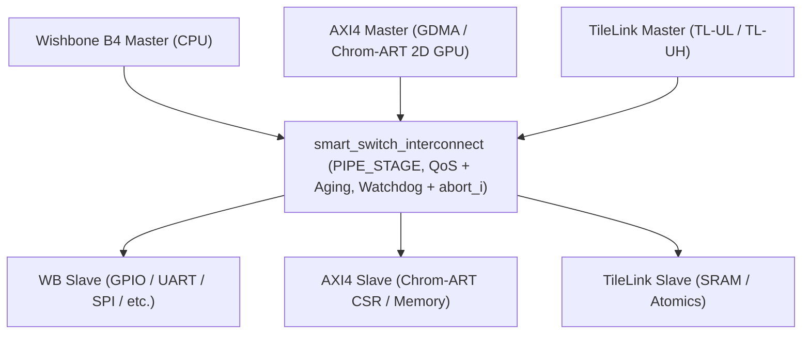

# Tian's SystemVerilog IP Core Collection

A 100% pure, synthesizable **IEEE 1800-2017 SystemVerilog** SoC IP & interconnect library verified cleanly under **Verilator `-Wall`** (`31` lint top-level modules, `19` self-checking testbenches) and packaged for **FuseSoC** (`sv_ip_library.core`).

---

## Key Highlights

- **Tri-Bus Peripheral Wrapper Architecture**: Every peripheral core speaks a simple protocol-agnostic internal CSR/DMA handshake and ships with dedicated **Wishbone B4**, **AXI4 / AXI4-Lite**, and **TileLink TL-UL / TL-UH** wrappers plus a compile-time `*_top #(.BUS_TYPE(...))` selector.
- **Full Interconnect & Bridge Suite**:
  - Dedicated non-blocking crossbars (`wb_xbar`, `axi4_xbar`, `tl_xbar`) with QoS + anti-starvation aging arbitration (`rr_arbiter`), optional master/slave pipeline register slices (`wb_reg_slice`, `axi4_reg_slice`, `tl_reg_slice`), 4KB boundary violation `DECERR`, full 8-bit `a_source` 16-slot remapping on TileLink, and watchdog timeout protection.
  - All 6 pairwise protocol bridges (`wb_to_axi4`, `axi4_to_wb`, `wb_to_tl`, `tl_to_wb`, `axi4_to_tl`, `tl_to_axi4`) supporting single-beat, burst (`INCR`/`WRAP`/`FIXED`), decoupled `AW`/`W` arrival, partial strobes, and TL-UH atomics.
  - Heterogeneous **`smart_switch_interconnect`** bridging any mix of Wishbone, AXI4, and TileLink masters to any mix of slaves with optional `PIPE_STAGE`, dynamic AXI QoS propagation, `abort_i` timeout recovery, and performance counters.
  - Bidirectional 32 <-> 64-bit data width converters (`width_upsizer_downsizer`, `width_upsizer_32to64` with optional `WRITE_COMBINE` + `flush_i`).
- **Chrom-ART 2D GPU (`ips/16_gfx2d_dma`)**: Hardware 2D graphics & DMA2D engine supporting 8 modes (`M2M`, `M2M_PFC`, `M2M_BLEND`, `R2M`, `M2M_BLEND_FG`, `M2M_BLEND_BG`, `M2M_COLKEY`, 8-op `M2M_ROP`), 11 input color modes (`ARGB8888`..`A4`/`L4`), 6 output color modes + 2x2 Bayer dithering, dual 256 x 32-bit CLUT SRAMs (DMA autoload + direct CPU aperture), Porter-Duff Over alpha blending, 4KB burst splitting, `LWR` watermark IRQ, `SUSP`/`ABORT`, and `AMTCR` dead-time control.

---

## Heterogeneous SoC Architecture Example (`tb_soc_subsystem`)



---

## Repository Structure

```text
tians_ip_collection/
├── README.md
├── Makefile                         # Verilator lint (31 tops) & simulation (19 testbenches)
├── sv_ip_library.core               # FuseSoC CAPI=2 core manifest (open:soc:sv_peripherals_interconnect_suite:1.0.0)
├── filelists/
│   ├── common.f
│   ├── interconnect.f
│   ├── peripherals_all.f
│   └── sim_all.f
├── docs/
│   ├── 00_architecture_overview.md
│   ├── 01_bus_protocols_and_wrappers.md
│   ├── 02_interconnect_and_bridges.md
│   ├── 03_verification_and_integration.md
│   └── 04_chromart_2d_gpu_guide.md
├── common/
│   ├── pkg/                         # bus_pkg.sv, ip_common_pkg.sv
│   └── rtl/                         # skid_buffer.sv, rr_arbiter.sv, sync_fifo.sv, async_fifo.sv, crc_engine.sv, edge_detect.sv
├── interconnect/
│   ├── interfaces/                  # wb_if.sv, axi4_if.sv, tl_if.sv (with to_m2s / to_s2m helpers)
│   ├── slices/                      # wb_reg_slice.sv, axi4_reg_slice.sv, tl_reg_slice.sv
│   ├── adapters/                    # {wb,axi_lite,tl_ul}_to_csr.sv, mem_to_{wb,axi4,tl_uh}_master.sv
│   ├── bridges/                     # 6 pairwise WB <-> AXI4 <-> TL bridges
│   ├── crossbars/                   # wb_xbar.sv, axi4_xbar.sv, tl_xbar.sv
│   └── smart_switch/                # smart_switch_interconnect.sv, width_upsizer_downsizer.sv, width_upsizer_32to64.sv
├── ips/                             # 16 tri-bus peripheral & memory/graphics IPs (01..16)
└── tb/                              # Shared BFMs/RAM + SoC/crossbar/bridge system testbenches
```

---

## Interconnect & Infrastructure Catalogue

| Category | Modules | Highlights | Docs |
| :--- | :--- | :--- | :--- |
| **Packages & Primitives** | `bus_pkg`, `ip_common_pkg`, `rr_arbiter`, `skid_buffer`, `sync_fifo`, `async_fifo`, `crc_engine`, `edge_detect` | Packed structs, `axi_next_addr` / `axi_crosses_4kb` / `wb_next_addr`, aging QoS arbiter (`AGING_MAX`), zero-bubble skid buffer | [docs/00](docs/00_architecture_overview.md) |
| **Bus Interfaces & Slices** | `wb_if`, `axi4_if`, `tl_if`, `wb_reg_slice`, `axi4_reg_slice`, `tl_reg_slice` | `to_m2s()`/`to_s2m()` SV interfaces; parameterized `BYPASS` zero-bubble timing isolation slices | [docs/01](docs/01_bus_protocols_and_wrappers.md) |
| **Adapters & Bridges** | `{wb,axi_lite,tl_ul}_to_csr`, `mem_to_{wb,axi4,tl_uh}_master`, 6 bridges | Decoupled `AW`/`W`, INCR/WRAP/FIXED bursts, `abort_i` recovery, TL-UH atomics (`ADD`/`MIN`/`MAX`/`XOR`/`SWAP`...) | [docs/02](docs/02_interconnect_and_bridges.md) |
| **Crossbars & Smart Switch** | `wb_xbar`, `axi4_xbar`, `tl_xbar`, `smart_switch_interconnect`, `width_upsizer_downsizer`, `width_upsizer_32to64` | `PIPE_MASTER`/`PIPE_SLAVE`, 4KB `DECERR`, 16-slot 8-bit `a_source` remap, watchdog + `abort_i`, 32<->64 width conversion | [docs/02](docs/02_interconnect_and_bridges.md) |

---

## Peripheral, Memory, Connectivity & Graphics IP Catalogue (16 Cores)

| ID | Directory | Top Module | Description | Docs |
| :---: | :--- | :--- | :--- | :--- |
| `01` | `ips/01_uart_usart` | `uart_usart_top` | UART / synchronous USART controller with FIFOs & hardware flow control | [README](ips/01_uart_usart/doc/README.md) |
| `02` | `ips/02_spi` | `spi_top` | SPI master/slave controller with configurable clock polarity/phase & FIFOs | [README](ips/02_spi/doc/README.md) |
| `03` | `ips/03_i2c_i3c` | `i2c_i3c_top` | I2C / I3C controller with open-drain & push-pull timing | [README](ips/03_i2c_i3c/doc/README.md) |
| `04` | `ips/04_xspi_xip` | `xspi_xip_top` | Single/Dual/Quad/Octal xSPI flash controller with XiP support | [README](ips/04_xspi_xip/doc/README.md) |
| `05` | `ips/05_hyperram` | `hyperram_ctrl_top` | HyperBus / HyperRAM memory controller | [README](ips/05_hyperram/doc/README.md) |
| `06` | `ips/06_sdram_sram_nvsram` | `ext_mem_ctrl_top` | External SDRAM / SRAM / nvSRAM memory controller | [README](ips/06_sdram_sram_nvsram/doc/README.md) |
| `07` | `ips/07_nvpsram` | `nvpsram_ctrl_top` | Non-volatile PSRAM / low-pin-count PSRAM memory controller | [README](ips/07_nvpsram/doc/README.md) |
| `08` | `ips/08_gpio` | `gpio_top` | Multi-pin GPIO with split pad-ring (`_i`/`_o`/`_oe_o`/`_pull_*`), edge IRQs | [README](ips/08_gpio/doc/README.md) |
| `09` | `ips/09_i2s` | `i2s_top` | Full-duplex I2S audio transmitter/receiver | [README](ips/09_i2s/doc/README.md) |
| `10` | `ips/10_ledc` | `ledc_top` | Multi-channel PWM / LED dimming controller | [README](ips/10_ledc/doc/README.md) |
| `11` | `ips/11_jtag` | `jtag_top` | JTAG TAP / debug interface core | [README](ips/11_jtag/doc/README.md) |
| `12` | `ips/12_can` | `can_top` | CAN bus controller with frame filtering & error tracking | [README](ips/12_can/doc/README.md) |
| `13` | `ips/13_eth_mac` | `eth_mac_top` | Ethernet MAC with MII/RMII & hardware CRC32 (`crc_engine`) | [README](ips/13_eth_mac/doc/README.md) |
| `14` | `ips/14_dvi_tmds` | `dvi_tmds_top` | DVI/HDMI TMDS encoder & video timing generator | [README](ips/14_dvi_tmds/doc/README.md) |
| `15` | `ips/15_dma_gdma` | `gdma_top` | General-purpose scatter-gather DMA engine | [README](ips/15_dma_gdma/doc/README.md) |
| `16` | `ips/16_gfx2d_dma` | `gfx2d_dma_top` | Chrom-ART 2D GPU / DMA2D (11 ICM, 6 OCM, 2x2 Bayer dither, dual 256-entry CLUT, Porter-Duff blend, ColKey, 8-op ROP) | [README](ips/16_gfx2d_dma/doc/README.md) & [Guide](docs/04_chromart_2d_gpu_guide.md) |

---

## Quickstart: Lint, Simulate, & FuseSoC

```sh
# Clean previous Verilator build outputs
make clean

# Lint all 31 top-level RTL modules with Verilator --lint-only -Wall
make lint

# Build and run all 19 self-checking Verilator testbenches
make sim

# Run individual interconnect or IP testbenches
make tb_interconnect_bridges
make tb_crossbars_smart_switch
make tb_soc_subsystem
make tb_gfx2d_dma
```

For FuseSoC integration (`open:soc:sv_peripherals_interconnect_suite:1.0.0`), see [03_verification_and_integration.md](docs/03_verification_and_integration.md).
