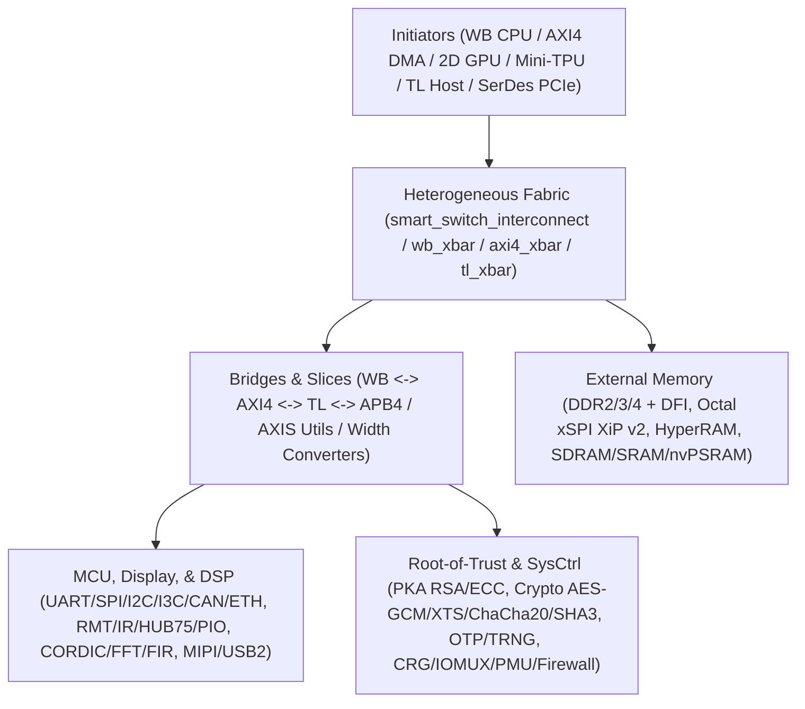

<a id="top"></a>

# SoC_IPs — Tian's SystemVerilog IP Core Collection

A 100% pure, synthesizable **IEEE 1800-2017 SystemVerilog** SoC IP, interconnect, DSP, security, & verification library targeting **FPGA prototyping** and **ASIC tape-out** (`Yosys` / OpenLane friendly), packaged for **FuseSoC** (`sv_ip_library.core`, `v3.0.0`).

**Language / 语言:** [English](#english) · [简体中文](#简体中文)

| Metric | Status | Scope |
| :--- | :---: | :--- |
| **Peripheral & System IPs** | `40` cores | `ips/01_uart_usart` .. `ips/40_usb2_otg` (Quad-Bus WB / AXI4 / TL / APB4) |
| **Tech Abstraction Primitives** | `8` cells | `common/rtl/tech/` (ICG, CDC sync, reset sync, IDDR/ODDR, SP/SDP SRAM, SerDes I/O) |
| **Verilator `-Wall` Lint Tops** | `95` clean | Interconnect fabrics, APB4, AXI4-Stream, tech cells, & all IP tops (`make lint_fast`) |
| **Self-Checking Testbenches** | `61` `[PASS]` | Per-TB minimal compile + `+seed=` constrained-random (`make sim_jobs`) |
| **Yosys Compatibility Scan** | `466` files | `0` errors via `scripts/check_yosys_compat.py` (`make check_yosys`) |
| **PIO Assembler Unit Tests** | `41` OK | Standalone Python 3 assembler/disassembler (`python3 tools/test_pioasm.py`) |
| **License** | Apache-2.0 | [LICENSE](LICENSE) |

---

## English

### Key Highlights

- **Quad-Bus Peripheral Architecture (`WB` / `AXI4` / `TileLink` / `APB4`)**: Every IP (`ips/01..40`) separates protocol-independent core logic (`csr_req_t`/`csr_rsp_t`, `mem_req_t`/`mem_rsp_t`) from selectable **Wishbone B4**, **AMBA AXI4/AXI4-Lite**, **TileLink TL-UL/TL-UH**, and **AMBA APB4** wrappers via a single `*_top #(.BUS_TYPE(...))` parameter (DMA-capable IPs expose `m_axi_*` master ports when `BUS_TYPE == BUS_APB`).
- **Yosys / FPGA / ASIC Tape-Out Abstraction (`common/rtl/tech/` & `make check_yosys`)**: Pure clock-only SRAM writes, explicit CDC/reset synchronizers, latch-free behavioral wrappers (`tech_icg`, `tech_cdc_sync`, `tech_rst_sync`, `tech_iddr`, `tech_oddr`, `tech_sram_sp`, `tech_sram_sdp`, `tech_serdes_io`) with clean `TARGET_ASIC` foundry macro hooks, verified across `466` RTL files (`0` errors) by [scripts/check_yosys_compat.py](scripts/check_yosys_compat.py).
- **Full Interconnect, APB4, AXI4-Stream, & Bridge Matrix (`interconnect/`)**:
  - Dedicated crossbars (`wb_xbar`, `axi4_xbar`, `tl_xbar`, `apb_xbar`) with QoS + anti-starvation aging arbitration (`rr_arbiter`), optional zero-bubble register slices (`{wb,axi4,tl,apb}_reg_slice`), 4KB boundary `DECERR` / illegal-burst `SLVERR`, 8-bit `a_source` remapping, and watchdog protection.
  - Pairwise bridges (`wb_to_axi4`, `axi4_to_wb`, `wb_to_tl`, `tl_to_wb`, `axi4_to_tl`, `tl_to_axi4`, `axi4_to_axil`, `axil_to_axi4`, `axi4_to_apb`, `wb_to_apb`, `tl_to_apb`, `apb_to_axi4`, `apb_to_wb`), AXI4 burst splitter & ID remapper (`axi4_burst_splitter`, `axi4_id_remap`), heterogeneous `smart_switch_interconnect` (w/ `PIPE_STAGE` + `abort_i` timeout recovery), and 32 <-> 64-bit width converters.
  - Complete flat-port **AXI4-Stream** utility library (`axis_register`, `axis_fifo`, `axis_async_fifo`, `axis_width_converter`, `axis_arb_mux`, `axis_demux`, `axi4_to_axis`, `axis_to_axi4`).
- **Library-Free UVM-Style Verification Kit (`tb/vkit/`)**: Weighted constrained-random generators, live protocol checkers (`WB`/`AXI4`/`TL`/`APB`), `csr_random_test`, sparse memory & scoreboards, `+seed=` / coverage reporting, plus `VKIT_USE_UVM` migration guidance in [docs/10_verification_methodology.md](docs/10_verification_methodology.md).

### Architecture Overview



### Complete 40-IP Catalogue

For full lint tops, parameter summaries, and testbench mappings, see [docs/08_ip_catalog.md](docs/08_ip_catalog.md).

| Group | IDs | IP Cores & Datasheets |
| :--- | :---: | :--- |
| **Serial, Connectivity & Audio/PWM** | `01..03`, `08..13` | [01 UART/USART](ips/01_uart_usart/doc/README.md) · [02 SPI](ips/02_spi/doc/README.md) · [03 I2C/I3C](ips/03_i2c_i3c/doc/README.md) · [08 GPIO](ips/08_gpio/doc/README.md) · [09 I2S](ips/09_i2s/doc/README.md) · [10 LEDC](ips/10_ledc/doc/README.md) · [11 JTAG](ips/11_jtag/doc/README.md) · [12 CAN-FD](ips/12_can/doc/README.md) · [13 1G ETH MAC](ips/13_eth_mac/doc/README.md) |
| **External Memory Controllers** | `04..07`, `38` | [04 xSPI XiP v2 (8D-DTR/OTFAD)](ips/04_xspi_xip/doc/README.md) · [05 HyperRAM](ips/05_hyperram/doc/README.md) · [06 SDRAM/SRAM/nvSRAM](ips/06_sdram_sram_nvsram/doc/README.md) · [07 NV-PSRAM](ips/07_nvpsram/doc/README.md) · [38 DDR2/DDR3/DDR4 + DFI/Soft-PHY](ips/38_ddr_ctrl/doc/README.md) |
| **DMA, Display, 2D GPU & AI/NPU** | `14..17`, `20` | [14 DVI/TMDS](ips/14_dvi_tmds/doc/README.md) · [15 GDMA2 (1..16ch 2D/3D/SG/CRC32)](ips/15_dma_gdma/doc/README.md) · [16 Chrom-ART 2D GPU](ips/16_gfx2d_dma/doc/README.md) · [17 Mini-TPU NPU (NVFP4/FP8/INT8)](ips/17_mini_tpu/doc/README.md) · [20 HUB75/HUB75E Matrix](ips/20_hub75/doc/README.md) |
| **Pulse, IR, Parallel, FlexBus & PIO** | `18..19`, `21..23` | [18 RMT + LED Encoders](ips/18_rmt/doc/README.md) · [19 IR TX/RX (11 Protocols + Learn)](ips/19_ir_txrx/doc/README.md) · [21 Parallel IF (i8080/6800/SRAM/FT245/DVP)](ips/21_par_if/doc/README.md) · [22 FlexBus (8-CS Ext Bus)](ips/22_flex_ext_bus/doc/README.md) · [23 PIO Engine + `pioasm`](ips/23_pio_engine/doc/README.md) |
| **Timers, IntC, WDT/RTC, Storage** | `24..27` | [24 Timer/PWM + `timer_group`](ips/24_timer_pwm/doc/README.md) · [25 RISC-V PLIC + CLINT/ACLINT](ips/25_plic_clint/doc/README.md) · [26 Windowed WDT + Backup RTC](ips/26_wdt_rtc/doc/README.md) · [27 SD/SDIO/eMMC SDR/DDR](ips/27_sdmmc/doc/README.md) |
| **Cryptography & Root-of-Trust** | `28`, `32..33` | [28 Crypto v2 (AES-GCM/XTS/ChaCha20-Poly1305/SHA-2/3)](ips/28_crypto/doc/README.md) · [32 PKA (RSA-4096/X25519/P-256)](ips/32_pka/doc/README.md) · [33 OTP/eFuse + TRNG 800-90B + Key-Vault](ips/33_otp_trng_keymgr/doc/README.md) |
| **DSP & Signal Acceleration** | `29..31` | [29 Multi-Mode CORDIC](ips/29_cordic/doc/README.md) · [30 Complex Radix-2 FFT/IFFT (16..1024, BFP)](ips/30_fft/doc/README.md) · [31 Multi-Ch FIR/Folded-FIR/Biquad IIR/Vector DSP](ips/31_dsp_filter/doc/README.md) |
| **MIPI, SoC Infra, IPC/Debug & SerDes/USB** | `34..37`, `39..40` | [34 MIPI CSI-2 RX (PPI/Soft-DPHY)](ips/34_mipi_csi2_rx/doc/README.md) · [35 MIPI DSI-2 TX (PPI/Soft-DPHY)](ips/35_mipi_dsi_tx/doc/README.md) · [36 SoC SysCtrl (CRG/IOMUX/PMU/Firewall/ECC)](ips/36_soc_sysctrl/doc/README.md) · [37 IPC Mailbox + RISC-V DM + ADC/PDM](ips/37_ipc_debug/doc/README.md) · [39 Unified SerDes (PCIe/USB3/SATA/DP)](ips/39_serdes_combo/doc/README.md) · [40 USB 2.0 OTG (UTMI+/ULPI)](ips/40_usb2_otg/doc/README.md) |

### Repository Structure

```text
tians_ip_collection/
├── README.md
├── CHANGELOG.md                     # Release history (v1.0.0 -> v3.0.0)
├── Makefile                         # Scalable per-TB build (`95` lint tops, `61` TBs)
├── sv_ip_library.core               # FuseSoC CAPI=2 manifest (v3.0.0)
├── scripts/
│   ├── gen_fusesoc_core.py          # Regenerates sv_ip_library.core from filelists & Makefile
│   └── check_yosys_compat.py        # Static Yosys/OpenLane/ASIC RTL compatibility checker
├── tools/pioasm.py                  # Python 3 PIO assembler/disassembler (+ test_pioasm.py)
├── filelists/
│   ├── common.f                     # common/pkg/*, common/rtl/tech/filelist.f, common/rtl/*
│   ├── interconnect.f               # common.f, interconnect/apb/filelist.f, interconnect/axis/filelist.f
│   ├── peripherals_all.f            # interconnect.f + all ips/01..40/filelist.f fragments
│   └── sim_all.f                    # Shared BFMs + all 61 testbench sources
├── docs/                            # Guides 00..11 + full catalog (08_ip_catalog.md)
├── common/                          # Packages, FIFOs, skid_buffer, rr_arbiter, crc_engine, tech/
├── interconnect/                    # Interfaces, slices, adapters, bridges, crossbars, smart_switch, apb/, axis/
├── ips/01_uart_usart .. 40_usb2_otg/ # Each: rtl/, tb/, doc/README.md, filelist.f
└── tb/                              # common/ BFMs, vkit/ verification kit, fabric/audit/tech/SoC TBs
```

### Documentation & Guides

- [docs/08_ip_catalog.md](docs/08_ip_catalog.md) — Master catalog of all 40 IPs, tech cells, wrappers, and testbenches
- [CHANGELOG.md](CHANGELOG.md) — Version history (`v1.0.0` baseline through `v3.0.0`)
- [00 Architecture Overview](docs/00_architecture_overview.md) · [01 Bus Protocols & Wrappers](docs/01_bus_protocols_and_wrappers.md) · [02 Interconnect & Bridges](docs/02_interconnect_and_bridges.md) · [03 Verification & Integration](docs/03_verification_and_integration.md)
- [04 Chrom-ART 2D GPU Guide](docs/04_chromart_2d_gpu_guide.md) · [05 Mini-TPU/NPU Guide](docs/05_mini_tpu_npu_guide.md) · [06 APB4 Fabric Guide](docs/06_apb_fabric_guide.md) · [07 GDMA2 Guide](docs/07_dma_guide.md)
- [09 Audit Review Findings](docs/09_review_findings.md) · [10 Verification Methodology (`vkit`)](docs/10_verification_methodology.md) · [11 Yosys, FPGA, & ASIC Porting Guide](docs/11_yosys_fpga_asic_guide.md)

### Quickstart: Lint, Simulate, & FuseSoC

```sh
# Clean previous build artifacts (build/, obj_dir/, work/)
make clean

# Verify filelists, FuseSoC manifest, and Yosys/ASIC synthesis rules (466 RTL files)
make check_lists
make check_yosys

# Lint all 95 top-level RTL modules with Verilator --lint-only -Wall
make lint_fast     # or: make lint

# Build and run all 61 self-checking Verilator testbenches (per-TB minimal compile)
make sim_jobs      # or: make sim

# Run individual testbenches or PIO assembler unit tests
make tb_soc_subsystem
make tb_vkit_axi_xbar_rand SIMARGS="+seed=7"
python3 tools/test_pioasm.py
```

For **FuseSoC** integration (`open:soc:sv_peripherals_interconnect_suite:3.0.0`), see [docs/03_verification_and_integration.md](docs/03_verification_and_integration.md).

---

## 简体中文

### 项目简介与核心特性

本项目是一套 100% 纯可综合的 **IEEE 1800-2017 SystemVerilog** 片上系统（SoC）IP 核、互联总线矩阵、数字信号处理（DSP）、安全加解密与验证基础设施库，面向 **FPGA 原型验证** 与 **ASIC 流片（兼容 Yosys / OpenLane）** 设计，并提供完整 **FuseSoC** 封装（[sv_ip_library.core](sv_ip_library.core)，`v3.0.0`）。

- **四总线统一外设封装（`WB` / `AXI4` / `TileLink` / `APB4`）**：所有外设与加速核（`ips/01..40`）均采用总线无关核心逻辑（`csr_req_t`/`csr_rsp_t`、`mem_req_t`/`mem_rsp_t`），并通过 `*_top #(.BUS_TYPE(...))` 在编译期选择 **Wishbone B4**、**AMBA AXI4/AXI4-Lite**、**TileLink TL-UL/TL-UH** 或 **AMBA APB4** 接口（带 DMA 主端口的外设在 `BUS_APB` 模式下自动使用 AXI4 `m_axi_*` 主端口）。
- **Yosys / FPGA / ASIC 工艺抽象层（`common/rtl/tech/` 与 `make check_yosys`）**：提供 8 个面向综合与流片的基础原语（`tech_icg` 门控时钟、`tech_cdc_sync` 多级同步器、`tech_rst_sync` 复位同步器、`tech_iddr`/`tech_oddr`、纯时钟写字节使能可推断单双口 SRAM `tech_sram_sp`/`tech_sram_sdp`、软 SerDes I/O `tech_serdes_io`），支持通过 `TARGET_ASIC` 宏平滑替换为晶圆厂标准单元/SRAM 宏，全库 `466` 个 RTL 文件已通过 [scripts/check_yosys_compat.py](scripts/check_yosys_compat.py) 静态检查（`0` 错误）。
- **完整的片上互联总线与桥接体系（`interconnect/`）**：
  - 高并发无阻塞交叉开关矩阵（`wb_xbar`、`axi4_xbar`、`tl_xbar`、`apb_xbar`），内置带 QoS 与防饿死老化仲裁的 `rr_arbiter`、零气泡寄存器切片（`{wb,axi4,tl,apb}_reg_slice`）、4KB 边界 `DECERR` / 非法突发 `SLVERR` 检测、全 8 位 TileLink `a_source` 映射及看门狗超时保护。
  - 全双工协议桥（WB / AXI4 / AXI4-Lite / TileLink / APB4 互转）、AXI4 突发拆分与 ID 重映射（`axi4_burst_splitter`、`axi4_id_remap`）、异构智能交换矩阵 `smart_switch_interconnect`（支持 `PIPE_STAGE` 流水线与 `abort_i` 超时恢复），以及 32/64 位双向位宽转换器。
  - 完备的扁平端口 **AXI4-Stream** 工具集（`axis_register`、`axis_fifo` 帧缓存、`axis_async_fifo` 跨时钟域、`axis_width_converter`、`axis_arb_mux`、`axis_demux`、`axi4_to_axis`、`axis_to_axi4`）。
- **免 UVM 库约束随机验证套件（`tb/vkit/`）**：在本地仅安装 Verilator 5.054 的环境下，提供类 UVM 面向对象验证框架（驱动器、监视器、记分板、协议实时检查器、`csr_random_test`、覆盖率统计与 `+seed=` 种子支持），并在 [docs/10_verification_methodology.md](docs/10_verification_methodology.md) 中提供商业仿真器 `VKIT_USE_UVM` 迁移指南。

### 40 个 IP 核分类总览表

完整的综合顶层列表、参数说明及测试平台映射请查阅 [docs/08_ip_catalog.md](docs/08_ip_catalog.md)。

| 分类 | 编号 | IP 核与数据手册链接 |
| :--- | :---: | :--- |
| **基础串口、低速总线与音频/网络** | `01..03`, `08..13` | [01 UART/USART](ips/01_uart_usart/doc/README.md) · [02 SPI](ips/02_spi/doc/README.md) · [03 I2C/I3C](ips/03_i2c_i3c/doc/README.md) · [08 GPIO](ips/08_gpio/doc/README.md) · [09 I2S](ips/09_i2s/doc/README.md) · [10 LEDC](ips/10_ledc/doc/README.md) · [11 JTAG](ips/11_jtag/doc/README.md) · [12 CAN-FD](ips/12_can/doc/README.md) · [13 千兆以太网 MAC](ips/13_eth_mac/doc/README.md) |
| **外部存储控制器** | `04..07`, `38` | [04 xSPI XiP v2（支持 8D-DTR/DQS 与 OTFAD 实时解密）](ips/04_xspi_xip/doc/README.md) · [05 HyperRAM](ips/05_hyperram/doc/README.md) · [06 SDRAM/SRAM/nvSRAM](ips/06_sdram_sram_nvsram/doc/README.md) · [07 NV-PSRAM](ips/07_nvpsram/doc/README.md) · [38 DDR2/DDR3/DDR4 + DFI 与软 PHY](ips/38_ddr_ctrl/doc/README.md) |
| **DMA、显示、2D GPU 与 AI 加速** | `14..17`, `20` | [14 DVI/TMDS](ips/14_dvi_tmds/doc/README.md) · [15 GDMA2（1..16通道 1D/2D/3D 链表散聚与 CRC32）](ips/15_dma_gdma/doc/README.md) · [16 Chrom-ART 2D GPU](ips/16_gfx2d_dma/doc/README.md) · [17 Mini-TPU 神经网络加速器（NVFP4/FP8/INT8）](ips/17_mini_tpu/doc/README.md) · [20 HUB75/HUB75E 点阵屏控制器](ips/20_hub75/doc/README.md) |
| **脉冲红外、并行接口与可编程 IO** | `18..19`, `21..23` | [18 RMT 多通道脉冲与灯带编码器](ips/18_rmt/doc/README.md) · [19 红外收发器（11 种协议/学习/唤醒）](ips/19_ir_txrx/doc/README.md) · [21 可编程并行接口（i8080/6800/SRAM/FT245/DVP）](ips/21_par_if/doc/README.md) · [22 FlexBus 8 片选外部总线](ips/22_flex_ext_bus/doc/README.md) · [23 可编程 IO 引擎 + `pioasm` 汇编器](ips/23_pio_engine/doc/README.md) |
| **高级定时器、中断、看门狗与 SD** | `24..27` | [24 高级控制定时器/PWM + `timer_group`](ips/24_timer_pwm/doc/README.md) · [25 RISC-V PLIC + CLINT/ACLINT](ips/25_plic_clint/doc/README.md) · [26 窗口看门狗 + 备份域 RTC](ips/26_wdt_rtc/doc/README.md) · [27 SD/SDIO/eMMC SDR/DDR 控制器](ips/27_sdmmc/doc/README.md) |
| **密码安全与信任根（Root-of-Trust）** | `28`, `32..33` | [28 密码引擎 v2（AES-GCM/XTS/ChaCha20-Poly1305/SHA-2/3）](ips/28_crypto/doc/README.md) · [32 公钥加速器 PKA（RSA-4096/X25519/P-256）](ips/32_pka/doc/README.md) · [33 OTP/eFuse + TRNG 800-90B + 密钥库](ips/33_otp_trng_keymgr/doc/README.md) |
| **数字信号处理（DSP）加速套件** | `29..31` | [29 多模式 CORDIC 三角/双曲加速核](ips/29_cordic/doc/README.md) · [30 可配复数 FFT/IFFT 核（16..1024点/BFP）](ips/30_fft/doc/README.md) · [31 多通道 FIR/折叠 FIR/级联 Biquad IIR/向量滤波核](ips/31_dsp_filter/doc/README.md) |
| **MIPI 音视频、系统控制与高速 SerDes** | `34..37`, `39..40` | [34 MIPI CSI-2 接收（PPI/软 D-PHY）](ips/34_mipi_csi2_rx/doc/README.md) · [35 MIPI DSI-2 发送（PPI/软 D-PHY）](ips/35_mipi_dsi_tx/doc/README.md) · [36 SoC 系统基础设施（CRG/IOMUX/PMU/防火墙/SRAM ECC）](ips/36_soc_sysctrl/doc/README.md) · [37 多核邮箱自旋锁 + RISC-V DM 调试 + SAR-ADC/PDM](ips/37_ipc_debug/doc/README.md) · [39 多协议统一 SerDes 核（PCIe/USB3/SATA/DP）](ips/39_serdes_combo/doc/README.md) · [40 USB 2.0 OTG 控制器（UTMI+/ULPI）](ips/40_usb2_otg/doc/README.md) |

### 专题技术文档索引

- [docs/08_ip_catalog.md](docs/08_ip_catalog.md) — 全部 40 个 IP 核、工艺单元与测试平台总目录
- [CHANGELOG.md](CHANGELOG.md) — 版本更新日志（`v1.0.0` -> `v3.0.0`）
- [00 系统架构总览](docs/00_architecture_overview.md) · [01 总线协议与封装规范](docs/01_bus_protocols_and_wrappers.md) · [02 互联矩阵与协议桥](docs/02_interconnect_and_bridges.md) · [03 验证流程与 SoC 集成](docs/03_verification_and_integration.md)
- [04 Chrom-ART 2D GPU 指南](docs/04_chromart_2d_gpu_guide.md) · [05 Mini-TPU/NPU 指南](docs/05_mini_tpu_npu_guide.md) · [06 APB4 总线指南](docs/06_apb_fabric_guide.md) · [07 GDMA2 控制器指南](docs/07_dma_guide.md)
- [09 资深审查问题与修复清单](docs/09_review_findings.md) · [10 类 UVM 验证方法学 (`vkit`)](docs/10_verification_methodology.md) · [11 Yosys / FPGA / ASIC 流片移植指南](docs/11_yosys_fpga_asic_guide.md)

### 快速开始：静态检查、综合 Lint 与仿真验证

```sh
# 清理构建产物 (build/, obj_dir/, work/)
make clean

# 校验 filelist、FuseSoC 清单及全库 466 个 RTL 文件的 Yosys/ASIC 兼容性
make check_lists
make check_yosys

# 使用 Verilator --lint-only -Wall 并行检查全部 95 个顶层模块
make lint_fast     # 或: make lint

# 按测试平台最小依赖并行编译并运行全部 61 个自校验仿真
make sim_jobs      # 或: make sim

# 运行单个测试平台或 PIO 汇编器单元测试
make tb_soc_subsystem
make tb_ddr_ctrl SIMARGS="+seed=7"
python3 tools/test_pioasm.py
```

### 开源协议

基于 Apache-2.0 协议开源，详见 [LICENSE](LICENSE)。

[Back to Top / 返回顶部](#top)
