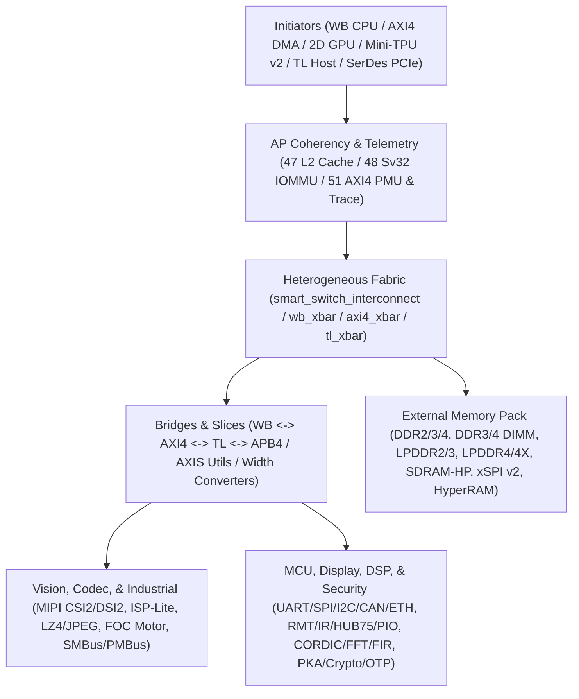

<a id="top"></a>

# SoC_IPs — Tian's SystemVerilog IP Core Collection

A 100% pure, synthesizable **IEEE 1800-2017 SystemVerilog** SoC IP, interconnect, memory, AI/vision, coherency, industrial, DSP, security, & verification library targeting **FPGA prototyping** and **ASIC tape-out** (`Yosys` / OpenLane friendly), packaged for **FuseSoC** (`sv_ip_library.core`, `v4.0.0`).

**Language / 语言:** [English](#english) · [简体中文](#简体中文)

| Metric | Status | Scope |
| :--- | :---: | :--- |
| **Peripheral & System IPs** | `51` cores | `ips/01_uart_usart` .. `ips/51_axi_pmu_trace` (Quad-Bus WB / AXI4 / TL / APB4) |
| **Tech Abstraction Primitives** | `8` cells | `common/rtl/tech/` (ICG, CDC sync, reset sync, IDDR/ODDR, SP/SDP SRAM, SerDes I/O) |
| **Verilator `-Wall` Lint Tops** | `106` clean | Interconnect fabrics, APB4, AXI4-Stream, tech cells, & all IP tops (`make lint`) |
| **Self-Checking Testbenches** | `73` `[PASS]` | Per-TB minimal compile + `+seed=` constrained-random (`make sim VJ=2`) |
| **Yosys Compatibility Scan** | `592` files | `0` errors via `scripts/check_yosys_compat.py` (`make check_yosys`) |
| **SW Drivers & Python Tools** | `12` C99 + `2` Py | `ips/*/sw/*.{h,c}` (`-std=c99 -Wall -Wextra`), `tpu_asm.py` (12 opcodes), `test_pioasm.py` (41 tests) (`make check_sw`) |
| **License** | Apache-2.0 | [LICENSE](LICENSE) |

---

## English

### Key Highlights

- **Quad-Bus Peripheral Architecture (`WB` / `AXI4` / `TileLink` / `APB4`)**: Every IP (`ips/01..51`) separates protocol-independent core logic (`csr_req_t`/`csr_rsp_t`, `mem_req_t`/`mem_rsp_t`) from selectable **Wishbone B4**, **AMBA AXI4/AXI4-Lite**, **TileLink TL-UL/TL-UH**, and **AMBA APB4** wrappers via a single `*_top #(.BUS_TYPE(...))` parameter (DMA-capable and memory-controller IPs expose `m_axi_*` / `axi_mem_*` AXI4 ports when `BUS_TYPE == BUS_APB`).
- **Complete Memory Pack (`ips/04..07`, `38`, `41..44`)**: Octal DTR/OTFAD `xSPI XiP v2`, `HyperRAM`, `SDRAM/SRAM/nvSRAM`, `NV-PSRAM`, `DDR2/3/4` (`ddr_ctrl`), `LPDDR2/3` (`lpddr3_ctrl`, 10b DDR CA, `REFPB`, CA train), Dual-Channel `LPDDR4/4X` (`lpddr4_ctrl`, `2x16b`, `MWR`, `DBI`, `FSP0/1` DVFS), Multi-Rank `DDR3/4 DIMM` (`ddr_dimm_ctrl`, I2C SPD + JC42.4 TSOD, RDIMM/LRDIMM/CAMM2, WL/RG training, `SECDED(72,64)`), and High-Throughput 4-Bank Open-Page `SDR SDRAM-HP` (`sdram_hp`, 16/32b). *(Note: LPDDR5, DDR5, Optane/DDR-T, and NVDIMM are out of scope.)*
- **AI, Vision, & Codec Pack (`ips/14`, `16..17`, `34..35`, `45..46`)**: **Mini-TPU / NPU v2.0** (`BF16`, `FP16`, `INT4` + block-scaled `INT4`, `OP_CONV2D`, `OP_POOL`, `OP_VEC_EW` incl. `RMSNorm` & 3-pass `Softmax`, ping-pong banks, `tpu_asm.py`), 6-stage AXI4-Stream **ISP-Lite** (`BLC`, `DPC`, Demosaic, 2A AWB/AE stats, 3x3 CCM, Gamma LUT, 2x2 downscale), Dual-Engine **LZ4 & 8x8 Baseline JPEG Codec**, **MIPI CSI-2 RX / DSI-2 TX**, **Chrom-ART 2D GPU**, and **DVI/TMDS**.
- **Application Processor Coherency, Telemetry, & Industrial Pack (`ips/47..51`)**: 4-Way Write-Back **L2 Cache** (`SECDED(39,32)`, way-locking, clean/inv maintenance, uncacheable window), **`Sv32` Hardware IOMMU / SMMU-Lite** (4KB/4MB, 16-entry TLB, 16 streams, fault FIFO), Non-Intrusive **AXI4 PMU & Triggered Trace SRAM** (8-bin latency histogram + atomic shadow snapshot), 3-Phase **Hardware FOC Motor Controller** (CORDIC, Clarke/Park, PI + circle limit, 7-seg SVPWM, 0-cycle fault), and **SMBus 3.0 / PMBus 1.3** (HW PEC CRC-8, `SMBALERT#` ARA `7'h0C`, ARP `7'h61`).
- **Yosys / FPGA / ASIC Tape-Out Abstraction (`common/rtl/tech/` & `make check_yosys`)**: Pure clock-only SRAM writes, explicit CDC/reset synchronizers, latch-free behavioral wrappers (`tech_icg`, `tech_cdc_sync`, `tech_rst_sync`, `tech_iddr`, `tech_oddr`, `tech_sram_sp`, `tech_sram_sdp`, `tech_serdes_io`) with clean `TARGET_ASIC` foundry macro hooks, verified across `592` RTL files (`0` errors) by [scripts/check_yosys_compat.py](scripts/check_yosys_compat.py).
- **Full Interconnect, APB4, AXI4-Stream, & Bridge Matrix (`interconnect/`)**:
  - Dedicated crossbars (`wb_xbar`, `axi4_xbar`, `tl_xbar`, `apb_xbar`) with QoS + anti-starvation aging arbitration (`rr_arbiter`), optional zero-bubble register slices (`{wb,axi4,tl,apb}_reg_slice`), 4KB boundary `DECERR` / illegal-burst `SLVERR`, 8-bit `a_source` remapping, and watchdog protection.
  - Pairwise bridges (`wb_to_axi4`, `axi4_to_wb`, `wb_to_tl`, `tl_to_wb`, `axi4_to_tl`, `tl_to_axi4`, `axi4_to_axil`, `axil_to_axi4`, `axi4_to_apb`, `wb_to_apb`, `tl_to_apb`, `apb_to_axi4`, `apb_to_wb`), AXI4 burst splitter & ID remapper (`axi4_burst_splitter`, `axi4_id_remap`), heterogeneous `smart_switch_interconnect` (w/ `PIPE_STAGE` + `abort_i` timeout recovery), and 32 <-> 64-bit width converters.
  - Complete flat-port **AXI4-Stream** utility library (`axis_register`, `axis_fifo`, `axis_async_fifo`, `axis_width_converter`, `axis_arb_mux`, `axis_demux`, `axi4_to_axis`, `axis_to_axi4`).
- **Library-Free UVM-Style Verification Kit (`tb/vkit/`)**: Weighted constrained-random generators, live protocol checkers (`WB`/`AXI4`/`TL`/`APB`), `csr_random_test`, sparse memory & scoreboards, `+seed=` / coverage reporting, plus `VKIT_USE_UVM` migration guidance in [docs/10_verification_methodology.md](docs/10_verification_methodology.md).

### Architecture Overview



### Complete 51-IP Catalogue

For full lint tops, parameter summaries, pad lists, and testbench mappings, see [docs/08_ip_catalog.md](docs/08_ip_catalog.md).

| Group | IDs | IP Cores & Datasheets |
| :--- | :---: | :--- |
| **Serial, Connectivity & Audio/PWM** | `01..03`, `08..13` | [01 UART/USART](ips/01_uart_usart/doc/README.md) · [02 SPI](ips/02_spi/doc/README.md) · [03 I2C/I3C](ips/03_i2c_i3c/doc/README.md) · [08 GPIO](ips/08_gpio/doc/README.md) · [09 I2S](ips/09_i2s/doc/README.md) · [10 LEDC](ips/10_ledc/doc/README.md) · [11 JTAG](ips/11_jtag/doc/README.md) · [12 CAN-FD](ips/12_can/doc/README.md) · [13 1G ETH MAC](ips/13_eth_mac/doc/README.md) |
| **Memory Pack (Flash, SRAM, SDR, DDR, LPDDR)** | `04..07`, `38`, `41..44` | [04 xSPI XiP v2 (8D-DTR/OTFAD)](ips/04_xspi_xip/doc/README.md) · [05 HyperRAM](ips/05_hyperram/doc/README.md) · [06 SDRAM/SRAM/nvSRAM](ips/06_sdram_sram_nvsram/doc/README.md) · [07 NV-PSRAM](ips/07_nvpsram/doc/README.md) · [38 DDR2/3/4](ips/38_ddr_ctrl/doc/README.md) · [41 LPDDR2/3](ips/41_lpddr3_ctrl/doc/README.md) · [42 LPDDR4/4X Dual-Ch](ips/42_lpddr4_ctrl/doc/README.md) · [43 DDR3/4 DIMM (SPD/ECC72)](ips/43_ddr_dimm_ctrl/doc/README.md) · [44 SDR SDRAM-HP](ips/44_sdram_hp/doc/README.md) |
| **DMA, Display, GPU, AI/NPU, Vision & Codec** | `14..17`, `20`, `45..46` | [14 DVI/TMDS](ips/14_dvi_tmds/doc/README.md) · [15 GDMA2 (1..16ch 2D/3D/SG/CRC32)](ips/15_dma_gdma/doc/README.md) · [16 Chrom-ART 2D GPU](ips/16_gfx2d_dma/doc/README.md) · [17 Mini-TPU v2 (BF16/FP16/INT4/Conv2D/Softmax)](ips/17_mini_tpu/doc/README.md) · [20 HUB75/HUB75E Matrix](ips/20_hub75/doc/README.md) · [45 ISP-Lite (Camera AXIS)](ips/45_isp_lite/doc/README.md) · [46 LZ4 & 8x8 JPEG Codec](ips/46_lz4_jpeg_codec/doc/README.md) |
| **Pulse, IR, Parallel, FlexBus & PIO** | `18..19`, `21..23` | [18 RMT + LED Encoders](ips/18_rmt/doc/README.md) · [19 IR TX/RX (11 Protocols + Learn)](ips/19_ir_txrx/doc/README.md) · [21 Parallel IF (i8080/6800/SRAM/FT245/DVP)](ips/21_par_if/doc/README.md) · [22 FlexBus (8-CS Ext Bus)](ips/22_flex_ext_bus/doc/README.md) · [23 PIO Engine + `pioasm`](ips/23_pio_engine/doc/README.md) |
| **Timers, IntC, WDT/RTC, Storage** | `24..27` | [24 Timer/PWM + `timer_group`](ips/24_timer_pwm/doc/README.md) · [25 RISC-V PLIC + CLINT/ACLINT](ips/25_plic_clint/doc/README.md) · [26 Windowed WDT + Backup RTC](ips/26_wdt_rtc/doc/README.md) · [27 SD/SDIO/eMMC SDR/DDR](ips/27_sdmmc/doc/README.md) |
| **Cryptography & Root-of-Trust** | `28`, `32..33` | [28 Crypto v2 (AES-GCM/XTS/ChaCha20-Poly1305/SHA-2/3)](ips/28_crypto/doc/README.md) · [32 PKA (RSA-4096/X25519/P-256)](ips/32_pka/doc/README.md) · [33 OTP/eFuse + TRNG 800-90B + Key-Vault](ips/33_otp_trng_keymgr/doc/README.md) |
| **DSP & Signal Acceleration** | `29..31` | [29 Multi-Mode CORDIC](ips/29_cordic/doc/README.md) · [30 Complex Radix-2 FFT/IFFT (16..1024, BFP)](ips/30_fft/doc/README.md) · [31 Multi-Ch FIR/Folded-FIR/Biquad IIR/Vector DSP](ips/31_dsp_filter/doc/README.md) |
| **MIPI, SoC Infra, IPC/Debug, SerDes & USB** | `34..37`, `39..40` | [34 MIPI CSI-2 RX (PPI/Soft-DPHY)](ips/34_mipi_csi2_rx/doc/README.md) · [35 MIPI DSI-2 TX (PPI/Soft-DPHY)](ips/35_mipi_dsi_tx/doc/README.md) · [36 SoC SysCtrl (CRG/IOMUX/PMU/Firewall/ECC)](ips/36_soc_sysctrl/doc/README.md) · [37 IPC Mailbox + RISC-V DM + ADC/PDM](ips/37_ipc_debug/doc/README.md) · [39 Unified SerDes (PCIe/USB3/SATA/DP)](ips/39_serdes_combo/doc/README.md) · [40 USB 2.0 OTG (UTMI+/ULPI)](ips/40_usb2_otg/doc/README.md) |
| **AP Coherency, Telemetry & Industrial/Power** | `47..51` | [47 4-Way L2 Cache (SECDED/PLRU)](ips/47_l2_cache/doc/README.md) · [48 Sv32 IOMMU / SMMU-Lite](ips/48_iommu/doc/README.md) · [49 Hardware FOC Motor Ctrl](ips/49_foc_motor/doc/README.md) · [50 SMBus 3.0 / PMBus 1.3](ips/50_smbus_pmbus/doc/README.md) · [51 AXI4 PMU & Triggered Trace](ips/51_axi_pmu_trace/doc/README.md) |

### Software Drivers, Microcode Assembler & Bring-Up Examples

All `ips/*/sw/` drivers compile cleanly with `-std=c99 -Wall -Wextra -fsyntax-only` (`make check_sw`). See [docs/12_software_drivers_and_bringup.md](docs/12_software_drivers_and_bringup.md) for the complete inventory and 4 end-to-end SoC bring-up recipes.

- **Mini-TPU v2 Toolchain (`ips/17_mini_tpu/sw/`)**: [`mini_tpu_regs.h`](ips/17_mini_tpu/sw/mini_tpu_regs.h) (64-bit ISA macros), [`tpu_inference_example.c`](ips/17_mini_tpu/sw/tpu_inference_example.c) (INT4 LLM + RMSNorm + Softmax, BF16 Conv2D + Pool, ping-pong GEMM), and [`tpu_asm.py`](ips/17_mini_tpu/sw/tpu_asm.py) (`--self-test` verifies 17 instructions across all 12 opcodes `0x0..0xB`).
- **Memory Pack Drivers**: [`41_lpddr3_ctrl/sw/`](ips/41_lpddr3_ctrl/sw/lpddr3_init_example.c) · [`42_lpddr4_ctrl/sw/`](ips/42_lpddr4_ctrl/sw/lpddr4_init_example.c) · [`43_ddr_dimm_ctrl/sw/`](ips/43_ddr_dimm_ctrl/sw/ddr_dimm_spd_example.c) · [`44_sdram_hp/sw/`](ips/44_sdram_hp/sw/sdram_hp_example.c)
- **Vision, Coherency, Industrial, & Telemetry Drivers**: [`45_isp_lite/sw/`](ips/45_isp_lite/sw/isp_camera_example.c) · [`46_lz4_jpeg_codec/sw/`](ips/46_lz4_jpeg_codec/sw/codec_lz4_jpeg_example.c) · [`47_l2_cache/sw/`](ips/47_l2_cache/sw/l2_cache_maint_example.c) · [`48_iommu/sw/`](ips/48_iommu/sw/iommu_pagetable_example.c) · [`49_foc_motor/sw/`](ips/49_foc_motor/sw/foc_motor_loop_example.c) · [`50_smbus_pmbus/sw/`](ips/50_smbus_pmbus/sw/smbus_pmbus_example.c) · [`51_axi_pmu_trace/sw/`](ips/51_axi_pmu_trace/sw/axi_pmu_profile_example.c)
- **PIO Assembler (`tools/pioasm.py`)**: Standalone Python 3 assembler/disassembler verified by 41 unit tests (`python3 tools/test_pioasm.py`).

### Repository Structure

```text
tians_ip_collection/
├── README.md
├── CHANGELOG.md                       # Release history (v1.0.0 -> v4.0.0)
├── Makefile                           # Per-TB build (`106` lint tops, `73` TBs, RAM-safe VJ=2)
├── sv_ip_library.core                 # FuseSoC CAPI=2 manifest (v4.0.0)
├── scripts/
│   ├── gen_fusesoc_core.py            # Regenerates sv_ip_library.core from filelists & Makefile
│   └── check_yosys_compat.py          # Static Yosys/OpenLane/ASIC RTL compatibility checker
├── tools/pioasm.py                    # Python 3 PIO assembler/disassembler (+ test_pioasm.py)
├── filelists/
│   ├── common.f                       # common/pkg/*, common/rtl/tech/filelist.f, common/rtl/*
│   ├── interconnect.f                 # common.f, interconnect/apb/filelist.f, interconnect/axis/filelist.f
│   ├── peripherals_all.f              # interconnect.f + all ips/01..51/filelist.f fragments
│   └── sim_all.f                      # Shared BFMs + all 73 testbench sources
├── docs/                              # Guides 00..12 + full catalog (08_ip_catalog.md)
├── common/                            # Packages, FIFOs, skid_buffer, rr_arbiter, crc_engine, tech/
├── interconnect/                      # Interfaces, slices, adapters, bridges, crossbars, smart_switch, apb/, axis/
├── ips/01_uart_usart .. 51_axi_pmu_trace/ # Each: rtl/, tb/, doc/README.md, filelist.f (+ sw/ on 17, 41..51)
└── tb/                                # common/ BFMs, vkit/ verification kit, fabric/audit/tech/SoC TBs
```

### Documentation & Guides

- [docs/08_ip_catalog.md](docs/08_ip_catalog.md) — Master catalog of all 51 IPs, tech cells, wrappers, and testbenches
- [docs/12_software_drivers_and_bringup.md](docs/12_software_drivers_and_bringup.md) — Bare-metal C99 driver inventory & end-to-end SoC bring-up recipes
- [CHANGELOG.md](CHANGELOG.md) — Version history (`v1.0.0` baseline through `v4.0.0`)
- [00 Architecture Overview](docs/00_architecture_overview.md) · [01 Bus Protocols & Wrappers](docs/01_bus_protocols_and_wrappers.md) · [02 Interconnect & Bridges](docs/02_interconnect_and_bridges.md) · [03 Verification & Integration](docs/03_verification_and_integration.md)
- [04 Chrom-ART 2D GPU Guide](docs/04_chromart_2d_gpu_guide.md) · [05 Mini-TPU/NPU Guide](docs/05_mini_tpu_npu_guide.md) · [06 APB4 Fabric Guide](docs/06_apb_fabric_guide.md) · [07 GDMA2 Guide](docs/07_dma_guide.md)
- [09 Audit Review Findings](docs/09_review_findings.md) · [10 Verification Methodology (`vkit`)](docs/10_verification_methodology.md) · [11 Yosys, FPGA, & ASIC Porting Guide](docs/11_yosys_fpga_asic_guide.md)

### Quickstart: Lint, Simulate, & FuseSoC

```sh
# Clean previous build artifacts (build/, obj_dir/, work/)
make clean

# Verify filelists, FuseSoC manifest, Yosys/ASIC rules (592 RTL files), and C/Python SW
make check_lists
make check_yosys
make check_sw

# Lint all 106 top-level RTL modules with Verilator --lint-only -Wall
make lint          # serial (low RAM) or: make lint_fast

# Build and run all 73 self-checking Verilator testbenches:
#   - Laptop / limited RAM (recommended default): serial TBs, VJ=2 threads per build
make sim VJ=2      # alias: make sim_serial
#   - Workstation (high RAM): parallel TBs
make sim_jobs JOBS=8 VJ=4

# Run individual testbenches
make tb_mini_tpu_v2
make tb_ddr_dimm_ctrl SIMARGS="+seed=7"
```

For **FuseSoC** integration (`open:soc:sv_peripherals_interconnect_suite:4.0.0`), see [docs/03_verification_and_integration.md](docs/03_verification_and_integration.md).

---

## 简体中文

### 项目简介与核心特性

本项目是一套 100% 纯可综合的 **IEEE 1800-2017 SystemVerilog** 片上系统（SoC）IP 核、互联总线矩阵、多代存储控制器、AI/视觉编解码、一致性与工业控制、数字信号处理（DSP）、安全加解密及验证基础设施库，面向 **FPGA 原型验证** 与 **ASIC 流片（兼容 Yosys / OpenLane）** 设计，并提供完整 **FuseSoC** 封装（[sv_ip_library.core](sv_ip_library.core)，`v4.0.0`）。

- **四总线统一外设封装（`WB` / `AXI4` / `TileLink` / `APB4`）**：所有外设与加速核（`ips/01..51`）均采用总线无关核心逻辑（`csr_req_t`/`csr_rsp_t`、`mem_req_t`/`mem_rsp_t`），并通过 `*_top #(.BUS_TYPE(...))` 在编译期选择 **Wishbone B4**、**AMBA AXI4/AXI4-Lite**、**TileLink TL-UL/TL-UH** 或 **AMBA APB4** 接口（带 DMA 主端口或高速存储端口的 IP 在 `BUS_APB` 模式下自动暴露 AXI4 `m_axi_*` / `axi_mem_*` 端口）。
- **全谱系存储控制器套件（`ips/04..07`、`38`、`41..44`）**：覆盖 Octal DTR/OTFAD `xSPI XiP v2`、`HyperRAM`、`SDRAM/SRAM/nvSRAM`、`NV-PSRAM`、`DDR2/3/4`（`ddr_ctrl`）、`LPDDR2/3`（`lpddr3_ctrl`，10b DDR CA、`REFPB` 与 CA 训练）、双通道 `LPDDR4/4X`（`lpddr4_ctrl`，`2x16b`、`MWR`、`DBI`、`FSP0/1` 无毛刺调频）、多 Rank `DDR3/4 DIMM`（`ddr_dimm_ctrl`，I2C SPD 自发现 + JC42.4 温控 2x 刷新、RDIMM/LRDIMM/CAMM2、Fly-By 写调平/读门训练、`SECDED(72,64)`）以及高吞吐 4-Bank 同页开启 `SDR SDRAM-HP`（`sdram_hp`，16/32 位）。*（注：LPDDR5、DDR5、Optane/DDR-T 与 NVDIMM 不在本库范围内。）*
- **AI、视觉与编解码套件（`ips/14`、`16..17`、`34..35`、`45..46`）**：**Mini-TPU / NPU v2.0**（新增 `BF16`、`FP16`、`INT4` 与块缩放 `INT4`、`OP_CONV2D`、`OP_POOL`、`OP_VEC_EW` 含 `RMSNorm` 与 3 遍 `Softmax`、双 Bank 乒乓缓存及 `tpu_asm.py` 汇编器）、6 级 AXI4-Stream **ISP-Lite**（`BLC`/`DPC`/去马赛克/2A AWB-AE 统计/3x3 CCM/Gamma LUT/2x2 下采样）、双引擎 **LZ4 与 8x8 Baseline JPEG 编解码器**、**MIPI CSI-2 RX / DSI-2 TX**、**Chrom-ART 2D GPU** 与 **DVI/TMDS**。
- **应用处理器一致性、遥测与工业控制套件（`ips/47..51`）**：4 路组相联写回 **L2 Cache**（`SECDED(39,32)`、路锁定、按地址/全量 Clean/Invalidate 与不可缓存窗口）、**`Sv32` 硬件 IOMMU / SMMU-Lite**（4KB/4MB 超级页、16 项 TLB、16 流隔离与故障 FIFO）、零侵入式 **AXI4 PMU 与触发式环形跟踪 SRAM**（8 桶延迟直方图与原子影子快照）、3 相 **硬件 FOC 电机控制加速器**（CORDIC、Clarke/Park、双路 PI + 圆形限幅、7 段 SVPWM 与 0 周期故障关断）及 **SMBus 3.0 / PMBus 1.3**（硬件 PEC CRC-8、`SMBALERT#` ARA `7'h0C`、ARP `7'h61`）。
- **Yosys / FPGA / ASIC 工艺抽象层（`common/rtl/tech/` 与 `make check_yosys`）**：提供 8 个面向综合与流片的基础原语（`tech_icg`、`tech_cdc_sync`、`tech_rst_sync`、`tech_iddr`/`tech_oddr`、可推断单双口 SRAM `tech_sram_sp`/`tech_sram_sdp`、`tech_serdes_io`），支持 `TARGET_ASIC` 宏替换晶圆厂硬核，全库 `592` 个 RTL 文件已通过 [scripts/check_yosys_compat.py](scripts/check_yosys_compat.py) 静态检查（`0` 错误）。
- **完整的片上互联总线与桥接体系（`interconnect/`）**：提供无阻塞交叉开关（`wb_xbar`、`axi4_xbar`、`tl_xbar`、`apb_xbar`）、全双工协议桥（WB / AXI4 / AXI4-Lite / TileLink / APB4 互转）、`smart_switch_interconnect` 异构矩阵、32/64 位位宽转换与完整 **AXI4-Stream** 工具集。
- **免 UVM 库约束随机验证套件（`tb/vkit/`）**：在本地 Verilator 5.054 环境下提供类 UVM 面向对象验证框架（驱动器、监视器、记分板、协议实时检查器、`csr_random_test` 与 `+seed=` 种子支持），详见 [docs/10_verification_methodology.md](docs/10_verification_methodology.md)。

### 51 个 IP 核分类总览表

完整的综合顶层列表、参数说明、管脚清单及测试平台映射请查阅 [docs/08_ip_catalog.md](docs/08_ip_catalog.md)。

| 分类 | 编号 | IP 核与数据手册链接 |
| :--- | :---: | :--- |
| **基础串口、低速总线与音频/网络** | `01..03`, `08..13` | [01 UART/USART](ips/01_uart_usart/doc/README.md) · [02 SPI](ips/02_spi/doc/README.md) · [03 I2C/I3C](ips/03_i2c_i3c/doc/README.md) · [08 GPIO](ips/08_gpio/doc/README.md) · [09 I2S](ips/09_i2s/doc/README.md) · [10 LEDC](ips/10_ledc/doc/README.md) · [11 JTAG](ips/11_jtag/doc/README.md) · [12 CAN-FD](ips/12_can/doc/README.md) · [13 千兆以太网 MAC](ips/13_eth_mac/doc/README.md) |
| **存储控制器套件（Flash / SRAM / SDR / DDR / LPDDR）** | `04..07`, `38`, `41..44` | [04 xSPI XiP v2（8D-DTR/OTFAD）](ips/04_xspi_xip/doc/README.md) · [05 HyperRAM](ips/05_hyperram/doc/README.md) · [06 SDRAM/SRAM/nvSRAM](ips/06_sdram_sram_nvsram/doc/README.md) · [07 NV-PSRAM](ips/07_nvpsram/doc/README.md) · [38 DDR2/3/4](ips/38_ddr_ctrl/doc/README.md) · [41 LPDDR2/3](ips/41_lpddr3_ctrl/doc/README.md) · [42 LPDDR4/4X 双通道](ips/42_lpddr4_ctrl/doc/README.md) · [43 DDR3/4 DIMM（SPD/ECC72）](ips/43_ddr_dimm_ctrl/doc/README.md) · [44 SDR SDRAM-HP](ips/44_sdram_hp/doc/README.md) |
| **DMA、显示、2D GPU、AI 与视觉编解码** | `14..17`, `20`, `45..46` | [14 DVI/TMDS](ips/14_dvi_tmds/doc/README.md) · [15 GDMA2（1..16通道 2D/3D/SG/CRC32）](ips/15_dma_gdma/doc/README.md) · [16 Chrom-ART 2D GPU](ips/16_gfx2d_dma/doc/README.md) · [17 Mini-TPU v2（BF16/FP16/INT4/Conv2D/Softmax）](ips/17_mini_tpu/doc/README.md) · [20 HUB75/HUB75E 点阵屏](ips/20_hub75/doc/README.md) · [45 ISP-Lite 相机流水线](ips/45_isp_lite/doc/README.md) · [46 LZ4 与 8x8 JPEG 编解码](ips/46_lz4_jpeg_codec/doc/README.md) |
| **脉冲红外、并行接口与可编程 IO** | `18..19`, `21..23` | [18 RMT 多通道脉冲与灯带编码器](ips/18_rmt/doc/README.md) · [19 红外收发器（11 种协议/学习/唤醒）](ips/19_ir_txrx/doc/README.md) · [21 可编程并行接口（i8080/6800/SRAM/FT245/DVP）](ips/21_par_if/doc/README.md) · [22 FlexBus 8 片选外部总线](ips/22_flex_ext_bus/doc/README.md) · [23 可编程 IO 引擎 + `pioasm` 汇编器](ips/23_pio_engine/doc/README.md) |
| **高级定时器、中断、看门狗与 SD** | `24..27` | [24 高级控制定时器/PWM + `timer_group`](ips/24_timer_pwm/doc/README.md) · [25 RISC-V PLIC + CLINT/ACLINT](ips/25_plic_clint/doc/README.md) · [26 窗口看门狗 + 备份域 RTC](ips/26_wdt_rtc/doc/README.md) · [27 SD/SDIO/eMMC SDR/DDR 控制器](ips/27_sdmmc/doc/README.md) |
| **密码安全与信任根（Root-of-Trust）** | `28`, `32..33` | [28 密码引擎 v2（AES-GCM/XTS/ChaCha20-Poly1305/SHA-2/3）](ips/28_crypto/doc/README.md) · [32 公钥加速器 PKA（RSA-4096/X25519/P-256）](ips/32_pka/doc/README.md) · [33 OTP/eFuse + TRNG 800-90B + 密钥库](ips/33_otp_trng_keymgr/doc/README.md) |
| **数字信号处理（DSP）加速套件** | `29..31` | [29 多模式 CORDIC 三角/双曲加速核](ips/29_cordic/doc/README.md) · [30 可配复数 FFT/IFFT 核（16..1024点/BFP）](ips/30_fft/doc/README.md) · [31 多通道 FIR/折叠 FIR/级联 Biquad IIR/向量滤波核](ips/31_dsp_filter/doc/README.md) |
| **MIPI 音视频、系统控制与高速 SerDes** | `34..37`, `39..40` | [34 MIPI CSI-2 接收（PPI/软 D-PHY）](ips/34_mipi_csi2_rx/doc/README.md) · [35 MIPI DSI-2 发送（PPI/软 D-PHY）](ips/35_mipi_dsi_tx/doc/README.md) · [36 SoC 系统基础设施（CRG/IOMUX/PMU/防火墙/SRAM ECC）](ips/36_soc_sysctrl/doc/README.md) · [37 多核邮箱自旋锁 + RISC-V DM 调试 + SAR-ADC/PDM](ips/37_ipc_debug/doc/README.md) · [39 多协议统一 SerDes 核（PCIe/USB3/SATA/DP）](ips/39_serdes_combo/doc/README.md) · [40 USB 2.0 OTG 控制器（UTMI+/ULPI）](ips/40_usb2_otg/doc/README.md) |
| **AP 一致性、总线遥测与工业电源控制** | `47..51` | [47 4路 L2 Cache（SECDED/PLRU）](ips/47_l2_cache/doc/README.md) · [48 Sv32 硬件 IOMMU](ips/48_iommu/doc/README.md) · [49 硬件 FOC 电机控制](ips/49_foc_motor/doc/README.md) · [50 SMBus 3.0 / PMBus 1.3](ips/50_smbus_pmbus/doc/README.md) · [51 AXI4 PMU 与触发式 Trace](ips/51_axi_pmu_trace/doc/README.md) |

### 软件驱动头文件、微码汇编器与裸机启动示例

所有 `ips/*/sw/` 下的 C99 驱动均通过 `-std=c99 -Wall -Wextra -fsyntax-only` 检查（`make check_sw`）。完整驱动清单与 4 套端到端 SoC 启动流程请参见 [docs/12_software_drivers_and_bringup.md](docs/12_software_drivers_and_bringup.md)。

- **Mini-TPU v2 工具链（`ips/17_mini_tpu/sw/`）**：[`mini_tpu_regs.h`](ips/17_mini_tpu/sw/mini_tpu_regs.h)（64 位指令编码宏）、[`tpu_inference_example.c`](ips/17_mini_tpu/sw/tpu_inference_example.c)（INT4 LLM + RMSNorm + Softmax、BF16 Conv2D + Pool、乒乓双缓冲 GEMM）与 [`tpu_asm.py`](ips/17_mini_tpu/sw/tpu_asm.py)（`--self-test` 验证全部 12 条操作码 `0x0..0xB`）。
- **存储控制器驱动示例**：[`41_lpddr3_ctrl/sw/`](ips/41_lpddr3_ctrl/sw/lpddr3_init_example.c) · [`42_lpddr4_ctrl/sw/`](ips/42_lpddr4_ctrl/sw/lpddr4_init_example.c) · [`43_ddr_dimm_ctrl/sw/`](ips/43_ddr_dimm_ctrl/sw/ddr_dimm_spd_example.c) · [`44_sdram_hp/sw/`](ips/44_sdram_hp/sw/sdram_hp_example.c)
- **视觉、一致性、工业与遥测驱动示例**：[`45_isp_lite/sw/`](ips/45_isp_lite/sw/isp_camera_example.c) · [`46_lz4_jpeg_codec/sw/`](ips/46_lz4_jpeg_codec/sw/codec_lz4_jpeg_example.c) · [`47_l2_cache/sw/`](ips/47_l2_cache/sw/l2_cache_maint_example.c) · [`48_iommu/sw/`](ips/48_iommu/sw/iommu_pagetable_example.c) · [`49_foc_motor/sw/`](ips/49_foc_motor/sw/foc_motor_loop_example.c) · [`50_smbus_pmbus/sw/`](ips/50_smbus_pmbus/sw/smbus_pmbus_example.c) · [`51_axi_pmu_trace/sw/`](ips/51_axi_pmu_trace/sw/axi_pmu_profile_example.c)
- **PIO 汇编器（`tools/pioasm.py`）**：独立 Python 3 汇编/反汇编工具，内置 41 项单元测试（`python3 tools/test_pioasm.py`）。

### 专题技术文档索引

- [docs/08_ip_catalog.md](docs/08_ip_catalog.md) — 全部 51 个 IP 核、工艺单元与测试平台总目录
- [docs/12_software_drivers_and_bringup.md](docs/12_software_drivers_and_bringup.md) — C99 裸机驱动清单与端到端 SoC 启动指南
- [CHANGELOG.md](CHANGELOG.md) — 版本更新日志（`v1.0.0` -> `v4.0.0`）
- [00 系统架构总览](docs/00_architecture_overview.md) · [01 总线协议与封装规范](docs/01_bus_protocols_and_wrappers.md) · [02 互联矩阵与协议桥](docs/02_interconnect_and_bridges.md) · [03 验证流程与 SoC 集成](docs/03_verification_and_integration.md)
- [04 Chrom-ART 2D GPU 指南](docs/04_chromart_2d_gpu_guide.md) · [05 Mini-TPU/NPU 指南](docs/05_mini_tpu_npu_guide.md) · [06 APB4 总线指南](docs/06_apb_fabric_guide.md) · [07 GDMA2 控制器指南](docs/07_dma_guide.md)
- [09 资深审查问题与修复清单](docs/09_review_findings.md) · [10 类 UVM 验证方法学 (`vkit`)](docs/10_verification_methodology.md) · [11 Yosys / FPGA / ASIC 流片移植指南](docs/11_yosys_fpga_asic_guide.md)

### 快速开始：静态检查、综合 Lint 与仿真验证

```sh
# 清理构建产物 (build/, obj_dir/, work/)
make clean

# 校验 filelist、FuseSoC 清单、592 个 RTL 文件的 Yosys 兼容性及全部 C/Python 驱动
make check_lists
make check_yosys
make check_sw

# 使用 Verilator --lint-only -Wall 检查全部 106 个顶层模块
make lint          # 串行低内存模式，或: make lint_fast

# 按测试平台最小依赖编译并运行全部 73 个自校验仿真：
#   - 笔记本 / 内存受限环境（推荐默认）：严格串行构建，单次编译限制 VJ=2 线程
make sim VJ=2      # 等价别名: make sim_serial
#   - 高内存工作站：并行运行多个测试平台
make sim_jobs JOBS=8 VJ=4

# 运行单个测试平台
make tb_mini_tpu_v2
make tb_ddr_dimm_ctrl SIMARGS="+seed=7"
```

### 开源协议

基于 Apache-2.0 协议开源，详见 [LICENSE](LICENSE)。

[Back to Top / 返回顶部](#top)
