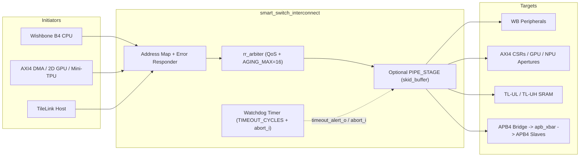

# Architecture Overview

This collection is organized into three strictly layered tiers written in pure synthesizable **IEEE 1800-2017 SystemVerilog** (verified with Verilator `-Wall` and packaged in [`sv_ip_library.core`](../sv_ip_library.core)):

1. **Common Infrastructure (`common/`)**
   - [`common/pkg/bus_pkg.sv`](../common/pkg/bus_pkg.sv): Standardized 32-bit packed request/response structs (`wb_m2s_t`/`wb_s2m_t`, `axi4_m2s_t`/`axi4_s2m_t`, `tl_m2s_t`/`tl_s2m_t`, `apb_m2s_t`/`apb_s2m_t`, `APB_S2M_IDLE`), protocol selector enum `bus_proto_e` (`BUS_WISHBONE`, `BUS_AXI4`, `BUS_TILELINK`, `BUS_APB`), AXI response constants (`AXI_RESP_DECERR`, etc.), and burst address helpers (`axi_next_addr`, `axi_crosses_4kb`, `wb_next_addr`).
   - [`common/pkg/ip_common_pkg.sv`](../common/pkg/ip_common_pkg.sv): Shared peripheral definitions and constants.
   - `common/rtl/`: Synthesizable primitives shared across interconnect and peripherals — `skid_buffer.sv` (zero-bubble forward/backward pipeline register), `rr_arbiter.sv` (QoS priority + bubble-safe lock retention + `AGING_MAX` anti-starvation promotion), `sync_fifo.sv`, `async_fifo.sv` (clock-only RAM writes, `ADDR_W>=1`), `crc_engine.sv`, `edge_detect.sv`, and `common/rtl/tech/` (8 Yosys/FPGA/ASIC technology abstraction cells: `tech_icg`, `tech_cdc_sync`, `tech_rst_sync`, `tech_iddr`, `tech_oddr`, `tech_sram_sp`, `tech_sram_sdp`, `tech_serdes_io` — see [11 Yosys/FPGA/ASIC Guide](11_yosys_fpga_asic_guide.md)).

2. **Interconnect, APB4, AXI-Stream, & Protocol Conversion (`interconnect/`)**
   - `interconnect/interfaces/`: SystemVerilog interfaces (`wb_if`, `axi4_if`, `tl_if`) exposing `master`/`slave` modports and `to_m2s()` / `to_s2m()` conversion helpers to pack/unpack structs cleanly at SoC boundaries.
   - `interconnect/apb/`: AMBA APB4 fabric — `apb_if.sv`, `apb_reg_slice.sv`, `apb_decoder.sv`, `apb_mux.sv`, and `apb_xbar.sv` (see [06 APB4 Fabric Guide](06_apb_fabric_guide.md)).
   - `interconnect/axis/`: Flat-port AXI4-Stream infrastructure — `axis_register.sv`, `axis_fifo.sv`, `axis_async_fifo.sv`, `axis_width_converter.sv`, `axis_arb_mux.sv`, `axis_demux.sv`, `axi4_to_axis.sv`, and `axis_to_axi4.sv`.
   - `interconnect/slices/`: Parameterizable `BYPASS` zero-bubble timing closure slices (`wb_reg_slice`, `axi4_reg_slice`, `tl_reg_slice`, `apb_reg_slice`).
   - `interconnect/adapters/`: Target CSR adapters (`wb_to_csr`, `axi_lite_to_csr`, `tl_ul_to_csr`, `apb_to_csr`), CSR-to-APB master (`csr_to_apb`), initiator DMA master adapters (`mem_to_wb_master`, `mem_to_axi4_master`, `mem_to_tl_uh_master` with synchronous `abort_i` recovery), and AXI4 burst/ID adapters (`axi4_burst_splitter`, `axi4_id_remap`).
   - `interconnect/bridges/`: Protocol translators covering WB/AXI4/TL (`wb_to_axi4`, `axi4_to_wb`, `wb_to_tl`, `tl_to_wb`, `axi4_to_tl`, `tl_to_axi4`), AXI4/AXI4-Lite (`axi4_to_axil`, `axil_to_axi4`), and APB4 (`axi4_to_apb`, `wb_to_apb`, `tl_to_apb`, `apb_to_axi4`, `apb_to_wb`).
   - `interconnect/crossbars/`: Protocol-native `M x N` non-blocking crossbars (`wb_xbar`, `axi4_xbar`, `tl_xbar`, `apb_xbar`) with QoS + aging arbitration, optional pipeline slices, and unmapped/error handling.
   - `interconnect/smart_switch/`: Heterogeneous any-to-any matrix (`smart_switch_interconnect`) plus 32 <-> 64-bit data width converters (`width_upsizer_downsizer`, `width_upsizer_32to64`).

3. **Quad-Bus Peripheral, Memory, AI/Vision, AP/Coherency, Industrial, & System IPs (`ips/01..51`)**
   - Every IP follows a modular split:
     - `*_core.sv` (+ helper submodules): Pure protocol-independent datapath, scratchpads/SRAMs, FSMs/sequencers, and CSR register file.
     - `*_{wb,axi,tl,apb}.sv`: Thin protocol wrappers instantiating the shared CSR slave and DMA master adapters from `interconnect/adapters/` (for `BUS_APB`, DMA-capable IPs expose their DMA master on `m_axi_o/m_axi_i` per the [APB DMA-master convention](06_apb_fabric_guide.md)).
     - `*_top.sv`: Unified top-level module parameterized by `BUS_TYPE` (`BUS_WISHBONE`, `BUS_AXI4`, `BUS_TILELINK`, `BUS_APB`) so integrators maintain one IP drop-in regardless of SoC fabric choice.
   - Full catalog of all 51 IPs (`01`..`51`) + `common/rtl/tech/` library: [08 IP Catalog](08_ip_catalog.md) · Software drivers & bare-metal bring-up recipes: [12 Software Drivers & Bring-Up](12_software_drivers_and_bringup.md).

## Multi-Master / Multi-Slave Heterogeneous Dataflow

