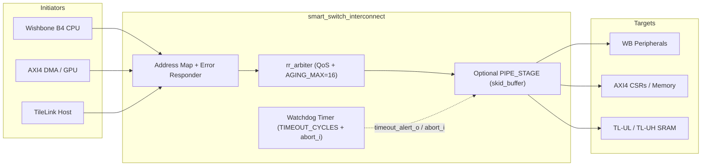

# Architecture Overview

This collection is organized into three strictly layered tiers written in pure synthesizable **IEEE 1800-2017 SystemVerilog** (verified with Verilator `-Wall` and packaged in `sv_ip_library.core`):

1. **Common Infrastructure (`common/`)**
   - `common/pkg/bus_pkg.sv`: Standardized 32-bit packed request/response structs (`wb_m2s_t`/`wb_s2m_t`, `axi4_m2s_t`/`axi4_s2m_t`, `tl_m2s_t`/`tl_s2m_t`), protocol selector enum `bus_proto_e` (`BUS_WISHBONE`, `BUS_AXI4`, `BUS_TILELINK`), AXI response constants (`AXI_RESP_DECERR`, etc.), and burst address helpers (`axi_next_addr`, `axi_crosses_4kb`, `wb_next_addr`).
   - `common/pkg/ip_common_pkg.sv`: Shared peripheral definitions and constants.
   - `common/rtl/`: Synthesizable primitives shared across interconnect and peripherals — `skid_buffer.sv` (zero-bubble forward/backward pipeline register), `rr_arbiter.sv` (QoS priority + lock retention + `AGING_MAX` anti-starvation promotion), `sync_fifo.sv`, `async_fifo.sv`, `crc_engine.sv`, and `edge_detect.sv`.

2. **Interconnect & Protocol Conversion (`interconnect/`)**
   - `interconnect/interfaces/`: SystemVerilog interfaces (`wb_if`, `axi4_if`, `tl_if`) exposing `master`/`slave` modports and `to_m2s()` / `to_s2m()` conversion helpers to pack/unpack structs cleanly at SoC boundaries.
   - `interconnect/slices/`: Parameterizable `BYPASS` zero-bubble timing closure slices (`wb_reg_slice`, `axi4_reg_slice`, `tl_reg_slice`) built on `skid_buffer`.
   - `interconnect/adapters/`: Target CSR adapters (`wb_to_csr`, `axi_lite_to_csr`, `tl_ul_to_csr`) and initiator DMA master adapters (`mem_to_wb_master`, `mem_to_axi4_master`, `mem_to_tl_uh_master` with synchronous `abort_i` recovery).
   - `interconnect/bridges/`: All 6 pairwise protocol translators (`wb_to_axi4`, `axi4_to_wb`, `wb_to_tl`, `tl_to_wb`, `axi4_to_tl`, `tl_to_axi4`).
   - `interconnect/crossbars/`: Protocol-native `M x N` non-blocking crossbars (`wb_xbar`, `axi4_xbar`, `tl_xbar`) with QoS + aging arbitration, optional pipeline slices, and unmapped/error handling.
   - `interconnect/smart_switch/`: Heterogeneous any-to-any matrix (`smart_switch_interconnect`) plus 32 <-> 64-bit data width converters (`width_upsizer_downsizer`, `width_upsizer_32to64`).

3. **Tri-Bus Peripheral & Memory/Graphics IPs (`ips/01..16`)**
   - Every IP follows a modular split:
     - `*_core.sv` (+ helper submodules such as `gfx2d_pfc.sv`, `gfx2d_blender.sv`, `gfx2d_clut_ram.sv`): Pure protocol-independent datapath, FSMs, and CSR register file.
     - `*_{wb,axi,tl}.sv`: Thin protocol wrapper instantiating the shared adapters from `interconnect/adapters/`.
     - `*_top.sv`: Unified top-level module parameterized by `BUS_TYPE` (`BUS_WISHBONE`, `BUS_AXI4`, `BUS_TILELINK`) so integrators maintain one IP drop-in regardless of SoC fabric choice.

## Multi-Master / Multi-Slave Heterogeneous Dataflow

