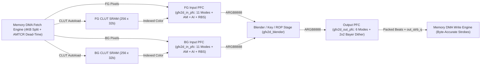

# Chrom-ART 2D GPU (`gfx2d_dma`) Architecture & Programming Guide

The `ips/16_gfx2d_dma` core is a pure IEEE 1800-2017 SystemVerilog hardware 2D graphics accelerator inspired by STMicroelectronics' **Chrom-ART Accelerator (DMA2D)**. It offloads rectangular fills, pixel-format conversion, indexed-color LUT lookup, anti-aliased glyph rendering, dual-plane Porter-Duff alpha blending, color-key transparency, and bitwise raster operations (ROP) from the host CPU, with dual-bus host adapters (CSR slave + DMA master) for **Wishbone B4**, **AXI4**, and **TileLink TL-UL/TL-UH**.

---

## 1. Pipeline Architecture

The engine processes scanlines in tiles of up to 16 pixels (`TILE_PX = 16`) per burst phase, splitting memory bursts at 4KB boundaries automatically and driving byte-accurate write strobes (`out_strb_q`) for sub-word (`RGB888`, `RGB565`, `L8`, etc.) and unaligned transfers.



### RTL Modules (`ips/16_gfx2d_dma/rtl/`)

| File | Module(s) | Responsibility |
| :--- | :--- | :--- |
| `gfx2d_pkg.sv` | `gfx2d_pkg` | Enums (`CR.MODE`, `CM`, `ROP`, `AM`), CSR offsets, `div255`, packing/unpacking helpers |
| `gfx2d_clut_ram.sv` | `gfx2d_clut_ram` | Dual-port 256 x 32-bit CLUT SRAM (DMA autoload write + CPU aperture + PFC lookup) |
| `gfx2d_pfc.sv` | `gfx2d_in_pfc`, `gfx2d_out_pfc` | 11-format input expansion, CLUT/alpha/RBS processing, 6-format output packing & 2x2 Bayer dithering |
| `gfx2d_blender.sv` | `gfx2d_blender` | Fixed-point Porter-Duff Over alpha blender, color-key mux, and 8-op ROP unit |
| `gfx2d_dma_core.sv` | `gfx2d_dma_core` | 16-pixel tile state machine, 4KB boundary burst splitter (`max_4kb_chunk_words`, `max_4kb_clut_words`), LWR IRQ, suspend/abort, AMTCR dead-time |
| `gfx2d_dma_wb.sv` | `gfx2d_dma_wb` | Wishbone B4 CSR slave + pipelined DMA master wrapper |
| `gfx2d_dma_axi.sv` | `gfx2d_dma_axi` | AXI4-Lite CSR slave + AXI4 burst DMA master wrapper |
| `gfx2d_dma_tl.sv` | `gfx2d_dma_tl` | TileLink TL-UL CSR slave + TL-UH burst DMA master wrapper |
| `gfx2d_dma_top.sv` | `gfx2d_dma_top` | Parameterizable top-level (`BUS_TYPE`: `WB`, `AXI`, `TL`) |

---

## 2. Operating Modes (`CR.MODE[2:0]`)

| `CR.MODE` | Mnemonic | Active Channels | Operation |
| :---: | :--- | :--- | :--- |
| `3'd0` | `M2M` | FG -> OUT | Raw memory-to-memory copy (supports 2D stride via `FGOR` / `OOR`) |
| `3'd1` | `M2M_PFC` | FG -> PFC -> OUT | Memory-to-memory with full Input & Output pixel format conversion |
| `3'd2` | `M2M_BLEND` | FG + BG -> Blender -> OUT | Dual-plane Porter-Duff Over alpha blending with separate FG/BG PFCs |
| `3'd3` | `R2M` | `OCOLR` -> OUT | Solid rectangle fill (supports direct packed `OCOLR` or `R2M_PFC` conversion via `OPFCCR[17]`) |
| `3'd4` | `M2M_BLEND_FG` | FG + `BGCOLR` -> Blender -> OUT | Blend FG image/glyph over fixed solid color `BGCOLR` (no BG DMA read) |
| `3'd5` | `M2M_BLEND_BG` | `FGCOLR` + BG -> Blender -> OUT | Blend fixed solid color `FGCOLR` over BG image (no FG DMA read) |
| `3'd6` | `M2M_COLKEY` | FG + BG -> ColKey -> OUT | Copy FG pixel to OUT unless FG RGB equals `COLKEY[23:0]`, in which case pass BG pixel |
| `3'd7` | `M2M_ROP` | FG + BG -> ROP -> OUT | Per-pixel bitwise Raster Operation controlled by `CR.ROP[2:0]` |

### Raster Operations (`CR.ROP[2:0]` when `CR.MODE == M2M_ROP`)

| `CR.ROP` | Operation | Formula (per RGB channel) |
| :---: | :--- | :--- |
| `3'd0` | `XOR` | `FG ^ BG` |
| `3'd1` | `AND` | `FG & BG` |
| `3'd2` | `OR` | `FG \| BG` |
| `3'd3` | `NOR` | `~(FG \| BG)` |
| `3'd4` | `NAND` | `~(FG & BG)` |
| `3'd5` | `INV_FG` | `~FG` |
| `3'd6` | `COPY_FG` | `FG` |
| `3'd7` | `AND_INV` | `FG & ~BG` |

---

## 3. Color Formats & Pixel Packing

### 3.1 Input Color Modes (`FGPFCCR.CM[3:0]` / `BGPFCCR.CM[3:0]`)

| `CM` | Format | Bits/px | Layout & Expansion Behavior |
| :---: | :--- | :---: | :--- |
| `4'd0` | `ARGB8888` | 32 | `[31:24]=A, [23:16]=R, [15:8]=G, [7:0]=B` |
| `4'd1` | `RGB888` | 24 | Packed 3-byte RGB (`A = 0xFF` before Alpha Mode) |
| `4'd2` | `RGB565` | 16 | `R[15:11], G[10:5], B[4:0]` bit-replicated to 8-bit (`A = 0xFF`) |
| `4'd3` | `ARGB1555` | 16 | `A[15]` (`0xFF`/`0x00`), `R[14:10], G[9:5], B[4:0]` |
| `4'd4` | `ARGB4444` | 16 | `A[15:12], R[11:8], G[7:4], B[3:0]` nibble-replicated |
| `4'd5` | `L8` | 8 | 8-bit index into 256-entry FG/BG CLUT SRAM |
| `4'd6` | `AL44` | 8 | `[7:4]` = 4-bit alpha (replicated), `[3:0]` = CLUT index (`0..15`) |
| `4'd7` | `AL88` | 16 | `[15:8]` = 8-bit alpha, `[7:0]` = CLUT index (`0..255`) |
| `4'd8` | `L4` | 4 | 4-bit CLUT index (two pixels packed per byte) |
| `4'd9` | `A8` | 8 | 8-bit alpha mask combined with `FGCOLR[23:0]` / `BGCOLR[23:0]` |
| `4'd10` | `A4` | 4 | 4-bit alpha mask combined with `FGCOLR[23:0]` / `BGCOLR[23:0]` (nibble packed) |

> [!NOTE]
> **4-bit Nibble Packing (`L4` and `A4`)**: Each byte packs two horizontally adjacent pixels in little-endian nibble order: **low nibble `[3:0]` is the even (first) pixel**, and **high nibble `[7:4]` is the odd (second) pixel**. This applies consistently to image fetches with arbitrary pixel alignment.

### 3.2 Input PFC Controls (`FGPFCCR` / `BGPFCCR`)

- **Alpha Mode (`AM[17:16]`)**:
  - `2'd0` (`NOP`): Retain pixel's decoded alpha `a_pix`.
  - `2'd1` (`REPLACE`): Override alpha with constant `PFCCR.ALPHA[31:24]`.
  - `2'd2` (`MULTIPLY`): Modulate alpha via exact `div255(a_pix * ALPHA)`.
- **Alpha Invert (`AI[20]`)**: When `1`, computes `255 - alpha` after `AM` selection.
- **Red/Blue Swap (`RBS[21]`)**: When `1`, swaps R and B channels (converting `ABGR` / `BGR` textures on the fly).

### 3.3 Output Color Modes (`OPFCCR.CM[2:0]`)

| `CM` | Format | Bits/px | Conversion Details |
| :---: | :--- | :---: | :--- |
| `3'd0` | `ARGB8888` | 32 | Full 8b/channel output (`AI` and `RBS` honored) |
| `3'd1` | `RGB888` | 24 | Tightly packed 3-byte output using byte strobes |
| `3'd2` | `RGB565` | 16 | Quantizes `(R,G,B)` to 5:6:5 (with optional 2x2 Bayer dithering) |
| `3'd3` | `ARGB1555` | 16 | `A = (a >= 128) ? 1 : 0`, `(R,G,B)` quantized 5:5:5 |
| `3'd4` | `ARGB4444` | 16 | Quantizes `(A,R,G,B)` to 4:4:4:4 |
| `3'd5` | `L8` | 8 | Fast integer luminance `Y = (2*R + 5*G + B) >> 3` |

- **Ordered 2x2 Bayer Dithering (`OPFCCR.DITHER_EN`, bit `[16]`)**: Applies the 2x2 Bayer matrix `[0, 2; 3, 1]` indexed by `(y[0], x[0])` prior to channel quantization (`RGB565`, `ARGB1555`, `ARGB4444`), eliminating banding on smooth alpha gradients.
- **`R2M_PFC` (`OPFCCR[17]`)**: In `R2M` mode, setting bit `[17]=1` treats `OCOLR[31:0]` as `ARGB8888` and passes it through `gfx2d_out_pfc` (applying `AI`, `RBS`, dithering, and output format conversion) instead of writing raw packed bits.

---

## 4. Blender & Stride Equations

### 4.1 Fixed-Point Porter-Duff `Over` Blending (`gfx2d_blender`)

Using the exact integer division helper `div255(x) = (x + 1 + (x >> 8)) >> 8`:

```text
a_out = sat8(a_fg + div255(a_bg * (255 - a_fg)))
```

For each RGB channel `c` (`R`, `G`, `B`):
- Fast path when `a_fg == 255`: `c_out = c_fg`.
- Fast path when `a_fg == 0`: `c_out = c_bg`.
- Fast path when `a_bg == 255`: `c_out = div255(c_fg * a_fg + c_bg * (255 - a_fg))`.
- General translucent case (`0 < a_fg < 255` and `0 <= a_bg < 255`, `den > 0`):
  ```text
  c_out = (c_fg * (a_fg * 255) + c_bg * (a_bg * (255 - a_fg)) + den / 2) / den
  ```
  where `den = a_fg * 255 + a_bg * (255 - a_fg)`. If `den == 0`, `c_out = 0`.

### 4.2 2D Stride & Offset Addressing

All offset registers (`FGOR`, `BGOR`, `OOR`) are specified in **pixels** (not bytes):

```text
row_step_bytes = (NLR.PL + OR) * bytes_per_pixel
```
For sub-byte formats (`L4`, `A4`, 4 bpp), nibble-accurate tracking advances source/byte pointers cleanly across odd widths and odd row offsets.

---

## 5. Complete CSR & CLUT Register Map (`0x000..0xBFC`)

| Offset | Name | Access | Reset | Bit Fields & Description |
| :--- | :--- | :---: | :---: | :--- |
| `0x000` | `CR` | RW | `0x0` | `[0]` `START` (self-clears on accept), `[1]` `SUSP` (pause DMA), `[2]` `ABORT` (safe terminate), `[8]` `TEIE`, `[9]` `TCIE`, `[10]` `TWIE`, `[11]` `CAEIE`, `[12]` `CTCIE`, `[13]` `CEIE`, `[18:16]` `MODE[2:0]`, `[21:19]` `ROP[2:0]` |
| `0x004` | `ISR` | RO | `0x0` | `[0]` `TEIF` (Transfer Err), `[1]` `TCIF` (Transfer Complete), `[2]` `TWIF` (Line Watermark), `[3]` `CAEIF` (CLUT Access Err), `[4]` `CTCIF` (CLUT Transfer Complete), `[5]` `CEIF` (Config Err), `[16]` `BUSY`, `[17]` `CLUT_BUSY`, `[18]` `SUSPENDED` |
| `0x008` | `IFCR` | WO | `0x0` | `[5:0]` Write-1-to-clear flags corresponding to `ISR[5:0]` |
| `0x00C` | `FGMAR` | RW | `0x0` | Foreground Memory Address Register |
| `0x010` | `FGOR` | RW | `0x0` | `[13:0]` Foreground Line Offset (pixels skipped after each scanline) |
| `0x014` | `BGMAR` | RW | `0x0` | Background Memory Address Register |
| `0x018` | `BGOR` | RW | `0x0` | `[13:0]` Background Line Offset (pixels skipped after each scanline) |
| `0x01C` | `FGPFCCR` | RW | `0x0` | `[3:0]` `CM`, `[4]` `CCM` (`0`: ARGB8888, `1`: RGB888), `[5]` `START` (CLUT DMA autoload), `[15:8]` `CS` (`entries - 1`), `[17:16]` `AM`, `[20]` `AI`, `[21]` `RBS`, `[31:24]` `ALPHA` |
| `0x020` | `FGCOLR` | RW | `0x0` | `[23:0]` Foreground RGB Color (for `A4`/`A8` font/mask & `M2M_BLEND_BG`) |
| `0x024` | `BGPFCCR` | RW | `0x0` | `[3:0]` `CM`, `[4]` `CCM`, `[5]` `START`, `[15:8]` `CS`, `[17:16]` `AM`, `[20]` `AI`, `[21]` `RBS`, `[31:24]` `ALPHA` |
| `0x028` | `BGCOLR` | RW | `0x0` | `[23:0]` Background RGB Color (for `A4`/`A8` & `M2M_BLEND_FG`) |
| `0x02C` | `FGCMAR` | RW | `0x0` | Foreground CLUT Memory Address Register (source for DMA autoload) |
| `0x030` | `BGCMAR` | RW | `0x0` | Background CLUT Memory Address Register (source for DMA autoload) |
| `0x034` | `OPFCCR` | RW | `0x0` | `[2:0]` `CM`, `[16]` `DITHER_EN` (2x2 Bayer), `[17]` `R2M_PFC`, `[20]` `AI`, `[21]` `RBS` |
| `0x038` | `OCOLR` | RW | `0x0` | `[31:0]` Output Color Register (fill value in `R2M`) |
| `0x03C` | `OMAR` | RW | `0x0` | `[31:0]` Output Memory Address Register |
| `0x040` | `OOR` | RW | `0x0` | `[13:0]` Output Line Offset (pixels skipped after each scanline) |
| `0x044` | `NLR` | RW | `0x0` | `[15:0]` `NL` (number of lines), `[29:16]` `PL` (pixels per line) |
| `0x048` | `LWR` | RW | `0x0` | `[15:0]` Line Watermark (`TWIF` fires when completed line index reaches `LWR`) |
| `0x04C` | `AMTCR` | RW | `0x0` | `[0]` `EN` (enable dead-time), `[15:8]` `DT` (idle cycles inserted between AHB/bus transactions) |
| `0x050` | `COLKEY` | RW | `0x0` | `[23:0]` 24-bit RGB Color Key for `M2M_COLKEY` |
| `0x054` | `PERF_PIXELS` | RO | `0x0` | Total pixels processed in the current/last transfer |
| `0x058` | `PERF_CYCLES` | RO | `0x0` | Total active bus cycles consumed in the current/last transfer |
| `0x400..0x7FC` | `FG_CLUT[0..255]` | RW | `0x0` | Direct CPU read/write aperture into 256 x 32-bit Foreground CLUT SRAM |
| `0x800..0xBFC` | `BG_CLUT[0..255]` | RW | `0x0` | Direct CPU read/write aperture into 256 x 32-bit Background CLUT SRAM |

---

## 6. Software Programming Recipes (C Examples)

### 6.1 Solid Rectangle Fill (`R2M` with `RGB565` Stride)

```c
// Clear flags and fill a (w x h) box at dst_addr in a framebuffer of width fb_stride
gfx_wr(GFX_IFCR, 0x3F);
gfx_wr(GFX_CR,   (3u << 16));                // MODE = 3 (R2M)
gfx_wr(GFX_OPFCCR, 2u);                      // OCM = 2 (RGB565)
gfx_wr(GFX_OCOLR,  0xF800u);                 // Red in RGB565
gfx_wr(GFX_OMAR,   dst_addr);
gfx_wr(GFX_OOR,    (fb_stride - w) & 0x3FFF);
gfx_wr(GFX_NLR,    ((w & 0x3FFF) << 16) | (h & 0xFFFF));
gfx_wr(GFX_CR,   (3u << 16) | 1u);           // START
while ((gfx_rd(GFX_ISR) & (1u << 1)) == 0) {} // Wait TCIF
```

### 6.2 CLUT DMA Autoload + Indexed Blit (`L4` / `L8`)

```c
// Load 16-entry RGB888 palette via DMA into FG CLUT SRAM
gfx_wr(GFX_IFCR, 0x3F);
gfx_wr(GFX_FGCMAR, palette_addr);
// CS = 15 (16 entries), CCM = 1 (RGB888), START = 1 (bit 5), CM = 8 (L4)
gfx_wr(GFX_FGPFCCR, ((15u) << 8) | (1u << 5) | (1u << 4) | 8u);
while ((gfx_rd(GFX_ISR) & (1u << 4)) == 0) {} // Wait CTCIF
gfx_wr(GFX_IFCR, (1u << 4));

// Convert L4 texture -> ARGB8888 framebuffer (M2M_PFC)
gfx_wr(GFX_CR, (1u << 16));                  // MODE = 1 (M2M_PFC)
gfx_wr(GFX_FGMAR, l4_src_addr);
gfx_wr(GFX_FGOR,  0);
gfx_wr(GFX_OPFCCR, 0u);                      // OCM = 0 (ARGB8888)
gfx_wr(GFX_OMAR,  dst_addr);
gfx_wr(GFX_OOR,   0);
gfx_wr(GFX_NLR,   (w << 16) | h);
gfx_wr(GFX_CR,    (1u << 16) | 1u);
```

### 6.3 Anti-Aliased Font Glyph Overlay (`A4` + `FGCOLR` + `M2M_BLEND`)

```c
// Blend A4 alpha-mask glyph colored with FGCOLR over BG RGB565 canvas
gfx_wr(GFX_IFCR, 0x3F);
gfx_wr(GFX_FGMAR, glyph_a4_addr);
gfx_wr(GFX_FGCOLR, 0x00FFD700u);             // Gold RGB888 glyph ink
// CM = 10 (A4), AM = 2 (MULTIPLY with constant alpha 0xFF)
gfx_wr(GFX_FGPFCCR, (0xFFu << 24) | (2u << 16) | 10u);

gfx_wr(GFX_BGMAR, canvas_addr);
gfx_wr(GFX_BGPFCCR, 2u);                     // BG CM = 2 (RGB565)
gfx_wr(GFX_OPFCCR, (1u << 16) | 2u);         // OCM = 2 (RGB565) + 2x2 Bayer Dither
gfx_wr(GFX_OMAR,  canvas_addr);
gfx_wr(GFX_NLR,   (w << 16) | h);
gfx_wr(GFX_CR,    (2u << 16) | 1u);          // MODE = 2 (M2M_BLEND) + START
```
