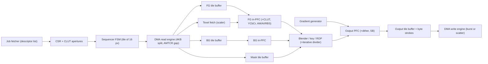

# 2D GPU / Chrom-ART-class Blitter (`gfx2d_dma`) — Gap Analysis, Normative Spec & Programming Guide

`ips/16_gfx2d_dma` is a clean-room, pure-SystemVerilog 2D accelerator in the class of ST's
**Chrom-ART Accelerator (DMA2D)** (STM32F4/F7 RM0090, H7 RM0433, U5 RM0456, H7R/S, N6 chapters).
It offloads fills, format conversion, CLUT look-up, glyph rendering, alpha blending, colour keying and
ROPs, and adds a few "stronger than reference" features (job chaining, flip/rotate, scaling, extra blend
operators, mask plane, gradient fill).  CSR slave + DMA master wrappers exist for **WB B4, AXI4, TL-UL/UH and APB** (APB slave + AXI4 master).

> [!NOTE]
> Source of the "ST behaviour" column: the public reference-manual chapters listed above (read via
> web search / vendor documentation; no vendor RTL or register text was copied).  Where the manual does
> not document rounding or an edge case the entry says **"undocumented"** and our choice is stated.
> Items marked **ext** are our extensions (new CSR offsets, default-off so reset behaviour is ST-like).

---

## 0. Gap analysis vs. ST DMA2D (honest status)

Legend: ✅ matches documented behaviour · ⚠ intentional / documented deviation · ➕ extension beyond reference · ❌ not implemented

| # | Feature | ST DMA2D behaviour | This core |
|--:|:--|:--|:--|
| 1 | Modes `CR.MODE` | 0 M2M, 1 M2M+PFC, 2 M2M+blend, 3 R2M, 4 M2M+blend fixed-colour FG, 5 M2M+blend fixed-colour BG (4/5 on H7/U5 class) | ✅ 0..5 identical numbering. ➕ 6 = colour-key blit, 7 = bitwise ROP |
| 2 | R2M | `OCOLR` written in the *output* format (raw, no PFC) | ✅ raw. ➕ `OPFCCR.R2M_PFC` treats `OCOLR` as ARGB8888 and runs the output PFC; ➕ gradient fill (`XCR.GRAD_EN`) |
| 3 | Fixed-colour blend (modes 4/5) | colour from `FGCOLR`/`BGCOLR`, alpha from `xxPFCCR.ALPHA` | ✅ fixed layer alpha := `ALPHA` (⚠ `AM` ignored for the fixed layer, `AI` honoured) |
| 4 | Input formats | ARGB8888, RGB888, RGB565, ARGB1555, ARGB4444, L8, AL44, AL88, L4, A8, A4 (`CM`=0..10) | ✅ exact encodings, ✅ expansion by MSB replication, ✅ ARGB1555 alpha 0/255, ✅ A4/AL44 alpha nibble replication |
| 5 | L4/A4 packing | two pixels per byte | ✅ even pixel = low nibble (little-endian nibble order), nibble-exact odd widths/offsets |
| 6 | YCbCr input (`CM`=11, `CSS`) | FG only; JPEG-codec **MCU 8x8-block layouts**, 4:4:4 / 4:2:2 / 4:2:0 | ⚠ ➕ FG-only, packed *line-based* 4:4:4 (3 B/px `Y,Cb,Cr`) and 4:2:2 (`Y0,Cb,Y1,Cr`); full-range BT.601 conversion (see §4.4). ❌ MCU-block layouts and 4:2:0 (`CSS`=2/3 → `CEIF`) |
| 7 | Newer 8-bit packed `ARGB2222/ABGR2222/RGBA2222/BGRA2222` (newer parts) | in/out on some newest parts | ➕ in (`CM`=12..15) and out (`OPFCCR.CM`=6..9); 2→8 bit by replication, 8→2 by truncation |
| 8 | CLUT | 256x32 per layer, entry ARGB8888 or RGB888 (`CCM`, alpha=0xFF), size `CS`=entries-1, auto-load by `xxPFCCR.START`, manual CPU write via CLUT aperture, `CTCIF` when load done, `CAEIF` on CPU access during auto-load | ✅ all; byte-accurate unaligned RGB888 tables; ⚠ CPU CLUT *writes* while a 2D transfer is running are ignored and also flag `CAEIF` (safe superset) |
| 9 | AM alpha mode | 00 keep, 01 replace with `ALPHA`, 10 `ALPHA x native / 255`, 11 reserved | ✅ (rounding: floor `/255`, undocumented in ST); `AM`=11 → `CEIF` |
| 10 | AI alpha invert / RBS red-blue swap | per layer input and on output | ✅ input FG/BG and output; for raw `M2M`/raw `R2M` no PFC is applied so AI/RBS do not act |
| 11 | Output formats | ARGB8888, RGB888, RGB565, ARGB1555, ARGB4444 | ✅ ; ➕ L8 (BT.601 luma), 2222 family; truncation of LSBs (ST: undocumented, truncation assumed); ARGB1555 alpha = `A[7]` |
| 12 | Output byte swap `OPFCCR.SB` (H7/U5 class) | swaps bytes in pairs in memory | ⚠ per-pixel: 16-bit formats swap the 2 bytes, 32-bit formats swap bytes within each 16-bit half (`[B1,B0,B3,B2]`); ignored for 8/24-bit formats |
| 13 | Blend equations | `aMUL=aFG*aBG/255; aOUT=aFG+aBG-aMUL; Cout=(CFG*aFG+CBG*aBG-CBG*aMUL)/aOUT` (rounding undocumented) | ✅ bit-exact integer form, §4.1 (floor division by default; ➕ `XCR.BLEND_RND` = round-to-nearest). `aOUT=0` → pixel `0x00000000` |
| 14 | Line offset `FGOR/BGOR/OOR` | pixels (bytes if `CR.LOM`=1 on newer parts) | ✅ pixels; ✅ `CR.LOM` (bit 6) = bytes |
| 15 | `NLR` | `PL` pixels, `NL` lines; `NL` reads back as lines remaining | ⚠ `NLR` is *not consumed* (re-usable, deliberate); remaining lines readable in `NLR_REM`. `PL=0`/`NL=0` → immediate `TCIF`, no bus traffic |
| 16 | Watermark `LWR`/`TWIF` | flag when the programmed line has been written | ✅ 0-based line index `LW` (`TWIF` after its last pixel is written); ⚠ reset value `0xFFFF` (never) instead of 0 |
| 17 | Abort / suspend | `ABORT` stops (no TC), `SUSP` pauses, clearing resumes | ✅ abort/suspend take effect at the next burst/tile boundary (≤16 px); `ISR[18]` shows suspended |
| 18 | Interrupt flags | TE, TC, TW, CAE, CTC, CE (+enables in `CR`) | ✅ same bit positions in `ISR`/`IFCR`/`CR.xxIE`; ✅ TE on any bus error (burst drained, `START` cleared); ✅ CE on invalid configuration, see §5.4 |
| 19 | AHB master timer `AMTCR` | dead time of `DT` clocks between bus accesses | ✅ `EN`,`DT[7:0]` gap inserted before **every** burst request |
| 20 | 4 KB / burst behaviour | AHB/AXI bursts | ✅ every burst is split at 4 KB; INCR bursts ≤16 beats |
| 21 | Job / command-list chaining | none (CPU re-programs every transfer) | ➕ linked descriptors in memory, per-job `TCIF`, list-done IRQ |
| 22 | Flip / rotate | none (Chrom-ART has no geometric transform) | ➕ output-address flip X/Y and 90° rotation (8 orientations) |
| 23 | Scaling | none | ➕ nearest / bilinear FG scaler (any format), 16.16 steps |
| 24 | Extra blend | none | ➕ ADD / SUB / MUL / SCREEN operators; ➕ A8 mask plane multiplied into FG alpha |
| 25 | Burst-level performance | 1 px/clk class | ✅ 1 px/clk in `GFX_PROC` on all fast paths (`M2M`, `R2M`, `M2M_PFC`, opaque BG/FG blend, `ADD`/`SUB`/`MUL`/`SCREEN`, `COLKEY`, `ROP`); ⚠ translucent-over-translucent `OVER` uses an 8-cycle restoring divider (zero combinational dividers) |

---

## 1. Architecture



Files (`ips/16_gfx2d_dma/rtl/`): `gfx2d_pkg` (enums, helpers) · `gfx2d_clut_ram` · `gfx2d_pfc` (`gfx2d_in_pfc`,
`gfx2d_out_pfc`) · `gfx2d_blender` · `gfx2d_dma_core` · wrappers `gfx2d_dma_wb/_axi/_tl/_apb` · `gfx2d_dma_top` (`BUS_TYPE`).

Core parameters (all default 1; 0 removes the logic and the feature reads as absent in `FEAT`):
`EN_JOBS`, `EN_XFORM`, `EN_SCALE`, `EN_EBLEND` (extra blend ops + mask plane), `EN_GRAD`, `EN_EXTFMT` (YCbCr + 2222 formats).

---

## 2. Operating modes

| `CR.MODE` | Name | Layers read | Operation |
|:-:|:--|:--|:--|
| 0 | `M2M` | FG | raw copy, no PFC; output pixel size = FG pixel size (FG ≥ 8 bpp, not YCbCr) |
| 1 | `M2M_PFC` | FG | FG PFC → output PFC |
| 2 | `M2M_BLEND` | FG+BG | FG PFC, BG PFC → blend → output PFC |
| 3 | `R2M` | – | fill with `OCOLR` (raw) / `OCOLR` through output PFC (`R2M_PFC`) / gradient |
| 4 | `M2M_BLEND_FG` | BG | fixed `FGCOLR`+`FGPFCCR.ALPHA` blended over memory BG |
| 5 | `M2M_BLEND_BG` | FG | memory FG blended over fixed `BGCOLR`+`BGPFCCR.ALPHA` |
| 6 | `M2M_COLKEY` (ext) | FG | FG PFC; if `FG.RGB == COLKEY` the pixel is **not written** (destination keeps its value, strobes off) |
| 7 | `M2M_ROP` (ext) | FG+BG | per-channel bitwise op on RGB, alpha taken from FG (`CR.ROP`: 0 XOR, 1 AND, 2 OR, 3 NOR, 4 NAND, 5 ~FG, 6 FG, 7 FG&~BG) |

---

## 3. Pixel formats (normative)

Memory is little-endian; a "pixel value" below is the little-endian integer of its bytes.

### 3.1 Input (`xxPFCCR.CM`) → canonical ARGB8888 `(A0,R0,G0,B0)`

| CM | Format | bpp | Decode |
|:-:|:--|:-:|:--|
| 0 | ARGB8888 | 32 | `A=v[31:24] R=v[23:16] G=v[15:8] B=v[7:0]` |
| 1 | RGB888 | 24 | bytes in memory order `B,G,R`; `A=FF` |
| 2 | RGB565 | 16 | `R={v[15:11],v[15:13]} G={v[10:5],v[10:9]} B={v[4:0],v[4:2]}`, `A=FF` |
| 3 | ARGB1555 | 16 | `A=v[15]?FF:00`, 5-bit channels replicated `{c,c[4:2]}` |
| 4 | ARGB4444 | 16 | each nibble `n → {n,n}` |
| 5 | L8 | 8 | `CLUT[v[7:0]]` (A from entry: ARGB8888 table, or FF for RGB888 table) |
| 6 | AL44 | 8 | `A={v[7:4],v[7:4]}`, RGB from `CLUT[v[3:0]]` |
| 7 | AL88 | 16 | `A=v[15:8]`, RGB from `CLUT[v[7:0]]` |
| 8 | L4 | 4 | `CLUT[nibble]`; even pixel = low nibble |
| 9 | A8 | 8 | `A=v[7:0]`, RGB = `xxCOLR` |
| 10 | A4 | 4 | `A={n,n}`, RGB = `xxCOLR` |
| 11 | YCbCr (ext, FG only) | 24 (`CSS`=0) / 16 (`CSS`=1) | §4.4 |
| 12..15 | ARGB2222, ABGR2222, RGBA2222, BGRA2222 (ext) | 8 | 2-bit field `f → {f,f,f,f}`; field order is the format name from bit 7 down |

Order of operations per layer: decode → **RBS** (swap R,B) → **AM** → **AI** (`A=~A`) → (FG only, `XCR.MASK_EN`) `A = div255(A*mask)`.

AM (`ALPHA` = `xxPFCCR.ALPHA`): NOP: `A`; REPLACE: `ALPHA`; MULTIPLY: `div255(A*ALPHA)`; value 3 → `CEIF`.
`div255(x) = floor(x/255)` for `0 ≤ x ≤ 65535` (implemented as `(x+1+(x>>8))>>8`).
A fixed layer (modes 4/5) enters this chain as `{ALPHA, xxCOLR}` with AM forced to NOP.

### 3.2 Output (`OPFCCR.CM`) from ARGB8888 `(A,R,G,B)`

Order: **AI** (`A=~A`) and **RBS** (swap R,B) first, then pack.

| CM | Format | bytes | Pack |
|:-:|:--|:-:|:--|
| 0 | ARGB8888 | 4 | `{A,R,G,B}` |
| 1 | RGB888 | 3 | memory order `B,G,R` |
| 2 | RGB565 | 2 | `{R[7:3],G[7:2],B[7:3]}` |
| 3 | ARGB1555 | 2 | `{A[7],R[7:3],G[7:3],B[7:3]}` |
| 4 | ARGB4444 | 2 | `{A[7:4],R[7:4],G[7:4],B[7:4]}` |
| 5 | L8 (ext) | 1 | `Y = (2*R + 5*G + B) >> 3` |
| 6..9 | ARGB2222, ABGR2222, RGBA2222, BGRA2222 (ext) | 1 | top 2 bits of each channel, field order = name from bit 7 down |

**Dither** (`OPFCCR.DITHER_EN`, ext) for CM 2/3/4 only: `b = bayer[{y[0],x[0]}]` with `bayer = {0,2,3,1}` for `{y0x0} = 00,01,10,11`;
5-bit channels add `2*b`, 6-bit (G of RGB565) adds `b`, 4-bit channels add `4*b`, each saturating at 255, before truncation. `(x,y)` = pixel coordinates inside the rectangle (iteration order, before flip/rotate).

**SB** (`OPFCCR[9]`, matching ST `DMA2D_OPFCCR.SB`): after packing, 16-bit pixel `{b1,b0} → {b0,b1}`; 32-bit pixel `{b3,b2,b1,b0} → {b2,b3,b0,b1}`; 8/24-bit formats unchanged. Also acts on raw `R2M` and raw `M2M` pixels of 16/32 bit.

**Raw modes** (`M2M`, raw `R2M`): no PFC, `AI`/`RBS`/dither do not apply; R2M writes the low `bytes(OPFCCR.CM)` bytes of `OCOLR`; `M2M` copies the FG pixel bytes unchanged (4 bpp not allowed).

---

## 4. Datapath math (normative, bit-exact)

### 4.1 Blend (`M2M_BLEND`, `M2M_BLEND_FG`, `M2M_BLEND_BG`; `XCR.BLEND_OP = 0`)
```text
aMUL = floor(aFG * aBG / 255)
aOUT = aFG + aBG - aMUL                       (0..255)
if aOUT == 0 :  OUT = 32'h0000_0000
else per channel c in {R,G,B}:
   num  = cFG*aFG + cBG*aBG - cBG*aMUL        (always >= 0, <= 255*aOUT)
   cOUT = floor(num / aOUT)                    (XCR.BLEND_RND=1:  floor((num + floor(aOUT/2)) / aOUT))
```
Consequences used by the tests: `aFG=255 → OUT = FG`; `aFG=0 → OUT = BG`; `cFG=cBG → cOUT = cFG`.

### 4.2 Extended blend operators (`XCR.BLEND_OP`, modes 2/4/5 only; ext)
With `s = aFG` and per channel (all `div255` = floor):
```text
1 ADD   : c = min(255, cBG + div255(cFG*s))
2 SUB   : c = max(0,   cBG - div255(cFG*s))
3 MUL   : m = div255(cFG*cBG);               c = div255(cBG*(255-s) + m*s)
4 SCREEN: m = cFG + cBG - div255(cFG*cBG);   c = div255(cBG*(255-s) + m*s)
alpha out (ops 1..4) = aBG
```

### 4.3 Colour key and ROP
`COLKEY`: compare `FG.R,G,B` *after* PFC (decode, RBS) to `COLKEY[23:0]={R,G,B}`; equal → skip write.
ROP: see §2 (alpha out = FG alpha, `ROP_NOR/NAND/INV` act on the 24 RGB bits only).

### 4.4 YCbCr → RGB (ext; `CM`=11, `CSS`: 0 = 4:4:4, 1 = 4:2:2, 2/3 = `CEIF`)
Memory: 4:4:4 → 3 B/px `[Y,Cb,Cr]`; 4:2:2 → 4 B per even/odd pixel pair `[Y0,Cb,Y1,Cr]`. Pixel pairs are aligned to the rectangle's pixel 0 (line start).
```text
u = Cb-128, v = Cr-128
R = clamp8( Y + ((359*v + 128) >>> 8) )
G = clamp8( Y - ((88*u + 183*v + 128) >>> 8) )
B = clamp8( Y + ((454*u + 128) >>> 8) )        (>>> arithmetic shift = floor division by 256), A = FF
```

### 4.5 Gradient (ext, `R2M` with `XCR.GRAD_EN`)
`OCOLR` is the ARGB8888 colour at pixel (0,0). `GRADX_*`/`GRADY_*` hold signed 16-bit **8.8** per-channel steps per pixel (x) and per line (y):
```text
ch(x,y) = clamp8( ((OCOLR_ch << 8) + x*dx_ch + y*dy_ch) >>> 8 )     for A,R,G,B
```
then output PFC (AI/RBS/dither/SB apply, as for `R2M_PFC`).

### 4.6 Scaler (ext, `XCR.SCALE_EN`, FG only; legal in modes 1, 2, 5, 6, 7 — see §5.4)
Output (iteration) rectangle is `PL x NL`; source is `SRC_W x SRC_H` pixels at `FGMAR`, pitch `(SRC_W + FGOR)` pixels (or `SRC_W*bpp + FGOR` bytes with `LOM`).
`DX`,`DY` are U16.16 source steps per output pixel/line (normally `SRC/DST * 65536`).
```text
pos_x = x*DX + (DX>>1)          pos_y = y*DY + (DY>>1)                  (U16.16, pixel-centre sampling)
nearest : sx = min(pos_x>>16, SRC_W-1)                   sy = min(pos_y>>16, SRC_H-1)
bilinear: px = max(pos_x,0x8000)-0x8000, py likewise;
          sx0 = min(px>>16,SRC_W-1), sx1 = min(sx0+1,SRC_W-1), fx = px[15:8]  (same for y)
          texels t00,t10,t01,t11 are each decoded through the full FG PFC (CLUT, AM, AI, RBS) to ARGB8888
          per channel: out = ( (t00*(256-fx)+t10*fx)*(256-fy) + (t01*(256-fx)+t11*fx)*fy + 32768 ) >> 16
```
(straight, non-premultiplied interpolation of all four channels.)

### 4.7 Geometry (ext, `XCR.FLIPX/FLIPY/ROT90`)
Applied to the *composited output pixel stream*. With `W=PL`, `H=NL`, source pixel `(x,y)`:
```text
xf = FLIPX ? W-1-x : x ;  yf = FLIPY ? H-1-y : y
no rotation: (xd,yd) = (xf,yf)             dest size Wd x Hd = W x H
ROT90 (clockwise): (xd,yd) = (H-1-yf, xf)  dest size Wd x Hd = H x W
dest byte address = OMAR + (yd*(Wd + OOR) + xd)*bytes_per_pixel          (LOM: yd*(Wd*bpp + OOR) + xd*bpp)
```
`OOR` is the offset after `Wd` destination pixels. FG/BG/mask are read in their normal raster order.

### 4.8 Addressing
Line step (per layer) in pixels: `PL + xxOR` (bytes: `PL*bpp + xxOR` when `CR.LOM=1`). Sub-byte formats are tracked in nibbles, so odd widths/offsets are exact. Every bus burst is ≤16 words, word-aligned (`size=2`), and never crosses a 4 KB boundary; partial words use byte strobes (read-modify-write is never needed).

---

## 5. Registers

### 5.1 Map (`0x000..0xBFC`; unmapped addresses return a CSR error)

| Offset | Name | Access | Reset | Fields |
|:--|:--|:-:|:-:|:--|
| `0x000` | `CR` | RW | 0 | `[0]` START (self-clears at TC/abort/error), `[1]` SUSP, `[2]` ABORT (W1, reads 0), `[6]` LOM, `[8]` TEIE `[9]` TCIE `[10]` TWIE `[11]` CAEIE `[12]` CTCIE `[13]` CEIE, `[18:16]` MODE, `[21:19]` ROP |
| `0x004` | `ISR` | RO | 0 | `[0]` TEIF `[1]` TCIF `[2]` TWIF `[3]` CAEIF `[4]` CTCIF `[5]` CEIF, `[16]` BUSY (any engine activity, incl. CLUT/job), `[17]` CLUT_BUSY, `[18]` SUSPENDED, `[19]` JOB_ACTIVE |
| `0x008` | `IFCR` | W1C | – | `[5:0]` clears `ISR[5:0]` |
| `0x00C` | `FGMAR` | RW | 0 | FG address (byte; any alignment) |
| `0x010` | `FGOR` | RW | 0 | `[13:0]` FG line offset |
| `0x014` | `BGMAR` | RW | 0 | |
| `0x018` | `BGOR` | RW | 0 | `[13:0]` |
| `0x01C` | `FGPFCCR` | RW | `FF00_0000` | `[3:0]` CM `[4]` CCM `[5]` START(CLUT load, self-clears) `[15:8]` CS `[17:16]` AM `[19:18]` CSS `[20]` AI `[21]` RBS `[31:24]` ALPHA |
| `0x020` | `FGCOLR` | RW | 0 | `[23:0]` RGB |
| `0x024` | `BGPFCCR` | RW | `FF00_0000` | same as FG (`CSS` unused) |
| `0x028` | `BGCOLR` | RW | 0 | `[23:0]` |
| `0x02C` / `0x030` | `FGCMAR` / `BGCMAR` | RW | 0 | CLUT table address (byte aligned) |
| `0x034` | `OPFCCR` | RW | 0 | `[3:0]` CM `[9]` SB `[16]` DITHER_EN `[17]` R2M_PFC `[20]` AI `[21]` RBS |
| `0x038` | `OCOLR` | RW | 0 | fill colour |
| `0x03C` | `OMAR` | RW | 0 | |
| `0x040` | `OOR` | RW | 0 | `[13:0]` |
| `0x044` | `NLR` | RW | 0 | `[29:16]` PL, `[15:0]` NL |
| `0x048` | `LWR` | RW | `FFFF` | `[15:0]` watermark line |
| `0x04C` | `AMTCR` | RW | 0 | `[0]` EN, `[15:8]` DT |
| `0x050` | `COLKEY` | RW | 0 | `[23:0]` |
| `0x054` | `PERF_PIXELS` | RO | 0 | pixels processed (all transfers, wraps) |
| `0x058` | `PERF_CYCLES` | RO | 0 | busy cycles |
| `0x05C` | `ID` | RO | `4732_4402` | `"G2D"`, version 2 |
| `0x060` | `FEAT` | RO | – | `[0]` JOBS `[1]` XFORM `[2]` SCALE `[3]` EBLEND `[4]` GRAD `[5]` EXTFMT |
| `0x064` | `XCR` | RW | 0 | `[0]` FLIPX `[1]` FLIPY `[2]` ROT90 `[4]` SCALE_EN `[5]` SCALE_BILIN `[6]` MASK_EN `[7]` BLEND_RND `[10:8]` BLEND_OP `[11]` GRAD_EN (bits of absent features read 0) |
| `0x068` | `SCALE_SIZE` | RW | 0 | `[13:0]` SRC_W, `[31:16]` SRC_H |
| `0x06C` / `0x070` | `SCALE_DX` / `SCALE_DY` | RW | 0 | U16.16 steps |
| `0x074` | `MASK_MAR` | RW | 0 | A8 mask plane address |
| `0x078` | `MASK_OR` | RW | 0 | `[13:0]` mask line offset |
| `0x07C` / `0x080` | `GRADX_AR` / `GRADX_GB` | RW | 0 | `{dA,dR}` / `{dG,dB}` signed 8.8 per pixel |
| `0x084` / `0x088` | `GRADY_AR` / `GRADY_GB` | RW | 0 | per line |
| `0x08C` | `NLR_REM` | RO | 0 | `[15:0]` lines remaining (loaded from `NL` on `NLR` write or transfer start; decrements per completed line to `0` at `TCIF`) |
| `0x090` | `JOB_PTR` | RW | 0 | descriptor address (word aligned) |
| `0x094` | `JOB_CTRL` | RW | 0 | `[0]` START (W1, self-clears when list ends) |
| `0x098` | `XISR` | RO | 0 | `[0]` JDIF list done, `[1]` JEIF job error (fetch bus error, config error, TE) |
| `0x09C` | `XIFCR` | W1C | – | clears `XISR` |
| `0x0A0` | `XIER` | RW | 0 | `[1:0]` enables |
| `0x0A4` | `JOB_CUR` | RO | 0 | address of the descriptor being executed |
| `0x0A8` | `JOB_CNT` | RO | 0 | descriptors completed since `JOB_CTRL.START` |
| `0x400..0x7FC` | `FG_CLUT` | RW | – | 256 x ARGB8888 |
| `0x800..0xBFC` | `BG_CLUT` | RW | – | 256 x ARGB8888 |

`irq_o = |(ISR[5:0] & CR[13:8]) | |(XISR[1:0] & XIER[1:0])`.

### 5.2 Job descriptor (24 little-endian words, word aligned)
`W0` NEXT (0 = last) · `W1` CRV (`[6]` LOM `[18:16]` MODE `[21:19]` ROP; START implied) · `W2` FGMAR · `W3` FGOR · `W4` BGMAR · `W5` BGOR · `W6` FGPFCCR · `W7` FGCOLR · `W8` BGPFCCR · `W9` BGCOLR · `W10` FGCMAR · `W11` BGCMAR · `W12` OPFCCR · `W13` OCOLR · `W14` OMAR · `W15` OOR · `W16` NLR · `W17` XCR · `W18` SCALE_SIZE · `W19` SCALE_DX · `W20` SCALE_DY · `W21` MASK_MAR · `W22` MASK_OR · `W23` reserved.
Words 2..22 overwrite the corresponding CSRs (`LWR`, `AMTCR`, `COLKEY`, gradient and IE bits are **not** touched). A `PFCCR.START` bit set in a descriptor triggers the CLUT load before that job's transfer. After each job `TCIF` is set (so `CR.TCIE` gives a per-job IRQ); if `NEXT != 0` the next descriptor is fetched, otherwise `XISR.JDIF`. Any error (bus error, `CEIF`) stops the chain and sets `XISR.JEIF`. `CR.ABORT` stops the chain. CSR writes to configuration registers while a list is running are ignored (only `CR` IE/SUSP/ABORT, `IFCR`, `XIFCR`, `XIER` stay writable).

### 5.3 Interrupt/flag semantics
`TEIF` bus error response on any read/write burst (burst is drained, transfer terminated, `START` cleared) · `TCIF` rectangle complete · `TWIF` line `LWR` written · `CAEIF` CPU access to a CLUT aperture during CLUT auto-load (reads and writes), or CPU CLUT write during a 2D transfer (write ignored) · `CTCIF` CLUT load done · `CEIF` bad configuration at `START`.

### 5.4 Configuration errors (`CEIF`, `START` rejected, nothing is started)
Undefined `CM` (FG/BG > 10 without `EN_EXTFMT`; output > 9 or > 5 without `EN_EXTFMT` in non-raw-`M2M` modes), BG `CM`=YCbCr, `CSS` ≥ 2 with YCbCr, YCbCr 4:2:2 with odd `PL` (or odd `SRC_W` when scaling), `AM`=3 on a memory-read layer, raw `M2M` with FG `L4/A4/YCbCr`, `XCR.BLEND_OP` > 4 on blend modes, scaler enabled in modes 0, 3 or 4, or with `SRC_W/SRC_H/DX/DY` = 0.

---

## 6. Software recipes

### 6.1 Solid fill (`R2M`, RGB565)
```c
gfx_wr(GFX_IFCR, 0x3F);
gfx_wr(GFX_OPFCCR, 2u);                       // RGB565
gfx_wr(GFX_OCOLR,  0xF800u);
gfx_wr(GFX_OMAR,   dst);
gfx_wr(GFX_OOR,    fb_w - w);
gfx_wr(GFX_NLR,    (w << 16) | h);
gfx_wr(GFX_CR,     (3u << 16) | (1u << 9) | 1u);   // R2M, TCIE, START
while (!(gfx_rd(GFX_ISR) & 2u)) {}                  // TCIF
```

### 6.2 CLUT load + indexed blit
```c
gfx_wr(GFX_FGCMAR, palette);
gfx_wr(GFX_FGPFCCR, (15u<<8) | (1u<<5) | (1u<<4) | 8u);   // 16 entries, RGB888 table, START, L4
while (!(gfx_rd(GFX_ISR) & (1u<<4))) {}  gfx_wr(GFX_IFCR, 1u<<4);
gfx_wr(GFX_FGMAR, l4_src); gfx_wr(GFX_OMAR, dst); gfx_wr(GFX_OPFCCR, 0);
gfx_wr(GFX_NLR, (w<<16)|h); gfx_wr(GFX_CR, (1u<<16)|1u);
```

### 6.3 Anti-aliased glyph (`A4` over RGB565 canvas)
```c
gfx_wr(GFX_FGMAR, glyph); gfx_wr(GFX_FGCOLR, 0x00FFD700u);
gfx_wr(GFX_FGPFCCR, (0xFFu<<24) | (2u<<16) | 10u);        // A4, AM=multiply 255
gfx_wr(GFX_BGMAR, canvas); gfx_wr(GFX_BGPFCCR, 2u);
gfx_wr(GFX_OPFCCR, (1u<<16) | 2u);                         // RGB565 + dither
gfx_wr(GFX_OMAR, canvas); gfx_wr(GFX_NLR, (w<<16)|h);
gfx_wr(GFX_CR, (2u<<16) | 1u);
```

### 6.4 Job list (two blits, one IRQ)
```c
static uint32_t job1[24] = { 0, (1u<<16), /*...fields...*/ };
static uint32_t job0[24] = { (uint32_t)job1, (1u<<16), /*...*/ };
gfx_wr(GFX_XIER, 1);  gfx_wr(GFX_JOB_PTR, (uint32_t)job0);  gfx_wr(GFX_JOB_CTRL, 1);
while (!(gfx_rd(GFX_XISR) & 1)) {}  gfx_wr(GFX_XIFCR, 3);
```

### 6.5 Rotate 90° + bilinear 2x upscale
```c
gfx_wr(GFX_SCALE_SIZE, (src_h<<16) | src_w);
gfx_wr(GFX_SCALE_DX, 0x8000); gfx_wr(GFX_SCALE_DY, 0x8000);          // 0.5 source px per dest px
gfx_wr(GFX_XCR, (1u<<4) | (1u<<5) | (1u<<2));                        // SCALE + BILIN + ROT90
gfx_wr(GFX_NLR, ((2*src_w)<<16) | (2*src_h));  gfx_wr(GFX_CR, (1u<<16)|1u);   // M2M_PFC
```

---

## 7. Verification

* `tb_gfx2d_dma` — directed (WB/AXI/TL/APB wrappers, every mode and format, CLUT, glyphs, 4 KB, LWR/SUSP/ABORT, errors, jobs, geometry, scaler, ext blend, gradient, YCbCr, 2222, SB, LOM…).
* `tb_gfx2d_rand` — constrained-random frame comparison against an independent reference renderer written only from §3–§4 (random modes, formats, strides, alpha, CLUT contents, unaligned and 4 KB-crossing buffers, plus directed corner cases: alpha 0/255, A4/L4 odd widths, suspend/abort mid-line, bus error mid-transfer).
* `tb_soc_subsystem` (integrator) — blend through the AXI wrapper over the smart switch.
