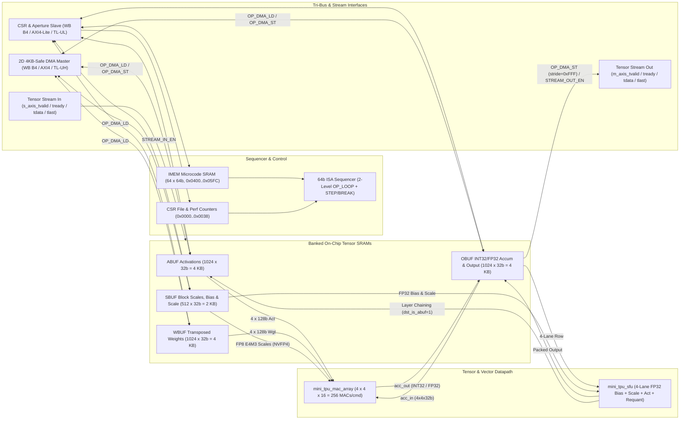

# Mini-TPU / Multi-Precision NPU (`mini_tpu`) Architecture & Programming Guide

The `ips/17_mini_tpu` core is a 100% pure, synthesizable **IEEE 1800-2017 SystemVerilog** programmable Neural Processing Unit (NPU) and Tensor Accelerator. It combines a 64-bit microcode sequencer (`IMEM` + 2-level zero-overhead hardware loops), banked on-chip tensor scratchpads (`ABUF`, `WBUF`, `SBUF`, `OBUF`), a **`4 x 4 x 16` (`256` MACs/op) multi-precision tensor MAC array** supporting **NVFP4** (4-bit `E2M1` with per-16-element `FP8 E4M3FN` micro-block scaling), **FP8** (`E4M3FN`, `E5M2`, and mixed `E4M3 x E5M2`), and **INT8** (symmetric `SINT8` and asymmetric `UINT8 x SINT8` with zero-points), a **4-lane FP32 Special Function & Requantization Unit (SFU)**, an autonomous **2D 4KB-safe strided DMA engine**, **direct AXI-Stream-style ready/valid tensor streaming (`s_axis_*` / `m_axis_*`)**, and unified **Wishbone B4**, **AXI4**, and **TileLink TL-UL/TL-UH** dual-bus wrappers.

---

## 1. Architecture Overview & Pipeline Dataflow

`mini_tpu_core` decouples host/external data movement from tensor math via five dedicated memory-mapped SRAM banks inside a single 16 KB (`0x0000..0x3FFC`) address aperture. Microcode programs stored in `IMEM` orchestrate 2D strided DMA loads, multi-tile GEMM accumulation, fused bias/scale/activation/requantization passes (including direct on-chip `OBUF -> ABUF` layer chaining without off-chip traffic), and DMA or streaming egress.



### RTL Module Hierarchy (`ips/17_mini_tpu/rtl/`)

| File | Package / Module | Responsibility |
| :--- | :--- | :--- |
| `mini_tpu_pkg.sv` | `mini_tpu_pkg` | Parameters (`TILE_M=4`, `TILE_N=4`, `K_GROUP=16`), enums (`prec_mode_e`, `act_mode_e`, `out_fmt_e`, `tpu_op_e`), CSR/aperture constants, and bit-exact synthesizable IEEE-754 `FP32` / `FP8` / `NVFP4` / `INT8` math functions |
| `mini_tpu_fp_conv.sv` | `mini_tpu_fp_conv` | Standalone combinational single-lane multi-format converter wrapping `mini_tpu_pkg` helpers (`FP32`/`INT32`/`FP8 E4M3FN`/`FP8 E5M2`/`NVFP4 E2M1`/`INT8` <-> `FP32`) |
| `mini_tpu_mac_array.sv` | `mini_tpu_mac_array` | 3-stage pipelined `4 x 4 x 16` (`256` MACs per command) tensor dot-product array supporting `INT8_SYM`, `INT8_ASYM`, `FP8_E4M3`, `FP8_E5M2`, `FP8_MIXED`, and block-scaled `NVFP4` |
| `mini_tpu_sfu.sv` | `mini_tpu_sfu` | 2-stage pipelined 4-lane vector post-processor (`INT32 -> FP32`, FP32 bias add, per-channel/global FP32 scale, 6 activation modes, and packing/requantization to 6 output formats) |
| `mini_tpu_core.sv` | `mini_tpu_core` | 64-bit microcode sequencer, 2-level hardware loop unit, `IMEM`/`SBUF`/`ABUF`/`WBUF`/`OBUF` SRAM banks, 4KB-safe 2D DMA engine, `s_axis_*`/`m_axis_*` streamer, CSRs, and performance counters |
| `mini_tpu_wb.sv` | `mini_tpu_wb` | Wishbone B4 CSR/aperture slave (`wb_to_csr`) + pipelined DMA master (`mem_to_wb_master`) wrapper |
| `mini_tpu_axi.sv` | `mini_tpu_axi` | AXI4-Lite CSR/aperture slave (`axi_lite_to_csr`) + AXI4 burst DMA master (`mem_to_axi4_master`) wrapper |
| `mini_tpu_tl.sv` | `mini_tpu_tl` | TileLink TL-UL CSR/aperture slave (`tl_ul_to_csr`) + TL-UH burst DMA master (`mem_to_tl_uh_master`) wrapper |
| `mini_tpu_top.sv` | `mini_tpu_top` | Unified parameterizable top-level (`BUS_TYPE`: `BUS_WISHBONE`, `BUS_AXI4`, `BUS_TILELINK`) with direct streaming ports and `irq_o` |

---

## 2. Supported Data Types & Precision Mathematics

### 2.1 Precision Mode Summary (`prec_mode_e`)

| `prec_mode` | Enum Name | Activation (`A`) | Weight (`B`) | Block Scale (`S_A, S_B`) | Accumulator | MACs / Cmd |
| :---: | :--- | :--- | :--- | :--- | :---: | :---: |
| `3'd0` | `PREC_INT8_SYM` | Signed `SINT8` | Signed `SINT8` | None | Signed `INT32` | `256` |
| `3'd1` | `PREC_INT8_ASYM` | Unsigned `UINT8` (`zp_a`) | Signed `SINT8` (`zp_b`) | None | Signed `INT32` | `256` |
| `3'd2` | `PREC_FP8_E4M3` | `OFP8 E4M3FN` | `OFP8 E4M3FN` | None | IEEE-754 `FP32` | `256` |
| `3'd3` | `PREC_FP8_E5M2` | `FP8 E5M2` | `FP8 E5M2` | None | IEEE-754 `FP32` | `256` |
| `3'd4` | `PREC_FP8_MIXED` | `OFP8 E4M3FN` | `FP8 E5M2` | None | IEEE-754 `FP32` | `256` |
| `3'd5` | `PREC_NVFP4` | `16x FP4 E2M1` (`64b`) | `16x FP4 E2M1` (`64b`) | `FP8 E4M3FN` per `16` elems | IEEE-754 `FP32` | `256` |

---

### 2.2 NVFP4 Block-Scaled 4-Bit Floating-Point (`PREC_NVFP4 = 3'd5`)

**NVFP4** pairs 16-element micro-blocks (`K_GROUP = 16`) of 4-bit **`E2M1`** elements with fine-grained 8-bit **`FP8 E4M3FN`** per-block scale factors (`S_A` for each activation row micro-block, `S_B` for each weight column micro-block). This achieves 2x storage and bandwidth compression over FP8/INT8 while preserving near-FP8 accuracy through narrow 16-element scaling windows.

#### Exact 4-Bit `E2M1` Bit Layout & 16-Entry Value Table

Each 4-bit `E2M1` nibble `b[3:0]` encodes:
- `b[3]`: Sign bit `s` (`0` = positive, `1` = negative)
- `b[2:1]`: 2-bit exponent `e` with **exponent bias = `1`**
- `b[0]`: 1-bit explicit mantissa `m`
- **No Infinity / No NaN**: Every one of the 16 nibble encodings represents a valid finite number. Moreover, every `E2M1` value is an **exact integer multiple of `0.5`** (`val = s5 * 0.5`, where `s5` is a signed 5-bit integer in `[-12, +12]`):

| Positive Hex (`b[3:0]`) | `(s, e, m)` | Real Value | Exact `s5` (`2 * val`) | Negative Hex (`b[3:0]`) | `(s, e, m)` | Real Value | Exact `s5` (`2 * val`) |
| :---: | :---: | :---: | :---: | :---: | :---: | :---: | :---: |
| `0x0` (`0000`) | `(0, 0, 0)` | `+0.0` (Zero) | `0` | `0x8` (`1000`) | `(1, 0, 0)` | `-0.0` (Zero) | `0` |
| `0x1` (`0001`) | `(0, 0, 1)` | `+0.5` (Subnormal) | `+1` | `0x9` (`1001`) | `(1, 0, 1)` | `-0.5` (Subnormal) | `-1` |
| `0x2` (`0010`) | `(0, 1, 0)` | `+1.0` | `+2` | `0xA` (`1010`) | `(1, 1, 0)` | `-1.0` | `-2` |
| `0x3` (`0011`) | `(0, 1, 1)` | `+1.5` | `+3` | `0xB` (`1011`) | `(1, 1, 1)` | `-1.5` | `-3` |
| `0x4` (`0100`) | `(0, 2, 0)` | `+2.0` | `+4` | `0xC` (`1100`) | `(1, 2, 0)` | `-2.0` | `-4` |
| `0x5` (`0101`) | `(0, 2, 1)` | `+3.0` | `+6` | `0xD` (`1101`) | `(1, 2, 1)` | `-3.0` | `-6` |
| `0x6` (`0110`) | `(0, 3, 0)` | `+4.0` | `+8` | `0xE` (`1110`) | `(1, 3, 0)` | `-4.0` | `-8` |
| `0x7` (`0111`) | `(0, 3, 1)` | `+6.0` | `+12` | `0xF` (`1111`) | `(1, 3, 1)` | `-6.0` | `-12` |

#### Byte & Micro-Block Packing

> [!IMPORTANT]
> **Little-Endian Nibble Packing**: Two `E2M1` elements pack into each byte with **even element `2k` in low nibble `[3:0]`** and **odd element `2k+1` in high nibble `[7:4]`**. One 16-element micro-block (`k = 0..15`) occupies 8 bytes = **two consecutive 32-bit words (`64` bits)** placed in `vec[63:0]`:
> - `word0` (`vec[31:0]`): `{elem7, elem6, elem5, elem4, elem3, elem2, elem1, elem0}`
> - `word1` (`vec[63:32]`): `{elem15, elem14, elem13, elem12, elem11, elem10, elem9, elem8}`

#### Lossless Integer Micro-Block Dot Product + FP32 Scale Fusion

Inside `mini_tpu_mac_array`, each `(m, n)` processing element (`m = 0..3`, `n = 0..3`) evaluates a 16-element NVFP4 inner product without intermediate floating-point rounding loss:

```text
1. Decode nibbles to exact half-integers:
     s5_a[k] = e2m1_to_s5(act_vec_i[m][4*k +: 4])    // in {-12..-1, 0, +1..+12}
     s5_b[k] = e2m1_to_s5(wgt_vec_i[n][4*k +: 4])    // in {-12..-1, 0, +1..+12}

2. Exact 16-element integer inner product (bounded in [-2304, +2304]):
     dot_s5  = sum_{k=0..15} (s5_a[k] * s5_b[k])

3. Exact conversion to FP32 & 0.25f normalization ((0.5 * 0.5) = 0.25):
     raw_fp32   = int32_to_fp32(dot_s5) * 0.25f

4. Fuse FP8 E4M3FN micro-block scales & accumulate in FP32:
     scale_prod = fp8_e4m3_to_fp32(act_scale_i[m]) * fp8_e4m3_to_fp32(wgt_scale_i[n])
     acc_out[m][n] = fp32_add(acc_prev[m][n], fp32_mul(raw_fp32, scale_prod))
```

When quantizing FP32 values back to `E2M1` (`fp32_to_e2m1`), magnitudes are rounded to nearest-even against the midpoint thresholds `{0.25, 0.75, 1.25, 1.75, 2.5, 3.5, 5.0}` and clamped at `±6.0`.

---

### 2.3 FP8 Formats (`PREC_FP8_E4M3`, `PREC_FP8_E5M2`, `PREC_FP8_MIXED`)

| Property | `OFP8 E4M3FN` (`PREC_FP8_E4M3`) | `FP8 E5M2` (`PREC_FP8_E5M2`) |
| :--- | :--- | :--- |
| **Bit Fields `[7:0]`** | `[7]` Sign, `[6:3]` Exp (`4b`), `[2:0]` Mant (`3b`) | `[7]` Sign, `[6:2]` Exp (`5b`), `[1:0]` Mant (`2b`) |
| **Exponent Bias** | `7` | `15` |
| **Zero Encoding** | `0x00` (`+0.0`), `0x80` (`-0.0`) | `0x00` (`+0.0`), `0x80` (`-0.0`) |
| **Subnormal Formula (`e == 0, m != 0`)** | `(-1)^s * 2^(-6) * (m / 8)` | `(-1)^s * 2^(-14) * (m / 4)` |
| **Min Positive Subnormal** | `2^(-9) = 0.001953125` (`0x01`) | `2^(-16) = 1.5258789e-5` (`0x01`) |
| **Normal Formula** | `(-1)^s * 2^(e - 7) * (1 + m / 8)` (`e=1..15`, except `0x7F`/`0xFF`) | `(-1)^s * 2^(e - 15) * (1 + m / 4)` (`e=1..30`) |
| **Max Finite Normal** | **`±448.0`** (`0x7E` / `0xFE`, `e=15, m=6`) | **`±57344.0`** (`0x7B` / `0xFB`, `e=30, m=3`) |
| **Infinity Encoding** | **None** (`FN` finite-only OCP profile) | `e=31, m=0` (`0x7C` = `+Inf`, `0xFC` = `-Inf`) |
| **NaN Encoding** | `e=15, m=7` (`0x7F`, `0xFF` only) | `e=31, m!=0` (`0x7D..0x7F`, `0xFD..0xFF`) |

- **Mixed FP8 (`PREC_FP8_MIXED = 3'd4`)**: Decodes `act_vec_i` as `OFP8 E4M3FN` (higher 3-bit mantissa precision for forward activations) and `wgt_vec_i` as `FP8 E5M2` (wider 5-bit exponent dynamic range up to `±57344.0` for weights or backward-pass gradients), multiplying element-wise and accumulating in IEEE-754 `FP32`.

---

### 2.4 INT8 Symmetric & Asymmetric Modes (`PREC_INT8_SYM`, `PREC_INT8_ASYM`)

- **Symmetric INT8 (`PREC_INT8_SYM = 3'd0`)**: Both `A` and `B` are two's-complement signed `SINT8` (`[-128, 127]`). Each 16-element inner product is computed exactly and accumulated into signed 32-bit `INT32`:
  ```text
  acc_out[m][n] = acc_prev[m][n] + sum_{k=0..15} (sint8(A[m][k]) * sint8(B[n][k]))
  ```
- **Asymmetric INT8 (`PREC_INT8_ASYM = 3'd1`)**: Activations `A` are unsigned `UINT8` (`[0, 255]`) with unsigned zero-point `zp_a` (`REG_CFG_PREC[23:16]`), while weights `B` are signed `SINT8` (`[-128, 127]`) with signed zero-point `zp_b` (`REG_CFG_PREC[31:24]`):
  ```text
  acc_out[m][n] = acc_prev[m][n] + sum_{k=0..15} ((int32(uint8(A[m][k])) - int32(uint8(zp_a)))
                                                * (int32(sint8(B[n][k])) - int32(sint8(zp_b))))
  ```
- During `OP_SFU`, when `prec_mode` is `PREC_INT8_SYM` or `PREC_INT8_ASYM` (`src_is_int32_i = 1`), `mini_tpu_sfu` converts each `INT32` accumulator lane to IEEE-754 `FP32` via `int32_to_fp32` before adding FP32 bias, multiplying by FP32 scale, applying non-linear activation, and requantizing.

---

### 2.5 4-Lane Vector SFU, Activations & Output Requantization (`mini_tpu_sfu`)

For each lane `j = 0..3`, `mini_tpu_sfu` executes:

```text
x0 = src_is_int32_i ? int32_to_fp32(acc_row_i[j]) : acc_row_i[j]
x1 = fp32_add(x0, bias_row_i[j])
x  = fp32_mul(x1, scale_row_i[j])
y  = activation(x, act_mode_i)
```

#### Deterministic Piecewise/Polynomial Activations (`act_mode_e`)

| `act_mode` | Enum Name | Exact Synthesizable FP32 Equation |
| :---: | :--- | :--- |
| `3'd0` | `ACT_NONE` | `y = x` |
| `3'd1` | `ACT_RELU` | `y = (x <= 0.0f) ? +0.0f : x` |
| `3'd2` | `ACT_RELU6` | `y = clamp(x, 0.0f, 6.0f)` |
| `3'd3` | `ACT_LEAKY_RELU` | `y = (x < 0.0f) ? (0.125f * x) : x` |
| `3'd4` | `ACT_SILU` | `y = x * clamp(0.125f * x + 0.5f, 0.0f, 1.0f)` (Hard-Swish / SiLU approx) |
| `3'd5` | `ACT_GELU` | `y = x * clamp(0.1875f * x + 0.5f, 0.0f, 1.0f)` (`0.1875 = 3/16` piecewise GELU) |

#### Output Formats & Lane Packing (`out_fmt_e`)

| `out_fmt` | Enum Name | Bytes / 4-Lane Op | Packing & Requantization Behavior |
| :---: | :--- | :---: | :--- |
| `3'd0` | `OUT_FP32` | `16` (`4` words) | `res_words_o[0..3]` = 4 IEEE-754 `FP32` words |
| `3'd1` | `OUT_INT32` | `16` (`4` words) | `res_words_o[0..3]` = 4 rounded, saturated signed `INT32` words |
| `3'd2` | `OUT_INT8` | `4` (`1` word) | Round `y` to integer, add signed `out_zp_i`, clamp to `[-128, 127]`, pack `{b3, b2, b1, b0}` in `res_words_o[0]` |
| `3'd3` | `OUT_FP8_E4M3` | `4` (`1` word) | Convert 4 lanes via `fp32_to_fp8_e4m3` (saturating at `±448.0`), pack `{b3, b2, b1, b0}` in `res_words_o[0]` |
| `3'd4` | `OUT_FP8_E5M2` | `4` (`1` word) | Convert 4 lanes via `fp32_to_fp8_e5m2`, pack `{b3, b2, b1, b0}` in `res_words_o[0]` |
| `3'd5` | `OUT_NVFP4` | `2` (`16` bits) | If `nvfp4_out_scale_i != 8'h00`, multiply `y` by `fp8_e4m3_to_fp32(nvfp4_out_scale_i)`; quantize via `fp32_to_e2m1` into `{n3, n2, n1, n0}` in `res_words_o[0][15:0]` (`OP_SFU` packs pairs of consecutive 4-lane halfwords `{vec_odd[15:0], vec_even[15:0]}` into full 32-bit scratchpad words) |

---

## 3. Complete 64-Bit Microcode ISA & Tensor Tiling Reference

`IMEM` holds up to **64 instructions of 64 bits each** (`0x0400..0x05FC`), mapped into the 32-bit CSR space as little-endian word pairs:
- `0x0400 + 8*i` (`word 2i`): `inst[31:0]` (lower 32 bits)
- `0x0404 + 8*i` (`word 2i+1`): `inst[63:32]` (upper 32 bits, containing `opcode = inst[63:60]`)

### 3.1 Instruction Set Summary (`tpu_op_e`)

| Opcode `inst[63:60]` | Mnemonic | Summary |
| :---: | :--- | :--- |
| `4'h0` | `OP_NOP` | No operation; advances `PC <= PC + 1` |
| `4'h1` | `OP_CFG` | Updates precision/activation/output format and either quantization zero-points/scales or `REG_GLOBAL_SCALE` |
| `4'h2` | `OP_DMA_LD` | 2D strided 4KB-safe burst DMA load from `BASE0`/`BASE1` into `ABUF`/`WBUF`/`SBUF`/`OBUF`/`IMEM` |
| `4'h3` | `OP_DMA_ST` | 2D strided 4KB-safe burst DMA store from scratchpad to external memory (or `m_axis_*` stream when `stride == 12'hFFF`) |
| `4'h4` | `OP_GEMM` | Multi-tile (`m_tiles x n_tiles x k_groups`) matrix multiplication on `mini_tpu_mac_array` |
| `4'h5` | `OP_SFU` | Multi-vector (`num_vec4`) bias + scale + activation + requantization to `OBUF` or `ABUF` (`dst_is_abuf`) |
| `4'h6` | `OP_LOOP` | Zero-overhead 2-level hardware loop counter init (`is_init=1`) or decrement-and-branch (`is_init=0`) |
| `4'h7` | `OP_HALT` | Terminates program (`DONE=1` when `is_break=0`) or pauses at breakpoint (`BREAK=1`, `PC+1` when `is_break=1`) |

---

### 3.2 Detailed Bit-Field Breakdown per Instruction

#### 1. `OP_NOP` (`opcode = 4'h0`)
- `[63:60]`: `4'h0`
- `[59:0]`: Reserved (`0`) — increments `PC` by 1 and increments `REG_PERF_INST_RET`.

#### 2. `OP_CFG` (`opcode = 4'h1`)
- `[63:60]`: `4'h1`
- `[59:57]`: `prec_mode[2:0]` (`prec_mode_e`)
- `[56:54]`: `act_mode[2:0]` (`act_mode_e`)
- `[53:51]`: `out_fmt[2:0]` (`out_fmt_e`)
- `[50]`: `set_global_scale`
  - When `set_global_scale == 1'b0`:
    - `[49:32]`: Reserved (`0`)
    - `[31:24]`: `zp_b[7:0]` (weight zero-point)
    - `[23:16]`: `zp_a[7:0]` (activation zero-point)
    - `[15:8]`: `nvfp4_out_scale[7:0]` (`FP8 E4M3FN` pre-quantization multiplier for `OUT_NVFP4`)
    - `[7:0]`: `out_zp[7:0]` (output signed INT8 zero-point for `OUT_INT8`)
  - When `set_global_scale == 1'b1`:
    - `[49:32]`: Reserved (`0`)
    - `[31:0]`: `global_scale_fp32[31:0]` (IEEE-754 `FP32` written to `REG_GLOBAL_SCALE`)

#### 3. `OP_DMA_LD` (`opcode = 4'h2`) & `OP_DMA_ST` (`opcode = 4'h3`)
- `[63:60]`: `4'h2` (`OP_DMA_LD`) or `4'h3` (`OP_DMA_ST`)
- `[59]`: `base_sel` (`0`: `REG_DMA_BASE0`, `1`: `REG_DMA_BASE1`)
- `[58:56]`: `buf_sel[2:0]` (`3'd0`: `ABUF`, `3'd1`: `WBUF`, `3'd2`: `SBUF`, `3'd3`: `OBUF`, `3'd4`: `IMEM`)
- `[55:44]`: `buf_word_addr[11:0]` (starting 32-bit word index in selected scratchpad, `0..1023`; `buf_word_addr[11:10]` must be `2'b00`; for `IMEM`, indexes 32-bit half-instructions `0..127`)
- `[43:36]`: `num_rows[7:0]` (number of 2D rows; `0` is treated as `1`)
- `[35:28]`: `words_per_row[7:0]` (32-bit words transferred per row; `0` retires as a 0-word no-op in memory DMA mode, or selects `REG_STREAM_PTR[31:16]` word count in `OP_DMA_ST` stream egress mode)
- `[27:16]`: `ext_row_stride_bytes[11:0]`:
  - `12'h000`: Contiguous rows (`row_step_bytes = words_per_row * 4`)
  - `12'h001..12'hFFE`: Explicit external byte pitch added to row start address between rows
  - **`12'hFFF` (on `OP_DMA_ST` only)**: **Direct Stream Egress Mode** — streams `(words_per_row != 0) ? (eff_rows * words_per_row) : REG_STREAM_PTR[31:16]` 32-bit words from `buf_sel[buf_word_addr...]` out of `m_axis_tdata_o` / `m_axis_tvalid_o`, asserting `m_axis_tlast_o = 1` on the final word, without issuing bus DMA transactions.
- `[15:0]`: `ext_word_offset[15:0]` — initial external address is `BASE + ({14'b0, ext_word_offset, 2'b00})`.
- **4KB Burst Safety**: Every row transfer is automatically partitioned (`calc_4kb_chunk_words`) into bursts of at most `16` words that never cross an AXI4 / TileLink 4KB (`0x1000`) address boundary.

#### 4. `OP_GEMM` (`opcode = 4'h4`)
- `[63:60]`: `4'h4`
- `[59]`: `acc_clear` (`1`: zero accumulator on `k_idx == 0`; `0`: preload existing `4x4` tile from `OBUF` on `k_idx == 0`)
- `[58:55]`: `m_tiles[3:0]` (number of 4-row M tiles; `0` -> `1`)
- `[54:51]`: `n_tiles[3:0]` (number of 4-column N tiles; `0` -> `1`)
- `[50:44]`: `k_groups[6:0]` (number of 16-element K micro-blocks; `0` -> `1`)
- `[43:34]`: `abuf_base[9:0]` (32-bit word base in `ABUF`)
- `[33:24]`: `wbuf_base[9:0]` (32-bit word base in `WBUF`)
- `[23:14]`: `obuf_base[9:0]` (32-bit word base in `OBUF`)
- `[13:0]`: `sbuf_scale_base[13:0]` (32-bit word base in `SBUF` for `PREC_NVFP4` `FP8 E4M3FN` block scales)

#### 5. `OP_SFU` (`opcode = 4'h5`)
- `[63:60]`: `4'h5`
- `[59]`: `dst_is_abuf` (`0`: write packed output to `OBUF[dst_base...]`; `1`: write packed output directly to `ABUF[dst_base...]` for zero-copy multi-layer chaining)
- `[58]`: `use_per_ch_scale` (`0`: broadcast `REG_GLOBAL_SCALE` to all 4 lanes; `1`: fetch 4 FP32 scales from `SBUF`)
- `[57]`: `use_bias` (`0`: `bias_row = 0.0f`; `1`: fetch 4 FP32 biases from `SBUF`)
- `[56:48]`: `num_vec4[8:0]` (number of 4-lane vectors to process; `0` -> `1`; e.g., `4` for one `4x4` tile, `16` for `2x2` tiles)
- `[47:38]`: `src_obuf_base[9:0]` (source word offset in `OBUF`, advancing by `4` words per `vec_idx`)
- `[37:28]`: `dst_base[9:0]` (destination word offset in `OBUF` or `ABUF`)
- `[27:19]`: `bias_sbuf_base[8:0]` (word offset in `SBUF` for FP32 bias vectors)
- `[18:10]`: `scale_sbuf_base[8:0]` (word offset in `SBUF` for FP32 per-channel scale vectors)
- `[9:0]`: `cols4_mod[9:0]` (column group modulo: when `0`, reads fixed 4-word vector at `bias_sbuf_base` / `scale_sbuf_base`; when `> 0`, indexes `base + (vec_idx % cols4_mod) * 4`)

#### 6. `OP_LOOP` (`opcode = 4'h6`)
- `[63:60]`: `4'h6`
- `[59]`: `loop_id` (`0` or `1`, selecting hardware loop register 0 or 1)
- `[58]`: `is_init`
  - When `is_init == 1'b1`: Loads `loop_cnt[loop_id] <= inst[15:0]` and advances `PC <= PC + 1`.
  - When `is_init == 1'b0`: If `loop_cnt[loop_id] > 16'd1`, decrements `loop_cnt[loop_id] <= loop_cnt[loop_id] - 16'd1` and jumps `PC <= inst[23:16]` (target `IMEM` PC `0..63`); otherwise sets `loop_cnt[loop_id] <= 16'd0` and falls through to `PC <= PC + 1`.

#### 7. `OP_HALT` (`opcode = 4'h7`)
- `[63:60]`: `4'h7`
- `[59]`: `is_break`
  - `is_break == 1'b0`: Sets `REG_SR.DONE = 1`, clears `BUSY = 0` (triggers `irq_o` if `REG_CR.DONE_IE == 1`).
  - `is_break == 1'b1`: Sets `REG_SR.BREAK = 1`, clears `BUSY = 0`, and advances `PC <= PC + 1` so software can inspect scratchpads via CSR apertures and resume via `REG_CR.STEP` or `REG_CR.START`.

---

### 3.3 Scratchpad Tensor Tiling & Memory Layout

To feed all `4` activation rows and `4` weight columns with `16`-element K vectors without bank conflicts, tensors use clean tiled layouts across `ABUF`, `WBUF`, `SBUF`, and `OBUF`:

1. **`ABUF` (`0x1000..0x1FFC`, `1024 x 32b`) — Row-Tiled `(m_tile, k_idx, row, word)`**:
   - **8-bit modes (`INT8*`, `FP8*`)**: Each 16-element K vector is `16` bytes = `4` words (`128b`). One `4`-row M-tile x `1` K-group occupies `16` words:
     `abuf_word = abuf_base + (m_tile * k_groups + k_idx) * 16 + row * 4 + w` (`row = 0..3`, `w = 0..3`).
   - **4-bit `PREC_NVFP4`**: Each 16-element `E2M1` K vector is `8` bytes = `2` words (`64b`). One `4`-row M-tile x `1` K-group occupies `8` words:
     `abuf_word = abuf_base + (m_tile * k_groups + k_idx) * 8 + row * 2 + w` (`row = 0..3`, `w = 0..1`).

2. **`WBUF` (`0x2000..0x2FFC`, `1024 x 32b`) — N-Major / Transposed `(n_tile, k_idx, col, word)`**:
   - Matrix `B[K][N]` is stored transposed by N-column `(n, k)` so each column `col = 0..3` of `16` K-elements is contiguous in memory:
   - **8-bit modes (`INT8*`, `FP8*`)**:
     `wbuf_word = wbuf_base + (n_tile * k_groups + k_idx) * 16 + col * 4 + w` (`col = 0..3`, `w = 0..3`).
   - **4-bit `PREC_NVFP4`**:
     `wbuf_word = wbuf_base + (n_tile * k_groups + k_idx) * 8 + col * 2 + w` (`col = 0..3`, `w = 0..1`).

3. **`SBUF` (`0x0800..0x0FFC`, `512 x 32b`) — NVFP4 Micro-Block Scales & FP32 Bias/Scale**:
   - **NVFP4 `FP8 E4M3FN` Block Scales** (at `sbuf_scale_base`):
     - Activation scales `S_A`: For each `(m_tile, k_idx)`, `1` 32-bit word packs `{act_scale[3], act_scale[2], act_scale[1], act_scale[0]}` at:
       `sbuf_word_a = sbuf_scale_base + (m_tile * k_groups + k_idx)`
     - Weight scales `S_B`: Immediately after all `m_tiles * k_groups` activation scale words, `1` 32-bit word per `(n_tile, k_idx)` packs `{wgt_scale[3], wgt_scale[2], wgt_scale[1], wgt_scale[0]}` at:
       `sbuf_word_b = sbuf_scale_base + (m_tiles * k_groups) + (n_tile * k_groups + k_idx)`
   - **SFU Bias & Per-Channel Scale**: Stored as contiguous 4-word (`4 x FP32`) vectors at `bias_sbuf_base` and `scale_sbuf_base`.

4. **`OBUF` (`0x3000..0x3FFC`, `1024 x 32b`) — Row-Major `4x4` Tiles**:
   - During `OP_GEMM`, each `(m_tile, n_tile)` output tile occupies `16` consecutive 32-bit words (`INT32` or `FP32` depending on `prec_mode`) in row-major order:
     `obuf_word = obuf_base + (m_tile * n_tiles + n_tile) * 16 + row * 4 + col` (`row = 0..3`, `col = 0..3`).

> [!TIP]
> **Multi-Tile `OP_SFU` Addressing Note**: Because `OP_GEMM` writes each `4x4` tile sequentially (`16` words per tile: tile `(0,0)` rows `0..3`, then tile `(0,1)` rows `0..3`), `num_vec4 = 4` processes one `4x4` tile with `cols4_mod = 0`. When processing multiple N-tiles where tiles are stored tile-by-tile, either invoke `OP_SFU` per N-tile column or arrange `SBUF` biases/scales to match your tile traversal order.

---

## 4. Complete CSR & Memory-Mapped Aperture Table (`0x0000..0x3FFC`)

The peripheral decodes a 16 KB (`ADDR_W = 14`) byte-addressed window. Scratchpad apertures (`0x0400..0x3FFC`) support direct CPU read/write access (honoring byte strobes) whenever `REG_SR.BUSY == 0`.

| Offset | Register / Aperture | Access | Reset | Bit Fields & Description |
| :--- | :--- | :---: | :---: | :--- |
| `0x0000` | `REG_CR` | RW | `0x0000_0000` | `[0]` `START` (self-clears; loads `PC = REG_PC_START` and starts execution), `[1]` `STEP` (self-clears; executes 1 instruction at `CUR_PC`, advances `CUR_PC`, and returns to `IDLE`), `[2]` `SOFT_RST` (self-clears; resets FSM/PC/flags/perf), `[3]` `STREAM_IN_EN`, `[4]` `STREAM_OUT_EN`, `[8]` `DONE_IE`, `[9]` `ERR_IE`, `[10]` `BREAK_IE`, `[18:16]` `STREAM_TARGET[2:0]` (`0`: `ABUF`, `1`: `WBUF`, `2`: `SBUF`, `3`: `IMEM`, `4`: `OBUF`) |
| `0x0004` | `REG_SR` | RO | `0x0000_0000` | `[0]` `DONE`, `[1]` `ERR`, `[2]` `BREAK`, `[8]` `BUSY`, `[9]` `DMA_BUSY`, `[10]` `MAC_BUSY`, `[11]` `SFU_BUSY`, `[23:16]` `CUR_PC[7:0]`, `[27:24]` `ERR_CODE[3:0]` (`4'h1`: PC>=64, `4'h2`: illegal opcode, `4'h3`: DMA bus error, `4'h4`: invalid buffer/scale range) |
| `0x0008` | `REG_IFCR` | WO | `0x0000_0000` | `[0]` W1C `DONE`, `[1]` W1C `ERR`, `[2]` W1C `BREAK` |
| `0x000C` | `REG_PC_START` | RW | `0x0000_0000` | `[7:0]` Initial microcode `IMEM` instruction pointer (`0..63`) loaded on `CR.START` |
| `0x0010` | `REG_CFG_PREC` | RW | `0x0000_0000` | `[2:0]` `prec_mode`, `[5:3]` `act_mode`, `[8:6]` `out_fmt`, `[23:16]` `zp_a[7:0]`, `[31:24]` `zp_b[7:0]` |
| `0x0014` | `REG_CFG_QUANT` | RW | `0x0000_0000` | `[7:0]` `out_zp[7:0]` (signed INT8 output zero-point), `[15:8]` `nvfp4_out_scale[7:0]` (`FP8 E4M3FN` output scale) |
| `0x0018` | `REG_GLOBAL_SCALE` | RW | `0x3F80_0000` | `[31:0]` IEEE-754 `FP32` global scale factor (reset = `1.0f`) |
| `0x001C` | `REG_STREAM_PTR` | RW | `0x0000_0000` | `[15:0]` Scratchpad word pointer (auto-increments on each `s_axis` / `m_axis` beat), `[31:16]` Stream egress word count (used when `CR.STREAM_OUT_EN = 1`) |
| `0x0020` | `REG_DMA_BASE0` | RW | `0x0000_0000` | `[31:0]` External DMA Base Address 0 (`base_sel = 0`) |
| `0x0024` | `REG_DMA_BASE1` | RW | `0x0000_0000` | `[31:0]` External DMA Base Address 1 (`base_sel = 1`) |
| `0x0028` | `REG_PERF_CYCLES` | RO | `0x0000_0000` | Active execution clock cycles elapsed while `BUSY == 1` |
| `0x002C` | `REG_PERF_MACS` | RO | `0x0000_0000` | Total multiply-accumulate operations retired (`+256` per `4x4x16` MAC command) |
| `0x0030` | `REG_PERF_DMA_WORDS` | RO | `0x0000_0000` | Total 32-bit words transferred by `OP_DMA_LD` / `OP_DMA_ST` |
| `0x0034` | `REG_PERF_INST_RET` | RO | `0x0000_0000` | Total 64-bit microcode instructions retired |
| `0x0038` | `REG_FEATURE_ID` | RO | `0x4E50_5531` | ASCII feature identification magic `"NPU1"` (`32'h4E50_5531`) |
| `0x0400..0x05FC` | `IMEM[0..127]` | RW | `'0` | Microcode instruction SRAM (`64 x 64-bit` instructions = `128 x 32-bit` words) |
| `0x0800..0x0FFC` | `SBUF[0..511]` | RW | `'0` | Scale & Bias SRAM (`512 x 32-bit` = 2 KB) |
| `0x1000..0x1FFC` | `ABUF[0..1023]` | RW | `'0` | Activation Scratchpad SRAM (`1024 x 32-bit` = 4 KB) |
| `0x2000..0x2FFC` | `WBUF[0..1023]` | RW | `'0` | Weight Scratchpad SRAM (`1024 x 32-bit` = 4 KB) |
| `0x3000..0x3FFC` | `OBUF[0..1023]` | RW | `'0` | Accumulator & Output Scratchpad SRAM (`1024 x 32-bit` = 4 KB) |

---

## 5. Flexible Bus & Streaming Integration Guide

### 5.1 Tri-Bus Parameterized Instantiation (`mini_tpu_top`)

`mini_tpu_top` supports **Wishbone B4** (`bus_pkg::BUS_WISHBONE`), **AXI4** (`bus_pkg::BUS_AXI4`), and **TileLink TL-UL / TL-UH** (`bus_pkg::BUS_TILELINK`) via a single compile-time `BUS_TYPE` parameter. Unused bus struct outputs are tied off to `'0` inside `generate` blocks so synthesis trims unselected protocol logic cleanly. You may also instantiate the protocol-specific wrappers (`mini_tpu_wb`, `mini_tpu_axi`, `mini_tpu_tl`) directly (as done in `tb_soc_subsystem.sv` at `0x7000_0000`).

```systemverilog
mini_tpu_top #(
  .BUS_TYPE (bus_pkg::BUS_AXI4) // BUS_WISHBONE, BUS_AXI4, or BUS_TILELINK
) u_mini_tpu (
  .clk_i           (clk_i),
  .rst_ni          (rst_ni),

  // Wishbone B4 Slave (CSR/Apertures) & Master (2D DMA)
  .s_wb_i          ('0),
  .s_wb_o          (),
  .m_wb_o          (),
  .m_wb_i          ('0),

  // AXI4-Lite Slave (16 KB CSR/Apertures) & AXI4 Burst Master (2D DMA)
  .s_axi_i         (tpu_s_axi_m2s),
  .s_axi_o         (tpu_s_axi_s2m),
  .m_axi_o         (tpu_m_axi_m2s),
  .m_axi_i         (tpu_m_axi_s2m),

  // TileLink TL-UL Slave & TL-UH Burst Master
  .s_tl_i          ('0),
  .s_tl_o          (),
  .m_tl_o          (),
  .m_tl_i          ('0),

  // Direct Ready/Valid Tensor Streaming Ports (tie off if unused)
  .s_axis_tvalid_i (s_axis_tvalid),
  .s_axis_tready_o (s_axis_tready),
  .s_axis_tdata_i  (s_axis_tdata),
  .s_axis_tlast_i  (s_axis_tlast),
  .m_axis_tvalid_o (m_axis_tvalid),
  .m_axis_tready_i (m_axis_tready),
  .m_axis_tdata_o  (m_axis_tdata),
  .m_axis_tlast_o  (m_axis_tlast),

  .irq_o           (tpu_irq)
);
```

### 5.2 Choosing Data Movement Paths

| Mechanism | Bandwidth & Overhead | Best Use Case |
| :--- | :--- | :--- |
| **1. CPU Aperture (`0x0400..0x3FFC`)** | Single-beat Slave R/W (`!BUSY`) | Loading short microcode kernels (`IMEM`), small bias/scale tables (`SBUF`), or interactive `STEP`/`BREAK` debugging |
| **2. Autonomous 2D Master DMA (`OP_DMA_LD` / `OP_DMA_ST`)** | Up to 16-word bursts, 4KB-safe, 2D row stride | Tiling sub-matrices directly out of shared DRAM/SRAM (`BASE0` = activations/IO, `BASE1` = weights/scales) without CPU intervention |
| **3. Direct Tensor Streaming (`s_axis_*` / `m_axis_*`)** | 1 word/cycle zero-bus-contention FIFO/pipeline link | Chaining `mini_tpu` directly to a camera/ISP/audio/DMA FIFO or chaining multiple `mini_tpu` cores in a pipeline (`OP_DMA_ST` with `ext_row_stride_bytes = 12'hFFF` or CSR `STREAM_IN_EN` / `STREAM_OUT_EN`) |

---

## 6. Software / Firmware Programming Recipes (C Examples)

### 6.1 Microcode Assembler Macros & `IMEM` Loader

```c
#include <stdint.h>

#define TPU_BASE            0x70000000u
#define TPU_REG(off)        (*(volatile uint32_t *)(TPU_BASE + (off)))

#define TPU_CR              0x0000u
#define TPU_SR              0x0004u
#define TPU_IFCR            0x0008u
#define TPU_PC_START        0x000Cu
#define TPU_DMA_BASE0       0x0020u
#define TPU_DMA_BASE1       0x0024u
#define TPU_IMEM_BASE       0x0400u

// 64-bit ISA Encoders
#define TPU_INST_CFG_QUANT(prec, act, outf, zpb, zpa, nv_scl, ozp) \
  ((1ULL << 60) | (((uint64_t)(prec) & 7) << 57) | (((uint64_t)(act) & 7) << 54) | \
   (((uint64_t)(outf) & 7) << 51) | (((uint64_t)(zpb) & 0xFF) << 24) | \
   (((uint64_t)(zpa) & 0xFF) << 16) | (((uint64_t)(nv_scl) & 0xFF) << 8) | ((uint64_t)(ozp) & 0xFF))

#define TPU_INST_CFG_GSCALE(prec, act, outf, fp32_bits) \
  ((1ULL << 60) | (((uint64_t)(prec) & 7) << 57) | (((uint64_t)(act) & 7) << 54) | \
   (((uint64_t)(outf) & 7) << 51) | (1ULL << 50) | ((uint64_t)(uint32_t)(fp32_bits)))

#define TPU_INST_DMA(op, bsel, bufsel, baddr, rows, wpr, stride_b, ext_woff) \
  ((((uint64_t)(op) & 0xF) << 60) | (((uint64_t)(bsel) & 1) << 59) | \
   (((uint64_t)(bufsel) & 7) << 56) | (((uint64_t)(baddr) & 0xFFF) << 44) | \
   (((uint64_t)(rows) & 0xFF) << 36) | (((uint64_t)(wpr) & 0xFF) << 28) | \
   (((uint64_t)(stride_b) & 0xFFF) << 16) | ((uint64_t)(ext_woff) & 0xFFFF))

#define TPU_INST_GEMM(clr, mt, nt, kg, abuf, wbuf, obuf, sbuf_scl) \
  ((4ULL << 60) | (((uint64_t)(clr) & 1) << 59) | (((uint64_t)(mt) & 0xF) << 55) | \
   (((uint64_t)(nt) & 0xF) << 51) | (((uint64_t)(kg) & 0x7F) << 44) | \
   (((uint64_t)(abuf) & 0x3FF) << 34) | (((uint64_t)(wbuf) & 0x3FF) << 24) | \
   (((uint64_t)(obuf) & 0x3FF) << 14) | ((uint64_t)(sbuf_scl) & 0x3FFF))

#define TPU_INST_SFU(to_abuf, pch_scl, ubias, nvec4, src_ob, dst, b_sb, s_sb, cmod) \
  ((5ULL << 60) | (((uint64_t)(to_abuf) & 1) << 59) | (((uint64_t)(pch_scl) & 1) << 58) | \
   (((uint64_t)(ubias) & 1) << 57) | (((uint64_t)(nvec4) & 0x1FF) << 48) | \
   (((uint64_t)(src_ob) & 0x3FF) << 38) | (((uint64_t)(dst) & 0x3FF) << 28) | \
   (((uint64_t)(b_sb) & 0x1FF) << 19) | (((uint64_t)(s_sb) & 0x1FF) << 10) | ((uint64_t)(cmod) & 0x3FF))

#define TPU_INST_LOOP_INIT(lid, count) \
  ((6ULL << 60) | (((uint64_t)(lid) & 1) << 59) | (1ULL << 58) | ((uint64_t)(count) & 0xFFFF))

#define TPU_INST_LOOP_NEXT(lid, target_pc) \
  ((6ULL << 60) | (((uint64_t)(lid) & 1) << 59) | (((uint64_t)(target_pc) & 0xFF) << 16))

#define TPU_INST_HALT(brk)  ((7ULL << 60) | (((uint64_t)(brk) & 1) << 59))

static inline void tpu_write_imem(uint32_t pc, uint64_t inst) {
  TPU_REG(TPU_IMEM_BASE + pc * 8u + 0u) = (uint32_t)(inst & 0xFFFFFFFFULL);
  TPU_REG(TPU_IMEM_BASE + pc * 8u + 4u) = (uint32_t)(inst >> 32);
}
```

---

### 6.2 Recipe 1: NVFP4 Block-Scaled `4 x 4 x 32` GEMM (`k_groups = 2`)

Computes `C[4][4] = A[4][32] * B[32][4]` in `PREC_NVFP4` (`3'd5`), where `A` and transposed `B` use packed 4-bit `E2M1` nibbles (`16` words each for `m_tiles=1, n_tiles=1, k_groups=2`) paired with `4` words of `FP8 E4M3FN` block scales in `SBUF` (`2` words for `S_A` + `2` words for `S_B`), writing `16` `FP32` output words back to memory:

```c
void run_nvfp4_gemm_4x4x32(uint32_t io_sram_base, uint32_t param_sram_base) {
  TPU_REG(TPU_IFCR)      = 0x7u;            // Clear DONE/ERR/BREAK
  TPU_REG(TPU_DMA_BASE0) = io_sram_base;    // [0x000]: A_nvfp4 (16w), [0x100]: C_fp32 out (16w)
  TPU_REG(TPU_DMA_BASE1) = param_sram_base; // [0x000]: B_nvfp4 (16w), [0x040]: S_A+S_B E4M3 (4w)

  uint32_t pc = 0;
  // PREC_NVFP4=5, ACT_NONE=0, OUT_FP32=0, global_scale = 1.0f (0x3F800000)
  tpu_write_imem(pc++, TPU_INST_CFG_GSCALE(5, 0, 0, 0x3F800000u));
  // Load A (16 words) -> ABUF[0], B (16 words) -> WBUF[0], Scales (4 words) -> SBUF[0]
  tpu_write_imem(pc++, TPU_INST_DMA(2, 0, 0, 0, 1, 16, 0, 0));   // BASE0+0  -> ABUF[0]
  tpu_write_imem(pc++, TPU_INST_DMA(2, 1, 1, 0, 1, 16, 0, 0));   // BASE1+0  -> WBUF[0]
  tpu_write_imem(pc++, TPU_INST_DMA(2, 1, 2, 0, 1,  4, 0, 16));  // BASE1+64 -> SBUF[0..3]
  // 4x4x32 NVFP4 GEMM: acc_clear=1, m_tiles=1, n_tiles=1, k_groups=2
  tpu_write_imem(pc++, TPU_INST_GEMM(1, 1, 1, 2, 0, 0, 0, 0));
  // Store 16 FP32 words from OBUF[0..15] -> BASE0 + 0x100 (word offset 64)
  tpu_write_imem(pc++, TPU_INST_DMA(3, 0, 3, 0, 1, 16, 0, 64));
  tpu_write_imem(pc++, TPU_INST_HALT(0));

  TPU_REG(TPU_PC_START) = 0u;
  TPU_REG(TPU_CR)       = (1u << 8) | 1u;   // DONE_IE | START
  while ((TPU_REG(TPU_SR) & 1u) == 0u) {}   // Wait DONE
}
```

---

### 6.3 Recipe 2: Chained 2-Layer INT8 MLP (`GEMM -> Bias+GELU+Requant -> GEMM -> Output`)

Runs a 2-layer MLP (`4x16 -> 4x16 -> 4x4`) entirely on-chip without writing intermediate Layer-1 activations to external DRAM by setting `dst_is_abuf = 1` in `OP_SFU`:

```c
void run_chained_int8_mlp(uint32_t io_base, uint32_t weights_base) {
  TPU_REG(TPU_IFCR)      = 0x7u;
  TPU_REG(TPU_DMA_BASE0) = io_base;
  TPU_REG(TPU_DMA_BASE1) = weights_base;

  uint32_t pc = 0;
  // Layer 1: PREC_INT8_SYM=0, ACT_GELU=5, OUT_INT8=2 (requantize hidden 4x16 directly into ABUF[64..79]!)
  tpu_write_imem(pc++, TPU_INST_CFG_QUANT(0, 5, 2, 0, 0, 0, 0));
  tpu_write_imem(pc++, TPU_INST_DMA(2, 0, 0,  0, 1, 16, 0,   0)); // X[4x16]     -> ABUF[0..15]
  tpu_write_imem(pc++, TPU_INST_DMA(2, 1, 1,  0, 4, 16, 0,   0)); // W1[16x16]   -> WBUF[0..63] (4 N-tiles)
  tpu_write_imem(pc++, TPU_INST_DMA(2, 1, 1, 64, 1, 16, 0,  64)); // W2[4x16]    -> WBUF[64..79]
  tpu_write_imem(pc++, TPU_INST_DMA(2, 1, 2,  0, 1, 36, 0,  80)); // Biases & Scales -> SBUF[0..35]

  // Layer 1 GEMM: m_tiles=1, n_tiles=4 (16 hidden cols), k_groups=1 -> OBUF[0..63]
  // Note: each n_tile (0..3) writes its 4x4 tile to OBUF[n_tile*16 .. n_tile*16+15].
  tpu_write_imem(pc++, TPU_INST_GEMM(1, 1, 4, 1, 0, 0, 0, 0));

  // Requantize each 4x4 hidden tile with per-channel bias+scale+GELU directly into ABUF[64..79]
  // placing row r (0..3), tile nt (0..3) at ABUF[64 + r*4 + nt] for Layer 2's 4x16 row layout:
  for (uint32_t nt = 0; nt < 4; nt++) {
    for (uint32_t r = 0; r < 4; r++) {
      tpu_write_imem(pc++, TPU_INST_SFU(
        /*to_abuf=*/1, /*pch_scl=*/1, /*ubias=*/1, /*nvec4=*/1,
        /*src_ob=*/nt * 16 + r * 4, /*dst=*/64 + r * 4 + nt,
        /*b_sb=*/nt * 4, /*s_sb=*/16 + nt * 4, /*cmod=*/0));
    }
  }

  // Layer 2: PREC_INT8_SYM=0, ACT_NONE=0, OUT_FP32=0 -> final 4x4 FP32 logits
  tpu_write_imem(pc++, TPU_INST_CFG_QUANT(0, 0, 0, 0, 0, 0, 0));
  tpu_write_imem(pc++, TPU_INST_GEMM(1, 1, 1, 1, 64, 64, 128, 0)); // ABUF[64..] * WBUF[64..] -> OBUF[128..143]
  tpu_write_imem(pc++, TPU_INST_SFU(0, 1, 1, 4, 128, 192, 32, 32, 0));
  tpu_write_imem(pc++, TPU_INST_DMA(3, 0, 3, 192, 1, 16, 0, 64));  // Store OBUF[192..207] -> io_base + 0x100
  tpu_write_imem(pc++, TPU_INST_HALT(0));

  TPU_REG(TPU_PC_START) = 0u;
  TPU_REG(TPU_CR)       = (1u << 8) | 1u;
  while ((TPU_REG(TPU_SR) & 1u) == 0u) {}
}
```
