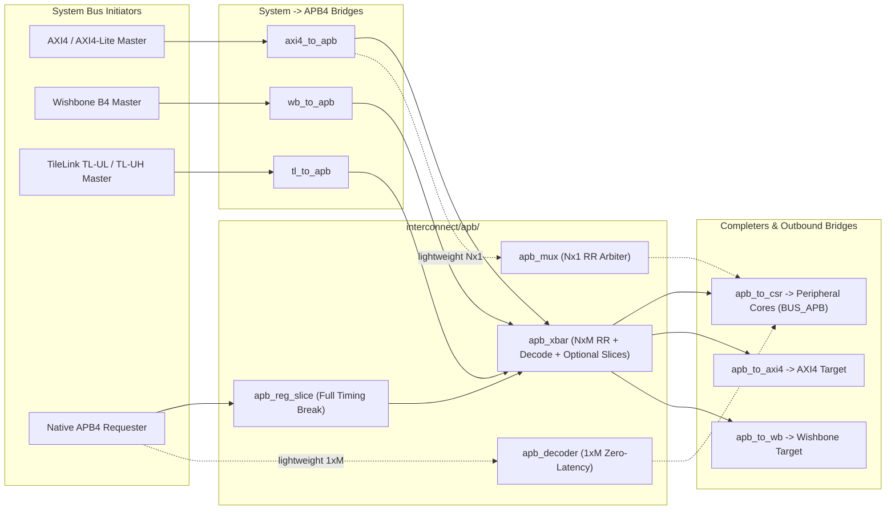

# AMBA APB4 Fabric, Bridges & Quad-Bus IP Integration Guide

This guide documents the **AMBA APB4 (IHI 0024C)** interconnect fabric, protocol bridges, CSR adapters, SystemVerilog interface, and the **quad-bus (`BUS_APB = 3`)** wrapper convention across the IP collection.

---

## 1. Architecture Overview

The APB4 subsystem integrates into the library's layered `common/` + `interconnect/` architecture using packed 32-bit SystemVerilog structs defined in `common/pkg/bus_pkg.sv`. All modules are 100% synthesizable IEEE 1800-2017 SystemVerilog with active-low asynchronous reset (`rst_ni`), zero inferred latches, and zero Verilator `-Wall` warnings.



### File Inventory

| File | Module / Type | Role |
| :--- | :--- | :--- |
| `common/pkg/bus_pkg.sv` | `BUS_APB = 3`, `apb_m2s_t`, `apb_s2m_t`, `APB_S2M_IDLE` | Packed APB4 structs & `bus_proto_e` selector |
| `interconnect/apb/apb_if.sv` | `apb_if` | Interface with `requester`, `completer`, `monitor` modports + `to_m2s()`/`to_s2m()` |
| `interconnect/apb/apb_reg_slice.sv` | `apb_reg_slice` | Full-isolation forward/return register slice (`BYPASS` parameter) |
| `interconnect/apb/apb_decoder.sv` | `apb_decoder` | 1-to-M zero-latency address decoder with decode-error responder |
| `interconnect/apb/apb_mux.sv` | `apb_mux` | N-to-1 round-robin APB4 requester arbiter/multiplexer |
| `interconnect/apb/apb_xbar.sv` | `apb_xbar` | N-to-M non-blocking crossbar with per-completer RR & optional slices |
| `interconnect/adapters/apb_to_csr.sv` | `apb_to_csr` | Combinational APB4 completer -> internal `csr_req_t`/`csr_rsp_t` adapter |
| `interconnect/adapters/csr_to_apb.sv` | `csr_to_apb` | Internal `csr_req_t`/`csr_rsp_t` master -> APB4 requester adapter |
| `interconnect/bridges/axi4_to_apb.sv` | `axi4_to_apb` | AXI4 / AXI4-Lite slave -> APB4 requester (INCR/WRAP/FIXED bursts, narrow) |
| `interconnect/bridges/wb_to_apb.sv` | `wb_to_apb` | Wishbone B4 Classic/Pipelined slave -> APB4 requester |
| `interconnect/bridges/tl_to_apb.sv` | `tl_to_apb` | TileLink TL-UL / TL-UH slave -> APB4 requester |
| `interconnect/bridges/apb_to_axi4.sv` | `apb_to_axi4` | APB4 completer -> single-beat 32-bit AXI4 master |
| `interconnect/bridges/apb_to_wb.sv` | `apb_to_wb` | APB4 completer -> single-beat 32-bit Wishbone B4 master |
| `interconnect/apb/filelist.f` | — | Compile-order filelist for APB fabric, adapters, and bridges |
| `interconnect/apb/filelist_ip_wrappers.f` | — | Compile-order list of all 15 retrofitted `ips/{01..14,17}/rtl/*_apb.sv` |

---

## 2. APB4 Bundle & Signal Tables (`bus_pkg.sv` / `apb_if.sv`)

### `apb_m2s_t` (Requester -> Completer, 74 bits packed)

| Field | Width | Direction | APB4 Spec Meaning & Library Rules |
| :--- | :---: | :---: | :--- |
| `paddr` | `[31:0]` | R -> C | Byte address. Held stable from SETUP through final ACCESS cycle. |
| `psel` | `1` | R -> C | Peripheral select. `psel=1, penable=0` = SETUP; `psel=1, penable=1` = ACCESS. |
| `penable` | `1` | R -> C | Access phase strobe. Must be `0` when `psel=0` and during SETUP. |
| `pwrite` | `1` | R -> C | Transfer direction: `1` = write, `0` = read. Held stable across SETUP + ACCESS. |
| `pprot` | `[2:0]` | R -> C | Protection attributes: `[0]` privileged, `[1]` non-secure, `[2]` instruction access. |
| `pwdata` | `[31:0]` | R -> C | Write data (little-endian). Valid and stable during write SETUP + ACCESS. |
| `pstrb` | `[3:0]` | R -> C | Write byte-lane strobes (`pstrb[i]` enables `pwdata[8*i +: 8]`). **Must be `4'b0000` on reads.** |

### `apb_s2m_t` (Completer -> Requester, 34 bits packed)

| Field | Width | Direction | APB4 Spec Meaning & Library Rules |
| :--- | :---: | :---: | :--- |
| `pready` | `1` | C -> R | Ready handshake in ACCESS phase. `0` inserts wait states; `1` completes transfer. |
| `prdata` | `[31:0]` | C -> R | Read data. Valid in ACCESS when `!pwrite && pready`. Driven to `32'd0` outside read completion by `apb_to_csr`. |
| `pslverr` | `1` | C -> R | Error response. Valid only when `psel && penable && pready`. Driven to `1'b0` outside ACCESS completion. |

- **Idle Constant**: `localparam apb_s2m_t APB_S2M_IDLE = '{pready: 1'b1, prdata: 32'd0, pslverr: 1'b0};`
- **APB5 Optional Signals**: `pwakeup`, `pauser`, `pwuser`, `pruser`, `pbuser`, and `pnse` are intentionally omitted from `apb_m2s_t`/`apb_s2m_t` to keep peripheral ports compact; tie them off at the top-level SoC boundary if connecting an APB5 initiator/target.
- **Interface `apb_if`**: Parameterized by `ADDR_W = 32` and `DATA_W = 32`, providing `requester`, `completer`, and `monitor` modports plus `to_m2s()` and `to_s2m()` conversion functions.

---

## 3. Protocol Timing Waveforms (ASCII)

### 3.1 Zero-Wait Write Followed Back-to-Back by Read with Wait States & Error

```text
clk       : __|‾‾|__|‾‾|__|‾‾|__|‾‾|__|‾‾|__|‾‾|__|‾‾|__|‾‾|__
cycle     :   T0    T1    T2    T3    T4    T5    T6    T7
phase     :  IDLE  SET1  ACC1  SET2  ACC2  ACC2  ACC2  IDLE
                                     (wait)(wait)(done)
psel      : ________/‾‾‾‾‾‾‾‾‾‾‾‾‾‾‾‾‾‾‾‾‾‾‾‾‾‾‾‾‾‾‾‾‾\_______
penable   : ______________/‾‾‾‾\_____/‾‾‾‾‾‾‾‾‾‾‾‾‾‾‾‾\_______
pwrite    : ________/‾‾‾‾‾‾‾‾‾‾\______________________________
paddr     : --------[   A1    ][         A2           ]-------
pwdata    : --------[   W1    ]-------------------------------
pstrb     : --------[  STRB1  ][         4'b0000      ]-------
pready    : ‾‾‾‾‾‾‾‾‾‾‾‾‾‾‾‾‾‾‾‾‾‾‾‾‾\___________/‾‾‾‾‾‾‾‾‾‾‾‾
prdata    : -------------------------------------[ R2 ]-------
pslverr   : -------------------------------------[ E2 ]-------
csr_valid : ______________/‾‾‾‾\_____/‾‾‾‾‾‾‾‾‾‾‾‾‾‾‾‾\_______
                                 ^                    ^
                         Write 1 commits      Read 2 completes
                        (pready=1 at T2)    (2 waits, pready=1 at T6)
```

Key guarantees of `apb_to_csr`:
- `csr_req_o.valid` is asserted **strictly in the ACCESS phase** (`psel && penable`), never during SETUP, so FIFO pops/pushes, clear-on-read flags, and W1C registers trigger **exactly once** per APB transfer.
- `csr_req_o.wstrb` is forced to `4'b0000` on reads even if a non-compliant requester leaves `pstrb` non-zero.
- `apb_to_csr` is purely combinational and introduces **zero** clock cycles of latency.

### 3.2 `apb_reg_slice` (`BYPASS = 0`) Timing Isolation

```text
clk       : __|‾‾|__|‾‾|__|‾‾|__|‾‾|__|‾‾|__|‾‾|__
cycle     :   T0    T1    T2    T3    T4    T5
state_q   :  IDLE  IDLE  SET   ACC   RESP  IDLE
s_psel    : __/‾‾‾‾‾‾‾‾‾‾‾‾‾‾‾‾‾‾‾‾‾‾‾‾‾‾‾\_______
s_penable : ________/‾‾‾‾‾‾‾‾‾‾‾‾‾‾‾‾‾‾‾‾‾\_______
s_pready  : ________________________/‾‾‾‾‾\_______  <- registered (state_q == ST_RESP)
m_psel    : ______________/‾‾‾‾‾‾‾‾‾‾‾\___________  <- registered
m_penable : ____________________/‾‾‾‾‾\___________  <- registered
m_pready  : ‾‾‾‾‾‾‾‾‾‾‾‾‾‾‾‾‾‾‾‾‾‾‾‾‾‾‾‾‾‾‾‾‾‾‾‾‾‾
                         ^           ^     ^
                    Capture up  Capture dn Return registered
                    payload     prdata/err response to up
```

All downstream (`m_apb_o`) and upstream (`s_apb_o`) outputs of `apb_reg_slice` are driven directly from flip-flops (`state_q`, `paddr_q`, `pwdata_q`, `pwrite_q`, `pprot_q`, `pstrb_q`, `prdata_q`, `pslverr_q`), breaking combinational paths completely in both directions at a cost of 3 extra cycles per transfer.

### 3.3 `axi4_to_apb` Multi-Beat Burst Decomposition

```text
AXI4 AW   : [AW: addr=0x200, len=1, size=2, burst=INCR] (accepted)
AXI4 W    : [W0: data=D0, strb=S0] ... [W1: data=D1, strb=S1, last=1]
APB out   : IDLE -> SET(0x200,D0,S0) -> ACC(0x200) -> IDLE -> SET(0x204,D1,S1) -> ACC(0x204)
AXI4 B    :                                                                           [B: OKAY or SLVERR]
```

Each AXI4 write or read beat (and each Wishbone pipelined beat) is sequenced into an independent APB4 transfer using `axi_next_addr` (`FIXED`, `INCR`, `WRAP`, narrow `size` = 0/1/2) and per-beat `wstrb`. If any beat in an AXI4 write burst receives `pslverr = 1`, the sticky error flag sets `bresp = AXI_RESP_SLVERR`; for AXI4 reads, `rresp` reflects `pslverr` per beat.

---

## 4. Fabric Modules & Parameters

### 4.1 `apb_xbar` (`interconnect/apb/apb_xbar.sv`)

| Parameter | Default | Description |
| :--- | :---: | :--- |
| `NUM_REQ` | `2` | Number of APB4 requester ports (`s_apb_i/o[NUM_REQ-1:0]`). |
| `NUM_CMP` | `4` | Number of APB4 completer ports (`m_apb_o/i[NUM_CMP-1:0]`). |
| `PIPE_REQ` | `1'b0` | Insert an `apb_reg_slice` on every requester port (`1` = registered, `0` = bypass). |
| `PIPE_CMP` | `1'b0` | Insert an `apb_reg_slice` on every completer port (`1` = registered, `0` = bypass). |

- **Non-blocking parallelism**: Independent per-completer FSMs (`ST_IDLE`, `ST_SETUP`, `ST_ACCESS`) and round-robin pointers (`ptr_q[c]`) allow up to `min(NUM_REQ, NUM_CMP)` transfers to proceed simultaneously when targeting distinct completers.
- **Arbitration**: Rotating priority starting at `ptr_q[c]`; on completion (`cp[c].pready`), `ptr_q[c]` advances to `(gnt_q[c] + 1) mod NUM_REQ` (implemented without `%` for clean ASIC/FPGA synthesis).
- **Decode & Error Handling**: Address match rule `(paddr & addr_mask) == (base_addr & addr_mask)`. Lowest completer index wins if windows overlap. Unmapped addresses complete on the requester's first ACCESS cycle with `pready = 1, prdata = 0, pslverr = 1` without disturbing any completer.
- **Latency**: 2 extra cycles (`arbitrate` + `SETUP`) with `PIPE_REQ=0, PIPE_CMP=0`; +3 cycles per enabled slice (`PIPE_REQ` / `PIPE_CMP`).

### 4.2 `apb_decoder` (`interconnect/apb/apb_decoder.sv`) & `apb_mux` (`interconnect/apb/apb_mux.sv`)

- **`apb_decoder #(NUM_CMP = 4)`**: Lightweight 1-to-M zero-latency combinational decoder for single-bridge APB peripheral buses. Uses the exact same `addr_map_rule_t` match rule, lowest-index overlap priority, and decode-error response (`pready=1, pslverr=1, prdata=0`) as `apb_xbar`. Forward and return `always_comb` blocks are separated to prevent false combinational-loop flags.
- **`apb_mux #(NUM_REQ = 2)`**: Lightweight N-to-1 round-robin arbiter sharing one APB4 completer across `NUM_REQ` requesters with registered downstream SETUP/ACCESS phases.

### 4.3 Protocol Bridges (`interconnect/bridges/`)

| Module | Direction | Parameters | Key Behavior & Error Mapping |
| :--- | :--- | :--- | :--- |
| `axi4_to_apb` | AXI4 / AXI4-Lite -> APB4 | `PPROT = 3'b000` | Decoupled AW/W arrival; `FIXED`/`INCR`/`WRAP` bursts; narrow sizes; `pslverr` -> `AXI_RESP_SLVERR` (sticky on B, per-beat on R). |
| `wb_to_apb` | Wishbone B4 -> APB4 | `PPROT = 3'b000` | Classic & Pipelined B4 cycles (incl. wrap/incr bursts); `sel` -> `pstrb`; `pslverr` -> `wb.err` (`ack` suppressed). |
| `tl_to_apb` | TileLink TL-UL/UH -> APB4 | `PPROT = 3'b000` | `Get`, `PutFullData`, `PutPartialData`, `Intent` (`HintAck`), and TL-UH `ArithmeticData`/`LogicalData` as 2-transfer APB RMW (non-atomic wrt other APB masters); `pslverr` -> `d_denied` (+ `d_corrupt` on `AccessAckData`). |
| `apb_to_axi4` | APB4 -> AXI4 Master | — | Each APB transfer becomes 1 single-beat 32-bit word-aligned (`{paddr[31:2], 2'b00}`, `len=0`, `size=2`) AXI4 transaction; holds `pready=0` until B/R; `bresp/rresp != OKAY` -> `pslverr`. |
| `apb_to_wb` | APB4 -> Wishbone B4 Master | — | Each APB transfer becomes 1 single-beat word-aligned Wishbone B4 transaction; holds `pready=0` until `ack`/`err`; `wb.err` -> `pslverr`. |

---

## 5. Address Decode-Map Example

```systemverilog
import bus_pkg::*;

localparam int unsigned NUM_APB_SLAVES = 4;

// addr_map_rule_t: match when (paddr & addr_mask) == (base_addr & addr_mask)
// Lowest index wins on overlap. Unmapped addresses return pslverr = 1, prdata = 0.
addr_map_rule_t [NUM_APB_SLAVES-1:0] apb_map;
assign apb_map[0] = '{base_addr: 32'h4000_0000, addr_mask: 32'hFFFF_F000}; // 4 KB: GPIO
assign apb_map[1] = '{base_addr: 32'h4000_1000, addr_mask: 32'hFFFF_F000}; // 4 KB: UART
assign apb_map[2] = '{base_addr: 32'h4000_2000, addr_mask: 32'hFFFF_F000}; // 4 KB: SPI
assign apb_map[3] = '{base_addr: 32'h4000_3000, addr_mask: 32'hFFFF_F000}; // 4 KB: LEDC

apb_m2s_t [1:0]                req_m2s;
apb_s2m_t [1:0]                req_s2m;
apb_m2s_t [NUM_APB_SLAVES-1:0] cmp_m2s;
apb_s2m_t [NUM_APB_SLAVES-1:0] cmp_s2m;

// Example: CPU AXI4 port bridged onto requester 0 of a 2x4 APB4 crossbar
axi4_to_apb #(.PPROT(3'b000)) u_axi_to_apb (
  .clk_i   (clk_i),
  .rst_ni  (rst_ni),
  .s_axi_i (cpu_axi_m2s),
  .s_axi_o (cpu_axi_s2m),
  .m_apb_o (req_m2s[0]),
  .m_apb_i (req_s2m[0])
);

apb_xbar #(
  .NUM_REQ  (2),
  .NUM_CMP  (NUM_APB_SLAVES),
  .PIPE_REQ (1'b0),
  .PIPE_CMP (1'b1)  // Register slice toward peripherals for clean timing closure
) u_apb_xbar (
  .clk_i      (clk_i),
  .rst_ni     (rst_ni),
  .addr_map_i (apb_map),
  .s_apb_i    (req_m2s),
  .s_apb_o    (req_s2m),
  .m_apb_o    (cmp_m2s),
  .m_apb_i    (cmp_s2m)
);

gpio_top #(.BUS_TYPE(BUS_APB), .NUM_PINS(32)) u_gpio (
  .clk_i (clk_i), .rst_ni (rst_ni),
  .wb_i  ('0),    .wb_o   (),
  .axi_i ('0),    .axi_o  (),
  .tl_i  ('0),    .tl_o   (),
  .apb_i (cmp_m2s[0]),
  .apb_o (cmp_s2m[0]),
  /* ... pad ports ... */
);
```

---

## 6. Quad-Bus Wrapper Convention (`BUS_APB = 3`) & DMA Master Rule

Every IP in `ips/01..14` and `ips/17` (plus all new IPs) supports `BUS_TYPE = bus_pkg::BUS_APB`:

1. **CSR-only slave IPs** (`01_uart_usart`, `02_spi`, `03_i2c_i3c`, `08_gpio`, `09_i2s`, `10_ledc`, `12_can`):
   - `<ip>_apb.sv` instantiates `apb_to_csr` feeding `<ip>_core`.
   - `<ip>_top.sv` appends `input apb_m2s_t apb_i, output apb_s2m_t apb_o` after `tl_i`/`tl_o` and adds an `else if (BUS_TYPE == BUS_APB) begin : gen_apb` generate branch.
   - Inactive bus outputs are tied to `'0` in every branch.
2. **Dual-port CSR + memory-window IPs** (`04_xspi_xip`, `05_hyperram`, `06_sdram_sram_nvsram`, `07_nvpsram`):
   - Append `apb_csr_i/apb_csr_o` and `apb_mem_i/apb_mem_o` after `tl_mem_i/tl_mem_o`.
   - Each port uses its own `apb_to_csr` instance feeding `csr_req_i/o` and `mem_win_req_i/o`.
3. **DMA-capable / bus-master IPs** (`11_jtag`, `13_eth_mac`, `14_dvi_tmds`, `17_mini_tpu`, and new DMA/GPU IPs):
   - **Convention**: Because AMBA APB4 is a low-bandwidth peripheral slave bus with **no burst/DMA master role**, selecting `BUS_TYPE == BUS_APB` connects the CSR slave port via `s_apb_i`/`s_apb_o` (`apb_to_csr`) while the IP's DMA/system master port uses **`mem_to_axi4_master` driving the existing `m_axi_o`/`m_axi_i` port pair**.
   - `m_wb_o`, `m_tl_o`, `s_wb_o`, `s_axi_o`, and `s_tl_o` are tied to `'0` in `gen_apb`.

---

## 7. Bus Protocol Comparison Table (Wishbone B4 vs AXI4 vs TileLink vs APB4)

| Feature | Wishbone B4 (`BUS_WISHBONE = 0`) | AXI4 / AXI4-Lite (`BUS_AXI4 = 1`) | TileLink TL-UL / TL-UH (`BUS_TILELINK = 2`) | AMBA APB4 (`BUS_APB = 3`) |
| :--- | :--- | :--- | :--- | :--- |
| **Struct Pair** | `wb_m2s_t` / `wb_s2m_t` | `axi4_m2s_t` / `axi4_s2m_t` | `tl_m2s_t` / `tl_s2m_t` | `apb_m2s_t` / `apb_s2m_t` |
| **Bit Width (m2s / s2m)** | 76 b / 36 b | 154 b / 50 b | 89 b / 57 b | 74 b / 34 b |
| **Channels** | Shared req/rsp (`cyc/stb/ack/stall`) | 5 independent (`AW, W, B, AR, R`) | 2 (`A` req, `D` rsp) | Single non-pipelined 2-phase (`SETUP` + `ACCESS`) |
| **Bursts** | Classic & Pipelined (`CTI`/`BTE`: linear, 4/8/16 wrap) | `FIXED`, `INCR`, `WRAP` up to 256 beats, 4 KB safe | Multi-beat `a_size` bursts (TL-UH) | Single-beat only (bridges serialize bursts) |
| **Byte Enables** | `sel[3:0]` | `wstrb[3:0]` | `a_mask[3:0]` | `pstrb[3:0]` (`4'b0000` on reads) |
| **Wait States** | `stall` (req) + delayed `ack` | Per-channel `ready`/`valid` | `a_ready`, `d_valid`/`d_ready` | `pready = 0` in ACCESS phase |
| **Error Signaling** | `err` (mutually exclusive with `ack`) | `bresp`/`rresp` (`SLVERR`, `DECERR`) | `d_denied`, `d_corrupt` | `pslverr` (in ACCESS when `pready=1`) |
| **Atomics** | None | None (in this 32b bundle) | TL-UH `ArithmeticData`/`LogicalData` | None (`tl_to_apb` runs 2-transfer RMW) |
| **Peak Throughput** | 1 word / cycle (pipelined) | 1 R + 1 W word / cycle (full duplex) | 1 word / cycle | 0.5 words / cycle (2 cycles min: SETUP + ACCESS) |
| **DMA Master Port** | `m_wb_o` / `m_wb_i` | `m_axi_o` / `m_axi_i` | `m_tl_o` / `m_tl_i` | Uses `m_axi_o` / `m_axi_i` (AXI4 master) |
| **Ideal Use Case** | Simple SoC fabric, classic open-source cores | High-throughput DMA, GPU, NPU, memory | RISC-V ecosystems, atomic CSR/SRAM ops | Low-area, low-power peripheral CSR fabrics |

---

## 8. Synthesis & Verification Summary

- **Lint**: All 11 standalone APB fabric modules (`apb_to_csr`, `csr_to_apb`, `apb_reg_slice` (`BYPASS=0/1`), `apb_decoder`, `apb_mux`, `apb_xbar` (all 4 `PIPE_REQ`/`PIPE_CMP` combos), `axi4_to_apb`, `wb_to_apb`, `tl_to_apb`, `apb_to_axi4`, `apb_to_wb`) and all retrofitted quad-bus tops pass `verilator --lint-only -Wall` with zero warnings and zero new `-Wno-*` flags.
- **Fabric Testbench (`tb/tb_apb_fabric.sv`, top `tb_apb_fabric`)**: Self-checking constrained-random (`+seed=<n>`) suite with an APB4 protocol monitor (`tb_apb_chk`) attached to every link and independent reference memory/register models:
  - `apb_to_csr`: wait states, `pslverr`, `pstrb` partial/zero strobes, back-to-back transfers, read-counter side effects verified exactly once.
  - `apb_reg_slice`: 300 randomized transfers with protocol assertions on both upstream and downstream links.
  - `apb_xbar`: 3x4 crossbar across all 4 `(PIPE_REQ, PIPE_CMP)` combinations, strict 3-way round-robin rotation fairness test, concurrent random traffic vs reference memories, slave errors, decode errors, and exact downstream transfer counts.
  - `axi4_to_apb`, `wb_to_apb`, `tl_to_apb`, `apb_to_axi4`, `apb_to_wb`: full burst/beat decomposition (`INCR`/`WRAP`/`FIXED`, narrow sizes, W-before-AW, WB classic + pipelined wrap bursts, TL Get/PutFull/PutPartial + TL-UH ADD/XOR/Intent), sparse strobes, word alignment, and error mapping.
  - `apb_decoder` (+ `apb_if` `to_m2s()`/`to_s2m()`): 1-to-4 decode, overlapping-window lowest-index priority, decode errors.
  - `apb_mux`: 3-to-1 concurrent random traffic and strict 3-way round-robin rotation check.
- **Peripheral Smoke Testbench (`tb/tb_apb_peripherals.sv`, top `tb_apb_peripherals`)**: Instantiates `BUS_TYPE = BUS_APB` tops of `gpio_top`, `uart_usart_top`, `spi_top`, `ledc_top`, `mini_tpu_top`, `xspi_xip_top`, `hyperram_ctrl_top`, `ext_mem_ctrl_top`, and `nvpsram_ctrl_top`; verifies reset values, W/R, `pstrb` byte lanes, `pslverr` on unmapped offsets, interrupts (level, edge, W1C, PWM fade-done), FIFO side effects, XIP cache-miss wait states, back-to-back transfers, and inactive bus output tie-offs.
