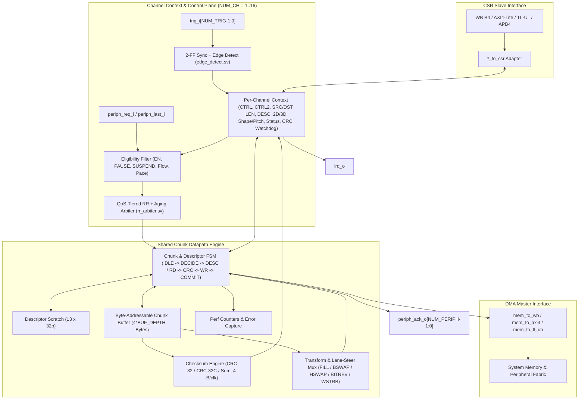
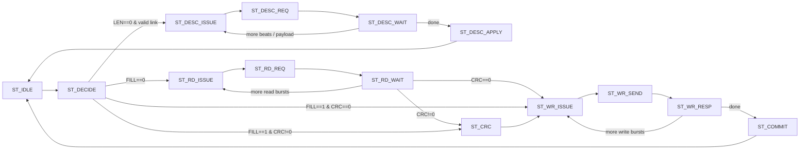

# General-Purpose + 2D/3D Scatter-Gather DMA Controller (`gdma`) — Architecture & Programming Guide

`ips/15_dma_gdma` provides **GDMA2**, a clean-room, pure synthesizable IEEE 1800-2017 SystemVerilog multi-channel DMA controller supporting 1D/2D/3D transfers, linked-list scatter-gather with per-node register update masks, independent source/destination burst & beat-width conversion, unaligned byte-lane steering, on-the-fly transforms and CRC-32/CRC-32C/checksum computation, hardware peripheral flow control with quantum and peripheral-last termination, circular/ping-pong buffers, hardware/software triggers, progress watchdogs, bus-error capture, and performance counters.

- **Datasheet & Complete Register Map**: [`ips/15_dma_gdma/doc/README.md`](../ips/15_dma_gdma/doc/README.md)
- **RTL Sources**: `ips/15_dma_gdma/rtl/{gdma_pkg,gdma_core,gdma_wb,gdma_axi,gdma_tl,gdma_apb,gdma_top}.sv`
- **Filelist Fragment**: `ips/15_dma_gdma/filelist.f`
- **Testbenches**: `ips/15_dma_gdma/tb/tb_gdma.sv` (legacy + 17 directed suites) and `ips/15_dma_gdma/tb/tb_gdma_rand.sv` (constrained-random + independent reference model)

> [!NOTE]
> **Backward compatibility**: Every legacy register offset (`0x000..0x008`, `0x020 + 0x20*c`), bit assignment, and 4-word 16-byte scatter-gather descriptor format is preserved verbatim. All new features reside in previously reserved bits or new offsets (`0x00C..0x01C`, `0x300..0x328`, `0x400 + 0x80*c`) and reset to disabled/off.

---

## 1. Architecture Overview

GDMA2 separates **per-channel context state** from a **shared, single-outstanding chunk datapath engine** bridged to the SoC fabric via protocol-agnostic `csr_req_t`/`csr_rsp_t` and `mem_req_t`/`mem_rsp_t` bundles.



### Key Design Choices

1. **Chunk-based burst pipelining**: Rather than holding the bus across an entire multi-megabyte transfer (which would starve high-priority channels) or issuing single beats per arbitration (which wastes bus bandwidth), GDMA2 arbitrates **per chunk** (up to `4 * BUF_DEPTH - src_byte_offset` bytes, default up to 64 B). Each chunk completes its read bursts, optional checksum pass, and write bursts atomically before committing progress and releasing the arbiter.
2. **4 KB-safe burst decomposition**: Before every incrementing read, write, or descriptor burst, the engine calculates `words_to_4kb = 1024 - addr[11:2]` and clamps the burst length to `min(remaining_words, programmed_burst, words_to_4kb)`. No AXI4 `AR` or `AW` burst ever crosses a 4 KB boundary, regardless of start alignment or pitch.
3. **Byte-stream unaligned engine**: All bus beats are 32-bit word-aligned (`size = 2`). Incrementing sources read whole aligned words into `buf_b_q` starting at `buf_start_off = src_addr[1:0]`, while incrementing destinations assemble aligned 32-bit words with exact `wstrb` masks so surrounding bytes outside `[dst_addr, dst_addr + len)` are never disturbed.
4. **Quad-bus wrapper symmetry**: `gdma_top` instantiates `gdma_wb`, `gdma_axi`, `gdma_tl`, or `gdma_apb` selected by `BUS_TYPE`. Because AMBA APB4 is a slave-only peripheral bus, `BUS_APB` pairs an `apb_to_csr` CSR slave (`s_apb_i`/`s_apb_o`) with a `mem_to_axi4_master` AXI4 burst master (`m_axi_o`/`m_axi_i`).

### Chunk Engine FSM Flow



---

## 2. Arbitration, Priority, QoS & Anti-Starvation Aging

GDMA2 reuses `common/rtl/rr_arbiter.sv` (`ENABLE_AGING = 1`, `AGING_MAX = ARB_AGING_MAX`, default 16).

### How Channels Compete

1. **Eligibility (`ch_req[c]`)**: A channel requests the chunk engine only when:
   - `GLB_CTRL.EN == 1` and `GLB_CTRL.SUSPEND == 0`
   - `CH_CTRL.EN == 1` and `CTRL2.PAUSE == 0`
   - No pending abort, stop, or watchdog timeout on channel `c`
   - Either `CH_LEN == 0` (needing descriptor fetch or zero-length completion) **or** both peripheral flow (`!PERIPH_FLOW || q_active || (ack_hold==0 && periph_req_i[sel])`) and trigger pacing (`!TRIG_ACT || pace_pend`) are satisfied.
2. **Priority tiers (`CH_CTRL.QOS`, bits `[15:12]`)**: Each channel carries a 4-bit priority `0..15` (`15` = highest). On every `ST_IDLE` grant decision, the arbiter filters eligible channels to the highest effective priority tier and selects the next channel in round-robin order starting from `rr_ptr_q`.
3. **Anti-starvation aging**: Whenever channel `c` is requesting (`ch_req[c] == 1`) and loses a chunk grant to another channel, its `wait_cnt_q[c]` increments by 1 (the `ack_i` pulse fires at the `ST_IDLE -> ST_DECIDE` handoff with `lock_i = 0`). Once `wait_cnt_q[c] >= ARB_AGING_MAX`, channel `c`'s effective priority is promoted to `4'hF` until it receives a chunk grant, preventing lower-priority channels from starving under sustained high-priority traffic.
4. **Decoupled Bus-QoS (`CTRL2.BUS_QOS_EN` / `BUS_QOS`)**: By default, `CH_CTRL.QOS` drives both internal channel arbitration and the bus `awqos`/`arqos` signals (on AXI4). Setting `CTRL2[26] = 1` decouples the two so a channel can have low internal arbitration priority (e.g., background memory scrub) while still emitting a specific fabric QoS tag in `CTRL2[30:27]`, or vice versa.

---

## 3. Descriptor Formats (Scatter-Gather Linked Lists)

Enable scatter-gather by setting `CH_CTRL.SG_EN = 1` (bit 10) and programming `CH_DESC` with bit `[0] = 1`. Setting `CH_LEN = 0` at channel arm causes GDMA2 to fetch the first descriptor immediately before moving any data.

### 3.1 Legacy 4-Word Descriptor (`CH_CTRL.EXT_DESC = 0`)

Must be **16-byte aligned** (`addr = {CH_DESC[31:4], 4'b0000}`).

| Word Offset | Field | Description |
| :--- | :--- | :--- |
| `+0x00` (`W0`) | `SRC_ADDR` | 32-bit source byte address (also refreshes row/plane base) |
| `+0x04` (`W1`) | `DST_ADDR` | 32-bit destination byte address (also refreshes row/plane base) |
| `+0x08` (`W2`) | `BYTE_LEN` | `[23:0]` row byte length (also updates row-reload length) |
| `+0x0C` (`W3`) | `NEXT_DESC` | `[31:4]` next 16B-aligned descriptor address, `[0]` valid link (`0` = end of list) |

### 3.2 Extended Variable-Length Descriptor (`CH_CTRL.EXT_DESC = 1`)

Must be **4-byte (word) aligned** (`addr = {CH_DESC[31:2], 2'b00}`). Every extended node starts with 2 mandatory words (`HDR`, `NEXT`), followed by **0 to 13 optional payload words** packed tightly in ascending bit order of `HDR[12:0]`.

| Word Index | Field | Bit Definition |
| :--- | :--- | :--- |
| `W0` (`+0x00`) | `HDR` | `[12:0]` update bitmask, `[15:13]` reserved (must be `0` else `CFG` error), `[16]` `NODE_IRQ`, `[17]` `PAUSE_AFTER`, `[18]` `CRC_CLR`, `[31:19]` reserved |
| `W1` (`+0x04`) | `NEXT` | `[31:2]` next word-aligned node pointer, `[1]` ignored (cleared in `CH_DESC`), `[0]` valid link (`1` = continue, `0` = end of list) |
| `W2 .. W(1+popcount)` | Payload | Present only for bits set in `HDR[12:0]`, ordered from bit 0 upward |

#### `HDR[12:0]` Per-Node Register Update Mask

| `HDR` Bit | Target Register | Update Semantics |
| :---: | :--- | :--- |
| `0` | `CH_SRC` | Updates `CH_SRC` and re-latches 2D/3D source row & plane base |
| `1` | `CH_DST` | Updates `CH_DST` and re-latches 2D/3D destination row & plane base |
| `2` | `CH_LEN` | Updates `CH_LEN[23:0]` and row-reload length (`0` or omitted = 0-length config node) |
| `3` | `CH_CTRL[15:1]` | Updates transfer flags/sizes/periph/SG/QOS; `EN` (`[0]`) is **never** modified |
| `4` | `CTRL2[30:0]` | Updates bursts/width/transforms/FILL/CRC/triggers/QoS; `PAUSE` (`[31]`) is **never** modified |
| `5` | `SHAPE` | Updates `[15:0]` `ROWS` and `[31:16]` `PLANES` |
| `6` | `SRC_PITCH` | Signed 32-bit byte offset between source row starts |
| `7` | `DST_PITCH` | Signed 32-bit byte offset between destination row starts |
| `8` | `SRC_PSTRIDE` | Signed 32-bit byte offset between source plane starts |
| `9` | `DST_PSTRIDE` | Signed 32-bit byte offset between destination plane starts |
| `10` | `FILL` | 32-bit little-endian fill pattern |
| `11` | `HT_THRESH` | Half-transfer interrupt byte threshold |
| `12` | `TIMEOUT` | `[23:0]` progress watchdog cycle limit |

> [!TIP]
> **Atomic application & chaining**: All words of a node are fetched into an internal 13-word scratch buffer before any channel register is modified. If a bus error occurs on any beat of the descriptor fetch, the channel stops with `EC_DESC` (`3`) leaving prior registers intact. Fields omitted from `HDR[12:0]` keep their existing values; if `SRC` or `DST` is omitted, 2D/3D `row_base` and `plane_base` are re-latched from the current working `CH_SRC`/`CH_DST` so consecutive nodes tile seamlessly.

### 3.3 Circular Linked Lists

GDMA2 supports two circular list patterns:
1. **Ring-link circular list**: Point the final node's `NEXT` back to Node 0 with `NEXT[0] = 1` (`CIRC = 0`). The list runs indefinitely, firing `STATUS.NODE` on each marked node, until paused or aborted.
2. **Snapshot circular list**: Terminate the last node with `NEXT[0] = 0` and set `CTRL2.CIRC = 1`. On end-of-list, GDMA2 sets `STATUS.TC`, restores `CH_SRC/CH_DST/CH_LEN/CH_DESC` from the arm-time snapshot (`DESC_HEAD` holds the initial `CH_DESC`), resets `BYTES` and `HT` arming, and restarts automatically.

---

## 4. 2D & 3D Addressing Explained

For `PLANES = max(SHAPE[31:16], 1)` and `ROWS = max(SHAPE[15:0], 1)` with row width `L = CH_LEN` bytes:

```text
S(plane p, row r) = src0 + p * SRC_PSTRIDE + r * SRC_PITCH    (mod 2^32, if SRC_INC=1)
D(plane p, row r) = dst0 + p * DST_PSTRIDE + r * DST_PITCH    (mod 2^32, if DST_INC=1)
```

### Example A — Sub-Rectangle Crop (640x480 RGB888 Frame -> Contiguous 100x48 Tile)

Extract a 100-pixel-wide (`300` bytes/row) by `48`-row window starting at `(x=40, y=20)` in a `640`-pixel (`1920`-byte stride) framebuffer into a tightly packed destination buffer:

```text
Source Framebuffer (stride = 1920 B)              Destination Tile (stride = 300 B)
+-----------------------------------+             +-----------------+
| (0,0)                             |             | Row 0  (300 B)  |
|   +--------------+                |   GDMA 2D   +-----------------+
|   | (40,20) 300B | --> row 0      | ==========> | Row 1  (300 B)  |
|   |   ...        | --> row 1      |             +-----------------+
|   |         48 r | --> row 47     |             | ... Row 47      |
|   +--------------+                |             +-----------------+
+-----------------------------------+
SRC       = fb_base + 20*1920 + 40*3    DST       = tile_buf
SRC_PITCH = 1920                        DST_PITCH = 300
CH_LEN    = 300                         SHAPE     = 48 (PLANES=0 -> 1)
```

### Example B — Vertical Flip via Negative Pitch

To flip an image of `H` rows of `W` bytes vertically while copying:
- Set `CH_SRC = img_base + (H - 1) * src_stride`
- Set `SRC_PITCH = -src_stride` (32-bit two's complement signed byte offset!)
- Set `CH_DST = dst_base`, `DST_PITCH = +dst_stride`
- Set `CH_LEN = W`, `SHAPE = H`

Row `0` reads the bottom line, row `1` steps backward by `src_stride`, ..., row `H-1` reads the top line.

### Example C — 3D Planar Color/Tensor Extraction

Given a 3-plane CHW tensor (3 channels, each 16x16 bytes stored with plane stride `256` B and row pitch `16` B), extract an 8x8 sub-patch across all 3 planes simultaneously into a packed 3x8x8 buffer:
- `SHAPE = (3 << 16) | 8` (`PLANES = 3`, `ROWS = 8`), `CH_LEN = 8`
- `SRC_PITCH = 16`, `SRC_PSTRIDE = 256`
- `DST_PITCH = 8`, `DST_PSTRIDE = 64`
- Total bytes moved = `3 * 8 * 8 = 192` bytes in a single channel run, with `PROG` showing `{planes_rem, rows_rem}` live during execution and `0` upon `TC`.

---

## 5. Data Path, Width Conversion, Transforms & Checksum

### 5.1 Width Conversion & Unaligned Byte Steering

Source item size (`ssz` from `CH_CTRL[4:3]`) and destination item size (`dsz` from `CTRL2[10:9]` when `CTRL2[8]=1`, else `CH_CTRL[4:3]`) are independently selectable (`1B`, `2B`, `4B`):
- **Incrementing side**: Bytes are streamed contiguously from/to arbitrary unaligned addresses `0..3` using aligned 32-bit bus beats and byte write strobes (`wstrb`), regardless of `ssz`/`dsz`.
- **Fixed (FIFO) side**: Each item of `ssz` (or `dsz`) bytes generates exactly one single-beat 32-bit bus access to `{addr[31:2], 2'b00}` using byte lane `addr[1:0] & ~(sz-1)`. Thus a 1-byte UART RX FIFO at fixed address `0x4000_0000` (`SRC_INC=0, ssz=1`) automatically packs 4 consecutive FIFO reads into 32-bit burst writes (`DST_INC=1, dsz=4`) to SRAM!

### 5.2 Transform Pipeline Order

Transforms operate on each **complete** `dsz`-byte group from the start of a row (in this exact order):
1. `BSWAP` (`CTRL2[12]`): reverse bytes inside the `dsz`-byte group (`dsz=4`: `[b3,b2,b1,b0]`, `dsz=2`: `[b1,b0]`).
2. `HSWAP` (`CTRL2[13]`): swap the two 16-bit halves (applies to `dsz=4` only: `[x2,x3,x0,x1]`). Combining `BSWAP + HSWAP` yields byte swap within each 16-bit halfword (`[b1,b0,b3,b2]`).
3. `BITREV` (`CTRL2[14]`): reverse bit order (`b[7:0] -> b[0:7]`) of every byte in the complete group.

### 5.3 On-the-Fly Checksum / CRC Engine

Set `CTRL2[17:16]` (`CRC_MODE`):
- `1`: **CRC-32 (IEEE 802.3 / Ethernet / zlib)** — reflected polynomial `0xEDB8_8320`, init `0xFFFF_FFFF`, XOR-out `0xFFFF_FFFF` (`"123456789"` -> `0xCBF4_3926`).
- `2`: **CRC-32C (Castagnoli / iSCSI / NVMe)** — reflected polynomial `0x82F6_3B78`, init `0xFFFF_FFFF`, XOR-out `0xFFFF_FFFF` (`"123456789"` -> `0xE306_9283`).
- `3`: **32-bit byte sum** — wrapping modulo-2^32 sum of all stream bytes (`"123456789"` -> `0x0000_01DD`).

The checksum runs on the **pre-transform** byte stream (including `FILL` streams) at 4 bytes/cycle. `CHx_CRC` always reads and writes in **final-value form**: writing `0` initializes a standard CRC-32/CRC-32C calculation regardless of whether `CRC_MODE` is configured before or after the write, and writing a previous `CHx_CRC` value seamlessly resumes an incremental CRC across disjoint buffers or channels.

---

## 6. Peripheral Hookup, Flow Control & Hardware Triggers

### 6.1 Peripheral Request / Acknowledge Handshake

Connect peripheral `k` (`0 <= k < NUM_PERIPH`) to `periph_req_i[k]`, `periph_ack_o[k]`, and optionally `periph_last_i[k]`:

```text
clk_i          _/‾\_/‾\_/‾\_/‾\_/‾\_/‾\_/‾\_/‾\_/‾\_/‾\_/‾\_
periph_req_i   ____/‾‾‾‾‾‾‾‾‾‾‾‾‾‾‾‾‾‾‾‾\________________/‾‾
periph_last_i  ____/‾‾‾‾ (sampled at quantum start) ________
DMA bus xfer   ________[== read + write PQ*psz bytes ==]____
periph_ack_o   ________________________________________/‾\__
ack_hold_q     0   0   0   0   0   0   0   0   0   0   2  1  0
                                                       ^-- 2-cycle hold-off
```

- **Quantum size**: Program `CHx_FLOW[7:0] = PQ - 1` (`1..256` items per request). The byte quantum is `PQ * psz`, where `psz = CTRL2.FLOW_SRC ? ssz : dsz`.
  - Single-item handshake (e.g., UART byte): `PQ - 1 = 0` (`FLOW = 0`), `psz = 1B`.
  - Burst/FIFO-threshold handshake (e.g., SPI/I2S FIFO half-empty of 8 halfwords): `PQ - 1 = 7`, `psz = 2B` -> 16 bytes moved per `periph_req_i`, followed by one `periph_ack_o` pulse.
- **Peripheral-terminated flow control (`FLOW[8] = LAST_EN`)**: When a peripheral (such as an Ethernet RX MAC or variable-length packet engine) drives `periph_last_i[k] = 1` alongside `periph_req_i[k] = 1`, GDMA2 transfers that final quantum, pulses `periph_ack_o[k]`, abandons any remaining length/rows/chain, and immediately completes with `STATUS.TC` (or wraps if `CIRC = 1`). Software reads `CHx_BYTES` to learn the exact packet length received.

### 6.2 Hardware & Software Triggers

`trig_i[NUM_TRIG-1:0]` passes through `common/rtl/edge_detect.sv` (2-FF synchronizer + rising/falling edge detector), so asynchronous external trigger pulses (timer compare, ADC EOC, GPIO pin) are safe without external CDC logic.
- **Start mode (`CTRL2.TRIG_ACT = 0`)**: The configured edge (`TRIG_MODE = 1` rise, `2` fall, `3` both) or a write of `2` to `CHx_CMD` arms a disabled channel (`EN: 0 -> 1`).
- **Pace mode (`CTRL2.TRIG_ACT = 1`)**: Every data chunk waits until a trigger event arrives (`STATUS.WAIT_REQ = 1`), then moves exactly one chunk and waits for the next trigger. Useful for timed DAC waveform playback or periodic sensor sampling.

---

## 7. Programming Recipes

All examples assume a base address `GDMA_BASE` and helper macros:

```c
#define R(off)        (*(volatile uint32_t *)(GDMA_BASE + (off)))
#define CH(c, off)    R(0x020u + 0x20u * (c) + (off))
#define CX(c, off)    R(0x400u + 0x80u * (c) + (off))
```

### Recipe 1: High-Throughput Burst M2M Copy with On-the-Fly CRC-32

```c
void gdma_memcpy_crc32(int ch, uint32_t dst, uint32_t src, uint32_t len, uint32_t *crc_out) {
  R(0x000) = 1u;                             // GLB_CTRL: global enable
  CX(ch, 0x20) = 0x7Fu;                      // STATUS: W1C all flags
  CX(ch, 0x04) = 0u;                         // SHAPE: 1D (1 plane, 1 row)
  CX(ch, 0x1C) = 0u;                         // CRC: seed 0 (standard IEEE CRC-32)
  CX(ch, 0x00) = (15u << 0)                  // SRC_BURST = 16 beats
               | (15u << 4)                  // DST_BURST = 16 beats
               | (1u  << 16);                // CRC_MODE = 1 (CRC-32 IEEE)
  CH(ch, 0x04) = src;
  CH(ch, 0x08) = dst;
  CH(ch, 0x0C) = len;
  CH(ch, 0x00) = (2u << 3) | 4u | 2u | 1u;   // 4B | DST_INC | SRC_INC | EN

  while (CX(ch, 0x20) & (1u << 8)) { }       // wait ACTIVE == 0
  if (CX(ch, 0x20) & (1u << 2)) {            // check ERR
    uint32_t bad_addr = CX(ch, 0x38);
    uint32_t bad_info = CX(ch, 0x3C);
    handle_dma_error(bad_addr, bad_info);
  }
  *crc_out = CX(ch, 0x1C);                   // final CRC-32
}
```

### Recipe 2: 2D Strided Copy with Vertical Flip & Endian Swap

```c
void gdma_blit_flip_bswap(int ch, uint32_t dst, uint32_t src_top,
                          uint32_t row_bytes, uint32_t rows,
                          int32_t src_stride, int32_t dst_stride) {
  CX(ch, 0x20) = 0x7Fu;
  CX(ch, 0x04) = rows & 0xFFFFu;             // SHAPE: 1 plane, `rows` rows
  CX(ch, 0x08) = (uint32_t)(-src_stride);    // negative source pitch
  CX(ch, 0x0C) = (uint32_t)(dst_stride);
  CX(ch, 0x00) = (15u << 0) | (15u << 4) | (1u << 12); // 16-beat bursts + BSWAP
  CH(ch, 0x04) = src_top + (rows - 1u) * (uint32_t)src_stride;
  CH(ch, 0x08) = dst;
  CH(ch, 0x0C) = row_bytes;
  CH(ch, 0x00) = (2u << 3) | 4u | 2u | 1u;   // dsz=4B, inc both, EN
}
```

### Recipe 3: Ping-Pong Circular Peripheral RX Buffer with HT & TC Interrupts

```c
void gdma_start_uart_rx_ring(int ch, uint32_t uart_rx_reg, uint32_t ring_buf,
                             uint32_t ring_bytes, uint32_t periph_line) {
  CX(ch, 0x20) = 0x7Fu;
  CX(ch, 0x04) = 0u;                         // 1D
  CX(ch, 0x2C) = ring_bytes / 2u;            // HT_THRESH = half buffer
  CX(ch, 0x30) = 0u;                         // FLOW: PQ=1 byte per UART req
  CX(ch, 0x24) = (1u << 0) | (1u << 1) | (1u << 2); // IE: TC | HT | ERR
  CX(ch, 0x00) = (1u << 11)                  // CIRC = 1
               | (1u << 25)                  // FLOW_SRC = 1 (peripheral is source)
               | (1u << 8) | (2u << 9)       // DST_SIZE_EN=1, DST_SIZE=4B (pack to 32b)
               | (7u << 4);                  // DST_BURST = 8 beats
  CH(ch, 0x04) = uart_rx_reg;                // fixed 1B FIFO
  CH(ch, 0x08) = ring_buf;                   // incrementing SRAM ring
  CH(ch, 0x0C) = ring_bytes;
  CH(ch, 0x00) = (0u << 3)                   // SIZE = 1B (source FIFO)
               | (1u << 2)                   // DST_INC = 1, SRC_INC = 0
               | (1u << 5)                   // PERIPH_FLOW = 1
               | ((periph_line & 0xFu) << 6)
               | 1u;                         // EN = 1
}
```

### Recipe 4: Extended Scatter-Gather Chain with Pause Breakpoint

```c
// Two-node chain: Node 0 copies payload with CRC_CLR + NODE_IRQ + PAUSE_AFTER;
// Node 1 updates only FILL + DST + LEN to zero-pad a trailer once CPU resumes.
uint32_t node1[] = {
  (1u<<1) | (1u<<2) | (1u<<4) | (1u<<10),    // HDR: DST, LEN, CTRL2, FILL
  0u,                                        // NEXT: end of list
  trailer_dst,                               // DST
  64u,                                       // LEN = 64 bytes
  (1u<<15) | (15u<<4),                       // CTRL2: FILL=1, 16-beat write bursts
  0x00000000u                                // FILL = 0
};
uint32_t node0[] = {
  (1u<<0) | (1u<<1) | (1u<<2) | (1u<<16) | (1u<<17) | (1u<<18), // SRC,DST,LEN + NODE_IRQ|PAUSE_AFTER|CRC_CLR
  ((uint32_t)(uintptr_t)node1) | 1u,         // NEXT -> node1 (valid)
  pkt_src,
  pkt_dst,
  pkt_len
};

CH(ch, 0x10) = ((uint32_t)(uintptr_t)node0) | 1u;
CH(ch, 0x0C) = 0u;                           // LEN=0 -> fetch node0 immediately
CH(ch, 0x00) = (2u<<3) | 4u | 2u | (1u<<10) | (1u<<11) | 1u; // SG_EN | EXT_DESC | EN
```

---

## 8. Error Handling, Watchdog & Safe Abort

| Condition | Flag Set | `ERR_INFO[7:4]` | `GERR_*` Updated? | Effect on Channel |
| :--- | :--- | :---: | :---: | :--- |
| Source read bus error | `STATUS.ERR` | `1` (`EC_RD`) | Yes (if clear) | Burst drained, chunk not committed, `EN := 0` |
| Dest write bus error | `STATUS.ERR` | `2` (`EC_WR`) | Yes (if clear) | Burst drained, chunk not committed, `EN := 0` |
| Descriptor read bus error | `STATUS.ERR` | `3` (`EC_DESC`) | Yes (if clear) | Burst drained, node not applied, `EN := 0` |
| Illegal size / reserved `HDR` / 0-progress rounding | `STATUS.CFG` | `4` (`EC_CFG`) | No | No bus access issued, `EN := 0` |
| Progress timeout (`TIMEOUT` cycles without commit/fetch) | `STATUS.TO` | `5` (`EC_TO`) | No | Safe stop at next burst boundary, `EN := 0` |
| `CMD.ABORT` or `GLB_CTRL.ABORT_ALL` (while `EN=1`) | `STATUS.ABRT` | unchanged | No | Safe stop at next burst boundary, `EN := 0` |
| Clearing `CH_CTRL.EN` to `0` | none | unchanged | No | Safe stop at next burst boundary, `EN := 0` |

In-flight bus bursts are **never** truncated mid-burst on abort, pause, suspend, or timeout; the DMA always drains the active burst cleanly so AXI4/WB/TileLink fabric invariants are never violated.

---

## 9. Integration & Synthesis Notes

- **Wrapper instantiation**: Existing SoCs instantiating `gdma_axi`, `gdma_wb`, or `gdma_tl` without `periph_last_i` or `trig_i` continue to compile warning-free because both new inputs default to `'0`.
- **Quad-bus top**: `gdma_top` accepts `BUS_TYPE = BUS_WISHBONE | BUS_AXI4 | BUS_TILELINK | BUS_APB`. Unused bus outputs are tied to `'0`.
- **Area scaling**: Per-channel state uses ~700 flip-flops/channel. The shared chunk buffer uses `BUF_DEPTH * 32` flip-flops (512 flops at default `BUF_DEPTH = 16`, scalable down to `4` for compact MCUs or up to `64` for wider burst buffering). No memories, latches, or derived clocks are instantiated.
- **Lint & synthesis**: Clean under `verilator --lint-only -Wall` (repo warning flags, zero `lint_off` pragmas) across all 4 `BUS_TYPE` settings and `NUM_CH = 1..16`, `BUF_DEPTH = 4..64`.

---

## 10. Verification Summary

Two independent testbenches verify GDMA2 under Verilator 5.054 (`--binary --timing`):

1. **`tb_gdma` (`ips/15_dma_gdma/tb/tb_gdma.sv`)**: Preserves all original WB/AXI4/TileLink legacy scatter-gather and M2M checks and adds 16 directed feature suites exercising `gdma_top(BUS_APB)`, partial `pstrb`, `pslverr`, all 4x4 unaligned offsets, fixed-address FIFO packing/unpacking, 2D positive/negative pitch, 3D planes, `BSWAP`/`HSWAP`/`BITREV` + partial tails, `FILL`, IEEE CRC-32 (`0xCBF43926`) / CRC-32C (`0xE3069283`) / byte-sum (`0x01DD`) KATs + seeded resumption, extended descriptor chains (`NODE_IRQ`, `PAUSE_AFTER`, `CRC_CLR`), circular rings with `HT`/`TC` IRQs, peripheral quantum + `periph_last_i`, HW/SW start & pace triggers, global suspend & `ABORT_ALL`, 4KB-boundary burst safety with live AXI4 protocol & QoS assertions, error capture (`EC_RD`/`WR`/`DESC`/`CFG`/`TO` + `GERR`), anti-starvation aging, and global performance counters.
2. **`tb_gdma_rand` (`ips/15_dma_gdma/tb/tb_gdma_rand.sv`)**: Constrained-random, multi-seed self-checking testbench with an independent byte-stream reference model (built solely from the datasheet contract), running concurrent multi-channel randomized configurations across AXI4, Wishbone B4, and TileLink (plus 16-channel stress) against back-pressured, error-injecting bus slaves with live protocol checks and mandatory functional-coverage closure.
