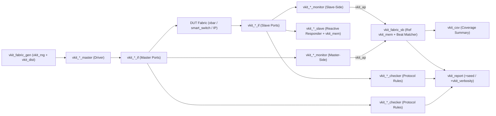

# 10 — Verification Methodology (`vkit`)

This document describes the reusable, UVM-flavored, library-free SystemVerilog verification kit in [`tb/vkit/`](../tb/vkit/) and the fabric-level constrained-random regressions built on top of it.

---

## 1. Reference Host Tooling Audit

Verified on the reference machine before designing `vkit`:

| Tool / Library | Check Command | Result |
|---|---|---|
| Verilator | `verilator --version` | **Installed**: `Verilator 5.054 2026-11-01` (`/opt/homebrew/bin/verilator`) |
| QuestaSim | `which vsim` | Not installed |
| Cadence Xcelium | `which xrun` | Not installed |
| Synopsys VCS | `which vcs` | Not installed |
| UVM library (`uvm_pkg.sv`) | `mdfind -name uvm_pkg.sv` / `/opt/homebrew/share/*uvm*` | Not installed |
| External SMT solvers (`z3`, `cvc5`, `cvc4`, `boolector`, `bitwuzla`, `yices`) | `which z3 cvc5 ...` | Not installed |

Because Verilator 5.054 (`--binary --timing`) is the only installed simulator and neither a UVM library nor an external SMT solver (`z3`) is present, `vkit` implements a clean, library-free UVM-style architecture in pure IEEE 1800-2017 SystemVerilog that runs natively under Verilator with zero warnings under the repository's strict Makefile `-Wall` flags.

---

## 2. Verilator 5.054 (`--binary --timing`) SV Feature Support Matrix

Each SystemVerilog verification feature was empirically probed under `verilator --binary --timing -Wall` on this host:

| SV Feature | Status | Empirical Behavior & Caveats | `vkit` Usage / Workaround |
|---|---|---|---|
| Classes, `new()`, static fields/methods | **Supported** | Static associative arrays, class queues, and constructors work. Cannot pass `new()` directly inside `q.push_back(new())` (assign to local first). | Used throughout `tb/vkit/*.svh`. |
| Inheritance (`extends`), `virtual` methods, `$cast` | **Supported** | Polymorphic dispatch and `$cast` work cleanly. Caveat: `pure virtual task` with `output` arguments emits `%Warning-UNDRIVEN` under `-Wall`. | Use `virtual task` with a safe default body when `output` args are present (`vkit_csr_bfm`). |
| Parameterized classes (`class C #(type T, int N)`) | **Supported** | Value and type parameters both compile and execute accurately. | Supported; `vkit` prefers concrete `vkit_txn` handles to keep build times fast. |
| `mailbox #(T)`, `semaphore`, `event` | **Supported** | Bounded/unbounded `mailbox`, `semaphore.get/put`, and `-> ev` / `@ev` all work under `--timing`. | `semaphore` used in `vkit_axi_master` for independent concurrent write/read threads. |
| Queues (`$`), dynamic arrays (`[]`), associative arrays (`[K]`) | **Supported** | `push_back`, `pop_front`, `delete`, `sort`, `shuffle`, `.exists()`, `.first()`, `.num()` all work. | Sparse `vkit_mem`, scoreboard queues, coverage bin tables, hazard tracker. |
| Unconstrained `obj.randomize()` & `std::randomize(x)` | **Supported** | Works with Verilator's built-in PRNG (returns `1`). Caveat: `!obj.randomize()` emits `%Warning-WIDTHTRUNC` (`int` -> `1b`), use `obj.randomize() == 0`. | Not needed in `vkit` because `vkit_rng` is faster and per-component deterministic. |
| Constrained `rand` / `constraint` / `dist` / inline `with { ... }` | **Blocked without `z3`** | Verilator 5.054 delegates any constraint block or inline `with` clause to an external SMT solver (`z3 --in` / `$VERILATOR_SOLVER`). Without `z3`, every call fails at runtime with `execvp(z3): No such file or directory` and returns `0`. | `vkit_rng` (xorshift64* seeded from `+seed` + FNV-1a component name) + `vkit_dist` composable weighted range distributions. |
| `$urandom`, `$urandom_range(hi, lo)`, `process::self().srandom()` | **Supported** | Deterministic per-process seeding works accurately. | Available; `vkit_rng` gives independent per-agent reproducibility invariant to agent instantiation order. |
| `covergroup`, `coverpoint`, `bins`, `cross`, `.sample()`, `.get_coverage()` | **Supported** | Works both at module scope and inside classes (verified 50.0% -> 100.0% progression). Caveat: `bins` is a reserved keyword (cannot be used as a formal argument name). | `vkit_cov` uses manual associative-array bin counters for uniform zero-hole text tables and threshold checks (`require()`) without `--coverage` overhead; users may also add native `covergroup`s where desired. |
| `virtual interface` | **Supported (with caveat)** | Works across packages/classes. **Caveat**: interface arrays `if_t arr[N]` cannot be indexed with a runtime variable `arr[i]` in procedural loops (`Expecting expression to be constant`). | Copy into a `virtual if_t v[N]` array inside a `for (genvar i ...)` `initial v[i] = arr[i];` block (see all `tb/tb_vkit_*.sv`). |
| `fork` / `join` / `join_any` / `join_none` / `disable fork` | **Supported** | Full timing concurrency works. Always capture loop indices via `automatic int ii = i;` inside `for` loops spawning `fork ... join_none`. | Used for concurrent masters, reactive slaves, monitors, and checkers. |
| `clocking` blocks (`@(cb)`, `cb.sig <= ...`) | **Supported** | Driving and sampling via `clocking` blocks works under `--timing`. | `vkit` uses explicit `@(posedge vif.clk)` + NBA (`<=`) for deterministic delta-cycle semantics with Verilator `--timing`. |
| Verilator `-Wall` hygiene nuances | **Note** | (1) Constructor args with the same name as class members trigger `VARHIDDEN` -> suffix formal args with `_`. (2) `logic clk = 0;` + `always #5 clk = ~clk;` triggers `PROCASSINIT` -> initialize inside `initial`. (3) Multi-word casts like `int unsigned'(x)` fail grammar -> use `typedef int unsigned uint_t; uint_t'(x)`. (4) `enum_var.name()` works on enum variables, not bare enum literals. | Enforced across all `tb/vkit/*.svh` and `tb/tb_vkit_*.sv` so every target builds with **0 warnings**. |

---

## 3. Architecture of `tb/vkit/`

`vkit` cleanly separates stimulus generation, pin-level driving, passive monitoring, protocol checking, reference modeling, and end-to-end scoreboarding:



### File Inventory (`tb/vkit/filelist.f`)

| File | Responsibility |
|---|---|
| `tb/vkit/filelist.f` | Root-relative Verilator filelist (`+incdir+tb/vkit`, `vkit_if.sv`, `vkit_pkg.sv`). Compile after `-f filelists/interconnect.f`. |
| `tb/vkit/vkit_if.sv` | Thin virtual-interface wrappers (`vkit_wb_if`, `vkit_axi_if`, `vkit_tl_if`, `vkit_apb_if`) carrying `bus_pkg` `*_m2s_t` / `*_s2m_t` structs. |
| `tb/vkit/vkit_pkg.sv` | Single package compiling all `vkit` classes (`import bus_pkg::*;`, optional `` `ifdef VKIT_USE_UVM ``). |
| `tb/vkit/vkit_macros.svh` | `` `VKIT_INFO ``, `` `VKIT_MEDIUM ``, `` `VKIT_DEBUG ``, `` `VKIT_WARN ``, `` `VKIT_ERROR ``, `` `VKIT_FATAL ``, `` `VKIT_CHECK ``. |
| `tb/vkit/vkit_report.svh` | `vkit_cfg` plusarg parser and `vkit_report` severity / check / error counter and `[PASS]`/`[FAIL]` summary emitter. |
| `tb/vkit/vkit_rng.svh` | Deterministic xorshift64* PRNG (`vkit_rng`) and composable weighted distributions (`vkit_dist`). |
| `tb/vkit/vkit_cov.svh` | Manual bin coverage registry (`vkit_cov::declare`, `hit`, `require`, `report`). |
| `tb/vkit/vkit_txn.svh` | Protocol-neutral transaction (`vkit_item`, `vkit_txn`), analysis port (`vkit_ap`, `vkit_subscriber`, `vkit_collector`), and in-flight hazard tracker (`vkit_inflight`). |
| `tb/vkit/vkit_mem.svh` | Sparse byte-addressed reference memory (`vkit_mem` with deterministic hashed power-up contents), `vkit_addr_map`, and `vkit_slave_cfg`. |
| `tb/vkit/vkit_sb.svh` | Two-sided fabric scoreboard (`vkit_fabric_sb`) + independent TileLink AMO oracle (`vkit_amo`). |
| `tb/vkit/vkit_gen.svh` | Multi-master constrained-random fabric sequence generator (`vkit_fabric_gen`) with private RW windows, shared RO page, error page, and unmapped probes. |
| `tb/vkit/vkit_wb.svh` | Wishbone B4 (classic & pipelined) master, monitor, reactive slave, and protocol checker. |
| `tb/vkit/vkit_axi.svh` | AXI4 / AXI4-Lite master (concurrent write+read threads, AW/W skew, bursts), monitor, reactive slave, and 5-channel protocol checker. |
| `tb/vkit/vkit_tl.svh` | TileLink TL-UL / TL-UH host master (8-bit `a_source`, bursts, AMOs), monitor, reactive device, and protocol checker. |
| `tb/vkit/vkit_apb.svh` | AMBA APB4 requester master, monitor, reactive completer (wait states, `pslverr`), and phase protocol checker. |
| `tb/vkit/vkit_csr.svh` | Reusable `csr_random_test` engine + `vkit_csr_{wb,axi,tl,apb}_bfm` adapters. |
| `tb/vkit/vkit_uvm_shim.svh` | Optional compile-guarded `` `ifdef VKIT_USE_UVM `` thin UVM 1.2 / 1800.2 shim sketch (**untested on this host**). |

### Plusargs & Build Invocation

All `vkit` testbenches accept uniform runtime plusargs (compatible with `make <tb> SIMARGS="+seed=7"`):

| Plusarg | Default | Effect |
|---|---|---|
| `+seed=<n>` | `1` | Global master seed; every agent hashes `(+seed, component_name)` into its own independent `vkit_rng`. |
| `+vkit_verbosity=<0..3>` | `1` | `0`: errors/summary only; `1`: info; `2`: medium; `3`: per-transaction debug trace. |
| `+vkit_max_errors=<n>` | `10` | Abort with `$fatal` after `n` errors (`0` = never abort early). |
| `+vkit_ntxn_pct=<pct>` | `100` | Scales nominal random transaction counts (e.g. `25` for fast smoke, `300` for overnight stress). |

Standalone Verilator compile template (never write to `./obj_dir`):

```sh
verilator --binary --timing \
  -Wall -Wno-UNUSEDSIGNAL -Wno-UNUSEDPARAM -Wno-DECLFILENAME -Wno-PINCONNECTEMPTY -Wno-TIMESCALEMOD \
  -j 0 -Mdir /tmp/obj_my_tb \
  -f filelists/interconnect.f -f tb/vkit/filelist.f \
  tb/tb_vkit_axi_xbar_rand.sv --top-module tb_vkit_axi_xbar_rand -o sim_tb_vkit_axi_xbar_rand

/tmp/obj_my_tb/sim_tb_vkit_axi_xbar_rand +seed=1
```

*(Note: `filelists/interconnect.f` already includes `filelists/common.f` and `interconnect/apb/filelist.f`; do not pass them twice or Verilator will emit `MODDUP`.)*

---

## 4. Protocol Checker Rule Catalog

Every `vkit_*_checker` runs passively on `@(posedge vif.clk)` and reports violations via `vkit_report::error`:

| Protocol | Rule ID | Invariant Checked |
|---|---|---|
| **Wishbone B4** (`vkit_wb_checker`) | `WB-R1` | At most one of `ack`, `err`, `rty` asserted simultaneously. |
| | `WB-R2` | No `X`/`Z` on `cyc`, `stb`, `ack`, `err`, `rty`. |
| | `WB-R3` | `ack`/`err`/`rty` asserted only while `cyc == 1`. |
| | `WB-R4` | No spurious `ack`/`err`/`rty` when zero requests are outstanding. |
| | `WB-R5a/b` | `stb` and request payload (`adr`, `we`, `sel`, `cti`, `bte`, `dat`) remain stable while waiting (pipelined `stall == 1` or classic before `ack`/`err`/`rty`). |
| | `WB-R6` | Outstanding request completes within `max_wait` cycles. |
| **AXI4 / AXI4-Lite** (`vkit_axi_checker`) | `AXI-R1` | No `X`/`Z` on `aw/w/b/ar/r` `valid`/`ready`. |
| | `AXI-R2a..e` | `valid` and entire channel payload remain strictly unchanged whenever `valid && !ready` on AW, W, B, AR, and R. |
| | `AXI-R3` | `wlast` occurs on beat `awlen + 1`. |
| | `AXI-R4` | `rlast` matches an outstanding `arid` and occurs on beat `arlen + 1`. |
| | `AXI-R5` | `bvalid && bready` matches an outstanding `awid`. |
| | `AXI-R6` | Legal `size <= 2`, non-reserved `burst != 2'b11`, and no INCR 4 KB boundary crossing (configurable on master vs. slave ports). |
| | `AXI-R7` | No channel `valid && !ready` stall exceeds `max_wait` cycles. |
| **TileLink TL-UL/UH** (`vkit_tl_checker`) | `TL-R1` | No `X`/`Z` on `a_valid`, `a_ready`, `d_valid`, `d_ready`. |
| | `TL-R2a/b` | Channel A and Channel D payloads remain strictly unchanged while `valid && !ready`. |
| | `TL-R3a..e` | Legal `a_opcode` (`0..5`), legal `a_param` per opcode, natural alignment `(a_address & ((1<<a_size)-1)) == 0`, legal `a_mask` (exact lanes for PutFull/Get/AMO, subset for PutPartial), and constant header across multi-beat Channel A messages. |
| | `TL-R4a..e` | Legal `d_opcode` matching request `a_opcode`, `d_size == a_size`, `d_source` matches an outstanding request, `d_corrupt` legality (`0` on AccessAck, `1` when `d_denied` on AccessAckData), constant header across multi-beat D messages. |
| | `TL-R5` | No Channel A or D stall exceeds `max_wait` cycles. |
| **AMBA APB4** (`vkit_apb_checker`) | `APB-R1` | No `X`/`Z` on `psel`, `penable`, request fields when `psel`, and `pready`/`pslverr` in ACCESS. |
| | `APB-R2` | `penable` is never `1` while `psel == 0`. |
| | `APB-R3a/b` | SETUP (`psel && !penable`) advances to ACCESS (`psel && penable`) with identical `paddr`, `pwrite`, `pprot`, `pstrb`, `pwdata`. |
| | `APB-R4a/b` | Stalled ACCESS (`psel && penable && !pready`) holds ACCESS and all request signals stable. |
| | `APB-R5` | Completed ACCESS (`pready == 1`) exits ACCESS on the next cycle (to IDLE or back-to-back SETUP). |
| | `APB-R6` | `pstrb == 4'b0000` on APB4 reads (`psel && !pwrite`). |
| | `APB-R7` | Wait-state duration does not exceed `max_wait` cycles. |

---

## 5. Reusing `csr_random_test` in Peripheral IP Testbenches

IP authors can verify their CSR register block across Wishbone, AXI4-Lite, TileLink, or APB4 in ~25 lines using `csr_random_test` (see [`tb/tb_vkit_csr_selftest.sv`](../tb/tb_vkit_csr_selftest.sv) for a full 4-bus working example):

```systemverilog
`include "vkit_macros.svh"
// Inside your TB module:
import bus_pkg::*;
import vkit_pkg::*;

vkit_apb_if apb_if(clk);   // or vkit_wb_if / vkit_axi_if / vkit_tl_if
// Wire apb_if.m2s -> dut.apb_i, dut.apb_o -> apb_if.s2m

initial begin
  vkit_apb_master  drv  = new("apb", 0, apb_if);
  vkit_apb_checker chk  = new("apb", apb_if);
  vkit_csr_apb_bfm bfm  = new(drv);
  csr_random_test  ct   = new("my_ip", bfm, 32'h0000_0000);

  //           name    off     reset_val      rw_mask        ro_mask        w1c_mask       wo_mask        volatile_mask
  ct.add_reg("CTRL",  32'h00, 32'h0000_0001, 32'h0000_FFFF, 32'hFFFF_0000, 32'h0000_0000, 32'h0000_0000, 32'h0000_0000);
  ct.add_reg("STAT",  32'h04, 32'h0000_0000, 32'h0000_0000, 32'hFFFF_FF00, 32'h0000_00FF, 32'h0000_0000, 32'h0000_0000);
  ct.add_reg("CMD",   32'h08, 32'h0000_0000, 32'h0000_0000, 32'h0000_0000, 32'h0000_0000, 32'h0000_00FF, 32'h0000_0000);
  ct.add_unmapped(32'hFC);   // optional: verifies bus error on invalid offset

  fork chk.run(); join_none
  @(posedge rst_n);
  repeat (2) @(posedge clk);
  drv.start();
  ct.run_all(200);           // 1) reset check, 2) RW/RO/W1C/WO/wstrb/unmapped directed, 3) 200 random ops
  vkit_cov::report();
  vkit_report::summary("tb_my_ip_csr", "CSR reset + directed + random verified");
  $finish;
end
```

To test hardware-asserted W1C interrupts, toggle the DUT's external stimulus and call `ct.notify_hw_set(offset, mask)` to keep the shadow model synchronized before issuing random/W1C clears. If an IP's CSR block ignores partial byte strobes, set `ct.supports_byte_strobes = 1'b0;`.

---

## 6. Migration Guide to Commercial UVM (QuestaSim / Xcelium / VCS)

`vkit` mirrors UVM 1.2 / IEEE 1800.2 concepts one-to-one so testbenches port cleanly when moving to QuestaSim, Xcelium, or VCS:

| `vkit` Class / Macro | UVM 1.2 / IEEE 1800.2 Equivalent | Porting Notes |
|---|---|---|
| `vkit_item` / `vkit_txn` | `uvm_sequence_item` | Wrap in `uvm_sequence_item` or inherit directly; add `` `uvm_object_utils `` and optional `rand` + `constraint` blocks (which commercial solvers support natively). |
| `vkit_fabric_gen` + `vkit_dist` | `uvm_sequence #(T)` + `uvm_sequencer #(T)` | Move `next()` loop into `uvm_sequence::body()` using `start_item()`/`finish_item()`; replace `vkit_dist` with SystemVerilog `constraint ... dist { ... }`. |
| `vkit_{wb,axi,tl,apb}_master` | `uvm_driver #(T)` | Fetch virtual interface from `uvm_config_db#(virtual vkit_*_if)::get()` in `build_phase()`; pull items in `run_phase()` via `seq_item_port.get_next_item()` -> `do_txn()` -> `item_done()`. |
| `vkit_{wb,axi,tl,apb}_monitor` | `uvm_monitor` | Replace `vkit_ap` with `uvm_analysis_port #(T)` created in `build_phase()`; `run()` becomes `run_phase()`. |
| `vkit_{wb,axi,tl,apb}_slave` | Reactive `uvm_driver` (slave agent) | Run `run()` inside `run_phase()`; share `vkit_mem` via `uvm_config_db` or env handle. |
| `vkit_ap` / `vkit_subscriber` | `uvm_analysis_port` / `uvm_subscriber` (`uvm_analysis_imp`) | Direct 1:1 `connect()` and `write(t)` signature match. |
| `vkit_fabric_sb` | `uvm_scoreboard` | Declare master/slave `uvm_analysis_imp_decl` ports; invoke `check_final()` from `check_phase()`. |
| `vkit_{wb,axi,tl,apb}_checker` | Bound SVA `interface` / `checker` module | Procedural rules translate directly to concurrent SVA properties (`assert property (@(posedge clk) disable iff (!rst_n) ...)`). |
| `csr_random_test` + `vkit_csr_*_bfm` | `uvm_reg_hw_reset_seq` + `uvm_reg_bit_bash_seq` + `uvm_reg_adapter` | Register table maps straight into a `uvm_reg_block`; `vkit_csr_*_bfm` maps to `uvm_reg_adapter::reg2bus`/`bus2reg`. |
| `vkit_report` + `` `VKIT_* `` macros | `uvm_report_object` + `` `uvm_info ``/`` `uvm_warning ``/`` `uvm_error ``/`` `uvm_fatal `` | Already compile-guarded in `vkit_macros.svh` under `` `ifdef VKIT_USE_UVM ``. |
| `vkit_cov` | Native `covergroup` inside `uvm_subscriber` | Keep `vkit_cov` for text summaries or sample native `covergroup`s inside `write(t)` for UCDB/IMC/URG merges. |

### Optional `` `ifdef VKIT_USE_UVM `` Shim

`tb/vkit/vkit_uvm_shim.svh` (and the matching macro switch in `tb/vkit/vkit_macros.svh`) provides a thin, compile-guarded UVM wrapper sketch (`vkit_uvm_seq_item`, `vkit_uvm_wb_driver`, `vkit_uvm_wb_monitor`, `vkit_uvm_ap_bridge`, `vkit_uvm_fabric_scoreboard`) showing how the pin-level `vkit_*` implementations drop into standard UVM phases without rewriting bus logic.

> **IMPORTANT**: The `` `ifdef VKIT_USE_UVM `` branch is **untested on this machine** because neither `uvm_pkg.sv` nor QuestaSim/Xcelium/VCS is installed here. On a commercial simulator, compile with `+define+VKIT_USE_UVM` after `uvm_pkg.sv`.

---

## 7. Fabric-Level Constrained-Random Regressions & Findings

Six `vkit` testbenches live under `tb/tb_vkit_*.sv` (all compile with zero Verilator `-Wall` warnings and accept `+seed=<n>`):

| Testbench | DUT & Configuration | Traffic & Checks | Verified Multi-Seed Result (Live Repo Tree) |
|---|---|---|---|
| [`tb_vkit_csr_selftest`](../tb/tb_vkit_csr_selftest.sv) | `wb_to_csr`, `axi_lite_to_csr`, `tl_ul_to_csr`, `apb_to_csr` + demo CSR bank | Reset table, RW/RO/W1C/WO/volatile, partial `wstrb`, HW-set W1C, unmapped errors, 4 protocol checkers | **PASS** (seeds 1–3: 1,644 checks/seed, 100.0% bins, 0 errors) |
| [`tb_vkit_wb_xbar_rand`](../tb/tb_vkit_wb_xbar_rand.sv) | `wb_xbar` 4×4 (`PIPE=0` & `PIPE=1` + watchdog side-by-side) | Classic + pipelined cycles, INCR & 4/8/16-beat WRAP bursts, partial `sel`, random slave stalls/latency, error window, unmapped decode errors, 16 `vkit_wb_checker`s | **PASS** (seeds 1–3: 24,210–25,515 checks/seed, 100.0% bins, 0 errors; after `wb_reg_slice` fix AR-17) |
| [`tb_vkit_axi_xbar_rand`](../tb/tb_vkit_axi_xbar_rand.sv) | `axi4_xbar` 4×4 (`PIPE=0` & `PIPE=1` side-by-side) | Concurrent RD+WR per master, FIXED/INCR/WRAP bursts, narrow/unaligned, sparse `wstrb`, AW/W skew, B/R backpressure, strict SLVERR/DECERR, directed 4 KB (`DECERR`) / bad-WRAP (`SLVERR`) illegal-burst interception, 16 `vkit_axi_checker`s | **PASS** (seeds 1–3: 18,277–19,707 checks/seed, 100.0% bins, 0 errors) |
| [`tb_vkit_tl_xbar_rand`](../tb/tb_vkit_tl_xbar_rand.sv) | `tl_xbar` 4×4 (`PIPE=0` & `PIPE=1` side-by-side) | Get/PutFull/PutPartial/ArithmeticData/LogicalData, 1–16 beat TL-UH bursts, narrow 1/2/4B, full 8-bit `a_source`, `d_ready` & `a_ready` backpressure, `d_denied` + unmapped decode-denied, 16 `vkit_tl_checker`s | **PASS** (seeds 1–3: 24,921–25,272 checks/seed, 100.0% bins, 0 errors; after `tl_xbar` fix AR-18) |
| [`tb_vkit_apb_xbar_rand`](../tb/tb_vkit_apb_xbar_rand.sv) | `apb_xbar` 4×4 (`PIPE=0` & `PIPE=1` side-by-side) | Partial `pstrb`, back-to-back & idle gaps, random `PREADY` wait states, `PSLVERR` window, unmapped decode errors, 16 `vkit_apb_checker`s | **PASS** (seeds 1–3: 5,107–5,151 checks/seed, 100.0% bins, 0 errors) |
| [`tb_vkit_smart_switch_rand`](../tb/tb_vkit_smart_switch_rand.sv) | `smart_switch_interconnect` 6×6 (2 WB + 2 AXI + 2 TL ↔ 2 WB + 2 AXI + 2 TL, `PIPE_STAGE=0` & `1`) | All 9 heterogeneous master→slave protocol conversions, partial strobes, slave errors, unmapped decode errors, QoS, telemetry counters, 24 protocol checkers | **PASS** (seeds 1–3: 8,563–8,702 checks/seed, 100.0% bins, 0 errors; after `wb_reg_slice` fix AR-17) |

### Real RTL Bugs Exposed by `vkit` & Fixed by `@audit`

1. **CRITICAL (AR-17, fixed) — `interconnect/slices/wb_reg_slice.sv:46` (`dn_ready` ignored Classic Wishbone `WB_CTI_CLASSIC`)**
   - **Root cause**: `assign dn_ready = !m_wb_i.stall;` treated Classic Wishbone cycles (`fwd_out.cti == WB_CTI_CLASSIC`) as pipelined transfers:
     - When `m_wb_i.stall == 0` before `ack`: `u_fwd_skid` popped on cycle 1 and dropped `m_wb_o.stb` before `ack`/`err`/`rty` returned — violating WB B4 Classic Rule 3.25 (`[WB-R5a]`) AND causing `wb_xbar` (`PIPE_MASTER=1`) to release the slave arbiter lock prematurely, **misrouting Master 1's read data to Master 0**.
     - When `m_wb_i.stall == 1` on the cycle `m_wb_i.ack == 1` returned: `dn_ready == 0` so `dn_hs == 0` while `dn_rsp == 1`, **underflowing `dn_inflight_q` (`0 -> 6'd63`)**, re-issuing the completed transaction, and later dropping `cyc` before the duplicate ACK (`[WB-R3]`).
   - **Repro**: `tb_vkit_wb_xbar_rand +seed=1` (failed at `t=555 ns`) and `tb_vkit_smart_switch_rand +seed=1` (failed at `t=165 ns`).
   - **Fix applied**: `assign dn_ready = (fwd_out.cti == WB_CTI_CLASSIC) ? (m_wb_i.ack || m_wb_i.err || m_wb_i.rty) : !m_wb_i.stall;` (now passes 100% across all seeds).

2. **MAJOR (AR-18, fixed) — `interconnect/crossbars/tl_xbar.sv:157-159` & `:190-192` (`lock_a` / `lock_d` omitted single-beat stalled transfers)**
   - **Root cause**: `lock_a` only locked `u_a_arb` when `dev_a_beats_rem_q > 0` or `a_beats_cur > 1`. For a stalled single-beat Channel A message (`a_beats_cur == 1`, `d_m[d].a_valid && !d_s[d].a_ready`), `lock_a == 0`, allowing a higher-QoS host to preempt the grant and **mutate `d_tl_o[d]` Channel A payload mid-stall** (`[TL-R2a]`, violating TileLink §4.3). `lock_d` had the identical omission on Channel D.
   - **Repro**: `tb_vkit_tl_xbar_rand +seed=1` (`TLCHK.A.d3: [TL-R2a]` at `t=5935 ns`).
   - **Fix applied**: Include `|| !a_hs_d` in `lock_a` and `|| !d_hs_h` in `lock_d` (plus stalled `a_source` freeze and `err_d` non-preemption; now passes 100% across all seeds).
