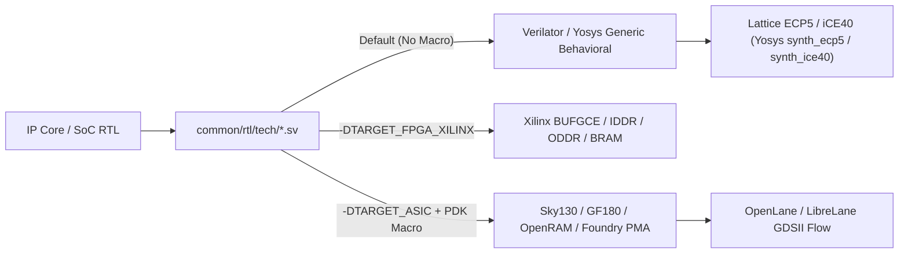

# Yosys, FPGA, & ASIC Tape-Out Porting Guide

This guide documents the **Technology Abstraction Library** ([`common/rtl/tech/`](../common/rtl/tech/filelist.f)), the **Static Yosys/OpenLane Compatibility Linter** ([`scripts/check_yosys_compat.py`](../scripts/check_yosys_compat.py)), target-specific foundry/FPGA mapping examples (OpenLane, Sky130, GF180MCU, Xilinx 7-Series/UltraScale, Lattice iCE40/ECP5), and SDC timing constraints.

---

## 1. Architecture & Porting Strategy

All IP cores in this collection are written in **pure synthesizable IEEE 1800-2017 SystemVerilog** with zero vendor-locked primitives in behavioral paths. Whenever a design requires clock gating, CDC synchronization, reset synchronization, DDR I/O, compiled SRAM/BRAM, or high-speed SerDes serialization, it instantiates a wrapper from [`common/rtl/tech/`](../common/rtl/tech/filelist.f):



### Compile Order

Include [`common/rtl/tech/filelist.f`](../common/rtl/tech/filelist.f) before any IP RTL that instantiates tech primitives:

```text
common/rtl/tech/tech_icg.sv
common/rtl/tech/tech_cdc_sync.sv
common/rtl/tech/tech_rst_sync.sv
common/rtl/tech/tech_iddr.sv
common/rtl/tech/tech_oddr.sv
common/rtl/tech/tech_sram_sp.sv
common/rtl/tech/tech_sram_sdp.sv
common/rtl/tech/tech_serdes_io.sv
```

---

## 2. Technology Cell Reference (`common/rtl/tech/`)

### 2.1 `tech_icg` — Integrated Clock Gating Cell

- **File**: [`common/rtl/tech/tech_icg.sv`](../common/rtl/tech/tech_icg.sv)
- **Purpose**: Glitch-free clock gating with DFT/scan bypass.

| Port | Dir | Width | Default | Description |
|---|---|---|---|---|
| `clk_i` | `input` | `1` | — | Source clock |
| `en_i` | `input` | `1` | — | Functional clock enable (active high) |
| `test_en_i` | `input` | `1` | `1'b0` | Scan/ATPG clock-gate bypass (`1` forces clock active) |
| `gclk_o` | `output` | `1` | — | Glitch-free gated clock output |

- **Behavioral default**: Captures `en_i | test_en_i` on a negative-level transparent `always_latch` (`if (!clk_i)`) and gates via `clk_i & en_lat_q`. Toggles on `en_i` while `clk_i == 1` are blocked cleanly.
- **Target macros**:
  - `-DTARGET_ASIC -DTECH_ASIC_ICG_SKY130` → `sky130_fd_sc_hd__sdlclkp_1`
  - `-DTARGET_ASIC -DTECH_ASIC_ICG_GF180` → `gf180mcu_fd_sc_mcu7t5v0__icgtp_1`
  - `-DTARGET_FPGA_XILINX` → `BUFGCE`

---

### 2.2 `tech_cdc_sync` — Multi-Stage CDC Synchronizer

- **File**: [`common/rtl/tech/tech_cdc_sync.sv`](../common/rtl/tech/tech_cdc_sync.sv)
- **Purpose**: 2-FF or 3-FF metastability synchronizer for single-bit control signals or Gray-coded multi-bit vectors.

| Parameter | Default | Description |
|---|---|---|
| `STAGES` | `2` | Synchronizer depth (clamped to `>= 2`; use `3` for high-frequency domains) |
| `WIDTH` | `1` | Signal width in bits |
| `RST_VAL` | `'0` | Async reset value applied to all stages |

| Port | Dir | Width | Description |
|---|---|---|---|
| `clk_i` | `input` | `1` | Destination domain clock |
| `rst_ni` | `input` | `1` | Destination domain active-low async reset |
| `d_i` | `input` | `WIDTH` | Asynchronous source-domain input |
| `q_o` | `output` | `WIDTH` | Synchronized destination-domain output |

- **Attributes**: Annotates `sync_q` with `(* async_reg = "true", keep = "true" *)` so Yosys, Vivado, and OpenLane preserve all stages and place them in adjacent slices/sites.

---

### 2.3 `tech_rst_sync` — Async-Assert / Sync-Deassert Reset Synchronizer

- **File**: [`common/rtl/tech/tech_rst_sync.sv`](../common/rtl/tech/tech_rst_sync.sv)
- **Purpose**: Ensures deterministic reset entry even without a clock, and glitch-free synchronous reset release across `STAGES` clock edges, with scan/DFT bypass.

| Parameter | Default | Description |
|---|---|---|
| `STAGES` | `2` | Synchronization flip-flop stages (`>= 2`) |

| Port | Dir | Width | Default | Description |
|---|---|---|---|---|
| `clk_i` | `input` | `1` | — | Target domain clock |
| `arst_ni` | `input` | `1` | — | Asynchronous active-low reset source |
| `test_mode_i` | `input` | `1` | `1'b0` | DFT/scan bypass (`1` routes `arst_ni` directly to `rst_no`) |
| `rst_no` | `output` | `1` | — | Synchronized active-low reset for `clk_i` domain |

---

### 2.4 `tech_iddr` & `tech_oddr` — DDR Input/Output Primitives

- **Files**: [`common/rtl/tech/tech_iddr.sv`](../common/rtl/tech/tech_iddr.sv), [`common/rtl/tech/tech_oddr.sv`](../common/rtl/tech/tech_oddr.sv)
- **Purpose**: Dual-data-rate pad capture and launch on a single clock (`clk_i`), suitable for HyperRAM, xSPI Octal DTR, RGMII, and eMMC HS400/DDR50.

**`tech_iddr` Parameters & Ports:**
- `WIDTH` (default `1`), `SAME_EDGE_PIPELINED` (default `1'b1`; `1` aligns both `q_rise_o` and `q_fall_o` to `posedge clk_i` one cycle later, `0` uses `OPPOSITE_EDGE` timing).
- Ports: `clk_i`, `rst_ni`, `ce_i` (`1'b1`), `d_i [WIDTH-1:0]`, `q_rise_o [WIDTH-1:0]`, `q_fall_o [WIDTH-1:0]`.
- Macro hook: `-DTARGET_FPGA_XILINX` instantiates Xilinx `IDDR`.

**`tech_oddr` Parameters & Ports:**
- `WIDTH` (default `1`), `SAME_EDGE` (default `1'b1`; `1` samples both `d_rise_i` and `d_fall_i` on `posedge clk_i` and launches `d_rise` while `clk_i == 1`, `d_fall` while `clk_i == 0`).
- Ports: `clk_i`, `rst_ni`, `ce_i` (`1'b1`), `d_rise_i [WIDTH-1:0]`, `d_fall_i [WIDTH-1:0]`, `q_o [WIDTH-1:0]`.
- Macro hook: `-DTARGET_FPGA_XILINX` instantiates Xilinx `ODDR`.

---

### 2.5 `tech_sram_sp` & `tech_sram_sdp` — Byte-Write Inferable SRAM Wrappers

- **Files**: [`common/rtl/tech/tech_sram_sp.sv`](../common/rtl/tech/tech_sram_sp.sv), [`common/rtl/tech/tech_sram_sdp.sv`](../common/rtl/tech/tech_sram_sdp.sv)
- **Purpose**: Pure clock-only write/read blocks (`always_ff @(posedge clk_i)` with **zero async reset on `mem`**) so Yosys (`memory_bram`), FPGA tools, and ASIC SRAM compilers infer dedicated memory blocks instead of thousands of flip-flops.

**`tech_sram_sp` (Single-Port 1RW, Read-First):**
- Parameters: `DATA_W = 32`, `DEPTH = 256`, `BYTE_W = 8` (`MASK_W = (DATA_W + BYTE_W - 1) / BYTE_W`, `ADDR_W = $clog2(DEPTH)`). Supports non-byte-multiple widths cleanly.
- Ports: `clk_i`, `en_i`, `we_i`, `wstrb_i [MASK_W-1:0]`, `addr_i [ADDR_W-1:0]`, `wdata_i [DATA_W-1:0]`, `rdata_o [DATA_W-1:0]`.

**`tech_sram_sdp` (Simple-Dual-Port 1W1R, Dual-Clock Capable):**
- Parameters: `DATA_W = 32`, `DEPTH = 256`, `BYTE_W = 8`, `OUT_REG = 1'b0` (`0` = 1-cycle BRAM read latency; `1` = 2-cycle registered output for timing closure).
- Ports: Write (`wclk_i`, `wen_i`, `wstrb_i`, `waddr_i`, `wdata_i`) and Read (`rclk_i`, `ren_i`, `raddr_i`, `rdata_o`).
- Macro hook: `-DTARGET_ASIC -DTECH_ASIC_SRAM_SKY130_1KB` maps directly to `sky130_sram_1kbyte_1rw1r_32x256_8` (OpenRAM).

---

### 2.6 `tech_serdes_io` — Parameterizable 8:1 / 10:1 / 20:1 SerDes Wrapper

- **File**: [`common/rtl/tech/tech_serdes_io.sv`](../common/rtl/tech/tech_serdes_io.sv)
- **Purpose**: Behavioral serializer/deserializer for FPGA/Verilator bring-up (e.g., TMDS 10:1, 8b/10b, high-speed serial links) with a clean ASIC PMA boundary.

| Parameter | Default | Description |
|---|---|---|
| `RATIO` | `10` | Serialization ratio (`8`, `10`, `20`, or any `>= 2`) |
| `LSB_FIRST` | `1'b1` | `1` = transmit/receive bit 0 first; `0` = MSB first |

| Port | Dir | Width | Description |
|---|---|---|---|
| `tx_ser_clk_i` | `input` | `1` | TX high-speed serial bit clock (`RATIO x tx_par_clk_i`) |
| `tx_par_clk_i` | `input` | `1` | TX parallel word clock |
| `tx_rst_ni` | `input` | `1` | TX active-low reset |
| `tx_par_data_i` | `input` | `RATIO` | Parallel TX word |
| `ser_tx_o` | `output` | `1` | Serial TX bit stream |
| `rx_ser_clk_i` | `input` | `1` | RX serial bit clock |
| `rx_rst_ni` | `input` | `1` | RX active-low reset |
| `ser_rx_i` | `input` | `1` | Serial RX bit stream |
| `loopback_i` | `input` | `1` | `1` loops `ser_tx_o` internally to RX path (`1'b0` default) |
| `rx_bitslip_i` | `input` | `1` | Rising-edge-triggered +1 serial bit frame slip (`1'b0` default) |
| `rx_par_data_o` | `output` | `RATIO` | Deserialized parallel word |
| `rx_par_valid_o` | `output` | `1` | 1-cycle pulse in `rx_ser_clk_i` domain when word updates |
| `rx_par_clk_o` | `output` | `1` | Divided RX word clock output |

- Macro hook: `-DTARGET_ASIC_PMA` swaps the behavioral PCS/PMA logic for `tech_asic_pma_serdes`.

---

## 3. Yosys, FPGA, & OpenLane Flow Examples

### 3.1 Yosys + `yosys-slang` (SystemVerilog Frontend)

Yosys requires a SystemVerilog-capable frontend (such as `yosys-slang` or `sv2v`) for IEEE 1800-2017 packed structs, interfaces, and packages (`bus_pkg.sv`):

```bash
# Option A: yosys-slang plugin (recommended — native IEEE 1800-2017 support)
yosys -m slang -p "
  read_slang --top spi_top -f filelists/interconnect.f -f ips/02_spi/filelist.f
  hierarchy -check -top spi_top
  proc; opt; memory_bram -rules +/xilinx/brams.txt
  stat
"

# Option B: Lattice ECP5 synthesis
yosys -m slang -p "
  read_slang --top fft_top -f filelists/interconnect.f -f ips/30_fft/filelist.f
  synth_ecp5 -top fft_top -json build/fft_ecp5.json
"

# Option C: Lattice iCE40 synthesis
yosys -m slang -p "
  read_slang --top uart_usart_top -f filelists/interconnect.f -f ips/01_uart_usart/filelist.f
  synth_ice40 -top uart_usart_top -json build/uart_ice40.json
"
```

### 3.2 Lattice ECP5 / iCE40 Primitive Mapping Snippets

Yosys `synth_ecp5` and `synth_ice40` automatically map `tech_sram_sp` / `tech_sram_sdp` to `DP16KD` (ECP5) and `SB_RAM40_4K` (iCE40) because there is no async reset on `mem`. For Lattice DDR I/O (`IDDRX1F` / `ODDRX1F`), instantiate inside an `` `ifdef TARGET_FPGA_ECP5 `` guard:

```systemverilog
`ifdef TARGET_FPGA_ECP5
  // Lattice ECP5 2:1 DDR input/output primitives
  IDDRX1F u_ecp5_iddr (.D(d_i[0]), .SCLK(clk_i), .RST(!rst_ni), .Q0(q_rise_o[0]), .Q1(q_fall_o[0]));
  ODDRX1F u_ecp5_oddr (.D0(d_rise_i[0]), .D1(d_fall_i[0]), .SCLK(clk_i), .RST(!rst_ni), .Q(q_o[0]));
`endif
```

### 3.3 OpenLane / Sky130 / GF180MCU ASIC Configuration

Example `config.json` snippet for OpenLane 2 (using `slang` or pre-converted SV and `TARGET_ASIC`):

```json
{
  "DESIGN_NAME": "soc_subsystem",
  "VERILOG_FILES": [
    "dir::common/rtl/tech/tech_icg.sv",
    "dir::common/rtl/tech/tech_cdc_sync.sv",
    "dir::common/rtl/tech/tech_rst_sync.sv",
    "dir::common/rtl/tech/tech_sram_sp.sv"
  ],
  "VERILOG_DEFINES": [
    "SYNTHESIS",
    "TARGET_ASIC",
    "TECH_ASIC_ICG_SKY130"
  ],
  "CLOCK_PORT": "clk_i",
  "CLOCK_PERIOD": 10.0,
  "SYNTH_CLOCK_UNCERTAINTY": 0.25,
  "PL_TARGET_DENSITY_PCT": 60
}
```

For **GF180MCU** (`gf180mcuD`), replace `"TECH_ASIC_ICG_SKY130"` with `"TECH_ASIC_ICG_GF180"`.
For **OpenRAM SRAM macros**, replace large behavioral `tech_sram_sp` / `tech_sram_sdp` blocks with `-DTECH_ASIC_SRAM_SKY130_1KB` (or your generated `.lef`/`.lib`/`.gds` macro wrapper) and declare the SRAM macros in `EXTRA_LEFS` and `EXTRA_LIBS`.

---

## 4. SDC Timing Constraints Template

Apply the following SDC constraints for synthesis and STA (OpenSTA / Vivado / PrimeTime):

```tcl
# Primary clocks
create_clock -name clk_sys -period 10.0 [get_ports clk_i]
create_clock -name clk_ser -period  1.0 [get_ports tx_ser_clk_i]

# Asynchronous clock domain crossing groups
set_clock_groups -asynchronous \
  -group [get_clocks clk_sys] \
  -group [get_clocks clk_ser]

# tech_cdc_sync: bound launch->capture skew to < 1 destination period,
# and prevent hold/setup failure reports on async source transitions
set_false_path -to [get_pins -hierarchical {*u_cdc*/sync_q_reg[0]*/D}]
set_max_delay -datapath_only 8.0 \
  -from [get_clocks clk_sys] \
  -to   [get_pins -hierarchical {*u_cdc*/sync_q_reg[0]*/D}]

# tech_rst_sync: async assertion path to synchronizer reset pins
set_false_path -from [get_ports arst_ni]
set_false_path -from [get_ports test_mode_i]
set_false_path -from [get_ports test_en_i]

# DDR I/O constraints (example 100 MHz DDR = 200 MT/s)
set_input_delay  -clock clk_sys -max 2.0 [get_ports ddr_d_i*]
set_input_delay  -clock clk_sys -min 0.5 [get_ports ddr_d_i*]
set_input_delay  -clock clk_sys -clock_fall -add_delay -max 2.0 [get_ports ddr_d_i*]
set_input_delay  -clock clk_sys -clock_fall -add_delay -min 0.5 [get_ports ddr_d_i*]

set_output_delay -clock clk_sys -max 1.5 [get_ports ddr_q_o*]
set_output_delay -clock clk_sys -min -0.5 [get_ports ddr_q_o*]
set_output_delay -clock clk_sys -clock_fall -add_delay -max 1.5 [get_ports ddr_q_o*]
set_output_delay -clock clk_sys -clock_fall -add_delay -min -0.5 [get_ports ddr_q_o*]
```

---

## 5. Static Compatibility Checker (`scripts/check_yosys_compat.py`)

Run the Python 3 stdlib static analyzer across all `common/`, `interconnect/`, and `ips/*/rtl/*.sv` files before submitting new IP or preparing a tape-out drop:

```bash
python3 scripts/check_yosys_compat.py
python3 scripts/check_yosys_compat.py --verbose
python3 scripts/check_yosys_compat.py --strict
```

### Checked Rules

| Rule ID | What It Flags | Synthesis / Tape-Out Impact |
|---|---|---|
| `DELAY_IN_RTL` | `#5`, `#1ns`, or procedural `#(...)` delays | Ignored by synthesis; causes sim/synth mismatch |
| `REAL_TYPE` | `real`, `shortreal`, `realtime` in RTL | Rejected by Yosys and ASIC synthesis |
| `INITIAL_BLOCK` | `initial` blocks in RTL | ASIC synthesis rejects `initial`; FPGA-only init |
| `TRISTATE_LITERAL` | `'bz`, `'hz`, `'z` inside digital cores | Causes bus contention/DRC errors inside core logic; use split `*_i`/`*_o`/`*_oe_o` |
| `ASYNC_RST_MEM` | Async-reset `for` loops clearing memory arrays | Forces FF synthesis instead of BRAM / SRAM macro inference |
| `UNSYNTH_SYSTASK` | `$display`, `$finish`, `$random`, `$readmem*`, `$fopen`, `$fatal`, `$error`, etc. | Unsynthesizable outside `` `ifndef SYNTHESIS `` |

### Documented Benign Exceptions

- Code guarded inside `` `ifndef SYNTHESIS `` / `` `ifdef SIMULATION `` is automatically skipped.
- Inline pragma `// yosys-compat: allow <RULE>` suppresses a reviewed line-level exception.
- Baseline elaboration-time `generate if (...)` parameter checks (`$error` / `$fatal` outside procedural blocks) in `ips/18_rmt/rtl/rmt_core.sv`, `ips/24_timer_pwm/rtl/timer_pwm_core.sv`, `ips/25_plic_clint/rtl/clint_core.sv`, and `ips/25_plic_clint/rtl/plic_core.sv` are recorded in `DOCUMENTED_EXCEPTIONS` (use `--strict` to fail on them for toolchains requiring `` `ifndef SYNTHESIS `` guards around elaboration `$error`/`$fatal`).

---

## 6. Verification

[`tb/tb_tech_cells.sv`](../tb/tb_tech_cells.sv) verifies every primitive in [`common/rtl/tech/`](../common/rtl/tech/filelist.f) under Verilator `--binary --timing` with zero warnings:

- `tech_icg`: glitch immunity when `en_i` toggles during `clk_i == 1`, pulse counting over randomized enables, and `test_en_i` DFT bypass.
- `tech_cdc_sync`: reset initialization (`RST_VAL`), exact 2-FF and 3-FF latency on randomized single-bit and 8-bit inputs.
- `tech_rst_sync`: immediate async assertion mid-cycle, exact 2-cycle / 3-cycle synchronous deassertion, and `test_mode_i` bypass.
- `tech_iddr` & `tech_oddr`: `SAME_EDGE_PIPELINED=1`, `SAME_EDGE_PIPELINED=0`, `ce_i=0` hold, and ODDR-to-IDDR loopback.
- `tech_sram_sp` & `tech_sram_sdp`: byte-write-enable masking (including non-byte-multiple 20-bit width), read-first behavior, `en_i=0` hold, dual-clock `wclk_i`/`rclk_i`, and `OUT_REG=0/1` latency.
- `tech_serdes_io`: 8:1, 10:1 (`LSB_FIRST=1` & `0`), and 20:1 serial loopback with `rx_bitslip_i` alignment across multi-cycle serial skew.

```bash
verilator --binary --timing -Wall -Wno-UNUSEDSIGNAL -Wno-UNUSEDPARAM -Wno-DECLFILENAME \
  -Wno-PINCONNECTEMPTY -Wno-TIMESCALEMOD -j 0 -Mdir /tmp/obj_tech_yosys_tb \
  -f common/rtl/tech/filelist.f tb/tb_tech_cells.sv --top-module tb_tech_cells -o sim_tb_tech_cells
/tmp/obj_tech_yosys_tb/sim_tb_tech_cells +seed=1
```
