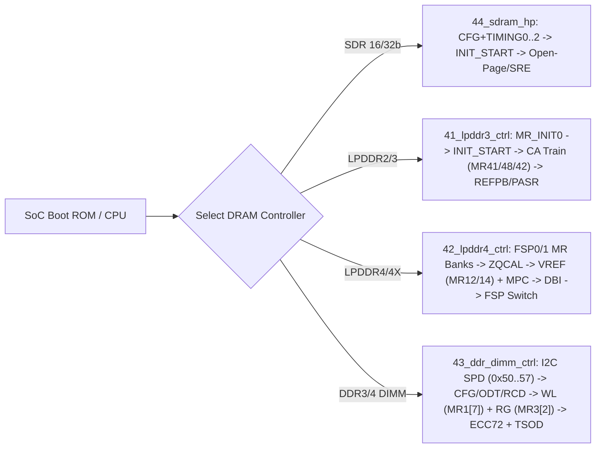
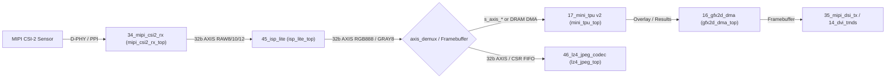
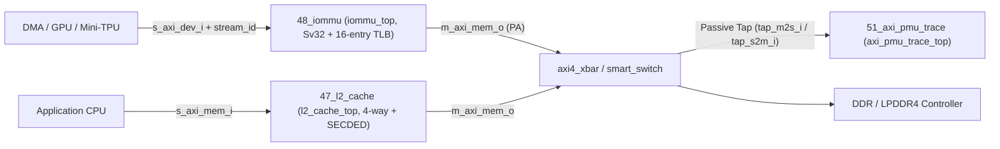
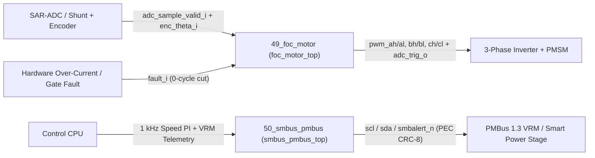

# 12 - Software Drivers & Bare-Metal SoC Bring-Up Guide

Practical bare-metal C99 driver inventory, Python microcode/PIO assembler tooling, and end-to-end SoC bring-up recipes for the **v4.0.0** SystemVerilog IP collection (`51` IPs). Every header (`*_regs.h`), C99 driver example (`*.c`), and Python tool referenced below is checked by `make check_sw`.

Related guides: [00 Architecture Overview](00_architecture_overview.md) · [03 Verification & Integration](03_verification_and_integration.md) · [04 Chrom-ART 2D GPU](04_chromart_2d_gpu_guide.md) · [05 Mini-TPU/NPU](05_mini_tpu_npu_guide.md) · [07 GDMA2 Guide](07_dma_guide.md) · [08 IP Catalog](08_ip_catalog.md)

---

## 1. Master Software Driver & Tool Inventory

All C drivers are standalone C99 (`-std=c99 -Wall -Wextra -fsyntax-only` clean, zero OS dependencies) using volatile MMIO accessors that adapt directly to any SoC memory map regardless of the underlying `BUS_TYPE` (`BUS_WISHBONE`, `BUS_AXI4`, `BUS_TILELINK`, or `BUS_APB`).

| IP / Area | File(s) | Purpose & Provided APIs / Features | Check / Usage Command |
| :-: | :-- | :-- | :-- |
| **17 Mini-TPU v2** | [`ips/17_mini_tpu/sw/mini_tpu_regs.h`](../ips/17_mini_tpu/sw/mini_tpu_regs.h) | CSR offsets (`0x0000..0x003C`), `IMEM`/`SBUF`/`ABUF`/`WBUF`/`OBUF` apertures, 64-bit ISA encoders (`TPU_INST_CFG*`, `TPU_INST_DMA_LD*`, `TPU_INST_GEMM`, `TPU_INST_CONV2D`, `TPU_INST_POOL`, `TPU_INST_VEC_EW`, `TPU_INST_SYNC_BANK*`), `tpu_load_program()`, `tpu_run_blocking()` | Included by C drivers |
| **17 Mini-TPU v2** | [`ips/17_mini_tpu/sw/tpu_inference_example.c`](../ips/17_mini_tpu/sw/tpu_inference_example.c) | 3 complete reference kernels: `tpu_run_llm_int4_rmsnorm_softmax()` (INT4 + FP8 block scale -> RMSNorm -> 3-pass Softmax), `tpu_run_cnn_conv_relu_pool()` (BF16 3x3 Conv2D -> ReLU -> 2x2 MaxPool), `tpu_run_pingpong_gemm()` (async `OP_DMA_LD_EX` + `OP_SYNC_BANK`) | `cc -std=c99 -Wall -Wextra -fsyntax-only ips/17_mini_tpu/sw/tpu_inference_example.c` |
| **17 Mini-TPU v2** | [`ips/17_mini_tpu/sw/tpu_asm.py`](../ips/17_mini_tpu/sw/tpu_asm.py) | Standalone Python 3 64-bit microcode assembler for all 12 opcodes (`4'h0..4'hB`); outputs `--format hex`, `words32`, `c`, or `sv` | `python3 ips/17_mini_tpu/sw/tpu_asm.py --self-test` |
| **23 PIO Engine** | [`tools/pioasm.py`](../tools/pioasm.py) | Standalone Python 3 PIO 24-bit ISA assembler/disassembler (`c`, `sv`, `hex`, `python` outputs) + [`tools/test_pioasm.py`](../tools/test_pioasm.py) (41 unit tests) | `python3 tools/test_pioasm.py` |
| **41 LPDDR2/3** | [`ips/41_lpddr3_ctrl/sw/lpddr3_regs.h`](../ips/41_lpddr3_ctrl/sw/lpddr3_regs.h), [`lpddr3_init_example.c`](../ips/41_lpddr3_ctrl/sw/lpddr3_init_example.c) | `lpddr3_bringup()`, `lpddr3_mrw()`, `lpddr3_mrr()`, CA training (`MR41/48/42`), `MR4` thermal poll, `REFPB` + `PASR`, `lpddr3_enter_dpd_sleep()`, `lpddr3_exit_dpd_and_reinit()` | `cc -std=c99 -Wall -Wextra -fsyntax-only ips/41_lpddr3_ctrl/sw/lpddr3_init_example.c` |
| **42 LPDDR4/4X** | [`ips/42_lpddr4_ctrl/sw/lpddr4_regs.h`](../ips/42_lpddr4_ctrl/sw/lpddr4_regs.h), [`lpddr4_init_example.c`](../ips/42_lpddr4_ctrl/sw/lpddr4_init_example.c) | `lpddr4_bringup()`: dual-16b channel interleave, `FSP0`/`FSP1` MR banks, `ZQCAL` init, Soft-PHY read-leveling, `MR12`/`MR14` VREF stepping + `MPC` loopback, DBI-WR/RD, glitch-free `FSP0->FSP1` DVFS switch | `cc -std=c99 -Wall -Wextra -fsyntax-only ips/42_lpddr4_ctrl/sw/lpddr4_init_example.c` |
| **43 DDR3/4 DIMM** | [`ips/43_ddr_dimm_ctrl/sw/ddr_dimm_regs.h`](../ips/43_ddr_dimm_ctrl/sw/ddr_dimm_regs.h), [`ddr_dimm_spd_example.c`](../ips/43_ddr_dimm_ctrl/sw/ddr_dimm_spd_example.c) | `ddr_dimm_bringup()`: I2C SPD EEPROM 256B auto-read (`0x50..0x57`), UDIMM/SO-DIMM/RDIMM/LRDIMM + ranks + odd-rank mirroring + ECC72 discovery, RCD/DB CW access, Fly-By WL + Read-Gate MPR training, JC42.4 TSOD 2x refresh | `cc -std=c99 -Wall -Wextra -fsyntax-only ips/43_ddr_dimm_ctrl/sw/ddr_dimm_spd_example.c` |
| **44 SDR SDRAM-HP** | [`ips/44_sdram_hp/sw/sdram_hp_regs.h`](../ips/44_sdram_hp/sw/sdram_hp_regs.h), [`sdram_hp_example.c`](../ips/44_sdram_hp/sw/sdram_hp_example.c) | `sdram_hp_init_16bit_w9825g6kh()`, `sdram_hp_init_32bit_is42s32800()` (100/133 MHz timing presets), `sdram_hp_mem_test()`, `sdram_hp_enter_self_refresh()`, `sdram_hp_exit_self_refresh()` | `cc -std=c99 -Wall -Wextra -fsyntax-only ips/44_sdram_hp/sw/sdram_hp_example.c` |
| **45 ISP-Lite** | [`ips/45_isp_lite/sw/isp_lite_regs.h`](../ips/45_isp_lite/sw/isp_lite_regs.h), [`isp_camera_example.c`](../ips/45_isp_lite/sw/isp_camera_example.c) | `isp_camera_init()` (CSI-2 RX + BLC, DPC, Q3.10 sRGB CCM, 256-entry Gamma LUT SRAM, output format/2x2 scale), `isp_2a_irq_handler()` (Gray-World AWB + 16-bin histogram AE loop) | `cc -std=c99 -Wall -Wextra -fsyntax-only ips/45_isp_lite/sw/isp_camera_example.c` |
| **46 LZ4/JPEG Codec** | [`ips/46_lz4_jpeg_codec/sw/codec_regs.h`](../ips/46_lz4_jpeg_codec/sw/codec_regs.h), [`codec_lz4_jpeg_example.c`](../ips/46_lz4_jpeg_codec/sw/codec_lz4_jpeg_example.c) | `codec_lz4_compress()`, `codec_lz4_decompress()`, `codec_jpeg_load_qtable()` (64-entry reciprocal SRAM), `codec_jpeg_encode_8x8_block()`, `codec_jpeg_emit_jfif_sof0_header()` | `cc -std=c99 -Wall -Wextra -fsyntax-only ips/46_lz4_jpeg_codec/sw/codec_lz4_jpeg_example.c` |
| **47 L2 Cache** | [`ips/47_l2_cache/sw/l2_cache_regs.h`](../ips/47_l2_cache/sw/l2_cache_regs.h), [`l2_cache_maint_example.c`](../ips/47_l2_cache/sw/l2_cache_maint_example.c) | `l2_enable()`, `l2_set_uncache_window()`, `l2_clean_range()`, `l2_invalidate_range()`, `l2_clean_invalidate_all()`, `l2_pin_region_in_way()`, `l2_ecc_isr_handler()` | `cc -std=c99 -Wall -Wextra -fsyntax-only ips/47_l2_cache/sw/l2_cache_maint_example.c` |
| **48 IOMMU** | [`ips/48_iommu/sw/iommu_regs.h`](../ips/48_iommu/sw/iommu_regs.h), [`iommu_pagetable_example.c`](../ips/48_iommu/sw/iommu_pagetable_example.c) | `iommu_sv32_map_4kb()`, `iommu_sv32_map_4mb()` (superpage), `iommu_config_stream()` (Sv32/Bypass/Block + ASID), `iommu_remap_4kb()` (targeted TLB shootdown), `iommu_soc_init()`, `iommu_fault_isr()` | `cc -std=c99 -Wall -Wextra -fsyntax-only ips/48_iommu/sw/iommu_pagetable_example.c` |
| **49 FOC Motor** | [`ips/49_foc_motor/sw/foc_regs.h`](../ips/49_foc_motor/sw/foc_regs.h), [`foc_motor_loop_example.c`](../ips/49_foc_motor/sw/foc_motor_loop_example.c) | `foc_init_pmsm()`, `foc_align_rotor_open_loop()`, `foc_close_current_loop()` (HW ADC trigger), `foc_speed_loop_tick()` (outer anti-windup speed PI), `foc_isr_handler()` (safe fault recovery) | `cc -std=c99 -Wall -Wextra -fsyntax-only ips/49_foc_motor/sw/foc_motor_loop_example.c` |
| **50 SMBus / PMBus** | [`ips/50_smbus_pmbus/sw/smbus_pmbus_regs.h`](../ips/50_smbus_pmbus/sw/smbus_pmbus_regs.h), [`smbus_pmbus_example.c`](../ips/50_smbus_pmbus/sw/smbus_pmbus_example.c) | `smbus_init()` (PEC + tTIMEOUT/tSEXT/tMEXT), `pmbus_write_vout()` (Linear16), `pmbus_read_telemetry()` (`Vout`/`Iout`/`Temp` Linear11), `smbus_handle_alert_ara()` (`7'h0C`), `smbus_arp_discover()` (`7'h61`) | `cc -std=c99 -Wall -Wextra -fsyntax-only ips/50_smbus_pmbus/sw/smbus_pmbus_example.c` |
| **51 AXI4 PMU & Trace** | [`ips/51_axi_pmu_trace/sw/axi_pmu_regs.h`](../ips/51_axi_pmu_trace/sw/axi_pmu_regs.h), [`axi_pmu_profile_example.c`](../ips/51_axi_pmu_trace/sw/axi_pmu_profile_example.c) | `pmu_start_profile()` (address/ID filter + 7 histogram thresholds), `pmu_read_report()` (atomic `PMU_CTRL_SNAPSHOT` + BW/util/stall/latency), `pmu_arm_latency_spike_trace()`, `pmu_dump_trace_sram()` | `cc -std=c99 -Wall -Wextra -fsyntax-only ips/51_axi_pmu_trace/sw/axi_pmu_profile_example.c` |

Run all software checks in one command:

```sh
make check_sw
```

---

## 2. End-to-End Bare-Metal SoC Bring-Up Recipes

### Recipe 1: Memory Subsystem Bring-Up (Segmented by Generation)

Choose the controller matched to the target board/package DRAM technology:

| Generation / Standard | IP Core | Key Capabilities & Target Use Case |
| :--- | :--- | :--- |
| **SDR SDRAM (100/133 MHz)** | [`ips/44_sdram_hp`](../ips/44_sdram_hp/doc/README.md) (`sdram_hp_top`) | 16b (`W9825G6KH` / `IS42S16160`) or 32b (`IS42S32800`), 4-bank open-page interleaving + 2-slot look-ahead `PRE`/`ACT` |
| **LPDDR2 / LPDDR3** | [`ips/41_lpddr3_ctrl`](../ips/41_lpddr3_ctrl/doc/README.md) (`lpddr3_ctrl_top`) | 10-bit DDR `CA[9:0]`, `REFPB`, `MR41/48/42` CA calibration, `MR4` thermal poll, `PASR`, `DPD`, DFI or Soft PHY |
| **LPDDR4 / LPDDR4X** | [`ips/42_lpddr4_ctrl`](../ips/42_lpddr4_ctrl/doc/README.md) (`lpddr4_ctrl_top`) | Dual independent 16-bit sub-channels (`2 x 16b`), 6-bit multi-cycle `CA[5:0]`, `MWR`, `DBI-WR`/`DBI-RD`, glitch-free `FSP0`/`FSP1` DVFS, `MPC` training |
| **DDR2 / DDR3 / DDR4 (Single Rank)** | [`ips/38_ddr_ctrl`](../ips/38_ddr_ctrl/doc/README.md) (`ddr_ctrl_top`) | On-board 16-bank FR-FCFS, SECDED ECC, DFI 4.0/5.0 or Soft PHY |
| **DDR3 / DDR4 DIMM (Multi-Rank)** | [`ips/43_ddr_dimm_ctrl`](../ips/43_ddr_dimm_ctrl/doc/README.md) (`ddr_dimm_ctrl_top`) | UDIMM/SO-DIMM/RDIMM/LRDIMM/CAMM2 (`DUAL_CH_SUB`), I2C SPD EEPROM auto-discovery, RCD/DB CWs, Fly-By WL + MPR Read-Gate training, 72b SECDED ECC, JC42.4 TSOD |

> **Scope Boundary**: **LPDDR5, DDR5, Optane / DDR-T, and NVDIMM** are explicitly **out of scope** for this collection.



1. **SDR SDRAM-HP (`44_sdram_hp`)**:
   - Check `SDRAM_HP_REG_IP_ID == SDRAM_HP_IP_ID_VAL` and `SDRAM_HP_STATUS_DATA_W_32` to verify 16-bit vs 32-bit synthesis configuration.
   - Program `SDRAM_HP_REG_CFG` (burst length `BL4`/`BL8`, CAS latency, col/row geometry), `TIMING0..2` (`tREFI = 780` @ 100 MHz or `1040` @ 133 MHz, 200 us `TIMING2`), then set `SDRAM_HP_CTRL_ENABLE | SDRAM_HP_CTRL_AUTO_REF_EN | SDRAM_HP_CTRL_OPEN_PAGE_EN | SDRAM_HP_CTRL_INIT_START` and poll `SDRAM_HP_STATUS_INIT_DONE` (`sdram_hp_init_16bit_w9825g6kh()` / `sdram_hp_init_32bit_is42s32800()`).
   - Use `sdram_hp_enter_self_refresh()` / `sdram_hp_exit_self_refresh()` around low-power retention sleep.
2. **LPDDR2 / LPDDR3 (`41_lpddr3_ctrl`)**:
   - Select `LPDDR3_CFG_STD_LPDDR3 | LPDDR3_CFG_BL8 | LPDDR3_CFG_ODT_WR_EN`, write `TIMING0..3` and `MR_INIT0` (`MR1/2/3/11`), set `LPDDR3_CTRL_INIT_START | LPDDR3_CTRL_AUTO_REF_EN | LPDDR3_CTRL_REFPB_EN` in `LPDDR3_REG_CTRL`, and poll `LPDDR3_STATUS_INIT_DONE`.
   - Trigger CA bus training via `LPDDR3_REG_CA_TRAIN_PAT` + `LPDDR3_REG_CA_TRAIN_CTRL` (`LPDDR3_CA_TR_START`, verify `LPDDR3_CA_TR_PASS`), read `MR5..MR8` (`LPDDR3_REG_VENDOR_ID`) and `MR4` thermal status (`LPDDR3_REG_THERMAL_STATUS`), then enable `PASR` + `Auto-PD` (`LPDDR3_REG_PWR_CTRL`).
3. **LPDDR4 / LPDDR4X (`42_lpddr4_ctrl`)**:
   - Configure `LPDDR4_REG_CFG` (`LPDDR4_CFG_CH_ILV_BIT6 | LPDDR4_CFG_REFPB_EN | LPDDR4_CFG_LPDDR4X_EN`) and both `FSP0` and `FSP1` MR shadow registers (`MR_A_FSP0/1`, `MR_B_FSP0/1`).
   - Run `LPDDR4_CTRL_INIT_START | LPDDR4_CTRL_ZQ_EN`, then Soft-PHY loopback calibration (`LPDDR4_REG_PHY_CTRL`), per-channel `MR12`/`MR14` VREF stepping + `MPC` WR/RD-FIFO loopback (`lpddr4_train_op()`), enable `LPDDR4_CTRL_DBI_WR_EN | LPDDR4_CTRL_DBI_RD_EN`, and trigger glitch-free `LPDDR4_REG_FSP_CTRL` (`LPDDR4_FSP_TARGET_1 | LPDDR4_FSP_PRELOAD_MRS | LPDDR4_FSP_AUTO_DBI_SYNC | LPDDR4_FSP_SWITCH_GO`).
4. **DDR3 / DDR4 DIMM (`43_ddr_dimm_ctrl`)**:
   - Issue `DDR_DIMM_SPD_READ_GO` on `DDR_DIMM_REG_SPD_CTRL` to fetch 256B from the DIMM SPD EEPROM (`0x50..0x57`) into internal SRAM; check `DDR_DIMM_SPD_NACK` for slot presence.
   - Parse SPD bytes `2` (DDR3 vs DDR4), `3` (UDIMM/SO-DIMM/RDIMM/LRDIMM), `12` (ranks), `13` (ECC), and `136` / `63` (odd-rank address mirroring) to build `DDR_DIMM_REG_CFG`, `ODT_RD_MAP`/`ODT_WR_MAP`, and `DDR_DIMM_REG_CTRL` (`ECC_EN | THERMAL_2X_EN`).
   - Wait for `DDR_DIMM_STATUS_INIT_DONE`, optionally write custom RCD/DB Control Words via `DDR_DIMM_REG_RCD_DB_CMD`, run hardware Write-Leveling (`MR1[7]`) + Read-Gate MPR (`MR3[2]`) via `DDR_DIMM_REG_TRAIN_CTRL` (`DDR_DIMM_TRAIN_MODE_BOTH`), and enable `DDR_DIMM_SPD_TSOD_POLL_EN` (`+85 C` threshold `0x0550` in `DDR_DIMM_REG_TSOD_CFG`) for automatic 2x refresh throttling.

---

### Recipe 2: Edge AI Vision Pipeline (Camera -> ISP -> NPU -> Codec / Display)



1. **Camera + ISP-Lite (`34_mipi_csi2_rx` -> `45_isp_lite`)**:
   - Call `isp_camera_init(CSI2_RX_BASE, ISP_LITE_BASE, width, height, ISP_OUT_GRAY8, 1u, &state)` from [`isp_camera_example.c`](../ips/45_isp_lite/sw/isp_camera_example.c): resets ISP, writes `ISP_REG_IMG_SIZE`, configures 12-bit BLC pedestals (`ISP_REG_BLC_PED_*`), DPC threshold (`ISP_REG_DPC_CFG`), Q3.10 sRGB CCM (`ISP_REG_CCM_*`), loads the 256-entry Gamma LUT SRAM (`ISP_REG_GAMMA_LUT(i)`), enables ISP (`ISP_CTRL_EN` + optional `ISP_CTRL_SCALE_2X_EN` 2x2 downscale for NPU input), and finally enables `34_mipi_csi2_rx` (`CTRL` offset `0x00` = 4 lanes, VC0).
   - In the `FRAME_DONE` ISR, call `isp_2a_irq_handler(ISP_LITE_BASE, &state)` to compute Gray-World AWB (`STAT_SUM_R/G/B`) and 16-bin histogram AE (`ISP_REG_HIST(0..15)`), updating `AWB_GAIN_*` and `BLC_GAIN_*`.
2. **Mini-TPU v2 Inference (`17_mini_tpu`)**:
   - Assemble microcode offline with `python3 ips/17_mini_tpu/sw/tpu_asm.py model.asm -f c -o model_prog.h`, or build programs dynamically with `TPU_INST_*` macros in [`mini_tpu_regs.h`](../ips/17_mini_tpu/sw/mini_tpu_regs.h).
   - Set `TPU_REG_DMA_BASE0` (activations/IO) and `TPU_REG_DMA_BASE1` (weights/scales/gamma), load microcode via `tpu_load_program()`, and execute `tpu_run_blocking()`:
     * **CNN stage** (`tpu_run_cnn_conv_relu_pool()`): `TPU_INST_CFG_GSCALE(TPU_PREC_BF16, TPU_ACT_RELU, TPU_OUT_BF16, ...)` -> `TPU_INST_CONV2D` -> `TPU_INST_SFU` -> `TPU_INST_POOL` -> `TPU_INST_DMA_ST`.
     * **LLM / Transformer stage** (`tpu_run_llm_int4_rmsnorm_softmax()`): `TPU_INST_CFG_GSCALE_EXT(..., /*prec_ext=*/1, /*int4_scale_en=*/1, ...)` -> `TPU_INST_GEMM` -> `TPU_INST_VEC_EW(TPU_EW_RMSNORM, ...)` -> `TPU_INST_VEC_EW(TPU_EW_SOFTMAX, ...)`.
     * **Double-buffered tiling** (`tpu_run_pingpong_gemm()`): `TPU_INST_SYNC_BANK_SET` -> overlap async `TPU_INST_DMA_LD_EX` into bank 1 with `TPU_INST_GEMM` on bank 0 -> `TPU_INST_SYNC_BANK`.
3. **Compression or Display Output (`46_lz4_jpeg_codec` / `16_gfx2d_dma` -> `35_mipi_dsi_tx` or `14_dvi_tmds`)**:
   - For JPEG snapshot encoding, load quantization table via `codec_jpeg_load_qtable()`, emit JFIF/SOF0 headers with `codec_jpeg_emit_jfif_sof0_header()`, and stream 8x8 blocks through `codec_jpeg_encode_8x8_block()` (`CODEC_MODE_JPEG_8X8`) or use `codec_lz4_compress()` (`CODEC_MODE_LZ4_ENC`) for lossless telemetry/frame compression.
   - For live display, composite NPU bounding boxes/HUD via `16_gfx2d_dma` ([04 Chrom-ART 2D GPU](04_chromart_2d_gpu_guide.md)) and feed `35_mipi_dsi_tx` (`DSI_CTRL` + `DSI_VID_*`) or `14_dvi_tmds`.

---

### Recipe 3: Application Processor Coherency, Virtualization & Telemetry



1. **L2 Cache Bring-Up & DMA Coherency (`47_l2_cache`)**:
   - Call `l2_enable(L2_BASE, MMIO_UNCACHE_BASE, MMIO_UNCACHE_MASK)` from [`l2_cache_maint_example.c`](../ips/47_l2_cache/sw/l2_cache_maint_example.c): programs the uncacheable bypass window, runs `L2C_MAINT_OP_INV_ALL`, enables `L2C_IRQ_ECC_CE | L2C_IRQ_ECC_UE | L2C_IRQ_AXI_ERR` and `L2C_PERF_EN`, and enables `L2C_CTRL_CACHE_EN | L2C_CTRL_ECC_CHK_EN | L2C_CTRL_UNCACHE_WIN_EN`.
   - **Coherent DMA sequence**: call `l2_clean_range(L2_BASE, buf_pa, len)` **before** starting DMA/NPU TX (CPU -> Peripheral), and `l2_invalidate_range(L2_BASE, buf_pa, len)` **after** DMA RX completes (Peripheral -> CPU).
   - **Way locking**: call `l2_pin_region_in_way(L2_BASE, way_idx, paddr, len)` to lock critical RTOS ISR handlers or hot NPU weights into a dedicated cache way. Handle ECC events in `l2_ecc_isr_handler()`.
2. **IOMMU Stream Isolation & Sv32 Mapping (`48_iommu`)**:
   - Populate 4KB-aligned Sv32 L1/L2 page tables with `iommu_sv32_map_4kb()` and `iommu_sv32_map_4mb()` (`SV32_PTE_R | SV32_PTE_W | SV32_PTE_A | SV32_PTE_D`), or call `iommu_soc_init()` from [`iommu_pagetable_example.c`](../ips/48_iommu/sw/iommu_pagetable_example.c) to bind trusted streams (`IOMMU_MODE_SV32` / `IOMMU_MODE_BYPASS`) and quarantine untrusted external masters (`IOMMU_MODE_BLOCK`).
   - On page remap, update the PTE in RAM first, then shoot down the single TLB entry via `iommu_remap_4kb()` (`IOMMU_REG_TLB_INV_IOVA`). Drain faulting transactions from the depth-4 hardware FIFO in `iommu_fault_isr()`.
3. **Zero-Overhead AXI4 Profiling & Latency-Spike Trace (`51_axi_pmu_trace`)**:
   - Call `pmu_start_profile(PMU_BASE, filt_addr_en, addr_base, addr_mask, filt_id_en, id_val, id_mask, hist_thresh)` from [`axi_pmu_profile_example.c`](../ips/51_axi_pmu_trace/sw/axi_pmu_profile_example.c) to configure address/ID filters and 7 latency histogram thresholds (`8` buckets).
   - Optionally arm the triggered circular trace SRAM with `pmu_arm_latency_spike_trace(PMU_BASE, lat_thresh_cycles, post_events, filt_only)`.
   - Call `pmu_read_report(PMU_BASE, bus_clk_hz, &rpt, 1)` to latch an atomic `PMU_CTRL_SNAPSHOT` (`PMU_CTRL_SNAP_VIEW`) without stalling traffic and compute MB/s, utilization %, stall %, and min/avg/max latency; call `pmu_dump_trace_sram()` after trigger fire to inspect pre/post-trigger cycles chronologically.

---

### Recipe 4: Industrial Motor & Power Management Loop



1. **PMSM Field-Oriented Control (`49_foc_motor`)**:
   - Initialize carrier period, dead-time, d/q Q4.12 PI gains (`FOC_REG_KP_KI_D`, `FOC_REG_KP_KI_Q`), and `FOC_REG_V_LIMIT` via `foc_init_pmsm()` in [`foc_motor_loop_example.c`](../ips/49_foc_motor/sw/foc_motor_loop_example.c).
   - Align the rotor to electrical zero using `foc_align_rotor_open_loop(&drv, vd_align_pu)` (`FOC_CTRL_OPEN_LOOP_BIT | FOC_CTRL_SW_START_BIT`).
   - Switch to autonomous hardware-triggered closed-loop current control via `foc_close_current_loop(&drv, id_ref_pu, iq_ref_pu)` (`FOC_CTRL_HW_TRIG_EN_BIT | FOC_CTRL_ADC_TRIG_PEAK`), and run `foc_speed_loop_tick()` from a 1 kHz timer ISR to update `FOC_REG_ID_IQ_REF`.
   - In the fault ISR, call `foc_isr_handler()`: hardware `fault_i` cuts PWM outputs in 0 cycles, and software re-arms only after `FOC_STATUS_FAULT_PIN_BIT` clears (`FOC_CTRL_CLR_INT_BIT` + W1C `FOC_REG_IRQ_STAT`).
2. **PMBus 1.3 VRM Scaling, Telemetry, & Alert Handling (`50_smbus_pmbus`)**:
   - Initialize the host controller at 100 kHz / 400 kHz / 1 MHz with hardware CRC-8 PEC and SMBus 3.0 timeouts (`tTIMEOUT=30 ms`, `tSEXT=25 ms`, `tMEXT=10 ms`) via `smbus_init(SMBUS0_BASE, sys_clk_hz, 400000u, 1u)` in [`smbus_pmbus_example.c`](../ips/50_smbus_pmbus/sw/smbus_pmbus_example.c).
   - Dynamically discover unconfigured devices on `7'h61` via `smbus_arp_discover()` (`Prepare to ARP` -> `Get UDID` -> `Assign Address`), scale core voltage using `pmbus_write_vout()` (reads `VOUT_MODE` Linear16 exponent and writes `VOUT_COMMAND`), and monitor rails via `pmbus_read_telemetry()` (decodes `Vout`, `Iout`, `Temp` Linear11 + `STATUS_WORD`).
   - On `SMBALERT#`, call `smbus_handle_alert_ara()` to execute `ARA` (`7'h0C`) arbitration reads with PEC verification and identify every alerting slave.
