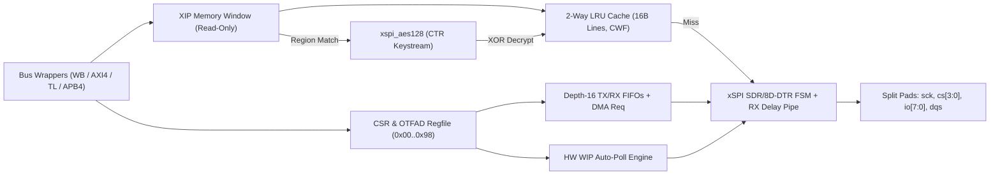

# xSPI / Octal DTR Flash Controller with XIP, OTFAD AES-128-CTR & 2-Way Cache (`xspi_xip` v2.0)

## Overview

`xspi_xip` v2.0 is a clean-room, pure synthesizable IEEE 1800-2017 SystemVerilog Dual/Quad/Octal xSPI controller designed for FPGA and ASIC tape-out flows (Yosys/OpenLane compatible, single-clock synchronous design, split pad ring, clock-only SRAM writes). It maintains 100% backward compatibility with v1.0 (`xspi_xip_top` ports, `0x00..0x1C` CSR offsets, and reset values) while adding enterprise XIP and flash management features.

### Key Features

- **1/2/4/8-Lane SDR & 8D-8D-8D Octal DTR/DDR**: Independently configurable lane widths across Command, Address, Mode, and Data phases, with optional SDR Command + DDR Addr/Data (`CTRL[21]`). Center-aligned DDR output staging (`eff_div >= 2` in DDR mode) ensures clean setup and hold margins without negative-edge flops.
- **DQS Data-Strobe Framing & `RX_DELAY_CFG`**: Optional bidirectional DQS (`xspi_dqs_i` / `xspi_dqs_o` / `xspi_dqs_oe_o`), optional 2-FF pad synchronizer (`dqs_sync_2ff`), and programmable 0..15 `clk_i`-cycle RX capture delay pipeline (`rx_sample_delay`) for FPGA/ASIC I/O timing closure.
- **On-the-Fly AES-128-CTR XIP Decryption (`OTFAD_EN = 1`)**: Self-contained iterative FIPS-197 AES-128 engine (`xspi_aes128.sv`, 11 cycles/block, zero external IP dependencies) supporting 2 programmable address regions (`REG0` / `REG1` start, end, 128-bit write-only key, 96-bit nonce, and region lock bits). Keystream is computed in parallel with SPI Cmd/Addr/Dummy phases using counter block `{nonce[95:0], 4'b0, addr[31:4]}`.
- **2-Way Set-Associative (LRU) 16-Byte XIP Cache**: Configurable `CACHE_LINES = 16..64` (power of 2) and `XIP_WAYS = 2` (default 8 sets x 2 ways x 16B lines = 256B), 0-wait-state combinational hit path, 16-byte burst refills, **Critical-Word-First** early-restart (`cwf`), automatic invalidation on non-read indirect operations or format/OTFAD changes, and 32-bit `CACHE_HIT_CNT` / `CACHE_MISS_CNT` performance counters.
- **Continuous-Read (`M7:0`) Mode**: Per-CS tracking (`CS0..CS3`) of continuous-read state to skip instruction bytes on sequential XIP misses, with automatic 32-bit all-ones exit before non-continuous indirect or auto-poll transactions.
- **Multi-CS (`CS0..CS3`)**: Selectable via `CTRL[19:18]` (`CS0 = xspi_cs_no`, `CS1..3 = xspi_cs_ext_no[2:0]`).
- **Depth-16 Indirect TX/RX FIFOs + DMA Requests**: Dedicated `TX_FIFO_DATA` / `RX_FIFO_DATA` ports with configurable watermarks (`dma_tx_req_o`, `dma_rx_req_o`) and hardware SCK pause flow-control for >16-word bursts.
- **Hardware `WIP` Auto-Polling**: Autonomous `RDSR` (`0x05`) polling loop checking `(sr & mask) == (match & mask)` with programmable poll interval, iteration timeout, and `POLL_DONE` / `POLL_TIMEOUT` IRQs.
- **Quad-Bus Wrappers**: Wishbone B4, AMBA AXI4/AXI4-Lite, TileLink TL-UL/TL-UH, and AMBA APB4 via unified `xspi_xip_v2_top` (full v2 ports) and `xspi_xip_top` (100% v1-compatible ports).

---

## Architecture Block Diagram



---

## RTL Modules & Parameters

| File | Module | Role |
| :--- | :--- | :--- |
| `rtl/xspi_aes128.sv` | `xspi_aes128` | Compact 11-cycle iterative FIPS-197 AES-128 forward cipher |
| `rtl/xspi_xip_core.sv` | `xspi_xip_core` | Protocol-agnostic v2.0 xSPI controller, 2-way cache, OTFAD, FIFOs, auto-poll |
| `rtl/xspi_xip_wb.sv` | `xspi_xip_wb` | Wishbone B4 CSR + XIP wrapper (v1-compatible ports) |
| `rtl/xspi_xip_axi.sv` | `xspi_xip_axi` | AXI4 / AXI4-Lite CSR + XIP wrapper (v1-compatible ports) |
| `rtl/xspi_xip_tl.sv` | `xspi_xip_tl` | TileLink TL-UL / TL-UH CSR + XIP wrapper (v1-compatible ports) |
| `rtl/xspi_xip_apb.sv` | `xspi_xip_apb` | AMBA APB4 CSR + XIP wrapper (v1-compatible ports) |
| `rtl/xspi_xip_top.sv` | `xspi_xip_top` | Parameterized quad-bus top with exact v1.0 ports |
| `rtl/xspi_xip_v2_top.sv` | `xspi_xip_v2_top` | Parameterized quad-bus top exposing all v2.0 Multi-CS, DQS & DMA ports |

### Top-Level Parameters (`xspi_xip_v2_top` / `xspi_xip_core`)

| Parameter | Default | Range / Options | Description |
| :--- | :--- | :--- | :--- |
| `BUS_TYPE` | `BUS_AXI4` | `BUS_WISHBONE`, `BUS_AXI4`, `BUS_TILELINK`, `BUS_APB` | Selects active CSR & XIP window slave bus |
| `CACHE_LINES` | `16` | `16`, `32`, `64` | Total 16-byte XIP cache lines across all ways |
| `XIP_WAYS` | `2` | `1`, `2` | Set associativity (`2` = 2-way LRU, `1` = direct-mapped) |
| `OTFAD_EN` | `1'b1` | `1'b0`, `1'b1` | Instantiates `xspi_aes128` for encrypted XIP regions |
| `FIFO_DEPTH` | `16` | Power of 2 (default `16`) | Depth of Indirect TX and RX 32-bit FIFOs |

### External Pad & Sideband Signals (`xspi_xip_v2_top`)

| Port | Dir | Width | Default | Description |
| :--- | :--- | :--- | :--- | :--- |
| `xspi_sck_o` | Output | 1 | — | SPI Serial Clock (Mode 0, idles low) |
| `xspi_cs_no` | Output | 1 | — | Primary Chip Select CS0# (active low) |
| `xspi_cs_ext_no` | Output | 3 | — | Extended Chip Selects CS3#..CS1# (active low) |
| `xspi_io_i` | Input | 8 | `8'h00` | Pad input data `IO[7:0]` (`IO0=MOSI`, `IO1=MISO` in 1-lane) |
| `xspi_io_o` | Output | 8 | — | Pad output data `IO[7:0]` |
| `xspi_io_oe_o` | Output | 8 | — | Pad output enable `IO[7:0]` (active high) |
| `xspi_dqs_i` | Input | 1 | `1'b0` | Data Strobe input from flash/PSRAM |
| `xspi_dqs_o` | Output | 1 | — | Data Strobe / DM output for DDR writes |
| `xspi_dqs_oe_o` | Output | 1 | — | Data Strobe pad output enable |
| `dma_tx_req_o` | Output | 1 | — | TX DMA request (`enable && dma_tx_en && tx_cnt <= tx_thresh`) |
| `dma_rx_req_o` | Output | 1 | — | RX DMA request (`enable && dma_rx_en && rx_cnt >= rx_thresh`) |
| `irq_o` | Output | 1 | — | Masked OR of `ind_done`, `poll_done`, `poll_timeout`, `tx_wm`, `rx_wm` |

> **Backward Compatibility Note**: `xspi_xip_top` retains the exact v1.0 port list (`xspi_sck_o`, `xspi_cs_no`, `xspi_io_i/o/oe_o`, `xspi_dqs_i`, `irq_o`) so existing SoCs and testbenches (`tb_xspi_xip`, `tb_apb_peripherals`) compile with zero Verilator `PINMISSING` warnings.

---

## Full CSR Register Map (`0x00..0xFC`)

Unmapped offsets (`0x40` and `0x9C..0xFC`) return bus error (`csr_rsp_o.err = 1`). All multi-byte RW registers support byte-lane `wstrb` (`pstrb`) writes.

| Offset | Name | Access | Reset | Bit Fields |
| :--- | :--- | :--- | :--- | :--- |
| `0x00` | `CTRL` | RW | `0x0000_2AA3` | `[0]` `enable`, `[1]` `xip_en`, `[2]` `ddr_en`, `[3]` `addr_32b` (1=32b, 0=24b), `[5:4]` `cmd_lanes` (0=1L,1=2L,2=4L,3=8L), `[7:6]` `addr_lanes`, `[9:8]` `data_lanes`, `[14:10]` `dummy_cycles`, `[15]` `cache_flush` (WO, reads 0), `[16]` `cont_read_en`, `[17]` `dqs_en`, `[19:18]` `cs_sel` (`0..3`), `[20]` reserved, `[21]` `cmd_sdr_force` (when `ddr_en=1`, keeps Cmd SDR), `[31:22]` reserved |
| `0x04` | `CLK_DIV` | RW | `0x0000_0001` | `[7:0]` `sck_half_div` (`>=1`; clamped to `>=2` automatically in DDR mode for center-aligned timing) |
| `0x08` | `XIP_CFG` | RW | `0x0000_A5EB` | `[7:0]` `xip_read_opcode` (default `0xEB`), `[15:8]` `xip_mode_bits` (default `0xA5`) |
| `0x0C` | `IND_CMD` | WO | `0x0000_0000` | `[7:0]` `opcode`, `[8]` `has_addr`, `[9]` `is_write`, `[10]` `has_data`, `[11]` `has_dummy`, `[12]` `use_fifo`, `[13]` `has_mode`, `[19:15]` `custom_dummy`, `[20]` `use_custom_dummy`. Rejected with `err=1` when `enable=0`. |
| `0x10` | `IND_ADDR` | RW | `0x0000_0000` | `[31:0]` Indirect flash target address |
| `0x14` | `IND_WDATA` | RW | `0x0000_0000` | `[31:0]` Legacy single-word indirect write data |
| `0x18` | `IND_RDATA` | RO | `0x0000_0000` | `[31:0]` Legacy single-word indirect captured read data |
| `0x1C` | `STATUS` | RW/RO | `0x0000_0000` | `[0]` `busy` (RO), `[1]` `ind_done` (W1C), `[2]` `poll_done` (W1C), `[3]` `poll_timeout` (W1C), `[4]` `tx_empty` (RO), `[5]` `tx_full` (RO), `[6]` `rx_empty` (RO), `[7]` `rx_full` (RO), `[15:8]` `xip_hit_cnt[7:0]` (RO), `[20:16]` `tx_fifo_level` (RO), `[28:24]` `rx_fifo_level` (RO) |
| `0x20` | `RX_DELAY_CFG` | RW | `0x0000_0000` | `[3:0]` `rx_sample_delay` (`0..15` `clk_i` cycles), `[4]` `rx_negedge_en` (SDR falling-edge capture), `[5]` `dqs_preamble_en` (toggle `xspi_dqs_o` on DDR writes), `[6]` `dqs_sync_2ff` (2-FF pad sync for DQS+IO) |
| `0x24` | `FIFO_CTRL` | RW | `0x0000_0140` | `[0]` `tx_fifo_rst` (WO), `[1]` `rx_fifo_rst` (WO), `[2]` `dma_tx_en`, `[3]` `dma_rx_en`, `[7:4]` `dma_tx_thresh` (default `4`), `[11:8]` `dma_rx_thresh` (default `1`) |
| `0x28` | `TX_FIFO_DATA` | WO | `0x0000_0000` | `[31:0]` Push word into depth-16 TX FIFO (`err=1` if full) |
| `0x2C` | `RX_FIFO_DATA` | RO | `0x0000_0000` | `[31:0]` Pop word from depth-16 RX FIFO (returns `0` if empty) |
| `0x30` | `IRQ_EN` | RW | `0x0000_0001` | `[0]` `ind_done_ie`, `[1]` `poll_done_ie`, `[2]` `poll_timeout_ie`, `[3]` `tx_wm_ie`, `[4]` `rx_wm_ie` |
| `0x34` | `IND_LEN` | RW | `0x0000_0000` | `[15:0]` Word count for FIFO indirect transfers (`0` treated as `1`) |
| `0x38` | `CACHE_HIT_CNT` | RW | `0x0000_0000` | `[31:0]` XIP cache hit counter (any write clears to 0) |
| `0x3C` | `CACHE_MISS_CNT` | RW | `0x0000_0000` | `[31:0]` XIP cache miss counter (any write clears to 0) |
| `0x40` | *(Unmapped)* | — | — | Returns `err = 1` |
| `0x44` | `POLL_CTRL` | RW | `0x0000_0000` | `[7:0]` `poll_opcode`, `[8]` `poll_start` (WO trigger; reads `poll_active`), `[9]` `poll_stop` (WO), `[11]` `poll_has_dummy`, `[12]` `poll_has_addr`, `[13]` `poll_2byte_sr`, `[23:16]` `poll_interval` (x16 clks), `[31:24]` `poll_last_sr` (RO) |
| `0x48` | `POLL_MASK_MATCH` | RW | `0x0000_0000` | `[15:0]` `poll_mask`, `[31:16]` `poll_match` |
| `0x4C` | `POLL_TIMEOUT` | RW | `0x0001_0000` | `[31:0]` Max poll iterations before `poll_timeout` (`0` = unlimited) |
| `0x50` | `OTFAD_CTRL` | RW | `{OTFAD_EN,27'd0,4'h0}` | `[0]` `reg0_en`, `[1]` `reg1_en`, `[2]` `reg0_lock` (W1S until reset), `[3]` `reg1_lock` (W1S until reset), `[31]` `OTFAD_EN` (RO) |
| `0x54` | `REG0_START` | RW | `0x0000_0000` | `[31:4]` Region 0 inclusive start address (16B-aligned) |
| `0x58` | `REG0_END` | RW | `0x0000_0000` | `[31:4]` Region 0 exclusive end address (16B-aligned) |
| `0x5C..0x68` | `REG0_KEY0..3` | WO | `0x0000_0000` | 128-bit Region 0 AES key (`{KEY3, KEY2, KEY1, KEY0}`, reads 0) |
| `0x6C..0x74` | `REG0_NONCE0..2` | RW | `0x0000_0000` | 96-bit Region 0 nonce (`{NONCE2, NONCE1, NONCE0}`) |
| `0x78` | `REG1_START` | RW | `0x0000_0000` | `[31:4]` Region 1 inclusive start address (16B-aligned) |
| `0x7C` | `REG1_END` | RW | `0x0000_0000` | `[31:4]` Region 1 exclusive end address (16B-aligned) |
| `0x80..0x8C` | `REG1_KEY0..3` | WO | `0x0000_0000` | 128-bit Region 1 AES key (reads 0) |
| `0x90..0x98` | `REG1_NONCE0..2` | RW | `0x0000_0000` | 96-bit Region 1 nonce |
| `0x9C..0xFC` | *(Unmapped)* | — | — | Returns `err = 1` |

---

## OTFAD AES-128-CTR Programming Recipe

Flash ciphertext is prepared per 16-byte cache line (`line_addr = addr & ~0xF`) using standard NIST SP 800-38A AES-128-CTR with:
- **Key**: `K[127:0] = {REGn_KEY3, REGn_KEY2, REGn_KEY1, REGn_KEY0}` (`K[127:120]` is AES byte 0).
- **Counter Block**: `IV[127:0] = {REGn_NONCE2, REGn_NONCE1, REGn_NONCE0, (addr >> 4)[31:0]}` (`IV[127:120]` is AES byte 0).
- **Keystream XOR**: Byte `b` (`0..15`) at `line_addr + b` is XORed with `AES_ENC(K, IV)[127 - 8*b -: 8]`.

```c
// Configure 8D-8D-8D DTR + DQS and OTFAD Region 0 [0x2000, 0x2100)
XSPI_CLK_DIV   = 2;
XSPI_XIP_CFG   = 0x0000A5EE; // 8D-8D-8D XIP opcode 0xEE
XSPI_CTRL      = (1<<17) | (4<<10) | (3<<8) | (3<<6) | (3<<4) | (1<<3) | (1<<2) | (1<<1) | 1;

XSPI_REG0_START  = 0x00002000;
XSPI_REG0_END    = 0x00002100;
XSPI_REG0_KEY0   = key[0]; XSPI_REG0_KEY1 = key[1]; XSPI_REG0_KEY2 = key[2]; XSPI_REG0_KEY3 = key[3];
XSPI_REG0_NONCE0 = nonce[0]; XSPI_REG0_NONCE1 = nonce[1]; XSPI_REG0_NONCE2 = nonce[2];
XSPI_OTFAD_CTRL  = 0x5; // Enable Region 0 + Lock Region 0 until reset
// CPU instruction/data reads in [0x2000, 0x2100) now decrypt on-the-fly!
```

---

## Yosys / FPGA / ASIC Timing & Synthesis Notes

1. **Clock-Only SRAM Inference**: Cache tag/data arrays (`cache_tag_mem`, `cache_data_mem`) and Indirect FIFOs (`tx_fifo_mem`, `rx_fifo_mem`) use synchronous `always_ff @(posedge clk_i)` writes with no async reset, passing `scripts/check_yosys_compat.py` with 0 errors and 0 exceptions.
2. **Center-Aligned DDR Output Staging**: In DDR mode (`ddr_en = 1`), `eff_div` is clamped to `>= 2` and physical `xspi_io_o` / `xspi_io_oe_o` / `xspi_dqs_o` transitions are staged at `div_cnt_q == (eff_div >> 1)` (center of each SCK half-period), guaranteeing >= 1 `clk_i` cycle of output setup and hold margin without negative-edge flip-flops.
3. **RX Timing Closure**: Use `RX_DELAY_CFG[3:0]` (`rx_sample_delay`) to compensate board/pad round-trip delay in non-DQS mode, or enable `CTRL[17]` (`dqs_en`) + `RX_DELAY_CFG[6]` (`dqs_sync_2ff`) for source-synchronous DQS capture in high-speed ASIC/FPGA designs.

---

## Verification Summary

| Check / Testbench | Command / Scope | Result |
| :--- | :--- | :--- |
| Lint (`xspi_xip_top`) | Verilator `--lint-only` (`WARN_FLAGS`), `BUS_TYPE=0..3` | 0 warnings |
| Lint (`xspi_xip_v2_top`) | Verilator `--lint-only` (`WARN_FLAGS`), `BUS_TYPE=0..3`, `CACHE_LINES=32/64`, `OTFAD_EN=0/1` | 0 warnings |
| Yosys/ASIC Check | `python3 scripts/check_yosys_compat.py` | 0 errors, 0 exceptions |
| `tb_xspi_xip` | Legacy v1 regression across WB/AXI4/TL (unmodified) | **PASS** |
| `tb_apb_peripherals` | APB4 SoC peripheral conformance (unmodified) | **PASS** |
| `tb_xspi_xip_v2` | 8D-8D-8D DTR+DQS, `RX_DELAY_CFG`, AES-128-CTR OTFAD (R0/R1/Bypass/Lock vs golden AES), 2-way LRU cache & counters, Multi-CS (`CS0..CS3`), depth-16 TX/RX FIFOs + DMA reqs, HW WIP Auto-Poll + timeout + IRQ, Continuous-Read, Quad-Bus (WB/AXI4/TL/APB), `+seed=1,7,42` | **PASS** |
