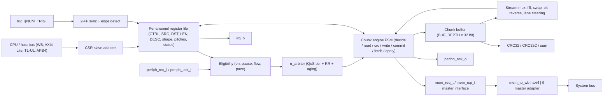

# GDMA2 — General-Purpose + 2D/3D Scatter-Gather DMA Controller (`gdma`)

Clean-room, protocol-agnostic multi-channel DMA with a quad-bus wrapper
(Wishbone B4 / AXI4 / TileLink-UH slave **and** master side; AMBA APB4 slave side with an
AXI4 master). Plain synthesizable SystemVerilog (IEEE 1800-2017), single clock,
asynchronous-assert active-low reset, no latches, no tri-states, no vendor primitives.

* Design guide (architecture, recipes, 2D examples, arbitration): [`docs/07_dma_guide.md`](../../../docs/07_dma_guide.md)
* RTL: `rtl/gdma_pkg.sv`, `rtl/gdma_core.sv`, wrappers `gdma_wb|axi|tl|apb`, `gdma_top`
* Testbenches: `tb/tb_gdma.sv` (legacy + directed extension), `tb/tb_gdma_rand.sv` (constrained random vs. reference model)

> Backward compatibility: every CSR offset/bit and behaviour of the original 4-channel DMA
> (global block at `0x00`, channel blocks at `0x20 + 0x20*c`, 4-word legacy descriptors) is preserved;
> all new features live at new offsets / previously-reserved bits and are **off after reset**.

## 1. Feature summary

| Area | Feature |
| :-- | :-- |
| Channels | `NUM_CH` = 1..16 (default 4); per-channel 4-bit priority (`CH_CTRL.QOS`), optional separate 4-bit bus-QoS (`awqos/arqos`) |
| Arbitration | QoS-tiered round robin with anti-starvation aging (`common/rtl/rr_arbiter`), arbitration per chunk |
| Transfer types | memory→memory, memory→peripheral, peripheral→memory (req/ack handshake; single / quantum-of-N / peripheral-terminated flow control) |
| Addressing | 1D, 2D (rows, src/dst signed line pitch), 3D (planes, src/dst signed plane stride); fixed (FIFO) or incrementing on each side independently |
| Data path | 8/16/32-bit item size per side, packing / unpacking / width conversion, unaligned start addresses (byte-lane steering, write strobes), 32-bit bus beats, 4 KB-safe INCR bursts (1..16 beats), independent source / destination burst length |
| Transforms | per-destination-item byte swap, half-word swap, bit reverse; memset / pattern fill; on-the-fly CRC-32 (IEEE), CRC-32C, or 32-bit byte-sum |
| Linked lists | legacy 4-word nodes **or** extended variable-size nodes with a per-node field-update mask, per-node IRQ, pause-after-node, CRC-clear; end-of-list or circular (ring) operation |
| Circular / ping-pong | auto-restart with half-transfer (HT) and transfer-complete (TC) interrupts |
| Control | per-channel pause / resume / abort, global suspend, global abort, hardware trigger inputs (rising / falling / both, *start* or *pace* action), software trigger |
| Safety | per-channel progress timeout (watchdog), bus-error capture (address / direction / code) per channel + global first-error, configuration-error detection |
| Observability | per-channel byte counter, rows/planes remaining, global performance counters (busy cycles, stall cycles, read beats, write beats, chunks, bytes) |
| Interrupts | per channel flags TC / HT / ERR / TIMEOUT / NODE / CFG / ABORT with per-channel enables; one OR-ed `irq_o`; legacy `INT_EN/INT_STAT` aliases |

## 2. Block diagram



## 3. Parameters

| Parameter | Default | Range | Meaning |
| :-- | :-- | :-- | :-- |
| `NUM_CH` | 4 | 1..16 | number of channels |
| `NUM_PERIPH` | 16 | 1..16 | number of `periph_req_i/ack_o` lines (`CH_CTRL.PERIPH_SEL` ≥ `NUM_PERIPH` means "always requesting") |
| `NUM_TRIG` | 8 | 1..16 | number of hardware trigger inputs; out-of-range `TRIG_SEL` never fires |
| `BUF_DEPTH` | 16 | 4..64 | chunk buffer depth in 32-bit words (a chunk is at most `4*BUF_DEPTH` stream bytes) |
| `ARB_AGING_MAX` | 16 | 1..255 | grants a waiting channel may lose before it is promoted to top QoS tier |
| `BUS_TYPE` (top only) | `BUS_AXI4` | `BUS_WISHBONE/AXI4/TILELINK/APB` | selects the CSR slave and DMA master protocol |

## 4. Ports

`gdma_wb`, `gdma_axi`, `gdma_tl` (identical except bus ports):

| Port | Dir | Description |
| :-- | :-- | :-- |
| `clk_i`, `rst_ni` | in | clock, async active-low reset |
| `s_wb_i/s_wb_o`, `s_axi_i/s_axi_o`, `s_tl_i/s_tl_o` | in/out | CSR slave port (one per wrapper) |
| `m_wb_o/m_wb_i`, `m_axi_o/m_axi_i`, `m_tl_o/m_tl_i` | out/in | DMA master port |
| `periph_req_i[NUM_PERIPH-1:0]` | in | peripheral DMA request (level, held until `periph_ack_o`) |
| `periph_ack_o[NUM_PERIPH-1:0]` | out | one-cycle acknowledge pulse at the end of a request quantum |
| `periph_last_i[NUM_PERIPH-1:0]` | in, default `'0` | peripheral says "this quantum is the last" (peripheral is the flow controller) |
| `trig_i[NUM_TRIG-1:0]` | in, default `'0` | asynchronous hardware trigger inputs |
| `irq_o` | out | OR of all enabled channel interrupts |

`gdma_apb`: `s_apb_i/s_apb_o` (APB4 slave) + `m_axi_o/m_axi_i` (AXI4 master — APB has no master role, so
BUS_APB uses an AXI4 DMA master, per the repo convention) + the same peripheral / trigger / irq ports.
`gdma_top` carries all four slave ports (`s_wb`, `s_axi`, `s_tl`, `s_apb`) and the three master ports (`m_wb`, `m_axi`, `m_tl`; `BUS_APB` uses `m_axi`); unused outputs are tied to 0.

## 5. Register map

All registers are 32-bit; `addr[11:0]` is decoded, `addr[1:0]` ignored; byte strobes are honoured on
RW registers. Unmapped offsets and channel indices ≥ `NUM_CH` return a CSR error (`err=1`).
Reset value is 0 unless stated.

### 5.1 Global block

| Offset | Name | Access | Fields |
| :-- | :-- | :-- | :-- |
| `0x000` | `GLB_CTRL` | RW | `[0]` EN (global enable; channels do nothing while 0), `[1]` SUSPEND (no new chunk starts; running chunk completes), `[2]` ABORT_ALL (write 1 = pulse `CMD.ABORT` on every channel, reads 0) |
| `0x004` | `INT_EN` (legacy) | RW | `[7:0]` TC interrupt enable ch0..7 (= `CHx_IE[0]`), `[15:8]` ERR enable ch0..7 (= `CHx_IE[2]`) |
| `0x008` | `INT_STAT` (legacy) | W1C | `[7:0]` TC flag ch0..7 (= `CHx_STATUS[0]`), `[15:8]` ERR flag ch0..7 (= `CHx_STATUS[2]`) |
| `0x00C` | `GLB_STATUS` | RO | `[0]` BUSY (engine not idle), `[1]` SUSPENDED (SUSPEND && idle), `[2]` ANY_ACTIVE (some channel enabled), `[3]` IRQ (`irq_o` level), `[15:8]` ACT_CH (channel currently owned by the engine) |
| `0x010` | `GLB_ID` | RO | `0x4744_4D32` |
| `0x014` | `GLB_CFG` | RO | `[4:0]` NUM_CH, `[9:5]` NUM_PERIPH, `[14:10]` NUM_TRIG, `[15]` reserved (0), `[23:16]` BUF_DEPTH, `[24]` 2D/3D, `[25]` CRC, `[26]` triggers, `[27]` perf counters (all 1) |
| `0x018` | `INT_EN_HI` | RW | same layout as `INT_EN` for channels 8..15 |
| `0x01C` | `INT_STAT_HI` | W1C | same layout as `INT_STAT` for channels 8..15 |
| `0x300` | `PERF_CTRL` | RW | `[0]` CLEAR (write 1: clear all counters, reads 0), `[1]` FREEZE |
| `0x304` | `PERF_CYC` | RO | cycles with the engine not idle |
| `0x308` | `PERF_STALL` | RO | cycles waiting for the bus (request valid but not accepted, or waiting for a response beat) |
| `0x30C` | `PERF_RD_BEATS` | RO | accepted read data beats (data and descriptor reads) |
| `0x310` | `PERF_WR_BEATS` | RO | accepted write data beats |
| `0x314` | `PERF_CHUNKS` | RO | committed chunks |
| `0x318` | `PERF_BYTES` | RO | committed (written) payload bytes, all channels |
| `0x320` | `GERR_ADDR` | RO | address of the first bus error since last clear |
| `0x324` | `GERR_INFO` | RO / write-clear | same format as `CHx_ERR_INFO`; **any write clears it** (re-arms capture); bit 31 = valid |
| `0x328` | `IRQ_PEND` | RO | `[15:0]` per-channel `\|(STATUS & IE)` |

### 5.2 Legacy channel block (`0x020 + 0x20*c`)

| Offset | Name | Access | Fields |
| :-- | :-- | :-- | :-- |
| `+0x00` | `CH_CTRL` | RW | `[0]` EN (auto-clears on completion / error / abort), `[1]` SRC_INC, `[2]` DST_INC, `[4:3]` SIZE (0:1B, 1:2B, 2:4B, 3 reserved ⇒ CFG error) — source item size, also destination size unless `CTRL2.DST_SIZE_EN`, `[5]` PERIPH_FLOW, `[9:6]` PERIPH_SEL, `[10]` SG_EN, `[11]` EXT_DESC (0 = legacy 4-word nodes, 1 = extended nodes), `[15:12]` QOS (arbitration priority; also bus QoS unless `CTRL2.BUS_QOS_EN`). Bits `[31:16]` reserved (read 0). Writing EN 0→1 **arms** the channel (see §6.1) |
| `+0x04` | `CH_SRC` | RW | working source byte address (advances as data is committed) |
| `+0x08` | `CH_DST` | RW | working destination byte address |
| `+0x0C` | `CH_LEN` | RW | `[23:0]` bytes remaining in the current row (1D: whole transfer). Writing also sets the row-reload length |
| `+0x10` | `CH_DESC` | RW | next-node pointer. Legacy format: `[31:4]` 16-byte-aligned address, `[0]` link valid. Extended: `[31:2]` word-aligned address, `[0]` link valid, `[1]` reserved |

### 5.3 Extended channel block (`0x400 + 0x80*c`)

| Offset | Name | Access | Fields |
| :-- | :-- | :-- | :-- |
| `+0x00` | `CTRL2` | RW | `[3:0]` SRC_BURST−1, `[7:4]` DST_BURST−1 (max beats per bus transaction 1..16; fixed-address sides always use single-beat transactions), `[8]` DST_SIZE_EN, `[10:9]` DST_SIZE (0:1B,1:2B,2:4B,3 ⇒ CFG error), `[11]` CIRC, `[12]` BSWAP, `[13]` HSWAP, `[14]` BITREV, `[15]` FILL, `[17:16]` CRC_MODE (0 off, 1 CRC-32, 2 CRC-32C, 3 byte-sum), `[18]` TRIG_ACT (0 start, 1 pace), `[20:19]` TRIG_MODE (0 off, 1 rising, 2 falling, 3 both), `[24:21]` TRIG_SEL, `[25]` FLOW_SRC (peripheral is the source side; 0 = destination side), `[26]` BUS_QOS_EN, `[30:27]` BUS_QOS, `[31]` PAUSE |
| `+0x04` | `SHAPE` | RW | `[15:0]` ROWS (0 ⇒ 1), `[31:16]` PLANES (0 ⇒ 1) |
| `+0x08` | `SRC_PITCH` | RW | signed byte distance between source row starts |
| `+0x0C` | `DST_PITCH` | RW | signed byte distance between destination row starts |
| `+0x10` | `SRC_PSTRIDE` | RW | signed byte distance between source plane starts |
| `+0x14` | `DST_PSTRIDE` | RW | signed byte distance between destination plane starts |
| `+0x18` | `FILL` | RW | 32-bit fill pattern (little-endian byte order) |
| `+0x1C` | `CRC` | RW | running checksum; reads the *final* value (CRC modes: LFSR state ⊕ `FFFF_FFFF`; sum mode: sum). Writing `V` seeds the running value as if `V` were the checksum of the preceding data (write 0 for the standard CRC) |
| `+0x20` | `STATUS` | W1C / RO | `[0]` TC, `[1]` HT, `[2]` ERR, `[3]` TO, `[4]` NODE, `[5]` CFG, `[6]` ABRT (all W1C); `[8]` ACTIVE (EN), `[9]` PAUSED (PAUSE set and channel not currently in the engine), `[10]` BUSY (channel currently owns the engine), `[11]` WAIT_REQ (enabled, not paused, `LEN != 0`, waiting for peripheral request or pace trigger) |
| `+0x24` | `IE` | RW | `[6:0]` interrupt enables matching `STATUS[6:0]` |
| `+0x28` | `TIMEOUT` | RW | `[23:0]` progress watchdog in clock cycles (0 = off) |
| `+0x2C` | `HT_THRESH` | RW | half-transfer threshold in bytes (0 = HT disabled) |
| `+0x30` | `FLOW` | RW | `[7:0]` PQ−1 (items per peripheral request quantum), `[8]` LAST_EN (honour `periph_last_i`) |
| `+0x34` | `BYTES` | RO | payload bytes committed since the channel was armed / last circular wrap |
| `+0x38` | `ERR_ADDR` | RO | address of the failing bus access |
| `+0x3C` | `ERR_INFO` | RO | `[0]` write access, `[7:4]` code, `[11:8]` channel, `[31]` valid |
| `+0x40` | `CMD` | WO | `[0]` ABORT, `[1]` TRIGGER (software trigger event). Reads 0 |
| `+0x44` | `PROG` | RO | `[15:0]` rows remaining (incl. current), `[31:16]` planes remaining (incl. current) |
| `+0x48` | `DESC_HEAD` | RO | snapshot of `CH_DESC` taken when the channel was armed (restart pointer for circular lists) |

Error codes (`ERR_INFO[7:4]`): `1` source read bus error, `2` destination write bus error, `3` descriptor read bus error,
`4` configuration error, `5` timeout. `ERR_ADDR` is the word-aligned (`addr & ~3`) byte address of the first failing *beat* for read/descriptor bursts and
the first address of the failing burst for write bursts (bus responses arrive per burst); it is `0` for codes 4/5.
`GERR_ADDR` / `GERR_INFO` capture bus errors only (codes 1/2/3); per-channel `ERR_INFO` / `ERR_ADDR` capture all codes 1..5 and persist until the next error on that channel.

## 6. Behavioural specification

This section is the contract used by the reference model of `tb_gdma_rand`.

### 6.1 Arming, completion
* **Arm** (CSR write that takes `CH_CTRL.EN` from 0 to 1, or a hardware *start* trigger): the channel takes a snapshot
  `src0=CH_SRC, dst0=CH_DST, len0=CH_LEN, desc0=CH_DESC`; `rows_left = max(ROWS,1)`, `planes_left = max(PLANES,1)`;
  row/plane base addresses := `CH_SRC/CH_DST`; row-reload length := `CH_LEN`; `BYTES`, HT-done, peripheral quantum,
  pending node flags and timeout counter := 0. Status flags and `CRC` are *not* touched.
* A **transfer** moves `PLANES × ROWS × LEN` stream bytes (see 6.2). When the last byte of the last row of the
  last plane is committed (or immediately after arm if `LEN == 0`) the *node* is complete:
  1. if the loaded node had `NODE_IRQ`: set `STATUS.NODE`; if it had `PAUSE_AFTER`: set `CTRL2.PAUSE`;
  2. if `SG_EN` and `CH_DESC[0]` = 1 (and the transfer was not terminated by the peripheral): fetch the next node (6.5) and continue;
  3. otherwise set `STATUS.TC`. If `CTRL2.CIRC` = 0: `CH_CTRL.EN` := 0 and `PROG` := `0` (`CH_SRC`/`CH_DST` stay at end-of-last-row `S(P-1,R-1)+L` / `D(P-1,R-1)+L` if incrementing; `CH_SRC` is unchanged when `FILL=1`). If `CIRC` = 1: restore
     `CH_SRC/DST/DESC/LEN` from the arm snapshot, `rows_left/planes_left` from `SHAPE`, `BYTES` := 0, re-allow HT, and keep running (including when terminated by `periph_last_i`).
* With `SG_EN` and `LEN == 0` at arm, the first node is fetched before any data moves (legacy behaviour).
* `CH_SRC/CH_DST` (for an incrementing side) and `CH_LEN` always reflect *committed* progress; a chunk is committed
  only after all its writes got an OK response.

### 6.2 Stream model (golden semantics)
For plane `p` in `0..P-1`, row `r` in `0..R-1` (`P=max(PLANES,1)`, `R=max(ROWS,1)`), row length `L` bytes:
* row source start `S(p,r) = src0 + p*SRC_PSTRIDE + r*SRC_PITCH` if SRC_INC else `src0`; destination analogous with `DST_*`
  (all modulo 2³²; the first row/plane uses exactly `src0`/`dst0`).
* **Source bytes** of a row: with `SRC_INC`, stream byte `i` = memory byte at `S+i` (any alignment). With a fixed
  source, item `k` (size `ssz` = 1/2/4 bytes) is one bus read of the word containing `S`; the item occupies lane
  `S[1:0] & ~(ssz-1)` of that word; stream bytes `k*ssz .. k*ssz+ssz-1` of the row come from it; `ceil(L/ssz)` reads per row, excess bytes of the last item are discarded.
* **FILL** (`CTRL2.FILL`): stream byte `i` of the row = byte `(B0 + i) mod 4` of `FILL`, where `B0` is the `BYTES` value at the start of the row (bytes committed since arm / wrap). No source access happens.
* **CRC** (`CRC_MODE` ≠ 0): the stream bytes (before any transform) are fed in order to the checksum.
  Mode 1: reflected CRC-32, poly `0xEDB88320`, init/xor-out `0xFFFFFFFF`; mode 2: reflected CRC-32C, poly `0x82F63B78`, same init/xor-out;
  mode 3: 32-bit sum of the bytes. `CRC` is updated when the chunk's data are gathered (before the writes), so an
  aborted / errored chunk may already have contributed.
* **Transforms**: the row stream is cut into groups of `dsz` bytes (destination item size) starting at the row start.
  Only *complete* groups are transformed: `BSWAP` reverses the byte order within the group; then `HSWAP` (only `dsz`=4) swaps the two 16-bit halves; then
  `BITREV` reverses the bit order of every byte. (With `dsz`=1 only BITREV has an effect.)
* **Destination bytes**: with `DST_INC`, transformed stream byte `i` is written to `D+i` with a byte strobe; no other byte of the
  destination is modified. With a fixed destination, item `k` (`dsz` bytes = stream bytes `k*dsz..`) is written by one single-beat
  write at the word containing `D`, in lane `D[1:0] & ~(dsz-1)`; the last item of a row may be partial (strobes only for valid bytes).
* Both sides: bus beats are always aligned 32-bit words (AXI `size=2`), writes use byte strobes.
* Constraint (otherwise behaviour is deterministic but not modelled): a chunk must not need to split a fixed-side item,
  i.e. for flow-controlled channels `PQ*peripheral_item_size` must be a multiple of the other side's item size if that side is also fixed;
  transforms require `L` to be a multiple of `dsz`.

### 6.3 Chunks, bursts, arbitration
* The engine services one *chunk* at a time for the arbitration winner: up to `4*BUF_DEPTH − src_byte_offset` stream bytes
  (never beyond the end of the row or the peripheral quantum; rounded down to a multiple of the fixed-side item sizes and — if a transform is enabled — of `dsz`, unless it ends the row).
  Read phase (one or more INCR bursts of ≤ `SRC_BURST` beats, never crossing 4 KB, or single-beat reads for a fixed source),
  optional checksum pass, write phase (bursts ≤ `DST_BURST` beats, never crossing 4 KB, or single beats for a fixed destination), then commit.
  Descriptor fetches use bursts of ≤ 16 beats, 4 KB-safe.
* Arbitration (`rr_arbiter`): highest effective priority tier wins, round robin inside a tier starting after the previous winner; a channel that
  has lost `ARB_AGING_MAX` consecutive grants is promoted to tier 15 until it wins. A channel is *eligible* when `GLB_CTRL.EN`, not `SUSPEND`, `CH_CTRL.EN`, not `PAUSE`,
  no abort/timeout pending, and — only while `LEN != 0` — (if `PERIPH_FLOW`: a quantum is in progress or `periph_req_i[sel]` is high and the post-ack hold-off has expired)
  and (if pace trigger: a trigger event is pending).
* Bus transaction attributes: `id` = channel, `qos` = `CTRL2.BUS_QOS_EN ? BUS_QOS : CH_CTRL.QOS`.

### 6.4 Peripheral handshake and flow control
* `PERIPH_FLOW=1`: a *request quantum* is `PQ*psz` bytes where `psz` is the item size of the peripheral side (`FLOW_SRC ? src : dst`). When
  `periph_req_i[PERIPH_SEL]` is seen (and `LEN != 0`) the quantum starts and `periph_last_i[sel]` is sampled (if `LAST_EN`).
  The quantum may span several chunks. At the commit that ends the quantum (or the row) `periph_ack_o[sel]` pulses for one cycle; the
  request is ignored for 2 cycles after the ack. If the sampled `last` was 1, the whole channel completes (TC) after that quantum, abandoning the remaining length / rows / chain.
* `periph_ack_o` is therefore a *quantum-done* pulse, issued after the data of the quantum were both read and written.

### 6.5 Descriptors (linked lists)
The channel `CH_DESC` register points at the node to fetch; after the fetch it holds the node's NEXT field.

**Legacy node** (`EXT_DESC=0`, 16-byte aligned, 4 words): `W0 SRC`, `W1 DST`, `W2 LEN[23:0]`, `W3 NEXT` (`[31:4]` pointer, `[0]` valid).

**Extended node** (`EXT_DESC=1`, word aligned): `W0 HDR`, `W1 NEXT`, then one word per set bit of `HDR[12:0]` in ascending bit order:

| HDR bit | Word loaded into | Notes |
| :-- | :-- | :-- |
| 0 | `CH_SRC` (+ row/plane base) | |
| 1 | `CH_DST` (+ row/plane base) | |
| 2 | `CH_LEN[23:0]` (+ row-reload length) | |
| 3 | `CH_CTRL[15:1]` | EN is never modified; `[31:16]` ignored |
| 4 | `CTRL2` | `PAUSE` bit is not modified |
| 5 | `SHAPE` | |
| 6 | `SRC_PITCH` | |
| 7 | `DST_PITCH` | |
| 8 | `SRC_PSTRIDE` | |
| 9 | `DST_PSTRIDE` | |
| 10 | `FILL` | |
| 11 | `HT_THRESH` | |
| 12 | `TIMEOUT` | |

`HDR[15:13]` must be 0 (else CFG error, channel stops). `HDR[16]` NODE_IRQ (set `STATUS.NODE` when this node completes, before the TC / next-node step),
`HDR[17]` PAUSE_AFTER (set `CTRL2.PAUSE` when the node completes), `HDR[18]` CRC_CLR (reset `CRC` to seed 0 when the node is loaded). `HDR[31:19]` reserved.
`NEXT`: `[31:2]` next node address (word aligned), `[0]` valid, `[1]` ignored (cleared in `CH_DESC`).
After loading, `rows_left/planes_left` are re-derived from `SHAPE`, and `row_base`/`plane_base` are re-latched from the working `CH_SRC`/`CH_DST` (whether updated by the node or retained). All fields of a node are applied atomically after the complete node was fetched without error.
A node with `LEN = 0` (or omitting `HDR[2]` after a prior node completed) completes immediately (a pure register-update node). Fields not selected keep their current value (including working addresses).
Legacy nodes load only `SRC`, `DST`, `LEN`, `NEXT` and have no node flags.

### 6.6 Triggers, pause, abort, timeout
* `trig_i` is synchronised (2 FF) and edge-detected. A trigger event is the chosen edge of `trig_i[TRIG_SEL]` (when `TRIG_MODE`≠0 and `TRIG_SEL < NUM_TRIG`) **or** a `CMD.TRIGGER` write (regardless of `TRIG_MODE`).
  `TRIG_ACT=0` (*start*): an event while `EN=0` arms the channel (as if `EN` had been written 1). `TRIG_ACT=1` (*pace*): an event while `EN=1` sets a one-deep pending flag; starting a chunk consumes it, so
  every chunk (while `LEN != 0`) needs one event.
* `PAUSE=1`: no new chunk starts; a chunk in flight completes. Clearing it resumes.
* Abort (`CMD.ABORT`, `GLB_CTRL.ABORT_ALL`, or clearing `CH_CTRL.EN` while active): takes effect at the next safe point — before a read burst, before a write
  burst or item, or immediately if the channel is not in the engine. The in-flight bus burst is never cut. `EN` := 0 and `STATUS.ABRT` is set (not for a plain EN clear).
  Aborting an already-disabled (`EN=0`) channel is a clean no-op (`STATUS.ABRT` stays 0).
  Registers keep their *committed* progress. Bytes of an uncommitted chunk may already have been written to the destination (correct values only).
* Timeout: if `TIMEOUT≠0`, the channel is enabled, not paused and `GLB_CTRL.SUSPEND=0`, a counter increments every cycle and is cleared at arm, at every committed chunk and at every completed node fetch.
  When it reaches `TIMEOUT` the channel is stopped like an abort but sets `STATUS.TO` (code 5).
* Bus error: the offending chunk or fetch is not committed, remaining beats of the burst are drained, `STATUS.ERR` is set, `ERR_ADDR/ERR_INFO` (and, if the global one was clear, `GERR_*`) are captured, `EN` := 0.
* CFG error: `SIZE` or `DST_SIZE` = 3, a chunk that cannot make progress (rounds to 0 bytes), reserved `HDR[15:13]` set → `STATUS.CFG`, `EN` := 0, code 4.

### 6.7 Interrupt summary
`irq_o = OR_c |(STATUS_c[6:0] & IE_c[6:0])`. Legacy aliases: `INT_STAT[c]` ≡ `STATUS_c.TC`, `INT_STAT[8+c]` ≡ `STATUS_c.ERR`; `INT_EN` likewise ≡ `IE_c[0]`/`IE_c[2]`.
HT: set once per run when `BYTES >= HT_THRESH` (`HT_THRESH≠0`), evaluated at every commit.

## 7. Programming recipes (C-style)

```c
#define GDMA 0x50000000u
#define R(o)     (*(volatile uint32_t*)(GDMA + (o)))
#define CH(c,o)  R(0x020 + 0x20*(c) + (o))
#define CX(c,o)  R(0x400 + 0x80*(c) + (o))

// 1) legacy memory copy, 64 bytes, channel 0
R(0x000) = 1;                      // global enable
CH(0,0x04) = src;  CH(0,0x08) = dst;  CH(0,0x0C) = 64;
CH(0,0x00) = (2<<3) | 4 | 2 | 1;   // 4-byte items, dst_inc, src_inc, en
while (!(R(0x008) & 1)) ;          R(0x008) = 1;   // wait TC, clear

// 2) 2D rectangle copy: 100 rows of 48 bytes, source pitch 640, destination pitch 256
CX(0,0x04) = 100;                  // ROWS
CX(0,0x08) = 640; CX(0,0x0C) = 256;
CX(0,0x00) = (15<<0)|(15<<4);      // 16-beat bursts
CH(0,0x04)=src; CH(0,0x08)=dst; CH(0,0x0C)=48; CH(0,0x00)=(2<<3)|4|2|1;

// 3) memset 4 KB with 0xA5A5A5A5, with CRC32 of the stream
CX(0,0x18) = 0xA5A5A5A5; CX(0,0x1C) = 0;
CX(0,0x00) = (1<<15) | (1<<16) | (15<<4);
CH(0,0x08)=dst; CH(0,0x0C)=4096; CH(0,0x00)=(2<<3)|4|1;

// 4) peripheral -> memory, 8-bit FIFO at fixed address, 16 bytes per request, circular ring with HT/TC
CH(0,0x04)=uart_dr; CH(0,0x08)=ring; CH(0,0x0C)=256;
CX(0,0x30) = 15;                       // PQ-1 = 15 items per request
CX(0,0x2C) = 128;                      // half-transfer at 128 bytes
CX(0,0x00) = (1<<11) | (1<<25) | (15<<4);   // CIRC | FLOW_SRC | 16-beat dst bursts
CX(0,0x24) = 3;                        // IE: TC, HT
CH(0,0x00) = (0<<3) | 4 | 0x20 | (3<<6) | 1; // 1-byte items, dst_inc, flow, periph 3, en

// 5) extended linked list: node = {HDR, NEXT, SRC, DST, LEN}
node[0] = 0x7 | (1<<16);               // update SRC,DST,LEN; NODE_IRQ
node[1] = (uint32_t)next | 1;          // valid link
node[2] = src; node[3] = dst; node[4] = len;
CH(0,0x10) = (uint32_t)node | 1;       // first node, link valid
CH(0,0x0C) = 0;                        // LEN=0 -> fetch first
CH(0,0x00) = (2<<3)|4|2|(1<<10)|(1<<11)|1;   // SG_EN | EXT_DESC | ...
```

## 8. Integration notes
* `periph_req_i/ack_o` follow a classic req/ack protocol: hold `req` until the one-cycle `ack` pulse, then drop it (or re-raise after ≥ 2 cycles for the next quantum).
* Hardware triggers may be asynchronous; they are re-synchronised inside the core.
* The core has a single master interface (`mem_req_t`) and issues one outstanding transaction; the wrapper adapters convert to WB B4 (classic cycles), AXI4 (INCR, size 2, id = channel, qos), or TL-UH (one message per beat).
* Bus-QoS: AXI `awqos/arqos` carry the per-channel QoS; the other protocols ignore it.
* FPGA/ASIC: per-channel state is flop based (≈ 700 flops/channel), the chunk buffer is `BUF_DEPTH×32` flops with a byte-granular read mux (use 8–16 for small area); no memories, no latches, no derived clocks.
* Reset: asynchronous assert (`rst_ni`), deassertion should be synchronised by the SoC reset controller.

## 9. Verification summary

See §10 of [`docs/07_dma_guide.md`](../../../docs/07_dma_guide.md) for the final coverage numbers.
