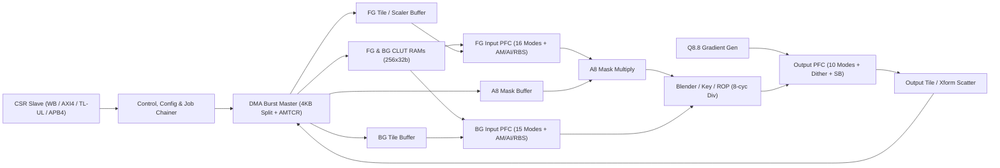

# 16_gfx2d_dma: Hardware 2D Graphics Accelerator & Stride Blitter (`gfx2d_dma`)

Clean-room, pure IEEE 1800-2017 SystemVerilog 2D graphics accelerator in the class of ST's DMA2D / Chrom-ART accelerator, with unified quad-bus host wrappers for **Wishbone B4** (`gfx2d_dma_wb`), **AXI4** (`gfx2d_dma_axi`), **TileLink TL-UL/TL-UH** (`gfx2d_dma_tl`), and **APB4 + AXI4 Master** (`gfx2d_dma_apb`), selectable via `gfx2d_dma_top #(.BUS_TYPE(...))`.

For the full ST DMA2D gap-analysis table, bit-exact mathematical specification, and architecture deep-dive, see [04_chromart_2d_gpu_guide.md](../../../docs/04_chromart_2d_gpu_guide.md).

---

## 1. Key Features

- **8 Operating Modes (`CR.MODE[2:0]`)**:
  - `0` `M2M` (raw copy), `1` `M2M_PFC`, `2` `M2M_BLEND`, `3` `R2M` (solid / `R2M_PFC` / gradient fill), `4` `M2M_BLEND_FG` (fixed FG over memory BG), `5` `M2M_BLEND_BG` (memory FG over fixed BG), `6` `M2M_COLKEY` (RGB color-key skip), `7` `M2M_ROP` (8 bitwise ROPs: `XOR`, `AND`, `OR`, `NOR`, `NAND`, `INV_FG`, `COPY_FG`, `AND_INV`).
- **16 Input Color Modes (`FGPFCCR.CM[3:0]` / `BGPFCCR.CM[3:0]`)**:
  - Base 11 formats: `ARGB8888`, `RGB888`, `RGB565`, `ARGB1555`, `ARGB4444`, `L8`, `AL44`, `AL88`, `L4`, `A8`, `A4` (nibble-accurate odd widths/offsets, even pixel in low nibble `[3:0]`).
  - Optional extended formats (`EN_EXTFMT=1`): FG-only line-packed `YCbCr` (`CM=11`, `CSS=0` 4:4:4 and `CSS=1` 4:2:2, full-range BT.601) and 8-bit `ARGB2222`, `ABGR2222`, `RGBA2222`, `BGRA2222` (`CM=12..15`).
  - Per-layer Alpha Mode `AM` (`NOP` / `REPLACE` / `MULTIPLY`), Alpha Invert `AI`, Red/Blue Swap `RBS`.
- **10 Output Color Modes (`OPFCCR.CM[3:0]`)**:
  - Base 6 formats: `ARGB8888`, `RGB888`, `RGB565`, `ARGB1555`, `ARGB4444`, `L8` (`(2*R + 5*G + B) >> 3`).
  - Optional extended formats (`EN_EXTFMT=1`): `ARGB2222` (`6`), `ABGR2222` (`7`), `RGBA2222` (`8`), `BGRA2222` (`9`).
  - Output `AI`, `RBS`, optional 2x2 ordered Bayer dithering (`OPFCCR[16]`), `R2M_PFC` (`OPFCCR[17]`), and halfword byte-swap `SB` (`OPFCCR[9]`).
- **Dual 256 x 32-bit CLUT SRAMs (`gfx2d_clut_ram`)**:
  - Hardware DMA autoload (`FGCMAR`/`BGCMAR`, ARGB8888 or unaligned RGB888 via `CCM`, size `CS+1`, `CTCIF` completion IRQ) and direct CPU CSR apertures (`0x400..0x7FC` FG, `0x800..0xBFC` BG) with `CAEIF` access-conflict detection.
- **Bit-Exact Porter-Duff Source-Over Blender (`gfx2d_blender`)**:
  - Exact integer formula `aMUL = floor(aFG*aBG/255)`, `aOUT = aFG + aBG - aMUL`, `cOUT = floor((cFG*aFG + cBG*(aBG - aMUL)) / aOUT)` (optional round-to-nearest via `XCR.BLEND_RND`).
  - Zero-cycle fast paths when `aFG in {0,255}` or `aBG in {0,255}`; tiny 8-cycle restoring divider (no combinational dividers) when both layers are translucent.
- **DMA Burst Engine & Bus Hygiene**:
  - 16-pixel tile engine (`TILE_PX = 16`), <=16-beat INCR bursts, automatic 4KB boundary splitting on every read/write/CLUT/job burst, byte-accurate write strobes (`wstrb`), pixel or byte line offsets (`CR.LOM`), `NLR_REM` live down-counter, `LWR`/`TWIF` line watermark, `SUSP`/`ABORT`, `AMTCR` inter-burst dead-time throttling, and sticky burst-draining `TEIF` bus-error handling.
- **Parameter-Guarded Extensions (each removable with `EN_* = 0`)**:
  - `EN_JOBS`: Linked-list 24-word job descriptors in memory (`JOB_PTR`, `JOB_CTRL`, `XISR.JDIF/JEIF`, `JOB_CUR`, `JOB_CNT`), supporting per-job CLUT autoload and per-job `TCIF`.
  - `EN_XFORM`: 8 output orientations (`FLIPX`, `FLIPY`, `ROT90`) on output addressing.
  - `EN_SCALE`: Nearest and bilinear 2D foreground scaling across all input formats (`SCALE_SIZE`, `SCALE_DX`, `SCALE_DY`).
  - `EN_EBLEND`: `ADD`, `SUB`, `MUL`, `SCREEN` blend operators (`XCR.BLEND_OP`) + dedicated A8 mask plane (`MASK_MAR`, `MASK_OR`).
  - `EN_GRAD`: Linear signed Q8.8 ARGB gradient fill in `R2M` mode (`GRADX_*`, `GRADY_*`).
  - `EN_EXTFMT`: `YCbCr` 4:4:4 / 4:2:2 input + `ARGB/ABGR/RGBA/BGRA2222` in/out formats.

---

## 2. Block Diagram



---

## 3. Parameters & Port Tables

### 3.1 Top-Level Parameters (`gfx2d_dma_top` / `gfx2d_dma_core`)

| Parameter | Type | Default | Description |
| :--- | :--- | :---: | :--- |
| `BUS_TYPE` | `bus_pkg::bus_proto_e` | `BUS_AXI4` | Active wrapper in `gfx2d_dma_top`: `BUS_WISHBONE`, `BUS_AXI4`, `BUS_TILELINK`, `BUS_APB` |
| `EN_JOBS` | `bit` | `1'b1` | Enable linked-list command/job chainer (`FEAT[0]`) |
| `EN_XFORM` | `bit` | `1'b1` | Enable output `FLIPX`/`FLIPY`/`ROT90` geometry (`FEAT[1]`) |
| `EN_SCALE` | `bit` | `1'b1` | Enable nearest/bilinear 2D FG scaler (`FEAT[2]`) |
| `EN_EBLEND` | `bit` | `1'b1` | Enable `ADD`/`SUB`/`MUL`/`SCREEN` blend ops & A8 mask plane (`FEAT[3]`) |
| `EN_GRAD` | `bit` | `1'b1` | Enable Q8.8 ARGB linear gradient fill (`FEAT[4]`) |
| `EN_EXTFMT` | `bit` | `1'b1` | Enable `YCbCr` 4:4:4/4:2:2 input and `2222` in/out formats (`FEAT[5]`) |

### 3.2 Port List (`gfx2d_dma_top`)

| Port | Direction | Type | Description |
| :--- | :---: | :--- | :--- |
| `clk_i` | Input | `logic` | Single synchronous system clock |
| `rst_ni` | Input | `logic` | Asynchronous-assert, synchronous-deassert active-low reset |
| `s_wb_i` / `s_wb_o` | In / Out | `wb_m2s_t` / `wb_s2m_t` | Wishbone B4 CSR slave (active when `BUS_TYPE == BUS_WISHBONE`) |
| `s_axi_i` / `s_axi_o` | In / Out | `axi4_m2s_t` / `axi4_s2m_t` | AXI4-Lite CSR slave (active when `BUS_TYPE == BUS_AXI4`) |
| `s_tl_i` / `s_tl_o` | In / Out | `tl_m2s_t` / `tl_s2m_t` | TileLink TL-UL CSR slave (active when `BUS_TYPE == BUS_TILELINK`) |
| `s_apb_i` / `s_apb_o` | In / Out | `apb_m2s_t` / `apb_s2m_t` | APB4 CSR slave (active when `BUS_TYPE == BUS_APB`) |
| `m_wb_o` / `m_wb_i` | Out / In | `wb_m2s_t` / `wb_s2m_t` | Wishbone B4 DMA master (`BUS_WISHBONE`) |
| `m_axi_o` / `m_axi_i` | Out / In | `axi4_m2s_t` / `axi4_s2m_t` | AXI4 burst DMA master (`BUS_AXI4` and `BUS_APB`) |
| `m_tl_o` / `m_tl_i` | Out / In | `tl_m2s_t` / `tl_s2m_t` | TileLink TL-UH DMA master (`BUS_TILELINK`) |
| `irq_o` | Output | `logic` | Level-high combined interrupt (`|(ISR[5:0]&CR[13:8]) \| |(XISR[1:0]&XIER[1:0])`) |

Individual protocol wrappers (`gfx2d_dma_wb`, `gfx2d_dma_axi`, `gfx2d_dma_tl`, `gfx2d_dma_apb`) expose only their own slave + master ports plus `clk_i`, `rst_ni`, `irq_o`.

---

## 4. Complete Register Map (`0x000..0xBFC`)

Configuration registers (`0x00C..0x050`, `0x064..0x094`) are write-protected while a 2D transfer or job list is active. Unmapped offsets return `csr_rsp_o.err = 1` (`PSLVERR`/`SLVERR`/`ERR`/`d_denied`).

| Offset | Name | Access | Reset | Bit Fields & Description |
| :--- | :--- | :---: | :---: | :--- |
| `0x000` | `CR` | RW | `0x0000_0000` | `[0]` `START` (self-clears at TC/error/abort), `[1]` `SUSP`, `[2]` `ABORT` (WO), `[6]` `LOM` (`0`=pixels, `1`=bytes), `[8]` `TEIE`, `[9]` `TCIE`, `[10]` `TWIE`, `[11]` `CAEIE`, `[12]` `CTCIE`, `[13]` `CEIE`, `[18:16]` `MODE[2:0]`, `[21:19]` `ROP[2:0]` |
| `0x004` | `ISR` | RO | `0x0000_0000` | `[0]` `TEIF`, `[1]` `TCIF`, `[2]` `TWIF`, `[3]` `CAEIF`, `[4]` `CTCIF`, `[5]` `CEIF`, `[16]` `BUSY`, `[17]` `CLUT_BUSY`, `[18]` `SUSPENDED`, `[19]` `JOB_ACTIVE` |
| `0x008` | `IFCR` | WO | `0x0000_0000` | `[5:0]` Write-1-to-clear `ISR[5:0]` (reads `0`, no bus error) |
| `0x00C` | `FGMAR` | RW | `0x0000_0000` | `[31:0]` Foreground memory base byte address |
| `0x010` | `FGOR` | RW | `0x0000_0000` | `[13:0]` Foreground line offset (pixels if `LOM=0`, bytes if `LOM=1`) |
| `0x014` | `BGMAR` | RW | `0x0000_0000` | `[31:0]` Background memory base byte address |
| `0x018` | `BGOR` | RW | `0x0000_0000` | `[13:0]` Background line offset |
| `0x01C` | `FGPFCCR` | RW | `0xFF00_0000` | `[3:0]` `CM`, `[4]` `CCM` (`0`=ARGB8888, `1`=RGB888), `[5]` `START` (CLUT autoload), `[15:8]` `CS` (`entries-1`), `[17:16]` `AM`, `[19:18]` `CSS` (YCbCr: `0`=4:4:4, `1`=4:2:2), `[20]` `AI`, `[21]` `RBS`, `[31:24]` `ALPHA` |
| `0x020` | `FGCOLR` | RW | `0x0000_0000` | `[23:0]` Foreground RGB888 constant color |
| `0x024` | `BGPFCCR` | RW | `0xFF00_0000` | Same layout as `FGPFCCR` (`CSS` unused; `CM=YCbCr` invalid) |
| `0x028` | `BGCOLR` | RW | `0x0000_0000` | `[23:0]` Background RGB888 constant color |
| `0x02C` | `FGCMAR` | RW | `0x0000_0000` | `[31:0]` Foreground CLUT source byte address |
| `0x030` | `BGCMAR` | RW | `0x0000_0000` | `[31:0]` Background CLUT source byte address |
| `0x034` | `OPFCCR` | RW | `0x0000_0000` | `[3:0]` `CM`, `[9]` `SB` (halfword byte-swap), `[16]` `DITHER_EN`, `[17]` `R2M_PFC`, `[20]` `AI`, `[21]` `RBS` |
| `0x038` | `OCOLR` | RW | `0x0000_0000` | `[31:0]` Output fill color (or gradient start ARGB8888 at `(0,0)`) |
| `0x03C` | `OMAR` | RW | `0x0000_0000` | `[31:0]` Output memory base byte address |
| `0x040` | `OOR` | RW | `0x0000_0000` | `[13:0]` Output line offset (after `Wd` destination pixels) |
| `0x044` | `NLR` | RW | `0x0000_0000` | `[15:0]` `NL` (lines), `[29:16]` `PL` (pixels per line) |
| `0x048` | `LWR` | RW | `0x0000_FFFF` | `[15:0]` 0-based line watermark index (`TWIF` fires when line `y == LWR` completes) |
| `0x04C` | `AMTCR` | RW | `0x0000_0000` | `[0]` `EN`, `[15:8]` `DT` (minimum idle clocks between consecutive DMA bursts) |
| `0x050` | `COLKEY` | RW | `0x0000_0000` | `[23:0]` 24-bit RGB color key (`M2M_COLKEY` skips write when post-PFC RGB matches) |
| `0x054` | `PERF_PIXELS` | RO | `0x0000_0000` | `[31:0]` Cumulative pixels processed |
| `0x058` | `PERF_CYCLES` | RO | `0x0000_0000` | `[31:0]` Cumulative active cycles (excludes `IDLE` and `SUSPENDED`) |
| `0x05C` | `ID` | RO | `0x4732_4402` | Core identifier (`"G2D\x02"`) |
| `0x060` | `FEAT` | RO | param-dep | `[0]` `EN_JOBS`, `[1]` `EN_XFORM`, `[2]` `EN_SCALE`, `[3]` `EN_EBLEND`, `[4]` `EN_GRAD`, `[5]` `EN_EXTFMT` |
| `0x064` | `XCR` | RW | `0x0000_0000` | `[0]` `FLIPX`, `[1]` `FLIPY`, `[2]` `ROT90`, `[4]` `SCALE_EN`, `[5]` `SCALE_BILIN`, `[6]` `MASK_EN`, `[7]` `BLEND_RND`, `[10:8]` `BLEND_OP`, `[11]` `GRAD_EN` |
| `0x068` | `SCALE_SIZE` | RW | `0x0000_0000` | `[13:0]` `SRC_W`, `[31:16]` `SRC_H` (source texture dimensions in pixels) |
| `0x06C` | `SCALE_DX` | RW | `0x0000_0000` | `[31:0]` U16.16 horizontal source step per output pixel |
| `0x070` | `SCALE_DY` | RW | `0x0000_0000` | `[31:0]` U16.16 vertical source step per output line |
| `0x074` | `MASK_MAR` | RW | `0x0000_0000` | `[31:0]` A8 mask plane byte address |
| `0x078` | `MASK_OR` | RW | `0x0000_0000` | `[13:0]` A8 mask plane line offset (pixels/bytes) |
| `0x07C` | `GRADX_AR` | RW | `0x0000_0000` | `[31:16]` signed Q8.8 `dA/dx`, `[15:0]` signed Q8.8 `dR/dx` |
| `0x080` | `GRADX_GB` | RW | `0x0000_0000` | `[31:16]` signed Q8.8 `dG/dx`, `[15:0]` signed Q8.8 `dB/dx` |
| `0x084` | `GRADY_AR` | RW | `0x0000_0000` | `[31:16]` signed Q8.8 `dA/dy`, `[15:0]` signed Q8.8 `dR/dy` |
| `0x088` | `GRADY_GB` | RW | `0x0000_0000` | `[31:16]` signed Q8.8 `dG/dy`, `[15:0]` signed Q8.8 `dB/dy` |
| `0x08C` | `NLR_REM` | RO | `0x0000_0000` | `[15:0]` Remaining lines in active/last transfer (`0` upon `TCIF`) |
| `0x090` | `JOB_PTR` | RW | `0x0000_0000` | `[31:0]` Word-aligned address of first 24-word job descriptor |
| `0x094` | `JOB_CTRL` | RW | `0x0000_0000` | `[0]` `START` (W1 to launch chain; reads `JOB_ACTIVE`) |
| `0x098` | `XISR` | RO | `0x0000_0000` | `[0]` `JDIF` (job list complete), `[1]` `JEIF` (job error) |
| `0x09C` | `XIFCR` | WO | `0x0000_0000` | `[1:0]` W1C for `XISR[1:0]` (reads `0`, no bus error) |
| `0x0A0` | `XIER` | RW | `0x0000_0000` | `[1:0]` Enables for `JDIF`, `JEIF` into `irq_o` |
| `0x0A4` | `JOB_CUR` | RO | `0x0000_0000` | `[31:0]` Address of current / last job descriptor |
| `0x0A8` | `JOB_CNT` | RO | `0x0000_0000` | `[31:0]` Count of completed jobs in current / last chain |
| `0x400..0x7FC` | `FG_CLUT[0..255]` | RW | undef | Direct CPU aperture to Foreground CLUT SRAM (`256 x 32b`) |
| `0x800..0xBFC` | `BG_CLUT[0..255]` | RW | undef | Direct CPU aperture to Background CLUT SRAM (`256 x 32b`) |

---

## 5. Timing & Protocol Waveforms

### 5.1 Tile Burst & AMTCR Dead-Time Timing

```text
State     | IDLE | TILE | FG_RD_REQ/WAIT | DT | BG_RD_REQ/WAIT | PROC (1..16 px) | OUT_WR_REQ/WAIT | IDLE |
dma_valid |______|______|=== burst 1 ====|____|=== burst 2 ====|_________________|==== burst 3 ====|______|
dt_cnt_q  |  0   |  0   |       0        |DT→0|       0        |   DT → 0 (idle) |        0        | DT→0 |
irq_o     |________________________________________________________________________________________|^^^^^^| (TCIF)
```

### 5.2 Translucent-Over-Translucent Blender Pipeline

```text
Cycle     |  0   |  1   |  2   |  3   |  4   |  5   |  6   |  7   |  8   |  9   |
px_idx_q  |  k (0<aFG<255 && 0<aBG<255)                                  | k+1  |
div_busy  |  0   |  1   |  1   |  1   |  1   |  1   |  1   |  1   |  1   |  0   |
div_done  |  0   |  0   |  0   |  0   |  0   |  0   |  0   |  0   |  0   |  1   | (consumes px k)
```
Fast paths (`aFG in {0,255}` or `aBG in {0,255}` or non-`OVER` modes) assert `done_o = 1` on cycle 0 (1 pixel/clock).

---

## 6. Programming Examples (C Pseudocode)

### 6.1 Alpha-Masked Additive Glow + 90-Degree Rotation

```c
gfx_wr(GFX_IFCR, 0x3F);
gfx_wr(GFX_FGMAR, sprite_argb8888); gfx_wr(GFX_FGOR, 0);
gfx_wr(GFX_BGMAR, fb_rgb565);       gfx_wr(GFX_BGOR, fb_w - w);
gfx_wr(GFX_MASK_MAR, mask_a8);      gfx_wr(GFX_MASK_OR, 0);
gfx_wr(GFX_FGPFCCR, 0u);            // ARGB8888
gfx_wr(GFX_BGPFCCR, 2u);            // RGB565
gfx_wr(GFX_OPFCCR, 2u);             // RGB565 output
gfx_wr(GFX_OMAR, dst_rot);          gfx_wr(GFX_OOR, dst_w - h); // ROT90 dest width = h
gfx_wr(GFX_NLR, (w << 16) | h);
// XCR: ROT90(bit2) | MASK_EN(bit6) | BLEND_OP=ADD(1<<8)
gfx_wr(GFX_XCR, (1u << 8) | (1u << 6) | (1u << 2));
gfx_wr(GFX_CR, (2u << 16) | (1u << 9) | 1u); // M2M_BLEND + TCIE + START
while (!(gfx_rd(GFX_ISR) & 2u)) {}
```

### 6.2 Linear Gradient Fill (RGB565 + Dither)

```c
gfx_wr(GFX_IFCR, 0x3F);
gfx_wr(GFX_OCOLR, 0xFF102030u);       // Start ARGB at (0,0)
gfx_wr(GFX_GRADX_AR, (0 << 16) | 0x0180); // dR/dx = +1.5/px
gfx_wr(GFX_GRADX_GB, (0 << 16) | 0x0000);
gfx_wr(GFX_GRADY_AR, 0);
gfx_wr(GFX_GRADY_GB, (0x0100 << 16) | (uint16_t)(-0x0080)); // dG/dy=+1, dB/dy=-0.5
gfx_wr(GFX_OPFCCR, (1u << 16) | 2u);  // RGB565 + 2x2 Bayer Dither
gfx_wr(GFX_OMAR, dst); gfx_wr(GFX_OOR, 0);
gfx_wr(GFX_NLR, (w << 16) | h);
gfx_wr(GFX_XCR, 1u << 11);            // GRAD_EN
gfx_wr(GFX_CR, (3u << 16) | 1u);      // R2M + START
```

---

## 7. Integration, FPGA & ASIC Notes

- **Single Clock Domain**: All registers and CLUT RAMs run on `clk_i` with async-assert active-low `rst_ni`. No internal derived clocks, latches, or tri-states.
- **Bus Selection**: Use `gfx2d_dma_top #(.BUS_TYPE(BUS_APB))` when placing CSRs on a low-power APB peripheral bus while keeping the DMA master on the high-bandwidth AXI4 interconnect (`m_axi_o`/`m_axi_i`).
- **Memory Inference**: `gfx2d_clut_ram` is a standard `256 x 32` synchronous-write, dual-combinational-read array (infers distributed/LUTRAM on FPGA or 2R1W register-file SRAM on ASIC; no reset loop on the array).
- **Area Scaling**: Setting `EN_JOBS=0, EN_XFORM=0, EN_SCALE=0, EN_EBLEND=0, EN_GRAD=0, EN_EXTFMT=0` strips all extensions cleanly at elaboration time, leaving a compact base Chrom-ART-class blitter.
- **Zero Combinational Division**: All `/255` operations use exact shift-add `div255`, and translucent Porter-Duff division uses an 8-cycle restoring divider, keeping critical paths short on FPGA and ASIC.

---

## 8. RTL File List (`ips/16_gfx2d_dma/filelist.f`)

1. `ips/16_gfx2d_dma/rtl/gfx2d_pkg.sv`
2. `ips/16_gfx2d_dma/rtl/gfx2d_clut_ram.sv`
3. `ips/16_gfx2d_dma/rtl/gfx2d_pfc.sv`
4. `ips/16_gfx2d_dma/rtl/gfx2d_blender.sv`
5. `ips/16_gfx2d_dma/rtl/gfx2d_dma_core.sv`
6. `ips/16_gfx2d_dma/rtl/gfx2d_dma_wb.sv`
7. `ips/16_gfx2d_dma/rtl/gfx2d_dma_axi.sv`
8. `ips/16_gfx2d_dma/rtl/gfx2d_dma_tl.sv`
9. `ips/16_gfx2d_dma/rtl/gfx2d_dma_apb.sv`
10. `ips/16_gfx2d_dma/rtl/gfx2d_dma_top.sv`

---

## 9. Verification Summary

- **`tb_gfx2d_dma`** (`ips/16_gfx2d_dma/tb/tb_gfx2d_dma.sv`): Directed verification across all 4 bus wrappers (`AXI4`, `WB`, `TL`, `APB`), all 8 modes, all 16 input / 10 output formats (incl. `YCbCr` 4:4:4 & 4:2:2, `2222` family, `SB`, `LOM`, Bayer dithering, `R2M_PFC`), CLUT autoload + CPU aperture + `CAEIF`, ST-exact translucent blending (`BLEND_RND=0/1`), `ADD`/`SUB`/`MUL`/`SCREEN`, A8 mask plane, Q8.8 gradient fill, all 8 flip/rotate orientations, nearest & bilinear scaling, linked job chaining (incl. CLUT-in-job & error stop), `NLR_REM`, `LWR`/`TWIF`, `SUSP`/`ABORT`, `CEIF` checks, `AMTCR`, and 4KB boundary splits.
- **`tb_gfx2d_rand`** (`ips/16_gfx2d_dma/tb/tb_gfx2d_rand.sv`): Constrained-random frame-by-frame verification (`+seed=`, `+iters=`) using a fully independent SV reference renderer written directly from the ST specification (never reusing DUT functions), random memory backpressure (`req_ready`/response latency), random modes/formats/strides/`LOM`/alpha/CLUTs/unaligned & 4KB-crossing buffers/extensions, plus directed corner cases (alpha `0`/`255`/translucent exhaustive edge cases, `A4`/`L4` odd widths & odd offsets, mid-line `SUSP`/`ABORT`, mid-transfer bus error `TEIF` on read/write/CLUT/job, `CAEIF`, `CEIF`, `EN_*=0` minimal-core smoke check), with functional coverage reporting.
- **`tb_soc_subsystem`** (`tb/tb_soc_subsystem.sv`): End-to-end SoC integration test over the smart switch (`gfx2d_dma_axi`).
