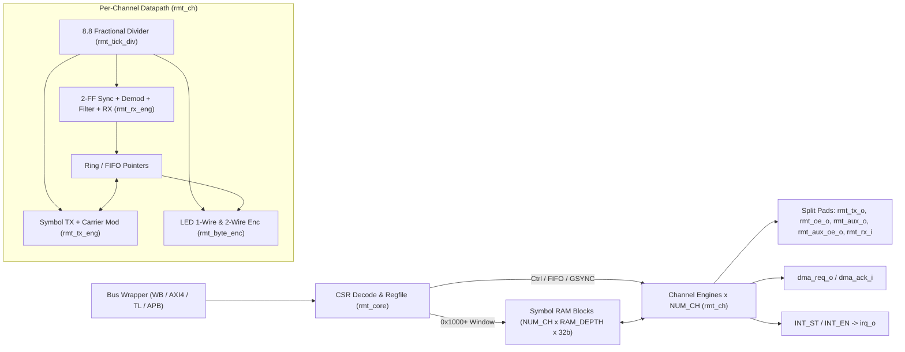

# Multi-Channel Pulse-Train Transceiver & Addressable-LED Encoder (`18_rmt`)

## 1. Overview

`18_rmt` is a clean-room, synthesizable IEEE 1800-2017 SystemVerilog multi-channel pulse-train transceiver (RMT-style) with integrated single-wire and clocked 2-wire addressable-LED hardware encoders. Each of the `NUM_CH` (2..8) channels is independently configurable as a transmitter or receiver and operates from a shared or dedicated symbol RAM pool accessible through both a direct CPU memory window and a per-channel FIFO register.

The core (`rmt_core`) uses the library's protocol-agnostic internal CSR interface (`csr_req_t` / `csr_rsp_t`) and ships with quad-bus wrappers for **Wishbone B4**, **AXI4 / AXI4-Lite**, **TileLink TL-UL / TL-UH**, and **AMBA APB4** unified in `rmt_top` (`BUS_TYPE`).

### Key Features

- **Parameterized Multi-Channel Architecture**: `NUM_CH` = 2..8 independent TX/RX channels; `RAM_DEPTH` = power-of-two words per channel block ($\ge 8$, default 64); optional cross-channel block borrowing (`RAM_SHARED = 1`).
- **Compact 32-Bit Symbol Format**: Two `{level, duration[14:0]}` segments per 32-bit word with `duration == 0` end-marker support and a 2-entry prefetch buffer for gap-less 1-tick segment transitions and seamless looping.
- **Fractional Clock Divider**: Per-channel 8.8 fixed-point divider (`DIV_INT + DIV_FRAC/256`, minimum 1.0) producing precise pulse ticks from any system clock.
- **Flexible TX Engine**:
  - RAM playback (one-shot, finite `LOOP_CNT` 1..1023, infinite `LOOP_INF`, continuous re-trigger `CONT`, or ping-pong `WRAP` refill with `THR`/`WRAP` IRQs and DMA handshake).
  - Direct FIFO symbol streaming (`SRC = 1`) for arbitrary-length patterns without RAM window management.
  - Programmable carrier modulator (`CARR_H`, `CARR_L` for arbitrary frequency and duty cycle) selectable on HIGH segments, LOW segments, both, or continuously during IDLE (`CC_IDLE`, carrier-always), with per-segment phase reset or free-running phase (`CC_CONT`).
  - Programmable idle level, output polarity invert, push-pull or open-drain pad output enable (`OE_MODE`), and cycle-aligned multi-channel synchronized start (`SYNC_EN` + `GSYNC` / `GSTART`).
- **Addressable-LED Hardware Encoders (No Symbol RAM Expansion Needed)**:
  - **Single-wire byte encoder (`SRC = 2`)**: Streams packed bytes from the channel FIFO/DMA directly into timed pulses with programmable `T0H`, `T0L`, `T1H`, `T1L`, `RST_T`, MSB/LSB bit order, pre- and post-frame reset, and exact byte length `LED_LEN` (supporting 24-bit RGB, 32-bit RGBW, and arbitrary byte lengths for WS2812/WS2812B, SK6812, SK6812-RGBW, WS2811, and GS8208-class parts).
  - **Clocked 2-wire byte encoder (`SRC = 3`)**: Streams bytes on `rmt_tx_o[c]` with synchronous clock on `rmt_aux_o[c]`, programmable half-period `TW_HALF`, clock polarity `TW_CPOL`, start-frame zero bits `TW_SF_BITS`, and end-frame fill bits `TW_EF_BITS` / `TW_EF_FILL` (APA102 / SK9822-class LEDs).
- **Robust RX Capture Engine**:
  - Built-in 2-FF asynchronous input synchronizer, polarity inversion, optional carrier envelope demodulator (`RX_DEMOD`, `RX_GAP`), 8-cycle averaged carrier period & high-time measurement (`RX_MEAS`, `MEAS`, `EV_CARR`), and programmable minimum-pulse glitch filter (`RX_FILT`).
  - Edge-to-symbol segmenter capturing directly into RAM (with optional `WRAP` ping-pong) or FIFO with idle-threshold end-of-frame detection (`RX_IDLE`), no-activity timeout (`RX_TMO`), and non-destructive overflow detection (`STAT.OVF`).
- **Quad-Bus & DMA/IRQ Integration**: `BUS_WISHBONE`, `BUS_AXI4`, `BUS_TILELINK`, `BUS_APB`; per-channel `dma_req_o` / `dma_ack_i`; masked global `irq_o` with W1C status and software `INT_SET`.

---

## 2. Architecture Block Diagram



---

## 3. Parameters and Ports

### Parameters (`rmt_top`, `rmt_wb`, `rmt_axi`, `rmt_tl`, `rmt_apb`, `rmt_core`)

| Parameter | Type | Default | Range | Description |
| :--- | :--- | :--- | :--- | :--- |
| `BUS_TYPE` (`rmt_top` only) | `bus_pkg::bus_proto_e` | `BUS_AXI4` | `BUS_WISHBONE` (0), `BUS_AXI4` (1), `BUS_TILELINK` (2), `BUS_APB` (3) | Active slave bus interface in `rmt_top`. |
| `NUM_CH` | `int unsigned` | `4` | `2 .. 8` | Number of independent TX/RX channels. |
| `RAM_DEPTH` | `int unsigned` | `64` | Power of 2, $\ge 8$ | Number of 32-bit symbol words per channel memory block. |
| `RAM_SHARED` | `bit` | `1'b1` | `0` or `1` | `1`: channel `c` may extend its region over contiguous blocks `c .. c+MEM.BLKS-1`. `0`: each channel is locked to 1 dedicated block. |

### Top-Level Ports (`rmt_top`)

| Port | Dir | Width | Description |
| :--- | :--- | :--- | :--- |
| `clk_i` | Input | 1 | System / bus clock (single clock domain). |
| `rst_ni` | Input | 1 | Active-low asynchronous-assert, synchronous-deassert reset. |
| `wb_i` / `wb_o` | In / Out | `wb_m2s_t` / `wb_s2m_t` | Wishbone B4 slave port (active when `BUS_TYPE == BUS_WISHBONE`). |
| `axi_i` / `axi_o` | In / Out | `axi4_m2s_t` / `axi4_s2m_t` | AXI4 / AXI4-Lite slave port (active when `BUS_TYPE == BUS_AXI4`). |
| `tl_i` / `tl_o` | In / Out | `tl_m2s_t` / `tl_s2m_t` | TileLink TL-UL / TL-UH slave port (active when `BUS_TYPE == BUS_TILELINK`). |
| `apb_i` / `apb_o` | In / Out | `apb_m2s_t` / `apb_s2m_t` | AMBA APB4 slave port (active when `BUS_TYPE == BUS_APB`). |
| `rmt_tx_o` | Output | `NUM_CH` | Channel pulse-train / LED data output (registered, post-invert). |
| `rmt_oe_o` | Output | `NUM_CH` | Channel output enable (`0` when disabled or RX; push-pull or open-drain per `OE_MODE`). |
| `rmt_aux_o` | Output | `NUM_CH` | Channel auxiliary clock output for clocked 2-wire LED mode (`SRC = 3`). |
| `rmt_aux_oe_o` | Output | `NUM_CH` | Auxiliary pad output enable (high when `EN && TX && SRC==3 && OE_MODE!=0`). |
| `rmt_rx_i` | Input | `NUM_CH` | Channel asynchronous pulse-train input (internally 2-FF synchronized). |
| `dma_req_o` | Output | `NUM_CH` | Per-channel DMA service request (level-sensitive, gated by `EN && DMA_EN`). |
| `dma_ack_i` | Input | `NUM_CH` | Per-channel DMA acknowledge pulse (clears RAM-mode `EV_THR` and `EV_WRAP` flags). |
| `irq_o` | Output | 1 | Active-high combined interrupt output (`|((INT_ST[c] & INT_EN[c]))`). |

---

## 4. Address Map and Register Definitions

`rmt_core` decodes a **64 KB address aperture** (`addr[15:0]`; upper address bits `addr[31:16]` are ignored so the core maps cleanly at any 64 KB-aligned SoC base address). Unmapped offsets return a bus error (`csr_rsp_o.err = 1`). All configuration registers support byte-lane strobes (`wstrb` / `pstrb`); zero-strobe writes have no side effects.

### Aperture Summary

| Address Range | Region |
| :--- | :--- |
| `0x0000 .. 0x0018` | Global Control, Identification, Sync & Status Registers |
| `0x0100 + 0x80*c .. +0x58` | Channel `c` Register Bank (`c = 0 .. NUM_CH-1`) |
| `0x1000 .. 0x1000 + 4*(NUM_CH*RAM_DEPTH) - 4` | Direct CPU Symbol RAM Window (`word w = c*RAM_DEPTH + offset` at `0x1000 + 4*w`) |

### 4.1 Global Registers (`0x0000 .. 0x0018`)

| Offset | Name | Access | Reset | Bit Fields |
| :--- | :--- | :--- | :--- | :--- |
| `0x0000` | `ID` | RO | `{16'h524D, NUM_CH[7:0], 8'h01}` | `[31:16]` Magic `"RM"` (`0x524D`), `[15:8]` `NUM_CH`, `[7:0]` Version (`0x01`). |
| `0x0004` | `HW_INFO` | RO | `{15'd0, RAM_SHARED, RAM_DEPTH[15:0]}` | `[16]` `RAM_SHARED`, `[15:0]` `RAM_DEPTH` (words per block). |
| `0x0008` | `GSYNC` | WO | `0x0000_0000` | `[NUM_CH-1:0]` Simultaneous go-release mask for channels currently `ARMED` (`SYNC_EN = 1`). |
| `0x000C` | `GSTART` | WO | `0x0000_0000` | `[NUM_CH-1:0]` Simultaneous arm + immediate start mask across selected channels. |
| `0x0010` | `GSTOP` | WO | `0x0000_0000` | `[NUM_CH-1:0]` Simultaneous stop mask across selected channels. |
| `0x0014` | `GIRQ` | RO | `0x0000_0000` | `[NUM_CH-1:0]` Per-channel pending masked interrupt vector (`|(INT_ST[c] & INT_EN[c])`). |
| `0x0018` | `GSTAT` | RO | `0x0000_0000` | `[23:16]` `dma_req_o`, `[15:8]` `ARMED` mask, `[7:0]` `BUSY` mask. |

### 4.2 Per-Channel Registers (`BASE_CH = 0x0100 + 0x80 * c`)

| Offset | Name | Access | Reset | Bit Fields & Description |
| :--- | :--- | :--- | :--- | :--- |
| `+0x00` | `CTRL` | RW | `0x0001_0000` | `[0]` `EN`: channel enable (`0` resets channel engines & ring pointers).<br>`[1]` `TX`: `1` = transmitter, `0` = receiver.<br>`[3:2]` `SRC`: TX: `0`=RAM symbols, `1`=FIFO symbols, `2`=1-wire LED encoder, `3`=2-wire clocked LED encoder. RX: `0`=RAM capture, `1`=FIFO capture.<br>`[4]` `CONT`: continuous mode (re-arm automatically on `EV_DONE` / `EV_TMO`).<br>`[5]` `WRAP`: RAM wrap/ping-pong mode (TX RAM wraps `faddr` at region end; RX RAM wraps `wptr`).<br>`[6]` `INV`: invert `rmt_tx_o` (TX) or `rmt_rx_i` (RX).<br>`[7]` `IDLE_LVL`: pre-invert TX idle level / RX idle polarity.<br>`[8]` `LOOP_INF`: TX RAM infinite gap-less loop.<br>`[9]` `SYNC_EN`: `CMD.START` arms and pauses until `GSYNC` releases.<br>`[10]` `DMA_EN`: enable `dma_req_o[c]`.<br>`[12:11]` `OE_MODE`: `0`=Hi-Z, `1`=push-pull (`oe=1` when `EN&&TX`), `2`=open-drain (`oe=!tx`).<br>`[25:16]` `LOOP_CNT`: finite TX RAM loop count (1..1023; `0` behaves as `1`). |
| `+0x04` | `CMD` | WO | `0x0000_0000` | `[0]` `START`: arm (and launch if `!SYNC_EN`); ignored if busy or `!EN`.<br>`[1]` `STOP`: abort TX immediately; flush current RX frame cleanly.<br>`[2]` `FIFO_CLR`: reset ring write/read pointers and occupancy.<br>`[3]` `CLR_ERR`: clear sticky `STAT.UNDER` and `STAT.OVF`. |
| `+0x08` | `STAT` | RO | `0x0000_0010` | `[0]` `BUSY`, `[1]` `ARMED`, `[2]` `UNDER` (sticky TX underrun), `[3]` `OVF` (sticky FIFO/RAM overflow), `[4]` `EMPTY`, `[5]` `FULL`, `[6]` `DMA_REQ`, `[7]` `RX_LVL` (post-filter RX level), `[31:16]` `LEVEL` (ring occupancy / RX captured words). |
| `+0x0C` | `DIV` | RW | `0x0000_0100` | `[15:8]` `DIV_INT`, `[7:0]` `DIV_FRAC`. Tick period = `(DIV_INT + DIV_FRAC/256)` cycles of `clk_i` (values `< 0x0100` clamp to `0x0100` = 1.0 clk/tick). |
| `+0x10` | `CARR` | RW | `0x0000_0000` | `[15:0]` `CARR_H` (high phase = `CARR_H + 1` clks), `[31:16]` `CARR_L` (low phase = `CARR_L + 1` clks). Period = `CARR_H + CARR_L + 2` clks. |
| `+0x14` | `CARR_CTL` | RW | `0x0000_0000` | `[0]` `CC_EN`: enable TX carrier modulator.<br>`[1]` `CC_HI`: modulate segments with `level == 1`.<br>`[2]` `CC_LO`: modulate segments with `level == 0`.<br>`[3]` `CC_CONT`: `0`=reset carrier phase at every segment start; `1`=free-running phase.<br>`[4]` `CC_IDLE`: carrier-always — drive carrier continuously during IDLE as well. |
| `+0x18` | `THR` | RW | `0x0000_0000` | `[15:0]` Threshold word index (RAM mode: fires `EV_THR` when read/write pointer hits `THR != 0`; FIFO TX: triggers when `LEVEL <= THR`; FIFO RX: triggers when `LEVEL >= max(THR,1)`). |
| `+0x1C` | `MEM` | RW | `0x0000_0001` | `[3:0]` `BLKS`: contiguous RAM blocks owned by channel `c` (`1 .. NUM_CH-c`). Read-only `1` when `RAM_SHARED == 0`. |
| `+0x20` | `FIFO` | RW | `0x0000_0000` | Write: push 32-bit word into channel TX ring/RAM. Read: pop 32-bit captured symbol word from RX ring (`0` if empty). |
| `+0x24` | `LED_TIM` | RW | `0x0000_0000` | `[7:0]` `T0H`, `[15:8]` `T0L`, `[23:16]` `T1H`, `[31:24]` `T1L` (each in channel ticks; `0` clamps to `1`). |
| `+0x28` | `LED_RST` | RW | `0x0000_0000` | `[23:0]` `RST_T`: single-wire LED reset/latch duration in channel ticks (`0` clamps to `1`). |
| `+0x2C` | `LED_CFG` | RW | `0x0000_0005` | `[0]` `MSB` (`1`=MSB-first, `0`=LSB-first), `[1]` `RPRE` (emit reset before data), `[2]` `RPOST` (emit reset after data). |
| `+0x30` | `LED_LEN` | RW | `0x0000_0000` | `[23:0]` Exact payload byte count (`0` = stream complete 32-bit FIFO words until empty; `> 0` = transmit exact byte count and auto-pop trailing partial word). |
| `+0x34` | `TW_CFG` | RW | `0x2000_0001` | `[15:0]` `TW_HALF` (clock half-period in ticks, `0` clamps to `1`), `[16]` `TW_CPOL` (idle clock polarity; data sampled on `CPOL -> ~CPOL`), `[17]` `TW_EF_FILL` (end-frame data bit value: `1` for APA102, `0` for SK9822), `[31:24]` `TW_SF_BITS` (start-frame zero bits, default 32). |
| `+0x38` | `TW_END` | RW | `0x0000_0020` | `[15:0]` `TW_EF_BITS`: end-frame clock/bit count (default 32). |
| `+0x3C` | `MEAS` | RO | `0x0000_0000` | `[15:0]` `PERIOD` (average carrier period in `clk_i` cycles over 8 cycles), `[31:16]` `HIGH` (average carrier high time in `clk_i` cycles over 8 cycles). |
| `+0x40` | `INT_ST` | W1C | `0x0000_0000` | Sticky event flags (write `1` to clear): `[0]` `DONE`, `[1]` `THR`, `[2]` `WRAP`, `[3]` `LOOP`, `[4]` `ERR` (underrun/overflow), `[5]` `TMO`, `[6]` `CARR` (measurement updated). |
| `+0x44` | `INT_EN` | RW | `0x0000_0000` | `[6:0]` Per-event interrupt enable mask corresponding to `INT_ST`. |
| `+0x48` | `INT_SET` | WO | `0x0000_0000` | `[6:0]` Software interrupt force (sets bits in `INT_ST`). |
| `+0x4C` | `RX_FILT` | RW | `0x0000_0000` | `[15:0]` Minimum pulse duration in `clk_i` cycles; pulses strictly shorter than `RX_FILT` clocks are suppressed (`0` or `1` = 1-clk passthrough). |
| `+0x50` | `RX_IDLE` | RW | `0x0000_0000` | `[15:0]` Idle-threshold end-of-frame duration in channel ticks (`0` disables idle detection; frame ends on `CMD.STOP`). |
| `+0x54` | `RX_TMO` | RW | `0x0000_0000` | `[15:0]` No-activity receive timeout in channel ticks while waiting for first edge (`0` disables timeout). |
| `+0x58` | `RX_CTL` | RW | `0x0000_0000` | `[0]` `RX_DEMOD` (enable carrier envelope demodulator before glitch filter), `[1]` `RX_MEAS` (enable 8-cycle carrier period/duty measurement), `[31:16]` `RX_GAP` (retriggerable envelope hold-off in `clk_i` cycles; set to $\approx 1.5\times$ carrier period when using `RX_DEMOD` or `RX_MEAS`). |

---

## 5. Protocol & Timing Waveforms

### 5.1 Symbol Word Format & Carrier Modulation

```text
32-bit Symbol Word:
 31   30               16   15   14                0
+----+-------------------+----+---------------------+
| L1 |     DUR1 (15b)    | L0 |      DUR0 (15b)     |
+----+-------------------+----+---------------------+
  Segment 1 (second)         Segment 0 (first)

Termination rules:
  DUR0 == 0              -> End-marker (stop before emitting this word)
  DUR0 != 0 && DUR1 == 0 -> Emit Segment 0 only, then end (or loop)

Example: word = {1'b0, 15'd4, 1'b1, 15'd6}  (L0=1 for 6 ticks, L1=0 for 4 ticks)
  Unmodulated (CC_EN=0):
    ____/````````````````````````\________________/
        |<------- 6 ticks ------>|<-- 4 ticks -->|

  Carrier on HIGH (CC_EN=1, CC_HI=1, CC_LO=0, CARR_H=H, CARR_L=L):
    ____/`\_/`\_/`\_/`\_/`\_/`\_/________________/
        |H|L|H|L|... (T = H+L+2 clks)
```

### 5.2 Ping-Pong Wrap Refill (`WRAP = 1`, `THR = RAM_DEPTH/2`)

```text
RAM Word Ptr:  0 .... THR-1 | THR .... SIZE-1 | 0 .... THR-1 | THR ... MARKER
                            ^                 ^              ^
Events:                  EV_THR            EV_WRAP        EV_THR       EV_DONE
dma_req_o:     __________/`\_______________/`\____________/`\_________________
Refill half:             [CPU/DMA writes   [CPU/DMA writes   [CPU/DMA writes
                          0 .. THR-1]       THR .. SIZE-1]    end-marker]
```

### 5.3 Multi-Channel Synchronized Start (`SYNC_EN = 1`)

```text
CSR writes:  CH0.START  CH1.START  CH2.START       G_GSYNC=3'b111
                 |          |          |                 |
ARMED[2:0]:  000 -> 001 -> 011 -> 111 -------------------+-> 000
rmt_tx_o[0]: ________________________(idle)______________/__/``\__
rmt_tx_o[1]: ________________________(idle)______________/__/````\  (exact same clock edge!)
rmt_tx_o[2]: ________________________(idle)______________/__/`\___
```

### 5.4 Single-Wire Addressable-LED Bit Timing (`SRC = 2`)

```text
Bit '0':                           Bit '1':
  +------+                 +         +--------------+         +
  |      |                 |         |              |         |
--+      +-----------------+--     --+              +---------+--
  |<-T0H>|<-     T0L     ->|         |<-   T1H    ->|<- T1L ->|

Frame (MSB-first, RPRE=0, RPOST=1):
  [ Byte 0 (G) ][ Byte 1 (R) ][ Byte 2 (B) ] ... [ Byte N-1 ][  RESET (LOW >= RST_T)  ]
```

#### Reference Timing Presets (at `clk_i = 100 MHz`, 10 ns/clk)

| LED Family | `DIV` (tick) | `T0H` | `T0L` | `T1H` | `T1L` | `RST_T` | Spec Window |
| :--- | :--- | :--- | :--- | :--- | :--- | :--- | :--- |
| **WS2812B** (RGB, 800 kHz) | `0x0500` (50 ns) | `8` (400 ns) | `17` (850 ns) | `16` (800 ns) | `9` (450 ns) | `1000` (50 us) | T0H 200-500, T0L 650-1000, T1H 550-1000, T1L 200-600 ns |
| **SK6812 / SK6812-RGBW** | `0x0500` (50 ns) | `6` (300 ns) | `18` (900 ns) | `12` (600 ns) | `12` (600 ns) | `1600` (80 us) | T0H 150-450, T0L 750-1050, T1H 450-750, T1L 450-750 ns |
| **WS2811** (400 kHz slow) | `0x0A00` (100 ns) | `5` (500 ns) | `20` (2000 ns) | `12` (1200 ns) | `13` (1300 ns) | `500` (50 us) | T0H 350-650, T0L 1850-2150, T1H 1050-1350, T1L 1150-1450 ns |
| **GS8208** (800 kHz) | `0x0500` (50 ns) | `6` (300 ns) | `19` (950 ns) | `16` (800 ns) | `9` (450 ns) | `6000` (300 us) | T0H 220-380, T1H 580-1000 ns, RST >= 280 us |

### 5.5 Clocked 2-Wire LED Mode (`SRC = 3`, APA102 / SK9822)

```text
TW_CPOL = 0 (receiver latches DATA on rising edge of CLK):
  CLK (rmt_aux_o): ___/```\___/```\___/```\___/```\___
                      ^       ^       ^       ^
                     half    half    half    half   (each phase = TW_HALF ticks)
  DAT (rmt_tx_o):  ===X  b0   X  b1   X  b2   X  b3===

Frame Structure:
  [ Start Frame: TW_SF_BITS x '0' (32b) ] [ LED0..LEDn: 0xE0|Brt, B, G, R ] [ End Frame: TW_EF_BITS x EF_FILL ]
    APA102: TW_SF_BITS=32, TW_EF_BITS=(N_leds/2 + 32), TW_EF_FILL=1
    SK9822: TW_SF_BITS=32, TW_EF_BITS=32,              TW_EF_FILL=0 (reset frame)
```

### 5.6 RX Glitch Filter, Carrier Demodulator & Idle-Threshold End-of-Frame

```text
Raw Pin (rmt_rx_i):  __/\_/``````````\_/``````\__________________________
                        ^             ^        |<--- RX_IDLE ticks ---->|
                     glitch        glitch
                     (<FILT)       (<FILT)
Filtered (RX_LVL):   ______/```````````````````\_________________________
Captured Symbols:          |<--- seg 0 (H) --->|  (trailing idle dropped) -> EV_DONE

Carrier Demod (RX_DEMOD=1, RX_MEAS=1, RX_GAP > T_carrier_low):
Modulated Pin:       __/`\_/`\_/`\_/`\_/`\_/`\_/____________/`\_/`\_/`\__
Envelope (gap!=0):   __/`````````````````````````\__________/``````````\__
MEAS Reg (after 8):  PERIOD = avg(8 carrier periods), HIGH = avg(8 high widths) -> EV_CARR
```

---

## 6. Programming Recipes (C-Style Pseudocode)

### 6.1 Modulated IR Pulse Train from Symbol RAM with Loops

```c
// 38 kHz carrier at 100 MHz clk: period = 2632 clks -> 33% duty: H=876 (877 clks), L=1753 (1754 clks)
RMT_CH(0)->DIV      = 100 << 8;                     // 1.0 us / tick
RMT_CH(0)->CARR     = (1753u << 16) | 876u;
RMT_CH(0)->CARR_CTL = CC_EN | CC_HI;                // modulate HIGH segments only
RMT_RAM[0]          = SYM(1, 9000, 0, 4500);        // 9 ms mark, 4.5 ms space
RMT_RAM[1]          = SYM(1,  560, 0,  560);        // bit 0
RMT_RAM[2]          = SYM(1,  560, 0,    0);        // trailing mark, implicit end
RMT_CH(0)->INT_EN   = EV_DONE | EV_LOOP;
RMT_CH(0)->CTRL     = EN | TX | SRC_RAM | OE_PP | (3u << 16); // repeat 3 times
RMT_CH(0)->CMD      = CMD_START;
while (!(RMT_CH(0)->INT_ST & EV_DONE));
RMT_CH(0)->INT_ST   = EV_DONE | EV_LOOP;            // W1C
```

### 6.2 WS2812B / SK6812-RGBW LED Strip (Zero RAM Symbol Expansion)

```c
// 100 MHz clk -> DIV = 5.0 (50 ns/tick). Drive 2 RGB LEDs (6 bytes = 2 FIFO words).
RMT_CH(0)->DIV     = 5 << 8;
RMT_CH(0)->LED_TIM = (9u << 24) | (16u << 16) | (17u << 8) | 8u; // T1L, T1H, T0L, T0H
RMT_CH(0)->LED_RST = 1000;                          // 50 us post-frame latch
RMT_CH(0)->LED_CFG = LED_MSB | LED_RPOST;
RMT_CH(0)->LED_LEN = 6;                             // exact byte count (auto-pops partial word 1)
RMT_CH(0)->CTRL    = EN | TX | SRC_LED1W | OE_PP;
RMT_CH(0)->FIFO    = 0x00112233u;                   // LED0: G=0x33, R=0x22, B=0x11; LED1 G=0x00
RMT_CH(0)->FIFO    = 0x0000FF80u;                   // LED1: R=0x80, B=0xFF
RMT_CH(0)->CMD     = CMD_START;
while (!(RMT_CH(0)->INT_ST & EV_DONE));
```

### 6.3 APA102 / SK9822 Clocked 2-Wire LED Strip

```c
RMT_CH(0)->DIV     = 2 << 8;                        // 20 ns/tick -> 50 MHz tick
RMT_CH(0)->LED_CFG = LED_MSB;
RMT_CH(0)->LED_LEN = 8;                             // 2 LEDs x 4 bytes
RMT_CH(0)->TW_CFG  = (32u << 24) | TW_EF_FILL_1 | (5u); // 32b start, fill=1, half=5 ticks (5 MHz CLK)
RMT_CH(0)->TW_END  = 32;                            // 32b end frame
RMT_CH(0)->CTRL    = EN | TX | SRC_LED2W | OE_PP;
RMT_CH(0)->FIFO    = 0xFF0080E5u;                   // LED0: 0xE5(brt=5), B=0x80, G=0x00, R=0xFF
RMT_CH(0)->FIFO    = 0x00FF20FFu;                   // LED1: 0xFF(brt=31), B=0x20, G=0xFF, R=0x00
RMT_CH(0)->CMD     = CMD_START;
```

### 6.4 RX Pulse Capture with Glitch Filter & Carrier Measurement

```c
RMT_CH(1)->DIV     = 100 << 8;                      // 1 us / tick at 100 MHz
RMT_CH(1)->RX_FILT = 50;                            // suppress glitches < 500 ns
RMT_CH(1)->RX_IDLE = 12000;                         // 12 ms idle ends frame
RMT_CH(1)->RX_CTL  = RX_DEMOD | RX_MEAS | (4000u << 16); // gap = 40 us (> 26 us @ 38 kHz)
RMT_CH(1)->CTRL    = EN | RX | SRC_RAM;             // IDLE_LVL = 0
RMT_CH(1)->CMD     = CMD_START;
while (!(RMT_CH(1)->INT_ST & EV_DONE));
uint32_t words     = RMT_CH(1)->STAT >> 16;         // captured symbol words in RAM block 1
uint32_t meas      = RMT_CH(1)->MEAS;               // [15:0]=period_clks, [31:16]=high_clks
```

---

## 7. Integration, Pad Ring & FPGA/ASIC Implementation Notes

- **Pad Ring (No Internal Tri-State)**: All I/Os are split (`rmt_tx_o`, `rmt_oe_o`, `rmt_aux_o`, `rmt_aux_oe_o`, `rmt_rx_i`). Connect `rmt_tx_o[c]`/`rmt_oe_o[c]`/`rmt_rx_i[c]` to a bidirectional pad cell, or tie `rmt_rx_i[c]` to a dedicated input pin and `rmt_tx_o[c]` to an output pin. In open-drain mode (`OE_MODE = 2`), `rmt_oe_o[c]` asserts only when driving low (`!rmt_tx_o[c]`), allowing wired-AND / level-shifted LED or IR buses with an external pull-up.
- **Single Clock Domain & CDC Hygiene**: All logic runs on `clk_i`. Every `rmt_rx_i[c]` input passes through a dedicated 2-FF metastability synchronizer (`s1_q -> s2_q`) before polarity inversion, demodulation, or edge detection. No combinational paths cross from pads to CSR outputs.
- **Memory Inference**: `mem_q[NUM_CH][RAM_DEPTH]` uses a synchronous write inside a clock-only `always_ff @(posedge clk_i)` block (no reset on the array), inferring cleanly into distributed LUTRAM on FPGAs or register-file/SRAM macros on ASICs.
- **DMA Handshake**: In RAM mode (`SRC = 0`), `dma_req_o[c]` asserts on `EV_THR` or `EV_WRAP` and clears when either `dma_ack_i[c]` pulses or CPU writes `1` to `INT_ST`. In FIFO modes (`SRC = 1, 2, 3`), `dma_req_o[c]` tracks FIFO fill level (`LEVEL <= THR && !FULL` for TX; `LEVEL >= max(THR,1) || (!EMPTY && !BUSY)` for RX) so standard peripheral DMA channels can burst continuously without `dma_ack_i`.
- **Lint & Synthesis Hygiene**: Pure synthesizable IEEE 1800-2017 SV (no delays, no `initial` blocks, no `real` types, no vendor primitives, no latches). Verified warning-free under Verilator 5.054 (`-Wall`, repo `WARN_FLAGS`) across all 4 `BUS_TYPE` settings and `NUM_CH = 2, 4, 8`, `RAM_SHARED = 0, 1`.

---

## 8. Verification Summary

Testbench: [tb_rmt.sv](file:///Users/tianrui6641/tians_ip_collection/ips/18_rmt/tb/tb_rmt.sv) (self-checking, constrained-random with `+seed=`, independent golden models — zero DUT code reuse):

- **CSR & Registers**: ID/HW info, reset defaults, partial/zero byte strobes, unmapped offset error responses, 64 KB SoC base-address placement (`0x4005_0000`), W1C `INT_ST`, `INT_SET`, masked `IRQ`, `GIRQ`, push-pull/open-drain/Hi-Z `OE_MODE`, `aux_oe_o`.
- **TX Golden Pin Checker**: 24 randomized patterns across integer and fractional dividers (1.0x .. 10.0x, incl. 1.5x, 2.25x, 7.75x, 300/256), finite/infinite loops, carrier on HIGH / LOW / BOTH / carrier-always / free-running, polarity invert, empty marker, 1-tick/1-clk prefetch stress, implicit RAM end, continuous mode, and `CMD.STOP`/`GSTOP`.
- **Shared RAM & Ping-Pong Refill**: 2-block borrowed RAM (`MEM.BLKS = 2`), `RAM_SHARED = 0` lock check, and 92-word continuous ping-pong wrap refill across 3 wraps with `EV_THR`, `EV_WRAP`, `dma_req_o`, and `dma_ack_i`.
- **FIFO Streaming & Error Corners**: 44-word DMA-fed TX FIFO streaming (`> RAM_DEPTH`), TX underrun (`STAT.UNDER` + `EV_ERR`), TX/RX overflow (`STAT.OVF` + `EV_ERR`), `FIFO_CLR` & `CLR_ERR`.
- **Multi-Channel Sync**: `SYNC_EN` + `GSYNC` cycle-exact alignment across mixed RAM, FIFO, and LED channels, plus `GSTART`.
- **Addressable-LED Encoders**: Independent pin-level pulse-width decoder verifying **WS2812B** (24-bit RGB, 6B non-4B-aligned, 50 us reset), **SK6812-RGBW** (32-bit, 80 us reset), **WS2811** (400 kHz, LSB-first, pre+post reset) against spec nanosecond windows, LED underrun detection, plus independent clocked 2-wire sampler for **APA102** (`CPOL=0`, `EF_FILL=1`), **SK9822** (`CPOL=1`, `EF_FILL=0`), and LSB-first 2-wire framing.
- **RX Engine & TX->RX Loopback**: Programmable glitch filter (rejecting idle and mid-pulse glitches `< RX_FILT`), idle-threshold end-of-frame, `RX_TMO` timeout, active-low IR polarity, 75-segment DMA-drained RX FIFO capture, non-destructive RX RAM overflow, carrier demodulation + exact 8-cycle carrier period/duty measurement, mid-frame `CMD.STOP`, 10 randomized exact 0-tick-error TX->RX loopbacks, carrier-modulated TX->demod RX loopback, and simultaneous 2-pair concurrent loopback.
- **Quad-Bus Compliance**: `rmt_top` verified across **Wishbone B4**, **AXI4**, **TileLink TL-UL**, and **APB4** (including APB4 partial/zero `pstrb`, `pslverr`, and live TX emission).
