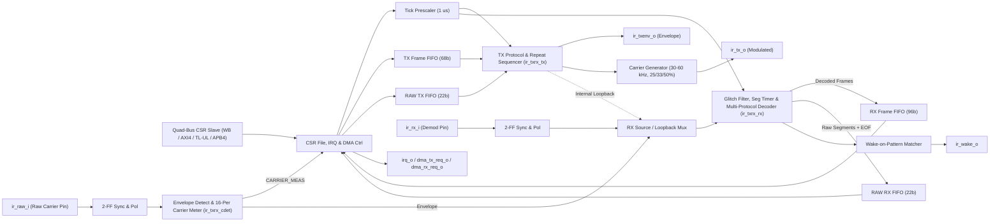

# 19_ir_txrx: Hardware Infrared Protocol Transceiver (`ir_txrx`)

Clean-room, pure IEEE 1800-2017 SystemVerilog hardware infrared (IR) remote-control protocol engine with transmit, receive, RAW timing capture/replay, carrier-frequency learning mode, programmable carrier modulator, low-power wake-on-pattern matching, FIFOs, interrupts, and DMA request handshaking. Unified quad-bus wrappers support **Wishbone B4** (`ir_txrx_wb`), **AMBA AXI4 / AXI4-Lite** (`ir_txrx_axi`), **TileLink TL-UL / TL-UH** (`ir_txrx_tl`), and **AMBA APB4** (`ir_txrx_apb`), selectable via `ir_txrx_top #(.BUS_TYPE(...))`.

---

## 1. Key Features

- **Hardware Protocol TX & Auto-Detecting RX Engine (11 Protocol IDs across 7 Families)**:
  - **NEC Standard** (8-bit address + inverted address, 8-bit command + inverted command, 32-bit pulse-distance).
  - **NEC Extended** (16-bit address, 8-bit command + inverted command).
  - **NEC Short Repeat Code** (9.0 ms mark / 2.25 ms space / 560 us mark) + full-frame repeat option.
  - **Samsung32** (4.5 ms / 4.5 ms leader, repeated 8-bit address, 8-bit command + inverted command).
  - **RC5 & RC5-Extended** (14-bit Manchester, 889 us half-bit, 6-bit or 7-bit command via inverted `S2` field bit, hardware toggle bit with auto-toggle).
  - **RC6 Mode 0** (21-bit Manchester, 444 us unit, 6T/2T leader, double-width 4T trailer toggle bit, 8-bit address, 8-bit command).
  - **Sony SIRC 12-bit, 15-bit, and 20-bit** (2.4 ms leader, pulse-width modulation, 7-bit command + 5/8/13-bit address).
  - **JVC** (8.4 ms / 4.2 ms header on initial frame, 16-bit pulse-distance, headerless repeat frames).
  - **Panasonic / Kaseikyo-class 48-bit** (3.456 ms / 1.728 ms leader, 16-bit vendor ID + 4-bit nibble-XOR parity + 12-bit device/subdevice + 8-bit command + 8-bit XOR checksum).
- **Programmable Timebase**:
  - 16-bit tick prescaler (`TICK_CFG.PRESCALER`, `tick = clk / (PRESCALER + 1)`), allowing 1 tick = 1 us across arbitrary system clock frequencies (default `49` = 1 us at 50 MHz).
- **Programmable TX Carrier Modulator**:
  - 16-bit period counter covering 30-60 kHz (and arbitrary sub-MHz carriers) directly from `clk_i`.
  - Selectable duty cycles: **25%**, **33.3%** (multiplier-free shift-add approximation accurate to <0.04% across 30-60 kHz), **50%**, or **custom** 16-bit high-time (`CARRIER_HI`).
  - Phase-reset on every mark (clean full first carrier pulse) or free-running carrier mode; carrier bypass (`CARRIER_EN=0`); independent `ir_tx_o` and `ir_txenv_o` polarity inversion.
- **Auto-Repeat & Hold-Repeat Generation**:
  - Hardware repeat counter (`TX_CFG.REP_CNT`) and continuous key-hold (`TX_CFG.HOLD`) with per-protocol default repeat periods (or programmable override in `TX_TIMING`).
  - Preserves RC5/RC6 toggle bit during repeats and optionally auto-toggles (`TX_CFG.TOG_AUTO`) on each new queued press.
- **Configurable Timing Tolerance & Glitch Filter**:
  - Per-segment fractional tolerance (`RX_CFG.TOL`, `|dur - nom| <= nom * TOL / 256`; default `64` = +/-25%).
  - Per-family decode enable mask (`RX_CFG.FAM_EN[6:0]`), programmable idle end-of-frame timeout (`RX_IDLE_TMO`), repeat classification window (`RX_REP_WIN`), and digital glitch filter (`RX_CFG.GLITCH`).
  - Unknown headers (`UNK=1, ERR=1`) and malformed/out-of-tolerance/bad-checksum frames (`ERR=1`) are flagged in both the RX frame FIFO and `INT_STAT.RX_ERR`.
- **RAW Capture/Replay & Learning Mode**:
  - Dedicated `RAW_TX` and `RAW_RX` timing FIFOs storing `{EOF, LEVEL, DUR_TICKS[19:0]}` records.
  - Internal carrier envelope detector and 16-period hardware carrier-frequency meter (`ir_txrx_cdet`) on `ir_raw_i`: supports demodulator-free reception (`CTRL.RX_SRC=1`), carrier measurement (`CARRIER_MEAS`), and simultaneous RAW timing capture for one-step Learn -> Replay.
- **Low-Power Wake-on-Pattern (`ir_wake_o`)**:
  - Hardware comparator matching decoded frames against configurable protocol ID, masked 32-bit address, masked 32-bit command, and repeat filter; asserts sticky `ir_wake_o` and `INT_STAT.WAKE` even while the CPU sleeps.
- **Four Synchronous FIFOs, Interrupts, and DMA Requests**:
  - Uses `common/rtl/sync_fifo` for TX frames, RX decoded frames, RAW TX segments, and RAW RX segments.
  - 11-source W1C interrupt controller (`INT_EN` / `INT_STAT` -> `irq_o`) and dual watermark DMA request lines (`dma_tx_req_o`, `dma_rx_req_o`) selectable between protocol and RAW FIFOs.

---

## 2. Block Diagram



---

## 3. Parameters & Port Tables

### 3.1 Parameters (`ir_txrx_top` / `ir_txrx_core` / Bus Wrappers)

| Parameter | Type | Default | Scope | Description |
| :--- | :--- | :---: | :--- | :--- |
| `BUS_TYPE` | `bus_pkg::bus_proto_e` | `BUS_AXI4` | `ir_txrx_top` only | Active bus wrapper: `BUS_WISHBONE` (0), `BUS_AXI4` (1), `BUS_TILELINK` (2), `BUS_APB` (3) |
| `TX_FIFO_DEPTH` | `int unsigned` | `8` | All modules | Protocol TX frame FIFO depth (entries of 68 bits) |
| `RX_FIFO_DEPTH` | `int unsigned` | `8` | All modules | Decoded RX frame FIFO depth (entries of 96 bits) |
| `RAW_TX_DEPTH` | `int unsigned` | `64` | All modules | RAW TX timing-segment FIFO depth (entries of 22 bits) |
| `RAW_RX_DEPTH` | `int unsigned` | `64` | All modules | RAW RX timing-segment FIFO depth (entries of 22 bits) |
| `DEFAULT_PRESCALER` | `int unsigned` | `49` | All modules | Reset value of `TICK_CFG.PRESCALER` (`clk` cycles per tick minus 1; `49` = 1 us at 50 MHz) |

### 3.2 Port List (`ir_txrx_top`)

| Port | Direction | Type | Description |
| :--- | :---: | :--- | :--- |
| `clk_i` | Input | `logic` | Single synchronous system clock |
| `rst_ni` | Input | `logic` | Asynchronous-assert, synchronous-deassert active-low reset |
| `wb_i` / `wb_o` | In / Out | `wb_m2s_t` / `wb_s2m_t` | Wishbone B4 CSR slave (active when `BUS_TYPE == BUS_WISHBONE`) |
| `axi_i` / `axi_o` | In / Out | `axi4_m2s_t` / `axi4_s2m_t` | AXI4 / AXI4-Lite CSR slave (active when `BUS_TYPE == BUS_AXI4`) |
| `tl_i` / `tl_o` | In / Out | `tl_m2s_t` / `tl_s2m_t` | TileLink TL-UL / TL-UH CSR slave (active when `BUS_TYPE == BUS_TILELINK`) |
| `apb_i` / `apb_o` | In / Out | `apb_m2s_t` / `apb_s2m_t` | AMBA APB4 CSR slave (active when `BUS_TYPE == BUS_APB`) |
| `ir_rx_i` | Input | `logic` | Demodulated IR receiver pin (internally 2-FF synchronized; invert via `CTRL.RX_INV`) |
| `ir_raw_i` | Input | `logic` | Raw carrier-modulated IR photodiode/preamp pin (internally 2-FF synchronized; invert via `CTRL.RAW_INV`) |
| `ir_tx_o` | Output | `logic` | Registered carrier-modulated IR LED drive output (invert via `CARRIER_CFG.TX_INV`) |
| `ir_txenv_o` | Output | `logic` | Registered unmodulated transmit envelope output (invert via `CARRIER_CFG.TXENV_INV`) |
| `ir_wake_o` | Output | `logic` | Active-high sticky wake-on-pattern match output for low-power PMU wake |
| `irq_o` | Output | `logic` | Active-high combined interrupt (`|(INT_EN & INT_STAT)`) |
| `dma_tx_req_o` | Output | `logic` | Level-high TX DMA request (asserted when selected TX FIFO is not full and `level <= TX_THRESH`) |
| `dma_rx_req_o` | Output | `logic` | Level-high RX DMA request (asserted when selected RX FIFO is not empty and `level >= RX_THRESH`) |

Individual wrappers (`ir_txrx_wb`, `ir_txrx_axi`, `ir_txrx_tl`, `ir_txrx_apb`) expose only their corresponding bus ports alongside `clk_i`, `rst_ni`, pad pins, and sideband signals. `ir_txrx_core` exposes the protocol-agnostic `csr_req_i` / `csr_rsp_o` interface.

---

## 4. Complete Register Map (`0x00..0x7C`)

All registers are 32-bit word-aligned on `addr[7:0]` with byte-lane write strobe (`wstrb` / `pstrb`) support. Reading WO registers returns `0`. Writing RO registers is ignored. Accessing any unmapped offset returns a bus error (`csr_rsp_o.err = 1`).

### 4.1 Summary Table

| Offset | Name | Access | Reset Value | Summary |
| :--- | :--- | :---: | :---: | :--- |
| `0x00` | `ID` | RO | `0x4952_0100` | IP identifier (`"IR"` v1.0) |
| `0x04` | `CAPS` | RO | Param | FIFO depths `{RAW_RX, RAW_TX, RX, TX}` (`0x4040_0808` default) |
| `0x08` | `CTRL` | RW / W1P | `0x0000_0000` | Engine enables, input select/invert, loopback, abort/flush/sw_rst |
| `0x0C` | `TICK_CFG` | RW | `DEFAULT_PRESCALER` | `[15:0]` Tick prescaler (`clk` cycles per tick minus 1) |
| `0x10` | `CARRIER_CFG` | RW | `0x0005_0523` | Carrier period, duty mode, enable, polarity, free-run |
| `0x14` | `CARRIER_HI` | RW | `0x0000_01B7` | `[15:0]` Custom carrier high duration in `clk` cycles |
| `0x18` | `TX_CFG` | RW | `0x0000_0100` | Auto-repeat count, NEC repeat mode, hold-repeat, RC5/RC6 toggle |
| `0x1C` | `TX_TIMING` | RW | `0x0000_0000` | `[19:0]` Repeat period override in ticks (`0` = protocol default) |
| `0x20` | `TX_GAP` | RW | `0x0000_2710` | `[19:0]` Minimum inter-frame idle gap in ticks (`10000` = 10 ms) |
| `0x24` | `TX_ADDR` | RW | `0x0000_0000` | `[31:0]` TX staging address |
| `0x28` | `TX_CMD` | RW | `0x0000_0000` | `[31:0]` TX staging command |
| `0x2C` | `TX_PUSH` | WO | `0x0000_0000` | `[3:0]` Write protocol ID to push `{PROTO, TX_ADDR, TX_CMD}` |
| `0x30` | `RX_CFG` | RW | `0x0000_FF40` | Tolerance, protocol family enable mask, error-push, glitch filter |
| `0x34` | `RX_IDLE_TMO` | RW | `0x0000_1770` | `[19:0]` Idle timeout in ticks (`6000` = 6 ms) |
| `0x38` | `RX_REP_WIN` | RW | `0x0002_49F0` | `[19:0]` Repeat window in ticks (`150000` = 150 ms) |
| `0x3C` | `RX_INFO` | RO | `0x0000_0000` | Peek RX frame FIFO head metadata & flags |
| `0x40` | `RX_ADDR` | RO | `0x0000_0000` | Peek RX frame FIFO head address |
| `0x44` | `RX_CMD` | RO | `0x0000_0000` | Read RX frame FIFO head command **and pop head entry** |
| `0x48` | `RAW_TX_DATA` | WO | `0x0000_0000` | Push `{EOF, LEVEL, DUR[19:0]}` segment into RAW TX FIFO |
| `0x4C` | `RAW_RX_DATA` | RO | `0x0000_0000` | Read & pop `{VALID, ..., EOF, LEVEL, DUR[19:0]}` from RAW RX FIFO |
| `0x50` | `CDET_CFG` | RW / W1P | `0x0000_07D0` | Carrier envelope timeout in `clk` cycles (`2000` = 40 us @ 50 MHz) & `MEAS_CLR` |
| `0x54` | `CARRIER_MEAS` | RO | `0x0000_0000` | Measured 16-period carrier count, update count, valid flag |
| `0x58` | `STATUS` | RO | `0x0000_1540` | Engine busy, live input levels, wake state, FIFO empty/full flags |
| `0x5C` | `FIFO_LVL` | RO | `0x0000_0000` | Current occupancy `{RAW_RX_LVL, RAW_TX_LVL, RX_LVL, TX_LVL}` |
| `0x60` | `INT_EN` | RW | `0x0000_0000` | `[10:0]` Interrupt enable mask |
| `0x64` | `INT_STAT` | W1C | `0x0000_0000` | `[10:0]` Sticky interrupt status (write 1 to clear) |
| `0x68` | `WAKE_CFG` | RW / W1P | `0x0000_0000` | Wake-on-pattern match enables, protocol, status, clear |
| `0x6C` | `WAKE_ADDR` | RW | `0x0000_0000` | `[31:0]` Wake target address |
| `0x70` | `WAKE_ADDR_MK` | RW | `0xFFFF_FFFF` | `[31:0]` Wake address compare bitmask |
| `0x74` | `WAKE_CMD` | RW | `0x0000_0000` | `[31:0]` Wake target command |
| `0x78` | `WAKE_CMD_MK` | RW | `0xFFFF_FFFF` | `[31:0]` Wake command compare bitmask |
| `0x7C` | `DMA_CFG` | RW | `0x0100_0000` | DMA TX/RX enables, protocol/RAW source select, watermark thresholds |

### 4.2 Detailed Bit-Field Definitions

#### `0x00` `ID` (RO) & `0x04` `CAPS` (RO)
- `ID[31:16]` = `16'h4952` (`"IR"`), `ID[15:8]` = `8'h01` (major), `ID[7:0]` = `8'h00` (minor).
- `CAPS[7:0]` = `TX_FIFO_DEPTH`, `CAPS[15:8]` = `RX_FIFO_DEPTH`, `CAPS[23:16]` = `RAW_TX_DEPTH`, `CAPS[31:24]` = `RAW_RX_DEPTH`.

#### `0x08` `CTRL` (RW / W1P)
| Bits | Field | Access | Reset | Description |
| :---: | :--- | :---: | :---: | :--- |
| `[0]` | `TX_EN` | RW | `0` | Enable TX sequencer and carrier generator |
| `[1]` | `RX_EN` | RW | `0` | Enable RX glitch filter, segment timer, and protocol decoder |
| `[2]` | `RAW_TX_EN` | RW | `0` | Allow TX sequencer to replay `RAW_TX` FIFO when protocol `TX_FIFO` is empty |
| `[3]` | `RAW_RX_EN` | RW | `0` | Capture mark/space durations + idle EOF into `RAW_RX` FIFO (requires `RX_EN=1`) |
| `[4]` | `LEARN_EN` | RW | `0` | Enable `ir_txrx_cdet` carrier frequency meter on `ir_raw_i` |
| `[5]` | `RX_SRC` | RW | `0` | `0` = receive from demodulated `ir_rx_i`; `1` = receive from internal envelope detector on `ir_raw_i` |
| `[6]` | `RX_INV` | RW | `0` | Invert `ir_rx_i` (set `1` for active-low demodulators such as TSOP382xx) |
| `[7]` | `RAW_INV` | RW | `0` | Invert `ir_raw_i` prior to `ir_txrx_cdet` |
| `[8]` | `LOOPBACK` | RW | `0` | Internal digital loopback: routes TX envelope -> RX demod path and TX modulated -> `ir_txrx_cdet` |
| `[9]` | `TX_ABORT` | W1P | `0` | Write `1` to immediately abort active TX frame/repeat and return TX to idle |
| `[10]` | `TX_CLR` | W1P | `0` | Write `1` to flush `TX_FIFO` and `RAW_TX_FIFO` |
| `[11]` | `RX_CLR` | W1P | `0` | Write `1` to flush `RX_FIFO` and `RAW_RX_FIFO` and reset RX decoder state |
| `[12]` | `SW_RST` | W1P | `0` | Write `1` to reset engines, FIFOs, `CARRIER_MEAS`, `wake_latch`, and `INT_STAT` |
| `[31:13]` | Reserved | RO | `0` | Reads `0` |

#### `0x0C` `TICK_CFG` (RW)
| Bits | Field | Access | Reset | Description |
| :---: | :--- | :---: | :---: | :--- |
| `[15:0]` | `PRESCALER` | RW | `DEFAULT_PRESCALER` | System clock cycles per tick minus 1 (`tick_freq = clk_freq / (PRESCALER + 1)`). Writing resets the tick divider counter. |

#### `0x10` `CARRIER_CFG` (RW) & `0x14` `CARRIER_HI` (RW)
| Bits | Field | Access | Reset | Description |
| :---: | :--- | :---: | :---: | :--- |
| `0x10[15:0]` | `PERIOD` | RW | `1315` | Carrier period in `clk_i` cycles minus 1 (`f_carr = clk_freq / (PERIOD + 1)`; `1315` = 38.0 kHz @ 50 MHz) |
| `0x10[17:16]` | `DUTY_SEL` | RW | `2'b01` | `00` = 25%, `01` = 33.3% (`((N*1365)+2048)>>12`), `10` = 50%, `11` = custom (`CARRIER_HI`) |
| `0x10[18]` | `CARRIER_EN` | RW | `1` | `1` = modulate `ir_tx_o` with carrier during marks; `0` = baseband bypass |
| `0x10[19]` | `TX_INV` | RW | `0` | Invert `ir_tx_o` pad polarity |
| `0x10[20]` | `TXENV_INV` | RW | `0` | Invert `ir_txenv_o` pad polarity |
| `0x10[21]` | `CARRIER_FREE` | RW | `0` | `0` = reset carrier phase to `0` at start of every mark; `1` = free-running carrier oscillator |
| `0x14[15:0]` | `CARRIER_HI` | RW | `439` | High-time in `clk_i` cycles when `DUTY_SEL == 2'b11` (clamped to `[1, PERIOD + 1]`) |

#### `0x18` `TX_CFG` (RW), `0x1C` `TX_TIMING` (RW), `0x20` `TX_GAP` (RW)
| Bits | Field | Access | Reset | Description |
| :---: | :--- | :---: | :---: | :--- |
| `0x18[7:0]` | `REP_CNT` | RW | `0` | Number of automatic repeats sent after each initial protocol frame |
| `0x18[8]` | `NEC_REP` | RW | `1` | `1` = use NEC 9.0/2.25/0.56 ms short repeat code for NEC/NECX repeats; `0` = repeat full 32-bit frame |
| `0x18[9]` | `HOLD` | RW | `0` | While `1`, continuously repeats the current protocol frame at `REP_PERIOD` |
| `0x18[10]` | `TOG_AUTO` | RW | `0` | `1` = automatically toggle internal RC5/RC6 toggle bit on each new queued frame (held constant across repeats) |
| `0x18[11]` | `TOG_VAL` | RW | `0` | Manual RC5/RC6 toggle bit value used when `TOG_AUTO == 0` |
| `0x1C[19:0]` | `REP_PERIOD` | RW | `0` | Frame-start to repeat-start period in ticks (`0` selects protocol default: NEC/Sam 108 ms, RC5 113.778 ms, RC6 107 ms, Sony 45 ms, JVC 60 ms, Kaseikyo 130 ms) |
| `0x20[19:0]` | `INTER_FRAME_GAP` | RW | `10000` | Minimum idle ticks enforced between distinct queued TX frames |

#### `0x24` `TX_ADDR`, `0x28` `TX_CMD`, `0x2C` `TX_PUSH`
- Write `TX_ADDR` and `TX_CMD`, then write `TX_PUSH[3:0] = PROTO` (values `1..11`) to enqueue `{PROTO, TX_ADDR, TX_CMD}` into `TX_FIFO`. Pushing while `TX_FIFO` is full sets `INT_STAT.TX_OVF`.

#### `0x30` `RX_CFG`, `0x34` `RX_IDLE_TMO`, `0x38` `RX_REP_WIN`
| Bits | Field | Access | Reset | Description |
| :---: | :--- | :---: | :---: | :--- |
| `0x30[7:0]` | `TOL` | RW | `64` | Timing tolerance in `1/256`ths of nominal duration (`64` = +/-25.0%, `26` = +/-10.2%) |
| `0x30[14:8]` | `FAM_EN` | RW | `7'h7F` | Per-family decode enable mask: `[8]` NEC/NECX, `[9]` Samsung32, `[10]` RC5/RC5X, `[11]` RC6, `[12]` Sony SIRC, `[13]` JVC, `[14]` Kaseikyo |
| `0x30[15]` | `ERR_PUSH_EN` | RW | `1` | `1` = push malformed/unknown frames into `RX_FIFO`; `0` = drop errors from FIFO (still asserts `INT_STAT.RX_ERR`) |
| `0x30[31:16]` | `GLITCH` | RW | `0` | Glitch filter: input transition must stay stable for `GLITCH` ticks to be accepted (`0` = bypass) |
| `0x34[19:0]` | `IDLE_TMO` | RW | `6000` | Continuous space duration (ticks) that terminates Manchester/Sony/RAW frames and exits error-drain (`6000` = 6 ms) |
| `0x38[19:0]` | `REP_WIN` | RW | `150000` | Maximum ticks since previous valid frame to accept NEC/JVC repeats or set `RX_INFO.REPEAT` (`150000` = 150 ms) |

#### `0x3C` `RX_INFO`, `0x40` `RX_ADDR`, `0x44` `RX_CMD`
| Bits | Field | Access | Description |
| :---: | :--- | :---: | :--- |
| `0x3C[3:0]` | `PROTO` | RO | Decoded protocol ID (`1..11`, or `0` when `UNK=1`) |
| `0x3C[4]` | `REPEAT` | RO | `1` = repeat frame (NEC short repeat, JVC headerless repeat, or matching frame with same toggle inside `REP_WIN`) |
| `0x3C[5]` | `TOGGLE` | RO | Decoded RC5/RC5X/RC6 toggle bit (`0` for other protocols) |
| `0x3C[6]` | `ERR` | RO | `1` = timing violation, bad checksum/parity, Manchester error, orphan repeat, or unknown header |
| `0x3C[7]` | `UNK` | RO | `1` = header did not match any enabled protocol family (`RX_ADDR` = header mark ticks, `RX_CMD` = header space ticks) |
| `0x3C[15:10]` | `NBITS` | RO | Number of decoded data bits (32 NEC/Sam, 14 RC5, 21 RC6, 12/15/20 Sony, 16 JVC, 48 Kaseikyo; `0` for NEC short repeat) |
| `0x3C[31]` | `VALID` | RO | `1` = `RX_FIFO` is non-empty and `RX_INFO`/`RX_ADDR`/`RX_CMD` hold a valid head entry |
| `0x40[31:0]` | `RX_ADDR` | RO | Decoded address (non-destructive peek) |
| `0x44[31:0]` | `RX_CMD` | RO | Decoded command — **reading `0x44` pops the head entry from `RX_FIFO`** |

#### `0x48` `RAW_TX_DATA` (WO) & `0x4C` `RAW_RX_DATA` (RO)
- `0x48` (`RAW_TX_DATA`): `[19:0]` `DUR_TICKS` (0 treated as 1), `[20]` `LEVEL` (`1`=mark, `0`=space), `[21]` `EOF` (`1`=last segment of burst).
- `0x4C` (`RAW_RX_DATA`, pop-on-read): `[19:0]` `DUR_TICKS`, `[20]` `LEVEL`, `[21]` `EOF` (`1`=idle timeout marker closing burst), `[31]` `VALID` (`!raw_rx_empty`).

#### `0x50` `CDET_CFG` & `0x54` `CARRIER_MEAS`
- `CDET_CFG[15:0]` = `ENV_TMO`: re-triggerable envelope timeout in `clk_i` cycles (set to ~1.5x longest expected carrier period, e.g. `2000` = 40 us @ 50 MHz for 38 kHz, `2500` = 50 us for 30 kHz).
- `CDET_CFG[16]` = `MEAS_CLR` (W1P): clears `CARRIER_MEAS` valid flag, count, and latched value.
- `CARRIER_MEAS[19:0]` = `PERIOD_X16`: sum of 16 consecutive carrier periods in `clk_i` cycles (`f_carrier = 16 * f_clk / PERIOD_X16`, and replay `CARRIER_CFG.PERIOD = (PERIOD_X16 >> 4) - 1`).
- `CARRIER_MEAS[30:20]` = `MEAS_CNT`: 11-bit saturating count of 16-period measurement updates.
- `CARRIER_MEAS[31]` = `VALID`: `1` once at least one 16-period measurement has completed.

#### `0x58` `STATUS` (RO) & `0x5C` `FIFO_LVL` (RO)
- `STATUS`: `[0]` `TX_BUSY`, `[1]` `RX_BUSY`, `[2]` `RX_LVL` (filtered RX mark), `[3]` `RAW_ENV` (cdet envelope), `[4]` `WAKE_ACTIVE`, `[5]` `TX_FULL`, `[6]` `TX_EMPTY`, `[7]` `RX_FULL`, `[8]` `RX_EMPTY`, `[9]` `RAW_TX_FULL`, `[10]` `RAW_TX_EMPTY`, `[11]` `RAW_RX_FULL`, `[12]` `RAW_RX_EMPTY`.
- `FIFO_LVL`: `[7:0]` `TX_LVL`, `[15:8]` `RX_LVL`, `[23:16]` `RAW_TX_LVL`, `[31:24]` `RAW_RX_LVL`.

#### `0x60` `INT_EN` (RW) & `0x64` `INT_STAT` (W1C)
| Bit | Name | Trigger Condition |
| :---: | :--- | :--- |
| `[0]` | `TX_DONE` | TX frame (including all repeats) or RAW replay completed |
| `[1]` | `TX_UNDER` | RAW TX FIFO emptied before encountering an `EOF=1` segment |
| `[2]` | `TX_OVF` | Write attempted to full `TX_FIFO` or `RAW_TX_FIFO` |
| `[3]` | `RX_FRAME` | Valid decoded protocol frame received |
| `[4]` | `RX_ERR` | Malformed or unknown frame received |
| `[5]` | `RX_OVF` | `RX_FIFO` or `RAW_RX_FIFO` overflowed on incoming data |
| `[6]` | `RAW_RX_EOF` | `RAW_RX` capture closed a burst on idle timeout |
| `[7]` | `WAKE` | Wake-on-pattern match occurred |
| `[8]` | `CARRIER_RDY` | 16-period carrier measurement updated |
| `[9]` | `TX_WM` | Rising edge of TX DMA watermark (`!full && level <= TX_THRESH`) |
| `[10]` | `RX_WM` | Rising edge of RX DMA watermark (`!empty && level >= RX_THRESH`) |

#### `0x68..0x78` Wake-on-Pattern Registers
- `WAKE_CFG`: `[0]` `WAKE_EN`, `[1]` `MATCH_PROTO`, `[2]` `MATCH_ADDR`, `[3]` `MATCH_CMD`, `[4]` `MATCH_REP` (`1` = allow repeat frames to wake), `[11:8]` `WAKE_PROTO`, `[12]` `WAKE_MATCHED` (RO), `[16]` `WAKE_CLR` (W1P clears `ir_wake_o`). Disabling `WAKE_EN` also clears `ir_wake_o`.
- Match expression (evaluated on every valid decoded frame when `WAKE_EN=1`):
  `(!MATCH_PROTO || proto == WAKE_PROTO) && (!MATCH_ADDR || (addr & WAKE_ADDR_MK) == (WAKE_ADDR & WAKE_ADDR_MK)) && (!MATCH_CMD || (cmd & WAKE_CMD_MK) == (WAKE_CMD & WAKE_CMD_MK)) && (MATCH_REP || !repeat)`.

#### `0x7C` `DMA_CFG` (RW)
| Bits | Field | Access | Reset | Description |
| :---: | :--- | :---: | :---: | :--- |
| `[0]` | `DMA_TX_EN` | RW | `0` | Enable `dma_tx_req_o` output |
| `[1]` | `DMA_TX_SRC` | RW | `0` | `0` = protocol `TX_FIFO`; `1` = `RAW_TX_FIFO` |
| `[15:8]` | `TX_THRESH` | RW | `0` | TX watermark (`!full && level <= TX_THRESH`) |
| `[16]` | `DMA_RX_EN` | RW | `0` | Enable `dma_rx_req_o` output |
| `[17]` | `DMA_RX_SRC` | RW | `0` | `0` = protocol `RX_FIFO`; `1` = `RAW_RX_FIFO` |
| `[31:24]` | `RX_THRESH` | RW | `1` | RX watermark (`!empty && level >= RX_THRESH`) |

---

## 5. Protocol IDs, Bit Packing & ASCII Timing Waveforms

All waveforms below show the **unmodulated envelope** (`ir_txenv_o` / polarity-normalized `mark`, `1` = carrier burst present, `0` = space/idle) with durations in **ticks** (nominal 1 tick = 1 us).

### 5.1 Protocol ID & Field Encoding Table

| ID | Protocol | `FAM_EN` Bit | `ADDR` Field Packing | `CMD` Field Packing | Default Repeat Period |
| :---: | :--- | :---: | :--- | :--- | :---: |
| `0` | `NONE / UNK` | - | RX unknown: header mark ticks | RX unknown: header space ticks | - |
| `1` | `NEC` | `[8]` | `[7:0]` 8-bit address | `[7:0]` 8-bit command | 108,000 ticks |
| `2` | `NECX` | `[8]` | `[15:0]` 16-bit address (`[15:8] != ~[7:0]` for RX NECX) | `[7:0]` 8-bit command | 108,000 ticks |
| `3` | `Samsung32` | `[9]` | `[7:0]` 8-bit address (sent twice) | `[7:0]` 8-bit command | 108,000 ticks |
| `4` | `RC5` | `[10]` | `[4:0]` 5-bit address | `[5:0]` 6-bit command (`0..63`) | 113,778 ticks |
| `5` | `RC5X` | `[10]` | `[4:0]` 5-bit address | `[6:0]` 7-bit command (`64..127` reports `RC5X`) | 113,778 ticks |
| `6` | `RC6 Mode 0` | `[11]` | `[7:0]` 8-bit control/address | `[7:0]` 8-bit info/command | 107,000 ticks |
| `7` | `Sony SIRC 12` | `[12]` | `[4:0]` 5-bit device address | `[6:0]` 7-bit command | 45,000 ticks |
| `8` | `Sony SIRC 15` | `[12]` | `[7:0]` 8-bit device address | `[6:0]` 7-bit command | 45,000 ticks |
| `9` | `Sony SIRC 20` | `[12]` | `[12:0]` `{ext[7:0], dev[4:0]}` | `[6:0]` 7-bit command | 45,000 ticks |
| `10` | `JVC` | `[13]` | `[7:0]` 8-bit address | `[7:0]` 8-bit command | 60,000 ticks |
| `11` | `Kaseikyo 48` | `[14]` | `[31:16]` 16-bit vendor, `[11:0]` 12-bit dev/subdev | `[7:0]` 8-bit command | 130,000 ticks |

### 5.2 NEC Standard, NEC Extended & NEC Short Repeat

Bit order: LSB-first across 4 bytes. Standard: `{addr[7:0], ~addr[7:0], cmd[7:0], ~cmd[7:0]}`. Extended: `{addr[7:0], addr[15:8], cmd[7:0], ~cmd[7:0]}`.

```text
NEC / NECX Full Frame (32 data bits, pulse-distance, ~67.5 ms active, 108,000 tick period):

      |<-- 9000 -->|<-- 4500 -->| 560 | 560 | 560 |<-- 1690 -->|       | 560 |
Mark  +------------+            +-----+     +-----+            +  ...  +-----+
      |   Header   |   Header   |Bit 0|     |Bit 1|            |  32b  |Stop |
Space +            +------------+     +-----+     +------------+  ...  +     +-------> Idle
                                 <-- 1120 -> <----- 2250 ----->

NEC Short Repeat Code (sent at 108,000 ticks when TX_CFG.NEC_REP=1):

      |<-- 9000 -->|<-- 2250 -->| 560 |
Mark  +------------+            +-----+
      |   Header   |   Repeat   |Stop |
Space +            +------------+     +---------------------------------------------> Idle
```

### 5.3 Samsung32

Bit order: LSB-first across 4 bytes: `{addr[7:0], addr[7:0], cmd[7:0], ~cmd[7:0]}`.

```text
Samsung32 (32 data bits, pulse-distance, 108,000 tick period):

      |<-- 4500 -->|<-- 4500 -->| 560 | 560 | 560 |<-- 1690 -->|       | 560 |
Mark  +------------+            +-----+     +-----+            +  ...  +-----+
      |   Header   |   Header   |Bit 0|     |Bit 1|            |  32b  |Stop |
Space +            +------------+     +-----+     +------------+  ...  +     +-------> Idle
```

### 5.4 RC5 & RC5-Extended

Bit order: MSB-first across 14 bits: `S1(1), S2(1 or ~cmd[6]), T, A[4:0], C[5:0]`. Half-bit unit `T = 889` ticks. Manchester: `'1'` = Space(889) -> Mark(889); `'0'` = Mark(889) -> Space(889). Leading half-bit of `S1=1` is Space (idle).

```text
RC5 / RC5X (14 bits Manchester, unit T = 889 ticks, 113,778 tick period):
Example start: S1=1 (S,M), S2=1 (S,M), T=0 (M,S), A4=1 (S,M), ...

            | 889 | 889 | 889 | 889 | 889 | 889 | 889 |
Mark        +-----+     +-----+-----+     +     +-----+  ...
            | S1  | S2  | S2  |  T  |  T  | A4  | A4  |
Space ------+     +-----+     +     +-----+-----+     +  ... ---> Idle (> 6000)
      (idle)   1     0     1     1     0     0     1
             <-S1->|<---S2=1-->|<---T=0--->|<---A4=1-->|

RC5X (cmd[6]=1 => S2=0): S1=1 (S,M), S2=0 (M,S) merges into a 1778-tick opening mark!
```

### 5.5 RC6 Mode 0

Bit order: MSB-first across 21 bits after leader: `Start(1), Mode(0,0,0), Trailer(T, double width 4T), Addr[7:0], Cmd[7:0]`. Unit `T = 444` ticks. Manchester (opposite of RC5): `'1'` = Mark(444) -> Space(444); `'0'` = Space(444) -> Mark(444).

```text
RC6 Mode 0 (unit T = 444 ticks, leader 6T/2T = 2664/888 ticks, 107,000 tick period):
Shown with Trailer T = 1 (2T mark + 2T space):

      |<--- 2664 (6T) --->|<- 888 (2T)->|444|888 |444|444|444|444|444|<-- 888 -->|<-- 888 -->|
Mark  +-------------------+             +---+    +---+   +---+   +---+-----------+           + ...
      |      Leader       |   Leader    |St |M2  |M2 |M1 |M1 |M0 |M0 |  Trailer  |  Trailer  | 16b
Space +                   +-------------+   +----+   +---+   +---+   +           +-----------+ ... -> Idle
                                         1  0 0   1   0   1   0   1     1   1       0   0
                                        <St><-M2-><--M1--><--M0--><------ Trailer (T=1) ----->
```

### 5.6 Sony SIRC 12-bit, 15-bit, and 20-bit

Bit order: LSB-first: `cmd[6:0]` followed by `addr[4:0]` (12b), `addr[7:0]` (15b), or `addr[12:0]` (20b). Pulse-width modulation, no stop mark; frame closes on `RX_IDLE_TMO` (6000 ticks < 6600 ticks minimum inter-frame gap of 20-bit all-ones at 45 ms period).

```text
Sony SIRC 12 / 15 / 20-bit (pulse-width, 45,000 tick period):

      |<-- 2400 -->| 600 | 600 | 600 |<-- 1200 -->| 600 |             |600 or 1200|
Mark  +------------+     +-----+     +------------+     +     ...     +-----------+
      |   Header   | Sp  |Bit 0| Sp  |   Bit 1    | Sp  | 12/15/20 b  |  Last Bit |
Space +            +-----+     +-----+            +-----+     ...     +           +-------> Idle (> 6000)
```

### 5.7 JVC (Initial Frame & Headerless Repeat)

Bit order: LSB-first across 16 bits: `{addr[7:0], cmd[7:0]}`.

```text
JVC First Frame (with 8400/4200 header, 60,000 tick period):

      |<-- 8400 -->|<-- 4200 -->| 525 | 525 | 525 |<-- 1575 -->|       | 525 |
Mark  +------------+            +-----+     +-----+            +  ...  +-----+
      |   Header   |   Header   |Bit 0|     |Bit 1|            |  16b  |Stop |
Space +            +------------+     +-----+     +------------+  ...  +     +-------> Idle

JVC Repeat Frame (header omitted, sent at 60,000 ticks within RX_REP_WIN):

      | 525 | 525 | 525 |<-- 1575 -->|       | 525 |
Mark  +-----+     +-----+            +  ...  +-----+
      |Bit 0|     |Bit 1|            |  16b  |Stop |
Space +     +-----+     +------------+  ...  +     +---------------------------------> Idle
```

### 5.8 Panasonic / Kaseikyo-Class 48-bit

Unit `T = 432` ticks. 48 bits LSB-first (6 bytes): `B0=vendor[7:0]`, `B1=vendor[15:8]`, `B2={dev[3:0], nibble_xor(B0,B1)}`, `B3=dev[11:4]`, `B4=cmd[7:0]`, `B5=B2^B3^B4`.

```text
Panasonic / Kaseikyo 48-bit (unit T = 432 ticks, 130,000 tick period):

      |<-- 3456 (8T) -->|<-- 1728 (4T) -->| 432 | 432 | 432 |<-- 1296 (3T) -->|       | 432 |
Mark  +-----------------+                 +-----+     +-----+                 +  ...  +-----+
      |     Header      |     Header      |Bit 0|     |Bit 1|                 |  48b  |Stop |
Space +                 +-----------------+     +-----+     +-----------------+  ...  +     +-> Idle
```

### 5.9 RAW Timing Format & Carrier Modulation (`ir_tx_o` vs `ir_txenv_o`)

```text
ir_txenv_o : 0 ________/^^^^^^^^^^^^^^^^^^^^^^^^^^^^^^^^^^^^^^^^\______________
ir_tx_o    : 0 ________/^^\___/^^\___/^^\___/^^\___/^^\___/^^\__\______________
                       |<-P->|
                       |H|    (P = PERIOD+1 clks, H = 25% / 33.3% / 50% / CARRIER_HI)

RAW Word [21:0] = { [21] EOF, [20] LEVEL (1=Mark, 0=Space), [19:0] DUR_TICKS }
```

---

## 6. Programming Recipes (C Pseudocode)

### 6.1 Initialize Timebase (1 us) & 38 kHz / 33% Carrier
```c
#define IR_BASE        0x40019000u
#define REG(off)       (*(volatile uint32_t *)(IR_BASE + (off)))

void ir_init(uint32_t clk_hz, uint32_t carrier_hz, bool active_low_rx) {
    REG(0x08) = (1u << 12);                             // CTRL.SW_RST
    REG(0x0C) = (clk_hz / 1000000u) - 1u;               // TICK_CFG: 1 us tick
    uint32_t cper = (clk_hz / carrier_hz) - 1u;
    REG(0x10) = (1u << 18) | (1u << 16) | (cper & 0xFFFFu); // CARRIER_EN=1, 33% duty
    REG(0x30) = (0u << 16) | (1u << 15) | (0x7Fu << 8) | 64u; // 25% tol, all 7 families
    REG(0x34) = 6000u;                                  // RX_IDLE_TMO = 6 ms
    REG(0x38) = 150000u;                                // RX_REP_WIN  = 150 ms
    REG(0x08) = (active_low_rx ? (1u << 6) : 0u) | 0x3u; // RX_INV | RX_EN | TX_EN
}
```

### 6.2 Transmit Protocol Frame with Auto-Repeat or Hold-Repeat
```c
void ir_send_nec_with_repeats(uint8_t addr, uint8_t cmd, uint8_t repeats) {
    REG(0x18) = (1u << 8) | repeats;   // TX_CFG: NEC_REP=1, REP_CNT=repeats
    REG(0x24) = addr;                  // TX_ADDR
    REG(0x28) = cmd;                   // TX_CMD
    REG(0x2C) = 1u;                    // TX_PUSH: P_NEC (1)
}

void ir_send_rc5_press_and_hold(uint8_t addr, uint8_t cmd) {
    REG(0x18) = (1u << 10) | (1u << 9); // TOG_AUTO=1, HOLD=1 (toggle flips on new press only)
    REG(0x24) = addr;
    REG(0x28) = cmd;
    REG(0x2C) = 4u;                     // TX_PUSH: P_RC5 (4)
    /* ... while button is held ... */
    REG(0x18) = (1u << 10);             // Clear HOLD -> finishes gracefully & raises TX_DONE
}
```

### 6.3 Interrupt-Driven Frame Reception
```c
void ir_isr(void) {
    uint32_t st = REG(0x64);
    REG(0x64) = st;                     // W1C clear
    if (st & ((1u << 3) | (1u << 4))) { // RX_FRAME | RX_ERR
        while (1) {
            uint32_t info = REG(0x3C);
            if (!(info & (1u << 31))) break; // VALID == 0 -> FIFO empty
            uint32_t addr = REG(0x40);
            uint32_t cmd  = REG(0x44);       // Pop head entry
            if (info & (1u << 6)) {
                handle_ir_error(info, addr, cmd);
            } else {
                handle_ir_frame(info & 0xFu, addr, cmd,
                                (info >> 4) & 1u, (info >> 5) & 1u);
            }
        }
    }
}
```

### 6.4 Learning Mode (Measure Carrier + Capture RAW -> Replay)
```c
int ir_learn_and_replay(uint32_t clk_hz, uint32_t *buf, int max_segs) {
    // Enable internal envelope detect + carrier meter + RAW capture on ir_raw_i
    REG(0x50) = (1u << 16) | ((clk_hz / 20000u) & 0xFFFFu); // MEAS_CLR, 50 us env timeout
    REG(0x64) = 0x7FFu;
    REG(0x08) = (1u << 11) | (1u << 5) | (1u << 4) | (1u << 3) | (1u << 1); // RX_CLR|RX_SRC|LEARN|RAW_RX|RX_EN

    while (!(REG(0x64) & (1u << 6))) { /* wait for RAW_RX_EOF */ }

    uint32_t cmeas = REG(0x54);
    uint32_t period_reg = (cmeas & (1u << 31)) ? (((cmeas & 0xFFFFFu) >> 4) - 1u) : 1315u;

    int n = 0;
    while (n < max_segs) {
        uint32_t w = REG(0x4C);         // Pop RAW_RX_DATA
        if (!(w & (1u << 31))) break;
        buf[n++] = w & 0x3FFFFFu;
        if (w & (1u << 21)) break;      // EOF marker reached
    }

    // Replay with learned carrier frequency at 33% duty
    REG(0x10) = (1u << 18) | (1u << 16) | (period_reg & 0xFFFFu);
    REG(0x08) = (1u << 10) | (1u << 2) | (1u << 0); // TX_CLR | RAW_TX_EN | TX_EN
    for (int i = 0; i < n; i++) {
        while (REG(0x58) & (1u << 9)) { /* wait !RAW_TX_FULL */ }
        REG(0x48) = buf[i];             // Push RAW_TX_DATA
    }
    return n;
}
```

### 6.5 Low-Power Wake-on-Pattern
```c
void ir_arm_power_button_wake(uint16_t nec_addr, uint8_t power_cmd) {
    REG(0x6C) = nec_addr;
    REG(0x70) = 0x0000FFFFu;            // Exact 16-bit address match
    REG(0x74) = power_cmd;
    REG(0x78) = 0x000000FFu;            // Exact 8-bit command match
    // WAKE_CLR | PROTO=NECX(2) | MATCH_CMD | MATCH_ADDR | MATCH_PROTO | WAKE_EN
    REG(0x68) = (1u << 16) | (2u << 8) | (1u << 3) | (1u << 2) | (1u << 1) | 1u;
    REG(0x60) |= (1u << 7);             // Enable WAKE IRQ
    // Enter low-power sleep; PMU wakes SoC when ir_wake_o asserts!
}
```

---

## 7. Integration, Pad-Ring, FPGA & ASIC Notes

- **Pad Ring**:
  - `ir_tx_o` drives an external N-FET / BJT IR LED driver (typically active-high; use `CARRIER_CFG.TX_INV=1` for inverting driver stages). Both `ir_tx_o` and `ir_txenv_o` are directly flop-registered (`ir_tx_q`, `ir_txenv_q`) so pads are glitch-free and reset safely to `0`.
  - `ir_rx_i` connects to an external integrated IR demodulator module (e.g., 38 kHz TSOP-class receiver, typically open-collector active-low with pull-up — enable `CTRL.RX_INV=1` and a board/pad pull-up).
  - `ir_raw_i` connects to a wideband photodiode/transimpedance receiver for carrier frequency learning or demodulator-free reception (`CTRL.RX_SRC=1`).
  - `ir_wake_o` is a glitch-free registered output (`wake_latch_q`) intended to feed the SoC Power Management Unit (PMU) wakeup controller; keep `clk_i` (or a low-frequency standby clock with adjusted `TICK_CFG.PRESCALER`) running during sleep to allow pattern-matched wake.
- **CDC & Reset Hygiene**:
  - Single clock domain (`clk_i`) with async-assert, sync-deassert active-low reset (`rst_ni`).
  - Both asynchronous inputs (`ir_rx_i`, `ir_raw_i`) enter dedicated 2-FF `edge_detect` synchronizers with zero combinational logic preceding the first flip-flop.
- **FPGA / ASIC Synthesis**:
  - Pure synthesizable IEEE 1800-2017 SystemVerilog — no `real`, no `#` delays, no `initial` blocks, no latches, no internal tri-states, no combinational dividers (33.3% carrier duty uses a constant shift-add product; tolerance check uses `nom * tol >> 8`).
  - All 4 FIFOs instantiate `common/rtl/sync_fifo` (inferable distributed RAM / register array on FPGA or register-file/standard-cell flops on ASIC).
  - Estimated footprint (default depths 8/8/64/64): ~1.2k LUTs / ~600 FFs + 4 small FIFOs (~4.4 kbit total storage).

---

## 8. Verification Summary

Verified with Verilator 5.054 (`--binary --timing -Wall -Wno-UNUSEDSIGNAL -Wno-UNUSEDPARAM -Wno-DECLFILENAME -Wno-PINCONNECTEMPTY -Wno-TIMESCALEMOD`, **0 warnings**) via `ips/19_ir_txrx/tb/tb_ir_txrx.sv`:

- **Lint**: `ir_txrx_top` (`BUS_TYPE=0,1,2,3`), `ir_txrx_core`, `ir_txrx_wb`, `ir_txrx_axi`, `ir_txrx_tl`, and `ir_txrx_apb` all lint with **0 warnings** and pure synthesizable RTL hygiene (no `real`, `#`, `initial`, `lint_off`, latches, tri-states, or combinational dividers).
- **Independent Golden Reference Model**: `ir_gold_model` class (pulse-time-list encoder and pin-level decoder written purely from public protocol specifications without importing `ir_txrx_pkg`).
- **Multi-Seed Regression**: **5/5 PASS** across `+seed=1, 7, 42, 1337, 9999` (~2,956–2,970 pin segments checked/seed, ~14.5 s CPU/seed):
  1. Quad-bus CSR checks (`WB`, `AXI4`, `TileLink`, `APB4`): ID/CAPS/reset values, byte-lane strobes (`wstrb`/`pstrb`), unmapped-offset bus errors, and TX->RX loopback on all 4 `ir_txrx_top` wrappers.
  2. Directed all-11-protocol TX pin timing window checks (+/- 1 tick against spec) + RX loopback, active-low `RX_INV` with non-unity prescaler (`PRESCALER=9`), and internal `CTRL.LOOPBACK`.
  3. Constrained-random loopback regression (44 random frames/seed uniformly covering all 11 protocol IDs).
  4. Jitter & error injection directly on `ir_rx_i`: +/-15% random per-segment jitter accepted across all 11 protocols (validated L-infinity normalized header scoring and 16b/32b NEC-vs-JVC bit-count disambiguation); tight 10% tolerance pass/fail boundary; unknown headers (`UNK=1, ERR=1`); NEC & Kaseikyo bad checksums; RC5 Manchester violations; orphan NEC repeats; disabled family mask; and 100 injected 8-tick glitches filtered (`GLITCH=20`).
  5. Repeat & hold engine: NEC short repeat (`9000/2250/560`), JVC headerless repeat, RC5 `HOLD` + `TOG_AUTO` toggle-bit semantics, Sony 20-bit all-ones repeat at 45 ms period, and mid-frame `TX_ABORT`.
  6. RAW capture/replay round-trip + RAW TX underrun (`INT_STAT.TX_UNDER`).
  7. Carrier generator (30/36/38/40/56/60 kHz; 25/33/50%/custom duty; bypass & invert), exact 16-period carrier measurement (`CARRIER_MEAS`), internal envelope detection (`RX_SRC=1`), and end-to-end Learn -> Replay (56 kHz JVC).
  8. Wake-on-pattern (`ir_wake_o`) hit/miss matrix across protocol, address mask, command mask, and `MATCH_REP`.
  9. FIFO full/overflow, W1C IRQ masking, `dma_tx_req_o`/`dma_rx_req_o` watermarks (protocol & RAW sources), and `SW_RST`.
