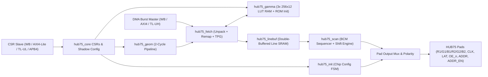

# HUB75 / HUB75E LED-Matrix Panel Controller (`hub75`)

## Overview

`hub75` (`ips/20_hub75`) is a production-grade, single-clock, FPGA- and ASIC-friendly RGB LED-matrix controller supporting HUB75 (1/4, 1/8, 1/16 scan) and HUB75E (1/32 scan) panels, multi-panel chains, and 1 to 4 parallel panel lanes (`LANES`). It integrates a 4KB-safe burst DMA framebuffer master, multi-format pixel unpacker, per-channel 12-bit gamma LUT RAMs with reset/reload ROM presets, programmable panel/chain pixel remapping, double-buffered shift-order line SRAM, a Binary Code Modulation (BCM) scheduler with global brightness/dithering/hardware fade, and a programmable driver-chip initialization sequencer.

## Feature List

- **Quad-Bus SoC Integration (`hub75_top`)**:
  - `BUS_WISHBONE`: Wishbone B4 CSR slave + Wishbone B4 burst DMA master (`hub75_wb`)
  - `BUS_AXI4`: AXI4-Lite CSR slave + AXI4 burst DMA master (`hub75_axi`)
  - `BUS_TILELINK`: TileLink TL-UL CSR device + TL-UH burst DMA host (`hub75_tl`)
  - `BUS_APB`: AMBA APB4 CSR slave + AXI4 burst DMA master (`hub75_apb`)
- **DMA Framebuffer Scanout**:
  - `mem_req_t` / `mem_rsp_t` INCR burst master (up to 256 beats/burst, automatic 4KB boundary splitting)
  - High-QoS (`qos = 4'h8`) real-time row prefetch overlapping display via double-buffered line SRAM
  - Framebuffer double-buffering (`FB_ADDR0` / `FB_ADDR1`) with tear-free frame-boundary pointer swap (`FB_SEL`, `STATUS.FB_ACTIVE`, `STATUS.SWAP_PENDING`, `INT_SWAP`) and `CTRL.CFG_HOLD`
- **Pixel Formats & Color Pipeline**:
  - `RGB565` (16 bpp), `RGB888P` (packed 24 bpp, byte order `B,G,R`), `ARGB8888` (32 bpp), `RGB332` (8 bpp), `RGB444` (`XRGB4444`, 16 bpp)
  - Bit-replication expansion to 8-bit/channel, followed by three independent `256 x 12-bit` CPU-writable gamma LUT RAMs
  - Reset/reload initialization FSM from 4 built-in ROM presets: `0` = gamma 2.2, `1` = linear (1.0), `2` = gamma 2.8, `3` = gamma 1.8
- **BCM Scheduler & Shift Engine**:
  - Selectable bit depth (`DEPTH = 8..12`), `BCM_BASE` base period (`W_p = BCM_BASE << p`), optional `MSB_FIRST` plane order
  - Global brightness (`0..255` with `255 -> 256/256` full scale), first-order error-diffusion dithering (`CTRL.DITHER`), and hardware frame-based fade (`FADE`, `BRIGHT_CUR`, `INT_FADE`)
  - Single-clock design using programmable tick dividers (`CLK_DIV` — no derived clocks)
  - Programmable latch pulse width (`LAT_W`), pre-latch and post-latch blanking (`BLANK_PRE`, `BLANK_POST`), row address setup (`ADDR_SETUP`), active-low/high `OE` & `LAT` polarity (`OE_INV`, `LAT_INV`), and `hub75_addr_en_o`
  - Row addressing `hub75_addr_o[4:0]` (`A..E`, up to 1/32 scan) in binary mode or serial shift-register decoder mode (`CTRL.ADDR_SER`, e.g., 74HC595/shift-row panels)
- **Panel Geometry & Remapping**:
  - Parameterizable `LANES` (`1..4` parallel chains, 6 color lines per lane) and `MAX_CHAIN` (up to `512` shift stages per half per lane)
  - Scan rates `1/4`, `1/8`, `1/16`, `1/32` (`SCAN_LOG2 = 2..5`) and panel row-group factor `K = 2, 4, 8` (`K_LOG2 = 1..3`)
  - 4 multiplexed pixel mapping modes (`MUX_LINEAR`, `MUX_BLOCK`, `MUX_STRIPE8`, `MUX_SNAKE`) for 1/4- and 1/8-scan panels
  - Multi-panel `GX x GY` chains (up to `MAX_PANELS = 32` per lane) with `COLMAJOR`, `SNAKE`, `ALT_ROT`, global `MIRROR_X`/`FLIP_Y`/`ROT180`, and per-panel `PANEL_TBL[pi]` (`ORDER` RGB/RBG/GRB/GBR/BRG/BGR, `FLIP_X`, `FLIP_Y`)
- **Driver-Chip Initialization FSM**:
  - 16-entry programmable init table (`INIT_PROG[0..15]`) supporting `CONFIG` (latch-pulse-count framing), `WAIT`, `LATP`, and `END`
  - Built-in templates (`CHIP_TYPE = 1..5`) for FM6126A/FM6127/ICN2038S/MBI5124/DP3246-class driver chips, plus `AUTO_INIT` on `CTRL.EN` rising edge and per-line `CHAN_MASK`
- **Test Pattern Generator & Diagnostics**:
  - 6 built-in test patterns (`BARS`, `GRADIENT`, `CHECKER`, `SOLID`, `BORDER`, `PLANE`)
  - `vsync` / `frame_o` pulse and `INT_FRAME`, underrun detection + automatic recovery (`INT_UNDERRUN`, `UNDERRUN_CNT`, `STALL_CYCLES`), DMA error counter (`INT_DMA_ERR`, `DMA_ERR_CNT`), `FRAME_CNT`, `FRAME_CYCLES`, programmable `FPS` / `FPS_WINDOW`, `ROW_FETCH_MAX`, `INT_CFG_ERR`

## Architecture Block Diagram



## Parameters and Signals

### Parameters (`hub75_top` / `hub75_core`)

| Parameter | Type | Default | Description |
| :--- | :--- | :--- | :--- |
| `BUS_TYPE` (`hub75_top` only) | `bus_pkg::bus_proto_e` | `BUS_AXI4` | Bus wrapper select: `BUS_WISHBONE` (0), `BUS_AXI4` (1), `BUS_TILELINK` (2), `BUS_APB` (3) |
| `LANES` | `int unsigned` | `1` | Parallel panel chain lanes (`1..4`). Each lane has `R1,G1,B1,R2,G2,B2` outputs |
| `MAX_CHAIN` | `int unsigned` | `512` | Maximum shift positions `LC` per half per lane (`NP * PW * K / 2 <= MAX_CHAIN`) |
| `MAX_PANELS` | `int unsigned` | `32` | Depth of per-panel remap table `PANEL_TBL` |

### Ports (`hub75_core`)

| Port | Dir | Width | Description |
| :--- | :--- | :--- | :--- |
| `clk_i` | Input | 1 | System clock (single clock domain for bus, DMA, and panel timing) |
| `rst_ni` | Input | 1 | Active-low asynchronous-assert, synchronous-deassert reset |
| `csr_req_i` / `csr_rsp_o` | In/Out | struct | Internal CSR bus (0 wait states on registers; 1 wait state on LUT RAM reads) |
| `dma_req_o` / `dma_rsp_i` | Out/In | struct | Generic burst memory interface (`mem_req_t` / `mem_rsp_t`) |
| `hub75_r1_o`, `g1_o`, `b1_o` | Output | `LANES` | Upper-half red/green/blue serial shift data per lane |
| `hub75_r2_o`, `g2_o`, `b2_o` | Output | `LANES` | Lower-half red/green/blue serial shift data per lane |
| `hub75_clk_o` | Output | 1 | Shift clock (rising-edge active, idle low) |
| `hub75_lat_o` | Output | 1 | Data latch / config framing strobe (polarity selectable via `CTRL.LAT_INV`) |
| `hub75_oe_n_o` | Output | 1 | Output enable, active-low by default (polarity selectable via `CTRL.OE_INV`) |
| `hub75_addr_o` | Output | 5 | Row address `A..E` (`[4:0]`) in binary mode, or `{3'b0, SCLK, DIN}` when `CTRL.ADDR_SER=1` |
| `hub75_addr_en_o` | Output | 1 | Active-high external row-decoder enable (asserted exactly when `OE` is active) |
| `irq_o` | Output | 1 | Level-sensitive interrupt (`|(INT_EN & INT_STAT)`) |
| `frame_o` | Output | 1 | 1-cycle strobe pulsed at completion of each displayed frame |

## Full Register Map

All registers are 32-bit word-aligned offsets from the peripheral base address. Unmapped offsets return a CSR bus error (`err = 1`).

| Offset | Name | Access | Reset | Bit Fields |
| :--- | :--- | :--- | :--- | :--- |
| `0x0000` | `CTRL` | RW | `0x00000000` | `[0]` `EN`, `[1]` `BLANK`, `[2]` `OE_INV`, `[3]` `LAT_INV`, `[4]` `MSB_FIRST`, `[5]` `DITHER`, `[6]` `ADDR_SER`, `[7]` `MIRROR_X`, `[8]` `FLIP_Y`, `[9]` `ROT180`, `[10]` `AUTO_INIT`, `[11]` `CFG_HOLD`, `[12]` `CNT_CLR` (W1SC) |
| `0x0004` | `STATUS` | RO | `0x00000010` | `[0]` `RUNNING`, `[1]` `INIT_BUSY`, `[2]` `GAMMA_BUSY`, `[3]` `FETCH_BUSY`, `[4]` `SCAN_IDLE`, `[5]` `STALLED`, `[6]` `CFG_VALID`, `[7]` `FB_ACTIVE`, `[8]` `SWAP_PENDING`, `[15:11]` `CUR_ROW`, `[19:16]` `CUR_PLANE` |
| `0x0008` | `INT_EN` | RW | `0x00000000` | `[0]` `FRAME`, `[1]` `UNDERRUN`, `[2]` `DMA_ERR`, `[3]` `SWAP`, `[4]` `INIT`, `[5]` `FADE`, `[6]` `CFG_ERR` |
| `0x000C` | `INT_STAT` | RW1C | `0x00000000` | `[6:0]` Sticky interrupt status matching `INT_EN` bit positions (write `1` to clear) |
| `0x0010` | `FB_ADDR0` | RW | `0x00000000` | `[31:0]` Framebuffer 0 base byte address (must be 4-byte aligned) |
| `0x0014` | `FB_ADDR1` | RW | `0x00000000` | `[31:0]` Framebuffer 1 base byte address (must be 4-byte aligned) |
| `0x0018` | `FB_STRIDE` | RW | `0x00000080` | `[15:0]` Row pitch in bytes (multiple of 4) |
| `0x001C` | `FB_CTRL` | RW | `0x00000F00` | `[0]` `FB_SEL` (`0`=`FB_ADDR0`, `1`=`FB_ADDR1`), `[3:1]` `FMT`, `[15:8]` `BURST` (max beats per DMA burst minus 1) |
| `0x0020` | `GEOM0` | RW | `0x03010440` | `[9:0]` `PW` (`4..512`, mult of 4), `[15:10]` `GX` (`1..32`), `[21:16]` `GY` (`1..32`), `[24:22]` `SCAN_LOG2` (`2..5` -> `S=4..32`), `[26:25]` `K_LOG2` (`1..3` -> `K=2,4,8`) |
| `0x0024` | `GEOM1` | RW | `0x00000000` | `[1:0]` `MUX_MODE` (`0`=LINEAR, `1`=BLOCK, `2`=STRIPE8, `3`=SNAKE), `[2]` `COLMAJOR`, `[3]` `SNAKE`, `[4]` `ALT_ROT` |
| `0x0028` | `BCM` | RW | `0x00000008` | `[3:0]` `DEPTH` (`8..12` bit planes) |
| `0x002C` | `BCM_BASE` | RW | `0x00000004` | `[15:0]` Base OE duration in system clock cycles for bit-plane 0 (`0` treated as `1`) |
| `0x0030` | `TIM0` | RW | `0x02020200` | `[7:0]` `CLK_DIV` (tick = `CLK_DIV+1` sys clks), `[15:8]` `LAT_W`, `[23:16]` `BLANK_PRE`, `[31:24]` `BLANK_POST` |
| `0x0034` | `TIM1` | RW | `0x00000002` | `[7:0]` `ADDR_SETUP` (address settling cycles / serial clock half-period) |
| `0x0038` | `BRIGHT` | RW | `0x000000FF` | `[7:0]` Target brightness (`0..255`) |
| `0x003C` | `FADE` | RW | `0x00000100` | `[0]` `FADE_EN`, `[15:8]` `FADE_STEP` (`1..255`, `0->1`), `[23:16]` `FADE_RATE` (frames minus 1 between steps) |
| `0x0040` | `TPG_CTRL` | RW | `0x00000000` | `[2:0]` `MODE` (`0`=OFF, `1`=BARS, `2`=GRADIENT, `3`=CHECKER, `4`=SOLID, `5`=BORDER, `6`=PLANE), `[7:4]` `PLANE` |
| `0x0044` | `TPG_COLOR` | RW | `0x00FFFFFF` | `[23:0]` `{R[7:0], G[7:0], B[7:0]}` |
| `0x0048` | `GAMMA_CTRL` | RW | `0x00000000` | `[1:0]` `PRESET` (`0`=2.2, `1`=1.0, `2`=2.8, `3`=1.8), `[8]` `RELOAD` (W1SC), `[16]` `BUSY` (RO) |
| `0x004C` | `INIT_CTRL` | RW | `0x0000FC00` | `[3:0]` `CHIP_TYPE` (`0..5`, writing loads `INIT_PROG`), `[8]` `START` (W1SC), `[9]` `LOAD` (W1SC force preset load), `[15:10]` `CHAN_MASK` (`{b2,g2,r2,b1,g1,r1}`), `[16]` `BUSY` (RO) |
| `0x0058` | `BRIGHT_CUR` | RO | `0x000000FF` | `[7:0]` Instantaneous brightness currently applied by BCM |
| `0x0060` | `FRAME_CNT` | RO | `0x00000000` | `[31:0]` Completed frames counter |
| `0x0064` | `FRAME_CYCLES` | RO | `0x00000000` | `[31:0]` System clock cycles of the most recently completed frame |
| `0x0068` | `FPS` | RO | `0x00000000` | `[31:0]` Frames completed during the previous `FPS_WINDOW` interval |
| `0x006C` | `FPS_WINDOW` | RW | `0x02FAF080` | `[31:0]` FPS measurement window in system clocks (default `50,000,000` = 1 s @ 50 MHz) |
| `0x0070` | `UNDERRUN_CNT` | RO | `0x00000000` | `[31:0]` Count of row underrun stall events |
| `0x0074` | `STALL_CYCLES` | RO | `0x00000000` | `[31:0]` Cumulative cycles spent stalled waiting for line-buffer fill |
| `0x0078` | `DMA_ERR_CNT` | RO | `0x00000000` | `[31:0]` Count of DMA response beats with `err=1` |
| `0x007C` | `ROW_FETCH_MAX` | RO | `0x00000000` | `[15:0]` Maximum system clocks taken to fetch a single scan row |
| `0x0080` | `ID` | RO | `0x48554201` | `[31:0]` IP identifier (`"HUB\x01"`) |
| `0x0084` | `CAPS` | RO | Param-dep | `[3:0]` `LANES`, `[15:4]` `MAX_CHAIN`, `[23:16]` `MAX_PANELS` |
| `0x0100..0x017C` | `PANEL_TBL[0..31]` | RW | `0x00000000` | `[2:0]` `ORDER` (`0`=RGB, `1`=RBG, `2`=GRB, `3`=GBR, `4`=BRG, `5`=BGR), `[3]` `FLIP_X`, `[4]` `FLIP_Y` |
| `0x0200..0x023C` | `INIT_PROG[0..15]` | RW | `0x00000000` | `[15:0]` `DATA`, `[21:16]` `LATCH_N`, `[24:22]` `OP` (`0`=END, `1`=CONFIG, `2`=WAIT, `3`=LATP), `[31:25]` `LEN8` (`0`=`LC`, else `LEN8*8`) |
| `0x1000..0x13FC` | `LUT_R[0..255]` | RW | Gamma 2.2 | `[11:0]` Red channel gamma LUT (stalls bus while `GAMMA_CTRL.BUSY=1`) |
| `0x1400..0x17FC` | `LUT_G[0..255]` | RW | Gamma 2.2 | `[11:0]` Green channel gamma LUT |
| `0x1800..0x1BFC` | `LUT_B[0..255]` | RW | Gamma 2.2 | `[11:0]` Blue channel gamma LUT |

## Memory Pixel Formats (`FB_CTRL.FMT`)

Framebuffers are stored row-major in little-endian SoC memory with lane 0 at the top. Both `FB_ADDR*` and `FB_STRIDE` must be 4-byte aligned, and `PW` must be a multiple of 4.

| `FMT` | Name | Bits/Pixel | Memory / Word Layout (Little-Endian) | 8-bit Expansion |
| :--- | :--- | :--- | :--- | :--- |
| `0` | `RGB565` | 16 bpp | Pixel 0 in `[15:0]`, Pixel 1 in `[31:16]`: `{R[4:0], G[5:0], B[4:0]}` | `R={r5,r5[4:2]}`, `G={g6,g6[5:4]}`, `B={b5,b5[4:2]}` |
| `1` | `RGB888P` | 24 bpp | Packed byte stream `B0, G0, R0, B1, G1, R1, ...` (4 pixels per 3 words) | Direct 8-bit |
| `2` | `ARGB8888` | 32 bpp | `{A[7:0], R[7:0], G[7:0], B[7:0]}` (alpha byte ignored) | Direct 8-bit |
| `3` | `RGB332` | 8 bpp | 4 pixels/word: `{R[2:0], G[2:0], B[1:0]}` | `R={r3,r3,r3[2:1]}`, `G={g3,g3,g3[2:1]}`, `B={b2,b2,b2,b2}` |
| `4` | `RGB444` | 16 bpp | `XRGB4444`: `{X[3:0], R[3:0], G[3:0], B[3:0]}` | `{x4, x4}` per channel |

## Timing Waveforms (ASCII)

### Pixel Shift, Blank, Address, Latch, and OE Overlap

The shifter starts loading plane `p+1` (or row `r+1`, plane 0) immediately upon the falling edge of `LAT`, overlapping the `BLANK_POST` and `ON` (`OE`) windows of plane `p`.

```
State     : | WAIT_SH |PREP| PRE | ADDR  | LAT  | POST |      ON (plane p)      |
            :                                    |<- Shifter runs plane p+1 ---->|
hub75_clk : ____/‾\__/‾\_________________________/‾\__/‾\__/‾\__/‾\_______________
hub75_r1  : ----< d[t=0] >< d[t=1] >-------------< d[t=0] >< d[t=1] >-------------
hub75_addr: =============================< row r >================================
hub75_lat : _____________________________/‾‾‾‾‾‾\_________________________________
hub75_oe_n: ‾‾‾‾‾‾‾‾‾‾‾‾‾‾‾‾‾‾‾‾‾‾‾‾‾‾‾‾‾‾‾‾‾‾‾‾‾‾‾‾‾‾‾‾\______________________/‾‾
addr_en   : _____________________________________________/‾‾‾‾‾‾‾‾‾‾‾‾‾‾‾‾‾‾‾‾‾‾\__
                                         |<LAT_W>|<POST>|
```

- `hub75_clk_o` half-period = `CLK_DIV + 1` system clocks (`period = 2 * (CLK_DIV + 1)`).
- `PREP` = 3 system clocks (computes scaled `ON` duration and updates dither accumulator).
- `ADDR` occurs on plane 0 of each row (`ADDR_SETUP` cycles in binary mode; `S+1` clock pulses on `row=0` and `1` pulse on `row>0` in serial `ADDR_SER` mode).

### Driver-Chip Config Framing (`INIT_PROG` `IOP_CONFIG`)

Data bit `DATA[j mod 16]` is shifted MSB-first per 16-bit word across `LEN` clocks (`LEN8 * 8`, or `LC` if `LEN8 = 0`), with `LAT` asserted during the final `LATCH_N` rising clock edges:

```
CLK       : __/‾\__/‾\__/‾\__/‾\__/‾\__/‾\____
DATA      : ==<b15><b14>...<b2 ><b1 ><b0 >====
LAT       : ______________/‾‾‾‾‾‾‾‾‾‾‾‾‾‾‾‾\__   (high for last LATCH_N rising edges)
OE_n      : ‾‾‾‾‾‾‾‾‾‾‾‾‾‾‾‾‾‾‾‾‾‾‾‾‾‾‾‾‾‾‾‾‾‾   (always blanked during init)
```

## BCM Schedule & Worked Example

For a gamma-corrected channel value `v` truncated to `DEPTH` bits (`v = lut_out >> (12 - DEPTH)`), plane `p` (`0 .. DEPTH-1`) has base weight `W_p = BCM_BASE * 2^p` cycles. With brightness `b` (`0..255`), scale `S = (b == 255) ? 256 : b`:

```
num     = W_p * S + acc
lit_p   = num >> 8
acc'    = DITHER ? (num & 255) : 0
```

**Worked Example**: `DEPTH = 8`, `BCM_BASE = 4`, `BRIGHT = 128` (`S = 128`), `DITHER = 0`:
- Plane 0 (`W_0 = 4`): `lit_0 = (4 * 128) >> 8 = 2` cycles
- Plane 1 (`W_1 = 8`): `lit_1 = 4` cycles
- ...
- Plane 7 (`W_7 = 512`): `lit_7 = 256` cycles
- If a pixel has gamma-corrected code `v = 8'b1000_0011` (131), total lit time per row refresh = `lit_7 + lit_1 + lit_0 = 256 + 4 + 2 = 262` system clocks (out of `510` max = `51.37%` linear duty).

With `DITHER = 1`, `BRIGHT = 1` (`S = 1`), `BCM_BASE = 4`: plane 0 (`4*1 = 4`) accumulates `acc += 4` each row until `acc >= 256`, emitting a 1-cycle pulse every 64 rows so fractional low-brightness levels remain smooth.

## Panel Wiring Guide

| Panel Configuration | `LANES` | `PW` | `GX x GY` | `SCAN_LOG2` (`S`) | `K_LOG2` (`K`) | `MUX_MODE` | Notes |
| :--- | :---: | :---: | :---: | :---: | :---: | :---: | :--- |
| **64x32 (1/16 scan)** | 1 | 64 | `1 x 1` | `4` (`S=16`) | `1` (`K=2`) | `0` (`LINEAR`) | Standard HUB75: use `addr[3:0]` (`A..D`) |
| **64x64 (1/32 scan)** | 1 | 64 | `1 x 1` | `5` (`S=32`) | `1` (`K=2`) | `0` (`LINEAR`) | HUB75E: connect all `addr[4:0]` (`A..E`) |
| **128x64 (2x 64x32 chained, 1 lane)** | 1 | 64 | `1 x 2` | `4` (`S=16`) | `1` (`K=2`) | `0` (`LINEAR`) | Set `SNAKE=1`, `ALT_ROT=1` if top/bottom panels are rotated 180° |
| **128x64 (2x 64x32, 2 parallel lanes)** | 2 | 64 | `2 x 1` | `4` (`S=16`) | `1` (`K=2`) | `0` (`LINEAR`) | Higher refresh rate: `LC = 128` vs `256` |
| **32x16 (1/4 or 1/8 outdoor scan)** | 1 | 32 | `1 x 1` | `2` or `3` | `2` (`K=4`) | `0..3` | Match panel PCB routing (`LINEAR`, `BLOCK`, `STRIPE8`, or `SNAKE`) |

## Programming Recipe (C-style Pseudocode)

```c
// 1. Wait for reset gamma ROM load (preset 0 = gamma 2.2)
while (HUB75->GAMMA_CTRL & (1u << 16)) {}

// 2. Configure 64x32 1/16-scan panel, RGB565, 10-bit BCM, 100 MHz sysclk (~12.5 MHz shift clk)
HUB75->FB_ADDR0  = fb0_phys_addr;
HUB75->FB_ADDR1  = fb1_phys_addr;
HUB75->FB_STRIDE = 64 * 2;
HUB75->FB_CTRL   = (15u << 8) | (0u << 1) | 0u; // burst=16, RGB565, FB0
HUB75->GEOM0     = (1u << 25) | (4u << 22) | (1u << 16) | (1u << 10) | 64u;
HUB75->GEOM1     = 0u;
HUB75->BCM       = 10u;
HUB75->BCM_BASE  = 8u;
HUB75->TIM0      = (4u << 24) | (4u << 16) | (4u << 8) | 3u; // CLK_DIV=3 -> div 8
HUB75->TIM1      = 4u;                                       // ADDR_SETUP=4
HUB75->BRIGHT    = 200u;

// 3. Load FM6126A-class init preset (CHIP_TYPE=1) and auto-run on enable
HUB75->INIT_CTRL = (0x3Fu << 10) | 1u;
HUB75->INT_EN    = (1u << 0) | (1u << 3); // FRAME + SWAP IRQs
HUB75->CTRL      = (1u << 10) | (1u << 5) | (1u << 0); // AUTO_INIT | DITHER | EN

// 4. Tear-free double-buffer swap on next frame boundary
HUB75->FB_CTRL ^= 1u;
while (HUB75->STATUS & (1u << 8)) {} // wait SWAP_PENDING == 0
```

## FPGA / ASIC Integration Notes

- **Single Clock Domain**: All logic runs on `clk_i`; `hub75_clk_o` is generated synchronously from a register with programmable divider `CLK_DIV` (no gated or derived clocks).
- **Inferable Memories**: `hub75_ram_1w2r` (gamma LUTs) and `hub75_ram_1w1r` (line buffers) use synchronous writes and registered reads with no reset on the memory array, mapping directly to block RAM / dual-port SRAM.
- **Pad Ring**: All panel outputs are registered (`hub75_core` outputs or 1 cycle after mux) and split cleanly without internal tri-states.

## Verification Summary

- **Testbench**: `ips/20_hub75/tb/tb_hub75.sv` + behavioral panel model `ips/20_hub75/tb/tb_hub75_panel.sv`
- **Reference Model**: Independent SystemVerilog golden model written purely from the specification (`$pow` gamma, physical-to-memory inverse remap, exact cycle-level BCM & dither integration)
- **Covered Scenarios**:
  - `LANES=1` (`MAX_CHAIN=256`) and `LANES=3` (`MAX_CHAIN=128`) environments running concurrently
  - All 5 pixel formats (`RGB565`, `RGB888P`, `ARGB8888`, `RGB332`, `RGB444`) with randomized pixels and DMA backpressure
  - Geometries (`64x32`, `64x64`, `32x16` `1/4` & `1/8` scan), all 4 MUX modes, multi-panel `2x2` snake/colmajor/alt-rot chains, per-panel flips and all 6 RGB orders, global mirror/flip/rot180
  - BCM depths `8..12`, `MSB_FIRST`, exact timing checks (`LAT_W`, `BLANK_PRE`, `BLANK_POST`, `ADDR_SETUP`), `OE_INV`/`LAT_INV`, serial address decoder (`ADDR_SER`), `BLANK`
  - Gamma presets `0..3` + `RELOAD` + CPU LUT R/W, chip-init presets `1..5` + custom `INIT_PROG` + `CHAN_MASK` + `AUTO_INIT`
  - TPG modes `1..6`, brightness `0/1/128/255`, dither, hardware fade (`INT_FADE`), tear-free FB swap (`INT_SWAP`) + `CFG_HOLD`, underrun + recovery, DMA error injection, `CFG_ERR`, perf counters / `FPS` / `CNT_CLR`, and all 4 bus wrappers (`BUS_WISHBONE`, `BUS_AXI4`, `BUS_TILELINK`, `BUS_APB`) via `hub75_top`.
