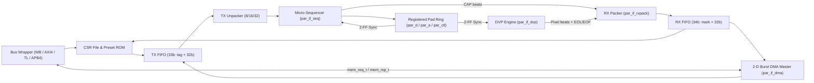

# Programmable Parallel Interface (`par_if`)

## 1. Overview

`par_if` (`ips/21_par_if`) is a clean-room, synthesizable programmable parallel interface with deep TX/RX packing FIFOs, a 64-bit micro-sequencer, hardware preset programs, a dedicated DVP-style camera capture engine, external DMA request/acknowledge lines, and an optional built-in 2-D burst DMA master.

It exposes a unified quad-bus top-level wrapper (`par_if_top`) supporting **Wishbone B4**, **AMBA AXI4 / AXI4-Lite**, **TileLink TL-UL / TL-UH**, and **AMBA APB4** (with an AXI4 DMA master port when `BUS_TYPE == BUS_APB`).

### Key Features
- **Configurable Data & Control Widths**: `DATA_W` parameterized (`8`, `16`, or `32`, runtime selectable `BW` `8`/`16`/`32`-bit), `NUM_CTRL` (`1..16`) control pins with per-pin output enable (`CTL_OE`), output polarity (`CTL_POL`), input polarity (`IN_POL`), and idle state (`CTL_IDLE`).
- **Address Counter**: `ADDR_W` (`1..32`) address bus output (`par_a_o` / `par_a_oe_o`) with programmable stride (`ADDR_INC`) and step-level post-increment (`AINC`).
- **Programmable Micro-Sequencer**: `PROG_DEPTH` (`32` or `64`) 64-bit steps `{B, A}` with:
  - Per-step control-pin state, `DOE`, data source (`HOLD`, `TXF`, `IMM8`, `IMMREG`, `CAP`, `ADDR`), duration (`DUR` or shared timing registers `T_SETUP`, `T_WR`, `T_RD`, `T_HOLD`, `T_RECOV`, `T_USR0`, `T_USR1`), and `EVT` counter/IRQ pulse.
  - Tick divider (`DIV`, 16-bit) or external clock-edge stepping (`TICK_EXT` on `TICK_PIN`).
  - Nested loop counters (`LEN0` / `LEN1`), unconditional jumps, conditional branches (`COND_RDY`, `PIN_HI/LO/RISE/FALL`, `TXF_AVAIL`, `RXF_ROOM`, `TXF_TAG`), qualified capture (`CQ`), and `WAIT` with configurable timeout (`WAIT_TO`).
- **Hardware Preset ROM (`PRESET` register)**: One-write setup of registers and micro-program for:
  1. `PRESET_I8080` — Intel 8080 parallel LCD write/read (`CS#`, `DC/RS`, `WR#`, `RD#`, tagged command/data via `TXCMD`/`TXDATA`).
  2. `PRESET_M6800` — Motorola 6800 bus (`CS#`, `RS`, `E`, `R/W`).
  3. `PRESET_SRAM` — Asynchronous SRAM/FIFO (`CE#`, `OE#`, `WE#`, `BE0#`, `BE1#` + `par_a_o` single and burst).
  4. `PRESET_SYNCFF` — Synchronous FT245-style FIFO (`WR#`, `RD#`, `OE#`, `TXE#`, `RXF#`).
  5. `PRESET_STROBE` — Source-synchronous streaming TX (`STB`, `VLD`, SDR and DDR modes).
  6. `PRESET_DVP` — DVP camera parallel RX pin defaults.
  7. `PRESET_GPIO` — Bit-banged general-purpose parallel pin defaults.
- **TX/RX Packing FIFOs**: Parameterized `TXF_DEPTH` / `RXF_DEPTH` 32-bit FIFOs with automatic 8/16/32-bit packing/unpacking, MSB-first or LSB-first ordering, byte-swap, partial-word flush, and 2-bit EOL/EOF frame markers (`RXMETA`).
- **DVP Capture Engine**: Hardware frame/line capture on `PCLK`, `HREF`, `VSYNC` with configurable pin indices, edge polarity, pixel/line/frame counters, and automatic EOL/EOF marker tagging.
- **2-D Burst DMA Master & External Handshake**: Optional `par_if_dma` (`HAS_DMA=1`) supporting 2-D strided memory-to-TX (e.g., RGB565 framebuffer push to i8080 LCD) and RX-to-memory transfers (4 KiB boundary safe, up to 16-beat bursts), plus `dma_tx_req_o`/`ack_i` and `dma_rx_req_o`/`ack_i`.

---

## 2. Architecture



### RTL File List (`ips/21_par_if/filelist.f`)
1. `ips/21_par_if/rtl/par_if_pkg.sv` — Step struct, enums, and preset ROM definitions.
2. `ips/21_par_if/rtl/par_if_seq.sv` — Micro-sequencer and program RAM.
3. `ips/21_par_if/rtl/par_if_rxpack.sv` — 8/16/32-bit RX beat packer and EOL/EOF marker hold stage.
4. `ips/21_par_if/rtl/par_if_dvp.sv` — Hardware DVP camera frame/line capture engine.
5. `ips/21_par_if/rtl/par_if_dma.sv` — 2-D burst DMA master (`mem_req_t`/`mem_rsp_t`).
6. `ips/21_par_if/rtl/par_if_core.sv` — Protocol-agnostic core (CSRs, FIFOs, synchronizers, pad stage).
7. `ips/21_par_if/rtl/par_if_wb.sv` — Wishbone B4 wrapper.
8. `ips/21_par_if/rtl/par_if_axi.sv` — AXI4-Lite CSR + AXI4 DMA wrapper.
9. `ips/21_par_if/rtl/par_if_tl.sv` — TileLink TL-UL CSR + TL-UH DMA wrapper.
10. `ips/21_par_if/rtl/par_if_apb.sv` — APB4 CSR + AXI4 DMA wrapper.
11. `ips/21_par_if/rtl/par_if_top.sv` — Quad-bus top wrapper (`BUS_TYPE`).

---

## 3. Parameters & Ports (`par_if_top`)

| Parameter | Type | Default | Description |
| :--- | :--- | :--- | :--- |
| `BUS_TYPE` | `bus_pkg::bus_proto_e` | `BUS_AXI4` | `BUS_WISHBONE` (0), `BUS_AXI4` (1), `BUS_TILELINK` (2), `BUS_APB` (3) |
| `DATA_W` | `int unsigned` | `16` | Physical data bus width (`8`, `16`, or `32`) |
| `NUM_CTRL` | `int unsigned` | `8` | Number of control pins (`1..16`) |
| `ADDR_W` | `int unsigned` | `16` | Physical address output width (`1..32`) |
| `PROG_DEPTH` | `int unsigned` | `32` | Micro-sequencer program RAM depth (`32` or `64`) |
| `TXF_DEPTH` | `int unsigned` | `16` | TX FIFO depth in 32-bit words (`>= 2`) |
| `RXF_DEPTH` | `int unsigned` | `16` | RX FIFO depth in 32-bit words (`>= 8` recommended) |
| `HAS_DMA` | `bit` | `1'b1` | Enable internal 2-D burst DMA master |

| Port | Dir | Width | Description |
| :--- | :--- | :--- | :--- |
| `clk_i`, `rst_ni` | in | 1 | System clock and active-low async reset |
| `s_wb_i` / `s_wb_o` | in/out | `wb_*` | Wishbone B4 CSR slave (active when `BUS_TYPE==BUS_WISHBONE`) |
| `s_axi_i` / `s_axi_o` | in/out | `axi4_*` | AXI4-Lite CSR slave (active when `BUS_TYPE==BUS_AXI4`) |
| `s_tl_i` / `s_tl_o` | in/out | `tl_*` | TileLink TL-UL CSR device (active when `BUS_TYPE==BUS_TILELINK`) |
| `s_apb_i` / `s_apb_o` | in/out | `apb_*` | AMBA APB4 CSR slave (active when `BUS_TYPE==BUS_APB`) |
| `m_wb_o` / `m_wb_i` | out/in | `wb_*` | Wishbone B4 DMA master |
| `m_axi_o` / `m_axi_i` | out/in | `axi4_*` | AXI4 burst DMA master (also used when `BUS_TYPE==BUS_APB`) |
| `m_tl_o` / `m_tl_i` | out/in | `tl_*` | TileLink TL-UH DMA host |
| `par_d_o` | out | `DATA_W` | Parallel data output |
| `par_d_oe_o` | out | `DATA_W` | Per-bit data output enable (`1` = drive pad) |
| `par_d_i` | in | `DATA_W` | Parallel data input |
| `par_a_o` | out | `ADDR_W` | Address counter output |
| `par_a_oe_o` | out | `ADDR_W` | Address output enable (`CFG.A_OE && CTRL.EN`) |
| `par_ctl_o` | out | `NUM_CTRL` | Control pin outputs (polarity adjusted by `CTL_POL.OUT_POL`) |
| `par_ctl_oe_o` | out | `NUM_CTRL` | Per-pin control output enables (`CTL_OE & {NUM_CTRL{CTRL.EN}}`) |
| `par_ctl_i` | in | `NUM_CTRL` | Control pin inputs |
| `par_rdy_i` | in | 1 | External ready/wait handshake input |
| `dma_tx_req_o` / `dma_tx_ack_i` | out/in | 1 | External DMA TX request/acknowledge |
| `dma_rx_req_o` / `dma_rx_ack_i` | out/in | 1 | External DMA RX request/acknowledge |
| `irq_o` | out | 1 | Active-high aggregated interrupt output |

---

## 4. Register Map

| Offset | Name | Access | Reset | Description |
| :--- | :--- | :--- | :--- | :--- |
| `0x000` | `ID` | RO | `0x5049_0100` | Peripheral ID (`"PI"` v1.0) |
| `0x004` | `HWCFG0` | RO | param | `[7:0]` DATA_W, `[15:8]` NUM_CTRL, `[23:16]` ADDR_W, `[31:24]` PROG_DEPTH |
| `0x008` | `HWCFG1` | RO | param | `[11:0]` TXF_DEPTH, `[23:12]` RXF_DEPTH, `[24]` HAS_DMA |
| `0x00C` | `CTRL` | RW/W1P | `0x0` | `[0]` EN (RW), `[1]` SOFT_RST (W1P), `[2]` CLR_TX (W1P), `[3]` CLR_RX (W1P), `[4]` ABORT_SEQ (W1P) |
| `0x010` | `CFG` | RW | param | `[1:0]` BW (`0`:8b,`1`:16b,`2`:32b), `[2]` TX_PACK, `[3]` RX_PACK, `[4]` MSB, `[5]` BSWAP, `[6]` IN_SYNC, `[7]` RDY_EN, `[8]` RDY_LOW, `[9]` TICK_EXT, `[10]` TICK_FALL, `[12:11]` UF_POL (`0`:stall,`1`:abort,`2`:repeat), `[13]` OF_STALL, `[14]` TO_ABORT, `[15]` AUTO_FLUSH, `[16]` D_IDLE_OE, `[17]` A_OE, `[18]` REPEAT, `[19]` MARK_EN, `[23:20]` TICK_PIN |
| `0x014` | `DIV` | RW | `0x0` | `[15:0]` Clock divider: 1 sequencer tick every `DIV + 1` clocks |
| `0x018` | `TIM_A` | RW | `0x0002_0001` | `[15:0]` `T_SETUP` (ticks-1), `[31:16]` `T_WR` (ticks-1) |
| `0x01C` | `TIM_B` | RW | `0x0001_0003` | `[15:0]` `T_RD` (ticks-1), `[31:16]` `T_HOLD` (ticks-1) |
| `0x020` | `TIM_C` | RW | `0x0000_0001` | `[15:0]` `T_RECOV` (ticks-1), `[31:16]` `T_USR0` (ticks-1) |
| `0x024` | `TIM_D` | RW | `0x0` | `[15:0]` `T_USR1` (ticks-1) |
| `0x028` | `CTL_POL` | RW | `0x0` | `[15:0]` `OUT_POL` (1=active-low output), `[31:16]` `IN_POL` (1=active-low input) |
| `0x02C` | `CTL_OE` | RW | `0x0` | `[15:0]` Per-pin control output enable mask |
| `0x030` | `CTL_IDLE` | RW | `0x0` | `[15:0]` Control pin assertion levels driven when sequencer is idle |
| `0x034` | `CTL_IN` | RO | `0x0` | `[15:0]` Synchronized control inputs (assertion sense) |
| `0x038` | `DATA_OUT` | RW | `0x0` | `[31:0]` Direct read/write to sequencer output data register |
| `0x03C` | `IMM` | RW | `0x0` | `[31:0]` Immediate data word (`DSRC_IMMREG`) |
| `0x040` | `DATA_IN` | RO | `0x0` | `[31:0]` Synchronized data input (`par_d_i`) |
| `0x044` | `ADDR` | RW | `0x0` | `[31:0]` Current address counter (`par_a_o`, `DSRC_ADDR`) |
| `0x048` | `ADDR_INC` | RW | `0x1` | `[31:0]` Address post-increment step size |
| `0x04C` | `LEN0` | RW | `0x0` | `[31:0]` Outer loop counter reload (`FLOW_LOOP0`) |
| `0x050` | `LEN1` | RW | `0x0` | `[15:0]` Inner loop counter reload (`FLOW_LOOP1`) |
| `0x054` | `WAIT_TO` | RW | `0x0` | `[15:0]` Wait timeout in ticks (`0` = disabled) |
| `0x058` | `TRIG` | RW | `0x0` | `[5:0]` Start PC; writing triggers sequencer execution from `wdata[5:0]` |
| `0x05C` | `STATUS` | RO | `0xA0` | `[0]` SEQ_BUSY, `[1]` STALL_TX, `[2]` STALL_COND, `[3]` DMA_BUSY, `[4]` TX_FULL, `[5]` TX_EMPTY, `[6]` RX_FULL, `[7]` RX_EMPTY, `[8]` PRESET_LOADING, `[9]` DVP_BUSY, `[21:16]` PC, `[22]` RXP_FLUSH_BUSY, `[23]` CAP_BUSY |
| `0x060` | `FIFO_LVL` | RO | `0x0` | `[15:0]` TX FIFO word level, `[31:16]` RX FIFO word level |
| `0x064` | `INT_STATUS` | W1C/RO | `0x0` | `[0]` DONE, `[1]` UNDERRUN, `[2]` OVERRUN, `[3]` TIMEOUT, `[4]` DMA_DONE, `[5]` DMA_ERR, `[6]` EVT, `[7]` DVP_FRAME, `[8]` DVP_LINE, `[9]` TRIG_DROP, `[10]` TX_OVF, `[11]` RX_UF, `[12]` DVP_DONE (all W1C); `[13]` TX_LOW (live RO), `[14]` RX_HIGH (live RO) |
| `0x068` | `INT_EN` | RW | `0x0` | `[14:0]` Interrupt enable mask matching `INT_STATUS[14:0]` |
| `0x06C` | `THR` | RW | `...` | `[15:0]` `TX_THR` (reset `TXF_DEPTH/2`), `[31:16]` `RX_THR` (reset `1`) |
| `0x070` | `TXDATA` | WO | `0x0` | Push untagged 32-bit word to TX FIFO |
| `0x074` | `TXCMD` | WO | `0x0` | Push tagged command word (`tag=1`) to TX FIFO (bypasses `TX_PACK` splitting) |
| `0x078` | `RXDATA` | RO | `0x0` | Pop and return 32-bit word from RX FIFO |
| `0x07C` | `RXMETA` | RO | `0x0` | `[1:0]` MARK (`[0]`=EOL, `[1]`=EOF), `[8]` VALID (non-popping peek) |
| `0x080` | `DMA_HS` | RW | `0x0` | `[0]` TX_REQ_EN, `[1]` RX_REQ_EN, `[2]` HANDSHAKE_MODE (`0`:level, `1`:req/ack) |
| `0x084` | `DVP_CTRL` | RW | `0x240` | `[0]` ARM, `[5:2]` PCLK_PIN, `[9:6]` HREF_PIN, `[13:10]` VSYNC_PIN, `[14]` PCLK_FALL, `[15]` LINE_FLUSH |
| `0x088` | `DVP_FRAMES` | RW | `0x1` | `[15:0]` Number of frames to capture (`0` = continuous until disarmed) |
| `0x08C` | `DVP_STAT` | RO | `0x0` | `[15:0]` PIX_LAST (pixels in last line), `[31:16]` LINES_LAST (lines in last frame) |
| `0x090` | `DVP_FCNT` | RO | `0x0` | `[15:0]` Completed frames counter |
| `0x094` | `DMA_CTRL` | RW/W1P | `0x0` | `[0]` START (W1P) / BUSY (RO), `[1]` DIR (`0`:Mem->TX, `1`:RX->Mem), `[4:2]` BURST_LOG2 (`0..4`), `[8]` ABORT (W1P) |
| `0x098` | `DMA_ADDR` | RW | `0x0` | `[31:0]` Word-aligned base memory address |
| `0x09C` | `DMA_DIM` | RW | `0x0` | `[15:0]` `W` (32-bit words per line), `[31:16]` `H` (lines; `0` treated as `1`) |
| `0x0A0` | `DMA_STRIDE` | RW | `0x0` | `[31:0]` Byte stride between consecutive line starts |
| `0x0A4` | `DMA_REMAIN` | RO | `0x0` | `[31:0]` Remaining 32-bit words in active DMA transfer |
| `0x0A8` | `PRESET` | RW | `0x0` | Write `[3:0]` (`1..7`) to load preset ROM; Read `[0]`=LOADING, `[7:4]`=LAST_PRESET |
| `0x0AC` | `EVT_CNT` | RO | `0x0` | `[31:0]` Count of sequencer steps executed with `EVT=1` |
| `0x200+` | `PROG[n]` | RW | `0x0` | Step `n` (`0..PROG_DEPTH-1`): `A` at `0x200+8n`, `B` at `0x204+8n` |

---

## 5. Micro-Sequencer Step Encoding (64-bit `{B, A}`)

| Word | Bits | Field | Description |
| :--- | :--- | :--- | :--- |
| `A` (`+0`) | `[15:0]` | `CTL` | Control-pin assertion levels (`1` = asserted; pad level XORed with `CTL_POL.OUT_POL`) |
| `A` (`+0`) | `[27:16]` | `DUR` | Duration in ticks minus 1 (when `DSEL == 0`) |
| `A` (`+0`) | `[30:28]` | `DSEL` | `0`:`DUR`, `1`:`T_SETUP`, `2`:`T_WR`, `3`:`T_RD`, `4`:`T_HOLD`, `5`:`T_RECOV`, `6`:`T_USR0`, `7`:`T_USR1` |
| `A` (`+0`) | `[31]` | `EVT` | Increment `EVT_CNT` and raise `INT_STATUS[6]` on step entry |
| `B` (`+4`) | `[2:0]` | `DSRC` | `0`:`HOLD`, `1`:`TXF`, `2`:`IMM8`, `3`:`IMMREG`, `4`:`CAP`, `5`:`ADDR` |
| `B` (`+4`) | `[3]` | `DOE` | Drive `par_d_oe_o` during this step (forced `0` when `DSRC == CAP`) |
| `B` (`+4`) | `[6:4]` | `FLOW` | `0`:`NEXT`, `1`:`JMP`, `2`:`LOOP0`, `3`:`LOOP1`, `4`:`WAIT`, `5`:`BRC`, `6`:`HALT`, `7`:`BRN` |
| `B` (`+4`) | `[7]` | `AINC` | Post-increment `ADDR` by `ADDR_INC` when step completes |
| `B` (`+4`) | `[11:8]` | `COND` | `0`:`TRUE`, `1`:`RDY`, `2`:`PIN_HI`, `3`:`PIN_LO`, `4`:`PIN_RISE`, `5`:`PIN_FALL`, `6`:`TXF_AVAIL`, `7`:`RXF_ROOM`, `8`:`TXF_TAG` |
| `B` (`+4`) | `[14:12]` | `CPIN` | Control input index (`0..7`) for `COND_PIN_*` |
| `B` (`+4`) | `[20:15]` | `TGT` | Target step index (`0..63`) for `JMP`/`LOOP0`/`LOOP1`/`BRC`/`BRN` |
| `B` (`+4`) | `[21]` | `CQ` | Qualified capture: push sample only if `COND` is true at sampling instant |
| `B` (`+4`) | `[23:22]` | `MARK` | 2-bit marker ORed into RX word holding this sample |
| `B` (`+4`) | `[31:24]` | `IMM` | 8-bit immediate value for `DSRC_IMM8` |

---

## 6. Pin Hookup Tables & Timing Diagrams

### 6.1 Common Peripheral Hookups

| Preset / Mode | `par_ctl[0]` | `par_ctl[1]` | `par_ctl[2]` | `par_ctl[3]` | `par_ctl[4]` | `par_a_o` | `par_d` |
| :--- | :--- | :--- | :--- | :--- | :--- | :--- | :--- |
| **i8080 LCD** (`PRESET=1`) | `CS#` (out, low) | `DC/RS` (out, high=data) | `WR#` (out, low) | `RD#` (out, low) | — | unused | `D[DATA_W-1:0]` |
| **M6800 Bus** (`PRESET=2`) | `CS#` (out, low) | `RS` (out, high=data) | `E` (out, high) | `R/W` (out, 1=rd) | — | unused | `D[DATA_W-1:0]` |
| **Async SRAM** (`PRESET=3`) | `CE#` (out, low) | `OE#` (out, low) | `WE#` (out, low) | `BE0#` (out, low) | `BE1#` (out, low) | `A[ADDR_W-1:0]` | `D[15:0]` |
| **FT245 Sync FIFO** (`PRESET=4`) | `WR#` (out, low) | `RD#` (out, low) | `OE#` (out, low) | `TXE#` (in, low) | `RXF#` (in, low) | unused | `D[7:0]` |
| **Strobe TX** (`PRESET=5`) | `STB` (out, high) | `VLD` (out, high) | — | — | — | unused | `D[DATA_W-1:0]` |
| **DVP Camera** (`PRESET=6`) | `PCLK` (in) | `HREF` (in) | `VSYNC` (in) | — | — | unused | `D[DATA_W-1:0]` |

### 6.2 ASCII Timing Diagrams

**Intel-8080 Write (`TRIG=0`, `TXCMD` -> `RS=0`, `TXDATA` -> `RS=1`)**
```text
           |<--RECOV-->|<--SETUP-->|<---T_WR (+RDY)--->|<--HOLD-->|<-RECOV->
CS#  ------\______________________________________________________/---------
DC/RS =====X=================== CMD(0) / DATA(1) =================X=========
WR#  ------------------\_______________________________/--------------------
D_OUT -----------------===========================================----------
D_OE __________________/                                          \_________
```

**Intel-8080 Read (`TRIG=10` RS=1 / `TRIG=14` RS=0)**
```text
           |<--SETUP-->|<---T_RD (+RDY)--->|<--HOLD-->|
CS#  ------\__________________________________________/---------
DC/RS =====X=============== 1 or 0 ===================X=========
RD#  ------------------\___________________/--------------------
D_OE ___________________________________________________________ (Hi-Z)
D_IN ------------------=====< VALID DATA >^===========----------
                                          ^ sample at end of T_RD
```

**Motorola-6800 Write / Read (`TRIG=0` write, `TRIG=10` read)**
```text
           |<--SETUP-->|<----T_WR/T_RD---->|<--HOLD-->|
CS#  ------\__________________________________________/---------
R/W  ======X=========== 0 (Write) / 1 (Read) =========X=========
E    __________________/                   \____________________
D_OUT -----------------=====================-------------------- (when R/W=0)
D_IN  -----------------====< VALID DATA >===-------------------- (when R/W=1)
```

**Async SRAM Single Write (`TRIG=0`) & Burst Read (`TRIG=20`)**
```text
Single Write:
           |<--SETUP-->|<---T_WR--->|<--HOLD-->|<--RECOV-->|
ADDR ======X============= ADDR[k] =============X===========X== ADDR[k+1]
CE#  ------\___________________________________/-----------\__
BE#  ------\___________________________________/-----------\__
WE#  ------------------\____________/-------------------------
D_OUT -----------------========================---------------

Burst Read (entry 20):
           |<-----T_RD----->|<1t>|
ADDR ======X===== ADDR[k] =======X===== ADDR[k+1] =====
CE#  ------\___________________________________________
OE#  ------\___________________________________________
D_IN  -----===< D[k] >^==========X===< D[k+1] >^=======
```

**Source-Synchronous Strobe TX (`TRIG=0` SDR, `TRIG=4` DDR)**
```text
SDR (entry 0):    |<SETUP>|<T_WR>|       |<SETUP>|<T_WR>|
VLD  _____________/       \______________/       \________
STB  _____________________/      \________________/      \
D_OUT ------------<  D0   >--------------<  D1   >--------

DDR (entry 4):    |<SETUP>|<T_WR>|<SETUP>|<T_WR>|
VLD  _____________/                             \_________
STB  _____________/       \_______/      \________________
D_OUT ------------<  D0   >< D1  ><  D2  >< D3  >---------
```

**DVP Camera Capture (`DVP_CTRL.ARM=1`, `LINE_FLUSH=1`)**
```text
VSYNC ------\______________________________________________________/----
HREF  ________/"""""""""""""\__________/"""""""""""""\_____________
PCLK  __|-|_|-|_|-|_|-|_|-|____|-|_|-|_|-|_|-|_|-|_________________
D_IN  ========[P0][P1][P2]=============[P3][P4][P5]================
RXF           [P1,P0] [P2,EOL]         [P4,P3] [P5,EOF|EOL]
```

---

## 7. Programming Recipes (C-Style Pseudocode)

### 7.1 Push RGB565 Framebuffer to an i8080 LCD via 2-D DMA
```c
// 1. Enable core & load i8080 preset
PAR_CTRL = 0x0E; // soft reset + clear FIFOs
PAR_CTRL = 0x01; // enable
PAR_PRESET = 1;  // PRESET_I8080
while (PAR_PRESET & 1);

// 2. Configure timing & 16-bit packed mode
PAR_DIV   = 1;
PAR_TIM_A = (2 << 16) | 1;   // T_WR=2, T_SETUP=1
PAR_TIM_B = (1 << 16) | 3;   // T_HOLD=1, T_RD=3
PAR_CFG   = 0x00008041;      // 16-bit, IN_SYNC=1, AUTO_FLUSH=1, TX_PACK=0

// 3. Send LCD RAMWR command sequence (CS=0, RS=0 for cmd, RS=1 for args)
PAR_TXCMD  = 0x2A;           // Column address set
PAR_TXDATA = 0x0000;
PAR_TXCMD  = 0x2C;           // Memory Write
PAR_LEN0   = 2;              // 3 beats
PAR_TRIG   = 0;
while (PAR_STATUS & 1);

// 4. Enable TX_PACK (2 RGB565 pixels per 32-bit DMA word) & launch 2-D DMA
PAR_CFG        = 0x00008045; // BW=16b, TX_PACK=1
PAR_LEN0       = (WIDTH * HEIGHT) - 1;
PAR_DMA_ADDR   = fb_base_addr;
PAR_DMA_DIM    = (HEIGHT << 16) | (WIDTH / 2);
PAR_DMA_STRIDE = fb_stride_bytes;
PAR_DMA_CTRL   = (2 << 2) | 1; // BURST_LOG2=2 (4 beats), DIR=0, START=1
PAR_TRIG       = 0;
while ((PAR_STATUS & 0x09) != 0); // wait for DMA & sequencer idle
```

### 7.2 Capture a DVP Frame into Memory via 2-D DMA
```c
PAR_CTRL       = 0x0E;
PAR_CTRL       = 0x01;
PAR_PRESET     = 6;          // PRESET_DVP
while (PAR_PRESET & 1);
PAR_CFG        = 0x00088049; // BW=16b, RX_PACK=1, IN_SYNC=1, AUTO_FLUSH=1, MARK_EN=1
PAR_DVP_FRAMES = 1;
PAR_DMA_ADDR   = rx_buf_addr;
PAR_DMA_DIM    = (HEIGHT << 16) | (WIDTH / 2);
PAR_DMA_STRIDE = rx_stride_bytes;
PAR_DMA_CTRL   = (2 << 2) | (1 << 1) | 1; // DIR=1 (RX->Mem), START=1
PAR_DVP_CTRL   = (1 << 15) | (2 << 10) | (1 << 6) | (0 << 2) | 1; // LINE_FLUSH, ARM=1
while ((PAR_STATUS & 0x208) != 0); // wait DVP_BUSY & DMA_BUSY clear
```

---

## 8. FPGA & ASIC Integration Notes

- **Pad Ring**: All physical bus outputs (`par_d_o`, `par_d_oe_o`, `par_a_o`, `par_a_oe_o`, `par_ctl_o`, `par_ctl_oe_o`) are registered directly inside `par_if_core` on `clk_i` and have balanced single-cycle launch latency. Connect `*_oe_o` to IOBUF/tri-state pad cells at the SoC pad ring.
- **Input Synchronization**: `CFG.IN_SYNC` defaults to `1` (2-FF synchronizer on `par_d_i`, `par_ctl_i`, `par_rdy_i` for asynchronous external peripherals). Set `CFG.IN_SYNC=0` only when the external logic is synchronous to `clk_i`.
- **Single Clock Domain**: All internal logic operates on `clk_i` with async-assert `rst_ni`. Program RAM (`mem_a`/`mem_b`) and FIFO arrays use synchronous-write inferable memory templates.

---

## 9. Verification Summary

Testbench: [`ips/21_par_if/tb/tb_par_if.sv`](../tb/tb_par_if.sv) (Verilator 5.054, zero warnings).
- **Quad-Bus Wrappers**: CSR R/W, byte-strobes (`wstrb`/`pstrb`), loopback capture, and DMA transfers verified across Wishbone B4, AXI4, TileLink, and APB4.
- **Behavioral Models & Golden Timing Checkers**:
  - Intel-8080 LCD GRAM model verifying setup/pulse/hold timing windows, `par_rdy_i` wait states, tagged `TXCMD`/`TXDATA`, packed readback, and 2-D strided DMA RGB565 tile transfer.
  - Motorola-6800 model verifying `CS#`/`RS`/`E`/`R/W` setup/pulse/hold timing and write/readback.
  - Async SRAM model verifying `CE#`/`WE#`/`OE#`/`BE#` timing checks and `par_a_o` auto-increment in single and burst modes.
  - FT245-style synchronous FIFO verifying `TXE#`/`RXF#` flow control and qualified capture.
  - Source-synchronous Strobe TX verifying SDR and DDR clocking with MSB-first and byte-swap packing.
  - DVP Camera generator verifying inverted pin polarities, partial-line flush, `EOL`/`EOF` markers, frame/line/pixel stats, and 2-D DMA store.
  - Error & flow control: underrun abort, `WAIT_TO` timeout, external `dma_tx_req_o`/`ack_i` handshake, AXI4 `SLVERR` DMA error handling, custom sequencer instructions (`IMM8`, `IMMREG`, `ADDR`, `EVT`), and constrained-random loopback (`+seed=`).
