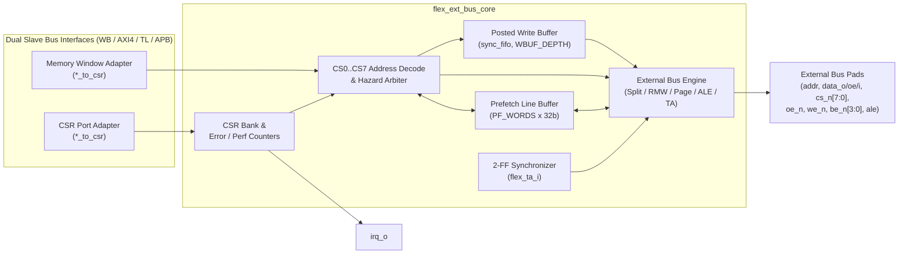

# Flexible External Memory-Mapped Bus Controller (`flex_ext_bus`)

## 1. Overview & Features

`flex_ext_bus` (`ips/22_flex_ext_bus`) is a clean-room, synthesizable external memory-mapped bus master interface designed in the style of a classic MCU static external bus controller. It exposes two slave ports—a CSR configuration port and a direct 32-bit word-granular memory-mapped load/store window—and translates CPU window accesses into asynchronous or handshaken external bus transactions across up to 8 independent chip-select regions.

### Key Features
- **Multi-Bus Top-Level Integration (`flex_ext_bus_top`)**: Parameterizable `BUS_TYPE` supporting **Wishbone B4**, **AXI4 / AXI4-Lite**, **TileLink TL-UL / TL-UH**, and **AMBA APB4** on both the CSR port and the memory window port.
- **8 Programmable Chip-Selects (`CS0`–`CS7`)**:
  - Independent 32-bit `BASE` and `MASK` matching (`((addr ^ BASE) & MASK) == 0`), lowest CS index wins on overlap.
  - Per-CS port width (`8`-bit, `16`-bit, or `32`-bit, clamped to `DATA_W`), automatic multi-cycle word splitting/assembly, and selective write beat skipping when byte strobes (`wstrb`) are zero.
  - Per-CS endianness (`big_endian` reverses the 4 byte positions within each 32-bit word and mirrors byte strobes).
  - Per-CS **Write Protect** (`wp`) returning immediate bus error without toggling external pins.
- **Separate or Multiplexed Address/Data Bus**:
  - Separate mode: full device-word address on `flex_addr_o` and data on `flex_data_o`/`flex_data_i`.
  - Multiplexed mode (`mux=1`): lower address bits driven onto `flex_data_o` with `flex_ale_o` (`addr_setup` + `ale_hold`), upper address bits on `flex_addr_o`.
- **Byte-Lane & Read-Modify-Write (RMW) Support**:
  - Active-low byte enables `flex_be_n_o[3:0]` generated per beat.
  - Optional `nobe=1` mode for devices lacking byte-lane pins: partial sub-port writes automatically perform an atomic hardware read-modify-write sequence on the external port word.
- **Programmable Per-CS Timing & Handshaking**:
  - Independent `addr_setup` (ALE pulse width in mux mode), `ale_hold`, `rd_assert`, `wr_assert`, `wait_states`, `hold`, `turnaround`, and `page_wait` cycle counters.
  - **Page/Burst Mode** (`burst=1`, separate bus with `nobe=0`): multi-beat word reads keep `flex_cs_n_o` and `flex_oe_n_o` asserted across consecutive beats using `page_wait`.
  - **External Transfer Acknowledge (`flex_ta_i`)**: 2-FF synchronized handshake with programmable polarity (`ta_active_low`) and programmable cycle `TIMEOUT` (`0` disables timeout).
- **Performance & Hazard Management**:
  - Parameterizable **Posted Write Buffer** (`WBUF_DEPTH`, per-CS `wbuf_en`) drained strictly before subsequent reads, synchronous writes, or configuration changes.
  - Parameterizable **Sequential Read Prefetch Line** (`PF_WORDS`, per-CS `pf_en`) with automatic invalidation on any write, configuration write, or explicit `CTRL.flush_pf`.
- **Diagnostics & Interrupts**:
  - Sticky W1C error status (`timeout`, `decode_err`, `wp_err`, `posted_timeout`, `pf_abort`), first-error capture (`ERR_ADDR`, `ERR_INFO`), performance counters (`CNT_BUS`, `CNT_PFHIT`, `CNT_PFFILL`), and maskable `irq_o`.

---

## 2. Architecture Block Diagram



---

## 3. Parameters & Port List

### 3.1 Parameters

| Parameter | Module(s) | Default | Range / Legal Values | Description |
| :--- | :--- | :--- | :--- | :--- |
| `BUS_TYPE` | `flex_ext_bus_top` | `BUS_AXI4` | `BUS_WISHBONE`, `BUS_AXI4`, `BUS_TILELINK`, `BUS_APB` | Selects active slave bus wrapper for CSR and memory window ports. |
| `ADDR_W` | All | `26` | `1..32` | Width of `flex_addr_o` external address bus. |
| `DATA_W` | All | `32` | `8`, `16`, `32` | Physical external data pad width. Per-CS port widths exceeding `DATA_W` are clamped to `DATA_W`. |
| `WBUF_DEPTH` | All | `4` | `0` or `>= 2` | Depth of posted-write FIFO (`0` disables posted write buffering). |
| `PF_WORDS` | All | `4` | `0` or power-of-2 `>= 2` | Prefetch line size in 32-bit words (`0` disables prefetch). |

### 3.2 Signal Interface (`flex_ext_bus_top` / `flex_ext_bus_core`)

| Port | Direction | Width | Description |
| :--- | :--- | :--- | :--- |
| `clk_i` | Input | 1 | System clock (rising-edge active). |
| `rst_ni` | Input | 1 | Asynchronous active-low reset. |
| `wb_csr_i` / `wb_csr_o` | In / Out | `wb_m2s_t` / `wb_s2m_t` | Wishbone B4 CSR slave port (used when `BUS_TYPE == BUS_WISHBONE`). |
| `axi_csr_i` / `axi_csr_o` | In / Out | `axi4_m2s_t` / `axi4_s2m_t` | AXI4-Lite/AXI4 CSR slave port (used when `BUS_TYPE == BUS_AXI4`). |
| `tl_csr_i` / `tl_csr_o` | In / Out | `tl_m2s_t` / `tl_s2m_t` | TileLink TL-UL CSR slave port (used when `BUS_TYPE == BUS_TILELINK`). |
| `apb_csr_i` / `apb_csr_o` | In / Out | `apb_m2s_t` / `apb_s2m_t` | AMBA APB4 CSR slave port (used when `BUS_TYPE == BUS_APB`). |
| `wb_mem_i` / `wb_mem_o` | In / Out | `wb_m2s_t` / `wb_s2m_t` | Wishbone B4 external-bus memory window slave port. |
| `axi_mem_i` / `axi_mem_o` | In / Out | `axi4_m2s_t` / `axi4_s2m_t` | AXI4 external-bus memory window slave port. |
| `tl_mem_i` / `tl_mem_o` | In / Out | `tl_m2s_t` / `tl_s2m_t` | TileLink TL-UL external-bus memory window slave port. |
| `apb_mem_i` / `apb_mem_o` | In / Out | `apb_m2s_t` / `apb_s2m_t` | AMBA APB4 external-bus memory window slave port. |
| `flex_addr_o` | Output | `ADDR_W` | External device-word address (in mux mode, upper address bits above the data width). |
| `flex_data_o` | Output | `DATA_W` | External data output (and multiplexed low address during `flex_ale_o`). |
| `flex_data_oe_o` | Output | `DATA_W` | Per-bit active-high output enable for bidirectional data pads. |
| `flex_data_i` | Input | `DATA_W` | External data input sampled at the end of read assert phase. |
| `flex_cs_n_o` | Output | 8 | Active-low chip-select lines (`CS0`–`CS7`). |
| `flex_oe_n_o` | Output | 1 | Active-low output/read enable strobe. |
| `flex_we_n_o` | Output | 1 | Active-low write enable strobe. |
| `flex_be_n_o` | Output | 4 | Active-low byte-lane enables (`0` during reads for active lanes; `!strb` during writes). |
| `flex_ale_o` | Output | 1 | Active-high Address Latch Enable (asserted in `mux=1` mode). |
| `flex_ta_i` | Input | 1 | External Transfer Acknowledge / READY input (synchronized via 2 FFs). |
| `irq_o` | Output | 1 | Active-high level interrupt (`\|(STATUS[8:4] & IRQ_EN[8:4])`). |

---

## 4. Full CSR Register Map

All CSR registers are 32-bit aligned; accesses to unmapped offsets return a bus error (`csr_rsp_o.err = 1`). Writes to `CSi_*` registers (`0x100`–`0x1FF`) stall the CSR bus until the external bus engine reaches `S_IDLE` and invalidate the prefetch line.

### 4.1 Global Registers

| Offset | Name | Reset | Access | Description |
| :--- | :--- | :--- | :--- | :--- |
| `0x00` | `ID` | `0xF1E5_0001` | RO | Peripheral identification register. |
| `0x04` | `CTRL` | `0x0000_0001` | RW / WO | `[0]` `en` (RW, reset `1`): global window decode enable.<br/>`[1]` `flush_pf` (WO, self-clearing): write `1` to invalidate the prefetch line. |
| `0x08` | `STATUS` | `0x0000_0002` | RO / RW1C | `[0]` `busy` (RO): engine active or write buffer non-empty.<br/>`[1]` `wbuf_empty` (RO): write buffer empty.<br/>`[2]` `wbuf_full` (RO): write buffer full.<br/>`[3]` `pf_valid` (RO): at least one word valid in prefetch line.<br/>`[4]` `timeout` (RW1C): synchronous window access TA timeout.<br/>`[5]` `decode_err` (RW1C): window disabled or no CS matched.<br/>`[6]` `wp_err` (RW1C): write attempted to write-protected CS.<br/>`[7]` `posted_timeout` (RW1C): posted write drain TA timeout.<br/>`[8]` `pf_abort` (RW1C): prefetch read TA timeout.<br/>`[23:16]` `wbuf_level` (RO): current write buffer occupancy. |
| `0x0C` | `IRQ_EN` | `0x0000_0000` | RW | `[8:4]` Interrupt enable mask corresponding to `STATUS[8:4]`. |
| `0x10` | `TIMEOUT` | `0x0000_0000` | RW | `[15:0]` Max cycles in `S_ASSERT` before TA timeout (`0` = wait indefinitely). |
| `0x14` | `ERR_ADDR` | `0x0000_0000` | RO | Byte address of the first error captured while `STATUS[8:4] == 0`. |
| `0x18` | `ERR_INFO` | `0x0000_0000` | RO | `[2:0]` `cs` index, `[3]` `write` (1=write), `[5:4]` `cause` (`0`=timeout, `1`=decode, `2`=write-protect), `[6]` `posted` (1=posted write drain). |
| `0x1C` | `CAPS` | Parameter | RO | `[7:0]` `DATA_W`, `[15:8]` `ADDR_W`, `[23:16]` `WBUF_DEPTH`, `[31:24]` `PF_WORDS`. |
| `0x20` | `CNT_BUS` | `0x0000_0000` | RW (clr) | Saturating counter of external word operations completed (any write clears to `0`). |
| `0x24` | `CNT_PFHIT` | `0x0000_0000` | RW (clr) | Saturating counter of window reads served from the prefetch line (any write clears). |
| `0x28` | `CNT_PFFILL` | `0x0000_0000` | RW (clr) | Saturating counter of completed prefetch word fills (any write clears). |

### 4.2 Per-Chip-Select Registers (`i = 0..7`, Base = `0x100 + 0x20 * i`)

| Offset | Name | Reset | Access | Bit Fields |
| :--- | :--- | :--- | :--- | :--- |
| `+0x00` | `CSi_BASE` | `0x0000_0000` | RW | `[31:0]` Base byte address compared under `CSi_MASK`. |
| `+0x04` | `CSi_MASK` | `0x0000_0000` | RW | `[31:0]` Address compare mask (`1` = bit compared). Match occurs when `((addr ^ BASE) & MASK) == 0`. |
| `+0x08` | `CSi_CFG` | `0x0000_0000` | RW | `[0]` `en`: CS region enable.<br/>`[2:1]` `width`: `0`=8-bit, `1`=16-bit, `2/3`=32-bit (clamped to `DATA_W`).<br/>`[3]` `big_endian`: reverse word byte order and strobes.<br/>`[4]` `mux`: `1`=address/data multiplexed with ALE.<br/>`[5]` `wp`: `1`=write-protect (writes error immediately).<br/>`[6]` `nobe`: `1`=device lacks byte enables (partial writes trigger atomic RMW).<br/>`[7]` `ta_en`: `1`=wait for synchronized `flex_ta_i`.<br/>`[8]` `ta_active_low`: `1`=`flex_ta_i==0` acknowledges.<br/>`[9]` `burst`: `1`=page-mode multi-beat reads without releasing `CS#`/`OE#` (requires `mux=0`, `nobe=0`).<br/>`[10]` `pf_en`: `1`=enable sequential prefetch.<br/>`[11]` `wbuf_en`: `1`=enable posted writes via write buffer. |
| `+0x0C` | `CSi_TIM0` | `0x0103_0301` | RW | `[7:0]` `addr_setup`: setup cycles (`S_SETUP`), or `ALE` high width in mux mode (`S_ASET`). Value `0` acts as `1`.<br/>`[15:8]` `rd_assert`: minimum `OE#` assert cycles (value `0` acts as `1`).<br/>`[23:16]` `wr_assert`: minimum `WE#` assert cycles (value `0` acts as `1`).<br/>`[31:24]` `hold`: hold cycles after `OE#`/`WE#` deasserts (`S_HOLD`, value `0` acts as `1`). |
| `+0x10` | `CSi_TIM1` | `0x0101_0001` | RW | `[7:0]` `turnaround`: idle cycles with `CS#` high after a word (`S_TURN`, value `0` acts as `1`).<br/>`[15:8]` `wait_states`: extra cycles added to `rd_assert`/`wr_assert` (`0` allowed).<br/>`[23:16]` `page_wait`: assert cycles per subsequent beat in `burst=1` read (value `0` acts as `1`).<br/>`[31:24]` `ale_hold`: address hold cycles after `ALE` falls in mux mode (`S_AHOLD`, value `0` acts as `1`). |

---

## 5. Timing Diagrams & Protocol Modes

### 5.1 Separate Async Read / Write (`mux = 0`, `ta_en = 0`)

```text
clk_i          _/‾\_/‾\_/‾\_/‾\_/‾\_/‾\_/‾\_/‾\_/‾\_/‾\_/‾\_/‾\_
flex_cs_n_o    ‾‾\_________________________________________/‾‾‾‾
flex_addr_o    --<======== A_dev (beat k) ================>-----
flex_be_n_o    --<======== BE# (0 on rd; !strb on wr) ====>-----
flex_oe_n_o    ‾‾‾‾‾‾‾‾‾‾‾\___________________/‾‾‾‾‾‾‾‾‾‾‾‾‾‾‾‾‾
  (read)       |<-t_as--->|<--rd_assert+wait->|<-t_hold-->|t_turn
flex_data_i    -------------------<== RDATA ==X----------->-----
                                              ^ sampled at end of S_ASSERT

flex_we_n_o    ‾‾‾‾‾‾‾‾‾‾‾\___________________/‾‾‾‾‾‾‾‾‾‾‾‾‾‾‾‾‾
  (write)      |<-t_as--->|<--wr_assert+wait->|<-t_hold-->|t_turn
flex_data_oe_o __|‾‾‾‾‾‾‾‾‾‾‾‾‾‾‾‾‾‾‾‾‾‾‾‾‾‾‾‾‾‾‾‾‾‾‾‾‾‾‾‾\_____
flex_data_o    --<======== WDATA (beat k) ================>-----
```

### 5.2 Multiplexed Address/Data Mode (`mux = 1`)

During `S_ASET`, `flex_ale_o` is high and the low `8*PB` address bits are driven on `flex_data_o` while the remaining upper device-word address bits appear on `flex_addr_o`. After `S_AHOLD` (`ale_hold` cycles) the data bus turns around (for reads) or presents write data before `S_SETUP` -> `S_ASSERT`.

```text
clk_i          _/‾\_/‾\_/‾\_/‾\_/‾\_/‾\_/‾\_/‾\_/‾\_/‾\_/‾\_/‾\_/‾\_
flex_cs_n_o    ‾‾\_____________________________________________/‾‾‾‾
flex_ale_o     __/‾‾‾‾‾‾‾\__________________________________________
                 |t_as   |t_alh|t_as|
flex_addr_o    --<======== A_dev >> (8*PB) ===================>-----
flex_data_oe_o __/‾‾‾‾‾‾‾‾‾‾‾‾‾\____________________________________ (read)
flex_data_o    --< A_low >-----<=== (Hi-Z on read / WDATA on wr) ==>
flex_oe_n_o    ‾‾‾‾‾‾‾‾‾‾‾‾‾‾‾‾‾‾‾‾‾\_______________/‾‾‾‾‾‾‾‾‾‾‾‾‾‾‾
flex_data_i    --------------------------<== RDATA ==X------------->
```

### 5.3 Page-Mode Multi-Beat Read (`burst = 1`, `mux = 0`, `nobe = 0`)

For 8-bit or 16-bit ports, a 32-bit read splits into 4 or 2 beats. With `burst=1`, `flex_cs_n_o` and `flex_oe_n_o` stay low across beats while `flex_addr_o` increments to the next beat and `page_wait` cycles are timed per subsequent beat.

```text
flex_cs_n_o    ‾‾\_________________________________________/‾‾‾‾
flex_oe_n_o    ‾‾‾‾‾‾‾‾‾\_________________________________/‾‾‾‾‾
flex_addr_o    --<== Beat 0 ===><== Beat 1 ===><== Beat 2 ===>--
                 |t_as  | rd_assert+wait | page_wait | page_wait |t_hold|
```

### 5.4 External Transfer Acknowledge (`ta_en = 1`) & Timeout

`flex_ta_i` passes through a 2-FF synchronizer (`ta_m_q`, `ta_s_q`). The cycle completes in `S_ASSERT` once `elapsed >= tmin` AND `(ta_s_q ^ ta_active_low) == 1`. If `TIMEOUT != 0` and `elapsed >= TIMEOUT` (with `elapsed >= tmin`) before TA asserts, the access terminates cleanly, releases all strobes through `S_HOLD`/`S_TURN`, logs `ERR_ADDR`/`ERR_INFO`, sets the appropriate sticky timeout bit (`STATUS[4]` or `STATUS[7]`/`STATUS[8]`), and returns `err = 1` for synchronous window requests.

### 5.5 Byte-Lane & Endianness Mapping

- **Little-Endian (`big_endian = 0`)**: CPU byte offset `0..3` maps to device bytes `0..3` in natural order.
  - `width=8` (`PB=1`): `be_n_o[0]` is `0` on read or `!wstrb[k]` on write; beats with `wstrb[k] == 0` are skipped.
  - `width=16` (`PB=2`): beat 0 carries bytes `[1:0]` with `be_n_o[1:0]`, beat 1 carries bytes `[3:2]` with `be_n_o[3:2]` (aligned onto `be_n_o[1:0]` pins).
  - `width=32` (`PB=4`): single beat carrying `[31:0]` with `be_n_o[3:0] = !wstrb[3:0]`.
- **Big-Endian (`big_endian = 1`)**: Word bytes are byte-swapped (`{B0, B1, B2, B3}`) and `wstrb` is bit-reversed (`{strb[0], strb[1], strb[2], strb[3]}`) prior to splitting.

---

## 6. Bring-Up Recipes (C-Style Pseudocode)

### 6.1 16-bit Async SRAM (`CS0` at `0x1000_0000`, 16 MB, with byte lanes & page read)
```c
#define FLEX_BASE 0x40000000u
#define CS0(off)  (*(volatile uint32_t *)(FLEX_BASE + 0x100u + (off)))

void init_async_sram_cs0(void) {
    // 1. Address window: 0x1000_0000 .. 0x10FF_FFFF
    CS0(0x00) = 0x10000000u; // BASE
    CS0(0x04) = 0xFF000000u; // MASK
    // 2. Timing (100 MHz = 10 ns/clk): 20 ns setup, 40 ns rd/wr assert, 20 ns hold, 20 ns turn, 30 ns page
    CS0(0x0C) = (2u << 24) | (4u << 16) | (4u << 8) | 2u; // TIM0
    CS0(0x10) = (2u << 24) | (3u << 16) | (0u << 8) | 2u; // TIM1
    // 3. Config: en=1, width=16b(1), burst=1, pf_en=1, wbuf_en=1
    CS0(0x08) = (1u << 11) | (1u << 10) | (1u << 9) | (1u << 1) | 1u;
}
```

### 6.2 8-bit NOR Flash / Write-Protected Multiplexed Boot ROM (`CS1` at `0x2000_0000`)
```c
#define CS1(off) (*(volatile uint32_t *)(FLEX_BASE + 0x120u + (off)))

void init_mux_rom_cs1(void) {
    CS1(0x00) = 0x20000000u;
    CS1(0x04) = 0xFF000000u;
    // ALE pulse = 2 cyc, ALE hold = 2 cyc, rd_assert = 3 cyc + 2 wait = 50 ns
    CS1(0x0C) = (2u << 24) | (4u << 16) | (3u << 8) | 2u;
    CS1(0x10) = (2u << 24) | (1u << 16) | (2u << 8) | 2u;
    // en=1, width=8b(0), mux=1, wp=1, pf_en=1
    CS1(0x08) = (1u << 10) | (1u << 5) | (1u << 4) | 1u;
}
```

### 6.3 Slow FPGA/ASIC Register Slave Using `flex_ta_i` + Timeout (`CS2` at `0x3000_0000`)
```c
#define FLEX_REG(off) (*(volatile uint32_t *)(FLEX_BASE + (off)))
#define CS2(off)      (*(volatile uint32_t *)(FLEX_BASE + 0x140u + (off)))

void init_ta_fpga_cs2(void) {
    FLEX_REG(0x10) = 200u;        // TIMEOUT = 200 cycles
    FLEX_REG(0x0C) = (1u << 4);   // Enable IRQ on synchronous timeout
    CS2(0x00) = 0x30000000u;
    CS2(0x04) = 0xFFFF0000u;
    CS2(0x0C) = 0x01010101u;
    CS2(0x10) = 0x01010001u;
    // en=1, width=32b(2), ta_en=1, ta_active_low=0
    CS2(0x08) = (1u << 7) | (2u << 1) | 1u;
}
```

---

## 7. Common External Hookup Pin Table

| `flex_ext_bus` Pin | 16-bit Async SRAM (`x16`) | 8-bit NOR / Parallel Flash (`x8`) | Multiplexed SRAM / MCU Bus (`mux=1`) | 32-bit FPGA / FIFO Slave (`TA`) |
| :--- | :--- | :--- | :--- | :--- |
| `flex_cs_n_o[i]` | `CE#` / `CS#` | `CE#` | `CS#` | `CS#` |
| `flex_oe_n_o` | `OE#` | `OE#` | `OE#` / `RD#` | `RD#` |
| `flex_we_n_o` | `WE#` | `WE#` | `WE#` / `WR#` | `WR#` |
| `flex_be_n_o[1:0]` | `LB#` / `UB#` (or `nobe=1` tie low) | Tie unused (`nobe=1`) | `BLE#` / `BHE#` | `BE#[3:0]` |
| `flex_addr_o` | `A[ADDR_W-1:0]` (halfword addr) | `A[ADDR_W-1:0]` (byte addr) | `A_high` (above `8*PB`) | `ADDR[ADDR_W-1:0]` |
| `flex_data_o/oe/i` | Tri-state pad -> `DQ[15:0]` | Tri-state pad -> `DQ[7:0]` | Tri-state pad -> `AD[15:0]` / `AD[7:0]` | Tri-state pad -> `D[31:0]` |
| `flex_ale_o` | Unused | Unused | `ALE` / `ADV#` | Unused |
| `flex_ta_i` | Tie `0` (`ta_en=0`) | `RY/BY#` (if `ta_en=1`) | Tie `0` or `WAIT` | `READY` / `WAIT#` |

---

## 8. Integration, FPGA/ASIC & Hazard Notes

- **Pad Ring**: No internal tri-states are used; connect `flex_data_o`, `flex_data_oe_o`, and `flex_data_i` directly to IO buffer cells (`IOBUF` / ASIC bidir pads).
- **Reset & CDC**: Asynchronous active-low reset (`rst_ni`); `flex_ta_i` is sampled through a dedicated 2-stage flip-flop synchronizer (`ta_m_q`, `ta_s_q`) prior to FSM evaluation.
- **Hazard Guarantees**:
  - Any read or synchronous write waits for the posted-write FIFO (`WBUF_DEPTH`) to drain when `wbuf_empty == 0`? Specifically, `S_IDLE` arbitrates `!wb_empty` at highest priority before `win_wants` (for reads or non-posted writes) and before prefetch fills, guaranteeing strict program order on the external pins.
  - Any write (posted or synchronous) or CSR configuration write (`0x100`–`0x1FF`) or `CTRL.flush_pf` immediately invalidates the prefetch line and marks any in-flight prefetch fill as discarded (`pf_disc_q`).
  - Partial writes in `nobe=1` mode execute an indivisible read phase followed immediately by a write phase without yielding the bus.
- **Single-Beat Window Port**: `win_req_i` / `win_rsp_o` uses the standard `csr_req_t`/`csr_rsp_t` stall/ready handshake (matching `ips/04_xspi_xip`), supporting Wishbone B4 (classic & pipelined), AXI4/AXI4-Lite, TileLink TL-UL, and APB4 via the repository adapters.

---

## 9. Verification Summary

Verified with the self-checking Verilator testbench `ips/22_flex_ext_bus/tb/tb_flex_ext_bus.sv` (`tb_flex_ext_bus`) against an independent CPU-view byte reference model and behavioural external device models (`tb_flex_dev` with live setup, hold, pulse-width, and access-time monitors):

- **T0 (Reset & CSRs)**: Reset values, `CAPS`, unmapped CSR error, disabled-CS `decode_err`, `ERR_ADDR`/`ERR_INFO`, W1C clear.
- **T1 (Widths, Byte Lanes, Endianness)**: 8-bit, 16-bit, and 32-bit ports in both Little-Endian and Big-Endian modes; full writes, partial `wstrb` beat skipping, and zero-strobe suppression.
- **T2 (Atomic RMW)**: `nobe=1` partial writes verified to issue read-then-write cycles without disturbing neighboring bytes (plus negative check with `nobe=0`).
- **T3 (Write Protect, Overlap & IRQs)**: `wp=1` error injection without external bus activity, CS overlap priority (lowest index wins), maskable `irq_o` assert/W1C clear.
- **T4 (External TA & Timeouts)**: Active-high and active-low `flex_ta_i` devices with variable latencies (`0`–`300 ns`), dead-device synchronous and posted-write timeouts, clean strobe release and bus recovery.
- **T5 (Timing Checks & Page Mode)**: Negative timing checks confirming `tb_flex_dev` catches `tWP` and `tAS` violations and early read sampling; wait-state recovery; page-mode single-`OE#` multi-beat reads.
- **T6 (Write Buffer, Prefetch & Hazards)**: Write buffer burst absorption + backpressure, sequential prefetch hit/fill counters, write-after-prefetch coherence, mid-prefetch write invalidation, and CSR config write stalling during active bus cycles.
- **T7 (Constrained-Random Mixes)**: Multi-seed constrained-random read/write/burst/streak mixes across all 8 CS devices (relaxed, tight, `wbuf+pf`, and big-endian configurations) compared byte-for-byte against the reference array.
- **T8 (Parameter Corner Instance)**: `ADDR_W=20`, `DATA_W=16`, `WBUF_DEPTH=0`, `PF_WORDS=0` with port-width clamping (`32b` request clamped to `16b`) and `CAPS` check.
- **T9 (Quad-Bus Wrappers)**: `flex_ext_bus_top` verified across `BUS_WISHBONE` (incl. pipelined bursts), `BUS_AXI4` (incl. INCR bursts), `BUS_TILELINK`, and `BUS_APB`.
