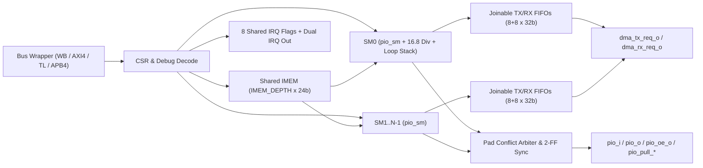

# Programmable-IO Engine (`ips/23_pio_engine`)

Original, clean-room programmable I/O engine capable of bit-exact serial and parallel protocol synthesis, waveform generation, and high-speed capture across up to 32 I/O pads without CPU intervention. Designed for both FPGA prototyping and ASIC tape-out (single clock domain, synchronous inferable memories, split pad rings `*_i`/`*_o`/`*_oe_o`, no tri-states, no latches).

## 1. Key Features

- **Parameterized State Machines (`NUM_SM`, 1..8, default 4)** running concurrently out of a shared, CPU-writable **Instruction RAM (`IMEM_DEPTH`, 64..256 × 24-bit words)**.
- **Custom 24-bit Clean-Room ISA** ([ISA.md](ISA.md)) with 4-bit delay `[0..15]`, 4-bit side-set (mandatory or optional enable), and 13 primary opcodes:
  - `JMP` (16 conditions incl. `XDEC`/`YDEC`, `X<Y`, `PIN`, `OSRE`, `ISRF`, `RXF`)
  - `WAIT` (`GPIO`, `PIN`, `IRQ` + relative SM indexing, `XBIT`)
  - `IN` / `OUT` (32-bit `ISR` / `OSR`, configurable shift direction, 1..32-bit threshold, `autopush` / `autopull`)
  - `PUSH` / `PULL` (`iffull` / `ifempty`, `block` / `noblock`)
  - `MOV` (none / invert `~` / 32-bit bit-reverse `rev` / byte-swap `swap`)
  - `ALUR` / `ALUI` (3-register and register-immediate `ADD`, `SUB`, `AND`, `OR`, `XOR`, `SHL`, `SHR`, `RSUB`/`SLTU`)
  - `SET` (5-bit/8-bit immediate to `PINS`, `PINDIRS`, `X`, `Y`, `Z`)
  - **Zero-overhead hardware loops** (`LOOP` immediate count, `LOOPR` register count, 2-level hardware loop stack)
  - `IRQ` (`SET`, `CLEAR`, `SETWAIT`, `TOGGLE` over 8 shared flags with `abs`/`rel`/`next`/`prev` SM addressing)
  - `EXEC` injection (`SM_INSTR` CSR, `OUT EXEC`, `MOV EXEC`)
- **Per-SM 8-deep TX and RX FIFOs (joinable to 16-deep TX or 16-deep RX)**:
  - First-word fall-through, programmable `TX_THR`/`RX_THR` for `dma_tx_req_o[i]`/`dma_rx_req_o[i]` and level interrupts.
  - Per-direction **byte-swap** and **bit-reverse** transforms, plus `TXF_B` (byte×4) and `TXF_H` (halfword×2) replication write windows.
- **16.8 Fractional Clock Divider** per SM with synchronized `CLK_RESTART` / `SM_START` phase alignment.
- **Flexible Pin Mapping & Conflict Arbitration**:
  - Independent `IN`, `OUT`, `SET`, `SIDESET` windows modulo 32, plus `JMP_PIN`.
  - Per-pin 2-FF input synchronizer with per-pin `SYNC_BYPASS` and internal `LOOPBACK`.
  - Deterministic pad output arbitration (highest-numbered permitted SM wins, `PINMASK` per-SM gating, sticky `CONFLICT` W1C status).
- **Quad-Bus Slave Wrappers**: Wishbone B4, AXI4/AXI4-Lite, TileLink TL-UL/TL-UH, and AMBA APB4 via `pio_top` (`BUS_TYPE`).

---

## 2. Architecture Block Diagram



---

## 3. Parameters & Interface Signals

### Parameters (`pio_top` / `pio_core`)

| Parameter | Default | Range | Description |
|---|---|---|---|
| `BUS_TYPE` | `BUS_AXI4` | `BUS_WISHBONE`, `BUS_AXI4`, `BUS_TILELINK`, `BUS_APB` | Active slave bus protocol (`pio_top` only) |
| `NUM_SM` | `4` | `1..8` | Number of state machines |
| `PIO_PINS` | `32` | `1..32` | Number of physical I/O pad channels |
| `IMEM_DEPTH` | `64` | `64..256` (power of 2) | Shared instruction memory depth (24-bit words) |

### Ports (`pio_core`)

| Signal | Dir | Width | Description |
|---|---|---|---|
| `clk_i`, `rst_ni` | in | 1 | Core clock and async-assert active-low reset |
| `csr_req_i`, `csr_rsp_o` | in/out | struct | Protocol-agnostic CSR interface (`bus_pkg`) |
| `pio_i[PIO_PINS-1:0]` | in | `PIO_PINS` | Pad input vector |
| `pio_o[PIO_PINS-1:0]` | out | `PIO_PINS` | Pad output data (registered) |
| `pio_oe_o[PIO_PINS-1:0]` | out | `PIO_PINS` | Pad output enable (active high, registered) |
| `pio_pull_en_o`, `pio_pull_up_o` | out | `PIO_PINS` | Pad pull resistor enable and direction (`1`=pull-up) |
| `dma_tx_req_o[NUM_SM-1:0]` | out | `NUM_SM` | Level DMA request: `tx_cap != 0 && txlvl < TX_THR` |
| `dma_rx_req_o[NUM_SM-1:0]` | out | `NUM_SM` | Level DMA request: `rx_cap != 0 && rxlvl >= RX_THR` |
| `irq_o[1:0]` | out | 2 | Configurable interrupt outputs (`INT_STAT0`, `INT_STAT1`) |

---

## 4. Pipeline, Clocking, FIFOs & Shifters

### Single-Cycle Execution & Fractional Clock Divider
Each SM maintains a 24-bit phase accumulator `ph_q` updated every `clk_i` cycle:
- `DIV_eff = max(256, {INT[15:0], FRAC[7:0]})` (units of `1/256` clock).
- `ph_sum = ph_q + 256`; a `tick` fires when `ph_sum >= DIV_eff` and wraps `ph_q <= ph_sum - DIV_eff`.
- On a `tick` (when `SM_EN` is set or an injected instruction is pending):
  1. **Fetch**: combinational read `imem_q[pc_q]` (or `inj_instr_q` if `inj_valid_q=1`).
  2. **Execute & Commit**: single-cycle ALU/shifter/FIFO/branch evaluation. If not stalled, `lvl_q`/`oe_q` register the new pad state (visible on `pio_o`/`pio_oe_o` on the next cycle), `dly_q` loads `DLY[3:0]`, and `pc_q` advances via loop-back, jump target, or wrap (`wrap_top -> wrap_bottom`).
  3. **Input Synchronization**: external `pio_i` passes through a per-pin 2-FF synchronizer (`sync1_q -> sync2_q`) unless `SYNC_BYPASS[p]=1`. Setting `LOOPBACK[p]=1` feeds `pio_o[p]` back internally.

### Joinable FIFOs & Shifters

```
Normal mode (JOIN_TX=0, JOIN_RX=0):
  CPU --(TXF/B/H + swap/rev)--> [u_ft: 8x32] --(PULL / autopull)--> OSR (32b) --> OUT/SET/MOV
  CPU <--(RXF + swap/rev)------ [u_fr: 8x32] <--(PUSH / autopush)-- ISR (32b) <-- IN/MOV

JOIN_TX=1 (16-deep TX, 0-deep RX):
  CPU --> [u_fr: 8x32] --(auto xfer)--> [u_ft: 8x32] --> OSR

JOIN_RX=1 (16-deep RX, 0-deep TX):
  CPU <-- [u_fr: 8x32] <--(auto xfer)-- [u_ft: 8x32] <-- ISR
```

- Changing `JOIN_TX`/`JOIN_RX` in `SMx_SHIFT` automatically flushes both FIFOs of that SM.

---

## 5. Register Map

### 5.1 Global Registers (`0x000..0x070`)

| Offset | Name | Access | Reset | Bit Fields & Description |
|---|---|---|---|---|
| `0x000` | `SM_EN` | RW | `0x0` | `[NUM_SM-1:0]` Enable mask per SM |
| `0x004` | `SM_RESTART` | WO | `0x0` | `[7:0]` Pulse: reset PC=`ENTRY`, shifters, loop stack, clkdiv phase, sticky SM flags |
| `0x008` | `CLK_RESTART` | WO | `0x0` | `[7:0]` Pulse: reset fractional divider phase `ph_q` only (multi-SM sync) |
| `0x00C` | `SM_START` | WO | `0x0` | `[7:0]` Atomic restart + set `SM_EN` bits simultaneously |
| `0x010` | `FSTAT` | RO | `0x0F00_0F00` | `[7:0]` RXFULL, `[15:8]` RXEMPTY, `[23:16]` TXFULL, `[31:24]` TXEMPTY |
| `0x014` | `FDEBUG` | RW1C | `0x0` | `[7:0]` RXDROP, `[15:8]` TXUNDER, `[23:16]` RXSTALL, `[31:24]` TXSTALL |
| `0x018` | `INT_RAW` | RO | `0x0` | `[7:0]` `IRQ_FLAGS`, `[15:8]` `TX_LOW`, `[23:16]` `RX_HIGH`, `[31:24]` `RXDROP\|TXUNDER` |
| `0x01C` | `INT_EN0` | RW | `0x0` | `[31:0]` Enable mask for `irq_o[0]` |
| `0x020` | `INT_EN1` | RW | `0x0` | `[31:0]` Enable mask for `irq_o[1]` |
| `0x024` | `INT_FORCE0` | RW | `0x0` | `[31:0]` Software force bits OR'd into `INT_STAT0` |
| `0x028` | `INT_FORCE1` | RW | `0x0` | `[31:0]` Software force bits OR'd into `INT_STAT1` |
| `0x02C` | `INT_STAT0` | RO | `0x0` | `(INT_RAW \| INT_FORCE0) & INT_EN0` |
| `0x030` | `INT_STAT1` | RO | `0x0` | `(INT_RAW \| INT_FORCE1) & INT_EN1` |
| `0x034` | `IRQ_FLAGS` | RW1C | `0x0` | `[7:0]` Shared SM/CPU IRQ flags |
| `0x038` | `IRQ_SET` | WO | `0x0` | `[7:0]` Set `IRQ_FLAGS` bits (set wins over simultaneous clear) |
| `0x03C` | `FDEBUG2` | RW1C | `0x0` | `[7:0]` `TXOVER` (CPU write to full TX), `[15:8]` `RXUNDER` (CPU read of empty RX) |
| `0x040` | `SYNC_BYPASS` | RW | `0x0` | `[PIO_PINS-1:0]` Bypass 2-FF input synchronizer per pin |
| `0x044` | `LOOPBACK` | RW | `0x0` | `[PIO_PINS-1:0]` Route `pio_o[p]` internally to SM `pin_in[p]` |
| `0x048` | `CONFLICT` | RW1C | `0x0` | `[PIO_PINS-1:0]` Sticky pad contention (>1 permitted SM driving OE=1) |
| `0x04C` | `PIN_IN` | RO | `0x0` | `[PIO_PINS-1:0]` Current synchronized/bypassed input vector |
| `0x050` | `PIN_OUT` | RO | `0x0` | `[PIO_PINS-1:0]` Current arbitrated `pio_o` |
| `0x054` | `PIN_OE` | RO | `0x0` | `[PIO_PINS-1:0]` Current arbitrated `pio_oe_o` |
| `0x058` | `PULL_EN` | RW | `0x0` | `[PIO_PINS-1:0]` Drives `pio_pull_en_o` |
| `0x05C` | `PULL_UP` | RW | `0x0` | `[PIO_PINS-1:0]` Drives `pio_pull_up_o` |
| `0x060` | `ID` | RO | `0x504F_0001` | Core ID (`"PO" v0.1`) |
| `0x064` | `CONFIG` | RO | param | `[3:0]` `NUM_SM`, `[13:8]` `PIO_PINS`, `[31:16]` `IMEM_DEPTH` |
| `0x068` | `CYCLES` | RO | `0x0` | Free-running `clk_i` cycle counter |
| `0x06C` | `DBG_SEL` | RW | `0x0` | `[2:0]` SM index, `[7:4]` internal register (`0=X,1=Y,2=Z,3=ISR,4=OSR,5=ISRC,6=OSRC,7=LVL,8=OE,9=LOOP0,10=LOOP1,11=INSTR`) |
| `0x070` | `DBG_DATA` | RO | `0x0` | Selected SM debug value |

### 5.2 Per-SM Registers (`0x100 + 0x40*sm + offset`)

| Offset | Name | Access | Reset | Bit Fields & Description |
|---|---|---|---|---|
| `0x00` | `SMx_CLKDIV` | RW | `0x0000_0100` | `[7:0]` `FRAC`, `[23:8]` `INT` (DIV < 256 treated as 256 = ÷1) |
| `0x04` | `SMx_WRAP` | RW | `{0,DEPTH-1,0}` | `[7:0]` `WRAP_BOTTOM`, `[15:8]` `WRAP_TOP`, `[23:16]` `ENTRY` |
| `0x08` | `SMx_SHIFT` | RW | `0x0000_0003` | `[0]` `IN_RIGHT`, `[1]` `OUT_RIGHT`, `[2]` `AUTOPUSH`, `[3]` `AUTOPULL`, `[4]` `JOIN_TX`, `[5]` `JOIN_RX`, `[6]` `TX_BSWAP`, `[7]` `TX_BREV`, `[8]` `RX_BSWAP`, `[9]` `RX_BREV`, `[14:10]` `PUSH_THRESH` (0=32), `[19:15]` `PULL_THRESH` (0=32) |
| `0x0C` | `SMx_PINCTRL` | RW | `0x0` | `[4:0]` `OUT_BASE`, `[10:5]` `OUT_COUNT`, `[15:11]` `SET_BASE`, `[19:16]` `SET_COUNT`, `[24:20]` `SIDE_BASE`, `[27:25]` `SIDE_COUNT`, `[28]` `SIDE_OPT`, `[29]` `SIDE_PINDIR` |
| `0x10` | `SMx_INCTRL` | RW | `0x0` | `[4:0]` `IN_BASE`, `[10:5]` `IN_COUNT` (0=32), `[20:16]` `JMP_PIN`, `[22:21]` `STATUS_SEL` (`0=TX<N,1=RX<N,2=IRQ!=0,3=0`), `[31:27]` `STATUS_N` |
| `0x14` | `SMx_PINMASK` | RW | `0xFFFF_FFFF` | `[31:0]` Per-pin output permission mask for this SM |
| `0x18` | `SMx_TXF` | RW | `0x0` | Write: push 32-bit word to TX FIFO. Read: non-destructive peek of TX head |
| `0x1C` | `SMx_RXF` | RO | `0x0` | Read: pop 32-bit word from RX FIFO (returns 0 and sets `RXUNDER` if empty) |
| `0x20` | `SMx_TXF_B` | WO | `0x0` | Write byte `[7:0]` replicated 4× (`{4{wd[7:0]}}`) into TX FIFO |
| `0x24` | `SMx_TXF_H` | WO | `0x0` | Write halfword `[15:0]` replicated 2× (`{2{wd[15:0]}}`) into TX FIFO |
| `0x28` | `SMx_INSTR` | RW | `0x0` | Write: inject 24-bit instruction `[23:0]` (executes on next tick even if disabled). Read: `{inj_valid, 7'd0, inj_instr}` |
| `0x2C` | `SMx_STATUS` | RW* | `0x0` | Read: `[7:0] PC`, `[8] STALLED`, `[11:9] REASON` (`1=WAIT,2=PULL,3=PUSH,4=APULL,5=SETWAIT`), `[12] DELAYING`, `[14:13] LOOP_DEPTH`, `[15] INJ_VALID`, `[20:16] TXLVL`, `[25:21] RXLVL`, `[26] ILLEGAL`, `[27] LOOP_OVF`, `[28] EN`. Write: clears sticky `ILLEGAL` & `LOOP_OVF` |
| `0x30` | `SMx_CYCLES` | RW* | `0x0` | Read: enabled tick counter. Write: clears `SMx_CYCLES` and `SMx_STALLS` |
| `0x34` | `SMx_STALLS` | RW* | `0x0` | Read: stalled step counter. Write: clears `SMx_CYCLES` and `SMx_STALLS` |
| `0x38` | `SMx_FTHR` | RW | `0x0000_0104` | `[4:0]` `TX_THR` (default 4), `[12:8]` `RX_THR` (default 1) |
| `0x3C` | `SMx_FIFOCTL` | WO | `0x0` | Write with `[1:0] != 0`: synchronously flush this SM's TX and RX FIFOs |

### 5.3 Shared Instruction RAM (`0x400..0x7FC`)

- `0x400 + 4*addr` (`addr < IMEM_DEPTH`): 24-bit instruction word in `[23:0]` (bits `[31:24]` read as `0`). Supports byte strobes `[2:0]`.

---

## 6. Instruction Set Summary

Every instruction word is 24 bits: `DLY[23:20] | SS[19:16] | OP[15:12] | ARG[11:0]`. Full normative encodings, edge cases, and assembler syntax live in [ISA.md](ISA.md) and [ASSEMBLER.md](ASSEMBLER.md).

| `OP` | Mnemonic | Encoding (`ARG[11:0]`) | Cycles | Summary |
|---|---|---|---|---|
| `0x0` | `JMP` | `[11:8]` COND, `[7:0]` ADDR | `1 + DLY` | Conditional jump; `XDEC`/`YDEC` post-decrement always |
| `0x1` | `WAIT` | `[11]` POL, `[10:9]` SRC, `[8:7]` REL, `[4:0]` IDX | `1 + stall + DLY` | Stall until `GPIO`/`PIN`/`IRQ`/`XBIT` equals `POL` (auto-clears `IRQ` when `POL=1`) |
| `0x2` | `IN` | `[11:8]` SRC, `[4:0]` CNT (`0=32`) | `1 (+ stall) + DLY` | Shift `CNT` bits into `ISR`; stalls if `autopush` hits full RX FIFO |
| `0x3` | `OUT` | `[11:8]` DST, `[4:0]` CNT (`0=32`) | `1 (+ stall) + DLY` | Shift `CNT` bits out of `OSR` to `PINS/X/Y/Z/NULL/PINDIRS/PC/ISR/EXEC`; stalls on empty TX if `autopull` |
| `0x4` | `PUSH`/`PULL` | `[11]` DIR (`0=PUSH,1=PULL`), `[10]` COND, `[9]` BLOCK | `1 (+ stall) + DLY` | Explicit FIFO transfer; non-block sets `RXDROP` or `TXUNDER` (`OSR=X`) |
| `0x5` | `MOV` | `[11:8]` DST, `[7:6]` MOP, `[3:0]` SRC | `1 + DLY` | Copy with optional `~`, `rev32`, or `bswap32` |
| `0x6` | `ALUR` | `[11:10]` DST, `[9:7]` OP, `[6:4]` A, `[3:1]` B | `1 + DLY` | 3-operand 32-bit `ADD/SUB/AND/OR/XOR/SHL/SHR/SLTU` |
| `0x7` | `ALUI` | `[11:10]` DST, `[9:7]` OP, `[6:0]` IMM | `1 + DLY` | 7-bit unsigned immediate `ADD/SUB/AND/OR/XOR/SHL/SHR/RSUB` |
| `0x8` | `SET` | `[11:8]` DST, `[7:0]` IMM | `1 + DLY` | Write immediate to `PINS`, `PINDIRS`, `X`, `Y`, or `Z` |
| `0x9` | `LOOP` | `[11:8]` LEN, `[7:0]` COUNT | `1 + DLY` | Push zero-overhead hardware loop (`LEN+1` instrs, `COUNT` iters; `0` skips body) |
| `0xA` | `LOOPR` | `[11:8]` LEN, `[7:6]` REG (`X/Y/Z`) | `1 + DLY` | Zero-overhead loop using `REG[15:0]` |
| `0xB` | `IRQ` | `[11:10]` MODE, `[9:8]` REL, `[2:0]` IDX | `1 (+ stall) + DLY` | `SET`, `CLEAR`, `SETWAIT` (stall until cleared), `TOGGLE` |
| `0xC` | `NOP` | `0` | `1 + DLY` | No operation (side-set and delay still apply) |

---

## 7. Assembler & Example Programs

Assemble with the stdlib-only Python 3 assembler ([tools/pioasm.py](../../../tools/pioasm.py)):

```sh
python3 tools/pioasm.py ips/23_pio_engine/examples/uart_tx.pio --hex out.hex --svh out.svh
```

Pre-assembled `.pio` sources and `.hex`/`.svh` outputs in [examples/](../examples/):

| Example | Protocol / Function | Key Engine Features Exercised |
|---|---|---|
| `uart_tx` | 8N1 UART TX (8 ticks/bit) | `LOOP 8`, `OUT PINS`, `SET`, `PULL BLOCK` |
| `uart_rx` | 8N1 UART RX + framing check | 2-FF sync, `WAIT PIN`, `LOOP 8`, `JMP PIN`, `PUSH NOBLOCK` |
| `spi_master` | Full-duplex SPI Mode 0 | `AUTOPULL`/`AUTOPUSH` (thresh 8), `SIDE_SET` SCLK |
| `i2s_tx` | 16-bit stereo Philips I2S | Zero-overhead `LOOP 15` with `SIDE_SET 2` (BCLK + 1-BCLK LRCLK advance) |
| `ws2812` | WS2812B 1-wire RGB stream | Exact 3/7 & 7/3 tick pulses, `JMP XZ`, `AUTOPULL` (24b) |
| `quadrature` | 4× quadrature decoder + glitch reject | 16-entry `MOV PC, ISR` jump table, `ADD/SUB X, 1` |
| `bus8080` | 8-bit 8080 parallel write bus | `LOOP 4`, 8-bit `OUT PINS`, `WR#` side-set |
| `dvp_capture` | DVP camera parallel capture | `WAIT GPIO` (VSYNC/HREF/PCLK), `JMP NPIN`, 32-bit `AUTOPUSH` |
| `hub75` | HUB75 LED row shifter + OE window | 3-bit `SIDE_SET` (`CLK`/`LAT`/`OE_N`), `LOOP 8`, delay `[7]` |
| `sd4` | Bidirectional 4-bit SD-style clocking | Dynamic `SET PINDIRS` turnaround, `LOOPR` (`loop x`/`loop y`) |
| `pwm_meas` | Concurrent PWM gen + pulse-width measure | Multi-SM concurrent execution, `LOOPR`, `LOOPBACK`, `ADD`/`JMP PIN` |

---

## 8. Programming Recipe (C-Style Pseudocode)

```c
// Load UART TX at IMEM[0..4] on SM0 (100 MHz / 8.68 = 11.52 Mbaud -> 1.44 Mbaud @ 8 ticks/bit)
for (int i = 0; i < UART_TX_LENGTH; i++) PIO->IMEM[i] = uart_tx_program[i];
PIO->SM[0].CLKDIV  = (8 << 8) | 174; // 8.68
PIO->SM[0].WRAP    = (UART_TX_ENTRY << 16) | (UART_TX_WRAP_TOP << 8) | UART_TX_WRAP_BOTTOM;
PIO->SM[0].SHIFT   = (1 << 0) | (1 << 1); // in_right=1, out_right=1
PIO->SM[0].PINCTRL = (0 << 0) | (1 << 5) | (0 << 11) | (1 << 16) | (0 << 20) | (1 << 25) | (1 << 28); // out=0(1), set=0(1), side=0(1,opt)
PIO->SM[0].INSTR   = 0x008401; // set pindirs, 1
PIO->SM[0].INSTR   = 0x008001; // set pins, 1 (idle high)
PIO->SM_START      = 0x1;      // restart + enable SM0
PIO->SM[0].TXF     = 'H';
```

---

## 9. Design Trade-offs vs Fixed-Function Peripherals & Tape-Out Notes

| Aspect | Fixed-Function Peripheral (UART/SPI/I2S/HUB75) | `pio_engine` |
|---|---|---|
| Protocol flexibility | Fixed to silicon state machine | Software-updatable 24-bit IMEM; mixes arbitrary protocols across SMs |
| Area for 1 protocol | Smaller for a single simple block (e.g. UART) | Shared IMEM + 4 tiny SMs replaces multiple unused blocks (WS2812, 8080, HUB75, DVP, SD4) |
| Timing determinism | Hardware-exact | Cycle-exact (`1 + DLY` per instruction, 16.8 divider, zero-overhead `LOOP`) |
| CPU / DMA offload | Dedicated FIFO + DMA req | 8/16-deep joinable FIFOs with `dma_tx_req_o`/`dma_rx_req_o` and `TXFB`/`TXFH` |
| Pad arbitration | Fixed pin mux at SoC top | Dynamic `PINMASK` + deterministic highest-SM priority + sticky `CONFLICT` detection |

**FPGA & ASIC Integration Notes**:
- All memories (`imem_q` and `pio_fifo` arrays) use synchronous clock-only writes without reset on the storage array so synthesis infers LUTRAM/distributed RAM or register files cleanly.
- Single clock domain (`clk_i`) with async-assert `rst_ni`; external asynchronous inputs pass through a 2-FF synchronizer per pin (`SYNC_BYPASS` only for synchronous/on-chip sources).
- Pad rings must connect `pio_i`/`pio_o`/`pio_oe_o`/`pio_pull_en_o`/`pio_pull_up_o` to external I/O cells (no internal tri-states).

---

## 10. Verification Summary

Verified with Verilator 5.054 (`-Wall`, zero warnings) across three test suites:
- **`tools/test_pioasm.py`**: 41 unit tests covering all opcodes, directives, expressions, error handling, and assemble→disassemble→assemble round-trips.
- **`tb_pio_examples`** ([tb/tb_pio_examples.sv](../tb/tb_pio_examples.sv)): executes all 11 assembled `.hex` example programs on `pio_core` and checks pin waveforms and FIFO outputs bit-exactly against independent golden models.
- **`tb_pio_engine`** ([tb/tb_pio_engine.sv](../tb/tb_pio_engine.sv)): quad-bus wrapper transactions (`WB`/`AXI4`/`TL`/`APB4` + error responses), 16-deep joinable FIFOs with byte-swap/bit-reverse/replication/`dma_*_req_o`, SM-to-SM IRQ sync & collision resolution, pad output conflict arbitration + `PINMASK` + `SYNC_BYPASS`, fractional 16.8 divider, hardware loops & `OUT EXEC`, and constrained-random ISA fuzzing against an independent SV reference interpreter.
