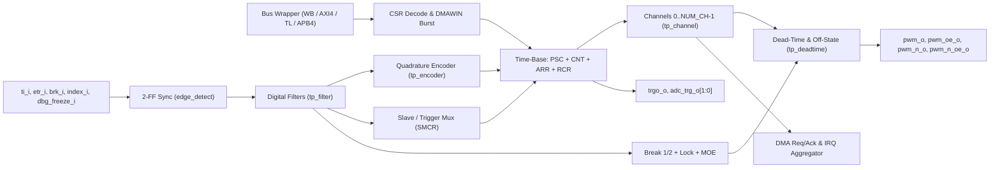

# 24_timer_pwm — Advanced-Control Timer & Complementary PWM Controller

Clean-room, pure synthesizable IEEE 1800-2017 SystemVerilog advanced-control timer, complementary dead-time PWM generator, quadrature encoder / Hall-sensor decoder, and multi-timer synchronizer with Quad-Bus support (**Wishbone B4 / AXI4 / TileLink / APB4**).

---

## 1. Key Features

- **Configurable Time-Base**:
  - Parameterized `CNT_W` = `16` or `32` bit counter (`CNT`) with `16`-bit prescaler (`PSC`, effective divisor `PSC + 1`) and preloadable shadow registers (`PSC`, `ARR`, `CCR`).
  - Counting modes: **Edge-Aligned Up**, **Edge-Aligned Down**, **Center-Aligned** (`CMS = 1..3` controlling compare flag timing), **One-Pulse Mode (`OPM`)**, and **32/16-bit Free-Running Mode (`FREE`)**.
  - `8`-bit **Repetition Counter (`RCR`)** for programmable update-event (`UEV`) decimation across PWM periods.
- **Capture / Compare Channels (`NUM_CH = 4..6`)**:
  - Output-Compare modes: Frozen (`0`), Active on Match (`1`), Inactive on Match (`2`), Toggle (`3`), Force Inactive (`4`), Force Active (`5`), PWM1 (`6`), PWM2 (`7`), plus external `ETRF` output clear (`OCCE`).
  - Complementary output pairs (`CHx` / `CHxN`) with independent polarities (`CCP` / `CCNP`), idle/off-state levels (`OIS` / `OISN`), and `CCPC` commutation preload (`COMG` or `TRGI`).
  - Asymmetric **Rising / Falling Dead-Time Inserter (`tp_deadtime`)** with `8`-bit `DTR`/`DTF` and `2`-bit preshift `DTSC` (`0..3`, yielding `0..2040` `clk_i` cycles) guaranteeing non-overlap.
- **Safety Break & Output Protection**:
  - Dual filtered fault/break inputs (`brk_i[1:0]`) with selectable polarity, enable, and `4`-bit digital glitch filters (`BKF1`/`BKF2`).
  - Immediate hardware disable of `MOE`, `OSSR`/`OSSI` run/idle off-state output enable control, `AOE` automatic re-enable at next update event, software break (`BG`), and write-once **Lock Levels `0..3`**.
- **Input Capture, Digital Filters, Hall & Quadrature Encoder**:
  - Per-pin `4`-bit digital glitch filter (`tp_filter`, `ICF = 0..15`, rejecting pulses shorter than `N * D` clock cycles) plus `2`-FF input synchronizers (`edge_detect`).
  - Input capture from own pin (`CCS=1`), paired pin `ch^1` (`CCS=2`), or `TRGI` (`CCS=3`), rising/falling/both edges, `1/2/4/8` edge prescaler (`ICPSC`), and overcapture flag (`CCxOF`).
  - **Hall-Sensor XOR Interface (`TI1S`)**: `TI0 ^ TI1 ^ TI2` routed to channel 0 and `TI1F_ED` trigger.
  - **Quadrature Encoder Interface (`tp_encoder`)**: `x1`, `x2`, `x4` decoding, `A/B` swap (`SWAP`), polarity control, direction status & `DIRCHG` flag, illegal double-edge detection (`ENCERR`), and filtered `index_i` reset (`IDXE`/`IDXP`/`IDXF`/`IDXIF`).
- **Synchronization, Triggers, DMA & Interrupts**:
  - Slave modes (`SMS`): Reset (`1`), Gated (`2`), Trigger (`3`), External Clock Mode 1 (`4`), plus Master-Slave `MSM` delay and External Clock Mode 2 (`ECE`) on `etr_i`.
  - Master trigger output (`trgo_o`, `MMS = 0..7`), dual **ADC Trigger Outputs (`adc_trg_o[1:0]`)** with channel mask, UEV, and count-direction gating, and `timer_group` daisy-chain helper.
  - Per-event DMA requests (`dma_req_o[NUM_CH+2:0]` with `dma_ack_i`), **DMA Burst Window (`DMABURST` / `DMAWIN` at `0xFC`)**, and aggregated/vectored IRQs (`irq_o`, `irq_vec_o[3:0]`).

---

## 2. Architecture Block Diagram



---

## 3. Parameters & Port List

### 3.1 `timer_pwm_top` Parameters

| Parameter | Type | Default | Valid Range | Description |
|---|---|---|---|---|
| `BUS_TYPE` | `bus_pkg::bus_proto_e` | `BUS_AXI4` | `BUS_WISHBONE` (0), `BUS_AXI4` (1), `BUS_TILELINK` (2), `BUS_APB` (3) | Active slave bus wrapper |
| `CNT_W` | `int unsigned` | `16` | `16` or `32` | Counter & compare register width |
| `NUM_CH` | `int unsigned` | `4` | `4..6` | Number of capture/compare channels |

### 3.2 `timer_pwm_top` Signals

| Signal | Dir | Width | Description |
|---|---|---|---|
| `clk_i` | `input` | `1` | System / timer clock (single clock domain) |
| `rst_ni` | `input` | `1` | Active-low asynchronous reset |
| `wb_i` / `wb_o` | `in/out` | `wb_m2s_t` / `wb_s2m_t` | Wishbone B4 slave interface (tie unused `wb_i` to `'0`) |
| `axi_i` / `axi_o` | `in/out` | `axi4_m2s_t` / `axi4_s2m_t` | AXI4 / AXI4-Lite slave interface |
| `tl_i` / `tl_o` | `in/out` | `tl_m2s_t` / `tl_s2m_t` | TileLink TL-UL slave interface |
| `apb_i` / `apb_o` | `in/out` | `apb_m2s_t` / `apb_s2m_t` | AMBA APB4 slave interface |
| `ti_i` | `input` | `NUM_CH` | Channel capture / encoder / Hall inputs (2-FF synced) |
| `etr_i` | `input` | `1` | External clock / trigger / ETRF clear input (2-FF synced) |
| `brk_i` | `input` | `2` | Break / fault inputs `[1:0]` (2-FF synced) |
| `index_i` | `input` | `1` | Encoder index pulse input (2-FF synced) |
| `itr_i` | `input` | `4` | Internal triggers from peer timers (same `clk_i` domain) |
| `dbg_freeze_i` | `input` | `1` | Debug halt input (2-FF synced; gated by `CTRL.DBGH`) |
| `pwm_o` | `output` | `NUM_CH` | Primary channel PWM / OC output `CHx` |
| `pwm_oe_o` | `output` | `NUM_CH` | Pad output-enable for `pwm_o` |
| `pwm_n_o` | `output` | `NUM_CH` | Complementary PWM output `CHxN` |
| `pwm_n_oe_o` | `output` | `NUM_CH` | Pad output-enable for `pwm_n_o` |
| `trgo_o` | `output` | `1` | Master trigger output (registered) |
| `adc_trg_o` | `output` | `2` | Dual ADC trigger pulses (registered) |
| `brk_active_o` | `output` | `1` | Active fault state (`|brk_act`) |
| `dma_req_o` | `output` | `NUM_CH+3` | `[0]` update, `[1]` COM, `[2]` trigger, `[3+x]` CCx |
| `dma_ack_i` | `input` | `NUM_CH+3` | DMA controller acknowledge per channel |
| `irq_o` | `output` | `1` | Aggregated interrupt output (`|irq_vec_o`) |
| `irq_vec_o` | `output` | `4` | `[0]` UEV, `[1]` CCx, `[2]` Break 1/2, `[3]` COM/TIF/IDX/ENC/DIR |

### 3.3 `timer_group` Helper Module

`timer_group #(.NUM_TIM(3), .CNT_W(16), .NUM_CH(4))` instantiates `NUM_TIM` `timer_pwm_core` blocks on a shared `clk_i`/`rst_ni` and daisy-chains their `trgo_o` signals onto peer `itr_i[3:0]` ports:
- For timer `k`: `itr_i[0] = trgo_o[k-1]` (`ext_trg_i` if `k==0`), `itr_i[1] = trgo_o[k-2]` (`ext_trg_i` if `k<2`), `itr_i[2] = trgo_o[k-3]` (`ext_trg_i` if `k<3`), `itr_i[3] = ext_trg_i`.
- Because `trgo_o` is registered (`1` cycle) and `slave_start` (`SMS=3`, trigger mode) takes `1` cycle to latch `cen_q`, whereas `SMS=2` (gated mode) gates `src` combinationally from `trgi_lvl`, chaining `T0 (MMS=1, CEN) -> T1 (SMS=3, Trigger, TS=ITR0, MMS=1) -> T2 (SMS=2, Gated, TS=ITR0)` yields deterministic startup offsets `c0 - c1 = 2` and `c1 - c2 = 1`.

---

## 4. Register Map

All CSR accesses are 32-bit aligned (`addr[7:0]`). Byte strobes (`wstrb`) are supported on writable registers. Unmapped offsets return `err = 1` (`rdata = 0`).

| Offset | Name | Access | Reset | Description |
|---|---|---|---|---|
| `0x00` | `CTRL` | RW | `0x0000_0000` | Counter & mode control |
| `0x04` | `SMCR` | RW | `0x0000_0000` | Slave / master / external clock control |
| `0x08` | `ENC` | RW | `0x0000_0000` | Quadrature encoder & index control |
| `0x0C` | `DIER` | RW | `0x0000_0000` | Interrupt enables |
| `0x10` | `DMAEN` | RW | `0x0000_0000` | DMA request enables |
| `0x14` | `SR` | RW / W1C | `0x0000_0000` | Sticky status flags (write 1 to clear) |
| `0x18` | `STAT` | RO | `0x0000_0000` | Live hardware status |
| `0x1C` | `EGR` | WO | `0x0000_0000` | Event generation (reads 0) |
| `0x20` | `CNT` | RW | `0x0000_0000` | Counter value (`[CNT_W-1:0]`) |
| `0x24` | `PSC` | RW | `0x0000_0000` | 16-bit prescaler (divisor = `PSC + 1`) |
| `0x28` | `ARR` | RW | `{CNT_W{1'b1}}` | Auto-reload register (`0xFFFF` or `0xFFFF_FFFF`) |
| `0x2C` | `RCR` | RW | `0x0000_0000` | 8-bit repetition counter reload |
| `0x30` | `BDTR` | RW | `0x0000_0000` | Break, dead-time output enable & lock |
| `0x34` | `DT` | RW | `0x0000_0000` | Asymmetric dead-time (`DTR`, `DTF`, `DTSC`) |
| `0x38` | `ADCTRG` | RW | `0x0000_0000` | Dual ADC trigger source masks |
| `0x40` | `DMABURST` | RW | `0x0000_0000` | DMA burst base address (`DBA`) & length (`DBL`) |
| `0x4C` | `ID` | RO | `0x5450_01<ch><w>` | Core ID (`"TP"`, rev `0x01`, `NUM_CH`, `CNT_W==32`) |
| `0x50 + 4*c` | `CCMRc` | RW | `0x0000_0000` | Channel `c` (`0..NUM_CH-1`) mode / filter / polarity |
| `0x80 + 4*c` | `CCRc` | RW / RO | `0x0000_0000` | Channel `c` compare (RW) / capture (RO in IC mode) |
| `0xFC` | `DMAWIN` | RW | `0x0000_0000` | DMA burst window portal (`addr = 4*(DBA + bidx)`) |

### 4.1 Bit-Field Definitions

#### `0x00 CTRL`
| Bits | Field | Description |
|---|---|---|
| `[0]` | `CEN` | Counter enable (`1` = running; auto-cleared on UEV when `OPM=1`) |
| `[1]` | `UDIS` | Update disable (`1` = suppress hardware `UEV` shadow reload and `UIF`) |
| `[2]` | `URS` | Update request source (`1` = `UG` / slave-reset do not set `UIF`) |
| `[3]` | `OPM` | One-pulse mode (`1` = stop `CEN` on next hardware update event) |
| `[4]` | `DIR` | Counter direction (`0` = up, `1` = down; ignored when `CMS!=0` or encoder active) |
| `[6:5]` | `CMS` | Center-aligned mode: `0`=edge-aligned, `1`=CCxIF on down, `2`=CCxIF on up, `3`=CCxIF both |
| `[7]` | `ARPE` | `ARR` preload enable (`1` = buffered via `arr_s_q`, reloaded on `UEV`) |
| `[8]` | `FREE` | Free-running mode (`1` = counter wraps at full scale `2^CNT_W - 1`, ignoring `ARR`) |
| `[9]` | `DBGH` | Debug halt (`1` = freeze counter while synchronized `dbg_freeze_i == 1`) |
| `[10]` | `CCPC` | Capture/compare preload control (`1` = `OCM/CCE/CCP/CCNE/CCNP` update only on `COM` event) |
| `[11]` | `CCUS` | Capture/compare update selection (`1` = `TRGI` rising edge triggers `COM` when `CCPC=1`) |
| `[12]` | `TI1S` | Hall XOR mode (`1` = channel 0 input `ti_x[0] = ti_s[0] ^ ti_s[1] ^ ti_s[2]`) |

#### `0x04 SMCR`
| Bits | Field | Description |
|---|---|---|
| `[2:0]` | `SMS` | Slave mode: `0`=disabled, `1`=Reset, `2`=Gated, `3`=Trigger, `4`=Ext Clock Mode 1 |
| `[6:3]` | `TS` | Trigger select: `0..3`=`itr_i[0..3]`, `4`=`TI1F_ED` (both edges), `5`=`TI1FP1`, `6`=`TI2FP2`, `7`=`ETRF` |
| `[7]` | `MSM` | Master/slave mode (`1` = delay `TRGI` action by 1 cycle to align chained timers) |
| `[8]` | `ECE` | External clock mode 2 enable (`1` = clock counter from filtered/prescaled `etr_i`) |
| `[9]` | `ETP` | External trigger polarity (`0` = active high/rising, `1` = active low/falling) |
| `[11:10]` | `ETPS` | ETR prescaler: `0`=/1, `1`=/2, `2`=/4, `3`=/8 |
| `[15:12]` | `ETF` | ETR digital filter `cfg` (`0..15`, see §4.2) |
| `[18:16]` | `MMS` | Master `trgo_o` select: `0`=Reset, `1`=Enable(`CEN`), `2`=UEV, `3`=CC0IF, `4..7`=OC0REF..OC3REF |

#### `0x08 ENC`
| Bits | Field | Description |
|---|---|---|
| `[1:0]` | `ENC_MODE` | `0`=off, `1`=x1 (A rising), `2`=x2 (all A edges), `3`=x4 (all A and B edges) |
| `[2]` | `IDXE` | Index pulse counter reset enable |
| `[3]` | `IDXP` | Index polarity (`0` = rising edge, `1` = falling edge) |
| `[7:4]` | `IDXF` | Index digital filter `cfg` (`0..15`) |
| `[8]` | `SWAP` | Swap encoder `A` (`TI0`) and `B` (`TI1`) inputs |

#### `0x0C DIER`, `0x10 DMAEN`, `0x14 SR` (W1C)
| Bit | `DIER` | `DMAEN` | `SR` (W1C) |
|---|---|---|---|
| `[0]` | `UIE` | `UDE` | `UIF` (Update event) |
| `[1]` | `COMIE` | `COMDE` | `COMIF` (Commutation event) |
| `[2]` | `TIE` | `TDE` | `TIF` (Slave trigger event) |
| `[3]` | `BIE` (gates `BIF` & `B2IF`) | — | `BIF` (Break 1 or `BG`) |
| `[4]` | `IDXIE` | — | `IDXIF` (Encoder index reset) |
| `[5]` | `ENCERRIE` | — | `ENCERR` (Illegal double-edge transition) |
| `[6]` | `DIRCHGIE` | — | `DIRCHG` (Encoder direction change) |
| `[7]` | — | — | `B2IF` (Break 2) |
| `[8+x]` | `CCxIE` (`x=0..NUM_CH-1`) | `CCxDE` | `CCxIF` (Capture / compare event) |
| `[16+x]` | — | — | `CCxOF` (Input overcapture flag, `SR` only) |

#### `0x18 STAT` (RO) & `0x1C EGR` (WO)
- `STAT`: `[0] DIR`, `[1] BRK1_ACT`, `[2] BRK2_ACT`, `[3] ETRF`, `[4] RUN`, `[5] ENC_A`, `[6] ENC_B`, `[7] MOE`, `[8] TRGI`.
- `EGR` (self-clearing strobe bits): `[0] UG`, `[1] COMG`, `[2] TG`, `[3] BG`, `[8+x] CCxG`.

#### `0x30 BDTR` & `0x34 DT`
- `BDTR`: `[0] BKE`, `[1] BKP` (`1`=active-low), `[2] BK2E`, `[3] BK2P`, `[7:4] BKF1`, `[11:8] BKF2`, `[12] AOE` (auto re-enable `MOE` on `UEV` if no break), `[13] MOE` (master output enable, blocked while break active), `[14] OSSR`, `[15] OSSI`, `[17:16] LOCK` (write-once when `LOCK==0`: `1`=locks `DT`+`BDTR[12:0]`+`OIS/OISN`, `2`=also locks `OSSR/OSSI`+`CCE/CCP/CCNE/CCNP`, `3`=also locks `OCM/OCPE`).
- `DT`: `[7:0] DTR` (rising dead-time base), `[15:8] DTF` (falling dead-time base), `[17:16] DTSC` (shift `0..3`: `dt_cycles = base << DTSC`).

#### `0x38 ADCTRG`, `0x40 DMABURST`, `0x4C ID`
- `ADCTRG`: Trigger 0 = `[NUM_CH-1:0] CH_MASK`, `[6] UEV`, `[8:7] DIRSEL` (`0`=both, `1`=up-only, `2`=down-only); Trigger 1 = `[16+NUM_CH-1:16] CH_MASK`, `[22] UEV`, `[24:23] DIRSEL`.
- `DMABURST`: `[5:0] DBA` (starting word index `offset >> 2`), `[11:8] DBL` (number of transfers minus 1; writing `DMABURST` resets burst index `bidx` to `0`).
- `ID`: `32'h5450_0100 | (NUM_CH << 4) | (CNT_W == 32 ? 1 : 0)`.

#### `0x50 + 4*c CCMRc`
| Bits | Field | Description |
|---|---|---|
| `[1:0]` | `CCS` | `0`=Output Compare, `1`=Capture own `TIc`, `2`=Capture paired `TI(c^1)`, `3`=Capture `TRGI` |
| `[4:2]` | `OCM` | `0`=Frozen, `1`=Active, `2`=Inactive, `3`=Toggle, `4`=Force0, `5`=Force1, `6`=PWM1, `7`=PWM2 |
| `[5]` | `OCPE` | `CCRc` preload enable (`1`=buffered until `UEV`) |
| `[6]` | `OCCE` | Clear `OCREF` while `ETRF=1` (latched until `UEV`) |
| `[8:7]` | `ICPSC` | Input capture prescaler (`0`=/1, `1`=/2, `2`=/4, `3`=/8) |
| `[12:9]` | `ICF` | Input filter `cfg` (`0..15`, see §4.2) |
| `[13]` | `CCE` | Output enable (`CHx`) / capture enable |
| `[14]` | `CCP` | `CHx` polarity (`1`=active-low) / capture edge bit 0 |
| `[15]` | `CCNE` | `CHxN` enable & dead-time insertion enable |
| `[16]` | `CCNP` | `CHxN` polarity / capture edge bit 1 (`{CCNP,CCP}`: `00`=rise, `01`=fall, `11`=both) |
| `[17]` | `OIS` | `CHx` idle / off-state pin level |
| `[18]` | `OISN` | `CHxN` idle / off-state pin level |

### 4.2 Digital Glitch Filter (`ICF` / `ETF` / `BKF` / `IDXF`)
- `cfg = 0`: bypass (`q_o = d_i`).
- `cfg = 1..15`: sample step `D = 1 << ((cfg - 1) >> 2)` (`1, 2, 4, 8` cycles), consecutive match count `N = 2 + 2 * ((cfg - 1) & 3)` (`2, 4, 6, 8` samples). Any pulse shorter than `N * D` cycles is rejected.

---

## 5. Timing & Waveforms

### 5.1 Center-Aligned PWM with Complementary Dead-Time & Break

```
CNT (ARR=4, CCR=2, PWM1):  0   1   2   3   4   3   2   1   0   1 ...
OCREF (dir=0:<, dir=1:<=): 1   1   0   0   0   0   1   1   1   1 ...
CHx  (DTR=1):              ___/^^^^^^^^^^^^^^^\___________/^^^^^ ...
CHxN (DTF=1):              ^^^\___________________/^^^^^^^\_____ ...
                              |1|                 |1|
                              DTR                 DTF
Break (brk_i=1, OSSI=1):   -----------------------[BRK=1]-------
MOE:                       ^^^^^^^^^^^^^^^^^^^^^^^\_____________
CHx / CHxN:                (driven PWM)            (OIS / OISN)
```

### 5.2 Quadrature Encoder `x4` Sequence (`A` leads `B` = Up)

```
ti[0] (A): ____/^^^^^^^^^^^\___________/^^^
ti[1] (B): ________/^^^^^^^^^^^\___________
Phase:      00 | 10 | 11  | 01 | 00  | 10
CNT (x4):   k  |k+1 | k+2 |k+3 | k+4 |k+5   (DIR=0, up)
```

---

## 6. Programming Recipes (C Pseudocode)

### 6.1 3-Phase Motor Complementary PWM + Dead-Time + Break + ADC Trigger

```c
// 100 MHz clk -> 20 kHz center-aligned PWM (ARR = 2500, period = 2*2500*10ns = 50us)
// 500 ns dead time (50 cycles): DTR = DTF = 50, DTSC = 0
TIM->ARR  = 2500;
TIM->PSC  = 0;
TIM->RCR  = 1;                          // Update event every full PWM period
TIM->DT   = (0 << 16) | (50 << 8) | 50; // DTR=50, DTF=50, DTSC=0
for (int ch = 0; ch < 3; ch++) {
    TIM->CCR[ch]  = 1250;               // 50% initial duty
    // PWM1 (6), OCPE=1, CCE=1, CCNE=1, OIS=0, OISN=0
    TIM->CCMR[ch] = (6 << 2) | (1 << 5) | (1 << 13) | (1 << 15);
}
// ADC Trigger 0 on UEV (valley/peak sync)
TIM->ADCTRG = (1 << 6);
// Break1 active-low (BKE=1, BKP=1, BKF1=4), AOE=1, OSSR=1, OSSI=1, LOCK=2, MOE=1
TIM->BDTR = (2 << 16) | (1 << 15) | (1 << 14) | (1 << 13) | (1 << 12) | (4 << 4) | 0x3;
TIM->EGR  = 1;                          // UG: latch shadow ARR/CCR
TIM->CTRL = (1 << 7) | (1 << 5) | 1;    // ARPE=1, CMS=1 (center-aligned), CEN=1
```

### 6.2 RC Servo PWM (50 Hz, 1–2 ms Pulse)

```c
// 100 MHz clk: PSC=99 -> 1 MHz tick (1 us); ARR=19999 -> 20 ms (50 Hz)
TIM->PSC   = 99;
TIM->ARR   = 19999;
TIM->CCR[0]= 1500;                      // 1.5 ms center position
TIM->CCMR[0] = (6 << 2) | (1 << 5) | (1 << 13); // PWM1, OCPE=1, CCE=1
TIM->BDTR  = (1 << 13);                 // MOE=1
TIM->EGR   = 1;                         // Latch PSC/ARR/CCR
TIM->CTRL  = (1 << 7) | 1;              // ARPE=1, CEN=1
```

### 6.3 Quadrature Encoder with Digital Filter & Index Reset

```c
TIM->ARR     = 4095;                    // 1024-PPR encoder in x4 mode
TIM->CCMR[0] = (2 << 9) | 1;            // ICF=2 (reject <4-clk bounce), CCS=1
TIM->CCMR[1] = (2 << 9) | 1;
TIM->ENC     = (2 << 4) | (1 << 2) | 3; // IDXF=2, IDXE=1, ENC_MODE=x4
TIM->DIER    = (1 << 5) | (1 << 4);     // Enable ENCERR & IDXIF IRQs
TIM->CTRL    = 1;                       // CEN=1
```

### 6.4 Hall-Sensor XOR Speed & Commutation Measurement

```c
TIM->ARR     = 0xFFFFFFFF;              // 32-bit timer (CNT_W=32)
TIM->CCMR[0] = (1<<16)|(1<<14)|(1<<13)|(4<<9)|1; // Both edges, CCE=1, ICF=4, CCS=1
TIM->SMCR    = (2 << 16) | (4 << 3) | 1; // MMS=UEV, TS=TI1F_ED (4), SMS=Reset (1)
TIM->CTRL    = (1 << 12) | 1;           // TI1S=1 (TI0^TI1^TI2), CEN=1
// On CC0IF: TIM->CCR[0] holds elapsed cycles since last Hall transition
```

### 6.5 Multi-Timer Daisy-Chain (`timer_group`)

```c
TIM0->SMCR = (1 << 16);                 // T0 master: TRGO = CEN
TIM1->SMCR = (1 << 16) | 3;             // T1 slave: Trigger on ITR0 (T0.trgo), TRGO = CEN
TIM2->SMCR = 2;                         // T2 slave: Gated on ITR0 (T1.trgo)
TIM2->CTRL = 1;                         // Arm T2 (waits for T1.trgo)
TIM0->CTRL = 1;                         // Start T0 -> T1 starts +2 clks, T2 +3 clks
```

---

## 7. Integration, Pad-Ring & FPGA/ASIC Notes

- **Pad Ring**: All output drivers split data (`pwm_o`, `pwm_n_o`) and output-enable (`pwm_oe_o`, `pwm_n_oe_o`). Connect external tri-state IO buffers as `pad = oe ? out : 1'bz`.
- **Single Clock Domain & CDC**: Entire core runs on `clk_i`. External asynchronous pins (`ti_i`, `etr_i`, `brk_i`, `index_i`, `dbg_freeze_i`) pass through `2`-FF synchronizers (`edge_detect`). Peer `itr_i` signals in `timer_group` share `clk_i` and require no extra synchronizers.
- **ASIC / FPGA Hygiene**: Pure synthesizable SV-2017 (`always_ff` with async-assert `rst_ni`, `always_comb`, zero latches, zero `#` delays, zero `real`, zero vendor primitives).

---

## 8. Verification Summary

| Testbench | Scope | Result |
|---|---|---|
| `ips/24_timer_pwm/tb/tb_timer_pwm_wave.sv` | Cycle-accurate pin/CNT/flag scoreboard across `CNT_W=16/NUM_CH=4` and `CNT_W=32/NUM_CH=6` (edge up/down, center-aligned `CMS 1..3`, all OC modes, preload, `RCR`, `OPM`, `FREE`, dead-time invariants & exact gaps, polarity, off-states, `COM`, break, analytic duty/period oracle) | **PASS** (seeds `1, 42, 1337`; ~296k cycles/seed checked) |
| `ips/24_timer_pwm/tb/tb_timer_pwm_feat.sv` | Quadrature encoder (`x1/x2/x4`, `SWAP`, polarity, bounce+filter, `ENCERR`, `DIRCHG`, index reset, `ARR` wrap), `ICF` filter, input capture (`CCS 1..3`, `ICPSC 1..8`, `CCxOF`), Hall XOR, slave modes & `ECE`, `TRGO`/`ADC_TRG`, `dbg_freeze_i`, `Break2`/OSSI/`LOCK 1..3`, DMA req/ack & `DMAWIN` burst, CSR err/wstrb/`ID`, all 4 `timer_pwm_top` bus wrappers (WB/AXI4/TL/APB), `timer_group` daisy-chain | **PASS** (seeds `1, 7, 42, 1337, 9999`) |
