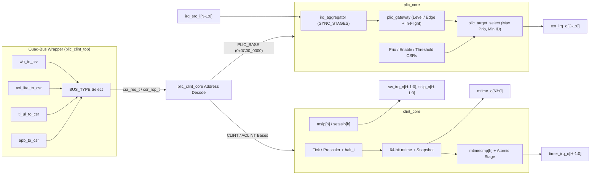

# RISC-V PLIC & CLINT/ACLINT Interrupt Controller (`plic_clint`)

## Overview

`ips/25_plic_clint` provides a clean-room, synthesizable SystemVerilog implementation of the **RISC-V Platform-Level Interrupt Controller (PLIC)** and **Core-Local Interruptor (CLINT / ACLINT)**, together with a reusable `irq_aggregator` line-conditioning block. It uses the standard RISC-V platform memory map by default (`CLINT_BASE = 0x0200_0000`, `PLIC_BASE = 0x0C00_0000`) and optionally splits CLINT into independent ACLINT MSWI / MTIMER / SSWI windows (`ACLINT_SPLIT = 1`), allowing unmodified RISC-V bare-metal, Zephyr, and Linux kernels/device-trees to run out of the box.

### Features

- **RISC-V PLIC (`plic_core`)**:
  - Parameterized `NUM_SOURCES` (`1..1023`, default `32`, target up to `128+`), `NUM_CONTEXTS` (`1..32`, default `2`, e.g., M/S per hart), and `PRIO_BITS` (`1..16`, default `3`, i.e., priorities `0..7` where `0` = never interrupt).
  - Per-source **level-sensitive** and **edge-triggered** gateways (`EDGE_MASK`) with claim clearing pending, per-source in-flight protection until completion, and 1-deep edge latching during in-flight intervals so no edge is lost or duplicated.
  - Balanced $\lceil\log_2 N\rceil$-depth selection tree (`plic_target_select`) selecting highest priority with **lowest source ID** tie-breaking.
  - Per-context `ENABLE` bitmaps, `THRESHOLD`, and `CLAIM/COMPLETE` registers; completion writes are validated against the context's enable bitmap.
  - Configurable input synchronizer (`SYNC_STAGES`, default `2`) and optional registered `ext_irq_o` (`REG_OUT`).
- **RISC-V CLINT / ACLINT (`clint_core`)**:
  - Parameterized `NUM_HARTS` (`1..4095`, default `1`).
  - Shared 64-bit `mtime` counter driven either by `clk_i / PRESCALE` (`USE_TICK_I = 0`) or external `tick_i` enable (`USE_TICK_I = 1`), with `halt_i` debug-freeze support and raw `mtime_o` output.
  - Per-hart 64-bit `mtimecmp[h]` (resets to `0xFFFF_FFFF_FFFF_FFFF`, timer interrupt inactive) with unsigned comparison `timer_irq_o[h] = (mtime >= mtimecmp[h])`.
  - Per-hart software interrupt `msip[h]` driving `sw_irq_o[h]`, plus optional ACLINT Supervisor Software Interrupt (`ENABLE_SSWI = 1`, `SETSSIP[h]` emitting a 1-cycle `ssip_o[h]` pulse).
  - Safe 64-bit access over 32-bit buses: `MTIME_SNAPSHOT = 1` latches `MTIME_HI` on `MTIME_LO` read for single-master torn-free reads; `ATOMIC_WRITE = 1` stages `LO` writes until `HI` is written.
  - Selectable **Legacy CLINT** single 64 KiB window (`ACLINT_SPLIT = 0`) or **ACLINT Split** `MSWI` / `MTIMER` / `SSWI` regions (`ACLINT_SPLIT = 1`).
- **Line Conditioner (`irq_aggregator`)**:
  - Parameterized width `N`, `SYNC_STAGES`, per-line polarity (`ACTIVE_LOW`), per-line mode (`0=level`, `1=rising`, `2=falling`, `3=both`), and mask (`irq_mask_i`).
- **Quad-Bus Wrappers**:
  - Protocol-agnostic `plic_clint_core` (`csr_req_t` / `csr_rsp_t`), plus `plic_clint_wb` (Wishbone B4), `plic_clint_axi` (AXI4 / AXI4-Lite), `plic_clint_tl` (TileLink TL-UL / TL-UH), `plic_clint_apb` (AMBA APB4), and unified `plic_clint_top` (`BUS_TYPE`).

---

## Block Diagram



---

## Parameters

### `plic_clint_top` / `plic_clint_core`

| Parameter | Type | Default | Description |
| :--- | :--- | :--- | :--- |
| `BUS_TYPE` | `bus_pkg::bus_proto_e` | `BUS_AXI4` | (`plic_clint_top` only) `BUS_WISHBONE` (0), `BUS_AXI4` (1), `BUS_TILELINK` (2), `BUS_APB` (3). |
| `ENABLE_PLIC` | `bit` | `1'b1` | Enables `plic_core`; if `0`, PLIC addresses return a bus error and `ext_irq_o = '0`. |
| `ENABLE_CLINT` | `bit` | `1'b1` | Enables `clint_core`; if `0`, CLINT addresses return a bus error. |
| `NUM_SOURCES` | `int unsigned` | `32` | Number of PLIC interrupt sources (`1..1023`, mapped to IDs `1..NUM_SOURCES`). |
| `NUM_CONTEXTS` | `int unsigned` | `2` | Number of PLIC target contexts (`1..32`, e.g., `2*hart` M-mode, `2*hart+1` S-mode). |
| `PRIO_BITS` | `int unsigned` | `3` | Width of PLIC priority and threshold registers (`1..16`). |
| `EDGE_MASK` | `logic [NUM_SOURCES-1:0]` | `'0` | Bit `i` = `1` configures source ID `i+1` as rising-edge-triggered; `0` = level-sensitive. |
| `SYNC_STAGES` | `int unsigned` | `2` | Input synchronizer stages on `irq_src_i` (`0` bypasses). |
| `NUM_HARTS` | `int unsigned` | `1` | Number of harts in CLINT/ACLINT (`1..4095`). |
| `ACLINT_SPLIT` | `bit` | `1'b0` | `0`: legacy single 64 KiB CLINT window; `1`: split `MSWI`/`MTIMER`/`SSWI` windows. |
| `ENABLE_SSWI` | `bit` | `1'b0` | Enables ACLINT `SSWI` (`SETSSIP`) window when `ACLINT_SPLIT = 1`. |
| `MTIME_SNAPSHOT` | `bit` | `1'b1` | `1`: reading `MTIME_LO` snapshots `MTIME_HI` for the immediately following `MTIME_HI` read. |
| `ATOMIC_WRITE` | `bit` | `1'b0` | `1`: stages `LO` writes to `MTIME` and `MTIMECMP[h]` until `HI` is written. |
| `USE_TICK_I` | `bit` | `1'b0` | `1`: `mtime` increments when `tick_i && !halt_i`; `0`: increments via `PRESCALE`. |
| `PRESCALE` | `int unsigned` | `1` | Clock cycles per `mtime` tick when `USE_TICK_I = 0` (`>= 1`). |
| `REG_OUT` | `bit` | `1'b0` | `1`: registers `ext_irq_o`, `timer_irq_o`, and `sw_irq_o` (+1 cycle latency). |
| `CLINT_BASE` | `logic [31:0]` | `32'h0200_0000` | Base of 64 KiB legacy CLINT window (`ACLINT_SPLIT = 0`). |
| `PLIC_BASE` | `logic [31:0]` | `32'h0C00_0000` | Base of 64 MiB PLIC window (`addr[31:26]` matched). |
| `MSWI_BASE` | `logic [31:0]` | `32'h0200_0000` | Base of 16 KiB ACLINT MSWI window (`ACLINT_SPLIT = 1`). |
| `MTIMER_BASE` | `logic [31:0]` | `32'h0201_0000` | Base of 32 KiB ACLINT MTIMER window (`ACLINT_SPLIT = 1`). |
| `SSWI_BASE` | `logic [31:0]` | `32'h0202_0000` | Base of 16 KiB ACLINT SSWI window (`ACLINT_SPLIT = 1 && ENABLE_SSWI = 1`). |

### Standalone `irq_aggregator`

| Parameter | Type | Default | Description |
| :--- | :--- | :--- | :--- |
| `N` | `int unsigned` | `8` | Number of interrupt lines. |
| `SYNC_STAGES` | `int unsigned` | `2` | Synchronizer flip-flop stages (`0` = bypass). |
| `MODE` | `logic [2*N-1:0]` | `'0` | Per-line `MODE[2*i +: 2]`: `0`=level, `1`=rising pulse, `2`=falling pulse, `3`=both-edge pulse. |
| `ACTIVE_LOW` | `logic [N-1:0]` | `'0` | Bit `i = 1` inverts `irq_i[i]` before synchronization/edge detection. |

---

## Port Interfaces (`plic_clint_top`)

| Port | Direction | Width | Description |
| :--- | :--- | :--- | :--- |
| `clk_i` | `input` | `1` | System clock. |
| `rst_ni` | `input` | `1` | Active-low asynchronous reset (synchronous deassertion). |
| `wb_i` / `wb_o` | `in`/`out` | `wb_m2s_t` / `wb_s2m_t` | Wishbone B4 slave port (active when `BUS_TYPE == BUS_WISHBONE`). |
| `axi_i` / `axi_o` | `in`/`out` | `axi4_m2s_t` / `axi4_s2m_t` | AXI4 / AXI4-Lite slave port (active when `BUS_TYPE == BUS_AXI4`). |
| `tl_i` / `tl_o` | `in`/`out` | `tl_m2s_t` / `tl_s2m_t` | TileLink TL-UL/TL-UH slave port (active when `BUS_TYPE == BUS_TILELINK`). |
| `apb_i` / `apb_o` | `in`/`out` | `apb_m2s_t` / `apb_s2m_t` | AMBA APB4 completer port (active when `BUS_TYPE == BUS_APB`). |
| `irq_src_i` | `input` | `NUM_SOURCES` | External interrupt inputs; `irq_src_i[i]` corresponds to PLIC source ID `i + 1`. |
| `ext_irq_o` | `output` | `NUM_CONTEXTS` | PLIC target external interrupt (`MEIP`/`SEIP` per context). |
| `tick_i` | `input` | `1` | Synchronous tick enable for `mtime` when `USE_TICK_I = 1`. |
| `halt_i` | `input` | `1` | Freezes `mtime` increment when `1` (debug halt). |
| `timer_irq_o` | `output` | `NUM_HARTS` | Machine timer interrupt (`MTIP`) per hart. |
| `sw_irq_o` | `output` | `NUM_HARTS` | Machine software interrupt (`MSIP`) per hart. |
| `ssip_o` | `output` | `NUM_HARTS` | Single-cycle supervisor software interrupt set pulse when `SETSSIP[h]` is written (`ENABLE_SSWI = 1`). |
| `mtime_o` | `output` | `64` | Current 64-bit `mtime` value (for `time` CSR / debug). |

> **Sub-block Standalone Ports**:
> - `plic_core` / `clint_core` accept `csr_req_t` / `csr_rsp_t` directly with offset-only decoding (use directly if an interconnect strips upper base address bits).
> - `irq_aggregator` ports: `clk_i`, `rst_ni`, `irq_i[N-1:0]`, `irq_mask_i[N-1:0]`, `irq_o[N-1:0]`, `any_o`.

---

## Memory Map & Register Reference

All accesses inside mapped regions are 32-bit word-aligned (`wstrb` byte-lane writes supported). Unmapped addresses outside enabled regions return `csr_rsp_o.err = 1` (`SLVERR`/`pslverr`/`wb_err`/`d_denied`); reserved offsets inside a mapped window read `0` and ignore writes without error.

### 1. Top-Level Default Memory Map

| Region | Default Base | Size | Condition |
| :--- | :--- | :--- | :--- |
| Legacy CLINT (`MSIP` + `MTIMER`) | `0x0200_0000` | `64 KiB` (`0x1_0000`) | `ENABLE_CLINT=1 && ACLINT_SPLIT=0` |
| ACLINT MSWI (`MSIP`) | `0x0200_0000` | `16 KiB` (`0x4000`) | `ENABLE_CLINT=1 && ACLINT_SPLIT=1` |
| ACLINT MTIMER (`MTIMECMP` + `MTIME`) | `0x0201_0000` | `32 KiB` (`0x8000`) | `ENABLE_CLINT=1 && ACLINT_SPLIT=1` |
| ACLINT SSWI (`SETSSIP`) | `0x0202_0000` | `16 KiB` (`0x4000`) | `ENABLE_CLINT=1 && ACLINT_SPLIT=1 && ENABLE_SSWI=1` |
| PLIC | `0x0C00_0000` | `64 MiB` (`0x0400_0000`) | `ENABLE_PLIC=1` |

### 2. PLIC Register Map (Offsets Relative to `PLIC_BASE`)

| Offset | Name | Access | Reset | Bit Fields |
| :--- | :--- | :--- | :--- | :--- |
| `0x000000 + 4*ID` | `PRIORITY[ID]` (`ID = 1..N`) | RW | `0` | `[PRIO_BITS-1:0]` source priority (`0` = disabled); `[31:PRIO_BITS]` RO `0`. (`ID=0` and `ID>N` reserved `0`). |
| `0x001000 + 4*w` | `PENDING[w]` (`w = 0..NW-1`) | RO | `0` | Bit `b` = pending bit of source ID `32*w + b` (`bit 0` of `w=0` is always `0`). |
| `0x002000 + 0x80*c + 4*w` | `ENABLE[c][w]` (`c = 0..C-1`) | RW | `0` | Bit `b` = enable for source ID `32*w + b` in context `c` (`ID=0` and `ID>N` hardwired `0`). |
| `0x200000 + 0x1000*c` | `THRESHOLD[c]` (`c = 0..C-1`) | RW | `0` | `[PRIO_BITS-1:0]` context priority threshold (sources must have `priority > threshold`); `[31:PRIO_BITS]` RO `0`. |
| `0x200004 + 0x1000*c` | `CLAIM_COMPLETE[c]` (`c = 0..C-1`) | RW | `0` | **Read (Claim)**: returns highest-priority pending enabled ID with `prio > threshold[c]` (lowest ID breaks ties), or `0` if none; clears `PENDING[ID]` and marks `ID` in-flight.<br>**Write (Complete)**: writes `ID`; if `1 <= ID <= N` and `ENABLE[c][ID] == 1`, clears in-flight state for `ID` (otherwise ignored). |

### 3. Legacy CLINT & ACLINT Register Map

#### Legacy CLINT (`ACLINT_SPLIT = 0`, Relative to `CLINT_BASE`)

| Offset | Name | Access | Reset | Bit Fields |
| :--- | :--- | :--- | :--- | :--- |
| `0x0000 + 4*h` | `MSIP[h]` (`h = 0..H-1`) | RW | `0` | `[0]` Machine software interrupt (`sw_irq_o[h]`); `[31:1]` RO `0`. |
| `0x4000 + 8*h` | `MTIMECMP_LO[h]` (`h = 0..H-1`) | RW | `0xFFFF_FFFF` | `[31:0]` Lower 32 bits of `mtimecmp[h]`. (Staged if `ATOMIC_WRITE=1`). |
| `0x4004 + 8*h` | `MTIMECMP_HI[h]` (`h = 0..H-1`) | RW | `0xFFFF_FFFF` | `[31:0]` Upper 32 bits of `mtimecmp[h]`. Commits staged `LO` if `ATOMIC_WRITE=1`. |
| `0xBFF8` | `MTIME_LO` | RW | `0` | `[31:0]` Lower 32 bits of `mtime`. Reading captures `mtime[63:32]` if `MTIME_SNAPSHOT=1`. Writing staged if `ATOMIC_WRITE=1`. |
| `0xBFFC` | `MTIME_HI` | RW | `0` | `[31:0]` Upper 32 bits of `mtime`. Returns snapshot if immediately preceded by `MTIME_LO` read (`MTIME_SNAPSHOT=1`). Commits staged `LO` if `ATOMIC_WRITE=1`. |

#### ACLINT Split Mode (`ACLINT_SPLIT = 1`)

- **MSWI (`MSWI_BASE`, 16 KiB)**: `0x0000 + 4*h` = `MSIP[h]` (identical to `CLINT_BASE + 0x0000 + 4*h`).
- **MTIMER (`MTIMER_BASE`, 32 KiB)**: `0x0000 + 8*h` = `MTIMECMP_LO[h]`, `0x0004 + 8*h` = `MTIMECMP_HI[h]`, `0x7FF8` = `MTIME_LO`, `0x7FFC` = `MTIME_HI` (identical to legacy offsets minus `0x4000`).
- **SSWI (`SSWI_BASE`, 16 KiB, `ENABLE_SSWI=1`)**: `0x0000 + 4*h` = `SETSSIP[h]` (WO: writing bit `[0] = 1` produces a 1-cycle high pulse on `ssip_o[h]`; reads return `0`).

---

## Gateway Semantics & Timing

```
Level Source (EDGE_MASK[i]=0):
  irq_sync[i]=1 (not inflight) ──► ip_q[i]=1 ──► ext_irq_o=1
  CPU reads CLAIM (returns ID)  ──► ip_q[i]=0, infl_q[i]=1 (ignores irq_sync[i] until complete)
  CPU writes COMPLETE(ID)       ──► infl_q[i]=0; if irq_sync[i] still 1, ip_q[i] sets next cycle

Edge Source (EDGE_MASK[i]=1):
  rising edge (idle)            ──► ip_q[i]=1
  rising edge (while inflight)  ──► latch_q[i]=1 (1-deep pending edge)
  CPU reads CLAIM (returns ID)  ──► ip_q[i]=0, infl_q[i]=1 (same-cycle edge sets latch_q[i]=1)
  CPU writes COMPLETE(ID)       ──► infl_q[i]=0; if latch_q[i] or same-cycle edge, ip_q[i]=1
```

### 64-Bit `mtime` / `mtimecmp` Access Sequences Over 32-Bit Bus

1. **Reading `mtime` safely**:
   - **Portable `hi / lo / hi` loop** (works for any `MTIME_SNAPSHOT` and multiple bus masters):
     ```c
     uint32_t hi0, lo, hi1;
     do {
       hi0 = REG32(MTIME_HI);
       lo  = REG32(MTIME_LO);
       hi1 = REG32(MTIME_HI);
     } while (hi0 != hi1);
     uint64_t now = ((uint64_t)hi1 << 32) | lo;
     ```
   - **Single-pair snapshot read** (`MTIME_SNAPSHOT = 1`, single reader): reading `MTIME_LO` captures `MTIME_HI` into an internal single-use shadow register, so `lo = REG32(MTIME_LO); hi = REG32(MTIME_HI);` returns an exact, torn-free 64-bit timestamp even across a `2^32` rollover between the two bus transactions. Any write to `MTIME` or subsequent `MTIME_HI` read clears the snapshot flag.

2. **Updating `mtimecmp[h]` without spurious timer interrupts**:
   - **Standard RISC-V 3-write sequence** (always safe regardless of `ATOMIC_WRITE`):
     ```c
     REG32(MTIMECMP_HI(h)) = 0xFFFFFFFFU; // Prevent premature trigger
     REG32(MTIMECMP_LO(h)) = (uint32_t)(next_cmp);
     REG32(MTIMECMP_HI(h)) = (uint32_t)(next_cmp >> 32);
     ```
   - **2-write atomic sequence** (when synthesized with `ATOMIC_WRITE = 1`): writing `MTIMECMP_LO[h]` stages the low word per hart, and writing `MTIMECMP_HI[h]` commits both 32-bit halves simultaneously in one cycle.

---

## Linux / Zephyr Device Tree Compatibility

With default parameters (`CLINT_BASE = 0x0200_0000`, `PLIC_BASE = 0x0C00_0000`), standard RISC-V Device Tree nodes map directly to the hardware registers without modifying Linux or Zephyr drivers:

```dts
/ {
    soc {
        #address-cells = <2>;
        #size-cells = <2>;

        /* Legacy CLINT (ACLINT_SPLIT = 0) */
        clint@2000000 {
            compatible = "riscv,clint0", "sifive,clint0";
            reg = <0x0 0x02000000 0x0 0x10000>;
            interrupts-extended = <
                &cpu0_intc 3 &cpu0_intc 7
                &cpu1_intc 3 &cpu1_intc 7
            >;
        };

        /* Or when ACLINT_SPLIT = 1:
         *   mswi@2000000   (compatible = "riscv,aclint-mswi",   reg = 0x02000000, size = 0x4000)
         *   mtimer@2010000 (compatible = "riscv,aclint-mtimer", reg = 0x02010000, size = 0x8000)
         *   sswi@2020000   (compatible = "riscv,aclint-sswi",   reg = 0x02020000, size = 0x4000)
         */

        plic@c000000 {
            compatible = "riscv,plic0", "sifive,plic-1.0.0";
            #interrupt-cells = <1>;
            #address-cells = <0>;
            interrupt-controller;
            reg = <0x0 0x0C000000 0x0 0x4000000>;
            riscv,ndev = <32>; /* Set to NUM_SOURCES */
            interrupts-extended = <
                &cpu0_intc 11 &cpu0_intc 9 /* Context 0 (M), Context 1 (S) */
            >;
        };
    };
};
```

---

## Programming Recipes (C Pseudocode)

### PLIC Setup & Interrupt Service Routine

```c
#define PLIC_BASE          0x0C000000UL
#define PLIC_PRIO(id)      (*(volatile uint32_t *)(PLIC_BASE + 4U * (id)))
#define PLIC_EN(ctx, w)    (*(volatile uint32_t *)(PLIC_BASE + 0x2000U + 0x80U * (ctx) + 4U * (w)))
#define PLIC_THR(ctx)      (*(volatile uint32_t *)(PLIC_BASE + 0x200000U + 0x1000U * (ctx)))
#define PLIC_CLAIM(ctx)    (*(volatile uint32_t *)(PLIC_BASE + 0x200004U + 0x1000U * (ctx)))

void plic_init_source(uint32_t ctx, uint32_t src_id, uint32_t prio) {
    PLIC_PRIO(src_id) = prio;
    PLIC_EN(ctx, src_id >> 5) |= (1U << (src_id & 31U));
    PLIC_THR(ctx) = 0U;
}

void external_irq_handler(uint32_t ctx) {
    uint32_t id;
    while ((id = PLIC_CLAIM(ctx)) != 0U) {
        dispatch_peripheral_isr(id);
        PLIC_CLAIM(ctx) = id; // Write ID back to complete
    }
}
```

---

## Integration & FPGA / ASIC Notes

- **Single Clock & Reset**: All modules share `clk_i` and active-low async-assert / sync-deassert `rst_ni`.
- **CDC Hygiene**: `irq_src_i` enters through `irq_aggregator` (`SYNC_STAGES = 2` by default, resetting to inactive `0` to prevent false edges out of reset). Set `SYNC_STAGES = 0` only if all sources are already synchronous to `clk_i`.
- **Timing Closure**: Setting `REG_OUT = 1` registers `ext_irq_o`, `timer_irq_o`, and `sw_irq_o`, breaking combinational paths from the `plic_target_select` comparator tree or 64-bit `mtime >= mtimecmp` comparator to core interrupt pins (+1 cycle latency).
- **Area / Synthesis**: Pure IEEE 1800-2017 synthesizable RTL with no latches, no vendor primitives, and no `#` delays. `plic_target_select` uses a balanced binary tree ($\lceil\log_2 N\rceil$ depth).

---

## Verification Summary

Testbench: [tb_plic_clint.sv](file:///Users/tianrui6641/tians_ip_collection/ips/25_plic_clint/tb/tb_plic_clint.sv) (runnable with Verilator 5.054 `--binary --timing`, `+seed=<n>`):

- **`plic_rand_env` (4 parameterized instances)**: Constrained-random CSR reads/writes + randomized level/edge interrupt bursts checked every cycle against an independent cycle-accurate golden model (`N=40/128/1/33`, `C=5/8/1/3`, `PRIO_BITS=3/5/1/8`, `SYNC_STAGES=0/2/1`, `REG_OUT=0/1`), verifying claim/complete races, lowest-ID tie-breaking, multi-context visibility, level re-pending, and edge-gateway 1-deep latching.
- **`clint_rand_env` (4 parameterized instances)**: Constrained-random traffic against an independent golden model covering legacy CLINT and split ACLINT (`MSWI` + `MTIMER` + `SSWI`), `MTIME_SNAPSHOT=0/1`, `ATOMIC_WRITE=0/1`, `USE_TICK_I=0/1`, `PRESCALE=1/3`, `REG_OUT=0/1`, `halt_i`, 32-bit `mtime` rollover carries, write-vs-tick collisions, and unmapped error responses.
- **`plic_dir_env`**: Spec-anchored directed tests T1–T9 (reset values, priority truncation/strobes, enable masks, level gateway in-flight protection, tie-breaks, threshold gating, non-enabled context completion rejection, edge latching, ID-specific completion).
- **`clint_dir_env` (3 configs)**: Directed tests D1–D8 (`msip`, safe 3-write vs unsafe lo-first `mtimecmp`, unsigned 64-bit compare, `halt_i`, atomic `mtime` staging, 200x `2^32` rollover 64-bit read races for both snapshot and `hi/lo/hi` retry loops, map decode).
- **`irq_agg_env`**: 5,000-cycle randomized verification of level/rising/falling/both modes, active-low polarity, 2-FF sync latency, and masking.
- **`bus_scn` (4 instances)**: End-to-end PLIC + CLINT transactions across all 4 `plic_clint_top` bus modes (`BUS_WISHBONE`, `BUS_AXI4`, `BUS_TILELINK`, `BUS_APB`).
