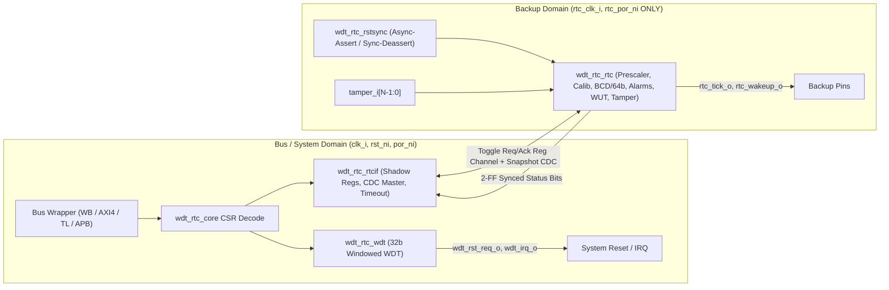

# Windowed Watchdog & Backup-Domain Real-Time Clock (`wdt_rtc`)

## Overview

`ips/26_wdt_rtc` implements a dual-subsystem peripheral combining a **Windowed Independent Watchdog Timer (WDT)** in the system bus clock domain and a **Backup-Domain Real-Time Clock (RTC)** running on an independent low-speed clock (`rtc_clk_i`, nominally 32.768 kHz) with an async-safe CDC bridge to the bus domain. Both subsystems share a single CSR address space (`0x000..0x0FF` WDT, `0x100..0x1FF` RTC) behind standard Wishbone B4, AXI4/AXI4-Lite, TileLink TL-UL/TL-UH, and AMBA APB4 wrappers.

### Features

- **Windowed Watchdog (`wdt_rtc_wdt`)**:
  - 32-bit programmable down-counter (`WDT_LOAD`) with 16-bit tick prescaler (`WDT_PRESC`).
  - Selectable tick source (`WDT_CTRL.CLK_SEL`): bus clock `clk_i`, synchronized rising edge of `wdt_clk_en_i`, or synchronized level of `wdt_clk_en_i`.
  - Programmable refresh window (`WDT_WIN`): refreshing while `WDT_COUNT > WDT_WIN` (when `WIN_EN=1`) triggers an immediate reset request and latches `CAUSE_WINDOW`.
  - Early-warning interrupt (`wdt_irq_o`) when `WDT_COUNT - 1 == WDT_WARN` (`WDT_WARN != 0`).
  - Two-step key-sequence protocol (`WDT_KEY`) for unlock, lock, and refresh; optional reset on invalid key (`BADKEY_RST`).
  - Debug freeze (`dbg_freeze_i` gated by `FRZ_EN`) and sleep stop (`sleep_i` gated by `SLP_STOP`).
  - Programmable reset-request pulse hold time (`WDT_HOLD`, minimum 1 cycle) and POR-retained reset cause (`WDT_CAUSE`, W1C).
- **Backup-Domain Real-Time Clock (`wdt_rtc_rtc` + `wdt_rtc_rtcif`)**:
  - Separate `rtc_clk_i` clock and `rtc_por_ni` reset (async-assert / sync-deassert via `wdt_rtc_rstsync`); immune to bus/system reset `rst_ni`.
  - 22-bit fractional prescaler (`RTC_PRE`, minimum 3, default 32767 for 1 Hz from 32.768 kHz) with smooth Bresenham cycle-swallow/insert digital calibration (`RTC_CAL`, configurable `CAL_WIN_LOG2` window).
  - Dual timekeeping modes:
    - **BCD Calendar** (`BIN_MODE=0`): seconds, minutes, hours (24h or 12h with AM/PM and automatic format conversion on `FMT12` toggle), day, month, weekday (1–7), year (`00..99`), century (`00..99`) with full Gregorian leap-year rules (`yr != 0 ? yr%4==0 : cen%4==0`, so 2000 is leap and 2100 is not).
    - **64-bit Binary Seconds Counter** (`BIN_MODE=1`): monotonic 64-bit counter (`RTC_BIN_LO` / `RTC_BIN_HI`).
  - Two independent alarms (`ALRA`, `ALRB`) with per-field masks (seconds, minutes, hours, date/weekday in BCD mode; 32-bit bitmask in binary mode).
  - 17-bit periodic wake-up timer (`RTC_WUT`) selectable across `rtc_clk_i`, `rtc_clk_i/16`, `ck_spre` (1 Hz), or `ck_spre` with `2^16` offset.
  - Multi-channel tamper/timestamp capture (`tamper_i[NUM_TAMPER-1:0]`): rising/falling polarity per pin, captures full calendar + subsecond + 64-bit binary time and sets `TS` / `TSOVF`.
  - Two-step write-protection key (`RTC_KEY`) + `INIT` mode guard for calendar/prescaler updates.
  - Coherent bus-domain shadow registers (`RTC_SUBSEC`, `RTC_TIME`, `RTC_DATE`, `RTC_BIN_LO`, `RTC_BIN_HI`) updated via toggle request/acknowledge snapshot CDC with shadow lock (`LOCK`) and sync flag (`RSF`), plus a bus-domain supervisor timeout (`RTC_TMO_LOG2`) so a stopped RTC never stalls the interconnect.

## Architecture Block Diagram



## Available RTL Modules & Filelist

Compile order is specified in [filelist.f](file:///Users/tianrui6641/tians_ip_collection/ips/26_wdt_rtc/filelist.f):

- `wdt_rtc_pkg.sv`: Shared key constants, cause/flag indices, RTC offsets, and `SNAP_W`.
- `wdt_rtc_rstsync.sv`: 2-FF async-assert / sync-deassert reset synchronizer.
- `wdt_rtc_wdt.sv`: Windowed watchdog engine (`rst_ni` + `por_ni` domains).
- `wdt_rtc_rtc.sv`: Backup-domain RTC engine (`rtc_clk_i` + `rtc_por_ni` domain).
- `wdt_rtc_rtcif.sv`: Bus-domain shadow registers, CDC request/acknowledge controller, and supervisor timeout.
- `wdt_rtc_core.sv`: Protocol-agnostic CSR core (`0x000..0x0FF` WDT, `0x100..0x1FF` RTC).
- `wdt_rtc_wb.sv` / `wdt_rtc_axi.sv` / `wdt_rtc_tl.sv` / `wdt_rtc_apb.sv`: Bus wrappers.
- `wdt_rtc_top.sv`: Unified parameterized top (`BUS_TYPE`).

## Parameters & Ports

### Parameters (`wdt_rtc_top` / `wdt_rtc_core`)

| Parameter | Default | Description |
| :--- | :--- | :--- |
| `BUS_TYPE` (`wdt_rtc_top` only) | `BUS_AXI4` | Bus protocol selector: `BUS_WISHBONE`, `BUS_AXI4`, `BUS_TILELINK`, `BUS_APB`. |
| `NUM_TAMPER` | `2` | Number of tamper/timestamp inputs (`1..8`). |
| `CAL_WIN_LOG2` | `20` | Base calibration window exponent (`2^CAL_WIN_LOG2` cycles at `CAL_SEL=2`; use smaller values like `8` in fast simulation). |
| `RTC_TMO_LOG2` | `22` | Bus-domain CDC supervisor timeout (`2^RTC_TMO_LOG2` `clk_i` cycles). |

### Top-Level Ports (`wdt_rtc_top`)

| Port | Width | Dir | Domain | Description |
| :--- | :--- | :--- | :--- | :--- |
| `clk_i` | `1` | in | Bus | Bus and watchdog system clock. |
| `rst_ni` | `1` | in | Bus | Active-low system reset (async assert, sync deassert externally or via reset controller). |
| `por_ni` | `1` | in | Bus (POR) | Active-low power-on reset for WDT reset-cause and hold logic; tie to `rst_ni` if no separate POR exists. |
| `wb_i` / `wb_o` | struct | in/out | Bus | Wishbone B4 slave bundle (active when `BUS_TYPE == BUS_WISHBONE`). |
| `axi_i` / `axi_o` | struct | in/out | Bus | AXI4 / AXI4-Lite slave bundle (active when `BUS_TYPE == BUS_AXI4`). |
| `tl_i` / `tl_o` | struct | in/out | Bus | TileLink TL-UL / TL-UH device bundle (active when `BUS_TYPE == BUS_TILELINK`). |
| `apb_i` / `apb_o` | struct | in/out | Bus | AMBA APB4 completer bundle (active when `BUS_TYPE == BUS_APB`). |
| `wdt_clk_en_i` | `1` | in | Async | Independent watchdog clock-enable tick input (2-FF synchronized to `clk_i`). |
| `dbg_freeze_i` | `1` | in | Bus | Debug halt input; freezes WDT counter when `WDT_CTRL.FRZ_EN=1`. |
| `sleep_i` | `1` | in | Bus | System sleep input; stops WDT counter when `WDT_CTRL.SLP_STOP=1`. |
| `wdt_rst_req_o` | `1` | out | Bus (POR) | Watchdog reset request output held for `max(1, WDT_HOLD)` `clk_i` cycles. |
| `wdt_irq_o` | `1` | out | Bus | Watchdog early-warning interrupt (`WDT_STAT.EWI & WDT_CTRL.IRQ_EN`). |
| `rtc_clk_i` | `1` | in | Backup | Independent low-speed RTC clock (e.g., 32.768 kHz). |
| `rtc_por_ni` | `1` | in | Backup | Active-low backup-domain POR; **only** reset for RTC state (sync-deasserted inside `wdt_rtc_rtc`). |
| `tamper_i` | `NUM_TAMPER` | in | Async | External tamper / timestamp trigger inputs (synchronized into `rtc_clk_i`). |
| `rtc_tick_o` | `1` | out | Backup | Calibrated 1-second pulse (1 `rtc_clk_i` cycle wide). |
| `rtc_irq_o` | `1` | out | Bus | Synchronized RTC interrupt (`|(flags_vis & ien_s)`). |
| `rtc_wakeup_o` | `1` | out | Backup | Registered wake-up output (`|(flags_q & wen_q)` in `rtc_clk_i` domain). |
| `irq_o` | `1` | out | Bus | Aggregated interrupt (`wdt_irq_o | rtc_irq_o`). |

---

## Register Map

All registers are 32-bit word-aligned. Accessing an unmapped offset returns a bus error (`csr_rsp_o.err = 1`).

### Watchdog Registers (`0x000..0x0FF`)

| Offset | Name | Access | Reset | Description |
| :--- | :--- | :--- | :--- | :--- |
| `0x000` | `WDT_KEY` | RW | `0x0000_0000` | Write key port (requires `wstrb == 4'hF`). Reads return `[4]` `UNLOCKED`, `[1:0]` key-FSM state (`0`=IDLE, `1`=U1, `2`=R1). |
| `0x004` | `WDT_CTRL` | RW (Unl) | `0x0000_0000` | Control register (see bit fields below). |
| `0x008` | `WDT_LOAD` | RW (Unl) | `0x0000_FFFF` | 32-bit reload value (`WDT_COUNT` loads this value on disable, valid refresh, or trigger). |
| `0x00C` | `WDT_COUNT` | RO | `0x0000_FFFF` | Current 32-bit down-counter value. |
| `0x010` | `WDT_WIN` | RW (Unl) | `0xFFFF_FFFF` | Window threshold; refresh is valid only when `WDT_COUNT <= WDT_WIN` (if `WIN_EN=1`). |
| `0x014` | `WDT_WARN` | RW (Unl) | `0x0000_0000` | Early-warning threshold; sets `EWI` when `(WDT_COUNT - 1) == WDT_WARN` (`0` disables). |
| `0x018` | `WDT_STAT` | RW1C/RO | `0x0000_0040` | Status & sticky event flags (see bit fields below). |
| `0x01C` | `WDT_CAUSE` | RW1C (POR) | `0x0000_0001` | POR-retained reset cause flags (survives `rst_ni`). |
| `0x020` | `WDT_HOLD` | RW (Unl) | `0x0000_0010` | `[15:0]` reset-request hold duration in `clk_i` cycles (`0` behaves as `1`). |
| `0x024` | `WDT_PRESC` | RW (Unl) | `0x0000_0000` | `[15:0]` tick divider (1 WDT tick per `WDT_PRESC + 1` source ticks). |
| `0x028` | `WDT_SWRST` | WO (Unl) | `0x0000_0000` | Write `0xDEAD_0B07` (`wstrb=4'hF`, unlocked) to trigger software reset (`CAUSE_SW`). |

#### WDT Key Protocol (`WDT_KEY`)

| Sequence | Word 1 | Word 2 | Effect |
| :--- | :--- | :--- | :--- |
| Unlock config | `0x5AFE_0001` | `0xC0DE_0002` | Sets `UNLOCKED = 1` (enables writes to `CTRL/LOAD/WIN/WARN/HOLD/PRESC/SWRST`). |
| Refresh counter | `0xA5A5_1111` | `0x5A5A_2222` | Reloads `WDT_COUNT <= WDT_LOAD` if `!WIN_EN` or `WDT_COUNT <= WDT_WIN`; else triggers `CAUSE_WINDOW` reset. |
| Lock config | `0x4C4F_434B` | — | Clears `UNLOCKED = 0`. |

Any unexpected word, partial `wstrb`, or broken two-word sequence sets `WDT_STAT.BADKEY` (and triggers `CAUSE_BADKEY` reset if `WDT_CTRL.BADKEY_RST=1` and `EN=1`). Writing a protected config register while locked sets `WDT_STAT.BLOCKED`.

#### WDT Bit Fields

- **`WDT_CTRL` (`0x004`)**:
  - `[0] EN`: Watchdog enable (`1` = running, `0` = held at `WDT_LOAD`).
  - `[1] IRQ_EN`: Early-warning interrupt enable.
  - `[2] FRZ_EN`: Freeze counter when `dbg_freeze_i == 1`.
  - `[3] SLP_STOP`: Stop counter when `sleep_i == 1`.
  - `[4] WIN_EN`: Enable upper window check on refresh.
  - `[5] BADKEY_RST`: Trigger reset request on invalid key sequence while `EN=1`.
  - `[7:6] CLK_SEL`: `00` = `clk_i` every cycle; `01` = rising edge of synced `wdt_clk_en_i`; `10` = synced level of `wdt_clk_en_i`; `11` = reserved (`clk_i`).
- **`WDT_STAT` (`0x018`)**:
  - `[0] EWI` (W1C): Early-warning interrupt sticky flag.
  - `[1] BADKEY` (W1C): Invalid key sequence detected.
  - `[2] BLOCKED` (W1C): Locked configuration write attempted.
  - `[3] RST_PEND` (RO): Mirrors `wdt_rst_req_o`.
  - `[4] UNLOCKED` (RO): Configuration write-enable state.
  - `[5] RUNNING` (RO): Counter currently active (`EN && !frozen && !sleeping`).
  - `[6] WIN_OPEN` (RO): `1` when `!WIN_EN || (WDT_COUNT <= WDT_WIN)`.
- **`WDT_CAUSE` (`0x01C`, `por_ni` domain)**:
  - `[0] POR` (W1C): Power-on reset occurred.
  - `[1] TIMEOUT` (W1C): Counter underflowed at `0`.
  - `[2] WINDOW` (W1C): Early refresh while `WDT_COUNT > WDT_WIN`.
  - `[3] BADKEY` (W1C): Bad key sequence with `BADKEY_RST=1`.
  - `[4] SW` (W1C): Software reset via `WDT_SWRST`.

---

### RTC Registers (`0x100..0x1FF`, Backup Domain)

Offsets `0x100..0x11C` are served in the bus clock domain (`wdt_rtc_rtcif`); offsets `0x120..0x178` cross to `wdt_rtc_rtc` via the toggle-handshake channel.

| Offset | Name | Access | Reset (`rtc_por_ni`) | Description |
| :--- | :--- | :--- | :--- | :--- |
| `0x100` | `RTC_STAT` | RO / W1C (`[3]`) | `0x0000_0002` | `[0]` `RSF` (shadow valid), `[1]` `INITF`, `[2]` `CH_BUSY`, `[3]` `TOUT` (W1C), `[4]` `LOCK`, `[5]` `UNLOCKED`, `[6]` `INITS` (calendar initialized). |
| `0x104` | `RTC_SYNC` | RW | `0x0000_0001` | `[0]` `AUTO` (continuous background shadow refresh, reset=`1`), `[1]` `SYNC_TRIG` (WO: write `1` to clear `RSF`, release `LOCK`, and trigger fresh snapshot). |
| `0x108` | `RTC_TIME` | RW (Unl+Init) | `0x0000_0000` | BCD time: `[22]` `PM`, `[21:20]` `HT`, `[19:16]` `HU`, `[14:12]` `MNT`, `[11:8]` `MNU`, `[6:4]` `ST`, `[3:0]` `SU`. Reading locks shadow until `RTC_DATE` read. |
| `0x10C` | `RTC_DATE` | RW (Unl+Init) | `0x2000_C101` | BCD date: `[31:24]` `CENT`, `[23:16]` `YEAR`, `[15:13]` `WDU` (`1..7`), `[12]` `MT`, `[11:8]` `MU`, `[5:4]` `DT`, `[3:0]` `DU`. Reading releases shadow lock. |
| `0x110` | `RTC_SUBSEC` | RO | `0x0000_0000` | `[21:0]` Prescaler counter snapshot (`0..RTC_PRE`). Reading locks shadow until `RTC_DATE` read. |
| `0x114` | `RTC_BIN_LO` | RW (Unl+Init) | `0x0000_0000` | `[31:0]` Lower 32 bits of 64-bit binary seconds counter. Reading locks shadow until `RTC_BIN_HI` read. |
| `0x118` | `RTC_BIN_HI` | RW (Unl+Init) | `0x0000_0000` | `[31:0]` Upper 32 bits of 64-bit binary seconds counter. Reading releases shadow lock. |
| `0x11C` | `RTC_FLAGS` | RW1C | `0x0000_0000` | `[0]` `ALRA`, `[1]` `ALRB`, `[2]` `WUT`, `[3]` `TS`, `[4]` `TSOVF`, `[5]` `SEC`, `[6]` `TAMP`, `[7]` `WRERR`. |
| `0x120` | `RTC_KEY` | RW | `0x0000_0000` | Write `0x52C1_0001` then `0x52C2_0002` to unlock (`UNLOCKED=1`); any other write locks. Read: `[1]` `KEY_ST`, `[0]` `UNLOCKED`. |
| `0x124` | `RTC_CTRL` | RW (Unl) | `0x0000_0001` | `[0]` `INIT`, `[1]` `BIN_MODE` (Unl+Init), `[2]` `FMT12` (Unl+Init, converts hours live), `[3]` `ALRA_EN`, `[4]` `ALRB_EN`, `[5]` `WUTE`, `[6]` `TSE`. |
| `0x128` | `RTC_IEN` | RW (Unl) | `0x0000_0000` | `[7:0]` Interrupt enable mask matching `RTC_FLAGS` bits (feeds `rtc_irq_o`). |
| `0x12C` | `RTC_WEN` | RW (Unl) | `0x0000_0000` | `[7:0]` Wake-up enable mask matching `RTC_FLAGS` bits (feeds `rtc_wakeup_o`). |
| `0x130` | `RTC_PRE` | RW (Unl+Init) | `0x0000_7FFF` | `[21:0]` Fractional/integer prescaler reload (`PRE >= 3`; 1 Hz tick every `PRE+1` nominal cycles). |
| `0x134` | `RTC_CAL` | RW (Unl) | `0x0002_0000` | `[14:0]` `CAL_MAG`, `[15]` `CAL_SIGN` (`0`=insert/+ppm, `1`=swallow/-ppm), `[17:16]` `CAL_SEL` (`0`=`2^(L-2)`, `1`=`2^(L-1)`, `2/3`=`2^L`), `[18]` `CAL_EN`. |
| `0x138` | `RTC_WUT` | RW (Unl) | `0x0000_0000` | `[15:0]` `WUT_REL` reload, `[17:16]` `WUT_SRC` (`0`=rtc_clk, `1`=rtc_clk/16, `2`=ck_spre 1Hz, `3`=ck_spre with bit16=1). |
| `0x13C` | `RTC_WUT_CNT` | RO | `0x0000_0000` | `[16:0]` Live wake-up down-counter value. |
| `0x140` | `RTC_ALRA_TIME` | RW (Unl) | `0x0000_0000` | Alarm A BCD time + masks: `[23]` `MSK_H`, `[22]` `PM`, `[21:16]` `HH`, `[15]` `MSK_M`, `[14:8]` `MN`, `[7]` `MSK_S`, `[6:0]` `SEC`. |
| `0x144` | `RTC_ALRA_DATE` | RW (Unl) | `0x0000_0000` | Alarm A BCD day/weekday + mask: `[7]` `MSK_D`, `[6]` `WD_SEL` (`1`=weekday `[2:0]`, `0`=day `[5:0]`). |
| `0x148` | `RTC_ALRA_BIN` | RW (Unl) | `0x0000_0000` | Alarm A 32-bit binary compare value (compared against `RTC_BIN_LO` when `BIN_MODE=1`). |
| `0x14C` | `RTC_ALRA_BMSK` | RW (Unl) | `0x0000_0000` | Alarm A 32-bit binary mask (`((bin_lo ^ alra_bin) & alra_bmsk) == 0`). |
| `0x150..0x15C` | `RTC_ALRB_*` | RW (Unl) | `0x0000_0000` | Alarm B registers (identical layout to Alarm A `0x140..0x14C`). |
| `0x160` | `RTC_TAMP` | RW (Unl) | `0x0000_0000` | `[7:0]` `TAMP_EN` per pin, `[15:8]` `TAMP_POL` (`0`=rising, `1`=falling). |
| `0x164` | `RTC_TS_TIME` | RO | `0x0000_0000` | Captured BCD time at timestamp event. |
| `0x168` | `RTC_TS_DATE` | RO | `0x0000_0000` | Captured BCD date at timestamp event. |
| `0x16C` | `RTC_TS_SUB` | RO | `0x0000_0000` | `[21:0]` Captured subsecond prescaler counter at timestamp event. |
| `0x170` | `RTC_TS_BLO` | RO | `0x0000_0000` | Captured binary `[31:0]` at timestamp event. |
| `0x174` | `RTC_TS_BHI` | RO | `0x0000_0000` | Captured binary `[63:32]` at timestamp event. |
| `0x178` | `RTC_TS_SRC` | RO | `0x0000_0000` | `[7:0]` Bitmask of tamper channel(s) that triggered capture. |

---

## Timing & CDC Operation

### Windowed Watchdog Refresh & Timeout

```text
wdt_cnt   : [LOAD] ... [WIN+1] [WIN] [WIN-1] ... [WARN+1] [WARN] ... [0]
refresh   :             ^-- early refresh => wdt_rst_req_o (CAUSE_WINDOW)
                                 ^----- valid window: reload to LOAD ----^
                                                            ^-- EWI=1 / wdt_irq_o
                                                                      ^-- timeout => wdt_rst_req_o (CAUSE_TIMEOUT)
```

### Coherent Snapshot CDC (`wdt_rtc_rtcif` <-> `wdt_rtc_rtc`)

1. **Snapshot Request**: Bus domain toggles `snap_req_tog_q` and waits for `snap_ack_s == snap_req_tog_q` (2-FF synced). While `snap_req_tog_q != snap_ack_s`, the RTC domain holds `snap_q` (`{time, date, subsec, bin}`) completely stable—eliminating multi-bit CDC skew across midnight, century, or 32-bit binary rollovers.
2. **Shadow Lock**: Reading `RTC_SUBSEC`, `RTC_TIME`, or `RTC_BIN_LO` sets `RTC_STAT.LOCK`, blocking background `AUTO` shadow updates until the companion high word (`RTC_DATE` or `RTC_BIN_HI`) is read (or `RTC_SYNC.SYNC_TRIG=1` is written).
3. **Register Channel**: Direct writes/reads (`0x120..0x178`) toggle `ch_req_tog_q` with `ch_addr_q/ch_wdata_q/ch_wstrb_q` held stable until `ch_ack_s == ch_req_tog_q`. A 2^`RTC_TMO_LOG2` cycle watchdog in `wdt_rtc_rtcif` aborts stalled accesses (`err_o=1`, `RTC_STAT.TOUT=1`) if `rtc_clk_i` is stopped.

---

## Programming Recipes (C-Style Pseudocode)

### 1. Watchdog Service Loop

```c
void wdt_init(uint32_t load, uint32_t win, uint32_t warn) {
    if (REG32(WDT_CAUSE) & (1u << 2)) { /* handle prior window violation */ }
    REG32(WDT_CAUSE) = 0x1F;            // clear reset causes (W1C)
    REG32(WDT_KEY)   = 0x5AFE0001;
    REG32(WDT_KEY)   = 0xC0DE0002;      // unlock
    REG32(WDT_LOAD)  = load;
    REG32(WDT_WIN)   = win;
    REG32(WDT_WARN)  = warn;
    REG32(WDT_HOLD)  = 32;
    REG32(WDT_CTRL)  = (1u << 0) | (1u << 1) | (1u << 2) | (1u << 4); // EN|IRQ|FRZ|WIN
    REG32(WDT_KEY)   = 0x4C4F434B;      // lock
}

void wdt_kick_when_window_open(void) {
    if (REG32(WDT_STAT) & (1u << 6)) {  // WIN_OPEN == 1
        REG32(WDT_KEY) = 0xA5A51111;
        REG32(WDT_KEY) = 0x5A5A2222;
    }
}
```

### 2. Soft-RTC Firmware: Set Time, Coherent Read, Alarm, Calibrate, Wake-Up

```c
void rtc_unlock(void) {
    REG32(RTC_KEY) = 0x52C10001;
    REG32(RTC_KEY) = 0x52C20002;
}

void rtc_set_time_bcd(uint32_t bcd_time, uint32_t bcd_date) {
    rtc_unlock();
    REG32(RTC_CTRL) |= 1u;                  // enter INIT
    while (!(REG32(RTC_STAT) & (1u << 1))); // wait INITF==1
    REG32(RTC_PRE)   = 32767;               // 32.768 kHz -> 1 Hz
    REG32(RTC_TIME)  = bcd_time;
    REG32(RTC_DATE)  = bcd_date;
    REG32(RTC_CTRL) &= ~1u;                 // exit INIT
    while (REG32(RTC_STAT) & (1u << 1));
    REG32(RTC_SYNC)  = 0x3;                 // AUTO=1 | SYNC_TRIG=1
    while (!(REG32(RTC_STAT) & 1u));        // wait RSF==1
}

void rtc_read_coherent(uint32_t *sub, uint32_t *time, uint32_t *date) {
    while (!(REG32(RTC_STAT) & 1u));        // ensure RSF==1
    *sub  = REG32(RTC_SUBSEC);              // locks shadow
    *time = REG32(RTC_TIME);
    *date = REG32(RTC_DATE);                // unlocks shadow
}

void rtc_setup_alarm_and_wakeup(uint32_t alr_time, uint32_t alr_date, uint16_t wut_sec) {
    rtc_unlock();
    REG32(RTC_ALRA_TIME) = alr_time;
    REG32(RTC_ALRA_DATE) = alr_date;
    REG32(RTC_WUT)       = (2u << 16) | wut_sec; // src = 1 Hz ck_spre
    REG32(RTC_IEN)      |= (1u << 0) | (1u << 2); // ALRA + WUT IRQ
    REG32(RTC_WEN)      |= (1u << 0) | (1u << 2); // ALRA + WUT wakeup pin
    REG32(RTC_CTRL)     |= (1u << 3) | (1u << 5); // ALRA_EN | WUTE
}

void rtc_set_calibration(bool slow_down, uint16_t mag, uint8_t win_sel) {
    rtc_unlock();
    REG32(RTC_CAL) = (1u << 18) | ((uint32_t)win_sel << 16) |
                     ((slow_down ? 1u : 0u) << 15) | (mag & 0x7FFFu);
}
```

---

## Power-Domain Split & Tape-Out Notes (ASIC / FPGA)

1. **Always-On / Backup Island (`VDD_BKP`)**:
   - Place `wdt_rtc_rtc` (`u_rtc`) and `wdt_rtc_rstsync` (`u_rst_sync`) in the battery-backed `VDD_BKP` power domain.
   - Only `rtc_clk_i`, `rtc_por_ni`, and `tamper_i` enter this domain directly; no system `rst_ni` touches `wdt_rtc_rtc`.
   - When `VDD_CORE` powers down: clamp outgoing `VDD_CORE -> VDD_BKP` CDC inputs (`ch_req_tog_o`, `snap_req_tog_o`, `ch_rd_o`, `ch_addr_o`, `ch_wdata_o`, `ch_wstrb_o`) with **retention-preserving isolation cells** before `VDD_CORE` drops so `ch_req_tog_i` / `snap_req_tog_i` do not glitch into spurious requests during power collapse.
   - `VDD_BKP -> VDD_CORE` outputs (`snap_o`, `ch_rdata_o`, `flags_o`, `ien_o`, `initf_o`, `inits_o`, `unlocked_o`, `ch_ack_tog_o`, `snap_ack_tog_o`) require standard isolation clamps when `VDD_CORE` is gated, and `rtc_wakeup_o` feeds the PMU wake controller directly in the always-on rail.
2. **System / Core Island (`VDD_CORE`)**:
   - `wdt_rtc_wdt` (`u_wdt`) and `wdt_rtc_rtcif` (`u_rtcif`) reside in `VDD_CORE`.
   - Inside `wdt_rtc_wdt`, `cause_q`, `rst_req_q`, and `hold_cnt_q` use `por_ni` rather than `rst_ni` so the watchdog's own reset pulse does not clear `WDT_CAUSE` or truncate `WDT_HOLD`.
3. **SDC Constraints**:
   - Declare `clk_i` and `rtc_clk_i` asynchronous (`set_clock_groups -asynchronous`).
   - Constrain `set_max_delay` < 1 `clk_i` / `rtc_clk_i` cycle on `ch_*` and `snap_*` payload paths relative to the 2-FF `ch_req_tog` / `snap_req_tog` / `ch_ack_tog` / `snap_ack_tog` synchronizer chains.
   - Apply `ASYNC_REG = TRUE` (FPGA) / don't-touch synchronizer cells on `edge_detect` and `wdt_rtc_rstsync`.

---

## Verification Summary

Verified via self-checking constrained-random SystemVerilog testbench [tb_wdt_rtc.sv](file:///Users/tianrui6641/tians_ip_collection/ips/26_wdt_rtc/tb/tb_wdt_rtc.sv) under Verilator 5.054 (`-Wall`, zero warnings):

- **Watchdog**: Cycle-accurate independent golden model checked on every `posedge clk_i` across directed tests (POR cause, locked-write blocking, exact window boundary `COUNT == WIN` vs `WIN + 1` early reset, early-warning IRQ, exact `WDT_HOLD` cycle count, debug freeze, sleep stop, `BADKEY_RST`, `WDT_SWRST`, `wdt_clk_en_i` prescaled edge mode) plus 600 constrained-random operations.
- **RTC**: Independent integer-epoch calendar oracle verifying Gregorian leap years (`2000` leap, `2100` non-leap), century `99->00`, 30/31 month ends, 12h/24h rollover & live `FMT12` conversion, Alarm A/B field masks and weekday vs day-of-month, 64-bit binary counter & mask alarm, periodic wake-up timer, Bresenham calibration (`+ppm` and `-ppm`) vs independent cycle-level arithmetic model, tamper timestamp capture + `TSOVF`, backup-domain survival across `rst_ni=0` (`rtc_por_ni=1`), and stopped-RTC supervisor timeout.
- **CDC & Bus Wrappers**: Continuous random-phase shadow read-coherence stress across three unrelated clock ratios (100 MHz vs slow RTC, 100 MHz vs medium prime-ratio RTC, and slower bus vs faster RTC) plus quad-bus wrapper transactions across Wishbone B4, AXI4/AXI4-Lite, TileLink TL-UL, and APB4.
