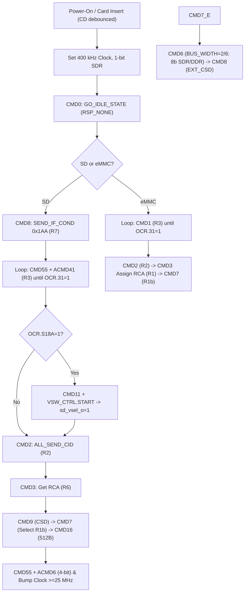

# SD / SDIO / eMMC Host Controller (`ips/27_sdmmc`)

A clean-room, synthesizable IEEE 1800-2017 SystemVerilog SD / SDIO / eMMC host controller with a protocol-agnostic CSR and burst-DMA core (`sdmmc_core`), selectable quad-bus wrappers (Wishbone B4, AXI4, TileLink, APB4), and split pad-ring signals (`*_i`, `*_o`, `*_oe_o`).

---

## 1. Features

- **Bus Interfaces (`BUS_TYPE`)**:
  - `BUS_WISHBONE` (`0`): Wishbone B4 CSR slave + Wishbone B4 DMA burst master (`sdmmc_wb`).
  - `BUS_AXI4` (`1`): AXI4-Lite/AXI4 CSR slave + AXI4 burst DMA master (`sdmmc_axi`).
  - `BUS_TILELINK` (`2`): TileLink TL-UL CSR slave + TL-UH burst DMA master (`sdmmc_tl`).
  - `BUS_APB` (`3`): AMBA APB4 CSR slave + AXI4 burst DMA master (`sdmmc_apb`).
- **Data Bus Width**: Parameterizable `MAX_W` (1, 4, or 8 data lanes); runtime selectable 1-bit, 4-bit, or 8-bit (`BUS_CTRL.WIDTH`).
- **Command Engine (`sdmmc_cmd_engine`)**:
  - 48-bit command frame transmitter with hardware CRC7 (`x^7 + x^3 + 1`).
  - Supports no-response (`RSP_NONE`), 48-bit checked (`RSP_R48`: R1/R5/R6/R7), 48-bit with DAT0 busy wait (`RSP_R48B`: R1b), 48-bit unchecked (`RSP_R48NC`: R3 OCR), and 136-bit (`RSP_R136`: R2 CID/CSD).
  - Hardware CRC7, response index, end-bit, response timeout (`CMD_TOUT`), and DAT0 busy timeout (`BUSY_TOUT`) checking.
- **Data Block Engine (`sdmmc_data_engine`)**:
  - Programmable block size `1..2048` bytes (`BLK_CFG.BLK_SIZE`) and block count `1..65535` or open-ended `0` (`BLK_CFG.BLK_CNT`).
  - Per-lane CRC16-CCITT (`0x1021`) generation on writes and checking on reads (1, 4, or 8 lanes).
  - Write CRC-status token (`010`=OK, `101`=CRC error, `110`=flash error) decode and DAT0 busy detection.
  - Automatic clock hold (stretching `sd_clk_o` low) on RX FIFO near-full or TX FIFO empty to prevent underrun/overflow.
  - Optional Auto-CMD23 (`SET_BLOCK_COUNT` before transfer) and Auto-CMD12 (`STOP_TRANSMISSION` after transfer).
- **SDR & Optional DDR50-Style Dual-Edge (`DDR_EN`)**:
  - Single-clock-domain architecture: `sd_clk_o` is generated as a data output from a toggle flop, never used as an internal clock.
  - Programmable `SMP_DLY` shift-register sampling delay (`0..15` core clocks) and `OUT_EDGE` launch polarity for board/IO timing closure.
  - Optional DDR slots (`DDR_EN=1`, `BUS_CTRL.DDR=1` in 4-bit/8-bit modes): dual-edge payload with per-(lane, edge-parity) CRC16 streams.
- **Card Clock Divider & Gating (`sdmmc_clkgen`)**:
  - `f(sd_clk) = f(clk_i) / (2 * (DIV + 1))` — supports 400 kHz identification clock up to `f(clk_i)/2` (e.g., 50 MHz at 100 MHz core clock).
  - Automatic idle clock gating (`AUTO_GATE=1`) keeps `sd_clk_o` low after a 16-cycle post-transaction tail.
- **SDIO & Card Management**:
  - SDIO card interrupt detection on `DAT1` while data engine is idle (`INT_STATUS.SDIO_IRQ`).
  - SDIO Read-Wait assertion on `DAT2` (`CTRL.RW_ASSERT`).
  - 2-FF synchronized and programmable-debounce Card-Detect (`sd_cd_i`) and Write-Protect (`sd_wp_i`) filters (`sdmmc_cd_filter`) with insert/remove interrupts.
  - 1.8 V Voltage Switch (`CMD11`) hardware handshake (`VSW_CTRL`, `sd_vsel_o`) and eMMC hardware reset output (`sd_rst_o`).
- **FIFO & Built-in DMA Master (`sdmmc_dma`)**:
  - Parameterized synchronous 32-bit data FIFO (`FIFO_DEPTH`, default 128 words = 512 B) with programmable RX/TX watermarks and external `dma_rx_req_o` / `dma_tx_req_o` request lines.
  - Optional built-in 4 KB-boundary-safe burst DMA master (`DMA_EN=1`) supporting single linear buffer mode and ADMA-like 64-bit scatter-gather descriptor lists (`VALID`, `END`, `INT`, `LINK`).

---

## 2. Architecture & Initialization Flow

### 2.1 Block Diagram

```mermaid
flowchart LR
    CSR["CSR Slave Adapter (WB/AXI4/TL/APB4)"] --> CORE["sdmmc_core (CSR + Sequencer + VSW)"]
    CORE --> CLKGEN["sdmmc_clkgen (Div + Auto-Gate + SmpDly)"]
    CORE --> CMD["sdmmc_cmd_engine (48b/136b + CRC7)"]
    CORE --> DATA["sdmmc_data_engine (1/4/8b SDR/DDR + CRC16)"]
    CORE --> FIFO["sync_fifo (32b x FIFO_DEPTH)"]
    CORE --> CDF["sdmmc_cd_filter (CD & WP Debounce)"]
    FIFO <--> DMA["sdmmc_dma (Single / ADMA List)"]
    DMA --> MADP["Master Adapter (WB/AXI4/TL)"]
    CLKGEN --> PADS["Split Pads (sd_clk_o, cmd, dat[7:0], vsel, rst)"]
    CMD --> PADS
    DATA --> PADS
    CDF <-- PADS
```

### 2.2 Card Initialization Flow (SDHC & eMMC)



---

## 3. Parameters & Ports (`sdmmc_top`)

### 3.1 Parameters

| Parameter | Type | Default | Description |
| :--- | :--- | :--- | :--- |
| `BUS_TYPE` | `bus_pkg::bus_proto_e` | `BUS_AXI4` | Bus wrapper select (`BUS_WISHBONE`, `BUS_AXI4`, `BUS_TILELINK`, `BUS_APB`) |
| `MAX_W` | `int unsigned` | `8` | Maximum supported data bus width (`1`, `4`, or `8`) |
| `DDR_EN` | `bit` | `1'b1` | Enable dual-edge (DDR50-style) data engine support |
| `DMA_EN` | `bit` | `1'b1` | Enable built-in burst DMA / ADMA descriptor master |
| `FIFO_DEPTH` | `int unsigned` | `128` | Synchronous data FIFO depth in 32-bit words (`>= 8`) |
| `CD_ACTIVE_LOW` | `bit` | `1'b1` | Polarity of `sd_cd_i` (`1` = active-low card detect) |
| `WP_ACTIVE_HIGH` | `bit` | `1'b1` | Polarity of `sd_wp_i` (`1` = active-high write protect) |
| `DEB_RST` | `int unsigned` | `200` | Reset value of `CD_DEB` (in 256-core-clock ticks) |

### 3.2 Ports

| Signal | Dir | Width | Description |
| :--- | :--- | :--- | :--- |
| `clk_i` | in | 1 | Core system clock (single clock domain for all internal logic) |
| `rst_ni` | in | 1 | Active-low asynchronous-assert, synchronous-deassert reset |
| `s_wb_i` / `s_wb_o` | in/out | struct | Wishbone B4 CSR slave port (when `BUS_TYPE == BUS_WISHBONE`) |
| `s_axi_i` / `s_axi_o` | in/out | struct | AXI4-Lite/AXI4 CSR slave port (when `BUS_TYPE == BUS_AXI4`) |
| `s_tl_i` / `s_tl_o` | in/out | struct | TileLink TL-UL CSR slave port (when `BUS_TYPE == BUS_TILELINK`) |
| `s_apb_i` / `s_apb_o` | in/out | struct | AMBA APB4 CSR slave port (when `BUS_TYPE == BUS_APB`) |
| `m_wb_o` / `m_wb_i` | out/in | struct | Wishbone B4 DMA master port (`BUS_WISHBONE`) |
| `m_axi_o` / `m_axi_i` | out/in | struct | AXI4 burst DMA master port (`BUS_AXI4` and `BUS_APB`) |
| `m_tl_o` / `m_tl_i` | out/in | struct | TileLink TL-UH DMA master port (`BUS_TILELINK`) |
| `sd_clk_o` | out | 1 | Card clock output (idles low when gated) |
| `sd_cmd_o` / `sd_cmd_oe_o` / `sd_cmd_i` | out/out/in | 1 | Split CMD pad signals |
| `sd_dat_o` / `sd_dat_oe_o` / `sd_dat_i` | out/out/in | 8 | Split DAT[7:0] pad signals (`[0]` for 1b, `[3:0]` for 4b, `[7:0]` for 8b) |
| `sd_cd_i` | in | 1 | Raw card-detect pin |
| `sd_wp_i` | in | 1 | Raw write-protect pin |
| `sd_vsel_o` | out | 1 | 1.8 V IO regulator select (`0`=3.3 V, `1`=1.8 V) |
| `sd_rst_o` | out | 1 | eMMC active-low hardware reset pin (`CTRL.RST_N`) |
| `dma_rx_req_o` / `dma_tx_req_o` | out | 1 | Level-sensitive external DMA requests (active when FIFO crosses watermark and internal DMA is inactive) |
| `irq_o` | out | 1 | Combined active-high interrupt (`|(INT_STATUS & INT_ENABLE)`) |

---

## 4. Clean-Room Register Map

All registers are 32-bit word-aligned at offsets `0x00`..`0x7C`. Byte strobes (`wstrb`) are supported on writable registers.

| Offset | Name | Access | Reset | Summary |
| :--- | :--- | :--- | :--- | :--- |
| `0x00` | `ID` | RO | `0x5D0C_0100` | Core identification (`0x5D0C` v1.0) |
| `0x04` | `CAPS` | RO | param | Capabilities: `[31:16]=FIFO_DEPTH`, `[5]=DMA_EN`, `[4]=DDR_EN`, `[2]=W8`, `[1]=W4`, `[0]=W1` |
| `0x08` | `CTRL` | RW/W1P | `0x0000_0020` | `[0]=SW_RST`(W1P), `[1]=FIFO_FLUSH`(W1P), `[2]=CMD_ABORT`(W1P), `[3]=DATA_ABORT`(W1P), `[4]=RW_ASSERT`, `[5]=RST_N`, `[6]=VSEL` |
| `0x0C` | `CLK_CTRL` | RW | `0x0002_00FF` | `[15:0]=DIV`, `[16]=CLK_EN`, `[17]=AUTO_GATE`, `[18]=OUT_EDGE` (0=fall,1=rise), `[23:20]=SMP_DLY` |
| `0x10` | `BUS_CTRL` | RW | `0x0000_0000` | `[1:0]=WIDTH` (`0`=1b,`1`=4b,`2`=8b), `[2]=DDR` |
| `0x14` | `BLK_CFG` | RW | `0x0001_0200` | `[11:0]=BLK_SIZE` (`1..2048`), `[31:16]=BLK_CNT` (`0`=open-ended) |
| `0x18` | `CMD_ARG` | RW | `0x0000_0000` | 32-bit command argument |
| `0x1C` | `CMD` | RW | `0x0000_0000` | Writing triggers command: `[5:0]=IDX`, `[8:6]=RSP_TYPE`, `[9]=DATA_EN`, `[10]=DATA_READ`, `[11]=MULTI`, `[12]=AUTO_CMD12`, `[13]=AUTO_CMD23`, `[14]=DMA_EN` |
| `0x20` | `RESP0` | RO | `0x0000_0000` | 48-bit response `[39:8]`, or R2 bits `[31:0]` (`[31:8]` = payload `[23:0]`, `[7:0]` = `{crc7, 1'b1}`) |
| `0x24` | `RESP1` | RO | `0x0000_0000` | R2 bits `[63:32]` (payload `[55:24]`) |
| `0x28` | `RESP2` | RO | `0x0000_0000` | R2 bits `[95:64]` (payload `[87:56]`) |
| `0x2C` | `RESP3` | RO | `0x0000_0000` | R2 bits `[127:96]` (payload `[119:88]`) |
| `0x30` | `RESP_AUTO` | RO | `0x0000_0000` | Response `[39:8]` of last Auto-CMD23 or Auto-CMD12 |
| `0x34` | `STATUS` | RO | live | `[0]=SEQ_BUSY`, `[1]=CMD_BUSY`, `[2]=DATA_BUSY`, `[3]=CD`, `[4]=WP`, `[5]=DAT0`, `[6]=CMD_LINE`, `[7]=CLK_RUN`, `[11:8]=DAT[3:0]`, `[12]=FIFO_EMPTY`, `[13]=FIFO_FULL`, `[14]=DMA_BUSY`, `[15]=VSW_BUSY`, `[16]=SDIO_LVL`, `[17]=VSEL`, `[29:24]=RESP_IDX` |
| `0x38` | `FIFO_CTRL` | RW | `0x0001_0001` | `[15:0]=RX_WM`, `[31:16]=TX_WM` (words) |
| `0x3C` | `FIFO_LEVEL` | RO | `0x0001_0000` | `[15:0]=LEVEL` (words), `[16]=EMPTY`, `[17]=FULL` |
| `0x40` | `DATA` | RW | `0x0000_0000` | PIO FIFO push (write) / pop (read) port (little-endian word) |
| `0x44` | `INT_STATUS` | W1C/RO | `0x0000_0000` | Sticky flags (W1C) + live status bits (`[6]=SDIO_IRQ`, `[8]=RX_WM`, `[9]=TX_WM`) |
| `0x48` | `INT_ENABLE` | RW | `0x0000_0000` | Interrupt enable mask matching `INT_STATUS` bits |
| `0x4C` | `CMD_TOUT` | RW | `0x0000_00FF` | Response wait timeout in `sd_clk` cycles |
| `0x50` | `DATA_TOUT` | RW | `0x00FF_FFFF` | Data start-bit / write CRC-status timeout in `sd_clk` cycles |
| `0x54` | `BUSY_TOUT` | RW | `0x00FF_FFFF` | DAT0 busy timeout (R1b and write busy) in `sd_clk` cycles |
| `0x58` | `CD_DEB` | RW | `DEB_RST` | Debounce filter period in units of 256 core clocks |
| `0x5C` | `VSW_CTRL` | RW/W1C | `0x0000_0000` | `[0]=START`(W1P), `[1]=VSW_DONE`(W1C), `[2]=VSW_FAIL`(W1C) (read `[0]=BUSY`) |
| `0x60` | `VSW_TIME1` | RW | `0x0028_0014` | `[15:0]=T_STOP`, `[31:16]=T_SETTLE` (in 256-core-clock ticks) |
| `0x64` | `VSW_TIME2` | RW | `0x0000_0004` | `[15:0]=T_CHK` (in 256-core-clock ticks) |
| `0x68` | `STOP_ARG` | RW | `0x0000_0000` | Argument used for Auto-CMD12 |
| `0x6C` | `ACMD_CFG` | RW | `0x0000_0000` | `[31:16]=CMD23_HI` (upper 16 bits of Auto-CMD23 argument, e.g., reliable write) |
| `0x70` | `DMA_CTRL` | RW | `0x0000_0000` | `[0]=EN`, `[1]=LIST` (`0`=single buffer, `1`=descriptor list), `[7:4]=BURST` (max burst = `BURST+1` words) |
| `0x74` | `DMA_ADDR` | RW | `0x0000_0000` | Buffer base address (`LIST=0`) or descriptor list base (`LIST=1`); reads current address when `DMA_BUSY` |
| `0x78` | `DMA_STAT` | RO | `0x0000_0000` | `[0]=BUSY`, `[1]=STARVED` |
| `0x7C` | `BLK_DONE` | RO | `0x0000_0000` | `[15:0]=BLK_CNT` completed in current/last transfer |

### 4.1 `CMD.RSP_TYPE` Encoding & `INT_STATUS` Bit Definitions

- **`CMD.RSP_TYPE` (`[8:6]`)**: `0`=`RSP_NONE`, `1`=`RSP_R48` (CRC7+idx), `2`=`RSP_R48B` (CRC7+idx+DAT0 busy), `3`=`RSP_R136` (120b CRC7), `4`=`RSP_R48NC` (no CRC/idx check, e.g. R3).
- **`INT_STATUS` (`0x44`)**:
  - `[0] CMD_DONE`, `[1] DATA_DONE`, `[2] BLK_DONE`, `[3] DMA_DONE`, `[4] CD_INS`, `[5] CD_REM`, `[6] SDIO_IRQ` (live), `[7] VSW_DONE`, `[8] RX_WM` (live), `[9] TX_WM` (live).
  - `[16] CMD_TMO`, `[17] CMD_CRC`, `[18] CMD_IDX`, `[19] CMD_END`, `[20] DATA_TMO`, `[21] DATA_CRC`, `[22] DATA_END`, `[23] CRC_STAT`, `[24] BUSY_TMO`, `[25] DMA_ERR`, `[26] FIFO_ERR`, `[27] AUTO_ERR`, `[28] VSW_FAIL`, `[29] CMD_REJECTED`.

### 4.2 ADMA-Like Descriptor Format (`DMA_CTRL.LIST = 1`)

Each descriptor is 2 words (8 bytes, 4-byte aligned) in system memory:

| Word | Bits | Field | Description |
| :--- | :--- | :--- | :--- |
| Word 0 | `[31:2]` | `ADDR` | 4-byte aligned buffer address (or next descriptor list address if `LINK=1`) |
| Word 1 | `[15:0]` | `LEN` | Byte length (multiple of 4; `0` = 65536 bytes) |
| Word 1 | `[16]` | `VALID` | `1` = valid descriptor (`0` raises `DMA_ERR`) |
| Word 1 | `[17]` | `END` | `1` = last descriptor in chain |
| Word 1 | `[18]` | `INT` | `1` = pulse `DMA_DONE` when segment finishes |
| Word 1 | `[19]` | `LINK` | `1` = jump to Word 0 as next descriptor list address |

---

## 5. Command, Response, and Timing Protocols

### 5.1 Command & Response Formats

| Format | Total Bits | Bit Layout (MSB -> LSB) | CRC7 Coverage |
| :--- | :--- | :--- | :--- |
| Host Command | 48 | `start(0) \| tx(1) \| idx[5:0] \| arg[31:0] \| crc7[6:0] \| end(1)` | Bits `[47:8]` (40 bits) |
| Short Resp (`R1/R6/R7/R3`) | 48 | `start(0) \| tx(0) \| idx[5:0] \| status_or_ocr[31:0] \| crc7[6:0] \| end(1)` | Bits `[47:8]` (unchecked for R3) |
| Long Resp (`R2` CID/CSD) | 136 | `start(0) \| tx(0) \| reserved(6'b111111) \| payload[119:0] \| crc7[6:0] \| end(1)` | Bits `[127:8]` (120 payload bits) |

### 5.2 Protocol Waveforms (ASCII)

**SDR Command + R1b + Read Block**:
```
sd_clk_o : __|‾|_|‾|_|‾|_|‾|_|‾|_|‾|_|‾|_|‾|_|‾|_|‾|_|‾|_|‾|_|‾|_
sd_cmd   : ‾‾\ S=0 T=1 IDX ARG[31:0] CRC7 E=1 /‾‾‾‾\ S=0 T=0 RESP... E=1 /‾‾
sd_dat0  : ‾‾‾‾‾‾‾‾‾‾‾‾‾‾‾‾‾‾‾‾‾‾‾‾‾‾‾‾‾‾‾‾‾‾‾‾‾‾‾‾\___BUSY___/‾‾\ S=0 D0..CRC16 E=1 /‾
```

**DDR50 Dual-Edge Data Slot Timing (4-bit / 8-bit)**:
```
sd_clk_o : __|‾‾‾|___|‾‾‾|___|‾‾‾|___|‾‾‾|___|‾‾‾|___|‾‾‾|___
DAT[3:0] : ‾‾|< S=0 >|< D0_hi | D0_lo >|< D1_hi | D1_lo >|< CRC_rise | CRC_fall >|< E=F >|‾‾
             ^rise   ^rise    ^fall    ^rise    ^fall     ^rise      ^fall        ^rise
             (2 slots per start/end bit; independent CRC16 on rise vs fall edge streams)
```

**CMD11 1.8 V Voltage Switch Handshake (`VSW_CTRL.START`)**:
```
1. Host sends CMD11 (R1) -> Card drives CMD & DAT[3:0] low after R1 end bit.
2. Host stops sd_clk_o low for T_STOP ticks -> checks DAT[3:0] == 4'h0.
3. Host sets sd_vsel_o = 1 (1.8 V regulator) and waits T_SETTLE ticks.
4. Host restarts sd_clk_o -> Card drives CMD & DAT[3:0] high for 1 edge, then releases.
5. Host detects DAT[3:0] == 4'hF within T_CHK ticks -> sets INT_STATUS.VSW_DONE.
```

---

## 6. Driver Programming Pseudocode (C-Style)

```c
#define SD_REG(off) (*(volatile uint32_t *)(SDMMC_BASE + (off)))

static int sd_send_cmd(uint8_t idx, uint32_t arg, uint8_t rtype, uint32_t *resp0) {
    SD_REG(0x44) = 0x3FFF00BF; // W1C INT_STATUS
    SD_REG(0x18) = arg;        // CMD_ARG
    SD_REG(0x1C) = ((uint32_t)rtype << 6) | (idx & 0x3F);
    uint32_t st;
    do { st = SD_REG(0x44); } while (!(st & 0x1) && !(st & 0x3FFF0000));
    if (st & 0x3FFF0000) return -1;
    while (SD_REG(0x34) & 0x1); // wait SEQ_BUSY == 0
    if (resp0) *resp0 = SD_REG(0x20);
    return 0;
}

int sd_init_4bit(uint16_t *rca_out) {
    uint32_t r0;
    SD_REG(0x0C) = 0x0003007C; // 400 kHz (@100 MHz), CLK_EN=1, AUTO_GATE=1
    SD_REG(0x10) = 0x0;        // 1-bit SDR
    sd_send_cmd(0, 0, 0, NULL);
    if (sd_send_cmd(8, 0x1AA, 1, &r0) || r0 != 0x1AA) return -1;
    do {
        if (sd_send_cmd(55, 0, 1, &r0)) return -1;
        if (sd_send_cmd(41, 0x41FF8000, 4, &r0)) return -1;
    } while (!(r0 & (1u << 31)));
    if (r0 & (1u << 24)) { // S18A: 1.8 V switch
        SD_REG(0x0C) = 0x00030001; // 25 MHz
        sd_send_cmd(11, 0, 1, &r0);
        SD_REG(0x5C) = 1; // VSW_CTRL.START
        while (!(SD_REG(0x44) & ((1u<<7) | (1u<<28))));
        if (SD_REG(0x44) & (1u<<28)) return -1;
        SD_REG(0x44) = (1u<<7);
    } else {
        SD_REG(0x0C) = 0x00030001; // 25 MHz
    }
    sd_send_cmd(2, 0, 3, NULL);
    sd_send_cmd(3, 0, 1, &r0);
    *rca_out = (uint16_t)(r0 >> 16);
    sd_send_cmd(7, ((uint32_t)*rca_out) << 16, 2, &r0);
    sd_send_cmd(16, 512, 1, &r0);
    sd_send_cmd(55, ((uint32_t)*rca_out) << 16, 1, &r0);
    sd_send_cmd(6, 2, 1, &r0); // ACMD6: 4-bit
    SD_REG(0x10) = 0x1;        // BUS_CTRL: 4-bit SDR
    return 0;
}

int sd_dma_xfer(uint32_t lba, uint16_t nblks, uint32_t buf_paddr, int is_read) {
    SD_REG(0x08) = (SD_REG(0x08) & 0x70) | 0x02; // FIFO_FLUSH, preserve VSEL/RST_N
    while (SD_REG(0x3C) & 0xFFFF);
    SD_REG(0x14) = ((uint32_t)nblks << 16) | 512u; // BLK_CFG
    SD_REG(0x74) = buf_paddr;                      // DMA_ADDR
    SD_REG(0x70) = 0x71;                           // BURST=8w, EN=1
    SD_REG(0x44) = 0x3FFF00BF;
    SD_REG(0x18) = lba;
    uint32_t cmd = (nblks > 1 ? (is_read ? 18 : 25) : (is_read ? 17 : 24))
                 | (1u << 6) | (1u << 9) | (is_read ? (1u<<10) : 0u)
                 | (nblks > 1 ? ((1u<<11) | (1u<<12)) : 0u) | (1u << 14);
    SD_REG(0x1C) = cmd;
    uint32_t st;
    do { st = SD_REG(0x44); } while (!(st & 0x2) && !(st & 0x3FFF0000));
    if (st & 0x3FFF0000) { // Error recovery: abort + CMD12 + flush
        SD_REG(0x08) |= 0x0E; // CMD_ABORT | DATA_ABORT | FIFO_FLUSH
        while (SD_REG(0x34) & ((1u<<0) | (1u<<14)));
        uint32_t r0;
        sd_send_cmd(12, 0, 2, &r0);
        return -1;
    }
    return 0;
}
```

---

## 7. FPGA & ASIC Integration Constraints

1. **Single Clock Domain (No Derived Clock)**: All sequential logic runs strictly on `clk_i`. `sd_clk_o` is a registered output toggled via `sdmmc_clkgen`, never routed onto an internal clock tree. On FPGA, instantiate an `ODDR` in the pad wrapper if ultra-low output skew is required on `sd_clk_o`, and place `IOB=TRUE` on `sd_cmd_*` / `sd_dat_*` pad registers.
2. **Input Timing Tuning (`CLK_CTRL.SMP_DLY`)**: Rather than phase-shifting a derived clock with a PLL, `sdmmc_clkgen` delays its sample strobes `smp_rise_o` / `smp_fall_o` by `1 + SMP_DLY` core clock cycles. At `clk_i = 100 MHz` (10 ns period) and `sd_clk_o = 50 MHz` (`DIV=0`), `SMP_DLY=0` samples 20 ns after the launching edge (next rising edge), while `SMP_DLY=1` adds +10 ns margin for pad/PCB round-trip delay.
3. **DDR50 Mode (`DDR_EN=1`)**: Dual-edge sampling uses `smp_rise` and `smp_fall` on the core-clock-registered inputs (`dat_in_q`). Because `dat_in_q` only updates on `posedge clk_i`, the half-period of `sd_clk_o` must be at least 2 core clock cycles (`DIV >= 1`, e.g., `sd_clk <= clk_i/4` = 25 MHz at 100 MHz core clock, or `clk_i >= 200 MHz` for 50 MHz DDR50).
4. **Pad Ring & Pull-Ups**: `sd_cmd` and `sd_dat[7:0]` are open-drain during early SD identification (`CMD0..CMD3` in legacy/MMC) or tri-stated between frames. Ensure board or pad-ring pull-ups (`10k-50k`) are present on `CMD` and `DAT[7:0]` so idle lines read `1` when `*_oe_o == 0`.
5. **Card Detect & Write Protect**: `sdmmc_cd_filter` includes a 2-FF synchronizer and programmable debounce (`CD_DEB`, default `200 * 256 = 51,200` core cycles $\approx 0.51\text{ ms}$ at 100 MHz).

---

## 8. Verification Summary

- **Testbenches**:
  - [tb_sdmmc.sv](../tb/tb_sdmmc.sv) — Top-level SoC host verification against behavioral SDHC and eMMC card models (`tb_sd_card.sv`), behavioral `tb_sim_ram`, and independent shadow card memory.
  - [tb_sd_card_selftest.sv](../tb/tb_sd_card_selftest.sv) — Standalone bit-bang self-test of the behavioral SD/eMMC card model.
- **Covered Scenarios**:
  - Register reset/ID/CAPS and `CMD_REJECTED` protection.
  - Card-detect glitch rejection + insert/remove IRQs; write-protect status.
  - Clock divider (`400 kHz` and `50 MHz`), idle clock gating, and `SMP_DLY` tuning.
  - Full SDHC init (`CMD0`/`8`/`55+ACMD41`/`CMD11` 1.8 V switch/`CMD2`/`3`/`9`/`7`/`16`/`13`/`ACMD6`).
  - 1-bit & 4-bit SDR PIO and DMA (single-buffer across 4 KB boundary + scatter-gather ADMA descriptor list with `LINK`/`INT`/`END`), non-512B blocks (`ACMD51` 8B, `ACMD13` 64B), Auto-CMD12, Auto-CMD23.
  - SDIO `DAT1` interrupt and `DAT2` read-wait.
  - Error injection & recovery (no-response timeout, response CRC7/idx/end errors, DAT0 busy timeout, read data CRC16/timeout, write CRC status `101` discard, missing write token timeout, mid-transfer `DATA_ABORT` + `CMD12` abort).
  - eMMC 8-bit SDR and 8-bit DDR50-style smoke test (`sd_rst_o`, `CMD1`, `CMD3`, `CMD7`, `CMD6` width switch, `CMD8` `EXT_CSD`).
  - Constrained-random read/write sequences (`+seed=` / `+iters=`) and quad-bus DMA loopback checks across AXI4, Wishbone B4, TileLink, and APB4.
