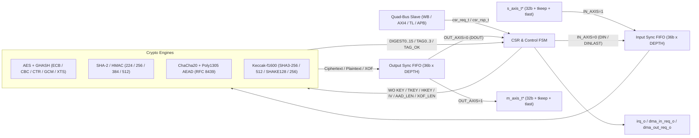

# Streaming Cryptographic Accelerator (`28_crypto` v2.0)

## Overview

`28_crypto` is a clean-room, pure synthesizable IEEE 1800-2017 SystemVerilog cryptographic accelerator supporting **AES-128/192/256** (**ECB**, **CBC**, **CTR**, **GCM**, **XTS**), **SHA-2 / HMAC** (**SHA-256/224**, **SHA-512/384**), **ChaCha20 & RFC 8439 ChaCha20-Poly1305 AEAD**, and **FIPS 202 SHA-3 / Keccak** (**SHA3-256**, **SHA3-512**, **SHAKE128**, **SHAKE256**). It provides a dual-path data interface — programmable **AXI-Stream-style 32-bit streaming ports** (`s_axis_*` / `m_axis_*`) for zero-copy DMA pipelines and **CSR FIFO registers** (`DIN`/`DINLAST`/`DOUT`) for polled CPU access — behind a unified **Quad-Bus CSR Slave** (`Wishbone B4`, `AMBA AXI4/AXI4-Lite`, `TileLink TL-UL/TL-UH`, and `AMBA APB4`).

All v2.0 engines (`GCM_EN`, `XTS_EN`, `CHACHA_EN`, `SHA3_EN`) and `SHA512_EN` are parameter-guarded so area-constrained microcontrollers can strip unused algorithms cleanly while preserving 100% register-level backward compatibility (`0x000..0x17C`).

### Features

- **AES Engine (`aes_core` + `ghash_core` + `crypto_aes_eng`)**:
  - Key sizes: **AES-128**, **AES-192**, **AES-256** (encrypt & decrypt).
  - Block/stream chaining modes: **ECB**, **CBC** (automatic IV update), and **CTR** (128-bit or 32-bit counter increment, arbitrary byte-length final block truncation, empty 0-byte pass-through).
  - **AES-GCM (`GCM_EN = 1`, NIST SP 800-38D)**: Automatic `H = AES_K(0^128)`, `J0 = {IV[95:0], 32'h0000_0001}`, iterative 8-bit/cycle `GF(2^128)` `ghash_core` (`x^128 + x^7 + x^2 + x + 1`), AAD streaming phase (`AAD_LEN` bytes), GCTR payload phase (`0..N` bytes), automatic `{AAD_bits[63:0], CT_bits[63:0]}` length block, `TAG = GHASH ^ AES_K(J0)` in `TAG0..3`, and hardware constant-time tag comparison (`TAG_EXP0..3` -> `STATUS.TAG_OK` / `ERR.TAG_FAIL`).
  - **AES-XTS (`XTS_EN = 1`, IEEE 1619 / NIST SP 800-38E)**: Dual-key (`KEY` = `Key1`, `TKEY` = `Key2`) for 128-bit and 256-bit XTS, initial `T0 = AES_K2(IV)` encryption, per-block `GF(2^128)` `alpha` multiply-by-`x` tweak update, and full **Ciphertext Stealing (CTS)** for non-16-byte-aligned sectors (`>= 16` bytes).
  - On-the-fly 8-word sliding-window key schedule (`fwd_step` / `bwd_step`) — no round-key SRAM required.
  - Parameterizable area/throughput trade-off via `AES_ARCH` (`0`: 1 round/clock; `1`: 1 column/clock, 4x fewer data S-boxes).
- **ChaCha20 & Poly1305 Engine (`chacha20_core` + `poly1305_core` + `crypto_chacha_eng`, `CHACHA_EN = 1`)**:
  - **ChaCha20 (RFC 8439 Sec. 2.4)**: 256-bit `KEY`, 96-bit nonce (`IV0..2`), programmable 32-bit initial block counter (`CHACHA_CNT`), 20 ARX rounds (1 round/clock).
  - **ChaCha20-Poly1305 AEAD (RFC 8439 Sec. 2.8)**: Automatic `ctr=0` Poly1305 one-time key (`r || s`) generation, `pad16(AAD)` + `ctr=1` payload encryption/decryption + `pad16(ciphertext)` + `{le64(AAD_LEN), le64(CT_LEN)}`, 8-bit/cycle `2^130 - 5` modular accumulator, 128-bit `TAG0..3`, and constant-time tag verification.
- **SHA-2 & HMAC Engine (`sha256_core` + `sha512_core` + `crypto_sha_eng`)**:
  - **SHA-256** & **SHA-224** (64-round compression, 1 round/clock).
  - Optional **SHA-512** & **SHA-384** enabled by `SHA512_EN = 1` (80-round compression, 1 round/clock).
  - Automatic **FIPS 180-4 padding** and hardware **HMAC** (`ipad = 0x36`, `opad = 0x5C`) from write-only `HKEY0..31`.
- **SHA-3 & Keccak XOF Engine (`keccak_core` + `crypto_sha3_eng`, `SHA3_EN = 1`, FIPS 202)**:
  - 1600-bit `Keccak-f[1600]` permutation (24 rounds, 1 round/clock, `theta`/`rho`/`pi`/`chi`/`iota`).
  - Supports **SHA3-256** (`0x06`), **SHA3-512** (`0x06`), **SHAKE128** (`0x1F`), and **SHAKE256** (`0x1F`) with arbitrary-length multi-block absorb and multi-block squeeze (`XOF_LEN` bytes via `DIG_FIFO = 1` and first up-to-64 bytes in `DIGEST0..15`).
- **Stream, DMA, IRQ & Security Controls (`crypto_core`)**:
  - Synchronous input/output FIFOs (`IN_FIFO_DEPTH`, `OUT_FIFO_DEPTH`), independent `BSWAP_IN`/`BSWAP_OUT`, level DMA requests (`dma_in_req_o`, `dma_out_req_o`), W1C IRQs.
  - `KEY0..7`, `TKEY0..7`, and `HKEY0..31` are strictly **write-only** (reads always return `32'h0`).
  - Synchronous `CMD.WIPE` zeroes all keys, tweak keys, HMAC keys, IV, expected tag, computed tags, internal engine states, and FIFOs immediately.
  - **Non-Goals**: Hardware TRNG is intentionally omitted (planned as a separate entropy IP).

---

## Block Diagram



---

## RTL File Hierarchy

| File | Role |
| :--- | :--- |
| [`crypto_pkg.sv`](../rtl/crypto_pkg.sv) | GF(2^8) math, elaboration-derived AES S-box/InvS-box, MixColumns, `blk_mask`, `xts_mul_alpha`, byte-swap helpers |
| [`crypto_sha_pkg.sv`](../rtl/crypto_sha_pkg.sv) | FIPS 180-4 round constants (`K256`, `K512`) and IVs (`H0_*`), generated by [`gen_sha_consts.py`](../tools/gen_sha_consts.py) |
| [`aes_core.sv`](../rtl/aes_core.sv) | AES-128/192/256 block engine with sliding-window on-the-fly key schedule (`ARCH=0/1`) |
| [`ghash_core.sv`](../rtl/ghash_core.sv) | Iterative 8-bit/cycle `GF(2^128)` GHASH multiplier (`x^128 + x^7 + x^2 + x + 1`, 16 clks/block) |
| [`sha256_core.sv`](../rtl/sha256_core.sv) | SHA-256 / SHA-224 64-round compression core |
| [`sha512_core.sv`](../rtl/sha512_core.sv) | SHA-512 / SHA-384 80-round compression core |
| [`chacha20_core.sv`](../rtl/chacha20_core.sv) | RFC 8439 ChaCha20 20-round ARX core (1 round/cycle) |
| [`poly1305_core.sv`](../rtl/poly1305_core.sv) | RFC 8439 Poly1305 `2^130 - 5` modular accumulator (8-bit/cycle, 16 clks/chunk) |
| [`keccak_core.sv`](../rtl/keccak_core.sv) | FIPS 202 `Keccak-f[1600]` permutation core (24 rounds, 1 round/cycle) |
| [`crypto_aes_eng.sv`](../rtl/crypto_aes_eng.sv) | AES message engine (ECB / CBC / CTR / GCM / XTS+CTS, constant-time tag verify) |
| [`crypto_sha_eng.sv`](../rtl/crypto_sha_eng.sv) | SHA-2 / HMAC message framer (auto padding, inner/outer HMAC passes) |
| [`crypto_chacha_eng.sv`](../rtl/crypto_chacha_eng.sv) | ChaCha20 & ChaCha20-Poly1305 AEAD message engine |
| [`crypto_sha3_eng.sv`](../rtl/crypto_sha3_eng.sv) | SHA3-256/512 & SHAKE128/256 message engine (`pad10*1`, multi-block absorb/squeeze) |
| [`crypto_core.sv`](../rtl/crypto_core.sv) | Protocol-agnostic CSR register file (`0x000..0x2FF`), FIFOs, AXIS bridges, DMA/IRQ logic |
| [`crypto_wb.sv`](../rtl/crypto_wb.sv) | Wishbone B4 slave wrapper (`wb_to_csr`) |
| [`crypto_axi.sv`](../rtl/crypto_axi.sv) | AXI4 / AXI4-Lite slave wrapper (`axi_lite_to_csr`) |
| [`crypto_tl.sv`](../rtl/crypto_tl.sv) | TileLink TL-UL / TL-UH device wrapper (`tl_ul_to_csr`) |
| [`crypto_apb.sv`](../rtl/crypto_apb.sv) | AMBA APB4 slave wrapper (`apb_to_csr`) |
| [`crypto_top.sv`](../rtl/crypto_top.sv) | Unified parameterized quad-bus top (`BUS_TYPE`) |

---

## Parameters & Ports (`crypto_top`)

### Parameters

| Parameter | Type | Default | Description |
| :--- | :--- | :--- | :--- |
| `BUS_TYPE` | `bus_pkg::bus_proto_e` | `BUS_AXI4` | Slave CSR bus protocol: `BUS_WISHBONE` (0), `BUS_AXI4` (1), `BUS_TILELINK` (2), `BUS_APB` (3) |
| `AES_ARCH` | `int unsigned` | `0` | `0`: 1 AES round/clock (fast); `1`: 1 column/clock (4 clocks/round, compact) |
| `SHA512_EN` | `bit` | `1'b1` | `1`: include SHA-384/512 engine and 32-word `HKEY`; `0`: SHA-224/256 only |
| `GCM_EN` | `bit` | `1'b1` | `1`: include `ghash_core` and AES-GCM mode |
| `XTS_EN` | `bit` | `1'b1` | `1`: include IEEE 1619 AES-XTS + ciphertext stealing |
| `CHACHA_EN` | `bit` | `1'b1` | `1`: include ChaCha20 & Poly1305 AEAD engine |
| `SHA3_EN` | `bit` | `1'b1` | `1`: include `Keccak-f[1600]` SHA-3 & SHAKE128/256 engine |
| `IN_FIFO_DEPTH` | `int unsigned` | `16` | Input FIFO depth in 32-bit words (`8..255`) |
| `OUT_FIFO_DEPTH` | `int unsigned` | `16` | Output FIFO depth in 32-bit words (`8..255`) |

### Ports

| Port | Direction | Width | Description |
| :--- | :--- | :--- | :--- |
| `clk_i` | `input` | 1 | System clock (single clock domain) |
| `rst_ni` | `input` | 1 | Active-low asynchronous reset (synchronized deassertion externally) |
| `wb_i` / `wb_o` | `in/out` | struct | Wishbone B4 slave port (active when `BUS_TYPE == BUS_WISHBONE`) |
| `axi_i` / `axi_o` | `in/out` | struct | AXI4 / AXI4-Lite slave port (active when `BUS_TYPE == BUS_AXI4`) |
| `tl_i` / `tl_o` | `in/out` | struct | TileLink TL-UL / TL-UH slave port (active when `BUS_TYPE == BUS_TILELINK`) |
| `apb_i` / `apb_o` | `in/out` | struct | AMBA APB4 slave port (active when `BUS_TYPE == BUS_APB`) |
| `s_axis_tdata` | `input` | 32 | AXI-Stream input data word |
| `s_axis_tkeep` | `input` | 4 | Input byte valid mask (`0000`, `0001`, `0011`, `0111`, `1111`; non-last beats must be `1111`) |
| `s_axis_tvalid` | `input` | 1 | AXI-Stream input valid |
| `s_axis_tready` | `output` | 1 | AXI-Stream input ready (`CTRL.IN_AXIS && !IN_FULL`) |
| `s_axis_tlast` | `input` | 1 | End-of-message indicator on final beat |
| `m_axis_tdata` | `output` | 32 | AXI-Stream output data word |
| `m_axis_tkeep` | `output` | 4 | Output byte valid mask |
| `m_axis_tvalid` | `output` | 1 | AXI-Stream output valid (`CTRL.OUT_AXIS && !OUT_EMPTY`) |
| `m_axis_tready` | `input` | 1 | AXI-Stream output ready |
| `m_axis_tlast` | `output` | 1 | End-of-message indicator on final output beat |
| `irq_o` | `output` | 1 | Active-high level interrupt (`|(IRQ_ST & IRQ_EN)`) |
| `dma_in_req_o` | `output` | 1 | Input DMA request (high when `DMA_IN_EN` and free slots `>= IN_THR`) |
| `dma_out_req_o` | `output` | 1 | Output DMA request (high when `DMA_OUT_EN`, non-empty, and `level >= OUT_THR` or `last` queued) |

---

## Register Map

Base-relative byte offsets (`addr[11:0]`). Reads/writes to unmapped offsets return `csr_rsp_o.err = 1`.

### Legacy v1.0 Registers (`0x000..0x17C`, 100% Preserved)

| Offset | Name | Access | Reset | Description |
| :--- | :--- | :--- | :--- | :--- |
| `0x000` | `ID` | RO | `0xC8A0_0100` | Peripheral ID (`0xC8A0` crypto, backward-compatible ID) |
| `0x004` | `CAPS` | RO | param | Capability flags and FIFO depths |
| `0x008` | `CTRL` | RW | `0x0000_0000` | Engine, mode, endianness, and stream configuration (locked when `BUSY/ARMED`) |
| `0x00C` | `CMD` | WO/W1P | `0x0000_0000` | Control commands (`START`, `KEY_LOAD`, `WIPE`, `ABORT`); reads `0` |
| `0x010` | `STATUS` | RO | `0x0000_0028` | Live engine, FIFO, and AEAD tag verification status |
| `0x014` | `ERR` | RW1C | `0x0000_0000` | Sticky error flags (write `1` to clear) |
| `0x018` | `IRQ_EN` | RW | `0x0000_0000` | Interrupt enable mask |
| `0x01C` | `IRQ_ST` | RO/W1C | `0x0000_0000` | Interrupt status (`[2:0]` W1C events; `[4:3]` live FIFO levels) |
| `0x020` | `FIFOCFG` | RW | `0x0000_0104` | DMA enables and FIFO watermarks (`IN_THR=4`, `OUT_THR=1`) |
| `0x024` | `LASTB` | RW | `0x0000_0004` | Valid byte count (`0..4`) for next `DINLAST` write |
| `0x028` | `MSGLEN` | RO | `0x0000_0000` | Total input bytes consumed for current/last message |
| `0x02C` | `DIN` | WO | `0x0000_0000` | CSR input FIFO write (4 valid bytes, `last=0`); active when `IN_AXIS=0` |
| `0x030` | `DINLAST` | WO | `0x0000_0000` | CSR input FIFO write with `last=1` and `LASTB` valid bytes |
| `0x034` | `DOUT` | RO | `0x0000_0000` | CSR output FIFO pop; active when `OUT_AXIS=0` |
| `0x038` | `DOUTINF` | RO | `0x0000_0000` | Peek output FIFO head metadata (`VALID`, `LAST`, `NB`) without popping |
| `0x040..0x05C` | `KEY0..KEY7` | WO | `0x0000_0000` | Primary key words (`AES` `KEY1`, `ChaCha20` 256-bit key); reads `0` |
| `0x060..0x06C` | `IV0..IV3` | RW | `0x0000_0000` | AES IV/CTR/XTS tweak (`IV0..3`), or 96-bit GCM IV / ChaCha nonce (`IV0..2`) |
| `0x070` | `HKLEN` | RW | `0x0000_0000` | HMAC key byte length (`0..64` for SHA-224/256; `0..128` for SHA-384/512) |
| `0x080..0x0BC` | `DIGEST0..15` | RO | `0x0000_0000` | SHA-2 / HMAC / SHA-3 / SHAKE output digest words (first up-to-64 bytes) |
| `0x100..0x17C` | `HKEY0..31` | WO | `0x0000_0000` | HMAC key words (`0x100..0x13C` if `SHA512_EN=0`, `0x100..0x17C` if `SHA512_EN=1`); reads `0` |

### v2.0 Extension Registers (`0x180..0x2FF`)

| Offset | Name | Access | Reset | Description |
| :--- | :--- | :--- | :--- | :--- |
| `0x180` | `VERSION` | RO | `0x0002_0000` | IP revision (`2.0.0`) |
| `0x184` | `AAD_LEN` | RW | `0x0000_0000` | AEAD AAD byte length for AES-GCM and ChaCha20-Poly1305 (locked when busy; wiped on `WIPE`) |
| `0x188` | `XOF_LEN` | RW | `0x0000_0000` | SHAKE128/256 squeeze output byte count (`0` defaults to `32` for SHAKE128, `64` for SHAKE256) |
| `0x18C` | `CHACHA_CNT` | RW | `0x0000_0000` | Initial 32-bit block counter for standalone ChaCha20 (`POLY_EN=0`) |
| `0x190..0x19C` | `TAG0..TAG3` | RO | `0x0000_0000` | Computed 128-bit AEAD authentication tag (GCM / ChaCha20-Poly1305; respects `BSWAP_OUT`) |
| `0x1A0..0x1AC` | `TAG_EXP0..3` | RW | `0x0000_0000` | Expected 128-bit AEAD tag for hardware constant-time verify (`TAG_CHK=1`; respects `BSWAP_IN`) |
| `0x1B0..0x1CC` | `TKEY0..TKEY7` | WO | `0x0000_0000` | XTS tweak key `Key2` (`TKEY0..3` for XTS-128, `0..7` for XTS-256); reads `0`, wiped on `WIPE` |

### Key Bit-Field Definitions

#### `CAPS` (`0x004`, RO)
| Bits | Field | Description |
| :--- | :--- | :--- |
| `0` | `SHA512_EN` | `1` if SHA-384/512 engine is compiled in |
| `1` | `GCM_EN` | `1` if AES-GCM (`ghash_core`) is compiled in |
| `2` | `AES_ARCH` | `0`: 1 round/clk, `1`: 1 column/clk (4-cycle S-box shared) |
| `3` | `XTS_EN` | `1` if IEEE 1619 AES-XTS is compiled in |
| `4` | `CHACHA_EN` | `1` if ChaCha20 & Poly1305 AEAD is compiled in |
| `5` | `SHA3_EN` | `1` if `Keccak-f[1600]` SHA-3 / SHAKE is compiled in |
| `15:8` | `IN_DEPTH` | `IN_FIFO_DEPTH` |
| `23:16` | `OUT_DEPTH` | `OUT_FIFO_DEPTH` |
| `24` | `HAS_DMA` | `1` |
| `25` | `HAS_AXIS` | `1` |

#### `CTRL` (`0x008`, RW — locked while `STATUS.BUSY` or `STATUS.ARMED`)
| Bits | Field | Values |
| :--- | :--- | :--- |
| `0` | `AUTO_REARM` | `1`: auto-restart next message on `tlast`/`DINLAST` completion |
| `2:1` | `MODE` | `0`: AES, `1`: SHA-2 / HMAC, `2`: ChaCha20 / ChaCha20-Poly1305, `3`: SHA-3 / SHAKE |
| `4:3` | `KEYLEN` | `0`: 128-bit, `1`: 192-bit (not valid for XTS), `2`: 256-bit (`3`: invalid -> `BAD_CFG`) |
| `5` | `DEC` | Direction (`0`: encrypt, `1`: decrypt; used by ECB/CBC/GCM/XTS/ChaCha-Poly) |
| `7:6` | `CHAIN` | AES mode when `XTS_MODE=0`: `0`: ECB, `1`: CBC, `2`: CTR, `3`: GCM |
| `8` | `CTR32` | CTR increment width (`0`: full 128-bit counter, `1`: low 32-bit counter wrap) |
| `10:9` | `SHA_ALG` | `MODE=1`: `0`=SHA256, `1`=SHA224, `2`=SHA512, `3`=SHA384; `MODE=3`: `0`=SHA3-256, `1`=SHA3-512, `2`=SHAKE128, `3`=SHAKE256 |
| `11` | `HMAC_EN` | `1`: compute HMAC using `HKEY` and `HKLEN` (`MODE=1`) |
| `12` | `BSWAP_IN` | `0`: little-endian host words (byte 0 in `[7:0]`); `1`: big-endian/network order (byte 0 in `[31:24]`) |
| `13` | `BSWAP_OUT` | `0`: little-endian host words on `DOUT`/`IV`/`DIGEST`/`TAG`/`m_axis`; `1`: big-endian/network order |
| `14` | `IN_AXIS` | `0`: input via `DIN`/`DINLAST`; `1`: input via `s_axis_*` |
| `15` | `OUT_AXIS` | `0`: output via `DOUT`; `1`: output via `m_axis_*` |
| `16` | `DIG_FIFO` | `1`: also push SHA-2 / HMAC / SHA-3 / SHAKE output bytes onto output FIFO / `m_axis_*` |
| `17` | `XTS_MODE` | `1`: select AES-XTS when `MODE=0` and `CHAIN=0` (`KEYLEN` `0` or `2`) |
| `18` | `POLY_EN` | `1`: enable RFC 8439 ChaCha20-Poly1305 AEAD when `MODE=2` (`0`: standalone ChaCha20) |
| `19` | `TAG_CHK` | `1`: enable hardware constant-time verification of `TAG0..3` against `TAG_EXP0..3` |

#### `CMD` (`0x00C`, WO/W1P)
| Bit | Field | Effect |
| :--- | :--- | :--- |
| `0` | `START` | Arm selected engine; if `MODE=0` and AES key schedule is dirty/mismatched, runs key setup first |
| `1` | `KEY_LOAD` | Pre-compute AES decryption final key window (`dk_q`) without starting a message |
| `2` | `WIPE` | Highest priority: zero `KEY`, `TKEY`, `HKEY`, `IV`, `TAG_EXP`, `TAG`, schedules, engine states, FIFOs |
| `3` | `ABORT` | Abort active operation and flush both FIFOs (preserves keys/IV) |

#### `STATUS` (`0x010`, RO)
| Bits | Field | Description |
| :--- | :--- | :--- |
| `0` | `BUSY` | Engine or key-schedule setup active (`armed_q \|\| setup_q`) |
| `1` | `KEY_VALID` | AES key schedule is up to date for current `KEY` and `CTRL.KEYLEN` |
| `2` | `KEY_DIRTY` | `KEY*` was written since last `KEY_LOAD`/auto-setup |
| `3` | `IN_FULL` | Input FIFO full |
| `4` | `IN_EMPTY` | Input FIFO empty |
| `5` | `OUT_FULL` | Output FIFO full |
| `6` | `OUT_EMPTY` | Output FIFO empty |
| `7` | `ARMED` | Message is armed / running |
| `8` | `TAG_VALID` | `1` when AEAD tag in `TAG0..3` is valid (cleared on `START`, `WIPE`, `ABORT`) |
| `9` | `TAG_OK` | `1` when `TAG_CHK=1` passed constant-time verify (`TAG == TAG_EXP`) |
| `23:16` | `IN_LEVEL` | Current input FIFO occupancy (words) |
| `31:24` | `OUT_LEVEL` | Current output FIFO occupancy (words) |

#### `ERR` (`0x014`, RW1C)
| Bit | Flag | Cause |
| :--- | :--- | :--- |
| `0` | `NO_KEY` | `CMD.START` (`MODE=0/2`) or `CMD.KEY_LOAD` issued with no key loaded |
| `1` | `ALIGN` | AES ECB/CBC message not a multiple of 16B, or AES-XTS message `< 16B` |
| `2` | `PROTO` | Non-last word with `tkeep != 4'hF`, AAD length mismatch on `last`, or `DIN`/`DOUT` access in AXIS mode |
| `3` | `BAD_CFG` | Invalid `MODE`/`KEYLEN`/`CHAIN`, disabled feature flag invoked, XTS with 192b key, or `HKLEN > block_size` |
| `4` | `BUSY_WR` | Attempted write to locked configuration registers or `CMD.START`/`KEY_LOAD` while busy |
| `5` | `IN_OVF` | CSR `DIN`/`DINLAST` written when input FIFO full |
| `6` | `OUT_UNF` | CSR `DOUT` read when output FIFO empty |
| `7` | `TAG_FAIL` | `CTRL.TAG_CHK=1` failed (`TAG != TAG_EXP`) at end of AEAD decryption/authentication |

---

## Protocol & Timing Diagrams

### AEAD Streaming Framing (AES-GCM & ChaCha20-Poly1305)

1. Program `AAD_LEN` (`0x184`) with the exact AAD byte count (`0` if none).
2. Stream `ceil(AAD_LEN / 4)` words of AAD first (unused trailing bytes in the final AAD word are masked/zeroed by hardware), followed immediately by payload words starting on the next 32-bit word with `tlast=1`/`DINLAST` on the final payload word.
   - If `AAD_LEN > 0` and payload is `0` bytes, either assert `tlast=1` on the final AAD word (with `tkeep` matching `AAD_LEN % 4`) or send a trailing `{tkeep=0, tlast=1}` null beat.
   - If `AAD_LEN == 0` and payload is `0` bytes, send a single `{tkeep=0, tlast=1}` null beat.
3. Hardware suppresses output during AAD, emits only payload ciphertext/plaintext words on `m_axis_*` / `DOUT`, latches `TAG0..3`, and evaluates `STATUS.TAG_OK` / `ERR.TAG_FAIL` when `CTRL.TAG_CHK=1`.

```text
clk_i         : _/‾\_/‾\_/‾\_/‾\_/‾\_/‾\_/‾\_/‾\_/‾\_/‾\_/‾\_
s_axis_tvalid : ___/‾‾‾‾‾‾‾‾‾‾‾‾‾‾‾‾‾‾‾‾‾‾‾‾‾‾‾\_____________
s_axis_tdata  :    [AAD0][AAD1][PT0 ][PT1 ][PT2 ] (AAD_LEN=8)
s_axis_tkeep  :    [ F  ][ F  ][ F  ][ F  ][ 3  ]
s_axis_tlast  : _______________________/‾‾‾‾‾‾‾\_____________
m_axis_tvalid : ___________________________/‾‾‾‾‾‾‾‾‾‾‾‾‾‾\_
m_axis_tdata  :                            [CT0 ][CT1 ][CT2 ]
m_axis_tlast  : ___________________________________/‾‾‾‾‾‾\_
STATUS.TAG_VLD: ___________________________________________/‾
```

---

## Programming Recipes (C Pseudocode)

### 1. AES-128 CBC Encrypt via AXI-Stream + DMA

```c
for (int i = 0; i < 4; i++) REG_WRITE(CRYPTO_KEY0 + 4*i, key[i]);
for (int i = 0; i < 4; i++) REG_WRITE(CRYPTO_IV0  + 4*i, iv[i]);
REG_WRITE(CRYPTO_CTRL, (0 << 1) | (0 << 3) | (0 << 5) | (1 << 6) | (1 << 14) | (1 << 15));
REG_WRITE(CRYPTO_FIFOCFG, (1 << 17) | (1 << 16) | (1 << 8) | 4);
REG_WRITE(CRYPTO_CMD, 1 << 0);
while (REG_READ(CRYPTO_STATUS) & (1 << 7)) {}
```

### 2. AES-256-GCM Authenticated Decrypt with Constant-Time Tag Verification

```c
// MODE=0 (AES), KEYLEN=2 (256b), DEC=1, CHAIN=3 (GCM), BSWAP_IN/OUT=1, AXIS=1, TAG_CHK=1
REG_WRITE(CRYPTO_CTRL, (0 << 1) | (2 << 3) | (1 << 5) | (3 << 6) |
                       (1 << 12) | (1 << 13) | (1 << 14) | (1 << 15) | (1 << 19));
for (int i = 0; i < 8; i++) REG_WRITE(CRYPTO_KEY0     + 4*i, key[i]);
for (int i = 0; i < 3; i++) REG_WRITE(CRYPTO_IV0      + 4*i, iv96[i]);
for (int i = 0; i < 4; i++) REG_WRITE(CRYPTO_TAG_EXP0 + 4*i, expected_tag[i]);
REG_WRITE(CRYPTO_AAD_LEN, aad_bytes);
REG_WRITE(CRYPTO_CMD, 1 << 0); // START

// Stream AAD words then ciphertext words (tlast=1); drain plaintext from m_axis
while (REG_READ(CRYPTO_STATUS) & (1 << 0)) {} // wait !BUSY
uint32_t st = REG_READ(CRYPTO_STATUS);
if (!(st & (1 << 9))) { /* TAG_OK == 0 -> discard plaintext! */ }
```

### 3. AES-128-XTS Flash Sector Encryption

```c
// MODE=0, KEYLEN=0 (128b), DEC=0, CHAIN=0, XTS_MODE=1, BSWAP_IN/OUT=1, AXIS=1
REG_WRITE(CRYPTO_CTRL, (1 << 17) | (1 << 12) | (1 << 13) | (1 << 14) | (1 << 15));
for (int i = 0; i < 4; i++) REG_WRITE(CRYPTO_KEY0  + 4*i, key1[i]);
for (int i = 0; i < 4; i++) REG_WRITE(CRYPTO_TKEY0 + 4*i, key2[i]);
for (int i = 0; i < 4; i++) REG_WRITE(CRYPTO_IV0   + 4*i, sector_tweak[i]);
REG_WRITE(CRYPTO_CMD, 1 << 0);
// Stream >= 16 bytes (arbitrary length >= 16B supported via CTS)
```

### 4. RFC 8439 ChaCha20-Poly1305 AEAD Encrypt

```c
// MODE=2 (ChaCha), POLY_EN=1, BSWAP_IN/OUT=1, AXIS=1
REG_WRITE(CRYPTO_CTRL, (2 << 1) | (1 << 18) | (1 << 12) | (1 << 13) | (1 << 14) | (1 << 15));
for (int i = 0; i < 8; i++) REG_WRITE(CRYPTO_KEY0 + 4*i, key[i]);
for (int i = 0; i < 3; i++) REG_WRITE(CRYPTO_IV0  + 4*i, nonce96[i]);
REG_WRITE(CRYPTO_AAD_LEN, aad_bytes);
REG_WRITE(CRYPTO_CMD, 1 << 0);
while (REG_READ(CRYPTO_STATUS) & (1 << 0)) {}
for (int i = 0; i < 4; i++) tag[i] = REG_READ(CRYPTO_TAG0 + 4*i);
```

### 5. Multi-Block SHAKE256 XOF Stream

```c
// MODE=3 (SHA-3), SHA_ALG=3 (SHAKE256), BSWAP_IN/OUT=1, AXIS=1, DIG_FIFO=1
REG_WRITE(CRYPTO_CTRL, (3 << 1) | (3 << 9) | (1 << 12) | (1 << 13) | (1 << 14) | (1 << 15) | (1 << 16));
REG_WRITE(CRYPTO_XOF_LEN, 200); // squeeze 200 bytes onto m_axis
REG_WRITE(CRYPTO_CMD, 1 << 0);
```

### 6. HMAC-SHA256 & Secure Key Zeroization (`WIPE`)

```c
REG_WRITE(CRYPTO_CTRL, (1 << 1) | (0 << 9) | (1 << 11) | (1 << 12) | (1 << 13));
for (int i = 0; i < (klen + 3) / 4; i++) REG_WRITE(CRYPTO_HKEY0 + 4*i, hkey_words[i]);
REG_WRITE(CRYPTO_HKLEN, klen);
REG_WRITE(CRYPTO_CMD, 1 << 0);
// ... feed DIN / DINLAST, wait !BUSY, read DIGEST0..7 ...
REG_WRITE(CRYPTO_CMD, 1 << 2); // CMD.WIPE: zeroes KEY, TKEY, HKEY, IV, TAG_EXP, TAG, FIFOs
```

---

## Integration & FPGA/ASIC Notes

- **Single Clock Domain**: All logic runs on `clk_i` with asynchronous active-low `rst_ni`. When integrating across clock domains, insert `common/rtl/async_fifo` on AXIS streams or an asynchronous bus bridge.
- **Area vs. Feature Stripping**:
  - For minimal MCU footprints, set `AES_ARCH=1` and disable unused extensions (`SHA512_EN=0`, `GCM_EN=0`, `XTS_EN=0`, `CHACHA_EN=0`, `SHA3_EN=0`). All disabled modes compile out via `generate` blocks and cleanly report `0` in `CAPS` and raise `ERR.BAD_CFG` if invoked.
- **Side-Channel Note**: AEAD tag comparison (`TAG == TAG_EXP`) is performed in constant time using a full 128-bit XOR-reduction tree without early exit. However, AES S-boxes and arithmetic cores are unmasked against differential power analysis (DPA).

---

## Verification Summary

Testbenches: [`tb_crypto.sv`](../tb/tb_crypto.sv) (v1.0 backward compatibility, unmodified) and [`tb_crypto_v2.sv`](../tb/tb_crypto_v2.sv) (v2.0 full suite), both Verilator 5.054 `-Wall` clean with 0 warnings.

| Check Category | Coverage | Reference |
| :--- | :--- | :--- |
| **v1.0 Backward Compatibility** | Full `tb_crypto` suite unmodified (AES-128/192/256 ECB/CBC/CTR, SHA-224/256/384/512, HMAC, quad-bus, errors, random) | FIPS-197 / SP 800-38A / FIPS 180-4 / RFC 4231 |
| **AES-GCM KATs & Tamper** | NIST SP 800-38D TC1/TC2/TC4 (AES-128), AES-192 AAD-only, TC16 (AES-256 on `AES_ARCH=1`), HW `TAG_OK` & `ERR.TAG_FAIL` | NIST SP 800-38D |
| **AES-XTS KATs & CTS** | IEEE 1619 XTS-AES-128 Vector 1, XTS-AES-256 (`AES_ARCH=1`), 23B Ciphertext Stealing (CTS) enc/dec, `< 16B` `ERR.ALIGN`, `TKEY` WO | IEEE 1619 / SP 800-38E |
| **ChaCha20 & Poly1305 AEAD** | RFC 8439 Sec 2.4.2 ChaCha20 stream, Sec 2.8.2 ChaCha20-Poly1305 AEAD, 0B PT AAD-only, HW `TAG_OK` & `ERR.TAG_FAIL` | RFC 8439 |
| **SHA-3 & SHAKE XOF** | SHA3-256, SHA3-512, SHAKE128, SHAKE256 (`0B`, `"abc"`, rate-edge lengths `71/72/136/169`, 200B multi-block squeeze) | FIPS 202 / Python `hashlib` |
| **Parameter Stripping & Security** | `GCM_EN=XTS_EN=CHACHA_EN=SHA3_EN=0` (`CAPS` + `ERR.BAD_CFG`), `CMD.WIPE` zeroization of all v2 CSRs & states | Directed assertions |
| **Constrained-Random (`+seed=`)** | Randomized AES-GCM, AES-XTS (+CTS), ChaCha20/Poly1305, SHA3/SHAKE across `BSWAP_IN/OUT` and AXIS stalls | Independent SV byte-oriented golden models |
