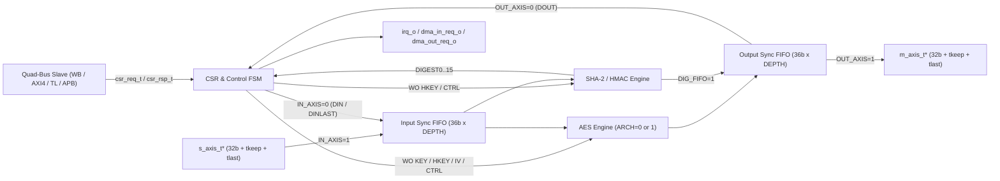

# Streaming Cryptographic Accelerator (`28_crypto`)

## Overview

`28_crypto` is a clean-room, pure synthesizable IEEE 1800-2017 SystemVerilog cryptographic accelerator supporting **AES-128/192/256** (ECB, CBC, CTR) and **SHA-2** (**SHA-256/224** plus optional **SHA-512/384** and hardware **HMAC**). It provides a dual-path data interface — programmable **AXI-Stream-style 32-bit streaming ports** (`s_axis_*` / `m_axis_*`) for zero-copy DMA pipelines and **CSR FIFO registers** (`DIN`/`DINLAST`/`DOUT`) for polled CPU access — behind a unified **Quad-Bus CSR Slave** (`Wishbone B4`, `AMBA AXI4/AXI4-Lite`, `TileLink TL-UL/TL-UH`, and `AMBA APB4`).

### Features

- **AES Engine (`aes_core` + `crypto_aes_eng`)**:
  - Key sizes: **AES-128**, **AES-192**, **AES-256** (encrypt & decrypt).
  - Block/stream chaining modes: **ECB**, **CBC** (automatic IV update), and **CTR** (128-bit or 32-bit counter increment, arbitrary byte-length final block truncation, empty 0-byte pass-through).
  - On-the-fly 8-word sliding-window key schedule (`fwd_step` / `bwd_step`) — no round-key SRAM required.
  - Parameterizable area/throughput trade-off via `AES_ARCH`:
    - `AES_ARCH = 0`: 1 round/clock (16 data S-boxes + 4 key S-boxes; 11/13/15 clocks per block).
    - `AES_ARCH = 1`: 1 column/clock (4 data S-boxes + 4 key S-boxes shared across 4 sub-cycles; 41/49/57 clocks per block).
- **SHA-2 & HMAC Engine (`sha256_core` + `sha512_core` + `crypto_sha_eng`)**:
  - **SHA-256** & **SHA-224** (64-round compression, 1 round/clock).
  - Optional **SHA-512** & **SHA-384** enabled by `SHA512_EN = 1` (80-round compression, 1 round/clock; strip out with `SHA512_EN = 0` for small microcontrollers).
  - Automatic **FIPS 180-4 padding** and bit-length appending (0-byte through multi-block messages).
  - Automatic **HMAC** (`ipad = 0x36`, `opad = 0x5C`) in hardware from a write-only `HKEY` block (`0..64` bytes for SHA-224/256, `0..128` bytes for SHA-384/512).
  - Digest readable via `DIGEST0..15` CSRs and/or streamed onto `m_axis_*` (`CTRL.DIG_FIFO = 1`).
- **Stream & Host Interface (`crypto_core`)**:
  - Synchronous input and output FIFOs (`IN_FIFO_DEPTH`, `OUT_FIFO_DEPTH`, default 16 words).
  - Independent input/output byte-swap controls (`CTRL.BSWAP_IN`, `CTRL.BSWAP_OUT`).
  - Level DMA request signals (`dma_in_req_o`, `dma_out_req_o`) with programmable watermarks (`FIFOCFG`) and automatic end-of-message flush (`last_cnt_q`).
  - Interrupt output (`irq_o`) with sticky W1C event flags (`DONE`, `ERR`, `KEY_DONE`) and FIFO level sources.
- **Security Controls**:
  - `KEY0..7` and `HKEY0..31` registers are strictly **write-only** (reads always return `32'h0`).
  - Synchronous `CMD.WIPE` command zeroes all key registers, HMAC key registers, IV, round-key schedule windows, internal state, and FIFOs immediately.
  - Configuration registers (`CTRL`, `KEY*`, `HKEY*`, `IV*`, `HKLEN`) are locked while `BUSY` or `ARMED`; illegal writes set `ERR.BUSY_WR`.
- **Non-Goals / Future Work**:
  - **No TRNG**: Hardware true random number generation is intentionally omitted (cannot be physically validated in digital simulation) and planned as a separate future entropy IP.
  - **AES-GCM (GHASH)**: Deferred to a future extension; ECB/CBC/CTR + HMAC-SHA2 cover authenticated encryption (Encrypt-then-MAC) today.

---

## Block Diagram



---

## RTL File Hierarchy

| File | Role |
| :--- | :--- |
| [`crypto_pkg.sv`](../rtl/crypto_pkg.sv) | GF(2^8) math, elaboration-derived AES S-box/InvS-box, MixColumns, byte-swap helpers |
| [`crypto_sha_pkg.sv`](../rtl/crypto_sha_pkg.sv) | FIPS 180-4 round constants (`K256`, `K512`) and IVs (`H0_*`), generated by [`gen_sha_consts.py`](../tools/gen_sha_consts.py) |
| [`aes_core.sv`](../rtl/aes_core.sv) | AES-128/192/256 block engine with sliding-window on-the-fly key schedule (`ARCH=0/1`) |
| [`sha256_core.sv`](../rtl/sha256_core.sv) | SHA-256 / SHA-224 64-round compression core |
| [`sha512_core.sv`](../rtl/sha512_core.sv) | SHA-512 / SHA-384 80-round compression core |
| [`crypto_aes_eng.sv`](../rtl/crypto_aes_eng.sv) | AES message framer (ECB/CBC/CTR chaining, partial-block CTR, ALIGN/PROTO checks) |
| [`crypto_sha_eng.sv`](../rtl/crypto_sha_eng.sv) | SHA-2 / HMAC message framer (auto padding, inner/outer HMAC passes) |
| [`crypto_core.sv`](../rtl/crypto_core.sv) | Protocol-agnostic CSR register file, FIFOs, AXIS bridges, DMA/IRQ logic |
| [`crypto_wb.sv`](../rtl/crypto_wb.sv) | Wishbone B4 slave wrapper (`wb_to_csr`) |
| [`crypto_axi.sv`](../rtl/crypto_axi.sv) | AXI4 / AXI4-Lite slave wrapper (`axi_lite_to_csr`) |
| [`crypto_tl.sv`](../rtl/crypto_tl.sv) | TileLink TL-UL / TL-UH device wrapper (`tl_ul_to_csr`) |
| [`crypto_apb.sv`](../rtl/crypto_apb.sv) | AMBA APB4 slave wrapper (`apb_to_csr`) |
| [`crypto_top.sv`](../rtl/crypto_top.sv) | Unified parameterized quad-bus top (`BUS_TYPE`) |

---

## Parameters & Ports (`crypto_top`)

### Parameters

| Parameter | Type | Default | Description |
| :--- | :--- | :--- | :--- |
| `BUS_TYPE` | `bus_pkg::bus_proto_e` | `BUS_AXI4` | Slave CSR bus protocol: `BUS_WISHBONE` (0), `BUS_AXI4` (1), `BUS_TILELINK` (2), `BUS_APB` (3) |
| `AES_ARCH` | `int unsigned` | `0` | `0`: 1 AES round/clock (fast); `1`: 1 column/clock (4 clocks/round, compact) |
| `SHA512_EN` | `bit` | `1'b1` | `1`: include SHA-384/512 engine and 32-word `HKEY`; `0`: SHA-224/256 only |
| `IN_FIFO_DEPTH` | `int unsigned` | `16` | Input FIFO depth in 32-bit words (`8..255`) |
| `OUT_FIFO_DEPTH` | `int unsigned` | `16` | Output FIFO depth in 32-bit words (`8..255`) |

### Ports

| Port | Direction | Width | Description |
| :--- | :--- | :--- | :--- |
| `clk_i` | `input` | 1 | System clock (single clock domain) |
| `rst_ni` | `input` | 1 | Active-low asynchronous reset (synchronized deassertion externally) |
| `wb_i` / `wb_o` | `in/out` | struct | Wishbone B4 slave port (active when `BUS_TYPE == BUS_WISHBONE`) |
| `axi_i` / `axi_o` | `in/out` | struct | AXI4 / AXI4-Lite slave port (active when `BUS_TYPE == BUS_AXI4`) |
| `tl_i` / `tl_o` | `in/out` | struct | TileLink TL-UL / TL-UH slave port (active when `BUS_TYPE == BUS_TILELINK`) |
| `apb_i` / `apb_o` | `in/out` | struct | AMBA APB4 slave port (active when `BUS_TYPE == BUS_APB`) |
| `s_axis_tdata` | `input` | 32 | AXI-Stream input data word |
| `s_axis_tkeep` | `input` | 4 | Input byte valid mask (`0000`, `0001`, `0011`, `0111`, `1111`; non-last beats must be `1111`) |
| `s_axis_tvalid` | `input` | 1 | AXI-Stream input valid |
| `s_axis_tready` | `output` | 1 | AXI-Stream input ready (`CTRL.IN_AXIS && !IN_FULL`) |
| `s_axis_tlast` | `input` | 1 | End-of-message indicator on final beat |
| `m_axis_tdata` | `output` | 32 | AXI-Stream output data word |
| `m_axis_tkeep` | `output` | 4 | Output byte valid mask |
| `m_axis_tvalid` | `output` | 1 | AXI-Stream output valid (`CTRL.OUT_AXIS && !OUT_EMPTY`) |
| `m_axis_tready` | `input` | 1 | AXI-Stream output ready |
| `m_axis_tlast` | `output` | 1 | End-of-message indicator on final output beat |
| `irq_o` | `output` | 1 | Active-high level interrupt (`|(IRQ_ST & IRQ_EN)`) |
| `dma_in_req_o` | `output` | 1 | Input DMA request (high when `DMA_IN_EN` and free slots `>= IN_THR`) |
| `dma_out_req_o` | `output` | 1 | Output DMA request (high when `DMA_OUT_EN`, non-empty, and `level >= OUT_THR` or `last` queued) |

---

## Register Map

Base-relative byte offsets (`addr[11:0]`). Reads/writes to unmapped offsets return `csr_rsp_o.err = 1`.

| Offset | Name | Access | Reset | Description |
| :--- | :--- | :--- | :--- | :--- |
| `0x000` | `ID` | RO | `0xC8A0_0100` | Peripheral ID (`0xC8A0` crypto, rev `0x0100`) |
| `0x004` | `CAPS` | RO | param | Capability flags and FIFO depths |
| `0x008` | `CTRL` | RW | `0x0000_0000` | Engine, mode, endianness, and stream configuration (locked when `BUSY/ARMED`) |
| `0x00C` | `CMD` | WO/W1P | `0x0000_0000` | Control commands (`START`, `KEY_LOAD`, `WIPE`, `ABORT`); reads `0` |
| `0x010` | `STATUS` | RO | `0x0000_0028` | Live engine and FIFO status (`IN_EMPTY=1`, `OUT_EMPTY=1`) |
| `0x014` | `ERR` | RW1C | `0x0000_0000` | Sticky error flags (write `1` to clear) |
| `0x018` | `IRQ_EN` | RW | `0x0000_0000` | Interrupt enable mask |
| `0x01C` | `IRQ_ST` | RO/W1C | `0x0000_0000` | Interrupt status (`[2:0]` W1C events; `[4:3]` live FIFO levels) |
| `0x020` | `FIFOCFG` | RW | `0x0000_0104` | DMA enables and FIFO watermarks (`IN_THR=4`, `OUT_THR=1`) |
| `0x024` | `LASTB` | RW | `0x0000_0004` | Valid byte count (`0..4`) for next `DINLAST` write |
| `0x028` | `MSGLEN` | RO | `0x0000_0000` | Message byte counter for current/last message |
| `0x02C` | `DIN` | WO | `0x0000_0000` | CSR input FIFO write (4 valid bytes, `last=0`); active when `IN_AXIS=0` |
| `0x030` | `DINLAST` | WO | `0x0000_0000` | CSR input FIFO write with `last=1` and `LASTB` valid bytes |
| `0x034` | `DOUT` | RO | `0x0000_0000` | CSR output FIFO pop; active when `OUT_AXIS=0` |
| `0x038` | `DOUTINF` | RO | `0x0000_0000` | Peek output FIFO head metadata (`VALID`, `LAST`, `NB`) without popping |
| `0x040..0x05C` | `KEY0..KEY7` | WO | `0x0000_0000` | AES key words (big-endian word order; `KEY0..3` for 128b, `0..5` for 192b, `0..7` for 256b); reads `0` |
| `0x060..0x06C` | `IV0..IV3` | RW | `0x0000_0000` | AES 128-bit IV / counter block (auto-updated on CBC/CTR block completion) |
| `0x070` | `HKLEN` | RW | `0x0000_0000` | HMAC key byte length (`0..64` for SHA-224/256; `0..128` for SHA-384/512) |
| `0x080..0x0BC` | `DIGEST0..15` | RO | `0x0000_0000` | SHA-2 / HMAC output digest words (`0..7` SHA-256, `0..6` SHA-224, `0..15` SHA-512, `0..11` SHA-384) |
| `0x100..0x17C` | `HKEY0..31` | WO | `0x0000_0000` | HMAC key words (`0x100..0x13C` if `SHA512_EN=0`, `0x100..0x17C` if `SHA512_EN=1`); reads `0` |

### Key Bit-Field Definitions

#### `CAPS` (`0x004`, RO)
| Bits | Field | Description |
| :--- | :--- | :--- |
| `0` | `SHA512_EN` | `1` if SHA-384/512 engine is compiled in |
| `1` | `GCM_EN` | `0` (GCM not implemented; future extension) |
| `2` | `AES_ARCH` | `0`: 1 round/clk, `1`: 1 column/clk (4-cycle S-box shared) |
| `15:8` | `IN_DEPTH` | `IN_FIFO_DEPTH` |
| `23:16` | `OUT_DEPTH` | `OUT_FIFO_DEPTH` |
| `24` | `HAS_DMA` | `1` |
| `25` | `HAS_AXIS` | `1` |

#### `CTRL` (`0x008`, RW — locked while `STATUS.BUSY` or `STATUS.ARMED`)
| Bits | Field | Values |
| :--- | :--- | :--- |
| `0` | `AUTO_REARM` | `1`: auto-restart next message on `tlast`/`DINLAST` completion without re-writing `CMD.START` |
| `2:1` | `MODE` | `0`: AES, `1`: SHA-2 / HMAC (`2..3`: reserved -> `BADCFG`) |
| `4:3` | `KEYLEN` | `0`: 128-bit, `1`: 192-bit, `2`: 256-bit (`3`: invalid -> `BADCFG`) |
| `5` | `DEC` | AES direction (`0`: encrypt, `1`: decrypt; ignored in CTR) |
| `7:6` | `CHAIN` | AES mode (`0`: ECB, `1`: CBC, `2`: CTR; `3`: invalid -> `BADCFG`) |
| `8` | `CTR32` | CTR increment width (`0`: full 128-bit counter, `1`: low 32-bit counter wrap) |
| `10:9` | `SHA_ALG` | `0`: SHA-256, `1`: SHA-224, `2`: SHA-512, `3`: SHA-384 |
| `11` | `HMAC_EN` | `1`: compute HMAC using `HKEY` and `HKLEN` |
| `12` | `BSWAP_IN` | `0`: little-endian host words (byte 0 in `[7:0]`); `1`: big-endian/network order (byte 0 in `[31:24]`) |
| `13` | `BSWAP_OUT` | `0`: little-endian host words on `DOUT`/`IV`/`DIGEST`/`m_axis`; `1`: big-endian/network order |
| `14` | `IN_AXIS` | `0`: input via `DIN`/`DINLAST`; `1`: input via `s_axis_*` |
| `15` | `OUT_AXIS` | `0`: output via `DOUT`; `1`: output via `m_axis_*` |
| `16` | `DIG_FIFO` | `1`: also push SHA/HMAC digest words onto output FIFO / `m_axis_*` |

#### `CMD` (`0x00C`, WO/W1P)
| Bit | Field | Effect |
| :--- | :--- | :--- |
| `0` | `START` | Arm selected engine; if AES key schedule is dirty/mismatched, runs key setup automatically first |
| `1` | `KEY_LOAD` | Pre-compute AES decryption final key window (`dk_q`) without starting a message |
| `2` | `WIPE` | Highest priority: immediately zero `KEY`, `HKEY`, `IV`, key schedule state, and flush both FIFOs |
| `3` | `ABORT` | Abort active operation and flush both FIFOs (preserves keys/IV) |

#### `STATUS` (`0x010`, RO)
| Bits | Field | Description |
| :--- | :--- | :--- |
| `0` | `BUSY` | Engine or key-schedule setup active (`armed_q \|\| setup_q`) |
| `1` | `KEY_VALID` | AES key schedule is up to date for current `KEY` and `CTRL.KEYLEN` |
| `2` | `KEY_DIRTY` | `KEY*` was written since last `KEY_LOAD`/auto-setup |
| `3` | `IN_FULL` | Input FIFO full |
| `4` | `IN_EMPTY` | Input FIFO empty |
| `5` | `OUT_FULL` | Output FIFO full |
| `6` | `OUT_EMPTY` | Output FIFO empty |
| `7` | `ARMED` | Message is armed / running |
| `23:16` | `IN_LEVEL` | Current input FIFO occupancy (words) |
| `31:24` | `OUT_LEVEL` | Current output FIFO occupancy (words) |

#### `ERR` (`0x014`, RW1C)
| Bit | Flag | Cause |
| :--- | :--- | :--- |
| `0` | `NO_KEY` | `CMD.START` (AES) or `CMD.KEY_LOAD` issued with no key loaded |
| `1` | `ALIGN` | AES ECB/CBC message length is not a multiple of 16 bytes (message aborted) |
| `2` | `PROTO` | Non-last word with `tkeep != 4'hF`, or CSR `DIN`/`DOUT` access while `IN_AXIS`/`OUT_AXIS=1` |
| `3` | `BAD_CFG` | Invalid `MODE`/`KEYLEN`/`CHAIN`, `SHA-384/512` with `SHA512_EN=0`, or `HKLEN > block_size` |
| `4` | `BUSY_WR` | Attempted write to `CTRL`/`KEY`/`HKEY`/`IV`/`HKLEN`/`CMD.START`/`CMD.KEY_LOAD` while busy |
| `5` | `IN_OVF` | CSR `DIN`/`DINLAST` written when input FIFO full |
| `6` | `OUT_UNF` | CSR `DOUT` read when output FIFO empty |

#### `IRQ_EN` (`0x018`, RW) & `IRQ_ST` (`0x01C`, RO/W1C)
| Bit | Name | Type | Description |
| :--- | :--- | :--- | :--- |
| `0` | `DONE` | W1C | Message completed |
| `1` | `ERR` | W1C | One or more error flags asserted |
| `2` | `KEY_DONE` | W1C | AES key schedule setup completed |
| `3` | `IN_SPACE` | RO | Input FIFO free slots `>= IN_THR` (and not full) |
| `4` | `OUT_AVAIL` | RO | Output FIFO non-empty and (`level >= OUT_THR` or `last` word present) |

#### `FIFOCFG` (`0x020`, RW) & `DOUTINF` (`0x038`, RO)
- `FIFOCFG[7:0]`: `IN_THR` (reset `4`; `0` treated as `1`)
- `FIFOCFG[15:8]`: `OUT_THR` (reset `1`; `0` treated as `1`)
- `FIFOCFG[16]`: `DMA_IN_EN`, `FIFOCFG[17]`: `DMA_OUT_EN`
- `DOUTINF[2:0]`: `NB` (valid bytes in head word), `[3]`: `LAST`, `[4]`: `VALID` (`!OUT_EMPTY`)

---

## Protocol & Timing Diagrams

### AXI-Stream Message Framing (`IN_AXIS=1, OUT_AXIS=1`)

```text
clk_i         : _/‾\_/‾\_/‾\_/‾\_/‾\_/‾\_/‾\_/‾\_/‾\_/‾\_/‾\_
s_axis_tvalid : ___/‾‾‾‾‾‾‾‾‾‾‾‾‾‾‾‾‾‾‾‾‾‾‾‾‾‾‾\_____________
s_axis_tready : ___/‾‾‾‾‾‾‾‾‾‾‾‾‾\_/‾‾‾‾‾‾‾‾‾‾‾‾‾‾‾‾‾‾‾‾‾‾‾‾‾
s_axis_tdata  :    [ W0 ][ W1 ][ W2 ][ W3 ][ W4 ]  (W4 = partial)
s_axis_tkeep  :    [ F  ][ F  ][ F  ][ F  ][ 3 ]  (2 bytes valid)
s_axis_tlast  : _______________________/‾‾‾‾‾‾‾\_____________
m_axis_tvalid : ___________________________/‾‾‾‾‾‾‾‾‾‾‾‾‾‾‾\_
m_axis_tready : ___________________________/‾‾‾‾\_/‾‾‾‾‾‾‾‾\_
m_axis_tlast  : _____________________________________/‾‾‾‾‾\_
```

- Non-last words must have `s_axis_tkeep == 4'b1111`; only `0000`, `0001`, `0011`, `0111`, `1111` are valid on `tlast`.
- An empty 0-byte message (valid for SHA/HMAC and AES-CTR) is signalled by a single beat with `s_axis_tlast = 1, s_axis_tkeep = 4'b0000`.

---

## Programming Recipes (C Pseudocode)

### 1. AES-128 CBC Encrypt via AXI-Stream + DMA

```c
// 1. Write 128-bit key (little-endian host words, BSWAP_IN=0) and IV
for (int i = 0; i < 4; i++) REG_WRITE(CRYPTO_KEY0 + 4*i, key[i]);
for (int i = 0; i < 4; i++) REG_WRITE(CRYPTO_IV0  + 4*i, iv[i]);

// 2. Configure: AES, 128b, Encrypt, CBC, IN_AXIS=1, OUT_AXIS=1
REG_WRITE(CRYPTO_CTRL, (0 << 1) | (0 << 3) | (0 << 5) | (1 << 6) | (1 << 14) | (1 << 15));
REG_WRITE(CRYPTO_FIFOCFG, (1 << 17) | (1 << 16) | (1 << 8) | 4); // DMA_IN/OUT_EN
REG_WRITE(CRYPTO_CMD, 1 << 0); // START (runs key setup automatically if dirty)

// 3. DMA streams N*16 bytes into s_axis_* (final beat tlast=1) and drains m_axis_*
while (REG_READ(CRYPTO_STATUS) & (1 << 7)) { /* wait ARMED == 0 */ }
// Next CBC call inherits updated IV automatically, or read CRYPTO_IV0..3
```

### 2. HMAC-SHA256 via CSR Polling

```c
// 1. Configure CTRL first so BSWAP_IN applies to HKEY writes
//    SHA mode, SHA-256, HMAC=1, BSWAP_IN=1, BSWAP_OUT=1 (big-endian byte order)
REG_WRITE(CRYPTO_CTRL, (1 << 1) | (0 << 9) | (1 << 11) | (1 << 12) | (1 << 13));

// 2. Write HMAC key (up to 64 bytes) and byte length
for (int i = 0; i < (klen + 3) / 4; i++) REG_WRITE(CRYPTO_HKEY0 + 4*i, hkey_words[i]);
REG_WRITE(CRYPTO_HKLEN, klen);
REG_WRITE(CRYPTO_CMD, 1 << 0); // START

// 3. Push message words; set LASTB before final word
for (int i = 0; i < nwords - 1; i++) {
  while (REG_READ(CRYPTO_STATUS) & (1 << 3)) {} // wait !IN_FULL
  REG_WRITE(CRYPTO_DIN, msg_words[i]);
}
REG_WRITE(CRYPTO_LASTB, final_valid_bytes);
REG_WRITE(CRYPTO_DINLAST, msg_words[nwords - 1]);

while (REG_READ(CRYPTO_STATUS) & (1 << 0)) {} // wait !BUSY
for (int i = 0; i < 8; i++) mac[i] = REG_READ(CRYPTO_DIGEST0 + 4*i);
```

### 3. Secure Key Zeroization (`WIPE`)

```c
REG_WRITE(CRYPTO_CMD, 1 << 2); // CMD.WIPE: clears KEY, HKEY, IV, schedules, FIFOs
```

---

## Integration & FPGA/ASIC Notes

- **Single Clock Domain**: All logic runs on `clk_i` with asynchronous active-low `rst_ni`. When integrating across clock domains, insert `common/rtl/async_fifo` on AXIS streams or an asynchronous bus bridge.
- **Area vs. Throughput**:
  - For area-constrained MCUs, set `AES_ARCH = 1` (4x fewer data S-boxes) and `SHA512_EN = 0` (removes 64-bit SHA-512/384 datapath and halves `HKEY` storage to 512 bits).
  - For DMA throughput, set `AES_ARCH = 0` (1 round/clock).
- **Side-Channel Note**: This RTL is a functional/synthesizable cryptographic engine and does not implement masked S-boxes or dual-rail precharge logic; treat it as unmasked against differential power analysis (DPA).

---

## Verification Summary

Testbench: [`tb_crypto.sv`](../tb/tb_crypto.sv) (Verilator 5.054 `-Wall` clean, 0 warnings).

| Check Category | Coverage | Reference |
| :--- | :--- | :--- |
| **AES Block KATs** | AES-128, AES-192, AES-256 encrypt & decrypt on both `AES_ARCH=0` (AXI4) and `AES_ARCH=1` (WB) | NIST FIPS-197 Appendix B/C |
| **AES Chaining KATs** | 4-block CBC & CTR encrypt/decrypt, IV updates, partial-block CTR, 0B CTR, `CTR32` wrap, `AUTO_REARM` | NIST SP 800-38A |
| **SHA-2 & Padding Edges** | SHA-224/256/384/512 at `0, 3, 55, 56, 63, 64, 111, 112, 119, 120, 127, 128` bytes + `DIG_FIFO` stream | FIPS 180-4 / Python `hashlib` |
| **HMAC KATs** | RFC 4231 TC1 (224/256/384/512) & TC2 (256), 0B/64B/128B key edge lengths | RFC 4231 / Python `hmac` |
| **Quad-Bus & Parameters** | `BUS_AXI4`, `BUS_WISHBONE` (`ARCH=1, SHA512_EN=0`), `BUS_TILELINK`, `BUS_APB` (`pstrb`, `pslverr`) | `tb_bfm_tasks` + APB BFM |
| **Stream, DMA, IRQ, Security** | Random AXIS `tvalid`/`tready` backpressure, `BSWAP_IN`/`OUT`, DMA watermarks (`>depth`), W1C IRQs, WO key readback=`0`, mid-op `CMD.WIPE`, all 7 `ERR` bits | Directed assertions |
| **Constrained-Random** | Randomized AES (128/192/256, ECB/CBC/CTR, enc/dec, byte swaps, stalls) & SHA/HMAC (`+seed=`) | Independent SV byte-oriented golden model |
