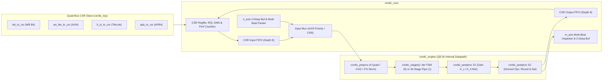

# `29_cordic` — Multi-Mode CORDIC Trigonometric, Hyperbolic & Linear Accelerator

Clean-room, pure synthesizable IEEE 1800-2017 SystemVerilog hardware accelerator implementing all three CORDIC coordinate systems (**Circular**, **Hyperbolic**, and **Linear**) in both **Rotation** and **Vectoring** modes plus derived transcendental/algebraic functions (`sin`, `cos`, vector rotate, `atan2`, `hypot`, `sinh`, `cosh`, `exp`, `atanh`, `sqrt`, `ln`, MAC `y + x·z`, and fixed-point division `y / x`).

Designed from the ground up for both **compact MCU/FPGA targets** (`ARCH_PIPELINED = 0`) and **high-throughput DSP/AP SoCs** (`ARCH_PIPELINED = 1`, sustained **1 result/cycle** streaming throughput), with a **Quad-Bus CSR slave** (Wishbone B4 / AXI4 / TileLink / AMBA APB4) and **zero-combinational-loop 32-bit AXI-Stream** ports.

---

## 1. Key Features

- **Pure Synthesizable SV (IEEE 1800-2017)**: Zero `real`/`shortreal`/`#`/initial blocks in RTL, single clock domain (`clk_i`), async-assert/sync-deassert-safe `rst_ni`, zero latches, zero Verilator `-Wall` warnings.
- **Dual Parameterizable Micro-Architectures**:
  - `ARCH_PIPELINED = 0`: Compact iterative FSM (1 shared micro-rotation stage, configurable precision `ITERS = 1..28`).
  - `ARCH_PIPELINED = 1`: Fully unrolled constant-shift registered pipeline (`PIPE_ITERS` default 28 -> 30 CORDIC stages, **zero barrel shifters**, sustained **1.00 result/cycle** throughput).
- **10 Hardware-Accelerated Modes** across all 3 coordinate systems:
  - **Circular Rotation**: `MODE_SIN_COS` (`cos(z)`, `sin(z)`), `MODE_CIRC_ROT` (general `(x, y)` rotation by `z`) — automatic 4-quadrant reduction `[-pi, +pi] -> [-pi/2, +pi/2]` (plus `[-2*pi, +2*pi]` wrap).
  - **Circular Vectoring**: `MODE_ATAN2_HYPOT` (`hypot(x, y)` and full 4-quadrant `atan2(y, x)` in `[-pi, +pi]`).
  - **Hyperbolic Rotation**: `MODE_SINH_COSH` (`cosh(z)`, `sinh(z)`), `MODE_EXP` (`exp(z)`, `exp(-z)`) — includes mathematically mandatory repeated hyperbolic iterations **`k = 4, 13`** (and `40` when `PIPE_ITERS >= 40`) plus automatic `z = n·ln(2) + r` range reduction for wide inputs beyond `|z| = 1.118`.
  - **Hyperbolic Vectoring**: `MODE_ATANH` (`sqrt(x² - y²)`, `atanh(y/x)`), `MODE_SQRT` (`sqrt(a)` across the **entire** positive fixed-point range `[1 LSB .. MAX]` via `a = m·2^(2k)` normalization), and `MODE_LN` (`ln(a)` across the **entire** positive range via `a = m·2^e` normalization and `2·atanh((m-1)/(m+1)) + e·ln(2)`).
  - **Linear Rotation & Vectoring**: `MODE_LIN_ROT` (`y + x·z`, auto pre-scaled for `|z| >= 1.5`) and `MODE_LIN_VEC` (`y / x`, full-range signed fixed-point division via power-of-2 pre-normalization).
- **4 Fixed-Point Formats (`DATA_W = 32`)**:
  - `FMT_Q1_31` (`[-1, +1)`), `FMT_Q2_30` (`[-2, +2)`), `FMT_Q1_15` (packed 16-bit `{y, x}` / `{res_b, res_a}` in 32-bit words), and `FMT_Q4_28` (`[-8, +8)`).
  - Circular angles support both **pi-normalized** (`RAD_MODE = 0`, `[-1, +1] = [-pi, +pi]`) and **raw radians** (`RAD_MODE = 1`).
  - Internal **42-bit signed Q8.34** datapath (5–6 guard bits below Q1.31 LSB + 7 integer bits) with round-to-nearest and saturation/domain-error detection.
- **Automatic Gain Compensation**: Exact per-iteration-count `K_c(N)` and `K_h(N)` lookup tables with runtime enable/bypass (`CTRL.GAIN_COMP_EN`) and configurable power-of-2 output scaling (`CTRL.SCALE = 0..7`).
- **SoC & DSP Integration**:
  - Quad-bus CSR slave: `cordic_wb`, `cordic_axi`, `cordic_tl`, `cordic_apb`, unified `cordic_top #(.BUS_TYPE(...), .ARCH_PIPELINED(...))`.
  - Direct 32-bit AXI-Stream slave/master ports (`s_axis_*`, `m_axis_*`) with registered skid boundaries (**zero combinational `tvalid -> tready` or `tready -> tvalid` paths**), 1/2/3-beat input packing, 1/2-beat output unpacking, and `tlast` propagation.
  - Depth-8 CSR Input/Output FIFOs, `AUTO_START` single-write trigger, `dma_in_req_o`/`dma_out_req_o`, 5-source maskable W1C `irq_o`, and active cycle/operation performance counters (`PERF_CYCLES`, `PERF_OPS`).

---

## 2. Block Diagram



---

## 3. Parameters & Port Reference

### 3.1 Top-Level Parameters (`cordic_top`)

| Parameter | Type | Default | Description |
|---|---|---|---|
| `BUS_TYPE` | `bus_pkg::bus_proto_e` | `BUS_AXI4` | Select CSR bus slave: `BUS_WISHBONE (0)`, `BUS_AXI4 (1)`, `BUS_TILELINK (2)`, `BUS_APB (3)` |
| `ARCH_PIPELINED` | `bit` | `1'b0` | `0` = compact iterative FSM (`ITERS` runtime-configurable `1..28`); `1` = unrolled registered pipeline (1 result/cycle) |
| `DATA_W` | `int unsigned` | `32` | AXI-Stream data width (fixed 32 bits for Q1.31 / Q2.30 / Q4.28 / packed Q1.15) |
| `PIPE_ITERS` | `int unsigned` | `28` | Number of hyperbolic shift iterations in pipelined mode (`PIPE_STAGES = hyp_total_steps(PIPE_ITERS)`, default 30 stages) |
| `FIFO_DEPTH` | `int unsigned` | `8` | Depth of CSR input and output `sync_fifo` queues |

### 3.2 Ports (`cordic_top`)

| Port | Dir | Width / Type | Description |
|---|---|---|---|
| `clk_i` | Input | `logic` | Single system clock |
| `rst_ni` | Input | `logic` | Active-low asynchronous-assert reset |
| `wb_i` / `wb_o` | In/Out | `wb_m2s_t` / `wb_s2m_t` | Wishbone B4 slave port (active when `BUS_TYPE == BUS_WISHBONE`) |
| `axi_i` / `axi_o` | In/Out | `axi4_m2s_t` / `axi4_s2m_t` | AXI4 / AXI4-Lite slave port (active when `BUS_TYPE == BUS_AXI4`) |
| `tl_i` / `tl_o` | In/Out | `tl_m2s_t` / `tl_s2m_t` | TileLink TL-UL slave port (active when `BUS_TYPE == BUS_TILELINK`) |
| `apb_i` / `apb_o` | In/Out | `apb_m2s_t` / `apb_s2m_t` | AMBA APB4 slave port (active when `BUS_TYPE == BUS_APB`) |
| `s_axis_tvalid_i` | Input | `logic` | AXI-Stream input valid |
| `s_axis_tready_o` | Output | `logic` | AXI-Stream input ready (pure flop output — zero comb loop) |
| `s_axis_tdata_i` | Input | `logic [31:0]` | AXI-Stream input data word |
| `s_axis_tlast_i` | Input | `logic` | AXI-Stream input packet-last flag |
| `m_axis_tvalid_o` | Output | `logic` | AXI-Stream output valid (pure flop output) |
| `m_axis_tready_i` | Input | `logic` | AXI-Stream output ready |
| `m_axis_tdata_o` | Output | `logic [31:0]` | AXI-Stream output data word |
| `m_axis_tlast_o` | Output | `logic` | AXI-Stream output packet-last flag |
| `irq_o` | Output | `logic` | Active-high level interrupt (`|(IRQ_EN & IRQ_STAT)`) |
| `dma_in_req_o` | Output | `logic` | Active-high DMA write request (`DMA_IN_EN && !IN_FIFO_FULL`) |
| `dma_out_req_o` | Output | `logic` | Active-high DMA read request (`DMA_OUT_EN && RES_VALID`) |

---

## 4. Fixed-Point Formats, Range Reduction & Convergence Math

### 4.1 Supported Q-Formats

All inputs are losslessly promoted to internal **42-bit signed Q8.34** (`INT_W = 42`, `INT_FRAC = 34`, range `[-128, +128)`) and rounded-to-nearest with saturation back to the chosen output format:

| `CTRL.FMT` | Name | Representation | Numeric Range | LSB Resolution | Packing (`ARG_PACK`/`RES_PACK`/AXIS) |
|---|---|---|---|---|---|
| `2'b00` | `FMT_Q1_31` | 32-bit signed `val / 2^31` | `[-1.0, +1.0 - 2^-31]` | `4.66e-10` | 32-bit full word |
| `2'b01` | `FMT_Q2_30` | 32-bit signed `val / 2^30` | `[-2.0, +2.0 - 2^-30]` | `9.31e-10` | 32-bit full word |
| `2'b10` | `FMT_Q1_15` | 16-bit signed `val / 2^15` | `[-1.0, +1.0 - 2^-15]` | `3.05e-5` | `{hi[15:0], lo[15:0]}` = `{y, x}` / `{res_b, res_a}` |
| `2'b11` | `FMT_Q4_28` | 32-bit signed `val / 2^28` | `[-8.0, +8.0 - 2^-28]` | `3.73e-9` | 32-bit full word |

> **Circular Angle Units (`CTRL.RAD_MODE`)**:
> - `RAD_MODE = 0` (**default, pi-normalized**): angle `z` represents `theta / pi`, mapping `[-pi, +pi]` onto `[-1.0, +1.0]`. Compatible with **all 4 formats** (including Q1.31 and Q1.15).
> - `RAD_MODE = 1` (**radians**): angle `z` is in direct radians `[-pi, +pi]` (use with `FMT_Q4_28`).

### 4.2 Unified Micro-Rotation Equations

For each step `s` (`m = +1` Circular, `m = -1` Hyperbolic, `m = 0` Linear):

```text
x_{s+1} = x_s - m * d_s * (y_s >>> k_s)
y_{s+1} = y_s +     d_s * (x_s >>> k_s)
z_{s+1} = z_s -     d_s * alpha(m, k_s)

d_s = (z_s >= 0) ? +1 : -1   [Rotation mode]
d_s = (y_s <  0) ? +1 : -1   [Vectoring mode]
```

- **Circular (`m = +1`)**: `k_s = 0, 1, ..., N-1`; `alpha = atan(2^-k)/pi` (`RAD_MODE=0`) or `atan(2^-k)` (`RAD_MODE=1`); gain `A_c = prod sqrt(1 + 2^(-2k)) ≈ 1.646760258121`, inverse `K_c ≈ 0.607252935009`.
- **Hyperbolic (`m = -1`)**: `k_s` starts at `1` and **repeats `k = 4, 13` (and `40` if `>= 40` iters)** per the CORDIC convergence theorem `atanh(2^-k) <= sum_{j>k} atanh(2^-j)`. Total steps for `ITERS = 28` is **30**. Gain `A_h = prod sqrt(1 - 2^(-2k)) ≈ 0.828159360960`, inverse `K_h ≈ 1.207497067763`.
- **Linear (`m = 0`)**: `k_s = 0, 1, ..., N-1`; `alpha = 2^-k`; unity gain `K_l = 1.0`.

### 4.3 Operating Modes & Range Reduction Summary

| `MODE` | Name | Inputs | `RES_A` | `RES_B` | Pre-Processing / Range Reduction | Domain Error (`STAT.LAST_ERR`) |
|---|---|---|---|---|---|---|
| `0` | `MODE_SIN_COS` | `z` | `cos(z)` | `sin(z)` | Wrap `[-2pi, 2pi]`, reflect `|z| > pi/2` by `(-x, -y, z -/+ pi)` | None |
| `1` | `MODE_CIRC_ROT` | `x, y, z` | `x·cos(z) - y·sin(z)` | `x·sin(z) + y·cos(z)` | Same 4-quadrant reduction on `(x, y, z)` | None |
| `2` | `MODE_ATAN2_HYPOT` | `x, y` | `hypot(x, y)` | `atan2(y, x)` | If `x < 0`: `(-x, -y)` and `z0 = (y>=0) ? +pi : -pi`; `(0,0) -> (0,0)` | None |
| `3` | `MODE_SINH_COSH` | `z` | `cosh(z)` | `sinh(z)` | `z = n·ln(2) + r` (`|r| <= 0.36 << 1.118`), reconstruct `(exp(r)·2^n +/- exp(-r)·2^-n)/2` | None |
| `4` | `MODE_EXP` | `z` | `exp(z)` | `exp(-z)` | Same `z = n·ln(2) + r`, post-shift `(cosh(r) +/- sinh(r)) · 2^(+/-n)` | None |
| `5` | `MODE_ATANH` | `x, y` | `sqrt(x² - y²)` | `atanh(y / x)` | Direct hyperbolic vectoring (`x > 0`, `|y/x| <= 0.806`) | `x <= 0`, `|y| >= x`, or non-convergence |
| `6` | `MODE_SQRT` | `x` (`= a`) | `sqrt(a)` | `0` | Normalize `a = m·2^(2k)`, `m in [0.25, 1.0)`, `x0 = m+0.25, y0 = m-0.25`, shift `2^k` | `a < 0` |
| `7` | `MODE_LN` | `x` (`= a`) | `ln(a)` | `0` | Normalize `a = m·2^e`, `m in [0.5, 1.0)`, `x0 = m+1, y0 = m-1`, `2·z + e·ln(2)` | `a <= 0` |
| `8` | `MODE_LIN_ROT` | `x, y, z` | `y + x·z` | `x` | If `|z| >= 1.5`: pre-scale `(x << 3, z >> 3)` so `|z'| <= 1.0 < 2.0` | None |
| `9` | `MODE_LIN_VEC` | `x, y` | `y / x` | `0` | Normalize `|x| in [1, 2)`, `|y| in [0.5, 1)` so `|y/x| in (0.25, 1)`, shift `2^(sx-sy)` | `x == 0` |

> **Tip (`CTRL.SCALE`)**: Setting `SCALE = s` (`0..7`) divides the computed output by `2^s` **before** final saturation (except `atan2` angle output, which stays unscaled). For example, in `FMT_Q1_31`, set `SCALE = 1` for `MODE_ATAN2_HYPOT` (`hypot/2` fits up to `sqrt(2)/2 = 0.707 < 1.0`), or `SCALE = 5` for `MODE_LN` (`ln(2^-31)/32 = -0.671 in [-1, +1)`).

### 4.4 Convergence & Accuracy vs. Iteration Count

| `ITERS` | Iter Latency (Circ/Lin) | Iter Latency (Hyp) | Theoretical Residual | Measured 32b Max Error |
|---|---|---|---|---|
| `8` | 11 cycles | 12 cycles | `< 7.8e-3` | `~4.0e-3` |
| `12` | 15 cycles | 16 cycles | `< 4.9e-4` | `~2.5e-4` |
| `16` | 19 cycles | 21 cycles | `< 3.1e-5` | `~1.5e-5` |
| `20` | 23 cycles | 25 cycles | `< 1.9e-6` | `~9.5e-7` |
| `28` (default) | 31 cycles | 33 cycles | `< 7.5e-9` | `< 3.0e-8` (Q2.30/Q4.28) |

In `ARCH_PIPELINED = 1` (`PIPE_ITERS = 28`), total pipeline latency is **35 cycles** (including registered input/output skid FIFOs) with **1.00 result/cycle** sustained throughput.

---

## 5. CSR Register Map

Base address is system-assigned. Unmapped offsets return bus error (`err` / `SLVERR` / `d_denied` / `PSLVERR`). Partial byte writes (`wstrb` / `pstrb`) are supported on all RW registers.

| Offset | Name | Access | Reset | Description |
|---|---|---|---|---|
| `0x00` | `ID_CAP` | RO | param | `[31:24]=0xC0` IP ID, `[23:16]=0x10` v1.0, `[15]=ARCH_PIPELINED`, `[14:8]=PIPE_ITERS`, `[7:0]=DATA_W` |
| `0x04` | `CTRL` | RW | `0x001C0100` | Core configuration (see Section 5.1) |
| `0x08` | `CMD` | WO | `0x00000000` | `[0]=START`, `[1]=SOFT_RST`, `[2]=PERF_CLR`, `[3]=FIFO_CLR` |
| `0x0C` | `STAT` | RO | `0x00000028` | Engine, FIFO, saturation & error status (see Section 5.2) |
| `0x10` | `IRQ_EN` | RW | `0x00000000` | `[0]=DONE`, `[1]=SAT`, `[2]=ERR`, `[3]=OUT_RDY`, `[4]=AXIS_LAST` |
| `0x14` | `IRQ_STAT` | W1C | `0x00000000` | Sticky interrupt status (same bit mapping as `IRQ_EN`; HW set wins over W1C) |
| `0x18` | `ARG_X` | RW | `0x00000000` | Signed `X` operand (`a` for `SQRT`/`LN`); auto-starts unary-X modes when `AUTO_START=1` |
| `0x1C` | `ARG_Y` | RW | `0x00000000` | Signed `Y` operand; auto-starts 2-arg vectoring modes when `AUTO_START=1` |
| `0x20` | `ARG_Z` | RW | `0x00000000` | Signed `Z` operand (angle / multiplier); auto-starts rotation modes when `AUTO_START=1` |
| `0x24` | `ARG_PACK` | RW* | `0x00000000` | Write `{y[15:0], x[15:0]}` (also sets `z=x` for unary angle modes); always triggers when `AUTO_START=1` |
| `0x28` | `RES_A` | RO | `0x00000000` | Latest primary CSR result (`cos`, `x'`, `hypot`, `cosh`, `exp(z)`, `sqrt`, `ln`, `y+xz`, `y/x`). Clears `RES_VALID` in non-FIFO mode |
| `0x2C` | `RES_B` | RO | `0x00000000` | Latest secondary CSR result (`sin`, `y'`, `atan2`, `sinh`, `exp(-z)`, `atanh`, `x`). Non-destructive |
| `0x30` | `RES_PACK` | RO | `0x00000000` | Packed `{RES_B[15:0], RES_A[15:0]}`. Clears `RES_VALID` in non-FIFO mode |
| `0x34` | `FIFO_POP` | RO | `0x00000000` | Pops 1 entry from CSR output FIFO; returns `RES_A` (or packed `{RES_B[15:0], RES_A[15:0]}` for Q1.15) and latches `RES_B` into `FIFO_POP_B` |
| `0x38` | `FIFO_POP_B` | RO | `0x00000000` | Secondary result (`RES_B`) paired with the entry most recently popped via `FIFO_POP` |
| `0x3C` | `PERF_CYCLES` | RO | `0x00000000` | Active compute cycle counter (increments when `PERF_EN && BUSY`) |
| `0x40` | `PERF_OPS` | RO | `0x00000000` | Completed operations counter (CSR + AXI-Stream, increments when `PERF_EN`) |

### 5.1 `CTRL` (`0x04`) Bit Fields

| Bits | Field | Reset | Description |
|---|---|---|---|
| `[3:0]` | `MODE` | `0` | Operation mode (`0..9`) |
| `[5:4]` | `FMT` | `0` | Fixed-point format (`0=Q1.31`, `1=Q2.30`, `2=Q1.15 packed`, `3=Q4.28`) |
| `[6]` | `RAD_MODE` | `0` | `0` = pi-normalized circular angles (`[-1, +1]`), `1` = radians (`[-pi, +pi]`) |
| `[7]` | `RSVD` | `0` | Reserved, reads 0 |
| `[8]` | `GAIN_COMP_EN` | `1` | `1` = apply exact `K_c`/`K_h` gain compensation, `0` = bypass raw CORDIC gain |
| `[11:9]` | `SCALE` | `0` | Output right-shift power-of-2 scale factor (`0..7`) |
| `[12]` | `AUTO_START` | `0` | Auto-push CSR op when writing the trigger operand register (`ARG_X`/`Y`/`Z`/`PACK`) |
| `[13]` | `OUT_FIFO_EN` | `0` | `0` = latest-result registers only (never stalls); `1` = strict backpressured 8-deep output FIFO |
| `[14]` | `DMA_IN_EN` | `0` | Enable `dma_in_req_o` |
| `[15]` | `DMA_OUT_EN` | `0` | Enable `dma_out_req_o` |
| `[20:16]` | `ITERS` | `28` | Iterative engine precision (`1..28`, clamped; ignored when `ARCH_PIPELINED=1`) |
| `[21]` | `AXIS_EN` | `0` | Enable AXI-Stream slave/master datapath (`s_axis_tready_o` gated by `AXIS_EN`) |
| `[23:22]` | `AXIS_IN_BEATS` | `0` | Beats per AXIS op: `0` = 1 beat, `1` = 2 beats (`X, Y`), `2` = 3 beats (`X, Y, Z`) |
| `[24]` | `AXIS_OUT_BEATS` | `0` | Output beats per AXIS op: `0` = 1 beat (`RES_A` or packed Q1.15), `1` = 2 beats (`RES_A`, `RES_B`) |
| `[25]` | `AXIS_OUT_SEL_B` | `0` | When `AXIS_OUT_BEATS=0` and 32b format: `0` = emit `RES_A`, `1` = emit `RES_B` |
| `[26]` | `PERF_EN` | `0` | Enable `PERF_CYCLES` and `PERF_OPS` counters |
| `[31:27]` | `RSVD` | `0` | Reserved, reads 0 |

### 5.2 `STAT` (`0x0C`) Bit Fields

| Bits | Field | Description |
|---|---|---|
| `[0]` | `BUSY` | Engine or input queues have active operation(s) in flight |
| `[1]` | `RES_VALID` | Unread result available (`!OUT_FIFO_EMPTY` if `OUT_FIFO_EN=1`, else unread flag) |
| `[2]` / `[3]` | `IN_FIFO_FULL` / `IN_FIFO_EMPTY` | CSR input FIFO flags |
| `[4]` / `[5]` | `OUT_FIFO_FULL` / `OUT_FIFO_EMPTY` | CSR output FIFO flags |
| `[6]` | `LAST_SAT` | Saturation occurred on last completed op (cleared by `SOFT_RST` or next non-saturating CSR op) |
| `[7]` | `LAST_ERR` | Domain error occurred on last completed op (`SQRT<0`, `LN<=0`, `DIV/0`, `ATANH` invalid) |
| `[11:8]` | `IN_FIFO_LVL` | CSR input FIFO occupancy (`0..8`) |
| `[15:12]` | `OUT_FIFO_LVL` | CSR output FIFO occupancy (`0..8`) |
| `[23:16]` | `INFLIGHT_CNT` | Number of operations currently inside `cordic_engine` |

---

## 6. AXI-Stream Protocol & Timing

Both `s_axis_*` and `m_axis_*` terminate on registered 2-deep FWFT `sync_fifo` boundaries (`s_axis_tready_o = cfg_axis_en && !in_buf_full`, `m_axis_tvalid_o = !out_buf_empty`), guaranteeing:
1. **Zero combinational paths** from `s_axis_tvalid_i -> s_axis_tready_o` or `m_axis_tready_i -> m_axis_tvalid_o`.
2. **Sustained 1.00 beat/cycle** throughput in `ARCH_PIPELINED = 1` with zero bubbles under full speed and zero dropped/duplicated beats under arbitrary sink backpressure.

```text
Cycle:       0     1     2    ...   35    36    37
s_tvalid:  __/¯¯¯¯¯¯¯¯¯¯¯¯¯\________..._____________
s_tready:  ¯¯¯¯¯¯¯¯¯¯¯¯¯¯¯¯¯\_______..._____________  (registered flop)
s_tdata:     [d0]  [d1]  [d2]
s_tlast:     0     0     1
m_tvalid:  ________________...______/¯¯¯¯¯¯¯¯¯¯¯¯¯\_  (registered flop)
m_tready:  ¯¯¯¯¯¯¯¯¯¯¯¯¯¯¯¯...¯¯¯¯¯¯¯¯¯¯¯¯¯¯¯¯¯¯¯¯¯¯
m_tdata:                            [r0]  [r1]  [r2]  (1 result/cycle!)
m_tlast:                            0     0     1
```

---

## 7. C Firmware Programming Recipes

### 7.1 Single-Shot `sin(z)` & `cos(z)` (Q2.30, Polling)

```c
#define CORDIC_BASE   0x40029000u
#define REG_CTRL      (*(volatile uint32_t *)(CORDIC_BASE + 0x04))
#define REG_STAT      (*(volatile uint32_t *)(CORDIC_BASE + 0x0C))
#define REG_ARG_Z     (*(volatile uint32_t *)(CORDIC_BASE + 0x20))
#define REG_RES_A     (*(volatile int32_t  *)(CORDIC_BASE + 0x28))
#define REG_RES_B     (*(volatile int32_t  *)(CORDIC_BASE + 0x2C))

void cordic_sincos_q2_30(int32_t z_pi_norm, int32_t *cos_out, int32_t *sin_out) {
  // MODE=0 (SIN_COS), FMT=1 (Q2.30), GAIN_COMP_EN=1, AUTO_START=1, ITERS=28
  REG_CTRL = (0u << 0) | (1u << 4) | (1u << 8) | (1u << 12) | (28u << 16);
  REG_ARG_Z = (uint32_t)z_pi_norm;          // Auto-starts computation
  while ((REG_STAT & (1u << 1)) == 0u) {}   // Wait RES_VALID
  *cos_out = REG_RES_A;
  *sin_out = REG_RES_B;
}
```

### 7.2 High-Throughput Packed Q1.15 Polar Conversion (`ATAN2_HYPOT`) over AXI-Stream

```c
void cordic_setup_axis_polar_q1_15(void) {
  // MODE=2 (ATAN2_HYPOT), FMT=2 (Q1.15 packed {y,x}), GAIN_COMP_EN=1,
  // SCALE=1 (hypot/2 avoids Q1.15 saturation), AXIS_EN=1, 1-beat in/1-beat out
  REG_CTRL = (2u << 0) | (2u << 4) | (1u << 8) | (1u << 9) | (28u << 16) | (1u << 21);
  // Stream {y16, x16} into s_axis_tdata_i; read {atan2_16, hypot_half_16} from m_axis_tdata_o
}
```

### 7.3 Arbitrary-Range `ln(a)` and `sqrt(a)` (Q4.28)

```c
int32_t cordic_sqrt_q4_28(int32_t a_q4_28) {
  REG_CTRL = (6u << 0) | (3u << 4) | (1u << 8) | (1u << 12) | (28u << 16);
  *(volatile uint32_t *)(CORDIC_BASE + 0x18) = (uint32_t)a_q4_28; // ARG_X auto-starts
  while ((REG_STAT & (1u << 1)) == 0u) {}
  return REG_RES_A;
}

// Returns ln(a) / 4 in Q4.28 (covers full 2^-28 .. 8.0 input range without saturation)
int32_t cordic_ln_div4_q4_28(int32_t a_q4_28) {
  REG_CTRL = (7u << 0) | (3u << 4) | (1u << 8) | (2u << 9) | (1u << 12) | (28u << 16);
  *(volatile uint32_t *)(CORDIC_BASE + 0x18) = (uint32_t)a_q4_28;
  while ((REG_STAT & (1u << 1)) == 0u) {}
  return REG_RES_A;
}
```

---

## 8. FPGA & ASIC Implementation Notes

- **FPGA Synthesis**:
  - `ARCH_PIPELINED = 0`: Fits in ~1,200–1,600 LUTs + 4 DSP48s (for the registered `K_c`/`K_h` gain stage); zero BRAMs required (depth-8 FIFOs infer distributed LUTRAM/registers).
  - `ARCH_PIPELINED = 1`: Each `cordic_stage` uses `FIXED_STAGE = 1` with compile-time constant shifts (**0 barrel shifters**) and constant LUT values, minimizing LUT depth to 1 carry chain + 2:1 mux per stage (>250–350 MHz on Artix-7 / UltraScale+).
- **ASIC Tape-Out**:
  - Single clock domain (`clk_i`), async-assert `rst_ni` on all control flops, synchronous `SOFT_RST` (`clr_i`) without gating `rst_ni`.
  - No tri-state buffers, no latches, no combinational handshake loops at either CSR or AXI-Stream boundaries.
  - `cordic_postproc` registers the gain multiply (`S1`) separately from post-add/denorm/saturation (`S2`) for balanced pipeline stage delay.

---

## 9. Verification Summary

Verified via self-checking testbench [`ips/29_cordic/tb/tb_cordic.sv`](../tb/tb_cordic.sv) (`tb_cordic`) using an **independent SV `real` floating-point oracle** (`$sin`, `$cos`, `$atan2`, `$sinh`, `$cosh`, `$exp`, `$sqrt`, `$ln`) — zero reuse of DUT LUTs or RTL functions:

- **Lint Clean**: `cordic_top` lint-clean under Verilator 5.054 (`-Wall -Wno-UNUSEDSIGNAL -Wno-UNUSEDPARAM -Wno-DECLFILENAME -Wno-PINCONNECTEMPTY`) across all 8 `(BUS_TYPE ∈ {WB, AXI4, TL, APB}) × (ARCH_PIPELINED ∈ {0, 1})` configurations plus `PIPE_ITERS ∈ {12, 40}`.
- **Simulation Coverage**:
  - All **4 bus wrappers** (`BUS_AXI4`, `BUS_APB`, `BUS_WISHBONE`, `BUS_TILELINK`) + both architectures (`ARCH_PIPELINED = 0` and `1`).
  - Partial byte strobes (`wstrb`/`pstrb`), unmapped address bus error responses (`SLVERR`/`PSLVERR`/`err`/`d_denied`), `AUTO_START`, `OUT_FIFO_EN`, `FIFO_POP`/`FIFO_POP_B`, `dma_in_req_o`/`dma_out_req_o`, maskable W1C `irq_o`, `SOFT_RST`, and `PERF_CYCLES`/`PERF_OPS`.
  - All **10 modes** across directed corners (`0, ±pi/2, ±pi`, all 4 quadrants, `1 LSB`, saturation, `GAIN_COMP_EN=0/1`, `ITERS = 8/12/16/20/28`, all domain error paths) and multi-seed constrained-random sweeps (`+seed=1, 7, 42`).
  - AXI-Stream verified for **exact 1.00 result/cycle peak throughput** (64 consecutive packed Q1.15 beats in 64 output cycles), random source bubbles + sink backpressure, 1/2/3-beat input packing, 1/2-beat output unpacking, and `tlast` / `IRQ_STAT.AXIS_LAST` propagation.
  - **Measured 32-bit Accuracy (`ITERS = 28`, across seeds `+seed=1, 7, 42`)**:
    - `MODE_SIN_COS` (`0`): max `7.32e-09`, RMS `3.11e-09`–`3.49e-09`
    - `MODE_CIRC_ROT` (`1`): max `2.19e-08`, RMS `4.11e-09`–`6.05e-09`
    - `MODE_ATAN2_HYPOT` (`2`): max `5.71e-09`, RMS `1.51e-09`–`1.56e-09`
    - `MODE_SINH_COSH` (`3`): max `1.11e-08`, RMS `3.14e-09`–`3.44e-09`
    - `MODE_EXP` (`4`): max `2.02e-08`, RMS `6.52e-09`–`7.25e-09`
    - `MODE_ATANH` (`5`): max `3.86e-09`, RMS `1.99e-09`–`2.16e-09`
    - `MODE_SQRT` (`6`): max `3.89e-09`, RMS `8.46e-10`–`1.12e-09`
    - `MODE_LN` (`7`): max `7.23e-09`, RMS `2.04e-09`–`2.09e-09`
    - `MODE_LIN_ROT` (`8`): max `9.26e-08`, RMS `2.23e-08`–`2.76e-08`
    - `MODE_LIN_VEC` (`9`): max `3.73e-08`, RMS `7.08e-09`–`8.75e-09`
  - **Coverage per seed**: 583 CSR checks + 104 AXI-Stream ops (0 errors, 20 domain-error checks, 31 saturation events, 8 gain-bypass checks, all 4 quadrants, all 4 buses, both `ARCH_PIPELINED=0/1`).
