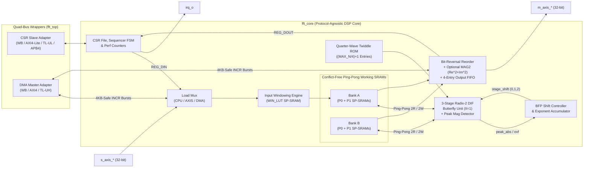
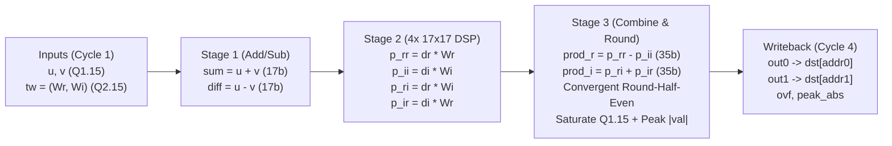

# 30_fft: Runtime-Configurable Complex Radix-2 FFT / IFFT Hardware Accelerator

A clean-room, pure synthesizable IEEE 1800-2017 SystemVerilog **Complex Radix-2 Decimation-In-Frequency (DIF) FFT / IFFT Hardware Accelerator** engineered for both **FPGA Block RAM / DSP48** inference and **ASIC Single-Port SRAM** tape-out.

It combines a 3-stage pipelined (`II = 1`, 1 butterfly/cycle) extended-precision butterfly engine with **convergent round-half-to-even** arithmetic, **quarter-wave compressed Twiddle Factor ROM** (`(MAX_N/4)+1` entries), **conflict-free parity-partitioned dual-bank ping-pong SRAMs**, **automatic zero-overflow Block Floating Point (`SCALE_BFP`)**, an **input windowing engine (`WIN_LUT`)**, **on-the-fly output bit-reversal reorder**, **exact 32-bit Magnitude-Squared (`Re^2 + Im^2`) power spectrum output**, **4KB-safe Master Burst DMA**, **32-bit AXI-Stream (`s_axis_*` / `m_axis_*`)**, and **Quad-Bus CSR/DMA wrappers** (`Wishbone B4`, `AXI4`, `TileLink TL-UL/TL-UH`, and `APB4 + AXI4`).

---

## Key Features

- **Runtime-Configurable Transform Length**: Parameterizable `MAX_LOG2_N` (`4..10`, default `10` = `1024`-pt); runtime-selectable `N = 16, 32, 64, 128, 256, 512, 1024` via `REG_CFG.LOG2_N`.
- **Forward FFT & Inverse IFFT**: Single unified datapath controlled by `REG_CFG.INVERSE` (`0`: $W_N^{+k} = e^{-j2\pi k/N}$; `1`: $W_N^{-k} = e^{+j2\pi k/N}$).
- **Q1.15 Complex Fixed-Point with Convergent Rounding**:
  - Packed 32-bit complex words `{re[15:0], im[15:0]}` (signed Q1.15 two's complement).
  - Extended 17-bit add/sub, 34-bit real products, 35-bit complex accumulate, unbiased **round-half-to-even**, and saturating Q1.15 writeback.
- **Three Selectable Scaling Schedules (`REG_CFG.SCALE_MODE`)**:
  - `SCALE_NONE` (`2'd0`): Unscaled butterfly stages with Q1.15 saturation and sticky `OVF_FLAG` / `OVF_IE` interrupt.
  - `SCALE_PER_STAGE` (`2'd1`): Fixed `>> 1` per stage ($1/N$ total scaling, `BFP_EXP = LOG2_N`), overflow-free for all unit-disk inputs $|x[n]| \le 1.0$.
  - `SCALE_BFP` (`2'd2`): **Adaptive Block Floating Point** tracks exact peak sample magnitude across every frame/stage and shifts by `0`, `1`, or `2` bits only when required — **mathematically guaranteeing zero overflow** even on worst-case full-scale corners `(±32767, ±32767)` while maximizing SNR and reporting total exponent in `REG_STATUS.BFP_EXP`.
- **Quarter-Wave Compressed Twiddle ROM (`fft_twiddle_rom`)**: Stores only `(MAX_N/4) + 1` (`257 x 16`-bit for `1024`-pt) unsigned Q1.15 cosine values (`[0..32768]`, exact `1.0 = 16'h8000`) and reconstructs full-circle `cos` and `sin` via quadrant sign/swap symmetry (**4x ROM savings** vs full-wave cosine, **8x** vs separate full-wave cos/sin tables).
- **Conflict-Free Dual-Bank Ping-Pong Single-Port SRAMs**: Bank A and Bank B ping-pong across stages; each bank is split into two parity sub-banks (`^addr`) so every butterfly reads 2 samples and writes 2 samples every single cycle using **pure Single-Port (1RW) synchronous SRAMs** with zero bank conflicts.
- **Input Windowing Engine (`WIN_LUT`)**: CPU-loadable `MAX_N x 16`-bit unsigned Q1.15 (`16'h8000 = 1.0`) single-port SRAM aperture (`0x1000..0x1FFC`) with 1-sample/cycle pipelined prefetch and bypass (`REG_CFG.WIN_EN`).
- **Output Post-Processing**:
  - Selectable **Bit-Reversal Output Reorder** (`REG_CFG.BITREV_EN`: `1` = natural frequency order, `0` = raw bit-reversed order).
  - Optional **Magnitude-Squared Power Spectrum** (`REG_CFG.MAG2_EN = 1`): exact 32-bit unsigned UQ2.30 `Re^2 + Im^2` (`0 .. 2^31`) with zero overflow or truncation.
- **Triple Data Movement Engines (Independently Selectable Source & Destination)**:
  - **4KB-Safe Master Burst DMA** (`IO_DMA`): Automatic AXI4 4KB (`0x1000`) page-boundary splitting with configurable `MAX_BURST_LEN` (`1..256` beats), `DMA_ID`, and `DMA_QOS`.
  - **Direct 32-bit AXI-Stream** (`IO_AXIS`): `s_axis_*` / `m_axis_*` with `tlast` frame delimiting, full backpressure stability, continuous back-to-back streaming (`CONT_STREAM`), and automatic zero-padding on early `s_axis_tlast_i`.
  - **CPU Memory-Mapped Sample FIFO** (`IO_CPU`): `REG_DIN` / `REG_DOUT` backed by a 4-entry output prefetch FIFO.
- **Quad-Bus SoC Integration (`fft_top`)**: Compile-time `BUS_TYPE` selects `BUS_WISHBONE`, `BUS_AXI4`, `BUS_TILELINK`, or `BUS_APB` (`s_apb_*` APB4 CSR slave paired with `m_axi_*` AXI4 Burst DMA master).

---

## Architecture Overview



### 3-Stage Pipelined Radix-2 DIF Butterfly (`fft_butterfly.sv`)



---

## RTL Hierarchy (`ips/30_fft/rtl/`)

Compile order is captured in `ips/30_fft/filelist.f`:

| File | Module / Package | Description |
| :--- | :--- | :--- |
| `fft_pkg.sv` | `fft_pkg` | CSR offsets, enums (`fft_scale_e`, `fft_io_mode_e`, `fft_err_e`), convergent rounding, saturation, `abs16_u`, and `bitrev12`. |
| `fft_sram_sp.sv` | `fft_sram_sp` | Clock-only inferable single-port synchronous SRAM (no reset on storage array). |
| `fft_twiddle_rom.sv` | `fft_twiddle_rom` | Quarter-wave compressed cosine ROM (`(MAX_N/4)+1` entries) + quadrant sign/swap reconstruction. |
| `fft_butterfly.sv` | `fft_butterfly` | 3-stage pipelined (`II = 1`) Radix-2 DIF butterfly with convergent rounding, saturation, and peak-magnitude detector. |
| `fft_core.sv` | `fft_core` | Protocol-agnostic FFT/IFFT engine, parity-banked SRAMs, windowing, BFP controller, bit-reversal/MAG2 unload FIFO, 4KB-safe DMA, and CSRs. |
| `fft_wb.sv` | `fft_wb` | Wishbone B4 CSR slave + Wishbone B4 DMA master wrapper. |
| `fft_axi.sv` | `fft_axi` | AXI4-Lite CSR slave + AXI4 burst DMA master wrapper. |
| `fft_tl.sv` | `fft_tl` | TileLink TL-UL CSR slave + TL-UH burst DMA master wrapper. |
| `fft_apb.sv` | `fft_apb` | AMBA APB4 CSR slave (`s_apb_*`) + AXI4 burst DMA master (`m_axi_*`) wrapper. |
| `fft_top.sv` | `fft_top` | Parameterized quad-bus top-level selector (`BUS_TYPE`, `MAX_LOG2_N`). |

---

## Parameters & Interface Ports (`fft_top`)

### Parameters

| Parameter | Type | Default | Range | Description |
| :--- | :--- | :---: | :---: | :--- |
| `BUS_TYPE` | `bus_pkg::bus_proto_e` | `BUS_AXI4` | `BUS_WISHBONE` (0), `BUS_AXI4` (1), `BUS_TILELINK` (2), `BUS_APB` (3) | Selects active CSR slave and DMA master bus wrapper. |
| `MAX_LOG2_N` | `int unsigned` | `10` | `4 .. 10` | Maximum transform size `MAX_N = 1 << MAX_LOG2_N` (`16 .. 1024`). |

### Port Table

| Port | Dir | Type / Width | Description |
| :--- | :---: | :--- | :--- |
| `clk_i` | Input | `logic` | Single system clock for all CSR, DMA, AXI-Stream, and DSP logic. |
| `rst_ni` | Input | `logic` | Asynchronous active-low reset (assert async, deassert sync; SRAM arrays unreset). |
| `s_wb_i` / `s_wb_o` | In / Out | `wb_m2s_t` / `wb_s2m_t` | Wishbone B4 CSR slave (`BUS_WISHBONE`). |
| `s_axi_i` / `s_axi_o` | In / Out | `axi4_m2s_t` / `axi4_s2m_t` | AXI4 / AXI4-Lite CSR slave (`BUS_AXI4`). |
| `s_tl_i` / `s_tl_o` | In / Out | `tl_m2s_t` / `tl_s2m_t` | TileLink TL-UL CSR slave (`BUS_TILELINK`). |
| `s_apb_i` / `s_apb_o` | In / Out | `apb_m2s_t` / `apb_s2m_t` | AMBA APB4 CSR slave (`BUS_APB`). |
| `m_wb_o` / `m_wb_i` | Out / In | `wb_m2s_t` / `wb_s2m_t` | Wishbone B4 burst DMA master (`BUS_WISHBONE`). |
| `m_axi_o` / `m_axi_i` | Out / In | `axi4_m2s_t` / `axi4_s2m_t` | AXI4 burst DMA master (active for **both** `BUS_AXI4` and `BUS_APB`). |
| `m_tl_o` / `m_tl_i` | Out / In | `tl_m2s_t` / `tl_s2m_t` | TileLink TL-UH burst DMA master (`BUS_TILELINK`). |
| `s_axis_tvalid_i` | Input | `logic` | AXI-Stream ingress valid (`SRC_MODE = IO_AXIS`). |
| `s_axis_tready_o` | Output | `logic` | AXI-Stream ingress ready. |
| `s_axis_tdata_i` | Input | `logic [31:0]` | AXI-Stream ingress Q1.15 complex sample `{re[15:0], im[15:0]}`. |
| `s_axis_tlast_i` | Input | `logic` | AXI-Stream ingress frame delimiter (early `tlast` zero-pads remainder of frame). |
| `m_axis_tvalid_o` | Output | `logic` | AXI-Stream egress valid (`DST_MODE = IO_AXIS`). |
| `m_axis_tready_i` | Input | `logic` | AXI-Stream egress ready (arbitrary backpressure supported). |
| `m_axis_tdata_o` | Output | `logic [31:0]` | AXI-Stream egress output word (Q1.15 complex or UQ2.30 `Re^2+Im^2`). |
| `m_axis_tlast_o` | Output | `logic` | AXI-Stream egress asserted on final sample (`N - 1`) of each frame. |
| `irq_o` | Output | `logic` | Level-sensitive active-high interrupt (`DONE`, `ERR`, or `OVF` masked by `REG_IRQ_EN`). |

---

## Fixed-Point DSP Mathematics

### 1. Number Formats

- **Complex Sample (Q1.15)**: 32-bit word `{re[15:0], im[15:0]}` where `re` and `im` are signed 16-bit two's complement integers representing $v = \text{int16} / 32768.0 \in [-1.0, +0.9999695]$.
- **Window Coefficient (`WIN_LUT`)**: Unsigned 16-bit Q1.15 (`[0 .. 65535]`) where `16'h8000` (`32768`) represents exact `1.0`, `16'h4000` represents `0.5`, and `16'h0000` represents `0.0`.
- **Magnitude-Squared (`MAG2_EN = 1`)**: Exact unsigned 32-bit **UQ2.30** integer $P = \text{re}^2 + \text{im}^2 \in [0, 2^{31}]$ (`0x0000_0000 .. 0x8000_0000`). True power is $P_{\text{true}} = \text{word} \cdot 2^{2 \cdot \text{BFP\_EXP} - 30}$.
- **Convergent Rounding (Round-Half-to-Even)**: For any two's complement value $x$ right-shifted by $S \ge 1$, the increment bit is `inc = x[S-1] && ((|x[S-2:0]) || x[S])`, eliminating positive DC rounding bias across all stages.

### 2. Quarter-Wave Compressed Twiddle Factor ROM

For `MAX_N = 1 << MAX_LOG2_N` and $Q = \text{MAX\_N}/4$, `fft_twiddle_rom` stores only the $Q + 1$ first-quadrant unsigned cosine values:

$$\text{QROM}[i] = \text{round}\!\left(32768 \cdot \cos\!\left(\frac{2\pi i}{\text{MAX\_N}}\right)\right), \quad i \in \{0, 1, \dots, Q\}$$

Note that $\text{QROM}[0] = 32768$ (`16'h8000`, exact unity) and $\text{QROM}[Q] = 0$. Using $\sin(\theta) = \cos(\pi/2 - \theta)$, both $\cos$ and $\sin$ are fetched simultaneously from `c = QROM[off]` and `s = QROM[Q - off]` where `quad = angle[AW-1:AW-2]` and `off = angle[AW-3:0]`:

| Quadrant `quad` | Angle $\theta$ | $\cos(\theta)$ | $\sin(\theta)$ | Forward $W_N^{+k}$ | Inverse $W_N^{-k}$ |
| :---: | :---: | :---: | :---: | :---: | :---: |
| `2'd0` | $[0, \pi/2)$ | $+c$ | $+s$ | $+c - j\,s$ | $+c + j\,s$ |
| `2'd1` | $[\pi/2, \pi)$ | $-s$ | $+c$ | $-s - j\,c$ | $-s + j\,c$ |
| `2'd2` | $[\pi, 3\pi/2)$ | $-c$ | $-s$ | $-c + j\,s$ | $-c - j\,s$ |
| `2'd3` | $[3\pi/2, 2\pi)$ | $+s$ | $-c$ | $+s + j\,c$ | $+s - j\,c$ |

Signed 17-bit outputs `tw_re_o, tw_im_o` span `[-32768, +32768]`, preserving **exact** $W^0 = +1$, $W^{N/4} = \mp j$, $W^{N/2} = -1$ with zero gain droop while still fitting natively inside a single 18-bit FPGA DSP multiplier input!

### 3. Conflict-Free Parity-Banked Ping-Pong SRAM Addressing

Every Radix-2 DIF butterfly at stage $s \in \{0, \dots, L-1\}$ accesses an index pair $(a_0, a_1)$ differing in **exactly one bit** $m = L - 1 - s$. Consequently, their XOR parity bits are always opposite:

$$p(a_0) = \bigoplus_{i=0}^{AW-1} a_{0,i} \neq \bigoplus_{i=0}^{AW-1} a_{1,i} = p(a_1)$$

Mapping every logical address $a$ to sub-bank $p(a) \in \{0, 1\}$ at sub-index $q(a) = a[AW-1:1]$ forms an **exact bijection** onto $2 \times (\text{MAX\_N}/2)$ words. Because Bank A and Bank B ping-pong across even/odd stages (`src = stage[0]`, `dst = ~stage[0]`), each of the four physical SRAMs (`bank_a_p0`, `bank_a_p1`, `bank_b_p0`, `bank_b_p1`) executes at most **one single read or one single write per clock cycle** (100% single-port 1RW SRAM!) while delivering 2 reads + 2 writes/cycle (1 full butterfly/cycle).

### 4. Block Floating Point (`SCALE_BFP`) Scaling Guide

In a DIF butterfly, if all input components satisfy $|u_r|, |u_i|, |v_r|, |v_i| \le M$:
- Upper branch: $|u + v| \le 2 M$
- Lower branch: $|(u - v) \cdot W| \le 2M(|\cos\theta| + |\sin\theta|) \le 2\sqrt{2}\,M \approx 2.8284\,M$ (for non-trivial stages $s < L - 2$), or $\le 2M$ (for the final 2 DIF stages $s \ge L - 2$, where $W \in \{1, \pm j\}$).

Before each stage $s$, `fft_core` inspects the exact peak magnitude `stage_max_abs_q` captured across all $N$ samples written by Load (for $s = 0$) or Stage $s - 1$ (for $s > 0$) and chooses `stage_shift ∈ {0, 1, 2}`:

| Stage Type | `stage_max_abs_q` Condition | Applied `stage_shift` | Guaranteed Worst-Case Output |
| :--- | :--- | :---: | :--- |
| Non-trivial ($s < L - 2$) | $\le 11580$ | `0` (no shift) | $\le 2\sqrt{2} \times 11580 = 32753 < 32767$ |
| Non-trivial ($s < L - 2$) | $11581 \dots 23160$ | `1` (`>> 1`) | $\le \sqrt{2} \times 23160 = 32753 < 32767$ |
| Non-trivial ($s < L - 2$) | $> 23160$ | `2` (`>> 2`) | $\le \frac{\sqrt{2}}{2} \times 32768 = 23171 < 32767$ |
| Trivial ($s \ge L - 2$, $W \in \{1,\pm j\}$) | $\le 16380$ | `0` (no shift) | $\le 2 \times 16380 = 32760 < 32767$ |
| Trivial ($s \ge L - 2$, $W \in \{1,\pm j\}$) | $16381 \dots 32766$ | `1` (`>> 1`) | $\le 32766 < 32767$ |
| Trivial ($s \ge L - 2$, $W \in \{1,\pm j\}$) | $32767 \dots 32768$ | `2` (`>> 2`) | $\le 16384 < 32767$ |

The total exponent `BFP_EXP = sum(stage_shift)` is reported in `REG_STATUS[23:16]`:
- **Forward FFT Reconstruction**: $X_{\text{true}}[k] \approx X_{\text{hw}}[k] \cdot 2^{\text{BFP\_EXP}}$ (holds identically for `SCALE_NONE` with `BFP_EXP=0`, `SCALE_PER_STAGE` with `BFP_EXP=LOG2_N`, and `SCALE_BFP`!).
- **Inverse IFFT Reconstruction**: $x_{\text{true}}[n] = \frac{1}{N}\sum X[k] W_N^{-kn} \approx x_{\text{hw}}[n] \cdot 2^{\text{BFP\_EXP}_{\text{inv}} - \log_2 N}$.
- **Forward FFT $\to$ Inverse IFFT Round-Trip**: $x_{\text{rec}}[n] = x_{\text{inv,hw}}[n] \cdot 2^{\text{BFP\_EXP}_{\text{fwd}} + \text{BFP\_EXP}_{\text{inv}} - \log_2 N}$.

---

## Complete CSR & Memory Aperture Map (`0x0000 .. 0x1FFC`)

| Offset | Name | Access | Reset | Bit Fields & Description |
| :--- | :--- | :---: | :---: | :--- |
| `0x0000` | `REG_CTRL` | RW/W1P | `0x0000_0000` | `[0]` `START` (W1P: launch frame); `[1]` `SOFT_RST` (W1P: reset FSM/FIFOs, keeps CFG/WIN_LUT); `[2]` `CONT_STREAM` (RW: continuous AXIS->AXIS framing); `[3]` `STOP_STREAM` (W1P: halt continuous streaming after current frame). |
| `0x0004` | `REG_CFG` | RW | `0x0000_014A`* | `[3:0]` `LOG2_N` (`4..MAX_LOG2_N`, default `MAX_LOG2_N`); `[4]` `INVERSE` (`0`=FFT, `1`=IFFT); `[6:5]` `SCALE_MODE` (`0`=NONE, `1`=PER_STAGE, `2`=BFP); `[7]` `WIN_EN` (`1`=enable windowing); `[8]` `BITREV_EN` (`1`=natural order output); `[9]` `MAG2_EN` (`1`=UQ2.30 `Re^2+Im^2` output); `[11:10]` `SRC_MODE` (`0`=CPU, `1`=AXIS, `2`=DMA); `[13:12]` `DST_MODE` (`0`=CPU, `1`=AXIS, `2`=DMA). *For `MAX_LOG2_N=10`. |
| `0x0008` | `REG_STATUS` | RO | `0x0000_0000` | `[0]` `DONE`; `[1]` `ERR`; `[2]` `COMPUTE_DONE`; `[3]` `OUT_READY`; `[4]` `BUSY`; `[5]` `LOAD_BUSY`; `[6]` `COMPUTE_BUSY`; `[7]` `UNLOAD_BUSY`; `[8]` `OVF_FLAG` (sticky saturation); `[9]` `TLAST_EARLY` (short AXIS frame zero-padded); `[10]` `TLAST_MISSING`; `[15:12]` `ERR_CODE` (`0`=NONE, `1`=BAD_LOG2_N, `2`=BAD_MODE, `3`=DMA_RD, `4`=DMA_WR); `[23:16]` `BFP_EXP`; `[27:24]` `CUR_STAGE`; `[31:28]` `FSM_STATE`. |
| `0x000C` | `REG_IRQ_EN` | RW | `0x0000_0000` | `[0]` `DONE_IE`; `[1]` `ERR_IE`; `[2]` `OVF_IE`. |
| `0x0010` | `REG_IRQ_CLR` | W1C | `0x0000_0000` | `[0]` `DONE_CLR`; `[1]` `ERR_CLR` (clears `ERR` & `ERR_CODE`); `[2]` `OVF_CLR`; `[3]` `TLAST_FLAGS_CLR`. |
| `0x0014` | `REG_DMA_SRC_ADDR` | RW | `0x0000_0000` | `[31:2]` Word-aligned DMA input buffer base byte address (`[1:0]` tied `00`). |
| `0x0018` | `REG_DMA_DST_ADDR` | RW | `0x0000_0000` | `[31:2]` Word-aligned DMA output buffer base byte address (`[1:0]` tied `00`). |
| `0x001C` | `REG_DMA_CFG` | RW | `0x0000_000F` | `[7:0]` `MAX_BURST_LEN` (beats - 1, `0..255`, default `15` = 16 beats); `[11:8]` `DMA_ID`; `[15:12]` `DMA_QOS`. |
| `0x0020` | `REG_PERF_CYCLES` | RO | `0x0000_0000` | Active cycle count of the most recent frame (cleared on `START`, frozen on IDLE). |
| `0x0024` | `REG_PERF_COMPUTE` | RO | `0x0000_0000` | Butterfly compute-only cycle count of the most recent frame. |
| `0x0028` | `REG_PERF_FRAMES` | RO/W1C | `0x0000_0000` | Cumulative completed frames counter (write any value to clear to `0`). |
| `0x002C` | `REG_FIFO_STAT` | RO | `0x0000_0000` | `[11:0]` `LOAD_CNT`; `[23:12]` `UNLOAD_CNT`; `[27:24]` `OUT_FIFO_LVL` (`0..4`). |
| `0x0030` | `REG_DIN` | WO | `0x0000_0000` | CPU sample push port `{re[15:0], im[15:0]}` (valid in `IO_CPU` load phase; returns bus error otherwise). |
| `0x0034` | `REG_DOUT` | RO | `0x0000_0000` | CPU sample pop port (Q1.15 complex or UQ2.30 `MAG2`; valid in `IO_CPU` unload phase). |
| `0x0038` | `REG_FEATURE_ID` | RO | `0x4646_5431` | ASCII `"FFT1"` (`0x4646_5431`). |
| `0x003C` | `REG_CAPABILITY` | RO | param | `[7:0]` `MAX_LOG2_N`; `[15:8]` `MIN_LOG2_N` (`4`); `[16]` `HAS_DMA`; `[17]` `HAS_AXIS`; `[18]` `HAS_WIN`; `[19]` `HAS_BFP`; `[20]` `HAS_MAG2`. |
| `0x1000..0x1FFC` | `WIN_LUT[0..MAX_N-1]` | RW | SRAM | `[15:0]` Unsigned Q1.15 window coefficient (`0x8000 = 1.0`); `[31:16]` read as `0`. Returns bus error if accessed during active `WIN_EN` load. |

---

## Latency, Throughput & 4KB-Safe DMA Timing

### Butterfly Compute Latency (`REG_PERF_COMPUTE`)

Each stage executes $N/2$ butterflies at `II = 1` plus 1 `FSM_STAGE_PREP` cycle + 4 pipeline drain cycles = $(N/2) + 5$ cycles per stage:

| Transform Size $N$ | Stages $\log_2 N$ | Compute Cycles (`PERF_COMPUTE`) | Approximate Total Cycles (Zero-Wait AXI-Stream) |
| :---: | :---: | :---: | :---: |
| `16` | 4 | `52` | `~90` |
| `64` | 6 | `222` | `~355` |
| `256` | 8 | `1,064` | `~1,585` |
| `1024` | 10 | `5,170` | `~7,230` |

### 4KB Boundary Splitting Waveform (Example: `SRC = 0x0FF4`, `N = 64`, `MAX_BURST_LEN = 15`)

```
DMA Read Bursts generated automatically by fft_core:
  Burst 0: addr=0x0FF4, len=2  (3 beats: 0x0FF4, 0x0FF8, 0x0FFC) -- stops cleanly at 0x1000!
  Burst 1: addr=0x1000, len=15 (16 beats: 0x1000 .. 0x103C)
  Burst 2: addr=0x1040, len=15 (16 beats: 0x1040 .. 0x107C)
  Burst 3: addr=0x1080, len=15 (16 beats: 0x1080 .. 0x10BC)
  Burst 4: addr=0x10C0, len=12 (13 beats: 0x10C0 .. 0x10F0) -- total 3+16+16+16+13 = 64 words
```

---

## C Driver Recipes

### Recipe 1: 1024-Point Forward BFP FFT via 4KB-Safe Burst DMA + IRQ

```c
#define FFT_BASE         0x40030000u
#define FFT_CTRL         (*(volatile uint32_t *)(FFT_BASE + 0x00))
#define FFT_CFG          (*(volatile uint32_t *)(FFT_BASE + 0x04))
#define FFT_STATUS       (*(volatile uint32_t *)(FFT_BASE + 0x08))
#define FFT_IRQ_EN       (*(volatile uint32_t *)(FFT_BASE + 0x0C))
#define FFT_IRQ_CLR      (*(volatile uint32_t *)(FFT_BASE + 0x10))
#define FFT_DMA_SRC      (*(volatile uint32_t *)(FFT_BASE + 0x14))
#define FFT_DMA_DST      (*(volatile uint32_t *)(FFT_BASE + 0x18))
#define FFT_DMA_CFG      (*(volatile uint32_t *)(FFT_BASE + 0x1C))

uint8_t run_fft1024_bfp_dma(uint32_t src_addr, uint32_t dst_addr, int mag2_mode) {
    FFT_DMA_SRC = src_addr;
    FFT_DMA_DST = dst_addr;
    FFT_DMA_CFG = (3u << 12) | (0u << 8) | 15u; // QoS=3, ID=0, 16-beat bursts

    // LOG2_N=10, INVERSE=0, SCALE_BFP=2, WIN_EN=0, BITREV_EN=1, MAG2, SRC=DMA(2), DST=DMA(2)
    FFT_CFG = (2u << 12) | (2u << 10) | ((mag2_mode ? 1u : 0u) << 9) |
              (1u << 8)  | (2u << 5)  | 10u;

    FFT_IRQ_EN  = 0x3u; // Enable DONE_IE and ERR_IE
    FFT_IRQ_CLR = 0xFu; // Clear stale flags
    FFT_CTRL    = 0x1u; // START

    // Wait for DONE (or sleep for irq_o)
    uint32_t st;
    do { st = FFT_STATUS; } while ((st & 0x3u) == 0u);

    uint8_t bfp_exp = (uint8_t)((st >> 16) & 0xFFu);
    FFT_IRQ_CLR = 0xFu;
    return bfp_exp; // True spectrum X[k] = dst[k] * 2^(bfp_exp)
}
```

### Recipe 2: Continuous Hann-Windowed AXI-Stream Spectrum Analyzer

```c
#define FFT_WIN_LUT(i)   (*(volatile uint32_t *)(FFT_BASE + 0x1000u + ((i) << 2)))

void start_hann_axis_analyzer(int log2_n, const uint16_t *hann_q15) {
    int n = 1 << log2_n;
    for (int i = 0; i < n; i++) {
        FFT_WIN_LUT(i) = hann_q15[i]; // 0x8000 = 1.0, 0x0000 = 0.0
    }
    // Forward FFT, BFP, WIN_EN=1, BITREV_EN=1, MAG2_EN=1, SRC=AXIS(1), DST=AXIS(1)
    FFT_CFG  = (1u << 12) | (1u << 10) | (1u << 9) | (1u << 8) |
               (1u << 7)  | (2u << 5)  | (uint32_t)log2_n;
    FFT_CTRL = (1u << 2) | (1u << 0); // CONT_STREAM | START
}

void stop_hann_axis_analyzer(void) {
    FFT_CTRL = (1u << 3); // STOP_STREAM (drains active frame cleanly to IDLE)
    while (FFT_STATUS & (1u << 4)) {} // Wait for BUSY == 0
}
```

### Recipe 3: CPU Memory-Mapped FIFO Mode (`REG_DIN` / `REG_DOUT`)

```c
#define FFT_DIN          (*(volatile uint32_t *)(FFT_BASE + 0x30))
#define FFT_DOUT         (*(volatile uint32_t *)(FFT_BASE + 0x34))

uint8_t run_fft_cpu(int log2_n, int inverse, const uint32_t *in, uint32_t *out) {
    int n = 1 << log2_n;
    FFT_CFG  = (0u << 12) | (0u << 10) | (1u << 8) | (2u << 5) |
               ((inverse ? 1u : 0u) << 4) | (uint32_t)log2_n;
    FFT_CTRL = 0x1u; // START
    for (int i = 0; i < n; i++) FFT_DIN = in[i];
    uint32_t st;
    do { st = FFT_STATUS; } while ((st & 0x1u) == 0u);
    uint8_t bfp_exp = (uint8_t)((st >> 16) & 0xFFu);
    for (int i = 0; i < n; i++) out[i] = FFT_DOUT;
    FFT_IRQ_CLR = 0xFu;
    return bfp_exp;
}
```

---

## FPGA & ASIC Implementation Notes

- **FPGA Resource Profile (`MAX_LOG2_N = 10`)**:
  - **Block RAM**: 5x `RAMB18` (4x `512 x 32` single-port parity banks = 8 KB + 1x `1024 x 16` single-port `WIN_LUT` = 2 KB; optional 1x `RAMB18` or distributed LUT-ROM for the `257 x 16` quarter-wave twiddle table).
  - **DSP Slices**: 4x DSP48 (`17 x 17` signed multipliers in `fft_butterfly`), 2x DSP48 (input windowing `16 x 17u` multipliers), 2x DSP48 (`MAG2` `16 x 16` squarers) — **8 DSP slices total**, all pipelined into registered outputs for high Fmax (>250 MHz on 7-series / UltraScale+).
- **ASIC Tape-Out Friendliness**:
  - Single clock domain (`clk_i`), clean async-assert `rst_ni`, zero latches, zero tri-states, zero combinational bus loops.
  - All 5 memory arrays live inside `fft_sram_sp.sv` (pure single-port 1RW synchronous SRAM, no reset on array) for direct 1-to-1 drop-in replacement with foundry SP-SRAM compiler macros (`512x32` x4 + `1024x16` x1).
  - Quarter-wave compression shrinks twiddle ROM area by 4x–8x vs naive full-wave LUTs.

---

## Verification Summary (`ips/30_fft/tb/tb_fft.sv`)

`tb_fft` instantiates **all four** `fft_top` bus configurations simultaneously (`BUS_WISHBONE`, `BUS_AXI4`, `BUS_TILELINK`, and `BUS_APB` paired with `m_axi_*`) alongside dedicated `tb_sim_ram` memories and an **independent double-precision (`real`) golden DFT/FFT oracle** (using direct $O(N^2)$ DFT for $N \le 256$ and independently cross-checked double-precision DIT Cooley-Tukey FFT for $N = 512, 1024$):

| Suite | Coverage & Assertions |
| :--- | :--- |
| **T0** | Cross-checks independent double-precision DIT FFT oracle vs textbook $O(N^2)$ DFT (`< 1e-11`). |
| **T1** | `REG_FEATURE_ID`, `REG_CAPABILITY`, `WIN_LUT` R/W across all 4 buses; `ERR_BAD_LOG2_N`, `ERR_BAD_MODE` + `ERR_IE` IRQ; `SOFT_RST` recovery mid-load. |
| **T2** | Impulse response (origin & shifted delta) across `N = 16, 64, 256, 1024` across all 4 buses (SNR $\ge 72$ dB). |
| **T3** | DC, Nyquist, single-tone, and multi-tone complex sinusoids across `N = 16, 64, 256, 1024` (`SCALE_PER_STAGE` & `SCALE_BFP`). |
| **T4** | `SCALE_NONE` exact small-signal & intentional saturation (`OVF_FLAG=1`, `OVF_IE` IRQ, `+32767` clamp); `SCALE_BFP` zero-shift on small signal (`BFP_EXP=0`) and **zero-overflow** verification on worst-case full-scale square corners `(±32767, ±32767)`. |
| **T5** | Forward FFT $\to$ Inverse IFFT round-trip reconstruction across `N = 16, 64, 256, 1024` (SNR $> 60$ dB, max error $< 0.004$). |
| **T6** | Programmable Hann window (`WIN_LUT`) on non-integer-bin sinusoids (`N = 64, 256`), verifying bit-exact equivalence across CPU, AXI-Stream, and DMA load paths. |
| **T7** | `MAG2_EN = 1` power spectrum mode (`N = 256`), verifying bit-exact `Re^2 + Im^2` match against complex output and golden power spectrum. |
| **T8** | `BITREV_EN = 1` vs `0` (`N = 128`, exercising Bank B final bank) bit-exact permutation check. |
| **T9** | AXI-Stream random `tvalid`/`tready` backpressure (with always-on protocol stability monitor), early-`tlast` zero-padding (`TLAST_EARLY=1`), and 3-frame continuous `CONT_STREAM` + `STOP_STREAM`. |
| **T10** | 4KB-boundary-straddling Burst DMA transfers (`0x0FFC`, `0x0FC0`, `0x0FE8`, `0x0FF4` $\to$ `0x2FF4`, `0x2FD0`, `0x2FFC`, `0x2FE0`) across all 4 wrappers (`WB`, `AXI4`, `TL`, `APB+AXI4`) with always-on AXI4 `!axi_crosses_4kb(...)` assertions. |
| **T11** | Seeded (`+seed=N`) constrained-random sweep covering all `N = 16..1024`, all 4 buses, all I/O modes, forward/inverse, bit-reversal, and random 4KB-straddling DMA bursts. |
