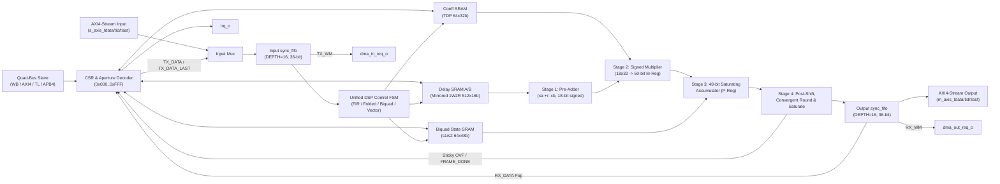

# IP 31 — Programmable Multi-Channel DSP Filter & Vector Engine (`ips/31_dsp_filter`)

A clean-room, FPGA- and ASIC-tape-out-friendly **Programmable Multi-Channel FIR, Linear-Phase Folded FIR, Cascaded Biquad IIR, and Vector MAC / Energy / Cross-Correlation DSP Engine** implemented in pure synthesizable IEEE 1800-2017 SystemVerilog.

---

## 1. Feature Summary

- **Four Unified Operating Modes** sharing a single pipelined **18x32 signed multiplier + 48-bit saturating accumulator** datapath:
  - **Mode 0 — Direct-Form FIR**: Programmable `1..MAX_TAPS` (default `64`) taps, reloadable Coefficient SRAM, per-channel circular delay-line SRAM (`1..MAX_CHANNELS`, default `8`), and programmable **Decimation (`M = 1..16`)** with selectable output phase (`0` or `M-1`) that skips MAC execution on decimated-out samples.
  - **Mode 1 — Symmetric / Antisymmetric Linear-Phase Folded FIR**: Mirrored dual-read-port delay-line SRAM reads `x[n-k]` and `x[n-(L-1-k)]` in one clock cycle and pre-adds `x[n-k] ± x[n-(L-1-k)]` before multiplying by `h[k]`, cutting MAC cycles in half across all four linear-phase FIR types (Type I/II symmetric, Type III/IV antisymmetric, odd or even tap counts).
  - **Mode 2 — Cascaded Biquad IIR (`Direct-Form-II Transposed`)**: Up to `MAX_SECTIONS = 8` cascaded second-order sections (`b0, b1, b2, a1, a2`) per channel (`up to 16th-order IIR`), maintaining independent full-precision 48-bit `(s1, s2)` state per `(channel, section)` in inferable SRAM (`5` MACs / `7` cycles per section).
  - **Mode 3 — Vector Dot-Product / Energy (RMS) / Cross-Correlation**:
    - `VEC_OP = 0`: Frame **Energy** (`sum x[n]^2`) with full 48-bit accumulator readout (`VEC_ACC_LO/HI`) and post-shifted 32-bit streaming output.
    - `VEC_OP = 1`: **Dual-Vector Dot Product** (`sum x[n] * y[n]` from packed `{y[15:0], x[15:0]}` beats).
    - `VEC_OP = 2`: **Template Dot Product** (`sum x[k] * coeff[k]`) against stored 16-bit or 32-bit templates.
    - `VEC_OP = 3`: **Sliding Cross-Correlation** (`r[n] = sum_{k=0}^{L-1} x[n-(L-1-k)] * coeff[k]`) for matched filtering and sync-word peak detection.
- **High-Precision Fixed-Point Arithmetic**:
  - 16-bit signed `Q1.15` sample I/O; selectable **16-bit (`Q1.15` / `Q2.14`)** or **32-bit (`Q2.30` / `Q1.31`)** coefficients.
  - 48-bit signed internal accumulator with saturating overflow detection (`add_sat48` / `sub_sat48`).
  - Programmable `POST_SHIFT` (`0..31`), **symmetric convergent rounding (round-half-to-even, zero DC bias)** or floor truncation, selectable saturation vs. wrap, and sticky `OVF` status + interrupt.
- **Flexible SoC Integration**:
  - **Quad-Bus Slave Wrappers**: Wishbone B4 (`dsp_filter_wb`), AXI4 / AXI4-Lite (`dsp_filter_axi`), TileLink TL-UL/TL-UH (`dsp_filter_tl`), AMBA APB4 (`dsp_filter_apb`), and unified `dsp_filter_top #(.BUS_TYPE(...))`.
  - **Direct 32-bit AXI4-Stream** (`s_axis_*`, `m_axis_*`) with `tlast` frame framing, `tid` channel tagging, and full backpressure decoupling via internal TX/RX FIFOs.
  - **CPU TX/RX FIFO Registers** with optional embedded channel tagging (`CH_IN_DATA`) or automatic TDM channel cycling (`AUTO_CH`), programmable watermarks, `dma_in_req_o` / `dma_out_req_o`, `irq_o`, and 4 hardware performance counters (`PERF_CYCLES`, `PERF_MACS`, `PERF_SAMP_IN`, `PERF_SAMP_OUT`).
- **FPGA & ASIC Friendly**: Single clock domain, async-assert `rst_ni`, strictly clock-only SRAM writes with zero memory reset loops (valid-bit masking eliminates post-reset init stalls and simulation X-propagation), zero latches, zero Verilator warnings.

---

## 2. Architecture & Pipeline Block Diagram



---

## 3. Mathematical Specification

### 3.1 Mode 0 — Direct-Form FIR with Decimation

For channel $c \in \{0, \dots, C-1\}$, tap length $L \in \{1, \dots, 64\}$, and decimation factor $M \in \{1, \dots, 16\}$:

$$y_c[m] = \operatorname{RoundSat}_{16}\!\left(\sum_{k=0}^{L-1} \operatorname{Term}\!\left(x_c[n_m - k],\; h[k]\right),\; \text{POST\_SHIFT}\right)$$

where:
- When `DECIM_PHASE = 0` (default textbook downsampling): outputs trigger at input indices $n_m = mM$ (`decim_cnt == 0`).
- When `DECIM_PHASE = 1` (frame-tail aligned): outputs trigger at $n_m = mM + (M - 1)$ (`decim_cnt == M - 1`), aligning `tlast` on frames whose length is a multiple of $M$.
- Skipped decimation phases push $x_c[n]$ into the circular delay line in **1 cycle** and bypass the MAC loop entirely.

### 3.2 Mode 1 — Symmetric & Antisymmetric Linear-Phase FIR Folding

Linear-phase FIR filters satisfy $h[L - 1 - k] = \pm h[k]$. Reading both $x_c[n - k]$ (Bank A) and $x_c[n - (L - 1 - k)]$ (Bank B) in the same cycle folds the convolution sum into $\lceil L / 2 \rceil$ MAC operations:

- **Symmetric (`SYM_ANTI = 0`, Type I odd $L$ / Type II even $L$)**:
  $$a_k = \begin{cases} x_c[n - k] + x_c[n - (L - 1 - k)], & k < L - 1 - k \\ x_c[n - k], & k = L - 1 - k \;\text{(center tap, odd } L\text{)} \end{cases}$$
- **Antisymmetric (`SYM_ANTI = 1`, Type III odd $L$ / Type IV even $L$)**:
  $$a_k = \begin{cases} x_c[n - k] - x_c[n - (L - 1 - k)], & k < L - 1 - k \\ 0, & k = L - 1 - k \;\text{(center tap, odd } L\text{)} \end{cases}$$

$$y_c[n] = \operatorname{RoundSat}_{16}\!\left(\sum_{k=0}^{\lfloor (L-1)/2 \rfloor} \operatorname{Term}(a_k,\; h[k]),\; \text{POST\_SHIFT}\right)$$

In 16-bit coefficient mode (`COEFF_32B = 0`), multiplication distributes exactly over integer addition/subtraction with zero intermediate truncation, making Mode 0 and Mode 1 **100% bit-exact** while cutting MAC count by **2.00x** (even $L$) and active cycle count by **~1.84x–1.91x** (for $L = 32..64$).

### 3.3 Mode 2 — Cascaded Biquad IIR (Direct-Form-II Transposed)

Each second-order section $s \in \{0, \dots, S-1\}$ ($S \le 8$) implements the standard MATLAB / SciPy SOS transfer function:

$$H_s(z) = \frac{b_{s,0} + b_{s,1} z^{-1} + b_{s,2} z^{-2}}{1 + a_{s,1} z^{-1} + a_{s,2} z^{-2}}$$

Using Direct-Form-II Transposed (DF-II-T) per `(channel c, section s)` with full 48-bit state registers $(s_1, s_2)$:

$$y_s[n] = \operatorname{RoundSat}_{16}\!\left(s_{1,c,s}[n-1] + \operatorname{Term}(x_s[n],\; b_{s,0}),\; \text{POST\_SHIFT}\right)$$
$$s_{1,c,s}[n] = s_{2,c,s}[n-1] + \operatorname{Term}(x_s[n],\; b_{s,1}) - \operatorname{Term}(y_s[n],\; a_{s,1})$$
$$s_{2,c,s}[n] = \operatorname{Term}(x_s[n],\; b_{s,2}) - \operatorname{Term}(y_s[n],\; a_{s,2})$$

where $x_0[n] = x_c[n]$, $x_{s+1}[n] = y_s[n]$, and final output is $y_c[n] = y_{S-1}[n]$. All additions/subtractions use 48-bit saturating arithmetic (`add_sat48` / `sub_sat48`), and any intermediate or final saturation sets the sticky `OVF` flag.

### 3.4 Mode 3 — Vector Energy, Dot Product & Sliding Cross-Correlation

| `VEC_OP` | Name | Formula | Output Cadence |
|---|---|---|---|
| `2'd0` | Energy (Sum of Squares) | $A_c = \sum_{n=0}^{N-1} x_c[n]^2$ (`x = tdata[15:0]`) | 1 beat on `tlast` or `vec_cnt == VEC_LEN` |
| `2'd1` | Dual-Vector Dot Product | $A_c = \sum_{n=0}^{N-1} x_c[n]\, y_c[n]$ (`x = [15:0], y = [31:16]`) | 1 beat on `tlast` or `vec_cnt == VEC_LEN` |
| `2'd2` | Template Dot Product | $A_c = \sum_{k=0}^{N-1} \operatorname{Term}(x_c[k],\; h[k \bmod 64])$ | 1 beat on `tlast` or `vec_cnt == VEC_LEN` |
| `2'd3` | Sliding Cross-Correlation | $A_c[n] = \sum_{k=0}^{L-1} \operatorname{Term}(x_c[n - (L-1-k)],\; h[k])$ | Every (decimated) input sample |

On every Mode 3 output, the exact unshifted 48-bit accumulator is latched into `VEC_ACC_LO` / `VEC_ACC_HI`, while `m_axis_tdata_o` (or `RX_DATA`) emits the 32-bit rounded & saturated value $\operatorname{RoundSat}_{32}(A_c, \text{POST\_SHIFT})$.

---

## 4. Q-Format, Scaling, Rounding & Saturation Guide

### 4.1 Multiplier Product-to-Accumulator Alignment (`Term(a, b)`)

| Mode / `COEFF_32B` | Operand `a` | Operand `b` | Raw Product | `Term` to 48-bit Acc | Acc Format | Recommended `POST_SHIFT` |
|---|---|---|---|---|---|---|
| FIR (`COEFF_32B = 0`) | Q1.15 (16b) | Q1.15 (16b) | Q2.30 (32b) | Exact (`prod[47:0]`) | **Q18.30** | **`15`** -> Q1.15 |
| FIR (`COEFF_32B = 1`) | Q1.15 (16b) | Q2.30 (32b) | Q3.45 (50b) | `prod >>> 8` (42b) | **Q11.37** | **`22`** -> Q1.15 |
| FIR (`COEFF_32B = 1`) | Q1.15 (16b) | Q1.31 (32b) | Q2.46 (50b) | `prod >>> 8` (42b) | **Q10.38** | **`23`** -> Q1.15 |
| Biquad (`COEFF_32B = 0`) | Q1.15 (16b) | Q2.14 (16b) | Q3.29 (32b) | Exact (`prod[47:0]`) | **Q19.29** | **`14`** -> Q1.15 |
| Biquad (`COEFF_32B = 1`) | Q1.15 (16b) | Q2.30 (32b) | Q3.45 (50b) | `prod >>> 8` (42b) | **Q11.37** | **`22`** -> Q1.15 |
| Vector `VEC_OP = 0, 1` | int16 (16b) | int16 (16b) | int32 (32b) | Exact (`prod[47:0]`) | **int48** | **`0`** (exact) or scale |
| Vector `VEC_OP = 2, 3` (`COEFF_32B = 0`) | int16 (16b) | int16 (16b) | int32 (32b) | Exact (`prod[47:0]`) | **int48** | **`0`** or **`15`** |
| Vector `VEC_OP = 2, 3` (`COEFF_32B = 1`) | int16 (16b) | Q2.30 (32b) | 50-bit | `prod >>> 8` (42b) | **Q11.37** | **`22`** or user scale |

> **Why `prod >>> 8` in 32-bit coefficient mode?**
> An 18x32 signed multiply produces a 50-bit product. Shifting right by 8 bits yields a 42-bit signed term, leaving **6 full integer guard bits** inside the 48-bit accumulator (`[-1024, +1024)` in Q11.37) — guaranteeing zero intermediate accumulator overflow even on 64-tap full-scale FIR filters or high-Q resonant biquads, while preserving 37 fractional bits (22 bits below Q1.15 LSB).
>
> **Note on Folded FIR in 32-bit mode**: In 16-bit mode (`COEFF_32B = 0`), Direct and Folded FIR are 100% bit-exact in all 48 bits. In 32-bit mode (`COEFF_32B = 1`), the `>>> 8` pre-shift occurs after pre-addition in Folded mode vs. per-tap in Direct mode, which may differ by at most 1 bit at fractional bit $2^{-37}$ (`2^-22` of a Q1.15 LSB).

### 4.2 Symmetric Convergent Rounding (`RND_MODE = 0`)

For `POST_SHIFT` $S > 0$, let $q = \lfloor \text{acc} / 2^S \rfloor = \text{acc} \ggg S$ and $r = \text{acc} \bmod 2^S \in [0, 2^S - 1]$:
- $r < 2^{S-1} \implies q$
- $r > 2^{S-1} \implies q + 1$
- $r = 2^{S-1}$ (exact halfway tie) $\implies q + (q \bmod 2)$ (rounds to nearest **even** integer, symmetric around zero: $+0.5 \to 0$, $+1.5 \to +2$, $-0.5 \to 0$, $-1.5 \to -2$).

Setting `CTRL.RND_MODE = 1` selects floor truncation (`acc >>> S`).

---

## 5. Parameters & Interfaces

### 5.1 Parameters (`dsp_filter_top`)

| Parameter | Type | Default | Description |
|---|---|---|---|
| `BUS_TYPE` | `bus_pkg::bus_proto_e` | `BUS_AXI4` | Active CSR slave bus: `BUS_WISHBONE (0)`, `BUS_AXI4 (1)`, `BUS_TILELINK (2)`, `BUS_APB (3)` |
| `MAX_TAPS` | `int unsigned` | `64` | Max FIR / XCorr taps (power of 2) |
| `MAX_SECTIONS` | `int unsigned` | `8` | Max cascaded Biquad sections per channel (power of 2) |
| `MAX_CHANNELS` | `int unsigned` | `8` | Max independent interleaved channels (power of 2; `CH_W = $clog2(MAX_CHANNELS)`) |
| `FIFO_DEPTH` | `int unsigned` | `16` | Depth of internal TX (input) and RX (output) synchronous FIFOs |

### 5.2 Port List (`dsp_filter_top`)

| Port | Direction | Width / Type | Description |
|---|---|---|---|
| `clk_i` | Input | `logic` | Single system clock |
| `rst_ni` | Input | `logic` | Active-low asynchronous-assert reset |
| `wb_i` / `wb_o` | In / Out | `wb_m2s_t` / `wb_s2m_t` | Wishbone B4 slave port (active when `BUS_TYPE == BUS_WISHBONE`) |
| `axi_i` / `axi_o` | In / Out | `axi4_m2s_t` / `axi4_s2m_t` | AXI4 / AXI4-Lite slave port (active when `BUS_TYPE == BUS_AXI4`) |
| `tl_i` / `tl_o` | In / Out | `tl_m2s_t` / `tl_s2m_t` | TileLink TL-UL/TL-UH slave port (active when `BUS_TYPE == BUS_TILELINK`) |
| `apb_i` / `apb_o` | In / Out | `apb_m2s_t` / `apb_s2m_t` | AMBA APB4 slave port (active when `BUS_TYPE == BUS_APB`) |
| `s_axis_tvalid_i` | Input | `logic` | AXI4-Stream input valid |
| `s_axis_tready_o` | Output | `logic` | AXI4-Stream input ready (`CTRL.EN && CTRL.IN_SRC && !in_fifo_full`) |
| `s_axis_tdata_i` | Input | `logic [31:0]` | Input sample (`[15:0]` signed Q1.15; `[31:16]` = `y[n]` in `VEC_DUAL_DOT`) |
| `s_axis_tlast_i` | Input | `logic` | Input frame-end marker |
| `s_axis_tid_i` | Input | `logic [CH_W-1:0]` | Input channel ID (`0..MAX_CHANNELS-1`) |
| `m_axis_tvalid_o` | Output | `logic` | AXI4-Stream output valid (`CTRL.OUT_DST && !out_fifo_empty`) |
| `m_axis_tready_i` | Input | `logic` | AXI4-Stream output ready (backpressure safe) |
| `m_axis_tdata_o` | Output | `logic [31:0]` | Output result (sign-extended 16-bit Q1.15 in Modes 0–2; signed 32-bit in Mode 3) |
| `m_axis_tlast_o` | Output | `logic` | Output frame-end marker |
| `m_axis_tid_o` | Output | `logic [CH_W-1:0]` | Output channel ID |
| `dma_in_req_o` | Output | `logic` | DMA TX request (`EN && DMA_EN && !IN_SRC && !tx_full && tx_level <= TX_WM`) |
| `dma_out_req_o` | Output | `logic` | DMA RX request (`EN && DMA_EN && !OUT_DST && !rx_empty && rx_level >= RX_WM`) |
| `irq_o` | Output | `logic` | Active-high level interrupt (`|(IRQ_STAT & IRQ_EN)`) |

---

## 6. Full CSR & SRAM Address Map (4 KB Aperture, `addr[11:0]`)

### 6.1 Aperture Overview

| Address Range | Size | Region | Wait States |
|---|---|---|---|
| `0x000 .. 0x050` | 84 B | Control, Config, Status, FIFO & Performance CSRs | 0 |
| `0x100 .. 0x1FC` | 256 B | **Coefficient SRAM** (`64 × 32-bit`, RW, byte-strobe enabled) | Write: 0 / Read: 1 |
| `0x200 .. 0x3FC` | 512 B | Reserved (returns bus error) | 0 |
| `0x400 .. 0x7FC` | 1 KB | **Biquad State SRAM** (`64 × {s1_lo, s1_hi, s2_lo, s2_hi}`, RW) | Write: 0* / Read: 1* |
| `0x800 .. 0xFFC` | 2 KB | **FIR Delay-Line State SRAM** (`512 × 16-bit` sign-extended, RW) | Write: 0* / Read: 1* |

\* CSR accesses to Biquad/Delay State SRAMs automatically insert wait states only during cycles when the DSP engine is actively addressing that same SRAM, preventing bus deadlock even under output backpressure.

### 6.2 Core CSR Register Summary (`0x000 .. 0x050`)

| Offset | Register | Access | Reset | Bit Fields |
|---|---|---|---|---|
| `0x000` | `ID` | RO | `0x31DF0100` | `[31:16]` IP ID (`0x31DF`), `[15:0]` Revision (`0x0100`) |
| `0x004` | `CAP` | RO | param | `[7:0]` `MAX_TAPS`, `[15:8]` `MAX_SECTIONS`, `[23:16]` `MAX_CHANNELS`, `[31:24]` `FIFO_DEPTH` |
| `0x008` | `CTRL` | RW | `0x00000040` | `[0]` `EN`, `[2:1]` `MODE` (`0`=FIR, `1`=Folded, `2`=Biquad, `3`=Vector), `[3]` `IN_SRC` (`0`=FIFO, `1`=AXIS), `[4]` `OUT_DST` (`0`=FIFO, `1`=AXIS), `[5]` `COEFF_32B`, `[6]` `SAT_EN` (reset 1), `[7]` `RND_MODE` (`0`=convergent, `1`=truncate), `[8]` `SYM_ANTI` (`0`=sym `+`, `1`=antisym `-`), `[9]` `DMA_EN`, `[11:10]` `VEC_OP`, `[12]` `DECIM_PHASE`, `[13]` `CH_IN_DATA`, `[14]` `AUTO_CH` |
| `0x00C` | `CMD` | WO | `0x00000000` | Write-1 self-clearing pulses: `[0]` `CLR_STATE`, `[1]` `CLR_FIFO`, `[2]` `CLR_PERF`, `[3]` `CLR_OVF`, `[4]` `SOFT_RST` |
| `0x010` | `FILTER_CFG` | RW | `0x000F0000` | `[5:0]` `NUM_TAPS_M1` (`0..63`), `[10:8]` `NUM_SEC_M1` (`0..7`), `[15:12]` `DECIM_M1` (`0..15`), `[20:16]` `POST_SHIFT` (`0..31`, reset `15`), `[26:24]` `NUM_CH_M1` (`0..7`) |
| `0x014` | `VEC_CFG` | RW | `0x00000000` | `[15:0]` `VEC_LEN` (`0` = `tlast`-delimited only; `>0` = auto-frame every `VEC_LEN` beats or on `tlast`) |
| `0x018` | `FIFO_CFG` | RW | `0x00010008` | `[7:0]` `TX_WM` (default `FIFO_DEPTH/2`), `[23:16]` `RX_WM` (default `1`) |
| `0x01C` | `STATUS` | RO | `0x00000014` | `[0]` `BUSY`, `[1]` `OVF` (sticky), `[2]` `TX_EMPTY`, `[3]` `TX_FULL`, `[4]` `RX_EMPTY`, `[5]` `RX_FULL`, `[15:8]` `TX_LEVEL`, `[23:16]` `RX_LEVEL`, `[26:24]` `RX_HEAD_CH`, `[27]` `RX_HEAD_LAST` |
| `0x020` | `IRQ_STAT` | RW1C/RO | `0x00000008` | `[0]` `OVF` (W1C), `[1]` `FRAME_DONE` (W1C), `[2]` `RX_WM` (RO live), `[3]` `TX_WM` (RO live), `[4]` `TX_OVF` (W1C), `[5]` `RX_UDF` (W1C) |
| `0x024` | `IRQ_EN` | RW | `0x00000000` | `[5:0]` Interrupt enable mask matching `IRQ_STAT` bits |
| `0x028` | `TX_CTRL` | RW | `0x00000000` | `[2:0]` `TX_CH` (channel ID for CPU writes to `TX_DATA`/`TX_DATA_LAST` when `CH_IN_DATA=0`) |
| `0x02C` | `TX_DATA` | WO | `0x00000000` | Push sample to TX FIFO with `tlast = 0` |
| `0x030` | `TX_DATA_LAST` | WO | `0x00000000` | Push sample to TX FIFO with `tlast = 1` |
| `0x034` | `RX_DATA` | RO | `0x00000000` | Pop 32-bit result from RX FIFO (sets `RX_UDF` if read when empty) |
| `0x038` | `VEC_ACC_LO` | RO | `0x00000000` | Latched 48-bit Mode 3 accumulator bits `[31:0]` |
| `0x03C` | `VEC_ACC_HI` | RO | `0x00000000` | Sign-extended upper 16 bits `{{16{acc[47]}}, acc[47:32]}` |
| `0x040` | `PERF_CYCLES` | RO | `0x00000000` | Active DSP compute cycles (excluding idle and downstream backpressure stalls) |
| `0x044` | `PERF_MACS` | RO | `0x00000000` | Total MAC operations executed by the multiplier |
| `0x048` | `PERF_SAMP_IN` | RO | `0x00000000` | Total input samples accepted by the DSP engine |
| `0x04C` | `PERF_SAMP_OUT` | RO | `0x00000000` | Total output samples / frame results committed |
| `0x050` | `VEC_LAST_META` | RO | `0x00000000` | `[2:0]` `LAST_CH`, `[3]` `LAST_OVF` of last Mode 3 completion |

### 6.3 SRAM Aperture Layouts

- **Coefficient SRAM (`0x100 + 4 * idx`, `idx = 0..63`)**:
  - **FIR / Folded FIR / Template Dot / XCorr**: `idx = k` stores `h[k]` (`[15:0]` signed when `COEFF_32B = 0`, `[31:0]` signed when `COEFF_32B = 1`).
  - **Cascaded Biquad IIR**: Section `s` (`0..7`) uses 8-word aligned base `0x100 + s*32`:
    - `+0x00`: `b0`, `+0x04`: `b1`, `+0x08`: `b2`, `+0x0C`: `a1`, `+0x10`: `a2`.
- **Biquad State SRAM (`0x400 + (ch*8 + sec)*16 + sub*4`)**:
  - `+0x00`: `s1[31:0]`, `+0x04`: sign-ext `s1[47:32]`, `+0x08`: `s2[31:0]`, `+0x0C`: sign-ext `s2[47:32]`.
- **FIR Delay-Line State SRAM (`0x800 + (ch*64 + slot)*4`)**:
  - Sign-extended 16-bit sample at circular buffer slot `slot` for channel `ch`.

---

## 7. Pipeline Timing Diagrams

### 7.1 Direct / Folded FIR Pipeline (`L` taps, `K = L` or `ceil(L/2)`)

```text
Cycle  :  0        1        2        3     ...   K      K+1      K+2      K+3
State  : IDLE  |  RUN(0) |  RUN(1) |  RUN(2) | RUN(K-1)| DRAIN1 | DRAIN2 | FINAL -> IDLE
SRAM   : Wr x  | Rd(0)   | Rd(1)   | Rd(2)   | Rd(K-1) |  --    |  --    |  --
PreAdd :  --   |   --    | P(0)    | P(1)    | P(K-2)  | P(K-1) |  --    |  --
Mul(M) :  --   |   --    | M(0)    | M(1)    | M(K-2)  | M(K-1) |  --    |  --
Acc(P) :  --   |   --    |   --    | A+=M(0) | A+=M(K-3)|A+=M(K-2)|A+=M(K-1)| Round/Sat->Out
```
- **Latency per emitted sample**: `K + 3` active compute cycles (`L + 3` Direct, `ceil(L/2) + 3` Folded).
- **Decimated-out sample**: `1` cycle in `ST_IDLE` (writes delay SRAM, skips `ST_FIR_RUN`).

### 7.2 Cascaded Biquad IIR Per-Section Schedule (7 Cycles / 5 MACs per Section)

```text
Cycle :  1       2        3        4        5        6        7
State : LOAD  | B0_MUL | Y_CALC | S1_B1  | S1_A1  | S2_B2  | S2_A2
SRAM  : Rd s1,| Rd b1  | Rd a1  | Rd b2  | Wr s1, |  --    | Wr s2
        s2,b0 |        |        |        | Rd a2  |        |
Mul   :  --   | b0*x   | b1*x   | a1*y   | b2*x   | a2*y   |  --
Acc   :  --   |  --    | y=rnd  | acc=s2 | s1=acc | acc=   | s2=acc
              |        | (s1+p) |  +b1*x |  -a1*y |  b2*x  |  -a2*y
```

---

## 8. Programming Recipes (C Pseudocode)

### 8.1 Mode 1 — 32-Tap Symmetric Folded FIR with Decimation `M = 4` (AXI-Stream)

```c
#define DSP_BASE 0x4001F000u
volatile uint32_t *const dsp = (volatile uint32_t *)DSP_BASE;

// 1. Stop engine & clear state/FIFOs/counters
dsp[0x008/4] = 0x00000040;          // EN=0, SAT_EN=1
dsp[0x00C/4] = 0x0000001F;          // SOFT_RST + CLR_STATE/FIFO/PERF/OVF

// 2. Load first 16 taps (or all 32 symmetric Q1.15 taps) into Coeff SRAM
for (int k = 0; k < 16; k++) {
    dsp[(0x100/4) + k] = (uint32_t)(int32_t)h_sym_q15[k];
}

// 3. Configure 32 taps, M=4 decimation, POST_SHIFT=15, 4 channels
dsp[0x010/4] = (31u << 0) | (3u << 12) | (15u << 16) | (3u << 24);

// 4. Enable Mode 1 (Folded FIR), Symmetric (SYM_ANTI=0), AXIS in & out, SAT_EN=1
dsp[0x008/4] = (1u << 0) | (1u << 1) | (1u << 3) | (1u << 4) | (1u << 6);
```

### 8.2 Mode 2 — 3-Section Cascaded 6th-Order Butterworth IIR in Q2.30

```c
dsp[0x008/4] = 0x00000040;
dsp[0x00C/4] = 0x0000001F;

// Load 3 SOS sections (8-word stride per section: b0, b1, b2, a1, a2 in Q2.30)
for (int s = 0; s < 3; s++) {
    for (int j = 0; j < 5; j++) {
        dsp[(0x100/4) + s * 8 + j] = (uint32_t)sos_q30[s][j];
    }
}

// 3 sections (NUM_SEC_M1=2), POST_SHIFT=22 (Q11.37 -> Q1.15), 2 channels
dsp[0x010/4] = (2u << 8) | (22u << 16) | (1u << 24);

// Enable Mode 2 (Biquad), COEFF_32B=1, AXIS in/out, SAT_EN=1
dsp[0x008/4] = (1u << 0) | (2u << 1) | (1u << 3) | (1u << 4) | (1u << 5) | (1u << 6);
```

### 8.3 Mode 3 — Vector Frame Energy (RMS) via CPU FIFO & DMA

```c
dsp[0x008/4] = 0x00000040;
dsp[0x00C/4] = 0x0000001F;

dsp[0x014/4] = 256;                 // VEC_LEN = 256 samples per RMS frame
dsp[0x010/4] = (8u << 16);          // POST_SHIFT = 8 for 32-bit scaled energy output
dsp[0x018/4] = (1u << 16) | 8u;     // RX_WM = 1, TX_WM = 8
dsp[0x024/4] = (1u << 1);           // Enable FRAME_DONE IRQ

// Mode 3, VEC_OP=0 (Energy), CPU FIFOs (IN_SRC=0, OUT_DST=0), DMA_EN=1
dsp[0x008/4] = (1u << 0) | (3u << 1) | (1u << 6) | (1u << 9);

// Push 256 samples to TX_DATA (0x02C), then read scaled 32-bit from RX_DATA (0x034)
// and exact 48-bit energy from VEC_ACC_LO (0x038) | ((int64_t)VEC_ACC_HI (0x03C) << 32)
```

---

## 9. FPGA & ASIC Implementation Notes

- **DSP48E1/E2 & ASIC MAC Inference**: The pre-adder (`18-bit`), multiplier (`18x32 -> 50-bit M-reg`), and 48-bit accumulator (`P-reg`) are cleanly separated by pipeline flip-flops (`ST_FIR_RUN` -> `prod_q` -> `acc_q`), mapping directly to two cascaded DSP48E2 slices in 32-bit coefficient mode (or one DSP48E1/E2 slice in 16-bit mode) and high-Fmax Booth/Wallace pipelines in ASIC synthesis.
- **BRAM / ASIC SRAM Inference**: All memory modules in [`dsp_filter_sram.sv`](rtl/dsp_filter_sram.sv) use strictly clock-only write blocks (`always_ff @(posedge clk_i)`) and synchronous registered reads with zero reset loops:
  - `u_coeff_sram`: 64×32b True Dual-Port with 4-bit byte-write enables (256 B).
  - `u_delay_sram_a` & `u_delay_sram_b`: Mirrored 512×16b Simple Dual-Port banks providing single-cycle dual-read access for linear-phase folding (2 × 1 KB).
  - `u_bq_s1_sram` & `u_bq_s2_sram`: 64×48b Simple Dual-Port with 6-bit byte-write enables (2 × 384 B).
  - Validity bitmasks (`coeff_bvalid_q`, `delay_valid_q`, `bq_s1_valid_q`, `bq_s2_valid_q`) clear all logical memory contents in **1 clock cycle** on `rst_ni`, `CMD.CLR_STATE`, or `CMD.SOFT_RST` without violating SRAM reset rules.
- **Reset & CDC**: Single clock domain (`clk_i`), active-low async-assert reset (`rst_ni`) on all control/pipeline registers; pair with `axis_async_fifo` from `interconnect/axis/` when crossing sample-clock domains.

---

## 10. Verification Summary

Verified with Verilator 5.054 (`--lint-only` across all 4 `BUS_TYPE` values + non-default parameters, and `--binary --timing` on [`tb_dsp_filter.sv`](tb/tb_dsp_filter.sv)) using independent mathematical golden reference models:

| Test Suite | Coverage & Checked Properties |
|---|---|
| **1. Quad-Bus Wrappers** | `BUS_WISHBONE`, `BUS_AXI4`, `BUS_TILELINK`, `BUS_APB`: ID/CAP, partial `wstrb`, unmapped address errors, 1-cycle wait-state Coefficient/Biquad/Delay SRAM R/W, and end-to-end FIR filtering |
| **2. Direct FIR** | Impulse response, step DC gain, `L = 1`, `L = 15`, `L = 64` taps, 16-bit Q1.15 & 32-bit Q2.30 |
| **3. Folded FIR & Speedup** | Type I/II Symmetric (`L = 31, 32`) & Type III/IV Antisymmetric (`L = 31, 64`): **100% bit-exact match** vs. Direct FIR; **1.94x–2.00x MAC reduction** and **1.79x–1.91x active cycle speedup** |
| **4. Decimation** | `M = 1, 2, 4, 16`, both phases (`0` & `M-1`), Folded + Decimation `M = 16`, verified skipped MAC savings |
| **5. Multi-Channel Isolation** | 4-channel random interleaved `tid` isolation (zero crosstalk) + 8-channel `AUTO_CH` round-robin |
| **6. Cascaded Biquad IIR** | 3-section 6th-order Butterworth LPF (Q2.14, -80 dB stopband) + 3-section Notch+LPF (Q2.30, -81 dB notch at `0.125*fs`, 0.980 passband gain): bit-exact output & bit-exact 48-bit State SRAM CSR readback |
| **7. Arithmetic & Overflow** | Exact round-half-to-even ties vs. floor truncation, `+32767`/`-32768` saturation vs. wrap, sticky `OVF` flag, `irq_o` & W1C clear |
| **8. Mode 3 Vector Engine** | Energy (`>32-bit` exact 48-bit `VEC_ACC_LO/HI`), Dual-Vector Dot (orthogonal=0 + random), 32-bit Template Dot, Barker-7 Sliding Cross-Correlation peak detection |
| **9. Backpressure & FIFOs** | 65% random + bursty `m_axis_tready_i` stalls forcing `ST_OUT_WAIT` (>3,400 stall cycles checked by continuous AXI4-Stream stability checker), CPU TX/RX FIFOs, `CH_IN_DATA`, `dma_in_req_o`/`dma_out_req_o`, `TX_OVF`/`RX_UDF`, `SOFT_RST` |
| **10. Constrained-Random** | Multi-seed (`+seed=1, 7, 42, 1337, 9999`, ~2,500 checks/seed, ~80 ms/seed) randomized multi-mode / multi-channel / mixed-width / backpressure sweeps |
