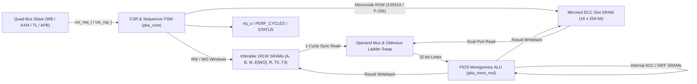

# Public-Key Cryptographic Accelerator (`32_pka`)

## Overview

`32_pka` is a clean-room, pure synthesizable IEEE 1800-2017 SystemVerilog **Public-Key Cryptographic Accelerator (PKA)** supporting **RSA (up to 4096-bit)**, **Curve25519 / X25519 (RFC 7748)**, and **NIST P-256 (`secp256r1`)** behind a unified **Quad-Bus CSR Slave** (`Wishbone B4`, `AMBA AXI4 / AXI4-Lite`, `TileLink TL-UL / TL-UH`, and `AMBA APB4`).

### Features

- **Parameterizable Word-Serial Montgomery Engine (`pka_mont_mul`)**:
  - Configurable `MAX_BITS` (`256..4096`, default `4096`; `MAX_WORDS = MAX_BITS / 32` up to `128`).
  - Runtime operand word length `NUM_WORDS` (`1..MAX_WORDS` 32-bit limbs).
  - Two-stage pipelined **FIOS (Finely Integrated Operand Scanning)** `32 x 32 -> 64` MAC + carry chain achieving **1 limb/cycle** inner-loop throughput over inferable clock-only `1R1W` synchronous SRAM banks (`pka_sram_1r1w`).
  - Hardware 5-iteration Newton-Raphson solver for `n0_inv = -M[0]^{-1} mod 2^32` (with optional software override via `CTRL.PRECOMP_EN = 0`).
  - Hardware `R^2 mod M` precomputation for arbitrary odd moduli (`OP_MOD_EXP`).
- **Constant-Time Execution**:
  - **`OP_MOD_EXP` (`R = A^E mod M`)**: Constant-time Montgomery powering ladder reading both `R0` and `R1` slots obliviously and performing uniform multiply-and-swap on every exponent bit (`EXP_BITS` or `NUM_WORDS * 32` bits).
  - **`OP_MOD_ADD` / `OP_MOD_SUB`**: Constant-time 3-pass modular addition and subtraction (`3N` cycles).
  - **`OP_X25519_SCALAR` (RFC 7748)**: Constant-time 255-step Montgomery ladder over $p = 2^{255}-19$ ($a_{24} = 121665$) with hardware RFC 7748 scalar clamping, `u`-coordinate bit-255 masking + reduction, constant-time `cswap`, and Fermat inversion ($z^{p-2} \bmod p$).
  - **`OP_ECC_P256_PMUL` / `PADD` / `PDBL` (NIST P-256)**: Constant-time 256-step Montgomery ladder using **Renes-Costello-Batina (2015) complete homogeneous projective addition** ($a = -3$, $b = \text{0x5ac635d8...}$, $\mathcal{O} = (0:1:0)$) — exception-free for $P = Q$, $P = -Q$, and $\mathcal{O}$, followed by Fermat inversion to affine $(R_x, R_y)$.
- **Security Controls**:
  - **Write-Only Scalar / Exponent Bank (`E`)**: CSR reads from `0x800..0x9FF` unconditionally return `32'h0`.
  - **Synchronous Zeroization (`CMD.WIPE`)**: Sequentially clears every word of all operand, scalar, result, scratch, ECC, and ALU internal SRAMs (`A, B, M, E, R, T0..T3, ECC, ACC, DIFF`) and internal registers.
  - **Busy Write Protection**: Writes to configuration CSRs or operand SRAMs while `STATUS.BUSY == 1` are ignored and set `ERR_STAT.BUSY_WR`.

---

## Block Diagram



---

## RTL File Hierarchy

| File | Role |
| :--- | :--- |
| [`pka_pkg.sv`](../rtl/pka_pkg.sv) | Operation enums, CSR offsets, X25519 & P-256 constants, and microcode ROMs |
| [`pka_sram_1r1w.sv`](../rtl/pka_sram_1r1w.sv) | Inferable clock-only `1R1W` synchronous SRAM (no async reset on memory array) |
| [`pka_mont_mul.sv`](../rtl/pka_mont_mul.sv) | Pipelined FIOS `32x32->64` Montgomery multiplier, `ModAdd`, `ModSub`, and `n0_inv` solver |
| [`pka_core.sv`](../rtl/pka_core.sv) | Protocol-agnostic CSR window, operand banks, ModExp/X25519/P-256 sequencer, and `WIPE` |
| [`pka_wb.sv`](../rtl/pka_wb.sv) | Wishbone B4 slave wrapper (`wb_to_csr`) |
| [`pka_axi.sv`](../rtl/pka_axi.sv) | AXI4 / AXI4-Lite slave wrapper (`axi_lite_to_csr`) |
| [`pka_tl.sv`](../rtl/pka_tl.sv) | TileLink TL-UL / TL-UH device wrapper (`tl_ul_to_csr`) |
| [`pka_apb.sv`](../rtl/pka_apb.sv) | AMBA APB4 slave wrapper (`apb_to_csr`) |
| [`pka_top.sv`](../rtl/pka_top.sv) | Unified parameterized quad-bus top (`BUS_TYPE`, `MAX_BITS`) |

---

## Parameters & Ports (`pka_top`)

### Parameters

| Parameter | Type | Default | Description |
| :--- | :--- | :--- | :--- |
| `BUS_TYPE` | `bus_pkg::bus_proto_e` | `bus_pkg::BUS_AXI4` | Active slave bus (`BUS_WISHBONE=0`, `BUS_AXI4=1`, `BUS_TILELINK=2`, `BUS_APB=3`) |
| `MAX_BITS` | `int unsigned` | `4096` | Maximum supported operand width in bits (`256..4096`, multiple of 32) |

### Ports

| Port | Direction | Type | Description |
| :--- | :--- | :--- | :--- |
| `clk_i` | `input` | `logic` | System clock |
| `rst_ni` | `input` | `logic` | Active-low asynchronous-assert, synchronous-deassert reset |
| `wb_i` / `wb_o` | `in/out` | `wb_m2s_t` / `wb_s2m_t` | Wishbone B4 slave port (`BUS_TYPE == BUS_WISHBONE`) |
| `axi_i` / `axi_o` | `in/out` | `axi4_m2s_t` / `axi4_s2m_t` | AXI4 / AXI4-Lite slave port (`BUS_TYPE == BUS_AXI4`) |
| `tl_i` / `tl_o` | `in/out` | `tl_m2s_t` / `tl_s2m_t` | TileLink TL-UL / TL-UH slave port (`BUS_TYPE == BUS_TILELINK`) |
| `apb_i` / `apb_o` | `in/out` | `apb_m2s_t` / `apb_s2m_t` | AMBA APB4 slave port (`BUS_TYPE == BUS_APB`) |
| `irq_o` | `output` | `logic` | Level interrupt (`(DONE | WIPE_DONE) & IRQ_EN | (|ERR_STAT & ERR_IRQ_EN)`) |

---

## Montgomery CIOS/FIOS & Constant-Time Ladder Architecture

### FIOS Montgomery Multiplication (`ALU_MONT_MUL`)

For radix $W = 2^{32}$, $N = \text{NUM\_WORDS}$ limbs, $R = 2^{32N}$, and odd modulus $M$ with $n_0' = (-M[0])^{-1} \bmod 2^{32}$:

Each outer iteration $i \in [0, N-1]$ performs:
1. $j = 0$: $(C_1, S_1) = T[0] + A[0] \cdot B[i]$, $m = (S_1 \cdot n_0') \bmod 2^{32}$, $(C_2, \_) = S_1 + m \cdot M[0]$.
2. Pipelined inner loop $j = 1 \dots N-1$ (1 limb/clock):
   - Stage 1: $(C_1, S_1) = T[j] + A[j] \cdot B[i] + C_1$
   - Stage 2: $(C_2, T[j-1]) = S_1 + m \cdot M[j] + C_2$
3. Top limb: $(T_{\text{hi}}, T[N-1]) = T_{\text{hi}} + C_1 + C_2$.
4. Constant-time final reduction: Pass 1 always computes $D = T - M$ into `u_diff`; Pass 2 always writes $D$ or $T$ depending on borrow/carry.

### Constant-Time Ladders

- **`OP_MOD_EXP`**: Runs $L$ iterations (`EXP_BITS` if non-zero, else $32 \cdot \text{NUM\_WORDS}$). Every iteration performs `T2 = MontMul(T0, T1)` and `T3 = MontMul(R_sel, R_sel)` (where both `T0` and `T1` are read simultaneously and muxed by `e_bit`), followed by an $N$-cycle oblivious writeback of `(T0, T1)`.
- **`OP_X25519_SCALAR`**: Clamps scalar bits `{255:254, 2:0}` per RFC 7748 on-the-fly, runs 255 identical Montgomery ladder steps with constant-time `cswap`, and computes $x_2 \cdot z_2^{p-2} \bmod p$.
- **`OP_ECC_P256_PMUL`**: Runs 256 identical Montgomery ladder steps using RCB complete addition (`CompleteAdd(R0, R1)` and `CompleteAdd(R_sq, R_sq)`), then converts $(X_0 : Y_0 : Z_0)$ to affine $(X_0 Z_0^{p-2}, Y_0 Z_0^{p-2})$.

---

## Register & SRAM Map (`0x000 .. 0xFFF`)

### Control & Status Registers (`0x000 .. 0x0FF`)

| Offset | Name | Access | Reset | Description |
| :--- | :--- | :--- | :--- | :--- |
| `0x000` | `ID` | RO | `0x504B4101` | Core identifier (`"PKA"` v1) |
| `0x004` | `CAPS` | RO | param | `[15:0]` `MAX_BITS`, `[23:16]` `MAX_WORDS`, `[24]` X25519, `[25]` P-256, `[26]` Auto-Precomp, `[27]` Scalar-WO |
| `0x008` | `CTRL` | RW | `0x00000030` | `[3:0]` `OP`, `[4]` `PRECOMP_EN` (def `1`), `[5]` `ECC_USE_G` (def `1`), `[6]` `IRQ_EN`, `[7]` `ERR_IRQ_EN` |
| `0x00C` | `CMD` | WO | `0x00000000` | `[0]` `START`, `[1]` `WIPE`, `[2]` `ABORT` (reads return `0`) |
| `0x010` | `STATUS` | RO/W1C | `0x00000000` | `[0]` `BUSY` (RO), `[1]` `DONE` (W1C), `[2]` `ERR` (W1C all), `[3]` `WIPE_DONE` (W1C), `[12:8]` `ERR_FLAGS` (W1C) |
| `0x014` | `ERR_STAT` | W1C | `0x00000000` | `[0]` `BAD_WORDS`, `[1]` `EVEN_MOD`, `[2]` `BAD_OP`, `[3]` `BUSY_WR`, `[4]` `ABORTED` |
| `0x018` | `NUM_WORDS` | RW | `0x00000008` | Operand length in 32-bit limbs (`1..MAX_WORDS`; forced to `8` for X25519/P-256) |
| `0x01C` | `EXP_BITS` | RW | `0x00000000` | Exponent bit count for `OP_MOD_EXP` (`0` = full `NUM_WORDS * 32` bits) |
| `0x020` | `N0_INV` | RW | `0x00000000` | `-M[0]^{-1} mod 2^32` (auto-updated when `PRECOMP_EN=1`; host-supplied when `PRECOMP_EN=0`) |
| `0x024` | `PERF_CYCLES` | RO | `0x00000000` | Cycle count of most recent operation (cleared on `START`/`WIPE`) |
| `0x028` | `IRQ_STAT` | RO | `0x00000000` | `[0]` `DONE & IRQ_EN`, `[1]` `ERR & ERR_IRQ_EN`, `[2]` `WIPE_DONE & IRQ_EN` |

#### `CTRL.OP` Encoding

| Value | Mnemonic | Description |
| :--- | :--- | :--- |
| `4'h0` | `OP_MONT_MUL` | `R = A * B * R^-1 mod M` |
| `4'h1` | `OP_MOD_EXP` | `R = A^E mod M` (constant-time Montgomery ladder) |
| `4'h2` | `OP_MOD_ADD` | `R = (A + B) mod M` (constant-time) |
| `4'h3` | `OP_MOD_SUB` | `R = (A - B) mod M` (constant-time) |
| `4'h4` | `OP_X25519_SCALAR` | RFC 7748 `R = X25519(E, A)` |
| `4'h5` | `OP_ECC_P256_PMUL` | NIST P-256 `(R, ECC_RY) = E * (ECC_USE_G ? G : (A, B))` |
| `4'h6` | `OP_ECC_P256_PADD` | NIST P-256 `(R, ECC_RY) = (A, B) + (ECC_QX, ECC_QY)` |
| `4'h7` | `OP_ECC_P256_PDBL` | NIST P-256 `(R, ECC_RY) = 2 * (A, B)` |

### Operand, Scalar & ECC SRAM Windows (`0x200 .. 0xE5F`)

All multi-word operands are stored in **little-endian 32-bit limb order** (word `0` at offset `+0x000` is bits `[31:0]`). Reads from operand SRAMs incur 1 wait state (`csr_rsp.ready = 0` for 1 cycle).

| Address Range | Bank | Access | Description |
| :--- | :--- | :--- | :--- |
| `0x200 .. 0x3FF` | `A` | RW | Operand `A` / X25519 `u` / P-256 `P1.x` |
| `0x400 .. 0x5FF` | `B` | RW | Operand `B` / P-256 `P1.y` |
| `0x600 .. 0x7FF` | `M` | RW | Modulus `M` (must be odd for `OP_MONT_MUL` and `OP_MOD_EXP`) |
| `0x800 .. 0x9FF` | `E` | WO | Secret Exponent / Scalar `E` (reads always return `0`, zeroed by `CMD.WIPE`) |
| `0xA00 .. 0xBFF` | `R` | RO | Result `R` / X25519 `out` / P-256 `Rx` |
| `0xC00 .. 0xDFF` | `R2_PRE` | RW | Optional preloaded `R^2 mod M` (used only when `CTRL.PRECOMP_EN = 0`) |
| `0xE00 .. 0xE1F` | `ECC_QX` | RW | Second point `P2.x` (`8` words) for `OP_ECC_P256_PADD` |
| `0xE20 .. 0xE3F` | `ECC_QY` | RW | Second point `P2.y` (`8` words) for `OP_ECC_P256_PADD` |
| `0xE40 .. 0xE5F` | `ECC_RY` | RO | Result `Ry` (`8` words) for NIST P-256 operations |

---

## Programming Recipes (C Pseudocode)

### 1. RSA-2048 Modular Exponentiation (`m = c^d mod N`)

```c
void pka_modexp(uint32_t *r, const uint32_t *a, const uint32_t *e,
                const uint32_t *m, uint32_t nw, uint32_t exp_bits) {
    PKA_STATUS    = 0xE;                     // W1C DONE/ERR/WIPE_DONE
    PKA_NUM_WORDS = nw;                      // 64 for RSA-2048
    PKA_EXP_BITS  = exp_bits;                // 0 = full nw*32 bits, 17 for e=65537
    for (uint32_t i = 0; i < nw; i++) {
        PKA_A[i] = a[i];
        PKA_M[i] = m[i];
        PKA_E[i] = e[i];                     // write-only bank
    }
    PKA_CTRL = (1u << 4) | 0x1;              // PRECOMP_EN=1, OP_MOD_EXP
    PKA_CMD  = 0x1;                          // START
    while (PKA_STATUS & 0x1);                // poll !BUSY
    for (uint32_t i = 0; i < nw; i++) r[i] = PKA_R[i];
}
```

### 2. RFC 7748 X25519 Scalar Multiplication

```c
void pka_x25519(uint32_t out[8], const uint32_t k[8], const uint32_t u[8]) {
    PKA_STATUS = 0xE;
    for (int i = 0; i < 8; i++) {
        PKA_E[i] = k[i];                     // clamped automatically in hardware
        PKA_A[i] = u[i];                     // bit 255 masked & reduced mod p
    }
    PKA_CTRL = 0x4;                          // OP_X25519_SCALAR
    PKA_CMD  = 0x1;
    while (PKA_STATUS & 0x1);
    for (int i = 0; i < 8; i++) out[i] = PKA_R[i];
}
```

### 3. NIST P-256 Scalar Multiplication (`Q = k * G`)

```c
void pka_p256_mul_g(uint32_t qx[8], uint32_t qy[8], const uint32_t k[8]) {
    PKA_STATUS = 0xE;
    for (int i = 0; i < 8; i++) PKA_E[i] = k[i];
    PKA_CTRL = (1u << 5) | 0x5;              // ECC_USE_G=1, OP_ECC_P256_PMUL
    PKA_CMD  = 0x1;
    while (PKA_STATUS & 0x1);
    for (int i = 0; i < 8; i++) {
        qx[i] = PKA_R[i];
        qy[i] = PKA_ECC_RY[i];
    }
}
```

---

## FPGA / ASIC Integration Notes

- **Memory Inference**: All operand, result, scratch, and ALU buffers use `pka_sram_1r1w` (clock-only writes, 1-cycle registered reads, zero async reset on memory arrays). At `MAX_BITS=4096` (`MAX_WORDS=128`), each bank maps to a single `128x32` BRAM/LUTRAM or compiled ASIC 1R1W SRAM (`~6 KB` total across all banks).
- **DSP Usage**: `pka_mont_mul` uses two `32x32->64` unsigned multipliers (4 DSP48E1/E2 slices on Xilinx 7-series/UltraScale+ or 2 DSP blocks on ECP5) plus one `32x32` low-32 multiply for `m = S1 * n0_inv`.
- **Single Clock Domain**: Fully synchronous to `clk_i` with async-assert / sync-deassert `rst_ni`.

---

## Verification Summary

Verified with Verilator 5.054 (`tb_pka`):
- **All 4 Bus Wrappers** (`BUS_WISHBONE`, `BUS_AXI4`, `BUS_TILELINK`, `BUS_APB`) and `MAX_BITS` = `4096` and `256` parameterizations.
- **RSA-256 / RSA-512 / RSA-1024 / RSA-2048** full encrypt (`e=65537`) + full-width private decrypt (`d`) round-trips (`pow(pow(m, e, N), d, N) == m`), plus **RSA-4096** 128-limb smoke.
- **RFC 7748 X25519** official test vectors (Vectors 1 & 2) and Alice/Bob Diffie-Hellman shared secret equality.
- **NIST P-256** `1*G`, `2*G`, `3*G`, `4*G`, `n*G = O`, official RFC 6979 scalar multiply KAT, custom base point `k * P`, `OP_ECC_P256_PADD`, and `OP_ECC_P256_PDBL`.
- **Security & Timing**: Write-only `E` bank, `CMD.WIPE` full SRAM zeroization, `ERR_STAT` fault injection (`BAD_WORDS`, `EVEN_MOD`, `BAD_OP`), and `PERF_CYCLES` invariance across differing Hamming-weight scalars (`OP_MOD_EXP`, `OP_X25519_SCALAR`, `OP_ECC_P256_PMUL`).
