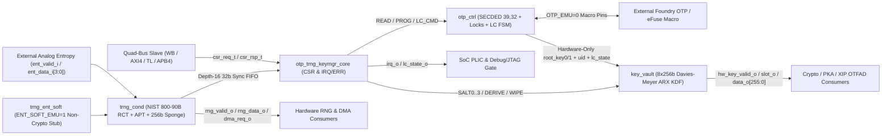

# OTP / eFuse Controller, NIST 800-90B TRNG & Hardware Key-Vault (`33_otp_trng_keymgr`)

## Overview

`33_otp_trng_keymgr` is a clean-room, pure synthesizable IEEE 1800-2017 SystemVerilog security subsystem integrating three tightly coupled hardware roots of trust behind a **Quad-Bus CSR Slave** (`Wishbone B4`, `AMBA AXI4/AXI4-Lite`, `TileLink TL-UL/TL-UH`, and `AMBA APB4`):

1. **OTP / eFuse Partition Controller (`otp_ctrl`)**:
   - 64 x 32-bit logical words (`OTP_WORDS = 64`), stored as 39-bit codewords (32-bit data + 7-bit Extended Hamming SECDED ECC on words `0..55`; raw monotonic bit-OR fuses on `56..63`).
   - Partitioned access control: `PART_UID` (read-only chip ID / boot config), `PART_SW_CFG` (CPU R/W until read/write locks fused), `PART_ROOT_KEY0` & `PART_ROOT_KEY1` (256-bit secret partitions — write-once, permanently CPU-unreadable once provisioned, routed strictly via internal hardware wires to `key_vault`), `PART_LOCK`, `PART_LC`, and `PART_MONO`.
   - Monotonic lifecycle progression: `LC_RAW -> LC_TEST -> LC_DEV -> LC_PROD -> LC_RMA` with hardware-enforced forward-only fusing and automatic key zeroization upon `LC_RMA`.
   - Dual backing mode: `OTP_EMU = 1` (default Yosys/FPGA/sim bit-OR array) or `OTP_EMU = 0` (external foundry eFuse/OTP macro pins `otp_*`).

2. **Digital TRNG Health-Test & Sponge Conditioner (`trng_cond`)**:
   - Clean external entropy macro boundary (`ent_valid_i`, `ent_data_i[3:0]`, `ent_enable_o`) plus optional non-cryptographic FPGA/sim stand-in (`trng_ent_soft`, enabled when `ENT_SOFT_EMU = 1`).
   - Continuous **NIST SP 800-90B** health tests: **Repetition Count Test (RCT)** and **Adaptive Proportion Test (APT)** (`W = 512` or `W = 64`), blocking output and raising `HEALTH_FAIL` IRQ/status on stuck or biased entropy.
   - **256-bit ARX Sponge Conditioner** (12 rounds per 64-bit absorb block) feeding a depth-16 32-bit random output FIFO (`TRNG_RAND_DATA` CSR, `rng_valid_o`/`rng_data_o`/`rng_ready_i` hardware port, and watermarked `dma_req_o`).

3. **Hardware Key-Vault / Key Manager (`key_vault`)**:
   - 8-slot x 256-bit key vault driven by an iterative 36-round 256-bit Davies-Meyer ARX KDF mixing `PART_ROOT_KEY0/1` + `PART_UID` + `KV_SALT0..3` + `LC_STATE` + target slot index.
   - Exposes a **hardware-only sideload key bus** (`hw_key_valid_o`, `hw_key_slot_o[2:0]`, `hw_key_data_o[255:0]`) to feed `28_crypto`, `32_pka`, or `04_xspi_xip` OTFAD without ever exposing secret bits on the CPU CSR bus.
   - Single-cycle zeroization on `CMD.GLOBAL_WIPE`, `KV_CMD.WIPE_ALL`, `KV_CMD.WIPE_SLOT`, or `LC_RMA`.

---

## Block Diagram



---

## RTL File Hierarchy

| File | Role |
| :--- | :--- |
| [`otp_trng_keymgr_pkg.sv`](../rtl/otp_trng_keymgr_pkg.sv) | Partition map, lifecycle enum, SECDED(39,32) Hamming codec, `perm256_round` ARX permutation |
| [`otp_ctrl.sv`](../rtl/otp_ctrl.sv) | OTP/eFuse partition controller, boot scan, locks, lifecycle FSM, SECDED ECC, `OTP_EMU` array |
| [`trng_ent_soft.sv`](../rtl/trng_ent_soft.sv) | Optional non-cryptographic LFSR/phase entropy stub (`ENT_SOFT_EMU = 1` FPGA/sim only) |
| [`trng_cond.sv`](../rtl/trng_cond.sv) | NIST SP 800-90B RCT + APT continuous health testers, 256-bit sponge conditioner, depth-16 FIFO |
| [`key_vault.sv`](../rtl/key_vault.sv) | 8-slot 256-bit Davies-Meyer KDF, sideload key bus, single-cycle `WIPE` / `LC_RMA` zeroization |
| [`otp_trng_keymgr_core.sv`](../rtl/otp_trng_keymgr_core.sv) | Protocol-agnostic CSR register file, IRQ/ERR aggregation, sub-engine integration |
| [`otp_trng_keymgr_wb.sv`](../rtl/otp_trng_keymgr_wb.sv) | Wishbone B4 slave wrapper (`wb_to_csr`) |
| [`otp_trng_keymgr_axi.sv`](../rtl/otp_trng_keymgr_axi.sv) | AXI4 / AXI4-Lite slave wrapper (`axi_lite_to_csr`) |
| [`otp_trng_keymgr_tl.sv`](../rtl/otp_trng_keymgr_tl.sv) | TileLink TL-UL / TL-UH device wrapper (`tl_ul_to_csr`) |
| [`otp_trng_keymgr_apb.sv`](../rtl/otp_trng_keymgr_apb.sv) | AMBA APB4 slave wrapper (`apb_to_csr`) |
| [`otp_trng_keymgr_top.sv`](../rtl/otp_trng_keymgr_top.sv) | Unified parameterized quad-bus top (`BUS_TYPE`) |

---

## Parameters & Top-Level Ports (`otp_trng_keymgr_top`)

### Parameters

| Parameter | Type | Default | Description |
| :--- | :--- | :--- | :--- |
| `BUS_TYPE` | `bus_pkg::bus_proto_e` | `BUS_AXI4` | Active slave bus (`BUS_WISHBONE=0`, `BUS_AXI4=1`, `BUS_TILELINK=2`, `BUS_APB=3`) |
| `OTP_EMU` | `bit` | `1'b1` | `1`: internal FPGA/sim bit-OR OTP array; `0`: external foundry OTP macro pins |
| `ENT_SOFT_EMU` | `bit` | `1'b1` | `1`: instantiate non-crypto `trng_ent_soft` stub; `0`: external entropy source only |
| `RNG_FIFO_DEPTH` | `int unsigned` | `16` | Conditioned random output FIFO depth (32-bit words) |

### Ports

| Port | Direction | Width | Description |
| :--- | :--- | :--- | :--- |
| `clk_i`, `rst_ni` | `input` | `1` | System clock and active-low asynchronous reset |
| `wb_i`, `wb_o` | `in/out` | `wb_m2s_t` / `wb_s2m_t` | Wishbone B4 CSR slave port (`BUS_TYPE == BUS_WISHBONE`) |
| `axi_i`, `axi_o` | `in/out` | `axi4_m2s_t` / `axi4_s2m_t` | AXI4 / AXI4-Lite CSR slave port (`BUS_TYPE == BUS_AXI4`) |
| `tl_i`, `tl_o` | `in/out` | `tl_m2s_t` / `tl_s2m_t` | TileLink TL-UL/UH CSR slave port (`BUS_TYPE == BUS_TILELINK`) |
| `apb_i`, `apb_o` | `in/out` | `apb_m2s_t` / `apb_s2m_t` | AMBA APB4 CSR slave port (`BUS_TYPE == BUS_APB`) |
| `otp_prog_o`, `otp_rd_o` | `output` | `1` | External OTP macro program / read strobe (`OTP_EMU == 0`) |
| `otp_addr_o` | `output` | `6` | External OTP macro word address (`0..63`) |
| `otp_wdata_o`, `otp_rdata_i` | `out/in` | `39` | 39-bit SECDED codeword write/read buses (`{ecc[6:0], data[31:0]}`) |
| `otp_ready_i` | `input` | `1` | External OTP macro operation complete handshake |
| `ent_valid_i`, `ent_data_i` | `input` | `1` / `4` | External physical entropy nibble valid & data |
| `ent_enable_o` | `output` | `1` | Entropy macro enable request (deasserts on health fail or FIFO full) |
| `rng_valid_o`, `rng_data_o`, `rng_ready_i` | `out/out/in` | `1` / `32` / `1` | Hardware conditioned random output handshake port |
| `dma_req_o` | `output` | `1` | Level DMA request (`fifo_level >= TRNG_CTRL.DMA_WM` and healthy) |
| `irq_o` | `output` | `1` | Masked interrupt output (`|(IRQ_ST & IRQ_EN)`) |
| `hw_key_valid_o`, `hw_key_slot_o`, `hw_key_data_o` | `output` | `1` / `3` / `256` | Hardware-only sideload key bus to cryptographic consumers |
| `lc_state_o` | `output` | `3` | Current lifecycle state (`0=RAW, 1=TEST, 2=DEV, 3=PROD, 4=RMA`) |

---

## OTP Partition, SECDED ECC & Lifecycle Architecture

### OTP Partition Table (64 Words x 39-bit Stored)

| Word Range | Partition | ECC | Read Policy | Write Policy |
| :--- | :--- | :--- | :--- | :--- |
| `0..7` (8W / 256b) | `PART_UID` | SECDED(39,32) | Always readable (+ `UID0..7` CSRs) | Writable ONLY in `LC_RAW` when `!UID_WLOCK` |
| `8..23` (16W / 512b) | `PART_SW_CFG` | SECDED(39,32) | Readable unless `SW_RLOCK` fused (`0x0` + `PERM_ERR`) | Writable unless `SW_WLOCK` fused or `LC_RMA` |
| `24..31` (8W / 256b) | `PART_ROOT_KEY0` | SECDED(39,32) | **Blocked (`0x0` + `PERM_ERR`) once provisioned/locked**; HW-only to `key_vault` | Write-once in `LC_RAW/TEST/DEV` when `!KEY0_LOCK` |
| `32..39` (8W / 256b) | `PART_ROOT_KEY1` | SECDED(39,32) | **Blocked (`0x0` + `PERM_ERR`) once provisioned/locked**; HW-only to `key_vault` | Write-once in `LC_RAW/TEST/DEV` when `!KEY1_LOCK` |
| `40..47` (8W) | `PART_LOCK` | SECDED(39,32) | Readable | Words `40..45` (`UID_W, SW_W, SW_R, KEY0, KEY1, LOCK_SELF`) writable until `LOCK_SELF` |
| `48..55` (8W) | `PART_LC` | SECDED(39,32) | Readable | Direct `OTP_CMD=PROG` blocked; monotonic updates via `LC_CMD` only |
| `56..63` (8W) | `PART_MONO` | Raw bit-OR | Readable | Incremental `0 -> 1` bit-OR fuses (anti-rollback counters) until `SW_WLOCK` |

### SECDED Hamming(39,32) ECC

Each 32-bit word in `0..55` is encoded into a 39-bit codeword `{p[6:0], d[31:0]}` using Extended Hamming(38,32) plus overall even parity `p[6]`:
- Parity bits `p[0..5]` occupy 1-indexed positions `{1, 2, 4, 8, 16, 32}`; data bits `d[0..31]` occupy the remaining 32 non-power-of-two positions in `1..38`.
- Overall parity `p[6] = (^d[31:0]) ^ (^p[5:0])`. Virgin fuses (`39'h0`) form a valid codeword (`ECC(0) = 0`).
- Decoding computes 6-bit syndrome `syn = rx_p[5:0] ^ exp_p[5:0]` and overall parity `par = ^cw[38:0]`:
  - `syn == 0 && par == 0`: clean word.
  - `par == 1 && syn <= 38`: **single-bit error corrected** (`OTP_ECC_CORR` + `ECC_ERR` IRQ).
  - `(syn != 0 && par == 0) || (par == 1 && syn > 38)`: **double-bit error detected** (`OTP_ECC_UNCORR` + `ECC_ERR` IRQ, read returns `32'h0`).

### Monotonic Lifecycle State Machine (`LC_STATE`)

| Encoding | State | Allowed Operations |
| :--- | :--- | :--- |
| `3'd0` | `LC_RAW` | `PART_UID` writable, `PART_ROOT_KEY0/1` writable, `OTP_ECC_INJ` enabled |
| `3'd1` | `LC_TEST` | `PART_UID` locked RO, `PART_ROOT_KEY0/1` writable, `OTP_ECC_INJ` enabled, `key_vault` active |
| `3'd2` | `LC_DEV` | `OTP_ECC_INJ` disabled, `PART_ROOT_KEY0/1` writable (if unlocked), `key_vault` active |
| `3'd3` | `LC_PROD` | `PART_ROOT_KEY0/1` locked from writes, `key_vault` active |
| `3'd4` | `LC_RMA` | Terminal state: OTP writes blocked, `root_key0/1` suppressed, `key_vault` zeroized & locked out |

Transitions require writing `LC_CMD = (16'h4C43 << 16) | target_state` with `target_state > current_state`. Each state fuses its dedicated word (`48..51`) with `32'hA5A5_5A5A` so regression is physically impossible.

---

## NIST SP 800-90B Continuous Health Tests

Both tests evaluate every 4-bit entropy sample `x[3:0]` whenever `ent_valid` is asserted while `TRNG_CTRL.EN = 1`:

1. **Repetition Count Test (RCT, SP 800-90B Section 4.4.1)**:
   - Tracks consecutive identical 4-bit samples $B$:
     $$B_t = \begin{cases} B_{t-1} + 1 & \text{if } x_t = x_{t-1} \\ 1 & \text{if } x_t \neq x_{t-1} \end{cases}$$
   - Trips `RCT_FAIL` when $B_t \ge C_{\text{RCT}}$, where $C_{\text{RCT}} = \max(2, \text{TRNG\_RCT\_CFG}[15:0])$ (default `10`).
   - Standard cutoff: $C = 1 + \lceil -\log_2(\alpha) / H \rceil$ (for $\alpha = 2^{-20}$, $H \ge 2$ bits/nibble $\Rightarrow C = 11$; default `10` catches stuck faults promptly).

2. **Adaptive Proportion Test (APT, SP 800-90B Section 4.4.2)**:
   - Evaluates non-overlapping windows of $W \in \{512, 64\}$ samples (`TRNG_CTRL.APT_WIN_64`):
     - At window index $i = 0$: sets reference symbol $A \leftarrow x_0$, match count $B \leftarrow 1$.
     - For $i = 1 \dots W - 1$: $B \leftarrow B + \mathbb{I}(x_i = A)$.
   - Trips `APT_FAIL` when $B \ge C_{\text{APT}}$, where $C_{\text{APT}} = \max(2, \text{TRNG\_APT\_CFG}[9:0])$ (default `325` for $W=512$).

3. **Health-Fail Behavior & Recovery**:
   - On any `RCT_FAIL` or `APT_FAIL` trip, the output FIFO is immediately cleared, the sponge state is zeroized, `ent_enable_o` is deasserted, and `HEALTH_FAIL` IRQ fires.
   - Software clears the fault after resolving the entropy source by writing `TRNG_CMD.CLR_HEALTH = 1` (and W1C `ERR` / `IRQ_ST`).

---

## Register Map

Base-relative 12-bit byte offsets (`0x000..0x0EC`):

| Offset | Name | Access | Reset | Bit Fields |
| :--- | :--- | :--- | :--- | :--- |
| `0x000` | `ID` | RO | `0x534B0100` | `[31:0]` IP identifier (`"SK"` v1.0) |
| `0x004` | `CAPS` | RO | Param | `[7:0]` `OTP_WORDS`, `[16]` `OTP_EMU`, `[17]` `ENT_SOFT_EMU`, `[23:20]` `KV_SLOTS`(8), `[31:24]` `RNG_FIFO_DEPTH` |
| `0x008` | `CMD` | WO | `0` | `[0]` `GLOBAL_WIPE` (zeroes KV + TRNG FIFO/sponge + salts + `OTP_WDATA`), `[1]` `OTP_REFRESH` |
| `0x00C` | `STATUS` | RO | `0` | `[0]` `OTP_INIT_DONE`, `[1]` `OTP_BUSY`, `[2]` `TRNG_COND_BUSY`, `[3]` `KV_BUSY`, `[4]` `RNG_VALID`, `[5]` `HEALTH_FAIL`, `[6]` `ECC_CORR_SEEN`, `[7]` `ECC_UNCORR_SEEN`, `[10:8]` `LC_STATE` |
| `0x010` | `IRQ_EN` | RW | `0` | `[0]` `OTP_DONE`, `[1]` `ECC_ERR`, `[2]` `OTP_PERM_ERR`, `[3]` `RNG_READY`, `[4]` `HEALTH_FAIL`, `[5]` `KV_DONE` |
| `0x014` | `IRQ_ST` | RW1C/RO | `0` | `[0]` `OTP_DONE`, `[1]` `ECC_ERR`, `[2]` `OTP_PERM_ERR`, `[3]` `RNG_READY` (live level), `[4]` `HEALTH_FAIL`, `[5]` `KV_DONE` |
| `0x018` | `ERR` | RW1C | `0` | `[0]` `OTP_PERM`, `[1]` `OTP_PROG`, `[2]` `ECC_CORR`, `[3]` `ECC_UNCORR`, `[4]` `RNG_RCT`, `[5]` `RNG_APT`, `[6]` `RNG_UNF`, `[7]` `KV_DENIED` |
| `0x040` | `OTP_CMD` | WO | `0` | `[1:0]` `1`=READ `OTP_ADDR`, `2`=PROG `OTP_WDATA` to `OTP_ADDR` |
| `0x044` | `OTP_ADDR` | RW | `0` | `[5:0]` Target OTP word index (`0..63`) |
| `0x048` | `OTP_WDATA` | WO | `0` | `[31:0]` OTP program data (write-only; reads always return `0`) |
| `0x04C` | `OTP_RDATA` | RO | `0` | `[31:0]` Last read OTP word (SECDED corrected; `0` on secret/locked/uncorr) |
| `0x050` | `OTP_STATUS` | RO | `0` | `[0]` `BUSY`, `[1]` `INIT_DONE`, `[2]` `LAST_ECC_CORR`, `[3]` `LAST_ECC_UNCORR`, `[13:8]` `LAST_ERR_ADDR`, `[16]` `KEY0_PROV`, `[17]` `KEY1_PROV`, `[23:18]` `LOCKS` (`UID_W,SW_W,SW_R,KEY0,KEY1,SELF`) |
| `0x054` | `LC_STATE` | RO | `0` | `[2:0]` `LC_STATE`, `[18:16]` Redundant copy of `LC_STATE` |
| `0x058` | `LC_CMD` | WO | `0` | `[2:0]` Target LC state, `[31:16]` Magic `0x4C43` |
| `0x05C` | `OTP_ECC_INJ_LO` | RW | `0` | `[31:0]` Data-bit XOR mask for next PROG (`LC_RAW`/`LC_TEST` only) |
| `0x060` | `OTP_ECC_INJ_HI` | RW | `0` | `[6:0]` ECC-bit XOR mask, `[31]` `ARM` (auto-clears after 1 PROG; `LC_RAW`/`LC_TEST` only) |
| `0x070..0x08C` | `UID0..UID7` | RO | OTP | `[31:0]` Shadowed `PART_UID[0..7]` |
| `0x0A0` | `TRNG_CTRL` | RW | `0x00010200` | `[0]` `EN`, `[1]` `EXT_ENT_SEL`, `[2]` `APT_WIN_64`, `[11:8]` `ABSORB_BLKS` (rst=2), `[19:16]` `DMA_WM` (rst=1) |
| `0x0A4` | `TRNG_CMD` | WO | `0` | `[0]` `CLR_HEALTH`, `[1]` `FLUSH_FIFO` |
| `0x0A8` | `TRNG_STATUS` | RO | `0x0100` | `[4:0]` `FIFO_LVL`, `[8]` `FIFO_EMPTY`, `[9]` `FIFO_FULL`, `[10]` `HEALTH_FAIL`, `[11]` `RCT_FAIL`, `[12]` `APT_FAIL`, `[13]` `COND_BUSY`, `[23:16]` `SAMPLE_CNT` |
| `0x0AC` | `TRNG_RCT_CFG` | RW | `10` | `[15:0]` RCT cutoff `C` (min effective `2`) |
| `0x0B0` | `TRNG_APT_CFG` | RW | `325` | `[9:0]` APT cutoff `C` (min effective `2`) |
| `0x0B4` | `TRNG_RAND_DATA` | RO | `0` | `[31:0]` Pop 1 conditioned 32-bit random word from FIFO |
| `0x0B8` | `TRNG_HEALTH_STAT` | RO | `0` | `[15:0]` Current RCT count, `[25:16]` Current APT match count, `[31:26]` Current APT window `[9:4]` |
| `0x0D0` | `KV_CTRL` | RW | `0` | `[0]` `ROOT_SEL` (`0=KEY0,1=KEY1`), `[3:1]` `DST_SLOT`, `[6:4]` `SIDELOAD_SLOT`, `[7]` `SIDELOAD_EN` |
| `0x0D4` | `KV_CMD` | WO | `0` | `[0]` `DERIVE`, `[1]` `WIPE_ALL`, `[2]` `WIPE_SLOT` (`DST_SLOT`) |
| `0x0D8` | `KV_STATUS` | RO | `0` | `[0]` `BUSY`, `[1]` `SIDELOAD_ACTIVE`, `[15:8]` `SLOT_VALID[7:0]`, `[18:16]` `LAST_DST_SLOT` |
| `0x0E0..0x0EC` | `KV_SALT0..KV_SALT3` | RW | `0` | `[31:0]` Diversification salt words 0..3 |

---

## C Programming Recipes

```c
#define SEC_BASE      0x40040000u
#define REG32(off)    (*(volatile uint32_t *)(SEC_BASE + (off)))

static inline void otp_wait_idle(void) {
    while (REG32(0x050) & 0x1u) {}
}

void provision_and_derive_key(const uint32_t root_key0[8], const uint32_t salt[4]) {
    // 1. Wait for boot OTP scan
    while (!(REG32(0x050) & 0x2u)) {}

    // 2. Program PART_ROOT_KEY0 (words 24..31) and fuse KEY0_LOCK (word 43)
    for (uint32_t i = 0; i < 8; i++) {
        REG32(0x044) = 24u + i;
        REG32(0x048) = root_key0[i];
        REG32(0x040) = 2u; // PROG
        otp_wait_idle();
    }
    REG32(0x044) = 43u;
    REG32(0x048) = 0x5A5AA5A5u;
    REG32(0x040) = 2u;
    otp_wait_idle();

    // 3. Advance lifecycle LC_RAW -> LC_TEST -> LC_DEV -> LC_PROD
    REG32(0x058) = 0x4C430001u; otp_wait_idle();
    REG32(0x058) = 0x4C430002u; otp_wait_idle();
    REG32(0x058) = 0x4C430003u; otp_wait_idle();

    // 4. Derive Slot 0 key and enable sideload bus to 28_crypto
    for (uint32_t i = 0; i < 4; i++) REG32(0x0E0 + i * 4u) = salt[i];
    REG32(0x0D0) = (1u << 7) | (0u << 4) | (0u << 1) | 0u; // SIDELOAD_EN=1, slot 0, KEY0
    REG32(0x0D4) = 1u; // DERIVE
    while (REG32(0x0D8) & 0x1u) {}
}

uint32_t get_random_word(void) {
    REG32(0x0A0) = (1u << 16) | (2u << 8) | 1u; // DMA_WM=1, ABSORB_BLKS=2, EN=1
    while ((REG32(0x0A8) & 0x1Fu) == 0u) {
        if (REG32(0x0A8) & (1u << 10)) { /* handle HEALTH_FAIL */ return 0; }
    }
    return REG32(0x0B4); // TRNG_RAND_DATA
}
```

---

## FPGA vs. ASIC Tape-Out Macro Swap Guide

| Subsystem | FPGA / Simulation (`OTP_EMU=1`, `ENT_SOFT_EMU=1`) | ASIC Tape-Out (`OTP_EMU=0`, `ENT_SOFT_EMU=0`) |
| :--- | :--- | :--- |
| **OTP / eFuse** | Uses internal clock-only `otp_mem[0:63]` bit-OR array (`OTP_EMU=1`). Tie `otp_rdata_i='0`, `otp_ready_i=0`. | Set `OTP_EMU=0` and connect `otp_prog_o`, `otp_rd_o`, `otp_addr_o`, `otp_wdata_o`, `otp_rdata_i`, `otp_ready_i` to the foundry eFuse/OTP macro wrapper. |
| **Entropy Source** | Uses `trng_ent_soft` dual-LFSR/phase stub (`ENT_SOFT_EMU=1`). **Non-cryptographic stand-in only!** | Set `ENT_SOFT_EMU=0` and connect `ent_valid_i`, `ent_data_i[3:0]`, `ent_enable_o` to a physical analog noise / ring-oscillator TRNG macro. |
| **SoC Integration** | Connect `hw_key_valid_o`/`hw_key_data_o` directly to `28_crypto`, `32_pka`, or `04_xspi_xip`; route `lc_state_o` to `11_jtag` TAP gating (`LC_PROD`/`LC_RMA` debug lock). | Same hardware-only sideload wires; route `irq_o` to `25_plic_clint` and `dma_req_o` to `15_dma_gdma`. |

---

## Verification Summary

Verified with Verilator 5.054 (`--binary --timing -Wall`) via [`tb_otp_trng_keymgr.sv`](../tb/tb_otp_trng_keymgr.sv) using independent golden models for SECDED(39,32) ECC, 256-bit sponge conditioning, and Davies-Meyer Key-Vault KDF across all four bus protocols (`BUS_AXI4`, `BUS_WISHBONE`, `BUS_TILELINK`, `BUS_APB`), both `OTP_EMU=1`/`0` and `ENT_SOFT_EMU=1`/`0`:
- **OTP & Security**: `PART_UID` provisioning & lock, `PART_MONO` incremental `0->1` bit-OR (`1->0` impossible), `PART_SW_CFG` R/W locks, permanent `PART_ROOT_KEY0/1` CPU read block (`0x0` + `PERM_ERR`), `OTP_WDATA` write-only check.
- **SECDED(39,32) ECC**: Internal DFT 1-bit data/parity correction and 2-bit detection (`OTP_ECC_INJ_*`), plus full 39-position 1-bit sweep and randomized 2-bit injection on external multi-cycle macro (`OTP_EMU=0`).
- **Lifecycle**: Monotonic `LC_RAW -> LC_TEST -> LC_DEV -> LC_PROD -> LC_RMA`, bad-magic & backward transition rejection, automatic key-vault zeroization and derivation lockout in `LC_RMA`.
- **TRNG (NIST SP 800-90B)**: Soft stub output generation + hardware port backpressure + `dma_req_o`, bit-exact external sponge conditioning check, RCT stuck-value fault trip & `CLR_HEALTH` recovery, APT bias fault trip (`W=64` & `W=512`) & recovery.
- **Key-Vault**: Bit-exact 256-bit key derivation across `KEY0`/`KEY1`, `SALT0..3`, slots `0..7`, and lifecycle states; `SIDELOAD_EN`, `WIPE_SLOT`, `GLOBAL_WIPE`, and `LC_RMA` zeroization checks; randomized `+seed=` coverage across all 4 buses.
