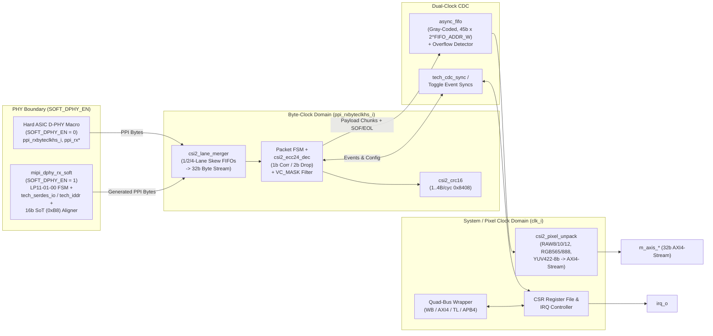

# 34_mipi_csi2_rx: MIPI CSI-2 RX Camera Controller & Soft D-PHY Adapter

A clean-room, pure synthesizable IEEE 1800-2017 SystemVerilog **MIPI CSI-2 Receiver (RX) Camera Controller** engineered for both **ASIC tape-out** (exposing a raw **MIPI D-PHY PPI** boundary) and **FPGA / SerDes prototyping** (selectable internal **Soft D-PHY RX Adapter** using `tech_serdes_io` / `tech_iddr`).

---

## Key Features

- **Dual PHY Architecture (`SOFT_DPHY_EN` on `mipi_csi2_rx_top`)**:
  - **`SOFT_DPHY_EN = 0` (ASIC Tape-Out Mode)**: Exposes standard MIPI D-PHY **PPI** ports (`ppi_rxbyteclkhs_i`, `ppi_rxdatahs_i`, `ppi_rxvalidhs_i`, `ppi_rxactivehs_i`, `ppi_rxsynchs_i`, `ppi_stopstate_i`) ready to connect directly to a foundry hard D-PHY macro.
  - **`SOFT_DPHY_EN = 1` (FPGA / SerDes Mode)**: Instantiates `mipi_dphy_rx_soft` with per-lane `LP11 -> LP01 -> LP00` HS-entry / `LP11` exit FSM, 8:1 SDR deserialization via `tech_serdes_io` (`DPHY_DDR_CLK = 0`) or 4:1 DDR capture via `tech_iddr` (`DPHY_DDR_CLK = 1`), and zero-loss 16-bit sliding-window `SoT` (`0xB8`) bit-offset alignment across all 8 UI phases.
- **Runtime-Selectable Multi-Lane Deskew & Merger (`csi2_lane_merger`)**:
  - Parameterized `MAX_LANES` (default `4`), runtime-selectable `1`, `2`, or `4` active lanes via `CTRL.LANE_CFG`.
  - Per-lane skew buffers absorb up to **7 byte-clocks** of inter-lane skew and drain asymmetric D-PHY trail bytes cleanly.
- **24-bit Hamming SEC-DED Header ECC & Payload CRC-16-CCITT (`csi2_ecc_crc`)**:
  - **1-bit header ECC error correction** across all 24 header bits `{WC[15:0], VC[1:0], DT[5:0]}` and 6 parity bits (`ECC_CORR` IRQ + `ECC_CORR_CNT`).
  - **2-bit header ECC error detection** drops corrupt packets cleanly (`ECC_ERR` IRQ + `ECC_ERR_CNT`).
  - **CRC-16-CCITT** (`x^16 + x^12 + x^5 + 1`, LSB-first `0x8408`, init `0xFFFF`) processes `1..4` bytes/cycle (`CRC_ERR` IRQ + `CRC_ERR_CNT`).
- **Short Packets & Virtual Channel Filtering**:
  - Tracks Frame Start (`0x00`), Frame End (`0x01`), Line Start (`0x02`), and Line End (`0x03`) with `FRAME_CNT`, `LINE_CNT`, and `FRAME_NUM` registers.
  - Per-VC hardware filter (`CTRL.VC_MASK[3:0]`).
- **Gray-Coded Dual-Clock CDC & Pixel Unpacker (`csi2_pixel_unpack`)**:
  - `async_fifo` (`ppi_rxbyteclkhs_i` -> `clk_i`) with overflow detection (`OVF` IRQ + `OVF_CNT`).
  - Unpacks `RAW8` (`0x2A`), `RAW10` (`0x2B`), `RAW12` (`0x2C`), `RGB565` (`0x22`), `RGB888` (`0x24`), and `YUV422-8b` (`0x1E`) to **32-bit AXI4-Stream (`m_axis_*`)** with `tuser[0]=SOF`, `tuser[2:1]=VC`, `tlast=EOL`, and `tkeep_o[3:0]`.
- **Quad-Bus SoC CSR Wrappers**: `Wishbone B4`, `AXI4 / AXI4-Lite`, `TileLink TL-UL / TL-UH`, and `AMBA APB4`.

---

## Architecture Overview: Hard PPI vs. Soft D-PHY



---

## RTL Hierarchy (`ips/34_mipi_csi2_rx/filelist.f`)

| Compile Order | File | Module / Package | Role |
| :---: | :--- | :--- | :--- |
| 1 | `rtl/csi2_pkg.sv` | `csi2_pkg` | CSI-2 DT constants, CSR offsets, IRQ bit indices, helpers |
| 2 | `rtl/csi2_ecc_crc.sv` | `csi2_ecc24_dec`, `csi2_crc16` | 24-bit Hamming SEC-DED decoder & variable-width CRC-16-CCITT |
| 3 | `rtl/csi2_lane_merger.sv` | `csi2_lane_merger` | Per-lane skew buffers (depth 8), SoT sync, 1/2/4-lane merger |
| 4 | `rtl/csi2_pixel_unpack.sv` | `csi2_pixel_unpack` | 6-format pixel unpacker to 32-bit AXI4-Stream (`clk_i` domain) |
| 5 | `rtl/mipi_dphy_rx_soft.sv` | `mipi_dphy_rx_soft` | Soft FPGA/SerDes D-PHY (`LP11->01->00`, `tech_serdes_io`/`tech_iddr`, SoT) |
| 6 | `rtl/mipi_csi2_rx_core.sv` | `mipi_csi2_rx_core` | Protocol-agnostic CSI-2 RX core with CDC & CSR file |
| 7 | `rtl/mipi_csi2_rx_wb.sv` | `mipi_csi2_rx_wb` | Wishbone B4 slave wrapper |
| 8 | `rtl/mipi_csi2_rx_axi.sv` | `mipi_csi2_rx_axi` | AXI4 / AXI4-Lite slave wrapper |
| 9 | `rtl/mipi_csi2_rx_tl.sv` | `mipi_csi2_rx_tl` | TileLink TL-UL / TL-UH device wrapper |
| 10 | `rtl/mipi_csi2_rx_apb.sv` | `mipi_csi2_rx_apb` | AMBA APB4 completer wrapper |
| 11 | `rtl/mipi_csi2_rx_top.sv` | `mipi_csi2_rx_top` | Unified parameterized Quad-Bus + Dual-PHY top wrapper |

---

## Parameters & Top-Level Ports (`mipi_csi2_rx_top`)

| Parameter | Type | Default | Description |
| :--- | :--- | :--- | :--- |
| `BUS_TYPE` | `bus_pkg::bus_proto_e` | `BUS_AXI4` | `BUS_WISHBONE` (0), `BUS_AXI4` (1), `BUS_TILELINK` (2), `BUS_APB` (3) |
| `MAX_LANES` | `int unsigned` | `4` | Maximum supported data lanes (`1`, `2`, or `4`) |
| `SOFT_DPHY_EN` | `bit` | `1'b0` | `0` = raw hard D-PHY PPI ports; `1` = internal `mipi_dphy_rx_soft` |
| `DPHY_DDR_CLK` | `bit` | `1'b0` | When `SOFT_DPHY_EN=1`: `0` = 8:1 SDR (`tech_serdes_io`), `1` = 4:1 DDR (`tech_iddr`) |
| `FIFO_ADDR_W` | `int unsigned` | `8` | Async CDC FIFO depth = `2**FIFO_ADDR_W` entries (default 256) |

| Port Group | Signal | Width | Dir | Clock Domain | Description |
| :--- | :--- | :---: | :---: | :--- | :--- |
| **System** | `clk_i`, `rst_ni` | 1 | In | `clk_i` | System/pixel clock & active-low async reset |
| **CSR Bus** | `wb_i`/`wb_o`, `axi_i`/`axi_o`, `tl_i`/`tl_o`, `apb_i`/`apb_o` | struct | In/Out | `clk_i` | Quad-bus CSR slave ports (tie unused inputs `'0`) |
| **Hard PPI** | `ppi_rxbyteclkhs_i` | 1 | In | `rxbyteclkhs` | D-PHY recovered byte clock (`SOFT_DPHY_EN=0`) |
| **Hard PPI** | `ppi_rxdatahs_i` | `8*MAX_LANES` | In | `rxbyteclkhs` | Per-lane HS byte data (`[7:0]` = lane 0) |
| **Hard PPI** | `ppi_rxvalidhs_i` | `MAX_LANES` | In | `rxbyteclkhs` | Per-lane HS data valid |
| **Hard PPI** | `ppi_rxactivehs_i` | `MAX_LANES` | In | `rxbyteclkhs` | Per-lane HS active envelope |
| **Hard PPI** | `ppi_rxsynchs_i` | `MAX_LANES` | In | `rxbyteclkhs` | Per-lane 1-cycle SoT (`0xB8`) sync pulse |
| **Hard PPI** | `ppi_stopstate_i` | 1 | In | Async | D-PHY LP-11 stop state indicator |
| **Soft D-PHY** | `dphy_clk_hs_i` | 1 | In | `dphy_clk_hs` | 8x SDR bit clock or 4x DDR clock (`SOFT_DPHY_EN=1`) |
| **Soft D-PHY** | `dphy_hs_rx_i` | `MAX_LANES` | In | `dphy_clk_hs` | Serial HS RX data per lane (LSB-first) |
| **Soft D-PHY** | `dphy_lp_p_i`, `dphy_lp_n_i` | `MAX_LANES` | In | Async | LP-11/01/00 state inputs per lane |
| **AXI4-Stream** | `m_axis_tvalid_o` / `m_axis_tready_i` | 1 | Out/In | `clk_i` | Pixel stream handshake |
| **AXI4-Stream** | `m_axis_tdata_o` / `m_axis_tkeep_o` | 32 / 4 | Out | `clk_i` | Unpacked pixel data & byte enables |
| **AXI4-Stream** | `m_axis_tlast_o` | 1 | Out | `clk_i` | End-of-Line (`EOL`) marker on final beat of long packet |
| **AXI4-Stream** | `m_axis_tuser_o` | 4 | Out | `clk_i` | `[0]`=SOF (1st pixel beat after FS), `[2:1]`=VC, `[3]`=0 |
| **Interrupt** | `irq_o` | 1 | Out | `clk_i` | Active-high level interrupt (`\|(IRQ_STAT & IRQ_EN)`) |

---

## Packet Format, ECC & CRC-16 Specification

### CSI-2 Packet Framing

- **Short Packet (4 bytes, `DT = 0x00..0x0F`)**: `{ECC[7:0], DataID16[15:8], DataID16[7:0], {VC[1:0], DT[5:0]}}` — no payload, no CRC footer.
  - `0x00`: Frame Start (FS) — `DataID16` carries 16-bit Frame Number (`FRAME_NUM[15:0]`), arms `SOF` for that VC.
  - `0x01`: Frame End (FE) — `DataID16` carries 16-bit Frame Number (`FRAME_NUM[31:16]`).
  - `0x02` / `0x03`: Line Start (LS) / Line End (LE).
- **Long Packet (`DT >= 0x10`)**: `4-byte Header {ECC, WC[15:8], WC[7:0], {VC, DT}}` + `WC bytes Payload` + `2-byte Footer {CRC_MSB, CRC_LSB}`.

### 24-bit Hamming SEC-DED ECC (`csi2_ecc24_dec`)

Over 24 header bits `D[23:0] = {WC[15:0], VC[1:0], DT[5:0]}`:

| Parity Bit | Covered Header Bit Indices (`D[23:0]`) | 24-bit Mask |
| :---: | :--- | :---: |
| `P0` | `0, 1, 2, 4, 5, 7, 10, 11, 13, 16, 20, 21, 22, 23` | `24'hF12C_B7` |
| `P1` | `0, 1, 3, 4, 6, 8, 10, 12, 14, 17, 20, 21, 22, 23` | `24'hF255_5B` |
| `P2` | `0, 2, 3, 5, 6, 9, 11, 12, 15, 18, 20, 21, 22` | `24'h749A_6D` |
| `P3` | `1, 2, 3, 7, 8, 9, 13, 14, 15, 19, 20, 21, 23` | `24'hB8E3_8E` |
| `P4` | `4, 5, 6, 7, 8, 9, 16, 17, 18, 19, 20, 22, 23` | `24'hDF03_F0` |
| `P5` | `10, 11, 12, 13, 14, 15, 16, 17, 18, 19, 21, 22, 23` | `24'hEFFC_00` |

- Syndrome `syn = calc_ecc(D) ^ rx_ecc[5:0]`:
  - `syn == 6'h00`: Error-free.
  - `syn` matches one of the 24 data-bit syndromes (`0x07..0x3B`) or 6 one-hot parity syndromes (`0x01..0x20`): **1-bit error corrected**, packet accepted, `ECC_CORR` raised.
  - Any other non-zero syndrome (all 2-bit errors have even Hamming weight): **uncorrectable error**, packet dropped, `ECC_ERR` raised.

### Payload CRC-16-CCITT (`csi2_crc16`)

- Polynomial: $x^{16} + x^{12} + x^5 + 1$ (`0x1021`, LSB-first reflected `0x8408`).
- Initial seed: `16'hFFFF`, no output inversion, footer byte order `{CRC[15:8], CRC[7:0]}`.

---

## Pixel Packing Tables (32-bit `m_axis_tdata_o`)

| Format | `DT` | Wire Group | Pixels / Beat | `m_axis_tdata_o[31:0]` Mapping | `tkeep_o` |
| :--- | :---: | :---: | :---: | :--- | :---: |
| `RAW8` | `0x2A` | 1B -> 1px | 4 | `{P3[7:0], P2[7:0], P1[7:0], P0[7:0]}` | `4'b1111` (partial on EOL) |
| `RAW10` | `0x2B` | 5B -> 4px | 2 (2 beats/group) | Beat 0: `{6'b0, P1[9:0], 6'b0, P0[9:0]}`<br/>Beat 1: `{6'b0, P3[9:0], 6'b0, P2[9:0]}` | `4'b1111` |
| `RAW12` | `0x2C` | 3B -> 2px | 2 | `{4'b0, P1[11:0], 4'b0, P0[11:0]}` | `4'b1111` |
| `RGB565` | `0x22` | 2B -> 1px | 2 | `{P1[15:0], P0[15:0]}` (`{R5,G6,B5}`) | `4'b1111` (`4'b0011` odd EOL) |
| `RGB888` | `0x24` | 3B (`B,G,R`) -> 1px | 1 | `{8'h00, R[7:0], G[7:0], B[7:0]}` | `4'b1111` |
| `YUV422-8b` | `0x1E` | 4B (`U0,Y0,V0,Y1`) | 2 (1 macropixel) | `{Y1[7:0], V0[7:0], Y0[7:0], U0[7:0]}` | `4'b1111` |

---

## CSR Register Map

| Offset | Name | Access | Reset | Bit Fields |
| :---: | :--- | :---: | :---: | :--- |
| `0x00` | `CTRL` | RW | `0x0000_0F04` | `[0]` `EN` (enable RX), `[2:1]` `LANE_CFG` (`00`=1L, `01`=2L, `10`=4L), `[3]` `SW_RST` (W1P self-clearing counter/IRQ reset), `[4]` `RAW_BYPASS` (pass unknown DTs raw), `[5]` `BITSLIP` (W1P soft D-PHY bitslip toggle), `[11:8]` `VC_MASK` (enable VC0..VC3) |
| `0x04` | `STATUS` | RO | `0x0000_0005` | `[0]` `STOPSTATE`, `[1]` `RX_ACTIVE`, `[2]` `FIFO_EMPTY`, `[3]` `FIFO_FULL`, `[7:4]` `LANES_SYNCED`, `[23:16]` `LAST_DI` (`{VC,DT}`), `[27]` `SOFT_DPHY_EN`, `[31:28]` `MAX_LANES` |
| `0x08` | `IRQ_EN` | RW | `0x0000_0000` | `[7:0]` Enable bits corresponding to `IRQ_STAT[7:0]` |
| `0x0C` | `IRQ_STAT` | RW1C | `0x0000_0000` | `[0]` `FS`, `[1]` `FE`, `[2]` `PKT_OK`, `[3]` `ECC_CORR`, `[4]` `ECC_ERR`, `[5]` `CRC_ERR`, `[6]` `OVF`, `[7]` `DESKEW_ERR` |
| `0x10` | `FRAME_CNT` | RO | `0x0000_0000` | `[31:0]` Received Frame Start (`DT=0x00`) packet counter |
| `0x14` | `LINE_CNT` | RO | `0x0000_0000` | `[31:0]` Received Long Packet (Line) counter |
| `0x18` | `ERR_CNT` | RO | `0x0000_0000` | `[15:0]` `ECC_CORR_CNT`, `[23:16]` `ECC_ERR_CNT`, `[31:24]` `CRC_ERR_CNT` (saturating) |
| `0x1C` | `OVF_CNT` | RO | `0x0000_0000` | `[15:0]` `FIFO_OVF_CNT`, `[31:16]` `DESKEW_ERR_CNT` (saturating) |
| `0x20` | `PKT_INFO` | RO | `0x0000_0000` | `[5:0]` `DT`, `[7:6]` `VC`, `[23:8]` `WC`, `[29:24]` `ECC_SYNDROME` |
| `0x24` | `FRAME_NUM` | RO | `0x0000_0000` | `[15:0]` `LAST_FS_NUM`, `[31:16]` `LAST_FE_NUM` |
| `0x28` | `LANE_SKEW` | RO | `0x0000_0000` | `[3:0]` `SOFT_DPHY_LOCKED`, `[19:4]` 4x4b detected `SoT` bit-slip offset (`1..8` per lane) |
| `0x2C` | `ID` | RO | `0x4353_4932` | ASCII `"CSI2"` IP identifier |

---

## Programming Recipe (C-Style Pseudocode)

```c
#define CSI2_BASE       0x40040000u
#define CSI2_CTRL       (*(volatile uint32_t *)(CSI2_BASE + 0x00))
#define CSI2_STATUS     (*(volatile uint32_t *)(CSI2_BASE + 0x04))
#define CSI2_IRQ_EN     (*(volatile uint32_t *)(CSI2_BASE + 0x08))
#define CSI2_IRQ_STAT   (*(volatile uint32_t *)(CSI2_BASE + 0x0C))
#define CSI2_ERR_CNT    (*(volatile uint32_t *)(CSI2_BASE + 0x18))

void csi2_init_4lane_vc0(void) {
    // 1. Soft-reset counters & clear pending IRQs
    CSI2_CTRL = (1u << 3);

    // 2. Enable Frame Start (bit 0) and fatal errors (ECC_ERR=4, CRC_ERR=5, OVF=6)
    CSI2_IRQ_EN = (1u << 0) | (1u << 4) | (1u << 5) | (1u << 6);

    // 3. Enable controller, 4 lanes (LANE_CFG=2), VC0 only (VC_MASK=0x1)
    CSI2_CTRL = (0x1u << 8) | (2u << 1) | (1u << 0);
}

void csi2_isr(void) {
    uint32_t st = CSI2_IRQ_STAT;
    if (st & (1u << 6)) {
        // Handle AXI4-Stream downstream backpressure / overflow
    }
    if (st & ((1u << 4) | (1u << 5))) {
        uint32_t errs = CSI2_ERR_CNT;
        (void)errs; // Inspect ECC/CRC error counts
    }
    CSI2_IRQ_STAT = st; // W1C acknowledge
}
```

---

## ASIC Hard D-PHY vs. FPGA LVDS / SerDes Bring-Up Guide

1. **ASIC Tape-Out (`SOFT_DPHY_EN = 0`)**:
   - Connect `ppi_rxbyteclkhs_i`, `ppi_rxdatahs_i`, `ppi_rxvalidhs_i`, `ppi_rxactivehs_i`, `ppi_rxsynchs_i`, and `ppi_stopstate_i` directly to your foundry MIPI D-PHY RX PHY macro.
   - Ensure `clk_i` >= `1.6 * ppi_rxbyteclkhs_i` for continuous full-rate 4-lane `RAW10` streams (or size `FIFO_ADDR_W` to absorb one active video line across horizontal blanking).
   - Constrain `u_cdc_fifo` Gray pointers (`async_fifo`) and `tech_cdc_sync` / `tech_rst_sync` cells as false-path / max-delay CDC constraints in SDC.
2. **FPGA LVDS / SerDes Bring-Up (`SOFT_DPHY_EN = 1`)**:
   - **8:1 SerDes Clocking (`DPHY_DDR_CLK = 0`)**: Feed the recovered HS bit clock into `dphy_clk_hs_i`; `tech_serdes_io` deserializes 8:1 and generates the phase-locked `/8` byte clock. Override `tech_serdes_io` with vendor `ISERDESE2` / `IDDRX4` when targeting specific FPGA families (`TARGET_ASIC_PMA` hook available).
   - **4:1 DDR Clocking (`DPHY_DDR_CLK = 1`)**: Feed the half-rate MIPI D-PHY HS clock into `dphy_clk_hs_i`; `tech_iddr` captures both rising and falling edges (`TARGET_FPGA_XILINX` hook maps directly to Xilinx `IDDR`).
   - External resistor network or FPGA `LVDS_25` / `MIPI_DPHY` I/O bank splits HS differential pairs (`dphy_hs_rx_i`) and single-ended 1.2 V LP receivers (`dphy_lp_p_i`, `dphy_lp_n_i`).

---

## Verification Summary (`ips/34_mipi_csi2_rx/tb/tb_mipi_csi2_rx.sv`)

Verified in Verilator 5.054 (`--binary --timing`, 0 lint warnings) with independent golden ECC/CRC/pixel reference models across `+seed=1`, `+seed=7`, and `+seed=42`:
- **PHY Modes**: Hard PPI (`SOFT_DPHY_EN=0` with asynchronous `ppi_rxbyteclkhs_i != clk_i`), Soft D-PHY 8:1 SDR SerDes (`tech_serdes_io`), and Soft D-PHY 4:1 DDR (`tech_iddr`).
- **Multi-Lane & Bit-Slip**: `1`, `2`, and `4` active lanes with per-lane byte skew and all `8` serial bit-slip offsets (`0..7` UI).
- **Formats & Protocol**: All 6 pixel formats (`RAW8`, `RAW10`, `RAW12`, `RGB565`, `RGB888`, `YUV422-8b`), `SOF`/`VC`/`EOL` AXI4-Stream signaling, short packets (`FS/FE/LS/LE`), Virtual Channel filtering, 1-bit ECC correction, 2-bit ECC packet drop, payload CRC-16 error detection, random AXI4-Stream backpressure, FIFO overflow detection, and all 4 bus interfaces (`Wishbone B4`, `AXI4`, `TileLink`, `APB4`).
