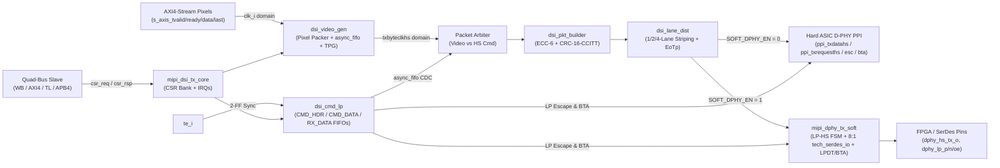

# MIPI DSI-2 TX Display Controller (`ips/35_mipi_dsi_tx`)

A clean-room, pure-synthesizable IEEE 1800-2017 SystemVerilog **MIPI DSI-2 Display Serial Interface TX Controller** targeting both **ASIC tape-out** (clean **D-PHY PPI — PHY Protocol Interface** boundary) and **FPGA / SerDes** platforms (integrated `mipi_dphy_tx_soft` 8:1 serializer adapter using `tech_serdes_io`).

---

## 1. Key Features

- **Dual-PHY Top Architecture (`SOFT_DPHY_EN`)**:
  - `SOFT_DPHY_EN = 0` (**ASIC Hard D-PHY Mode**): Exposes standard **MIPI D-PHY PPI TX** ports (`ppi_txbyteclkhs_i`, `ppi_txdatahs_o`, `ppi_txrequesths_o`, `ppi_txreadyhs_i`, `ppi_txrequestesc_o`, `ppi_txlpdtesc_o`, `ppi_txdataesc_o`, `ppi_txvalidesc_o`, `ppi_txreadyesc_i`, `ppi_turnrequest_o`, `ppi_direction_i`, `ppi_stopstate_i`, `ppi_rxdataesc_i`, `ppi_rxvalidesc_i`, `ppi_rxlpdtesc_i`).
  - `SOFT_DPHY_EN = 1` (**FPGA / SerDes Soft D-PHY Mode**): Instantiates `mipi_dphy_tx_soft`, driving `LP-11 -> LP-01 -> LP-00 -> SoT (8'hB8) -> HS Payload -> HS-Trail -> LP-11` via `tech_serdes_io` 8:1 serialization (`dphy_hs_tx_o`, `dphy_hs_oe_o`, `dphy_lp_p_o`/`n_o`/`oe_o`), plus Lane 0 LP Escape Spaced-One-Hot TX/RX and BTA turnaround.
- **Configurable Multi-Lane Striping**: `MAX_LANES = 4`, runtime selectable `1`, `2`, or `4` active lanes via `DSI_CTRL.LANES`, with optional **EoTp** (`0x08`, `08 0F 0F 01`) insertion at HS burst termination.
- **Packet Builder (`dsi_pkt_builder`)**:
  - 24-bit Header **6-bit Hamming (30,24) SEC-DED ECC** generator (`dsi_calc_ecc`).
  - **CRC-16-CCITT** (`0x1021` / reflected `0x8408`, init `0xFFFF`) payload checksum generator with 1-cycle zero-bubble folding.
  - Short Packets: `VSS (0x01)`, `VSE (0x11)`, `HSS (0x21)`, `HSE (0x31)`, `EOTP (0x08)`, `GEN_SW0/1/2 (0x03/0x13/0x23)`, `GEN_RD0/1/2 (0x04/0x14/0x24)`, `DCS_SW0/1 (0x05/0x15)`, `DCS_RD0 (0x06)`, `SET_MAX_RET (0x37)`.
  - Long Packets: `NULL (0x09)`, `BLANKING (0x19)`, `GEN_LW (0x29)`, `DCS_LW (0x39)`, `RGB565 (0x0E)`, `RGB666_PACKED (0x1E)`, `RGB888 (0x3E)`.
  - Full 2-bit Virtual Channel (`VC[1:0]`) support.
- **Video Mode Timing Engine (`dsi_video_gen`)**:
  - Programmable `HSA`, `HBP`, `HACT`, `HFP`, `VSA`, `VBP`, `VACT`, `VFP`.
  - Supports **Non-Burst Sync Pulse**, **Non-Burst Sync Event**, and **Burst** video modes.
  - 32-bit **AXI4-Stream** pixel slave (`s_axis_tvalid_i`, `s_axis_tready_o`, `s_axis_tdata_i`, `s_axis_tlast_i`) crossing from `clk_i` to `txbyteclkhs_i` via Gray-coded `async_fifo` with **underrun detection** (`UNDERRUN` IRQ + protocol-safe `0x00` padding).
  - Built-in 8-bar **SMPTE Color-Bar Test Pattern Generator** (`DSI_CTRL.TPG_EN`).
- **Command Mode, Tear-Effect & BTA (`dsi_cmd_lp`)**:
  - Depth-8 Command Header Queue + `CMD_DATA` TX FIFO (`sync_fifo`).
  - Hardware Tear-Effect (`te_i`) rising-edge frame-sync gating (`TE_EN` or per-command `TE_WAIT`).
  - HS Command dispatch across `async_fifo` CDC (arbitrated cleanly in inter-frame LP-11 windows when Video Mode is active).
  - Low-Power Escape (`LPDT`: `LP-11 -> LP-10 -> LP-00 -> LP-01 -> LP-00` + `0x87`) and **Bus Turn-Around (BTA)** RX response capture (`RX_DATA` FIFO, ECC/CRC validation, `BTA_DONE` IRQ).
- **Quad-Bus CSR Wrappers**: Wishbone B4 (`BUS_TYPE=0`), AXI4/AXI4-Lite (`BUS_TYPE=1`), TileLink TL-UL/UH (`BUS_TYPE=2`), AMBA APB4 (`BUS_TYPE=3`).

---

## 2. Architecture Block Diagram



---

## 3. Parameters & Interfaces

### 3.1 Top-Level Parameters (`mipi_dsi_tx_top`)

| Parameter | Type | Default | Description |
| :--- | :--- | :--- | :--- |
| `BUS_TYPE` | `bus_pkg::bus_proto_e` | `BUS_AXI4` | `0=BUS_WISHBONE`, `1=BUS_AXI4`, `2=BUS_TILELINK`, `3=BUS_APB` |
| `MAX_LANES` | `int unsigned` | `4` | Maximum supported D-PHY data lanes (`1`, `2`, or `4`) |
| `SOFT_DPHY_EN` | `bit` | `1'b0` | `0`: Raw PPI TX ports; `1`: Integrated `mipi_dphy_tx_soft` adapter |
| `PIX_FIFO_AW` | `int unsigned` | `8` | `log2(depth)` of CDC pixel `async_fifo` (default 256 words) |
| `CMD_FIFO_D` | `int unsigned` | `64` | Depth of 32-bit Command TX FIFO |
| `RX_FIFO_D` | `int unsigned` | `32` | Depth of 32-bit BTA RX response FIFO |

### 3.2 Port Summary

| Group | Signal | Dir | Width | Clock Domain | Description |
| :--- | :--- | :--- | :--- | :--- | :--- |
| System | `clk_i`, `rst_ni` | in | 1 | `clk_i` | System/CSR/AXI4-Stream clock and async active-low reset |
| CSR Slave | `wb_*`, `axi_*`, `tl_*`, `apb_*` | in/out | struct | `clk_i` | Selected by `BUS_TYPE` (`BUS_WISHBONE..BUS_APB`) |
| Pixel Stream | `s_axis_tvalid_i`, `tready_o`, `tdata_i`, `tlast_i` | in/out | 1 / 32 | `clk_i` | 32-bit pixel input (`XRGB8888` for 888/666, `{P1,P0}` for 565) |
| Panel / IRQ | `te_i`, `irq_o` | in / out | 1 | async / `clk_i` | Panel Tear-Effect sync input; level-high combined interrupt |
| PPI HS TX | `ppi_txbyteclkhs_i` | in | 1 | `txbyteclkhs` | D-PHY byte clock (`SOFT_DPHY_EN=0`) |
| PPI HS TX | `ppi_txdatahs_o`, `ppi_txrequesths_o`, `ppi_txreadyhs_i` | out/in | `8*L` / `L` | `txbyteclkhs` | Per-lane HS byte data, request, and PHY ready |
| PPI LP/BTA | `ppi_txrequestesc_o`, `txlpdtesc_o`, `txdataesc_o`, `txvalidesc_o`, `txreadyesc_i` | out/in | 1 / 8 | `clk_i` | Lane 0 Escape LPDT TX handshake |
| PPI LP/BTA | `ppi_turnrequest_o`, `direction_i`, `stopstate_i`, `rxdataesc_i`, `rxvalidesc_i`, `rxlpdtesc_i` | out/in | 1 / 8 | `clk_i` / `byte` | Lane 0 BTA turnaround request, direction, StopState, RX byte |
| Soft D-PHY | `dphy_clk_hs_i`, `dphy_clk_byte_o`, `dphy_clk_tx_o` | in/out | 1 | `dphy_clk_hs` | 8x serial bit clock input, `/8` byte clock, forwarded HS clock |
| Soft D-PHY | `dphy_hs_tx_o`, `dphy_hs_oe_o` | out | `MAX_LANES` | `dphy_clk_hs` | Serialized HS lane bit outputs and HS output enables |
| Soft D-PHY | `dphy_lp_p_o`, `dphy_lp_n_o`, `dphy_lp_oe_o`, `dphy_lp_p0_i`, `dphy_lp_n0_i` | out/in | `MAX_LANES` / 1 | `clk_i` / `byte` | Split LP pad controls and Lane 0 LP RX inputs for BTA |

---

## 4. MIPI DSI-2 Protocol Sequences, ECC & CRC

### 4.1 Video Mode Packet Sequences

1. **Non-Burst Mode with Sync Pulses (`VID_MODE = 0`)**:
   - Frame start (Line 0): `VSS (0x01)` -> `BLANKING (HSA)` -> `HSE (0x31)` -> `BLANKING (HBP)` -> LP-11 or Blanking (`HFP`).
   - Line `VSA`: `VSE (0x11)` -> `BLANKING (HSA)` -> `HSE (0x31)` -> ...
   - Active lines (`VSA+VBP .. VSA+VBP+VACT-1`): `HSS (0x21)` -> `BLANKING (HSA)` -> `HSE (0x31)` -> `BLANKING (HBP)` -> **Pixel Long Packet (`0x0E`/`0x1E`/`0x3E`)** -> optional `EoTp (0x08)` -> LP-11 (`VID_LP_HFP_EN=1`) or `BLANKING (HFP)`.
2. **Non-Burst Mode with Sync Events (`VID_MODE = 1`)**:
   - No `VSE` or `HSE` packets; `HSA + HBP` are combined into a single `BLANKING (0x19)` interval after `VSS`/`HSS`.
3. **Burst Mode (`VID_MODE = 2`)**:
   - `VSS`/`HSS` -> optional `BLANKING (HBP)` -> **Pixel Long Packet** at full HS bandwidth -> immediate `EoTp (0x08)` + exit to **LP-11** for `HFP` / BLLP power saving.

### 4.2 LP Escape (`LPDT`) & Bus Turn-Around (`BTA`)

- **LPDT TX Sequence** (`mipi_dphy_tx_soft`):
  `LP-11` -> `LP-10` -> `LP-00` -> `LP-01` -> `LP-00` -> `0x87` (LPDT entry command, LSB-first Spaced-One-Hot: `1 -> LP10->LP00`, `0 -> LP01->LP00`) -> DSI packet bytes -> Mark-1 Exit (`LP-10 -> LP-11`).
- **BTA Sequence**:
  Host drives `LP-10 -> LP-00 -> LP-10 -> LP-00` and releases `dphy_lp_oe_o[0] = 0` (`ppi_turnrequest_o = 1`, `ppi_direction_i = 1`), decodes slave LPDT response (`0x87` + DSI Short/Long Read Response), validates ECC-6 & CRC-16, writes 32-bit words into `RX_DATA` FIFO, raises `BTA_DONE` IRQ, and reclaims the bus on reverse-BTA / `LP-11`.

### 4.3 24-bit Header Hamming ECC & Payload CRC-16

For 24-bit header `H[23:0] = {WC_or_Data[15:0], VC[1:0], DT[5:0]}`:

```
ECC[0] = ^(H & 24'hF12C_B7)
ECC[1] = ^(H & 24'hF255_5B)
ECC[2] = ^(H & 24'h749A_6D)
ECC[3] = ^(H & 24'hB8E3_8E)
ECC[4] = ^(H & 24'hDF03_F0)
ECC[5] = ^(H & 24'hEFFC_00)
Header Byte 3 = {2'b00, ECC[5:0]}
```

Payload checksum uses **CRC-16-CCITT** with polynomial $x^{16} + x^{12} + x^5 + 1$ (reflected `0x8408`, LSB-first per payload byte, initial value `0xFFFF`, no final XOR), transmitted little-endian (`CRC[7:0]`, then `CRC[15:8]`).

### 4.4 Pixel Packing Format on `s_axis_tdata_i[31:0]`

| `PIX_FMT` | DSI DT | `s_axis_tdata_i[31:0]` Layout | Wire Byte Order |
| :--- | :--- | :--- | :--- |
| `0` (`RGB565`) | `0x0E` | `{P1[15:0], P0[15:0]}` (2 px/beat; odd `HACT` last beat uses `P0`) | `{G[2:0],B[4:0]}`, `{R[4:0],G[5:3]}` |
| `1` (`RGB666`) | `0x1E` | `{8'h00, R[7:0], G[7:0], B[7:0]}` (1 px/beat) | Packed 18-bit (`{B[7:2],G[7:2],R[7:2]}`), 4 px = 9 bytes |
| `2` (`RGB888`) | `0x3E` | `{8'h00, R[7:0], G[7:0], B[7:0]}` (1 px/beat) | `R[7:0]`, `G[7:0]`, `B[7:0]` |

---

## 5. CSR Register Map (`0x00` – `0x30`)

| Offset | Name | Access | Reset | Bit Fields |
| :--- | :--- | :--- | :--- | :--- |
| `0x00` | `DSI_CTRL` | RW | `0x0004_04A0` | `[0]` `EN`; `[1]` `MODE` (0=Cmd, 1=Video); `[3:2]` `VID_MODE` (0=Pulse, 1=Event, 2=Burst); `[5:4]` `PIX_FMT` (0=565, 1=666, 2=888); `[7:6]` `LANES` (0=1L, 1=2L, 2/3=4L); `[9:8]` `VC`; `[10]` `EOTP_EN`; `[11]` `TPG_EN`; `[12]` `TE_EN`; `[13]` `VID_LP_HFP_EN`; `[14]` `HS_TX_CLK_GATE`; `[15]` `FIFO_CLR` (W1P); `[23:16]` `LP_CLK_DIV` |
| `0x04` | `DSI_STATUS` | RO | `0x0000_0254` | `[0]` `VID_ACTIVE`; `[1]` `TX_BUSY`; `[2]` `CMD_FIFO_EMPTY`; `[3]` `CMD_FIFO_FULL`; `[4]` `RX_FIFO_EMPTY`; `[5]` `RX_FIFO_FULL`; `[6]` `PIX_FIFO_EMPTY`; `[7]` `PIX_FIFO_FULL`; `[8]` `TE_STATE`; `[9]` `STOP_STATE`; `[15:10]` `CMD_FIFO_LVL`; `[21:16]` `RX_FIFO_LVL`; `[31:24]` `FRAME_CNT` |
| `0x08` | `DSI_INT_EN` | RW | `0x0000_0000` | `[0]` `VSYNC`; `[1]` `UNDERRUN`; `[2]` `CMD_DONE`; `[3]` `BTA_DONE`; `[4]` `TE_EVENT` |
| `0x0C` | `DSI_INT_STAT` | RW1C | `0x0000_0000` | `[0]` `VSYNC`; `[1]` `UNDERRUN`; `[2]` `CMD_DONE`; `[3]` `BTA_DONE`; `[4]` `TE_EVENT` |
| `0x10` | `DSI_VID_HSA_HBP` | RW | `0x0008_0004` | `[15:0]` `HSA` (`txbyteclkhs` cycles); `[31:16]` `HBP` (`txbyteclkhs` cycles) |
| `0x14` | `DSI_VID_HACT_HFP` | RW | `0x0008_0010` | `[15:0]` `HACT` (pixels); `[31:16]` `HFP` (`txbyteclkhs` cycles) |
| `0x18` | `DSI_VID_VSA_VBP` | RW | `0x0002_0001` | `[15:0]` `VSA` (lines); `[31:16]` `VBP` (lines) |
| `0x1C` | `DSI_VID_VACT_VFP` | RW | `0x0002_0004` | `[15:0]` `VACT` (lines); `[31:16]` `VFP` (lines) |
| `0x20` | `DSI_CMD_HDR` | RW/Trig | `0x0000_0000` | Writing queues a command: `[5:0]` `DT`; `[7:6]` `VC`; `[23:8]` `WC_DATA`; `[24]` `USE_LP` (1=LPDT, 0=HS); `[25]` `DO_BTA`; `[26]` `TE_WAIT` |
| `0x24` | `DSI_CMD_DATA` | WO | `0x0000_0000` | `[31:0]` Push 4 payload bytes (LSB = byte 0) into TX FIFO before `DSI_CMD_HDR` |
| `0x28` | `DSI_RX_DATA` | RO/Pop | `0x0000_0000` | `[31:0]` Pop 1 word from BTA RX FIFO (Word 0 = `{ECC, WC[15:8], WC[7:0], VC, DT}`) |
| `0x2C` | `DSI_RX_STATUS` | RO | `0x0000_0000` | `[15:0]` `RX_PKT_LEN`; `[16]` `RX_ECC_ERR`; `[17]` `RX_CRC_ERR`; `[18]` `RX_OVERFLOW`; `[31:24]` `RX_LAST_DT` |
| `0x30` | `DSI_PKT_STAT` | RO | `0x0000_0000` | `[15:0]` `HS_PKT_CNT`; `[31:16]` `LP_CMD_CNT` |

---

## 6. Programming Recipes (C Pseudocode)

### 6.1 Panel Initialization via LP Escape & BTA Readback

```c
// 1. Send DCS Sleep Out (0x11) in LP Escape mode
dsi_write(DSI_CMD_HDR, (1 << 24) | (0x0011 << 8) | 0x05);
while (dsi_read(DSI_STATUS) & (1 << 1)); // Wait TX_BUSY == 0

// 2. Send DCS Long Write (0x39, WC=5) in HS mode gated by Tear-Effect (te_i)
dsi_write(DSI_CMD_DATA, 0x0302012A); // Column Address Set: cmd 0x2A + 3 bytes
dsi_write(DSI_CMD_DATA, 0x00000004); // 5th byte
dsi_write(DSI_CMD_HDR, (1 << 26) | (5 << 8) | 0x39);

// 3. Perform DCS Read (0x06, reg 0x0A Power Mode) with BTA
dsi_write(DSI_INT_STAT, 0x1F);
dsi_write(DSI_CMD_HDR, (1 << 25) | (1 << 24) | (0x000A << 8) | 0x06);
while (!(dsi_read(DSI_INT_STAT) & (1 << 3))); // Wait BTA_DONE
uint32_t rsp_hdr = dsi_read(DSI_RX_DATA);
```

### 6.2 Starting 4-Lane Burst RGB888 Video Mode (with TPG or AXI4-Stream)

```c
dsi_write(DSI_VID_HSA_HBP,  (16 << 16) | 8);     // HBP=16, HSA=8 byte-clks
dsi_write(DSI_VID_HACT_HFP, (16 << 16) | 800);   // HFP=16, HACT=800 px
dsi_write(DSI_VID_VSA_VBP,  (8 << 16)  | 2);     // VBP=8, VSA=2 lines
dsi_write(DSI_VID_VACT_VFP, (8 << 16)  | 480);   // VFP=8, VACT=480 lines
dsi_write(DSI_INT_EN,       0x03);               // Enable VSYNC + UNDERRUN IRQs
// EN=1, MODE=1(Video), VID_MODE=2(Burst), PIX_FMT=2(RGB888), LANES=2(4L), EOTP=1, LP_HFP=1
dsi_write(DSI_CTRL, (4 << 16) | (1 << 13) | (1 << 10) | (2 << 6) | (2 << 4) | (2 << 2) | 0x3);
```

---

## 7. Integration & FPGA / ASIC Bring-Up Notes

- **ASIC Tape-Out (`SOFT_DPHY_EN = 0`)**: Connect `ppi_txbyteclkhs_i`, `ppi_txdatahs_o`, `ppi_txrequesths_o`, `ppi_txreadyhs_i`, `ppi_tx*esc_*`, `ppi_turnrequest_o`, `ppi_direction_i`, `ppi_stopstate_i`, and `ppi_rx*esc_i` directly to your foundry MIPI D-PHY hard macro PPI pins. All CDC crossings (`clk_i` <-> `ppi_txbyteclkhs_i`) use Gray-coded `async_fifo` and 2-FF `tech_cdc_sync` / `tech_rst_sync` cells.
- **FPGA LVDS / SerDes (`SOFT_DPHY_EN = 1`)**: Feed an 8x HS serial clock into `dphy_clk_hs_i` (e.g., 400 MHz for 50 MHz byte clock / 400 Mbps per lane). `mipi_dphy_tx_soft` divides `dphy_clk_hs_i` by 8 for `dphy_clk_byte_o` and drives `tech_serdes_io` (`RATIO=8, LSB_FIRST=1`). On FPGA boards, map `dphy_hs_tx_o` / `dphy_hs_oe_o` to high-speed LVDS `OBUFTDS` buffers and `dphy_lp_p/n/oe` to 1.2 V LVCMOS/HSUL resistor-network LP drivers.
- **Graceful Shutdown**: Clearing `DSI_CTRL.EN = 0` allows the active DSI packet and HS burst to terminate cleanly with valid CRC-16 and EoTp before returning `DSI_STATUS.VID_ACTIVE` and `TX_BUSY` to `0`.

---

## 8. Verification Summary

Verified with Verilator 5.054 (`--binary --timing`, 0 warnings under `WARN_FLAGS`) and `scripts/check_yosys_compat.py` (0 errors) across `BUS_TYPE = 0..3` and `SOFT_DPHY_EN = 0/1`, with self-checking golden receiver regression (`ips/35_mipi_dsi_tx/tb/tb_mipi_dsi_tx.sv`, `+seed=1,7,42`):

- Quad-bus CSR read/write & packet dispatch across Wishbone B4, AXI4, TileLink, and APB4.
- 1, 2, and 4-lane PPI Video Mode (Non-Burst Sync Pulse, Non-Burst Sync Event, Burst) with pixel-exact verification for `RGB565` (including odd `HACT`), `RGB666_PACKED`, and `RGB888`.
- Independent 6-bit Hamming ECC & CRC-16-CCITT verification on every packet, plus EoTp (`08 0F 0F 01`).
- SMPTE 8-bar TPG verification and live AXI4-Stream underrun IRQ verification.
- Command Mode HS/LP DCS & Generic short/long writes, `te_i` rising-edge gating, LP Escape sequence (`LP-11 -> LP-10 -> LP-00 -> LP-01 -> LP-00` + `0x87`), and both PPI & Soft D-PHY BTA readback (`RX_DATA` + `BTA_DONE` IRQ).
- Soft FPGA/SerDes D-PHY TX (`SOFT_DPHY_EN=1`): 8:1 serial HS capture, `SoT 8'hB8` locking, HS-Trail, and LP-11 transitions.
