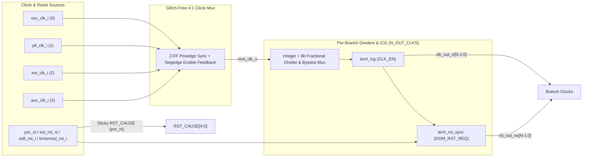
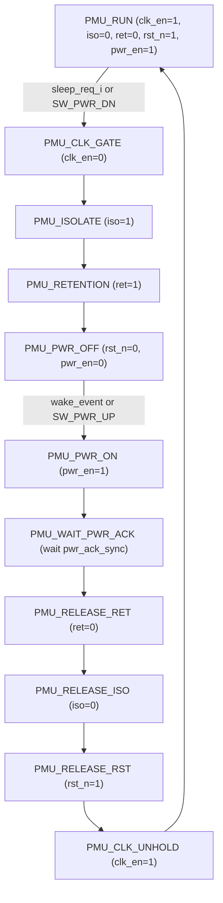
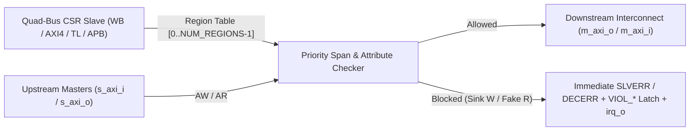
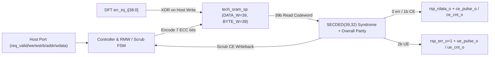

# SoC Silicon Infrastructure Pack (`36_soc_sysctrl`)

## Overview

`ips/36_soc_sysctrl` is a clean-room, Yosys-, FPGA-, and ASIC-tape-out-ready **SoC Silicon Infrastructure Pack** providing five foundational system-control and memory-protection blocks:

1. **CRG (`crg_top`)**: Glitch-free 4:1 root clock multiplexer, programmable integer + 8-bit fractional branch dividers, `tech_icg` clock gating, PLL control/status CDC (`tech_cdc_sync`), per-domain synchronized resets (`tech_rst_sync`), and POR-retained sticky reset-cause tracking (`RST_CAUSE`).
2. **IOMUX (`iomux_top`)**: Parameterizable `32x8` pinmux crossbar with split pad-ring vectors (`pad_i`/`pad_o`/`pad_oe_o`), programmable pad electrical attributes (`DRIVE`, `SLEW`, `PULL_EN`, `PULL_UP`, `SCHMITT_EN`), input isolation (`IN_ISO`), output retention latches (`OUT_RET`), and write-once `LOCK`.
3. **PMU (`pmu_top`)**: Multi-domain power-down / power-up handshake sequencer (`NUM_DOMAINS=4`) with programmable phase delays, CDC-synchronized `NUM_WAKE_SRCS=8` wake-up aggregator (polarity, edge/level, per-domain mask, W1C status, `irq_o`), and strict isolation/retention/reset ordering invariants.
4. **Access-Control Bus Firewall (`bus_firewall_top`)**: Inline AXI4 memory protection firewall (`NUM_REGIONS=8`) configured via a quad-bus CSR slave (`WB`/`AXI4`/`TL`/`APB`), checking burst address spans `[start_addr, end_addr]`, read/write permissions, 16-bit `MASTER_MASK`, `SEC_ONLY`, and `PRIV_ONLY`, immediately terminating illegal transactions with `SLVERR`/`DECERR` and latching violation telemetry.
5. **SRAM SECDED ECC Wrapper (`sram_ecc_wrap`)**: Standalone synthesizable Hamming **SECDED(39,32)** wrapper around `tech_sram_sp` with 1-bit inline correction (`ce_pulse_o`, `ce_cnt_o`, `ce_addr_o`), 2-bit uncorrectable error detection (`ue_pulse_o`, `ue_cnt_o`, `ue_addr_o`, `rsp_err_o`), automatic 2-cycle partial-byte RMW, background idle scrubber, and DFT `err_inj_i[38:0]` fault injection.

Compile order is specified in [filelist.f](file:///Users/tianrui6641/tians_ip_collection/ips/36_soc_sysctrl/filelist.f).

---

## Architecture Diagrams

### 1. CRG — Clock & Reset Generator (`crg_top`)



### 2. PMU — Power Management & Wake-Up Controller (`pmu_top`)



### 3. Access-Control Bus Firewall (`bus_firewall_top`)



### 4. SRAM SECDED(39,32) ECC Wrapper (`sram_ecc_wrap`)



---

## Sub-IP 1: CRG (`crg_top`)

### Parameters & Ports (`crg_top`)

| Name | Type / Width | Default / Dir | Description |
| :--- | :--- | :--- | :--- |
| `BUS_TYPE` | `bus_proto_e` | `BUS_AXI4` | Selects CSR wrapper (`BUS_WISHBONE`, `BUS_AXI4`, `BUS_TILELINK`, `BUS_APB`). |
| `N_OUT_CLKS` | `int unsigned` | `4` | Number of divided/gated output clock & reset branches (max `16`). |
| `RST_PULSE_CYCLES` | `int unsigned` | `8` | Duration (in `clk_i` cycles) of warm `SWRST_KEY` reset pulse. |
| `clk_i`, `rst_ni` | `logic` | in | Always-on CSR bus clock and active-low CSR reset. |
| `osc_clk_i`, `pll_clk_i`, `ext_clk_i`, `aux_clk_i` | `logic` | in | Glitch-free 4:1 multiplexer source clocks (`0`..`3`). |
| `test_mode_i` | `logic` | in | DFT scan bypass (forces `osc_clk_i`, bypasses `tech_icg` and `tech_rst_sync`). |
| `por_ni`, `ext_rst_ni`, `wdt_rst_i`, `brownout_rst_i` | `logic` | in | Reset inputs & sticky `RST_CAUSE` sources. |
| `pll_en_o`, `pll_bypass_o`, `pll_cfg_o[31:0]`, `pll_lock_i` | `logic` | out / in | PLL control outputs and 2-FF synced lock status input. |
| `root_clk_o`, `sys_rst_no` | `logic` | out | Glitch-free root clock and synchronized system reset. |
| `clk_out_o[N-1:0]`, `rst_out_no[N-1:0]` | `logic` | out | Divided & ICG-gated branch clocks and per-domain synchronized resets. |
| `mux_active_o[3:0]`, `rst_cause_o[4:0]` | `logic` | out | Synced one-hot active mux source and sticky reset cause vector. |

### CRG CSR Register Map (`0x000..0x05C`)

| Offset | Name | Access | Reset | Bit Fields |
| :--- | :--- | :--- | :--- | :--- |
| `0x000` | `CLK_CTRL` | RW | `0x0000_0100` | `[1:0]` `MUX_SEL` (`0`=OSC,`1`=PLL,`2`=EXT,`3`=AUX), `[4]` `PLL_EN`, `[5]` `PLL_BYPASS`, `[8]` `GLOBAL_CG_EN`, `[31]` `LOCK` (write-once). |
| `0x004` | `CLK_STAT` | RO | `0x0000_0001` | `[3:0]` `MUX_ACTIVE` (one-hot), `[4]` `MUX_BUSY`, `[8]` `PLL_LOCK` (2-FF synced). |
| `0x008` | `PLL_CFG` | RW | `0x0000_0000` | `[31:0]` `PLL_CFG` (gated by `CLK_CTRL.LOCK`). |
| `0x00C` | `CLK_EN` | RW | `'1` | `[N_OUT_CLKS-1:0]` per-branch `tech_icg` clock enable (`1`=run, `0`=gate). |
| `0x010` | `RST_CTRL` | RW | `0x0000_0000` | `[N_OUT_CLKS-1:0]` `DOM_RST_REQ` (`1`=assert domain reset), `[16]` `SW_SYS_RST` (RO status of active warm pulse). |
| `0x014` | `RST_STAT` | RO | `0x0001_000F` | `[N_OUT_CLKS-1:0]` `DOM_RST_N_ACTIVE`, `[16]` `SYS_RST_N_ACTIVE`. |
| `0x018` | `RST_CAUSE` | RW1C (POR) | `0x0000_0001` | `[0]` `POR`, `[1]` `WDT`, `[2]` `SW`, `[3]` `EXT`, `[4]` `BROWN_OUT`. Retained across warm `rst_ni`. |
| `0x01C` | `SWRST_KEY` | WO | `0x0000_0000` | Write `0x5A5A_0001` (`wstrb=4'hF`) to trigger warm `SW` reset pulse & latch `RST_CAUSE.SW`. |
| `0x020 + 4*i` | `CLK_DIV[i]` | RW | `0x0000_0001` | `[15:0]` `DIV_INT` (`0`/`1`=bypass div-by-1; `>=2`=divide by `DIV_INT`), `[23:16]` `DIV_FRAC` (`+DIV_FRAC/256` fractional period). |

---

## Sub-IP 2: IOMUX (`iomux_top`)

### Parameters & Ports (`iomux_top`)

- Parameters: `BUS_TYPE` (`BUS_AXI4`), `NUM_PINS` (`32`), `NUM_FUNCS` (`8`).
- Low-power overrides: `global_iso_i`, `global_ret_i`.
- Peripheral side: `func_o[NUM_PINS-1:0][NUM_FUNCS-1:0]`, `func_oe_o[...]`, `func_i[...]`.
- Split pad-ring vectors: `pad_i[NUM_PINS-1:0]`, `pad_o[...]`, `pad_oe_o[...]`, `pad_drive_o[...][1:0]`, `pad_slew_o[...]`, `pad_pull_en_o[...]`, `pad_pull_up_o[...]`, `pad_schmitt_o[...]`.

### IOMUX CSR Register Map (`0x000..0x10C`)

| Offset | Name | Access | Reset | Bit Fields |
| :--- | :--- | :--- | :--- | :--- |
| `0x000 + 4*p` | `PIN_CFG[p]` | RW | `0x0000_0010` | `[2:0]` `ALT_FUNC`, `[5:4]` `DRIVE[1:0]`, `[6]` `SLEW`, `[7]` `PULL_EN`, `[8]` `PULL_UP`, `[9]` `SCHMITT_EN`, `[10]` `IN_ISO` (clamps `func_i[p]` to `0`), `[11]` `OUT_RET` (latches `pad_o[p]`/`pad_oe_o[p]`), `[31]` `LOCK` (write-once until reset). |
| `0x100` | `PAD_IN` | RO | live | `[NUM_PINS-1:0]` live `pad_i` sample. |
| `0x104` | `GLOBAL_CTRL` | RW | `0x0000_0000` | `[0]` `SW_GLOBAL_ISO`, `[1]` `SW_GLOBAL_RET`, `[31]` `GLOBAL_LOCK` (write-once). |
| `0x108` | `LOCK_MASK` | RO | `0x0000_0000` | `[NUM_PINS-1:0]` bitmask of locked pins. |
| `0x10C` | `IOMUX_INFO` | RO | `{NUM_FUNCS, NUM_PINS}` | `[15:0]` `NUM_PINS`, `[31:16]` `NUM_FUNCS`. |

---

## Sub-IP 3: PMU (`pmu_top`)

### Parameters & Ports (`pmu_top`)

- Parameters: `BUS_TYPE` (`BUS_AXI4`), `NUM_DOMAINS` (`4`), `NUM_WAKE_SRCS` (`8`).
- Inputs: `sleep_req_i[NUM_DOMAINS-1:0]`, `dom_pwr_ack_i[NUM_DOMAINS-1:0]`, `wake_src_i[NUM_WAKE_SRCS-1:0]` (all 2-FF CDC synced).
- Outputs: `dom_clk_en_o[...]`, `dom_iso_o[...]`, `dom_ret_o[...]`, `dom_rst_no[...]`, `dom_pwr_en_o[...]`, `irq_o`.

### PMU Power-Sequence Timing Diagram

```
Power-Down:
  clk_en_o  ‾‾‾‾\_______________________________________________________
  iso_o     __________/‾‾‾‾‾‾‾‾‾‾‾‾‾‾‾‾‾‾‾‾‾‾‾‾‾‾‾‾‾‾‾‾‾‾‾‾‾‾‾‾‾‾‾‾‾‾‾‾‾
  ret_o     ________________/‾‾‾‾‾‾‾‾‾‾‾‾‾‾‾‾‾‾‾‾‾‾‾‾‾‾‾‾‾‾‾‾‾‾‾‾‾‾‾‾‾‾‾
  rst_no    ‾‾‾‾‾‾‾‾‾‾‾‾‾‾‾‾‾‾‾‾‾\______________________________________
  pwr_en_o  ‾‾‾‾‾‾‾‾‾‾‾‾‾‾‾‾‾‾‾‾‾\______________________________________
            |RUN|CGATE| ISO | RET | PWR_OFF

Power-Up:
  pwr_en_o  __________/‾‾‾‾‾‾‾‾‾‾‾‾‾‾‾‾‾‾‾‾‾‾‾‾‾‾‾‾‾‾‾‾‾‾‾‾‾‾‾‾‾‾‾‾‾‾‾‾‾
  pwr_ack_i ______________/‾‾‾‾‾‾‾‾‾‾‾‾‾‾‾‾‾‾‾‾‾‾‾‾‾‾‾‾‾‾‾‾‾‾‾‾‾‾‾‾‾‾‾‾‾
  ret_o     ‾‾‾‾‾‾‾‾‾‾‾‾‾‾‾‾‾‾‾\________________________________________
  iso_o     ‾‾‾‾‾‾‾‾‾‾‾‾‾‾‾‾‾‾‾‾‾‾‾‾\___________________________________
  rst_no    _____________________________/‾‾‾‾‾‾‾‾‾‾‾‾‾‾‾‾‾‾‾‾‾‾‾‾‾‾‾‾‾‾
  clk_en_o  __________________________________/‾‾‾‾‾‾‾‾‾‾‾‾‾‾‾‾‾‾‾‾‾‾‾‾‾
            | PWR_OFF |PON|WACK|RRET|RISO|RRST|CUH| RUN
```

### PMU CSR Register Map (`0x000..0x05C`)

| Offset | Name | Access | Reset | Bit Fields |
| :--- | :--- | :--- | :--- | :--- |
| `0x000` | `PMU_CTRL` | RW | `0x0000_0003` | `[0]` `GLOBAL_WAKE_EN`, `[1]` `GLOBAL_IRQ_EN`. |
| `0x004` | `WAKE_EN` | RW | `0x0000_0000` | `[NUM_WAKE_SRCS-1:0]` per-source wake enable mask. |
| `0x008` | `WAKE_POL` | RW | `'1` | `[NUM_WAKE_SRCS-1:0]` `1`=active-high/rising, `0`=active-low/falling. |
| `0x00C` | `WAKE_EDGE` | RW | `'1` | `[NUM_WAKE_SRCS-1:0]` `1`=edge-triggered, `0`=level-triggered. |
| `0x010` | `WAKE_STATUS` | RW1C | `0x0000_0000` | `[NUM_WAKE_SRCS-1:0]` sticky latched wake event flags. |
| `0x014` | `WAKE_IRQ_EN` | RW | `'1` | `[NUM_WAKE_SRCS-1:0]` per-wake-source IRQ mask. |
| `0x018` | `WAKE_RAW` | RO | live | `[NUM_WAKE_SRCS-1:0]` synced & polarity-adjusted wake inputs. |
| `0x01C` | `PMU_INFO` | RO | `{NUM_WAKE_SRCS, NUM_DOMAINS}` | `[15:0]` `NUM_DOMAINS`, `[31:16]` `NUM_WAKE_SRCS`. |
| `0x020 + 16*d` | `DOM_CTRL[d]` | RW/WO | `0x0000_0003` | `[0]` `HW_SLEEP_EN`, `[1]` `RET_EN`, `[2]` `SW_PWR_DN` (WO pulse), `[3]` `SW_PWR_UP` (WO pulse), `[4]` `WAKE_IRQ_DONE_EN`. |
| `0x024 + 16*d` | `DOM_STAT[d]` | RO/RW1C | `0x0000_0190` | `[3:0]` `FSM_STATE`, `[4]` `CLK_EN`, `[5]` `ISO`, `[6]` `RET`, `[7]` `RST_N`, `[8]` `PWR_EN`, `[9]` `PWR_ACK_SYNC`, `[10]` `WAKE_DONE` (RW1C). |
| `0x028 + 16*d` | `DOM_WAKE_MASK[d]` | RW | `'1` | `[NUM_WAKE_SRCS-1:0]` sources permitted to wake domain `d`. |
| `0x02C + 16*d` | `DOM_DLY[d]` | RW | `0x0202_0202` | `[7:0]` `DLY_CLK_GATE`, `[15:8]` `DLY_ISO`, `[23:16]` `DLY_RET`, `[31:24]` `DLY_PWR_RST` (minimum 1 cycle per phase). |

---

## Sub-IP 4A: Access-Control Bus Firewall (`bus_firewall_top`)

### Parameters & Ports (`bus_firewall_top`)

- Parameters: `BUS_TYPE` (`BUS_AXI4`, selects CSR slave), `NUM_REGIONS` (`8`).
- Inline AXI4 path: `s_axi_i`/`s_axi_o` (upstream masters) -> `m_axi_o`/`m_axi_i` (downstream interconnect/memory), plus `irq_o`.

### Bus Firewall CSR Register Map (`0x000..0x09C`)

| Offset | Name | Access | Reset | Bit Fields |
| :--- | :--- | :--- | :--- | :--- |
| `0x000` | `FW_CTRL` | RW | `0x0000_0008` | `[0]` `EN` (`0`=bypass, `1`=enforce), `[1]` `DEFAULT_ALLOW`, `[2]` `DEFAULT_DECERR` (`0`=SLVERR, `1`=DECERR), `[3]` `IRQ_EN`, `[31]` `LOCK` (write-once). |
| `0x004` | `VIOL_STAT` | RW1C/RO | `0x0000_0000` | `[0]` `VIOL_VALID` (W1C), `[1]` `VIOL_OVF` (W1C), `[2]` `VIOL_WRITE`, `[6:3]` `VIOL_ID`, `[9:7]` `VIOL_PROT`, `[15:12]` `VIOL_REGION` (`0xF`=unmatched). |
| `0x008` | `VIOL_ADDR` | RO | `0x0000_0000` | `[31:0]` offending transaction address. |
| `0x00C` | `VIOL_CNT` | RO/WCLR | `0x0000_0000` | `[31:0]` saturating violation counter (write any value to clear when no simultaneous violation). |
| `0x010` | `FW_INFO` | RO | `NUM_REGIONS` | `[7:0]` `NUM_REGIONS`. |
| `0x020 + 16*r` | `RGN_BASE[r]` | RW | `0x0000_0000` | `[31:0]` inclusive region start address (gated by `LOCK`). |
| `0x024 + 16*r` | `RGN_LIMIT[r]` | RW | `0x0000_0000` | `[31:0]` inclusive region end address (gated by `LOCK`). |
| `0x028 + 16*r` | `RGN_MASTER_MASK[r]` | RW | `0x0000_0000` | `[15:0]` allowed AXI `awid`/`arid` bitmask (gated by `LOCK`). |
| `0x02C + 16*r` | `RGN_ATTR[r]` | RW | `0x0000_0000` | `[0]` `EN`, `[1]` `R_EN`, `[2]` `W_EN`, `[3]` `SEC_ONLY` (`!prot[1]`), `[4]` `PRIV_ONLY` (`prot[0]`), `[5]` `RESP_MODE` (`0`=SLVERR, `1`=DECERR), `[31]` `LOCK` (write-once). |

---

## Sub-IP 4B: SRAM SECDED(39,32) ECC Wrapper (`sram_ecc_wrap`)

- Parameters: `DEPTH` (`256`), `ENABLE_SCRUB` (`1'b1`), `ADDR_W` (`$clog2(DEPTH)`).
- Codeword layout: bit `0` = overall even parity `P0`; bits `{1, 2, 4, 8, 16, 32}` = Hamming parity `P1..P32`; remaining 32 positions in `1..38` = `data[31:0]`.
- Sub-word writes (`req_wstrb_i != 4'hF && req_wstrb_i != 4'h0`) automatically execute a 2-cycle RMW: read existing 39-bit word, perform 1-bit ECC correction (updating `ce_pulse_o`/`ce_cnt_o`/`ce_addr_o`), merge bytes, re-encode ECC, and write back.
- Background scrubber (`scrub_en_i`, `scrub_period_i`) sweeps `0..DEPTH-1` during idle bus cycles and writes back corrected 39-bit words (without `err_inj_i`) whenever a 1-bit CE is found.

---

## Tape-Out UPF / SDC / DFT Integration Notes

- **UPF (Unified Power Format)**:
  - Each switchable power domain `d` connects `PMU.dom_pwr_en_o[d]` to its header/footer power switch control and feeds `dom_pwr_ack_i[d]` back from the daisy-chained switch acknowledgement.
  - `PMU.dom_iso_o[d]` drives the UPF isolation clamp cells (`isolation_signal`, active-high, clamp `0` or `latch`), guaranteed to assert at least `DLY_ISO + DLY_RET` cycles before `dom_pwr_en_o[d]` drops and remain asserted until `DLY_RET + DLY_ISO` cycles after `dom_pwr_ack_i[d]` is observed.
  - `PMU.dom_ret_o[d]` drives retention flip-flops (`save`/`restore`), asserted after isolation and released only after `dom_pwr_ack_i[d] == 1`.
  - `IOMUX` (`IN_ISO` / `OUT_RET` / `global_iso_i` / `global_ret_i`) provides pad-ring retention and input clamping so external pads hold valid states while core domains sleep.
- **SDC Timing Constraints**:
  - Declare `osc_clk_i`, `pll_clk_i`, `ext_clk_i`, `aux_clk_i`, and `clk_i` as asynchronous clock groups (`set_clock_groups -asynchronous`).
  - Constrain `crg_top/clk_out_o[*]` with `create_generated_clock` (using `-divide_by` / `-combinational` per mode) and apply `set_false_path -to [get_pins -hier *u_*_sync*/*sync_q_reg[0]*/D]` and `set_max_delay` on `tech_cdc_sync` / `tech_rst_sync` stages (`async_reg = "true"`, `keep = "true"`).
  - Mark `tech_icg` negative-latch enable paths as standard integrated clock-gating cells (`TARGET_ASIC` swaps in foundry `PREICG`/`CKLMX` cells).
- **DFT & BIST**:
  - Assert `test_mode_i = 1'b1` during ATPG scan shift/capture: forces `crg_top` onto `osc_clk_i`, bypasses `tech_icg` gating, and bypasses `tech_rst_sync` synchronous release so scan reset is directly controllable.
  - `sram_ecc_wrap.err_inj_i[38:0]` enables manufacturing BIST and in-system safety diagnostics to verify every bit of the SECDED(39,32) encoder/decoder and scrubber path.

---

## Verification Summary

All five lint tops (`crg_top`, `iomux_top`, `pmu_top`, `bus_firewall_top`, `sram_ecc_wrap`) lint with **0 warnings** across all four `BUS_TYPE` configurations under Verilator 5.054 (`-Wall -Wno-UNUSEDSIGNAL -Wno-UNUSEDPARAM -Wno-DECLFILENAME -Wno-PINCONNECTEMPTY`) and pass `python3 scripts/check_yosys_compat.py` with **0 errors**.

[tb_soc_sysctrl.sv](file:///Users/tianrui6641/tians_ip_collection/ips/36_soc_sysctrl/tb/tb_soc_sysctrl.sv) verifies under `+seed=1,7,42`:
- **CRG**: Continuous runt-pulse monitor (`t_high >= 3.4ns`, `t_low >= 3.4ns`) across asynchronous `10ns/7ns/13ns/17ns` clock switches and back-to-back writes; `1x`/`4x`/`3x`/`2.5x` fractional dividers; `tech_icg` gating; PLL CDC lock sync; per-domain resets; warm-reset-retained sticky `RST_CAUSE` across all 5 sources with W1C.
- **IOMUX**: Randomized `32x8` pinmux crossbar & electrical attribute verification against an independent golden model; `IN_ISO`, `OUT_RET`, and write-once `LOCK`.
- **PMU**: Cycle-by-cycle ordering invariant assertions across all power-down and power-up phases, programmable delays, hardware `sleep_req_i`, 8-source wake matrix (polarity & edge/level), W1C, and `irq_o`.
- **Bus Firewall**: Priority carve-out, `SEC_ONLY`, read-only, `MASTER_MASK`, burst-boundary crossing rejection, `SLVERR`/`DECERR`, `VIOL_*` capture & `irq_o`, `LOCK`, and 40 randomized transactions checked against a golden model + downstream leak detector.
- **SRAM ECC**: Exhaustive single-bit fault injection across all `39` codeword bit positions, double-bit UE detection, partial-byte RMW (including correction of pre-existing 1-bit errors), and idle background scrubbing.
- **Quad-Bus Smoke**: Live Wishbone B4, AXI4, TileLink TL-UL, and AMBA APB4 CSR transactions across the wrappers.
