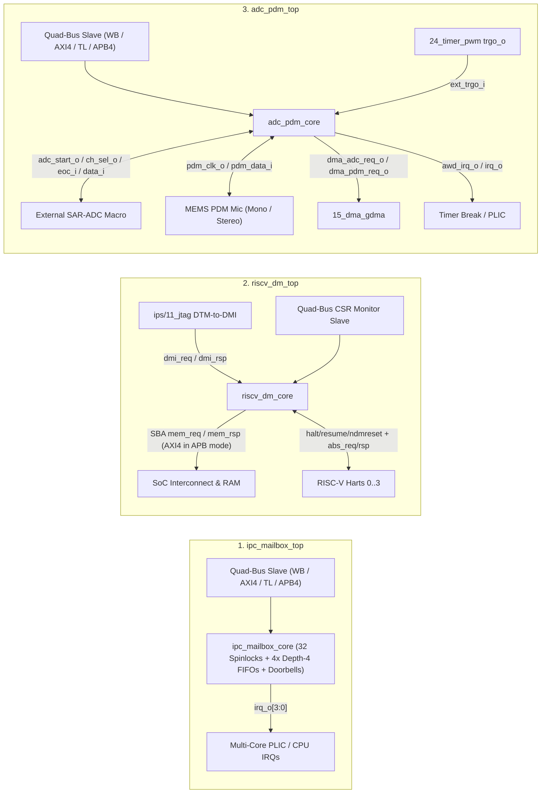

# MPU / AP Multi-Core IPC, RISC-V Debug & Mixed-Signal Front-End Pack (`37_ipc_debug`)

## Overview

`ips/37_ipc_debug` is a clean-room, pure synthesizable IEEE 1800-2017 SystemVerilog IP suite designed for multi-core MPU / Application Processor SoCs across **Yosys, FPGA, and ASIC** flows. Each sub-IP includes a protocol-agnostic core plus **Quad-Bus** wrappers (**Wishbone B4**, **AMBA AXI4 / AXI4-Lite**, **TileLink TL-UL/TL-UH**, and **AMBA APB4**).

1. **Multi-Core IPC Mailbox & Hardware Spinlocks (`ipc_mailbox_top`)**:
   - Parameterizable `NUM_CORES` (default 4), `NUM_CH` (default 4, depth-4 32-bit message FIFOs), and `NUM_LOCKS` (default 32 hardware atomic spinlocks).
   - **Atomic Test-and-Set Spinlocks (`LOCK[k]`)**: Single-cycle read atomically acquires a free lock (`0 = acquired`) and returns `1 = busy` to all subsequent contenders until software writes `0` to release. Non-side-effecting `LOCK_STAT_LO/HI` and `LOCK_OWNER[k]` provide inspection without perturbing lock state.
   - **Doorbells & Message FIFOs**: Per-core `DB_SET` (W1S), `DB_CLR` (W1C), and `DB_STAT` (RO) registers plus configurable `DST_CORE_MASK` channel FIFOs driving masked per-core `irq_o[NUM_CORES-1:0]`.

2. **RISC-V Debug Module (`riscv_dm_top`)**:
   - Implements the **RISC-V Debug Specification (DM 0.13 / 1.0)** **DMI** request/response interface (`dmi_req_*`, `dmi_rsp_*`), ready to plug into `ips/11_jtag` via a DTM-to-DMI bridge.
   - **Multi-Hart Run Control (`NUM_HARTS = 4`)**: `dmcontrol` (`dmactive`, `ndmreset`, `haltreq`, `resumereq`, `hartsello`, `hasel`, `ackhavereset`, `set/clrresethaltreq`), `dmstatus` (`version=2`, `allhalted/anyhalted`, `allrunning/anyrunning`, `allresumeack/anyresumeack`, `allhavereset/anyhavereset`, `allnonexistent/anynonexistent`), `hartinfo`, `hawindowsel`/`hawindow`, and `haltsum0`.
   - **Abstract Commands**: `abstractcs` (`cmderr`, `busy`, `datacount=4`, `progbufsize=4`), `command` (Access Register `cmdtype=0`, 32-bit `aarsize=2`, `aarpostincrement`), `data0..3`, `abstractauto`, and `progbuf0..3` over a clean hart abstract interface (`abs_req_*` / `abs_rsp_*`).
   - **System Bus Access (SBA)**: `sbcs`, `sbaddress0`, `sbdata0` supporting **8/16/32-bit** (`sbaccess=0/1/2`) transfers, `sbreadonaddr`, `sbautoincrement`, `sbreadondata`, and `sberror` (alignment, unsupported size, bus fault) driving a real `mem_req_t`/`mem_rsp_t` master port (WB / AXI4 / TL-UH; **AXI4 master in `BUS_APB` mode**).
   - **Quad-Bus CSR Monitor Slave**: Read-only debug status, SBA mirror, and `progbuf0..3` aperture.

3. **SAR-ADC Digital Sequencer & PDM-to-PCM (`DFSDM`) Filter (`adc_pdm_top`)**:
   - **SAR-ADC Digital Sequencer**: Clean digital macro boundary (`adc_start_o`, `adc_ch_sel_o[3:0]`, `adc_eoc_i`, `adc_data_i[11:0]`) with up to **16-slot** programmable channel scan (`ADC_SEQ0/1`), hardware oversampling/averaging (**1x–64x** + programmable right-shift), `ext_trgo_i` rising-edge hardware trigger (pairs with `24_timer_pwm` `trgo_o`), continuous/single-scan modes, depth-16 result FIFO (`dma_adc_req_o`), and dual **Analog Watchdog** thresholds (`AWD_LOW`, `AWD_HIGH` -> dedicated `awd_irq_o` + `irq_o`).
   - **PDM-to-PCM (`DFSDM`) Decimation Filter**: Programmable `pdm_clk_o` divider, mono/stereo rising+falling edge `pdm_data_i` capture, dual **3rd-order CIC (`Sinc3`)** decimation filters (`OSR = 16, 32, 64, 128`), programmable zero-bias **IIR DC-offset high-pass blocker** (`HPF_EN`, `HPF_SHIFT`), and depth-16 16-bit/stereo PCM output FIFO (`dma_pdm_req_o`, `irq_o`).

---

## Block Diagram



---

## RTL File Hierarchy

| File | Role |
| :--- | :--- |
| [`ipc_mailbox_core.sv`](../rtl/ipc_mailbox_core.sv) | Multi-core doorbells, depth-4 channel FIFOs, 32 atomic spinlocks |
| [`ipc_mailbox_wb.sv`](../rtl/ipc_mailbox_wb.sv) | Wishbone B4 slave wrapper (`wb_to_csr`) |
| [`ipc_mailbox_axi.sv`](../rtl/ipc_mailbox_axi.sv) | AXI4 / AXI4-Lite slave wrapper (`axi_lite_to_csr`) |
| [`ipc_mailbox_tl.sv`](../rtl/ipc_mailbox_tl.sv) | TileLink TL-UL/UH slave wrapper (`tl_ul_to_csr`) |
| [`ipc_mailbox_apb.sv`](../rtl/ipc_mailbox_apb.sv) | AMBA APB4 slave wrapper (`apb_to_csr`) |
| [`ipc_mailbox_top.sv`](../rtl/ipc_mailbox_top.sv) | Unified quad-bus top for `ipc_mailbox_core` |
| [`riscv_dm_core.sv`](../rtl/riscv_dm_core.sv) | RISC-V DM 0.13/1.0 core (DMI, run-control, abstract cmds, SBA, CSR monitor) |
| [`riscv_dm_wb.sv`](../rtl/riscv_dm_wb.sv) | Wishbone B4 monitor slave + WB SBA master wrapper |
| [`riscv_dm_axi.sv`](../rtl/riscv_dm_axi.sv) | AXI4-Lite monitor slave + AXI4 SBA master wrapper |
| [`riscv_dm_tl.sv`](../rtl/riscv_dm_tl.sv) | TileLink monitor slave + TL-UH SBA master wrapper |
| [`riscv_dm_apb.sv`](../rtl/riscv_dm_apb.sv) | AMBA APB4 monitor slave + AXI4 SBA master wrapper |
| [`riscv_dm_top.sv`](../rtl/riscv_dm_top.sv) | Unified quad-bus top for `riscv_dm_core` |
| [`pdm_cic_hpf.sv`](../rtl/pdm_cic_hpf.sv) | 3rd-order `Sinc3` CIC decimator + zero-bias IIR DC-offset HPF |
| [`adc_pdm_core.sv`](../rtl/adc_pdm_core.sv) | SAR-ADC scan/oversampling/AWD sequencer + dual-channel DFSDM engine |
| [`adc_pdm_wb.sv`](../rtl/adc_pdm_wb.sv) | Wishbone B4 slave wrapper |
| [`adc_pdm_axi.sv`](../rtl/adc_pdm_axi.sv) | AXI4 / AXI4-Lite slave wrapper |
| [`adc_pdm_tl.sv`](../rtl/adc_pdm_tl.sv) | TileLink TL-UL/UH slave wrapper |
| [`adc_pdm_apb.sv`](../rtl/adc_pdm_apb.sv) | AMBA APB4 slave wrapper |
| [`adc_pdm_top.sv`](../rtl/adc_pdm_top.sv) | Unified quad-bus top for `adc_pdm_core` |

---

## Sub-IP 1: `ipc_mailbox_top`

### Parameters & Ports

| Parameter | Default | Range | Description |
| :--- | :--- | :--- | :--- |
| `BUS_TYPE` | `BUS_AXI4` | `0..3` | `BUS_WISHBONE=0`, `BUS_AXI4=1`, `BUS_TILELINK=2`, `BUS_APB=3` |
| `NUM_CORES` | `4` | `1..16` | Number of CPU cores (doorbells and `irq_o` bits) |
| `NUM_CH` | `4` | `1..16` | Number of bidirectional mailbox FIFO channels |
| `NUM_LOCKS` | `32` | `1..64` | Number of hardware atomic test-and-set spinlocks |
| `FIFO_DEPTH` | `4` | `>= 2` | Depth (in 32-bit words) of each channel FIFO |

Ports: `clk_i`, `rst_ni`, `wb_i`/`wb_o`, `axi_i`/`axi_o`, `tl_i`/`tl_o`, `apb_i`/`apb_o`, `irq_o[NUM_CORES-1:0]`.

### Register Map (`ipc_mailbox_core`)

| Offset | Name | Access | Reset | Bit Fields |
| :--- | :--- | :--- | :--- | :--- |
| `0x000` | `CTRL` | RW | `0x0000_0001` | `[0]` `EN`: Global IRQ enable; `[1]` `SW_RST` (WO self-clear): resets locks, doorbells, FIFOs |
| `0x004` | `CAPS` | RO | param | `[7:0]` `NUM_CORES`, `[15:8]` `NUM_CH`, `[23:16]` `NUM_LOCKS`, `[31:24]` `FIFO_DEPTH` |
| `0x008` | `LOCK_STAT_LO` | RO | `0x0000_0000` | `[31:0]` Non-side-effecting lock state bitmap (locks `0..31`) |
| `0x00C` | `LOCK_STAT_HI` | RO | `0x0000_0000` | `[31:0]` Non-side-effecting lock state bitmap (locks `32..63`) |
| `0x040+4*c` | `DB_SET[c]` | W1S/RO | `0x0000_0000` | Write sets bits in core `c` doorbell mask; read returns `DB_STAT[c]` |
| `0x080+4*c` | `DB_CLR[c]` | W1C/RO | `0x0000_0000` | Write clears `1`-bits in core `c` doorbell mask; read returns `DB_STAT[c]` |
| `0x0C0+4*c` | `DB_STAT[c]` | RO | `0x0000_0000` | Pending doorbell bitmask for core `c` |
| `0x100+4*c` | `IRQ_EN[c]` | RW | `0xFFFF_FFFF` | `[0]` `DB_IRQ_EN`; `[16 +: NUM_CH]` `CH_IRQ_EN` |
| `0x140+4*c` | `IRQ_STAT[c]` | RO | `0x0000_0000` | `[0]` `DB_PEND` (`|DB_STAT[c]`); `[16 +: NUM_CH]` `CH_PEND` |
| `0x200+16*ch` | `MBOX_DATA[ch]` | RW | `0x0000_0000` | Write pushes 32-bit word to channel `ch` FIFO; read pops 32-bit word |
| `0x204+16*ch` | `MBOX_STAT[ch]` | RO/W1C | `0x0000_0001` | `[0]` `EMPTY`, `[1]` `FULL`, `[7:2]` `LEVEL`, `[8]` `OVF` (W1C), `[9]` `UNF` (W1C), `[23:16]` `SRC_ID` |
| `0x208+16*ch` | `MBOX_CTRL[ch]` | RW | `1<<(ch%C)` | `[15:0]` `DST_CORE_MASK`, `[23:16]` `SRC_ID`, `[24]` `IRQ_EN` (rst 1), `[25]` `FLUSH` (WO) |
| `0x20C+16*ch` | `MBOX_PEEK[ch]` | RO | `0x0000_0000` | Non-destructive peek at channel `ch` FIFO head |
| `0x400+4*k` | `LOCK[k]` | TAS | `0x0000_0000` | Read: returns `0` & atomically acquires if free, `1` if busy. Write: `[0]=0` releases, `[0]=1` locks with `[15:8]` owner |
| `0x500+4*k` | `LOCK_OWNER[k]` | RW | `0x0000_0000` | `[7:0]` software owner tag (RW); `[31]` lock busy (RO, no TAS side effect) |

---

## Sub-IP 2: `riscv_dm_top`

### Parameters & Ports

- Parameters: `BUS_TYPE` (default `BUS_AXI4`), `NUM_HARTS` (default `4`).
- Slave/Master Ports: `s_wb_*`/`m_wb_*`, `s_axi_*`/`m_axi_*`, `s_tl_*`/`m_tl_*`, `s_apb_*` (when `BUS_TYPE == BUS_APB`, SBA master drives `m_axi_o`/`m_axi_i`).
- DMI Port: `dmi_req_valid_i`, `dmi_req_ready_o`, `dmi_req_addr_i[6:0]`, `dmi_req_op_i[1:0]` (`0=NOP, 1=READ, 2=WRITE`), `dmi_req_data_i[31:0]`, `dmi_rsp_valid_o`, `dmi_rsp_ready_i`, `dmi_rsp_data_o[31:0]`, `dmi_rsp_op_o[1:0]` (`0=OK, 2=FAIL`).
- Hart Sideband: `halted_i[NUM_HARTS-1:0]`, `resume_ack_i[NUM_HARTS-1:0]`, `halt_req_o[NUM_HARTS-1:0]`, `resume_req_o[NUM_HARTS-1:0]`, `ndmreset_o`.
- Hart Abstract Register Port: `abs_req_valid_o`, `abs_req_write_o`, `abs_req_hartsel_o`, `abs_req_regno_o[15:0]`, `abs_req_wdata_o[31:0]`, `abs_rsp_valid_i`, `abs_rsp_rdata_i[31:0]`, `abs_rsp_err_i`.

### DMI Register Map (`dmi_req_addr_i[6:0]`)

| DMI Addr | Name | Access | Reset | Bit Fields |
| :--- | :--- | :--- | :--- | :--- |
| `0x04..0x07` | `data0..data3` | RW | `0` | 32-bit abstract data registers (auto-executes `command` if `abstractauto[i]=1`) |
| `0x10` | `dmcontrol` | RW | `0` | `[0]` `dmactive`, `[1]` `ndmreset`, `[2]` `clrresethaltreq`, `[3]` `setresethaltreq`, `[25:16]` `hartsello`, `[26]` `hasel`, `[28]` `ackhavereset`, `[30]` `resumereq`, `[31]` `haltreq` |
| `0x11` | `dmstatus` | RO | `0x0000_0C82` | `[3:0]=2` (DM 0.13), `[5]` `hasresethaltreq=1`, `[7]` `authenticated=1`, `[8]` `anyhalted`, `[9]` `allhalted`, `[10]` `anyrunning`, `[11]` `allrunning`, `[14]` `anynonexistent`, `[15]` `allnonexistent`, `[16]` `anyresumeack`, `[17]` `allresumeack`, `[18]` `anyhavereset`, `[19]` `allhavereset` |
| `0x12` | `hartinfo` | RO | `0x0020_0000` | `[23:20]` `nscratch=2`, `[15:12]` `dataaccess=0`, `[11:0]` `dataaddr=0` |
| `0x14` | `hawindowsel` | RW | `0` | Always `0` (supports up to 32 harts in window 0) |
| `0x15` | `hawindow` | RW | `0` | `[NUM_HARTS-1:0]` Hart array mask when `dmcontrol.hasel=1` |
| `0x16` | `abstractcs` | RW | `0x0400_0004` | `[3:0]` `datacount=4`, `[10:8]` `cmderr` (RW1C: `1=busy,2=unsup,3=exc,4=halt`), `[12]` `busy`, `[28:24]` `progbufsize=4` |
| `0x17` | `command` | RW | `0` | `[31:24]` `cmdtype=0`, `[22:20]` `aarsize=2` (32b), `[19]` `aarpostincrement`, `[17]` `transfer`, `[16]` `write`, `[15:0]` `regno` |
| `0x18` | `abstractauto` | RW | `0` | `[3:0]` `autoexecdata`, `[19:16]` `autoexecprogbuf` |
| `0x20..0x23` | `progbuf0..3` | RW | `0` | 4x 32-bit program buffer words |
| `0x38` | `sbcs` | RW | `0x2004_0407` | `[31:29]` `sbversion=1`, `[22]` `sbbusyerror` (W1C), `[21]` `sbbusy`, `[20]` `sbreadonaddr`, `[19:17]` `sbaccess` (`0=8b,1=16b,2=32b`), `[16]` `sbautoincrement`, `[15]` `sbreadondata`, `[14:12]` `sberror` (W1C: `2=bus,3=align,4=size`), `[11:5]` `sbasize=32`, `[2:0]=3'b111` |
| `0x39` | `sbaddress0` | RW | `0` | 32-bit SBA target address (write triggers read when `sbreadonaddr=1`) |
| `0x3C` | `sbdata0` | RW | `0` | 32-bit SBA data (write triggers write; read triggers next read when `sbreadondata=1`) |
| `0x40` | `haltsum0` | RO | `0` | `[NUM_HARTS-1:0]` live `halted_i` bitmap |

### Quad-Bus CSR Monitor Aperture (Read-Only)

| Offset | Name | Description |
| :--- | :--- | :--- |
| `0x00` | `DM_CSR_STAT` | `[0]=dmactive`, `[1]=ndmreset`, `[4:2]=sberror`, `[5]=sbbusy`, `[8:6]=cmderr`, `[9]=abs_busy`, `[15:12]=hartsel`, `[19:16]=halted`, `[23:20]=halt_req`, `[27:24]=resume_req`, `[31:28]=havereset` |
| `0x04` | `DM_CSR_SBADDR` | Mirror of `sbaddress0` |
| `0x08` | `DM_CSR_SBDATA` | Mirror of `sbdata0` |
| `0x0C` | `DM_CSR_COMMAND` | Mirror of `command` |
| `0x10..0x1C` | `DM_CSR_DATA0..3` | Mirrors of `data0..3` |
| `0x20..0x2C` | `DM_CSR_PROGBUF0..3` | Read-only aperture of `progbuf0..3` |
| `0x30` | `DM_CSR_HALTSUM0` | Mirror of `haltsum0` |

### DMI-to-JTAG (`ips/11_jtag`) Wiring Guide

`ips/11_jtag` provides a 5-bit IR JTAG slave TAP (`jtag_tap_master_core`). To attach an external OpenOCD / GDB JTAG probe to `riscv_dm_top`:
1. Add a standard RISC-V **DTM (Debug Transport Module)** wrapper with JTAG IR opcodes `DTMCS` (`0x10`, `abits=7`, `version=1`) and `DMI` (`0x11`, 41-bit `{addr[6:0], data[31:0], op[1:0]}` DR shift).
2. Connect the DTM's `Update-DR` handshake to `riscv_dm_top`'s `dmi_req_valid_i`/`dmi_req_ready_o`/`dmi_req_*`, and `Capture-DR` to `dmi_rsp_valid_o`/`dmi_rsp_ready_i`/`dmi_rsp_*`.
3. Wire `riscv_dm_top`'s `m_axi_o`/`m_axi_i` (or WB/TL master) to the SoC crossbar so GDB memory reads/writes hit system RAM directly via SBA without halting the CPU.

---

## Sub-IP 3: `adc_pdm_top`

### SAR-ADC Macro & MEMS PDM Hookup

- **External SAR-ADC Macro**: `adc_start_o` pulses high for 1 cycle while `adc_ch_sel_o[3:0]` selects the active analog mux channel. The sequencer waits for `adc_eoc_i == 1`, accumulates `1..64` samples, shifts right by `OVS_SHIFT`, checks `AWD_LOW`/`AWD_HIGH`, and pushes `{10'd0, awd_high, awd_low, ch_id[3:0], result[15:0]}` to the depth-16 ADC FIFO.
- **Timer Trigger & Fault Loop**: Wire `24_timer_pwm`'s `trgo_o` to `ext_trgo_i` (`ADC_CTRL.EXT_TRG_EN=1`) for deterministic periodic sampling, and wire `awd_irq_o` to `timer_pwm_top.brk_i` for hardware over-voltage/over-current motor shutdown.
- **MEMS PDM Microphone**: Connect `pdm_clk_o` to the microphone `CLK` pin and `pdm_data_i` to `DATA`. In mono mode (`STEREO_EN=0`), Ch0 is captured on `EDGE_POL=0` (`pdm_clk_o == 1` end). In stereo mode (`STEREO_EN=1`), Ch0 (Left) and Ch1 (Right) are captured on opposite half-periods and packed as `{ch1_pcm16, ch0_pcm16}` in `PDM_DATA`.

### Register Map (`adc_pdm_core`)

| Offset | Name | Access | Reset | Bit Fields |
| :--- | :--- | :--- | :--- | :--- |
| `0x000` | `CAPS` | RO | `0x3710_1010` | `[7:0]=16` (max seq), `[15:8]=ADC_FIFO_DEPTH`, `[23:16]=PDM_FIFO_DEPTH`, `[31:24]=0x37` |
| `0x004` | `IRQ_STAT` | RW1C/RO | `0x0000_0000` | `[0]` `ADC_DONE`(W1C), `[1]` `ADC_OVF`(W1C), `[2]` `AWD_LOW`(W1C), `[3]` `AWD_HIGH`(W1C), `[4]` `PDM_OVF`(W1C), `[8]` `ADC_WM`(RO), `[9]` `PDM_WM`(RO) |
| `0x008` | `IRQ_EN` | RW | `0x0000_0000` | Interrupt enable mask matching `IRQ_STAT` |
| `0x020` | `ADC_CTRL` | RW | `0x0001_0000` | `[0]` `EN`, `[1]` `CONT`, `[2]` `EXT_TRG_EN`, `[3]` `SW_START`(WO), `[7:4]` `SEQ_LEN`(N-1), `[10:8]` `OVS_RATIO`(`0..6` -> `1x..64x`), `[14:11]` `OVS_SHIFT`, `[15]` `FIFO_FLUSH`(WO), `[19:16]` `DMA_WM`, `[27:20]` `SAMPLE_DIV` |
| `0x024` | `ADC_STAT` | RO | `0x0000_0002` | `[0]` `BUSY`, `[1]` `EMPTY`, `[2]` `FULL`, `[7:3]` `LEVEL`, `[11:8]` `CUR_SLOT`, `[15:12]` `CUR_CH` |
| `0x028` | `ADC_SEQ0` | RW | `0x7654_3210` | Scan slots `0..7` (4 bits per channel ID) |
| `0x02C` | `ADC_SEQ1` | RW | `0xFEDC_BA98` | Scan slots `8..15` (4 bits per channel ID) |
| `0x030` | `ADC_AWD_CFG` | RW | `0xFFFF_0000` | `[0]` `AWD_EN`, `[31:16]` `AWD_CH_MASK` |
| `0x034` | `ADC_AWD_THRESH` | RW | `0x0FFF_0000` | `[15:0]` `AWD_LOW`, `[31:16]` `AWD_HIGH` |
| `0x038` | `ADC_DATA` | RO | `0x0000_0000` | Pops ADC FIFO: `[15:0]` `RESULT`, `[19:16]` `CH_ID`, `[20]` `AWD_LOW_FLAG`, `[21]` `AWD_HIGH_FLAG` |
| `0x03C` | `ADC_LAST_RAW` | RO | `0x0000_0000` | Non-destructive last conversion `{12'd0, ch_id, result}` |
| `0x060` | `PDM_CTRL` | RW | `0x0031_00C4` | `[0]` `EN`, `[1]` `STEREO_EN`, `[3:2]` `OSR_SEL` (`0=16,1=32,2=64,3=128`), `[4]` `HPF_EN`, `[8:5]` `HPF_SHIFT`, `[9]` `EDGE_POL`, `[11:10]` `GAIN_RSHIFT`, `[15]` `FIFO_FLUSH`(WO), `[19:16]` `DMA_WM`, `[27:20]` `CLK_DIV` |
| `0x064` | `PDM_STAT` | RO | `0x0000_0002` | `[0]` `ACTIVE`, `[1]` `EMPTY`, `[2]` `FULL`, `[7:3]` `LEVEL` |
| `0x068` | `PDM_DATA` | RO | `0x0000_0000` | Pops PDM FIFO: `[15:0]` `CH0_PCM16`, `[31:16]` `CH1_PCM16` |
| `0x06C` | `PDM_DC_EST` | RO | `0x0000_0000` | `{dc_est_ch1[15:0], dc_est_ch0[15:0]}` |

---

## C Programming Recipes

### 1. Hardware Spinlock + Mailbox Message (Core 0 -> Core 2)
```c
// Acquire hardware spinlock 0 (atomic test-and-set on read)
while (REG32(MBOX_BASE + 0x400) != 0) { /* busy */ }
// Push message to Channel 0 (routed to Core 2) and ring doorbell
REG32(MBOX_BASE + 0x208) = 0x01010004; // IRQ_EN=1, SRC=1, DST_MASK=Core2
REG32(MBOX_BASE + 0x200) = payload;
REG32(MBOX_BASE + 0x048) = (1u << 0);  // DB_SET[2]
// Release spinlock 0
REG32(MBOX_BASE + 0x400) = 0;
```

### 2. SBA 32-bit RAM Block Read via DMI
```c
dmi_write(0x10, 0x00000001);             // dmcontrol.dmactive = 1
dmi_write(0x38, (1<<20)|(2<<17)|(1<<16)|(1<<15)); // readonaddr + 32b + autoinc + readondata
dmi_write(0x39, 0x20000000);             // triggers read 0
for (int i = 0; i < N; i++) {
  while (dmi_read(0x38) & (1<<21));      // poll sbbusy
  if (i == N - 1) dmi_write(0x38, 2<<17);
  buf[i] = dmi_read(0x3C);               // read sbdata0 (+ triggers next read)
}
```

### 3. SAR-ADC 16x Oversampled Scan & PDM Audio Capture
```c
// SAR-ADC: 4 channels, 16x oversample + >>4 shift, AWD [0x100..0xE00]
REG32(ADC_BASE + 0x028) = 0x0000C173;
REG32(ADC_BASE + 0x034) = (0x0E00u << 16) | 0x0100u;
REG32(ADC_BASE + 0x030) = 0xFFFF0001;
REG32(ADC_BASE + 0x020) = 0x00042439;    // EN=1, SW_START=1, SEQ_LEN=3, OVS=4(16x), SHIFT=4

// DFSDM PDM: Stereo, OSR=64, DC-blocker HPF shift=6, pdm_clk = clk/4
REG32(ADC_BASE + 0x060) = 0x001180DB;
```

---

## Yosys / FPGA / ASIC Synthesis Notes

- All FIFOs reuse `common/rtl/sync_fifo.sv` (sync-write, non-reset RAM storage for BRAM/register-file inference).
- All register arrays use packed vectors (`logic [N-1:0][W-1:0]`) with clean async active-low reset (`rst_ni`).
- Zero `#` delays, `real` types, `initial` blocks, tri-states, or unsynthesizable system tasks in RTL (`python3 scripts/check_yosys_compat.py` passes with 0 findings).
- `pdm_cic_hpf.sv` uses modulo 24-bit signed two's-complement arithmetic for exact Hogenauer Sinc3 wrap-around cancellation at up to `OSR = 128` (`128^3 = 2^21`).

---

## Verification Summary

Verified with [`tb_ipc_debug.sv`](../tb/tb_ipc_debug.sv) under Verilator 5.054 (`+seed=1, 7, 42`):
- **`ipc_mailbox_top`**: 32-lock atomic test-and-set contention/release, multi-core doorbell isolation & W1C clear, depth-4 channel FIFO routing/overflow/underflow/peek, and quad-bus WB/AXI4/TL/APB4 smoke.
- **`riscv_dm_top`**: `dmactive` reset, 4-hart halt/resume/`ndmreset`/`havereset`, abstract GPR read/write + `aarpostincrement` + `abstractauto` + `cmderr={2,3,4}`, SBA 8/16/32-bit R/W + `sbautoincrement` + `sbreadonaddr` + `sbreadondata` + alignment/bus error capture against `tb_sim_ram` across WB, AXI4, TL, and APB4 (AXI4 master), plus read-only CSR monitor aperture.
- **`adc_pdm_top`**: Behavioral SAR-ADC 16x oversampling exact average, `ext_trgo_i` trigger, Analog Watchdog high/low trips & `awd_irq_o`, 1-bit sigma-delta modulator driving `Sinc3` CIC across `OSR={16,32,64}` (exact DC gain, zero-offset HPF convergence, sine SNR > 30 dB, and stereo L/R separation), plus quad-bus CSR smoke.
