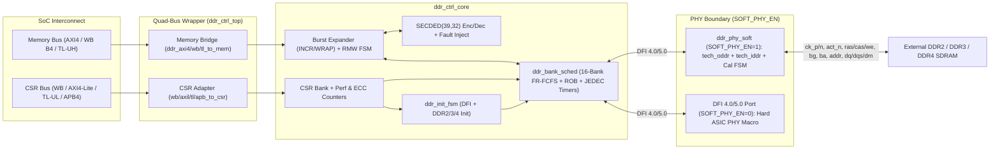

# Multi-Standard DDR2 / DDR3 / DDR4 SDRAM Controller (`38_ddr_ctrl`)

Clean-room, pure synthesizable IEEE 1800-2017 SystemVerilog **Multi-Standard DDR2 / DDR3 / DDR4 SDRAM Memory Controller** with an industry-standard **DFI 4.0/5.0 PHY Boundary**, optional **Soft/Dummy FPGA PHY** (`tech_oddr`/`tech_iddr`), **16-Bank FR-FCFS Command Scheduler**, **Inline Hamming SECDED(39,32) ECC**, and **Quad-Bus SoC Interfaces** (AXI4, Wishbone B4, TileLink TL-UL/TL-UH, APB4+AXI4).

---

## 1. Key Features

- **Runtime/CSR-Selectable JEDEC Standards (`CFG.DDR_STD`)**:
  - **`0` — DDR2** (JESD79-2): `RAS_n/CAS_n/WE_n`, `BA[2:0]`, `A[15:0]`, `CKE`, `ODT`, BL4/BL8, full `PREA -> MR2 -> MR3 -> MR1 -> MR0(DLL rst) -> PREA -> 2x REF -> MR0 -> MR1(OCD default/exit)` initialization.
  - **`1` — DDR3** (JESD79-3): `RESET_n`, `RAS_n/CAS_n/WE_n`, `BA[2:0]`, `A[15:0]`, `CKE`, `ODT`, BL8, `MR2 -> MR3 -> MR1 -> MR0 -> ZQCL` initialization + periodic `ZQCS`.
  - **`2` — DDR4** (JESD79-4): `RESET_n`, `ACT_n` with `A16=RAS_n / A15=CAS_n / A14=WE_n` multiplexing when `ACT_n=1`, **4 Bank Groups `BG[1:0]` x 4 Banks `BA[1:0]` = 16 Banks**, `A[17:0]`, **CA Even Parity (`PAR` / `ALERT_n`)**, `MR3 -> MR6 -> MR5 -> MR4 -> MR2 -> MR1 -> MR0 -> ZQCL` initialization, and **bank-group-aware timings** (`tRRD_S/L`, `tCCD_S/L`, `tWTR_S/L`).
- **Multi-Bank FR-FCFS Command Scheduler (`ddr_bank_sched.sv`)**:
  - 16-bank row/timing state tracker (4/8 banks in DDR2/3, 16 banks in DDR4).
  - 8-entry command reorder queue (`CMD_Q_DEPTH = 8`) with **Row-Hit Priority**, oldest-ready tie-break, same-address RAW/WAW/WAR hazard protection, and programmable **Anti-Starvation** age threshold (`CFG.ANTI_STARVE`).
  - Paired 8-entry in-order **Reorder Response Buffer (ROB)** preserving strict host bus response order while reordering DRAM bank commands underneath.
  - Programmable Open-Page vs **Closed-Page Auto-Precharge** (`RDA`/`WRA`, `CTRL.CLOSED_PAGE`).
  - Full JEDEC timing counters (`tRCD`, `tRP`, `tRAS`, `tRC`, `tRRD_S/L`, `tCCD_S/L`, `tFAW`, `tWTR_S/L`, `tRTW`, `tRTP`, `tWR`, `tRFC`, `tREFI`, `tMRD/tMOD`, `tZQCS`, `RL`, `WL`).
  - Periodic `tREFI` refresh scheduler with postpone debt counter (up to 8) and urgent `PREA -> REF` watermark (`CFG.REF_URGENT_WM`), periodic `ZQCS`, and manual **Self-Refresh Entry/Exit (`SRE`/`SRX`)** with `dfi_dram_clk_disable`.
- **Optional Inline SECDED(39,32) ECC (`ECC_EN = 1`, `ddr_ecc.sv`)**:
  - Single-cycle combinational Hamming SECDED(39,32) encode & decode over `{ecc[6:0], data[31:0]}` (24-bit DDR DQ: 16-bit data + 8-bit ECC lane).
  - Automatic **Read-Modify-Write (RMW)** on partial-strobe writes (`wstrb != 4'hF`).
  - Transparent inline 1-bit error correction (`ECC_CE_CNT`, `ECC_CE_ADDR`) and 2-bit uncorrectable error reporting (`ECC_UE_CNT`, `ECC_UE_ADDR`, bus error + `irq_o`).
  - DFT fault injection CSR (`ECC_INJECT`) supporting 1-bit and 2-bit error injection.
- **Dual Host Interface**:
  - **High-Bandwidth Memory Slave Port** (`mem_req_t`/`mem_rsp_t`): supports single-beat, `INCR`/`WRAP` bursts, partial byte strobes (`wstrb`), pipelining, and backpressure across **AXI4**, **Wishbone B4 (Classic & Pipelined)**, and **TileLink (TL-UL/TL-UH)** (for `BUS_APB`, memory slave is AXI4 per repo #37 convention).
  - **Quad-Bus CSR Control Port**: Wishbone B4, AXI4-Lite, TileLink TL-UL, or AMBA APB4.
- **Clean DFI 4.0/5.0 Boundary & Soft/Dummy FPGA PHY (`SOFT_PHY_EN = 0 / 1`)**:
  - `SOFT_PHY_EN = 0`: exposes standard DFI 4.0/5.0 signals directly for foundry hard DDR2/3/4 PHY macros.
  - `SOFT_PHY_EN = 1`: instantiates `ddr_phy_soft.sv` using `tech_oddr` and `tech_iddr`, programmable `PHY_RD_LAT`/`PHY_WR_LAT` taps, and hardware read-leveling pattern calibration.

---

## 2. Architecture Diagram



---

## 3. RTL Module Hierarchy

| # | File | Module(s) | Responsibility |
|---|---|---|---|
| 1 | [ddr_pkg.sv](file:///Users/tianrui6641/tians_ip_collection/ips/38_ddr_ctrl/rtl/ddr_pkg.sv) | `ddr_pkg` | Standard/command enums, CSR offsets, R-BG-B-C address decoder, DDR2/3/4 DFI pin encoder |
| 2 | [ddr_ecc.sv](file:///Users/tianrui6641/tians_ip_collection/ips/38_ddr_ctrl/rtl/ddr_ecc.sv) | `ddr_ecc_enc`, `ddr_ecc_dec` | Combinational Hamming SECDED(39,32) encoder and single-bit corrector / double-bit detector |
| 3 | [ddr_init_fsm.sv](file:///Users/tianrui6641/tians_ip_collection/ips/38_ddr_ctrl/rtl/ddr_init_fsm.sv) | `ddr_init_fsm` | DFI `init_start`/`init_complete` handshake + JEDEC DDR2/DDR3/DDR4 power-up & MRS sequences |
| 4 | [ddr_bank_sched.sv](file:///Users/tianrui6641/tians_ip_collection/ips/38_ddr_ctrl/rtl/ddr_bank_sched.sv) | `ddr_bank_sched` | 16-bank tracker, 8-entry FR-FCFS scheduler, ROB, JEDEC timing counters, refresh/ZQCS/SRE/SRX |
| 5 | [ddr_phy_soft.sv](file:///Users/tianrui6641/tians_ip_collection/ips/38_ddr_ctrl/rtl/ddr_phy_soft.sv) | `ddr_phy_soft` | Soft FPGA PHY (`tech_oddr`, `tech_iddr`, `PHY_RD_LAT`/`PHY_WR_LAT`, read-leveling calibration) |
| 6 | [ddr_ctrl_core.sv](file:///Users/tianrui6641/tians_ip_collection/ips/38_ddr_ctrl/rtl/ddr_ctrl_core.sv) | `ddr_ctrl_core` | Protocol-agnostic controller core, CSR file, burst expander, ECC RMW FSM, PHY mux |
| 7 | [ddr_axi4_to_mem.sv](file:///Users/tianrui6641/tians_ip_collection/ips/38_ddr_ctrl/rtl/ddr_axi4_to_mem.sv) | `ddr_axi4_to_mem` | Full AXI4 slave (decoupled AW/W, INCR/WRAP, pipelined outstanding IDs) -> `mem_req_t`/`mem_rsp_t` |
| 8 | [ddr_wb_to_mem.sv](file:///Users/tianrui6641/tians_ip_collection/ips/38_ddr_ctrl/rtl/ddr_wb_to_mem.sv) | `ddr_wb_to_mem` | Wishbone B4 classic & pipelined burst slave -> `mem_req_t`/`mem_rsp_t` |
| 9 | [ddr_tl_to_mem.sv](file:///Users/tianrui6641/tians_ip_collection/ips/38_ddr_ctrl/rtl/ddr_tl_to_mem.sv) | `ddr_tl_to_mem` | TileLink TL-UL / TL-UH single & multi-beat Put/Get slave -> `mem_req_t`/`mem_rsp_t` |
| 10 | [ddr_ctrl_wb.sv](file:///Users/tianrui6641/tians_ip_collection/ips/38_ddr_ctrl/rtl/ddr_ctrl_wb.sv) | `ddr_ctrl_wb` | Wishbone CSR + Wishbone Memory wrapper |
| 11 | [ddr_ctrl_axi.sv](file:///Users/tianrui6641/tians_ip_collection/ips/38_ddr_ctrl/rtl/ddr_ctrl_axi.sv) | `ddr_ctrl_axi` | AXI4-Lite CSR + Full AXI4 Memory wrapper |
| 12 | [ddr_ctrl_tl.sv](file:///Users/tianrui6641/tians_ip_collection/ips/38_ddr_ctrl/rtl/ddr_ctrl_tl.sv) | `ddr_ctrl_tl` | TileLink TL-UL CSR + TileLink Memory wrapper |
| 13 | [ddr_ctrl_apb.sv](file:///Users/tianrui6641/tians_ip_collection/ips/38_ddr_ctrl/rtl/ddr_ctrl_apb.sv) | `ddr_ctrl_apb` | AMBA APB4 CSR + Full AXI4 Memory wrapper (per repo #37) |
| 14 | [ddr_ctrl_top.sv](file:///Users/tianrui6641/tians_ip_collection/ips/38_ddr_ctrl/rtl/ddr_ctrl_top.sv) | `ddr_ctrl_top` | Parameterized quad-bus top-level (`BUS_TYPE`, `SOFT_PHY_EN`, `ECC_EN`, `CMD_Q_DEPTH`) |

---

## 4. DDR2 vs DDR3 vs DDR4 Comparison & Pin-Mux Table

| Feature / Pin | DDR2 (`DDR_STD = 0`) | DDR3 (`DDR_STD = 1`) | DDR4 (`DDR_STD = 2`) |
|---|---|---|---|
| **Banks / Bank Groups** | 4 or 8 banks (`BA[2:0]`, `BG=0`) | 8 banks (`BA[2:0]`, `BG=0`) | **16 banks** (4 `BG[1:0]` x 4 `BA[1:0]`) |
| **Address Bus** | `A[15:0]` | `A[15:0]` | `A[17:0]` (`A[16:14]` muxed when `ACT_n=1`) |
| **`ACT_n` Pin** | Tied `1'b1` (unused) | Tied `1'b1` (unused) | **`0` during `ACT`** (`A[17:0]`=row); `1` otherwise |
| **`RAS_n/CAS_n/WE_n`** | Dedicated pins | Dedicated pins | Muxed onto **`A16=RAS_n, A15=CAS_n, A14=WE_n`** when `ACT_n=1` |
| **`RESET_n` Pin** | Tied `1'b1` | Active-low async reset | Active-low async reset |
| **Burst Lengths** | BL4 (`BL_MODE=0`) or BL8 (`BL_MODE=1`) | BL8 | BL8 |
| **Mode Registers** | `MR0..MR3` (`BA[2:0]`) | `MR0..MR3` (`BA[2:0]`) | `MR0..MR6` (`{BG[0], BA[1:0]}`) |
| **Init Sequence** | `CKE -> PREA -> MR2 -> MR3 -> MR1 -> MR0(DLL rst) -> PREA -> 2xREF -> MR0(clr) -> MR1(OCD def/exit)` | `RESET_n -> CKE -> tXPR -> MR2 -> MR3 -> MR1 -> MR0 -> ZQCL` | `RESET_n -> CKE -> tXPR -> MR3 -> MR6 -> MR5 -> MR4 -> MR2 -> MR1 -> MR0 -> ZQCL` |
| **ZQ Calibration** | Not supported | `ZQCL` + periodic `ZQCS` | `ZQCL` + periodic `ZQCS` |
| **CA Parity** | Not supported | Not supported | Even parity `PAR` + `ALERT_n` (`STATUS[6]`) |
| **DM Polarity (Pads)** | `DM` active-high (`1`=mask) | `DM` active-high (`1`=mask) | **`DM_n` active-low** (`0`=mask) |
| **BG-Aware Timings** | Single group (`_S`) | Single group (`_S`) | Separate `_S` (diff BG) vs `_L` (same BG) |

### Address Mapping (Row-BankGroup-Bank-Column)

`decode_ddr_addr()` in `ddr_pkg.sv` places bank/bank-group bits directly above the 2 KB column page (`addr[10:2]`) so sequential 2 KB-strided streams alternate bank groups in DDR4 (exploiting `tRRD_S` / `tCCD_S` / `tWTR_S`):

- **DDR4 (16 banks)**: `col[9:1] = addr[10:2]`, `bg[1:0] = addr[12:11]`, `ba[1:0] = addr[14:13]`, `row[16:0] = addr[31:15]`
- **DDR3 / DDR2 (8 banks)**: `col[9:1] = addr[10:2]`, `ba[2:0] = addr[13:11]`, `row[17:0] = addr[31:14]`
- **DDR2 (4 banks, `CFG.BANKS_4=1`)**: `col[9:1] = addr[10:2]`, `ba[1:0] = addr[12:11]`, `row[17:0] = addr[30:13]`

---

## 5. JEDEC Timing & FR-FCFS Scheduler

1. **Arbitration Priority**:
   - **Maintenance / Refresh**: Urgent refresh (`ref_debt >= REF_URGENT_WM`), pending refresh when idle, `ZQCS`, manual `MRS`, or `SRE`/`SRX` (`PREA -> command -> tRFC/tXS`).
   - **CAS (`RD`/`RDA`/`WR`/`WRA`)**: Highest traffic priority for queued entries matching the bank's currently open row (`row_match`), subject to `tRCD`, `tCCD_S/L`, `tWTR_S/L`, `tRTW`, and same-address hazard checks.
   - **ACT**: Opens an idle bank when `tRP`, `tRC`, `tRRD_S/L`, `tFAW` (4-activate rolling window), and `tRFC` are met.
   - **PRE**: Closes a bank with a row conflict only after `tRAS`, `tRTP`, and `WL + BL/2 + tWR` are satisfied — and holds off if any non-starved queued request hits the currently open row.
2. **Anti-Starvation**: Each queued slot ages every cycle; once `slot_age >= CFG.ANTI_STARVE * 4`, it preempts younger row hits so no request can starve.
3. **In-Order ROB**: Slots are allocated sequentially (`rob_tail_q`) and retired strictly at `rob_head_q`, preserving AXI4/WB/TL ordering across out-of-order multi-bank execution.

---

## 6. Inline SECDED(39,32) ECC & RMW

When `ECC_EN = 1` (`DRAM_DQ_W = 24`: `dq[15:0]` = data, `dq[23:16]` = ECC byte lane) and `CTRL.ECC_EN_CSR = 1`:
- **Full-word writes (`wstrb == 4'hF`)**: `ddr_ecc_enc` appends 7 Hamming SECDED parity bits (`ecc[6:0]`) in a single cycle; no RMW required.
- **Partial-strobe writes (`wstrb != 4'hF`)**: `ddr_ctrl_core` automatically executes a **Read -> SECDED Check/Correct -> Byte Merge (`apply_wstrb`) -> Re-Encode -> Full Write** sequence.
- **Reads**: `ddr_ecc_dec` corrects any 1-bit flip across all 39 codeword bits (`ECC_CE_CNT++`, `ECC_CE_ADDR`), and flags any 2-bit error (`ECC_UE_CNT++`, `ECC_UE_ADDR`, `SLVERR`/`err`/`denied` + `irq_o`).
- **DFT Fault Injection**: Write `ECC_INJECT` before a write to flip 1 bit (`[0]`) or 2 bits (`[1]`) at programmable bit indices `[7:2]` / `[13:8]` (one-shot by default, or continuous with `[14]`).

---

## 7. Top-Level Parameters & Ports (`ddr_ctrl_top`)

| Parameter | Type | Default | Description |
|---|---|---|---|
| `BUS_TYPE` | `bus_proto_e` | `BUS_AXI4` | `0=BUS_WISHBONE`, `1=BUS_AXI4`, `2=BUS_TILELINK`, `3=BUS_APB` |
| `SOFT_PHY_EN` | `bit` | `1'b1` | `1`: Soft FPGA PHY (`dram_*` pads active); `0`: Direct DFI 4.0/5.0 port active |
| `ECC_EN` | `bit` | `1'b1` | `1`: 24-bit DQ (16b data + 8b ECC lane) with SECDED; `0`: 16-bit DQ |
| `CMD_Q_DEPTH` | `int unsigned` | `8` | FR-FCFS command queue & ROB depth (`4` or `8`) |

- **Bus Ports**: `{wb,axi,tl,apb}_csr_{i,o}` (CSR slave) and `{wb,axi,tl}_mem_{i,o}` (Memory slave; `BUS_APB` uses `apb_csr_{i,o}` + `axi_mem_{i,o}`).
- **Soft-PHY Pads (`SOFT_PHY_EN=1`)**: `dram_ck_p_o`, `dram_ck_n_o`, `dram_cke_o`, `dram_cs_no`, `dram_act_no`, `dram_ras_no`, `dram_cas_no`, `dram_we_no`, `dram_bg_o[1:0]`, `dram_ba_o[2:0]`, `dram_addr_o[17:0]`, `dram_odt_o`, `dram_reset_no`, `dram_par_o`, `dram_alert_ni`, `dram_dm_o[DRAM_DM_W-1:0]`, `dram_dq_i/o[DRAM_DQ_W-1:0]`, `dram_dq_oe_o`, `dram_dqs_i/o[DRAM_DQS_W-1:0]`, `dram_dqs_oe_o`.
- **Hard-PHY DFI 4.0/5.0 (`SOFT_PHY_EN=0`)**: `dfi_address_o[17:0]`, `dfi_bank_o[2:0]`, `dfi_bg_o[1:0]`, `dfi_act_no`, `dfi_ras_no`, `dfi_cas_no`, `dfi_we_no`, `dfi_cs_no`, `dfi_cke_o`, `dfi_odt_o`, `dfi_reset_no`, `dfi_parity_in_o`, `dfi_alert_ni`, `dfi_wrdata_o[2*DRAM_DQ_W-1:0]`, `dfi_wrdata_en_o`, `dfi_wrdata_mask_o[2*DRAM_DM_W-1:0]`, `dfi_rddata_en_o`, `dfi_rddata_i[2*DRAM_DQ_W-1:0]`, `dfi_rddata_valid_i`, `dfi_init_start_o`, `dfi_init_complete_i`, `dfi_dram_clk_disable_o`.

---

## 8. CSR Register Map (`0x00` – `0x70`)

| Offset | Name | Access | Reset | Fields |
|---|---|---|---|---|
| `0x00` | `CTRL` | RW/W1P | `0x0000_0814` | `[0]` `INIT_START` (W1P), `[1]` `SELF_REF_REQ`, `[2]` `AUTO_REF_EN`, `[3]` `ZQCS_EN`, `[4]` `ECC_EN_CSR`, `[5]` `CLOSED_PAGE`, `[6]` `PARITY_EN`, `[7]` `MR_WR_REQ` (W1P), `[8]` `REF_REQ` (W1P), `[9]` `ZQCS_REQ` (W1P), `[10]` `CNT_CLR` (W1P), `[11]` `IRQ_EN` |
| `0x04` | `CFG` | RW | `0x0000_0485` | `[1:0]` `DDR_STD` (`0=DDR2, 1=DDR3, 2=DDR4`), `[2]` `BL_MODE` (`0=BL4` DDR2, `1=BL8`), `[3]` `BANKS_4`, `[7:4]` `ANTI_STARVE` (x4 cycles), `[15:8]` `REF_URGENT_WM` |
| `0x08` | `STATUS` | RO/W1C | `0x0000_0000` | `[0]` `INIT_DONE`, `[1]` `INIT_BUSY`, `[2]` `DFI_INIT_COMP`, `[3]` `SELF_REF_ACTIVE`, `[4]` `SCHED_IDLE`, `[5]` `ECC_UE_IRQ` (W1C), `[6]` `CA_PAR_ERR` (W1C), `[7]` `ECC_CE_IRQ` (W1C), `[11:8]` `REF_DEBT`, `[15:12]` `CMD_Q_LEVEL` |
| `0x0C` | `TIMING0` | RW | `0x0E0A_0404` | `[5:0]` `tRCD`, `[13:8]` `tRP`, `[21:16]` `tRAS`, `[29:24]` `tRC` |
| `0x10` | `TIMING1` | RW | `0x320C_4432` | `[3:0]` `tRRD_S`, `[7:4]` `tRRD_L`, `[11:8]` `tCCD_S`, `[15:12]` `tCCD_L`, `[23:16]` `tFAW`, `[27:24]` `tWTR_S`, `[31:28]` `tWTR_L` |
| `0x14` | `TIMING2` | RW | `0x0404_0405` | `[4:0]` `RL`, `[12:8]` `WL`, `[19:16]` `tRTP`, `[27:24]` `tWR` |
| `0x18` | `TIMING3` | RW | `0x1004_0018` | `[9:0]` `tRFC`, `[25:10]` `tREFI`, `[31:26]` `tMRD_MOD` |
| `0x1C` | `TIMING4` | RW | `0x0810_0010` | `[15:0]` `tINIT_WAIT`, `[23:16]` `tZQ_WAIT`, `[31:24]` `tZQCS_INT` (x `tREFI`) |
| `0x20..0x38` | `MR0..MR6` | RW | JEDEC defaults | `[17:0]` Mode Register `0..6` images programmed during `init_fsm` |
| `0x3C` | `MR_CMD` | RW | `0x0000_0000` | `[2:0]` `MR_IDX` (`0..6`), `[20:3]` `MR_DATA` (issued when `CTRL.MR_WR_REQ=1`) |
| `0x40` | `PHY_CTRL` | RW | `0x0000_0003` | `[3:0]` `PHY_RD_LAT`, `[7:4]` `PHY_WR_LAT`, `[8]` `CAL_START` (W1P), `[9]` `CAL_LOOPBACK` |
| `0x44` | `PHY_STATUS` | RO | `0x0000_0000` | `[0]` `CAL_DONE`, `[1]` `CAL_PASS`, `[5:2]` `CAL_BEST_TAP`, `[15:8]` `CAL_TAP_MASK` |
| `0x48` | `PHY_CAL_PAT` | RW | `0xA55A_5AA5` | `[31:0]` Read-leveling calibration pattern |
| `0x4C` | `ECC_INJECT` | RW | `0x0000_0000` | `[0]` `INJ_1BIT`, `[1]` `INJ_2BIT`, `[7:2]` `BIT_POS0`, `[13:8]` `BIT_POS1`, `[14]` `INJ_PERSIST` |
| `0x50` | `ECC_CE_CNT` | RO | `0x0000_0000` | Correctable 1-bit ECC error count |
| `0x54` | `ECC_CE_ADDR` | RO | `0x0000_0000` | Address of last 1-bit ECC error |
| `0x58` | `ECC_UE_CNT` | RO | `0x0000_0000` | Uncorrectable 2-bit ECC error count |
| `0x5C` | `ECC_UE_ADDR` | RO | `0x0000_0000` | Address of last 2-bit ECC error |
| `0x60` | `PERF_RD_OPS` | RO | `0x0000_0000` | Total DRAM read commands |
| `0x64` | `PERF_WR_OPS` | RO | `0x0000_0000` | Total DRAM write commands |
| `0x68` | `PERF_ROW_HITS` | RO | `0x0000_0000` | Open-page row hit count |
| `0x6C` | `PERF_ROW_MISSES` | RO | `0x0000_0000` | Row miss / bank activate count |
| `0x70` | `PERF_REFRESHES` | RO | `0x0000_0000` | Auto + manual refresh count |

---

## 9. C Initialization Recipes (DDR2 / DDR3 / DDR4)

```c
#define DDR_REG(off) (*(volatile uint32_t *)(DDR_CSR_BASE + (off)))

void ddr_init_ddr2(void) {
  DDR_REG(0x04) = (4 << 8) | (8 << 4) | (1 << 2) | 0; // DDR2, BL8, anti_starve=8, ref_wm=4
  DDR_REG(0x0C) = (18 << 24) | (12 << 16) | (5 << 8) | 5; // tRC=18, tRAS=12, tRP=5, tRCD=5
  DDR_REG(0x10) = (2 << 28) | (2 << 24) | (14 << 16) | (4 << 12) | (4 << 8) | (3 << 4) | 3;
  DDR_REG(0x14) = (5 << 24) | (4 << 16) | (4 << 8) | 5;   // WL=4, RL=5
  DDR_REG(0x18) = (4 << 26) | (1560 << 10) | 32;          // tREFI=1560, tRFC=32
  DDR_REG(0x1C) = (8 << 24) | (16 << 16) | 40000;         // 200us @ 200 MHz
  DDR_REG(0x20) = 0x0553; // MR0: WR=6, CL=5, BL8
  DDR_REG(0x24) = 0x0000; // MR1: DLL enable
  DDR_REG(0x00) = (1 << 11) | (1 << 4) | (1 << 2) | (1 << 0); // IRQ_EN | ECC | AUTO_REF | INIT_START
  while ((DDR_REG(0x08) & 0x1) == 0);
}

void ddr_init_ddr3(void) {
  DDR_REG(0x04) = (4 << 8) | (8 << 4) | (1 << 2) | 1; // DDR3, BL8
  DDR_REG(0x0C) = (20 << 24) | (14 << 16) | (6 << 8) | 6;
  DDR_REG(0x10) = (3 << 28) | (3 << 24) | (16 << 16) | (4 << 12) | (4 << 8) | (3 << 4) | 3;
  DDR_REG(0x14) = (6 << 24) | (4 << 16) | (5 << 8) | 6;   // WL=5, RL=6
  DDR_REG(0x18) = (6 << 26) | (3120 << 10) | 64;          // tREFI=3120, tRFC=64
  DDR_REG(0x1C) = (8 << 24) | (64 << 16) | 50000;         // tZQ_WAIT=64, 500us CKE wait
  DDR_REG(0x20) = 0x0520; // MR0: WR=6, CL=6, BL8
  DDR_REG(0x28) = 0x0000; // MR2: CWL=5
  DDR_REG(0x00) = (1 << 11) | (1 << 4) | (1 << 3) | (1 << 2) | (1 << 0); // +ZQCS_EN
  while ((DDR_REG(0x08) & 0x1) == 0);
}

void ddr_init_ddr4(void) {
  DDR_REG(0x04) = (4 << 8) | (8 << 4) | (1 << 2) | 2; // DDR4, BL8, 16 banks
  DDR_REG(0x0C) = (24 << 24) | (16 << 16) | (8 << 8) | 8;
  DDR_REG(0x10) = (4 << 28) | (2 << 24) | (20 << 16) | (6 << 12) | (4 << 8) | (4 << 4) | 3; // BG _L/_S
  DDR_REG(0x14) = (8 << 24) | (4 << 16) | (6 << 8) | 8;   // WL=6, RL=8
  DDR_REG(0x18) = (8 << 26) | (3900 << 10) | 128;         // tREFI=3900, tRFC=128
  DDR_REG(0x34) = 0x0400; // MR5: DM enabled (A10=1)
  DDR_REG(0x38) = 0x0800; // MR6: tCCD_L
  DDR_REG(0x00) = (1 << 11) | (1 << 6) | (1 << 4) | (1 << 3) | (1 << 2) | (1 << 0); // +PARITY_EN
  while ((DDR_REG(0x08) & 0x1) == 0);
}
```

---

## 10. ASIC Hard-PHY DFI Integration vs FPGA Soft-PHY Constraints

- **ASIC Tape-Out (`SOFT_PHY_EN = 0`)**:
  - Connects `dfi_*` signals directly to a foundry DDR2/3/4 PHY macro (1:1 SDR-to-DDR clock ratio, or wrap with a 1:2/1:4 DFI gearbox for higher-speed PHYs).
  - External `dram_*` pads are tied off safely; no `negedge` flops or IOB attributes are instantiated inside the core.
  - Set `PHY_RD_LAT` CSR to match the hard PHY's `dfi_rddata_en -> dfi_rddata_valid` latency (the Read Tag FIFO handles arbitrary hard-PHY read return latency).
- **FPGA / Bring-Up (`SOFT_PHY_EN = 1`)**:
  - `ddr_phy_soft` uses `tech_oddr` and `tech_iddr` (which map directly to Xilinx `ODDR`/`IDDR` under `` `ifdef TARGET_FPGA_XILINX ``).
  - External tri-state pads (`dram_dq_i/o/oe_o`, `dram_dqs_i/o/oe_o`) must be connected to `IOBUF` / `IOBUFDS` primitives at the SoC pad ring.
  - Constrain `dram_ck_p/n_o` as generated 180-deg DDR clocks and set `set_false_path` / `IOB = TRUE` on `tech_oddr`/`tech_iddr` registers; use `PHY_CTRL.CAL_START` (`CAL_LOOPBACK=1`) to verify round-trip `PHY_RD_LAT`.

---

## 11. Verification Summary

- **Behavioral JEDEC DRAM Model (`tb/tb_ddr_dram_model.sv`)**: Independent pad-level DDR2/DDR3/DDR4 model enforcing live `$fatal` assertions on initialization sequencing, bank state, `tRCD`, `tRP`, `tRAS`, `tRC`, `tRRD_S/L`, `tCCD_S/L`, `tFAW`, `tWTR_S/L`, `tRTP`, `tWR`, `tRFC`, DDR4 `PAR`/`ALERT_n`, and `DM`/`DM_n` polarity.
- **Directed & Constrained-Random Suite (`tb/tb_ddr_ctrl.sv`)**:
  - Tests DDR2 (BL8 & BL4), DDR3, and DDR4 (4 Bank Groups x 4 Banks + CA parity) in both `SOFT_PHY_EN=1` and `SOFT_PHY_EN=0` (DFI loopback).
  - Verifies FR-FCFS pipelined bank/row-hit reordering, closed-page auto-precharge, `tREFI` refresh during traffic, `SRE`/`SRX` retention, AXI4 `INCR`/`WRAP`/decoupled `AW`/`W`, partial byte-strobe writes, SECDED ECC RMW + 1-bit CE + 2-bit UE + IRQ, Soft PHY loopback calibration, and constrained-random multi-bank stress (`+seed=1,7,42`).
