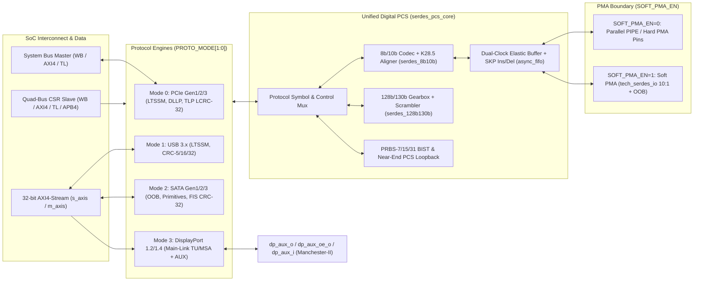
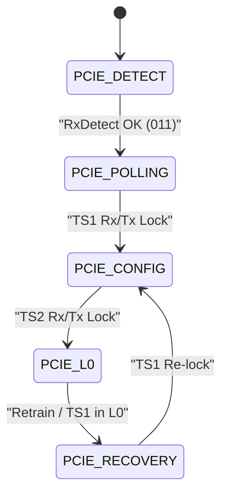
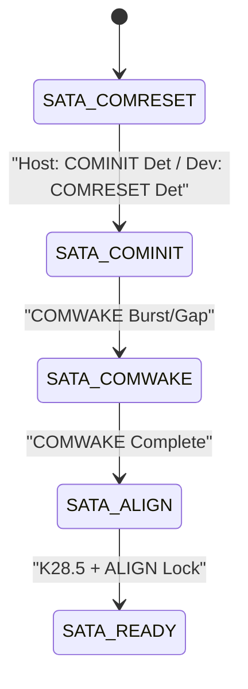
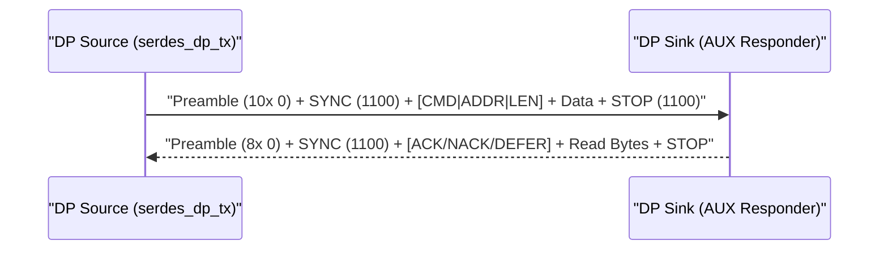

# Unified Multi-Protocol SerDes Combo Core (`ips/39_serdes_combo`)

Clean-room, Yosys/FPGA/ASIC-tape-out-friendly **Unified Multi-Protocol SerDes Combo IP** (`serdes_combo_top`) integrating a shared high-speed **Digital PCS + PIPE/PMA Boundary** (`8b/10b`, `128b/130b`, Dual-Clock Elastic Buffer, PRBS BIST) that powers four runtime-selectable serial protocols (**PCIe Gen1/2/3**, **USB 3.x SuperSpeed**, **SATA Gen1/2/3**, and **DisplayPort 1.2/1.4 + Manchester-II AUX**), plus a **Soft PMA** (`SOFT_PMA_EN=1`) built on `common/rtl/tech/tech_serdes_io.sv` and quad-bus SoC wrappers (**Wishbone B4**, **AXI4**, **TileLink**, **APB4 + AXI4 Master**).

---

## 1. Key Features

- **Unified Digital PCS (`serdes_pcs_core.sv`)**:
  - **IEEE/IBM 8b/10b Codec & Aligner (`serdes_8b10b.sv`)**: Full 256 D-code + 12 K-code (`K28.0..7`, `K23.7`, `K27.7`, `K29.7`, `K30.7`) encoder/decoder with running disparity tracking (`RD-`/`RD+`), code & disparity error detection, and a zero-latency 20-bit sliding-window **K28.5 (`10'b0011111010` / `10'b1100000101`) Comma Word Aligner**.
  - **128b/130b Gearbox & Scramblers (`serdes_128b130b.sv`)**: 2-bit sync-header framing (`2'b10` Data Block, `2'b01` Ordered Set Block), 13:10 parallel gearbox, block-lock alignment state machine (`BL_UNSYNC -> BL_ALIGN -> BL_LOCKED`), and programmable additive LFSR scrambler/descrambler supporting **PCIe Gen3 23-bit** ($x^{23}+x^{21}+x^{16}+x^8+x^5+x^2+1$) and **USB 3.x / Gen1-2 16-bit** ($x^{16}+x^5+x^4+x^3+1$).
  - **Dual-Clock Elastic Buffer (`serdes_elastic_buf.sv`)**: Wraps `common/rtl/async_fifo.sv` (16-entry Gray-coded CDC FIFO) between `pma_rx_clk_i` and `clk_i` with Gray-synced watermark fill estimation, automatic **SKP Ordered-Set insertion/deletion** (`LOW_WM`/`HIGH_WM`) for $\pm 300\text{--}5000\text{ ppm}$ SSC clock-rate compensation, and overflow/underflow diagnostics.
  - **Silicon Bring-Up BIST & Loopbacks (`serdes_prbs.sv`)**: PRBS-7 ($x^7+x^6+1$), PRBS-15 ($x^{15}+x^{14}+1$), and PRBS-31 ($x^{31}+x^{28}+1$) pattern generators, self-synchronizing lock-on-data checker with free-running `PRBS_ERR_CNT`, single-bit error injection, Near-End PCS digital loopback (`LPBK_PCS`), and PMA serial loopback (`LPBK_PMA`).
  - **Dual-Mode PMA Boundary (`SOFT_PMA_EN = 0/1`)**:
    - `SOFT_PMA_EN = 0`: Exposes standard PIPE/PMA parallel pins (`pma_tx_data_o`, `pma_tx_clk_i`, `pma_rx_data_i`, `pma_rx_clk_i`, `pma_tx_elecidle_o`, `pma_rx_elecidle_i`, `pma_tx_detectrx_o`, `pma_rx_status_i`, `pma_powerdown_o[1:0]`, `pma_rate_o[1:0]`, `pma_phy_status_i`) for ASIC hard SerDes macros or FPGA GTX/GTH/ECP5 transceivers.
    - `SOFT_PMA_EN = 1`: Instantiates `serdes_pma_soft.sv` using `tech_serdes_io #(.RATIO(10), .LSB_FIRST(1'b0))` with differential common-mode (`00`) electrical-idle / OOB envelope signaling and PIPE `RxDetect` handshake.
- **4 Shared Protocol Engines (Runtime-Selectable via `GLOBAL_CTRL.PROTO_MODE[1:0]`)**:
  - **Mode `0` — PCIe Gen1/2/3 (`serdes_pcie_link.sv`)**: LTSSM (`DETECT -> POLLING -> CONFIG -> L0 -> RECOVERY`), `TS1`/`TS2` ordered sets, `InitFC1`/`ACK`/`NAK` DLLPs, `MRd32`/`MWr32`/`Cpl`/`CplD` TLPs with **LCRC-32 (`0x04C11DB7`)**, replay buffer, and direct **`mem_req_t`/`mem_rsp_t`** system bus master bridge.
  - **Mode `1` — USB 3.x SuperSpeed (`serdes_usb3_link.sv`)**: LTSSM (`RX_DETECT -> POLLING -> U0 -> RECOVERY`), Link Commands (`LGOOD`/`LCRD`/`LBAD`) with **CRC-5**, Header Packets (`LMP`/`TP`/`DP`/`ITP`) with **CRC-16**, and Data Packet Payloads (DPP) with **CRC-32** over 32-bit AXI4-Stream (`s_axis_*` / `m_axis_*`).
  - **Mode `2` — SATA Gen1/2/3 (`serdes_sata_link.sv`)**: OOB bring-up FSM (`COMRESET -> COMINIT -> COMWAKE -> ALIGN -> READY`), SATA primitives (`SYNC`, `X_RDY`, `R_RDY`, `R_IP`, `SOF`, `EOF`, `WTRM`, `R_OK`, `R_ERR`), FIS framing (`Reg H2D` `0x27`, `Reg D2H` `0x34`, `Data FIS` `0x46`) with **SATA CRC-32** (`0x04C11DB7`, init `0x52325032`) and frame scrambling ($x^{16}+x^{15}+x^{13}+x^4+1$).
  - **Mode `3` — DisplayPort 1.2/1.4 + AUX (`serdes_dp_tx.sv`)**: 1/2/4-lane Main-Link training (`TPS1`, `TPS2`, `TPS3`), video framing (`BS`/`BE`/`SR`/`SS`/`SE`, MSA, Transfer Units `TU` with `FS`/`FE` fill, RGB888/RGB666 via `s_axis_*` or internal color-bar TPG), plus native **Manchester-II 1 Mbps AUX Controller** (`dp_aux_o`/`dp_aux_oe_o`/`dp_aux_i`) for DPCD & I2C-over-AUX EDID transactions.
- **Quad-Bus System Integration**: Unified `serdes_combo_top` supporting `BUS_WISHBONE`, `BUS_AXI4`, `BUS_TILELINK`, and `BUS_APB` (with AXI4 DMA/PCIe bus master in APB mode).

---

## 2. Unified Architecture Diagram



---

## 3. Parameters & Pinout

### 3.1 Top-Level Parameters (`serdes_combo_top`)

| Parameter | Type | Default | Description |
|---|---|---|---|
| `BUS_TYPE` | `bus_pkg::bus_proto_e` | `BUS_AXI4` | `BUS_WISHBONE` (0), `BUS_AXI4` (1), `BUS_TILELINK` (2), `BUS_APB` (3) |
| `MAX_LANES` | `int unsigned` | `2` | Maximum supported SerDes lanes (`1`, `2`, or `4`) |
| `SOFT_PMA_EN` | `bit` | `1'b1` | `1` = Instantiate Soft PMA (`serdes_pma_soft`), `0` = External Hard PMA/PIPE |

### 3.2 PIPE / SerDes PMA & Pad Pinout

| Signal | Dir | Width | Domain | Description |
|---|---|---|---|---|
| `clk_i`, `rst_ni` | In | 1 | `clk_i` | Core clock and active-low async reset |
| `pma_tx_data_o` | Out | `MAX_LANES*10` | `pma_tx_clk_i` / `clk_i` | Parallel 10-bit TX symbols (`{a,b,c,d,e,i,f,g,h,j}`) |
| `pma_tx_clk_i` | In | 1 | `pma_tx_clk_i` | Hard PMA TX parallel clock (active when `SOFT_PMA_EN=0`) |
| `pma_rx_data_i` | In | `MAX_LANES*10` | `pma_rx_clk_i` | Parallel 10-bit RX symbols from Hard PMA |
| `pma_rx_clk_i` | In | 1 | `pma_rx_clk_i` | Recovered RX parallel clock from Hard PMA |
| `pma_tx_elecidle_o` | Out | `MAX_LANES` | `clk_i` | Per-lane TX electrical idle / OOB squelch |
| `pma_rx_elecidle_i` | In | `MAX_LANES` | `pma_rx_clk_i` | Per-lane RX electrical idle / OOB envelope |
| `pma_tx_detectrx_o` | Out | 1 | `clk_i` | PIPE receiver detection request |
| `pma_rx_status_i` | In | `MAX_LANES*3` | `clk_i` | PIPE RX status (`3'b011` = Receiver Detected) |
| `pma_powerdown_o` | Out | 2 | `clk_i` | PIPE power state (`00`=P0, `01`=P0s, `10`=P1, `11`=P2) |
| `pma_rate_o` | Out | 2 | `clk_i` | Link speed select (`00`=Gen1, `01`=Gen2, `10`=Gen3) |
| `pma_phy_status_i` | In | 1 | `clk_i` | PIPE PHY command/status acknowledge |
| `ser_tx_clk_i`, `ser_rx_clk_i` | In | 1 | 10x Serial | 10x serial clocks for Soft PMA (`SOFT_PMA_EN=1`) |
| `ser_tx_p_o`, `ser_tx_n_o` | Out | `MAX_LANES` | `ser_tx_clk_i` | Differential serial TX (`00` = electrical idle) |
| `ser_rx_p_i`, `ser_rx_n_i` | In | `MAX_LANES` | `ser_rx_clk_i` | Differential serial RX (`p==n` = electrical idle) |
| `dp_aux_o`, `dp_aux_oe_o`, `dp_aux_i` | Out/Out/In | 1 | `clk_i` | DisplayPort Manchester-II 1 Mbps AUX split pads |
| `s_axis_*` / `m_axis_*` | In/Out | 32-bit | `clk_i` | AXI4-Stream payload ports (USB3 DPP, SATA Data FIS, DP RGB) |
| `irq_o` | Out | 1 | `clk_i` | Aggregated active-high level interrupt |

---

## 4. Subsystems & Protocol State Machines

### 4.1 8b/10b, 128b/130b & Dual-Clock Elastic Buffer Specs

- **8b/10b (`serdes_8b10b.sv`)**: Encodes `{H,G,F,E,D,C,B,A}` into `abcdei_fghj` (`[9:0]`). `K28.5` (`8'hBC`, `k=1`) produces `10'b0011111010` (`RD-`) or `10'b1100000101` (`RD+`). The sliding-window aligner checks all 10 bit offsets in `{prev_10b_q, rx_raw_10b_i}` and locks immediately upon seeing `K28.5`.
- **128b/130b (`serdes_128b130b.sv`)**: Wraps 128-bit blocks with `2'b10` (Data) or `2'b01` (Ordered Set) sync headers, shifts over the 10-bit PMA interface in 13 cycles, and acquires block lock (`BL_UNSYNC -> BL_ALIGN -> BL_LOCKED`) across all 130 bit phases after 4 consecutive valid sync headers.
- **Elastic Buffer (`serdes_elastic_buf.sv`)**: Uses `async_fifo #(.DATA_W(11), .ADDR_W(4))` (16 entries). After an initial hold-off to nominal fill (`7` entries), the write domain deletes `SKP` symbols when Gray-synced fill $\ge \text{HIGH\_WM}$ (default `11`) and the read domain duplicates `SKP` symbols when Gray-synced fill $\le \text{LOW\_WM}$ (default `4`).

### 4.2 Protocol State Diagrams







---

## 5. Full CSR Register Map

Base-relative byte offsets (`addr[9:2]` decoded):

### 5.1 Global, PCS, 128b/130b & BIST CSRs (`0x000 - 0x054`)

| Offset | Name | Access | Reset | Bit Fields |
|---|---|---|---|---|
| `0x000` | `ID_VER` | RO | `0x53440100` | `[31:16]` `"SD"`, `[15:0]` v1.0 (`0x0100`) |
| `0x004` | `GLOBAL_CTRL` | RW | `0x00000000` | `[1:0]` `PROTO_MODE` (`0`=PCIe,`1`=USB3,`2`=SATA,`3`=DP), `[2]` `CORE_EN`, `[3]` `SOFT_RST` (W1P), `[5:4]` `LOOPBACK_MODE` (`0`=Norm,`1`=PCS,`2`=PMA), `[7:6]` `RATE_SEL`, `[9:8]` `LANE_CFG` (`0`=1L,`1`=2L,`2`=4L), `[10]` `PCS_128B_EN`, `[11]` `SCRAM_DIS` |
| `0x008` | `GLOBAL_STATUS` | RO | `0x00000000` | `[3:0]` `RX_ALIGNED`, `[7:4]` `RX_ELECIDLE`, `[8]` `PCS_128B_LOCK`, `[9]` `PHY_STATUS`, `[11:10]` `POWERDOWN`, `[15:12]` `LINK_UP` (`12`=PCIe,`13`=USB3,`14`=SATA,`15`=DP), `[19:16]` `MAX_LANES`, `[20]` `SOFT_PMA_EN` |
| `0x00C` | `IRQ_STATUS` | RW1C | `0x00000000` | `[0]` `PCIE_UP`, `[1]` `PCIE_RX_TLP`, `[2]` `PCIE_ERR`, `[3]` `USB3_UP`, `[4]` `USB3_RX`, `[5]` `SATA_READY`, `[6]` `SATA_RX`, `[7]` `DP_AUX_DONE`, `[8]` `PRBS_ERR` |
| `0x010` | `IRQ_EN` | RW | `0x00000000` | `[8:0]` Interrupt enable mask matching `IRQ_STATUS` |
| `0x014` | `PCS_CFG` | RW | `0x000B41CD` | `[0]` `ALIGN_EN`, `[1]` `ALIGN_BYPASS`, `[2]` `ELASTIC_INS_EN`, `[3]` `ELASTIC_DEL_EN`, `[11:4]` `SKP_CHAR`, `[15:12]` `LOW_WM`, `[19:16]` `HIGH_WM`, `[20]` `128B_SCRAM_MODE` (`0`=Gen3 23b,`1`=USB3 16b) |
| `0x018` | `ELASTIC_STAT` | RO | `0x00000000` | `[7:0]` `SKP_INS_CNT`, `[15:8]` `SKP_DEL_CNT`, `[23:16]` `OVF_CNT`, `[31:24]` `UNF_CNT` |
| `0x01C` | `PRBS_CTRL` | RW | `0x00000000` | `[1:0]` `PRBS_SEL` (`0`=Off,`1`=PRBS7,`2`=PRBS15,`3`=PRBS31), `[2]` `ERR_INJ` (W1P), `[3]` `CNT_CLR` (W1P) |
| `0x020` | `PRBS_STATUS` | RO | `0x00000000` | `[0]` `PRBS_LOCK`, `[31:16]` `PRBS_ERR_CNT` |
| `0x024` | `PCS_ERR_CNT` | RW1P | `0x00000000` | `[15:0]` `DISP_CODE_ERR_CNT`, `[31:16]` `COMMA_CNT` (write bit 0 = clear) |
| `0x030` | `B130_CTRL` | RW | `0x00000004` | `[0]` `TX_START`, `[2:1]` `TX_SYNC_HDR`, `[3]` `TX_SCRAM_RST` (W1P) |
| `0x034` | `B130_STATUS` | RO | `0x00000001` | `[0]` `TX_READY`, `[1]` `RX_LOCK`, `[2]` `RX_VALID`, `[4:3]` `RX_HDR` |
| `0x038..0x044` | `B130_TX_DATA0..3` | RW | `0x00000000` | 128-bit TX block payload (`[31:0]` .. `[127:96]`) |
| `0x048..0x054` | `B130_RX_DATA0..3` | RO | `0x00000000` | 128-bit RX block payload (reading `0x048` clears `RX_VALID`) |

### 5.2 PCIe CSRs (`0x080 - 0x0A8`)

| Offset | Name | Access | Reset | Bit Fields |
|---|---|---|---|---|
| `0x080` | `PCIE_CTRL` | RW | `0x00000000` | `[0]` `LTSSM_EN`, `[1]` `RETRAIN` (W1P), `[2]` `TX_TLP_START` (W1P), `[3]` `DETECT_BYPASS`, `[4]` `FORCE_BAD_LCRC`, `[7:5]` `TX_LEN_DW` |
| `0x084` | `PCIE_STATUS` | RO | `0x00000000` | `[2:0]` `LTSSM_STATE` (`0`=DET,`1`=POLL,`2`=CFG,`3`=L0,`4`=REC), `[3]` `TX_BUSY`, `[4]` `RX_TLP_VALID`, `[7:5]` `RX_TLP_LEN`, `[15:8]` `LCRC_ERR_CNT`, `[23:16]` `ACK_RX_CNT`, `[31:24]` `NAK_RX_CNT` |
| `0x088..0x090` | `PCIE_TX_HDR0..2` | RW | `0x00000000` | Outbound 3DW TLP header |
| `0x094` | `PCIE_TX_DATA` | WO | `0x00000000` | Push DW into outbound TLP payload FIFO |
| `0x098..0x0A0` | `PCIE_RX_HDR0..2` | RO | `0x00000000` | Received 3DW TLP header |
| `0x0A4` | `PCIE_RX_DATA` | RO | `0x00000000` | Pop DW from inbound TLP payload FIFO |
| `0x0A8` | `PCIE_BUS_BASE` | RW | `0x00000000` | Base offset added to inbound `MRd32`/`MWr32` system bus address |

### 5.3 USB 3.x CSRs (`0x0C0 - 0x0DC`)

| Offset | Name | Access | Reset | Bit Fields |
|---|---|---|---|---|
| `0x0C0` | `USB3_CTRL` | RW | `0x00000000` | `[0]` `USB3_EN`, `[1]` `RETRAIN` (W1P), `[2]` `TX_HP_START` (W1P), `[3]` `DETECT_BYPASS`, `[4]` `TX_WITH_DPP`, `[5]` `FORCE_BAD_CRC`, `[15:8]` `TX_DPP_WORDS` |
| `0x0C4` | `USB3_STATUS` | RO | `0x00000000` | `[2:0]` `USB3_LTSSM` (`0`=DET,`1`=POLL,`2`=U0,`3`=REC), `[3]` `TX_BUSY`, `[4]` `RX_HP_VALID`, `[15:8]` `LGOOD_RX_CNT`, `[23:16]` `LBAD_RX_CNT`, `[31:24]` `CRC_ERR_CNT` |
| `0x0C8..0x0D0` | `USB3_TX_HDR0..2` | RW | `0x00000000` | Outbound USB3 Header Packet DW0..DW2 |
| `0x0D4..0x0DC` | `USB3_RX_HDR0..2` | RO | `0x00000000` | Received USB3 Header Packet DW0..DW2 (reading `0x0DC` pops `RX_HP_VALID`) |

### 5.4 SATA CSRs (`0x100 - 0x12C`)

| Offset | Name | Access | Reset | Bit Fields |
|---|---|---|---|---|
| `0x100` | `SATA_CTRL` | RW | `0x000C0400` | `[0]` `SATA_EN`, `[1]` `DEV_MODE`, `[2]` `TX_FIS_START` (W1P), `[3]` `TX_FIS_IS_DATA`, `[4]` `FORCE_BAD_CRC`, `[15:8]` `OOB_BURST_CYC`, `[23:16]` `OOB_GAP_LONG`, `[31:24]` `TX_DATA_DWORDS` |
| `0x104` | `SATA_STATUS` | RO | `0x00000000` | `[2:0]` `OOB_STATE` (`0`=IDLE,`1`=COMRESET,`2`=COMINIT,`3`=COMWAKE,`4`=ALIGN,`5`=READY), `[3]` `TX_BUSY`, `[4]` `RX_FIS_VALID`, `[5]` `LAST_TX_ROK`, `[6]` `LAST_TX_RERR`, `[15:8]` `CRC_ERR_CNT`, `[23:16]` `RX_FIS_CNT` |
| `0x108..0x118` | `SATA_TX_HDR0..4` | RW | `0x00000000` | Outbound 5-DW FIS header (`Reg H2D` `0x27` / `Reg D2H` `0x34` / `Data` `0x46`) |
| `0x11C..0x12C` | `SATA_RX_HDR0..4` | RO | `0x00000000` | Received 5-DW FIS header |

### 5.5 DisplayPort + AUX CSRs (`0x140 - 0x178`)

| Offset | Name | Access | Reset | Bit Fields |
|---|---|---|---|---|
| `0x140` | `DP_LINK_CTRL` | RW | `0x00002030` | `[0]` `DP_EN`, `[3:1]` `TRAIN_PAT` (`0`=Video,`1`=TPS1,`2`=TPS2,`3`=TPS3), `[4]` `SCRAM_EN`, `[5]` `TPG_EN`, `[6]` `BPC_6BIT`, `[15:8]` `TU_SIZE` |
| `0x144` | `DP_VID_TIMING0` | RW | `0x00040010` | `[15:0]` `H_ACTIVE`, `[31:16]` `V_ACTIVE` |
| `0x148` | `DP_VID_TIMING1` | RW | `0x00020008` | `[15:0]` `H_BLANK`, `[31:16]` `V_BLANK` |
| `0x14C` | `DP_MSA_MVID` | RW | `0x00008000` | `[23:0]` `MVID` |
| `0x150` | `DP_AUX_CTRL` | RW | `0x00000040` | `[0]` `AUX_START` (W1P), `[11:4]` `AUX_CLKDIV`, `[15:12]` `AUX_LEN` (bytes-1), `[19:16]` `AUX_CMD` |
| `0x154` | `DP_AUX_ADDR` | RW | `0x00000000` | `[19:0]` 20-bit DPCD / I2C-over-AUX address |
| `0x158` | `DP_AUX_STATUS` | RO | `0x00000000` | `[0]` `BUSY`, `[1]` `DONE`, `[2]` `TIMEOUT`, `[7:4]` `REPLY_CMD`, `[12:8]` `RX_BYTES` |
| `0x15C..0x168` | `DP_AUX_TX0..3` | RW | `0x00000000` | Up to 16 TX AUX bytes |
| `0x16C..0x178` | `DP_AUX_RX0..3` | RO | `0x00000000` | Up to 16 RX AUX reply bytes |

---

## 6. C Bring-Up Recipes

```c
// 1. PCIe Gen1/2 Link Bring-Up & MWr32 TLP
REG(GLOBAL_CTRL) = (1 << 2) | 0;       // CORE_EN=1, PROTO=PCIE
REG(PCIE_CTRL)   = 0x1;                // LTSSM_EN=1
while ((REG(PCIE_STATUS) & 0x7) != 3); // Wait LTSSM == L0
REG(PCIE_TX_HDR0) = 0x40000001;        // MWr32, len=1 DW
REG(PCIE_TX_HDR1) = 0x0000AAFF;        // ReqID=0, Tag=0xAA
REG(PCIE_TX_HDR2) = 0x00000040;        // Target Addr
REG(PCIE_TX_DATA) = 0xCAFEBABE;        // Payload DW0
REG(PCIE_CTRL)    = (1 << 5) | 0x5;    // TX_LEN_DW=1, TX_TLP_START=1, LTSSM_EN=1

// 2. USB 3.x SuperSpeed U0 & Data Packet with AXI4-Stream
REG(GLOBAL_CTRL) = (1 << 2) | 1;       // CORE_EN=1, PROTO=USB3
REG(USB3_CTRL)   = 0x1;                // USB3_EN=1
while ((REG(USB3_STATUS) & 0x7) != 2); // Wait LTSSM == U0
// Stream payload on s_axis_*, then kick DP HP + DPP:
REG(USB3_TX_HDR0) = 0x11220008;        // DP Header
REG(USB3_CTRL)    = (4 << 8) | (1 << 4) | (1 << 2) | 0x1;

// 3. SATA OOB Bring-Up & Reg H2D FIS
REG(GLOBAL_CTRL) = (1 << 2) | 2;       // CORE_EN=1, PROTO=SATA
REG(SATA_CTRL)   = 0x000C0401;         // Host mode, EN=1
while ((REG(SATA_STATUS) & 0x7) != 5); // Wait OOB == READY
REG(SATA_TX_HDR0) = 0x00CA8027;        // Reg H2D FIS (WRITE DMA)
REG(SATA_CTRL)    = 0x000C0405;        // TX_FIS_START=1

// 4. DisplayPort 1.2/1.4 AUX DPCD Read & Video TPG
REG(GLOBAL_CTRL)  = (1 << 2) | 3 | (1 << 8); // DP, 2 lanes
REG(DP_AUX_ADDR)  = 0x00000;           // DPCD Rev/Cap
REG(DP_AUX_CTRL)  = (9 << 16) | (2 << 12) | (50 << 4) | 1; // 1Mbps Read 3B
while (!(REG(DP_AUX_STATUS) & 0x2));
REG(DP_LINK_CTRL) = (32 << 8) | (1 << 5) | (1 << 4) | 0x1; // TPG + Scram + EN
```

---

## 7. ASIC Hard-SerDes PMA vs FPGA GTX/ECP5 Integration Guide

- **ASIC Tape-Out (`SOFT_PMA_EN = 0`)**:
  - Connect `pma_tx_data_o`, `pma_tx_clk_i`, `pma_rx_data_i`, `pma_rx_clk_i`, `pma_tx_elecidle_o`, `pma_rx_elecidle_i`, `pma_tx_detectrx_o`, `pma_rx_status_i`, `pma_powerdown_o`, `pma_rate_o`, and `pma_phy_status_i` directly to the foundry SerDes PMA / PIPE PHY macro.
  - All RX-clocked logic (`serdes_8b10b` RX, `serdes_128b130b` RX, `serdes_prbs` RX) is explicitly isolated behind `serdes_elastic_buf` (`async_fifo`) and `tech_cdc_sync`/`tech_rst_sync`.
  - No latches, no `#` delays, no `initial` blocks, and no tri-state drivers inside the RTL.
- **FPGA Transceivers (AMD/Xilinx GTX/GTH, Lattice ECP5 DCU, or Soft PMA `SOFT_PMA_EN = 1`)**:
  - For **Hard FPGA Transceivers**, set `SOFT_PMA_EN = 0`, disable the internal transceiver's 8b/10b & comma aligner (or set `PCS_CFG.ALIGN_BYPASS = 1` if using the hard GTX comma aligner), and wire `TXUSRCLK2 -> pma_tx_clk_i`, `RXUSRCLK2 -> pma_rx_clk_i`.
  - For **Board Bring-Up / Simulation without Hard Transceivers**, set `SOFT_PMA_EN = 1` and supply `10x` `ser_tx_clk_i` / `ser_rx_clk_i` alongside `clk_i`.

---

## 8. Verification Summary

Verified via self-checking testbench [`tb_serdes_combo.sv`](file:///Users/tianrui6641/tians_ip_collection/ips/39_serdes_combo/tb/tb_serdes_combo.sv) (`+seed=1,7,42`):
1. Exhaustive 256 D-code + 12 K-code 8b/10b encode/decode, invalid-symbol error flag, and `K28.5` alignment across all 10 bit offsets (`0..9`).
2. `128b/130b` block-lock under bit slips + 23-bit Gen3 & 16-bit USB3 scrambler round-trip.
3. Dual-clock Elastic Buffer SKP deletion (`rx_clk > clk`) and SKP insertion (`rx_clk < clk`).
4. PRBS-7/15/31 lock-on-data + exact 1-bit error injection count.
5. Back-to-back PCIe (`LTSSM -> L0`, `MWr32` & `MRd32 -> CplD` via `tb_sim_ram`, bad LCRC `NAK` & replay), USB 3.x (`U0`, `DP` + `DPP` CRC-16/32 + AXI-Stream + `LGOOD`), SATA (OOB `COMRESET->COMINIT->COMWAKE->ALIGN->READY`, `Reg H2D` & `Data FIS` CRC-32), DisplayPort (`TPS1`, `BS`/`BE`/`SS` video framing, Manchester-II AUX DPCD & EDID reads), and Hard-PMA (`SOFT_PMA_EN=0`) + Quad-Bus (`WB`/`AXI4`/`TL`/`APB4` + AXI4 Master).
