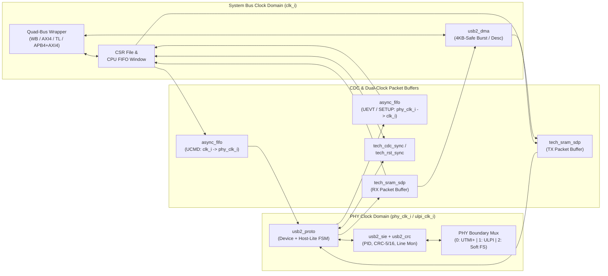

# `40_usb2_otg` — USB 2.0 Device / Host-Lite Digital Controller

Clean-room, Yosys/FPGA/ASIC-tape-out-friendly **USB 2.0 Device & Host-Lite Digital Controller** (`usb2_otg_top`) featuring a clean **UTMI+ / ULPI 1.1 SDR / Soft Full-Speed D+/D- PHY boundary**, dual-clock Gray-coded CDC, dual-port inferable packet SRAMs, an integrated 4 KB-safe Burst & Scatter-Gather DMA master, and Quad-Bus wrappers (Wishbone B4, AXI4/AXI4-Lite, TileLink TL-UL/TL-UH, and AMBA APB4 + AXI4 DMA).

---

## 1. Key Features

- **USB 2.0 Protocol & Serial Interface Engine (`usb2_sie`, `usb2_crc`, `usb2_proto`)**:
  - Full PID encode/decode and complement validation (`OUT`, `IN`, `SOF`, `SETUP`, `DATA0`, `DATA1`, `DATA2`, `MDATA`, `ACK`, `NAK`, `STALL`, `NYET`, `PING`).
  - Hardware USB 2.0 **CRC-5** (`x^5 + x^2 + 1`, token/SOF) and **CRC-16** (`x^16 + x^15 + x^2 + 1`, data payload) generation and residue verification.
  - **Device Mode**:
    - 7-bit `DEV_ADDR` matching (cleared to `0` on USB Bus Reset), `SOF_FN[10:0]` tracking, High-Speed / Full-Speed status, and USB Reset / Suspend / Resume detection.
    - `NUM_EPS = 8` endpoints (`EP0` Control + `EP1..EP7` configurable Control / Isochronous / Bulk / Interrupt, IN/OUT) with per-endpoint `DATA0`/`DATA1` toggle tracking, duplicate retransmission filtering, `STALL`/`NAK`/`READY` handling, and optional ping-pong double buffering (`PING_PONG`).
    - Dedicated 64-bit `SETUP` capture FIFO (`EP0_SETUP_LO` / `EP0_SETUP_HI`) that automatically ACKs valid `SETUP` packets, clears `EP0` IN/OUT `STALL`, and forces `DATA1` for the Data/Status stage.
  - **Host-Lite Mode (`CTRL.HOST_MODE = 1`)**:
    - Programmable periodic `SOF` frame/microframe generator (`SOF_PERIOD`).
    - Software-queued `SETUP`, `OUT`, `IN`, and `PING` transactions (`HOST_XACT_CTRL`) with `ACK`/`NAK`/`STALL`/`NYET`/timeout/CRC-error reporting (`HOST_XACT_STAT`) and IN payload capture.
- **Clean Tri-Mode PHY Boundary (`PHY_MODE`)**:
  - `PHY_MODE = 0`: **UTMI+ 8-bit / 60 MHz** parallel interface for ASIC hard USB 2.0 PHY macros.
  - `PHY_MODE = 1`: **ULPI 1.1 SDR 8-bit / 60 MHz** pin-count-reduced wrapper (`usb2_ulpi_bridge`) with split `ulpi_data_i/o/oe_o`, `ulpi_dir_i`, `ulpi_nxt_i`, `ulpi_stp_o`, `ulpi_rst_no`, supporting TX/RX framing, RX CMD line/VBUS decode, software ULPI register R/W, and automatic `Function Control`/`OTG Control` sync.
  - `PHY_MODE = 2`: **Soft Full-Speed (12 Mbps) D+/D- PHY** (`usb2_fs_phy_soft`) with parameterized NCO, NRZI encoding/decoding, bit-stuffing/unstuffing, SYNC/EOP framing, and split `usb_dp_*/usb_dm_*` pads for FPGA-only pin-direct bring-up.
- **Clock-Domain Crossing & Memory**:
  - Explicit CDC between `phy_clk_i`/`ulpi_clk_i` (60 MHz) and `clk_i` (system bus) using `common/rtl/async_fifo.sv`, `common/rtl/tech/tech_cdc_sync.sv`, and `common/rtl/tech/tech_rst_sync.sv`.
  - Inferable dual-clock packet buffers (`tech_sram_sdp`) with clock-only synchronous writes (no async reset on memory arrays).
- **4 KB-Safe Burst & Descriptor DMA + CPU FIFO Window**:
  - Built-in `usb2_dma` master (`mem_req_t`/`mem_rsp_t`) supporting linear burst transfers (up to 16-beat bursts clamped to never cross `0x1000` 4 KB boundaries), non-4-byte-aligned trailing `wstrb` masking, auto-commit (`TX_COMMIT` / `RX_FREE`), and 2-word scatter-gather descriptor lists.
  - CPU FIFO window (`FIFO_PTR`, `TX_FIFO_DATA`, `RX_FIFO_DATA`) for PIO / control transfers.
- **Quad-Bus SoC Wrappers**:
  - `BUS_WISHBONE` (`0`), `BUS_AXI4` (`1`), `BUS_TILELINK` (`2`), `BUS_APB` (`3`, APB4 slave + AXI4 burst DMA master per repo `BUS_APB` convention).

---

## 2. Architecture Block Diagram



---

## 3. Parameters & Top-Level Ports (`usb2_otg_top`)

### Parameters

| Parameter | Type | Default | Description |
|---|---|---|---|
| `BUS_TYPE` | `bus_pkg::bus_proto_e` | `BUS_AXI4` | `BUS_WISHBONE` (0), `BUS_AXI4` (1), `BUS_TILELINK` (2), `BUS_APB` (3) |
| `PHY_MODE` | `int unsigned` | `0` | `0`: UTMI+ 8-bit/60MHz, `1`: ULPI 1.1 SDR, `2`: Soft FS D+/D- |
| `NUM_EPS` | `int unsigned` | `8` | Number of endpoints (`EP0..EP7`) |
| `MAX_PKT_BYTES` | `int unsigned` | `512` | Max bytes per endpoint bank (`TX` and `RX` each allocate `NUM_EPS * 2 * MAX_PKT_BYTES`) |
| `DMA_EN` | `bit` | `1'b1` | Enables `usb2_dma` and bus master adapter |
| `PHY_CLK_HZ` | `int unsigned` | `60_000_000` | Input `phy_clk_i` frequency in Hz (used by `usb2_fs_phy_soft` NCO when `PHY_MODE=2`) |

### Ports Summary

| Group | Signal(s) | Dir | Width | Description |
|---|---|---|---|---|
| Clock/Reset | `clk_i`, `rst_ni`, `phy_clk_i` | in | 1 | System clock, async active-low reset, UTMI+/Soft-FS clock (`60 MHz`) |
| Bus Slave | `s_wb_i/o`, `s_axi_i/o`, `s_tl_i/o`, `s_apb_i/o` | in/out | struct | CSR slave selected by `BUS_TYPE` |
| DMA Master | `m_wb_o/i`, `m_axi_o/i`, `m_tl_o/i` | out/in | struct | Burst DMA master (`BUS_APB` uses `m_axi_o/i`) |
| UTMI+ (`PHY_MODE=0`) | `utmi_data_o[7:0]`, `utmi_txvalid_o`, `utmi_txready_i`, `utmi_data_i[7:0]`, `utmi_rxvalid_i`, `utmi_rxactive_i`, `utmi_rxerror_i`, `utmi_linestate_i[1:0]`, `utmi_vbusvalid_i`, `utmi_sessend_i`, `utmi_iddig_i`, `utmi_opmode_o[1:0]`, `utmi_xcvrselect_o[1:0]`, `utmi_termselect_o`, `utmi_dppulldown_o`, `utmi_dmpulldown_o`, `utmi_suspendm_no`, `utmi_reset_o` | in/out | — | Standard UTMI+ 8-bit parallel interface |
| ULPI (`PHY_MODE=1`) | `ulpi_clk_i`, `ulpi_data_i[7:0]`, `ulpi_data_o[7:0]`, `ulpi_data_oe_o`, `ulpi_dir_i`, `ulpi_nxt_i`, `ulpi_stp_o`, `ulpi_rst_no` | in/out | — | External ULPI 1.1 SDR PHY pins (split pad bus) |
| Soft FS (`PHY_MODE=2`) | `usb_dp_i/o/oe_o`, `usb_dm_i/o/oe_o`, `usb_dp_pullup_o` | in/out | 1 | Direct FPGA Full-Speed D+/D- differential pads |
| Sideband | `dma_tx_req_o`, `dma_rx_req_o`, `irq_o` | out | 1 | Endpoint TX/RX DMA demand flags and active-high interrupt |

---

## 4. Endpoint Packet SRAM & Descriptor Layout

### Packet SRAM Addressing (`u_tx_sram`, `u_rx_sram`)

Each direction (`TX` and `RX`) instantiates a `tech_sram_sdp` of depth `NUM_EPS * 2 * (MAX_PKT_BYTES / 4)` 32-bit words (`2048 x 32` = `8 KB` per direction at defaults):

```
SRAM Word Address = { ep[2:0], bank[0], word_idx[6:0] }
```

- `bank = 0` is used when `EPn_CFG.PING_PONG = 0`; `bank` alternates `0 <-> 1` automatically when `PING_PONG = 1`.
- Little-endian byte ordering within 32-bit words (byte 0 in `[7:0]`, byte 1 in `[15:8]`, etc.).

### Scatter-Gather DMA Descriptor Format (`DMA_CTRL.DESC_EN = 1`)

Each descriptor is **2 words (8 bytes, 4-byte aligned)** in system memory:

| Word | Bits | Field | Description |
|---|---|---|---|
| Word 0 | `[31:0]` | `BUF_ADDR` | 4-byte-aligned buffer address (or next descriptor list address if `LINK=1`) |
| Word 1 | `[15:0]` | `BYTE_LEN` | Transfer length in bytes (arbitrary byte count supported via final-beat `wstrb`) |
| Word 1 | `[16]` | `VALID` | Must be `1` (triggers `DMA_ERR` if `0`) |
| Word 1 | `[17]` | `END` | `1`: last descriptor in chain |
| Word 1 | `[18]` | `INT` | `1`: assert `IRQ_STAT.DMA_SEG` upon segment completion |
| Word 1 | `[19]` | `LINK` | `1`: jump `ptr` to Word 0 `BUF_ADDR` instead of transferring data |

---

## 5. CSR Register Map

All registers are 32-bit aligned. Per-endpoint registers are located at `0x100 + n * 0x10` for `n = 0..7`.

### Global, FIFO, DMA, and Host-Lite Registers (`0x000 .. 0x064`)

| Offset | Name | Access | Reset | Bit Fields |
|---|---|---|---|---|
| `0x000` | `ID` | RO | `0x55534232` | `"USB2"` peripheral identifier |
| `0x004` | `CAP` | RO | param | `[7:0]` `NUM_EPS`, `[19:8]` `MAX_PKT_BYTES`, `[23:20]` `PHY_MODE`, `[24]` `DMA_EN` |
| `0x008` | `CTRL` | RW | `0x01000008` | `[0]` `CORE_EN`, `[1]` `HOST_MODE`, `[2]` `CONNECT`, `[3]` `HS_EN`, `[6]` `PHY_OVR_EN`, `[8:7]` `OVR_OPMODE`, `[10:9]` `OVR_XCVRSEL`, `[11]` `OVR_TERMSEL`, `[12]` `OVR_DP_PD`, `[13]` `OVR_DM_PD`, `[14]` `OVR_SUSPENDM_N`, `[15]` `OVR_PHY_RST`, `[16]` `SOF_EN`, `[17]` `FAST_TIMERS`, `[18]` `SOFT_RST` (W1P), `[19]` `HOST_BUS_RESET`, `[24]` `DMA_EN_CTRL` |
| `0x00C` | `DEV_ADDR` | RW | `0x00000000` | `[6:0]` `DEV_ADDR` (cleared on USB Bus Reset) |
| `0x010` | `STATUS` | RO | — | `[1:0]` `LINESTATE`, `[2]` `VBUSVALID`, `[3]` `SESSEND`, `[4]` `IDDIG`, `[5]` `RXACTIVE`, `[6]` `SPEED_HS`, `[7]` `SUSPENDED`, `[8]` `BUS_RESET_SEEN`, `[9]` `ULPI_BUSY`, `[10]` `HOST_XACT_BUSY`, `[11]` `DMA_BUSY`, `[12]` `SETUP_PENDING`, `[26:16]` `SOF_FN[10:0]` |
| `0x014` | `IRQ_STAT` | W1C | `0x00000000` | `[0]` `USB_RESET`, `[1]` `SUSPEND`, `[2]` `RESUME`, `[3]` `SOF`, `[4]` `SETUP`, `[5]` `EP_TX`, `[6]` `EP_RX`, `[7]` `HOST_DONE`, `[8]` `DMA_DONE`, `[9]` `DMA_ERR`, `[10]` `ULPI_DONE`, `[11]` `CRC_ERR`, `[12]` `DMA_SEG` |
| `0x018` | `IRQ_EN` | RW | `0x00000000` | `[12:0]` Interrupt enable mask matching `IRQ_STAT` (`irq_o = |(IRQ_STAT & IRQ_EN)`) |
| `0x01C` | `SOF_PERIOD` | RW | `0x00001D4B` | `[15:0]` Host SOF period in `phy_clk_i` cycles - 1 (default `7499` = 125 us @ 60 MHz) |
| `0x020` | `ULPI_REG` | RW | `0x00000000` | `[5:0]` `ADDR`, `[7]` `WRITE`, `[15:8]` `WDATA`, `[23:16]` `RDATA` (RO), `[31]` `GO` (W1S) |
| `0x024` | `EP0_SETUP_LO` | RO | `0x00000000` | `[31:0]` SETUP bytes `3..0` (`{wValue[15:0], bRequest, bmRequestType}`) |
| `0x028` | `EP0_SETUP_HI` | RO | `0x00000000` | `[31:0]` SETUP bytes `7..4` (`{wLength[15:0], wIndex[15:0]}`) |
| `0x030` | `FIFO_PTR` | RW | `0x00000000` | `[2:0]` `TX_EP`, `[3]` `TX_BANK`, `[12:4]` `TX_WIDX`, `[18:16]` `RX_EP`, `[19]` `RX_BANK`, `[28:20]` `RX_WIDX` |
| `0x034` | `TX_FIFO_DATA` | WO | — | Write 32-bit word to TX SRAM at `{TX_EP, TX_BANK, TX_WIDX++}` |
| `0x038` | `RX_FIFO_DATA` | RO | — | Read 32-bit word from RX SRAM at `{RX_EP, RX_BANK, RX_WIDX++}` (1-cycle SRAM wait) |
| `0x040` | `DMA_ADDR` | RW | `0x00000000` | `[31:0]` System memory base address (or descriptor table base) |
| `0x044` | `DMA_CTRL` | RW | `0x00007000` | `[0]` `START` (W1P), `[1]` `DIR_TX` (1=RAM->USB), `[2]` `AUTO_COMMIT`, `[3]` `DESC_EN`, `[4]` `ABORT` (W1P), `[7:5]` `EP[2:0]`, `[8]` `BANK`, `[15:12]` `MAX_BURST` (beats-1), `[27:16]` `BYTE_LEN[11:0]` |
| `0x048` | `DMA_STAT` | RO | `0x00000000` | `[0]` `BUSY`, `[1]` `DONE`, `[2]` `ERR` |
| `0x04C` | `DMA_CUR_ADDR` | RO | `0x00000000` | `[31:0]` Current DMA memory address |
| `0x050` | `EP_TX_STAT` | RO | `0x00000001` | `[7:0]` Bit `n`=1 if enabled EP `n` has a free TX bank |
| `0x054` | `EP_RX_STAT` | RO | `0x00000000` | `[7:0]` Bit `n`=1 if enabled EP `n` has an unread RX bank |
| `0x060` | `HOST_XACT_CTRL` | RW | `0x00000000` | `[6:0]` `DEV_ADDR`, `[10:7]` `EP`, `[14:11]` `PID`, `[15]` `TOGGLE`, `[16]` `IS_ISO`, `[17]` `BANK`, `[28:18]` `BYTE_LEN[10:0]`, `[31]` `GO` (W1P) |
| `0x064` | `HOST_XACT_STAT` | RO | `0x00000000` | `[0]` `BUSY`, `[3:1]` `STATUS` (`0`=OK, `1`=NAK, `2`=STALL, `3`=NYET, `4`=TMO, `5`=CRC_ERR, `6`=PID_ERR), `[7:4]` `RX_PID`, `[8]` `NEXT_TOGGLE`, `[19:9]` `RX_BYTE_LEN[10:0]` |

### Per-Endpoint Registers (`0x100 + n*0x10`, `n = 0..7`)

| Sub-offset | Name | Access | Reset | Bit Fields |
|---|---|---|---|---|
| `+0x00` | `EPn_CFG` | RW | `EP0: 0x0403`, `EP1..7: 0x2008` | `[0]` `TX_EN`, `[1]` `RX_EN`, `[3:2]` `TYPE` (`0`=Ctrl, `1`=Iso, `2`=Bulk, `3`=Int), `[14:4]` `MAX_PKT[10:0]`, `[15]` `PING_PONG` |
| `+0x04` | `EPn_CTRL` | WO | `0` | `[0]` `TX_COMMIT_B0`, `[1]` `TX_COMMIT_B1`, `[2]` `RX_FREE_B0`, `[3]` `RX_FREE_B1`, `[4]` `STALL_IN_SET`, `[5]` `STALL_IN_CLR`, `[6]` `STALL_OUT_SET`, `[7]` `STALL_OUT_CLR`, `[8]` `TOG_IN_RST`, `[9]` `TOG_IN_SET1`, `[10]` `TOG_OUT_RST`, `[11]` `TOG_OUT_SET1`, `[26:16]` `TX_LEN[10:0]` |
| `+0x08` | `EPn_STAT` | RO | `0x00000000` | `[0]` `TX_B0_BUSY`, `[1]` `TX_B1_BUSY`, `[2]` `RX_B0_VALID`, `[3]` `RX_B1_VALID`, `[4]` `STALL_IN`, `[5]` `STALL_OUT`, `[6]` `TOGGLE_IN`, `[7]` `TOGGLE_OUT`, `[8]` `TX_DONE_B0`, `[19:9]` `RX_B0_LEN[10:0]`, `[30:20]` `RX_B1_LEN[10:0]`, `[31]` `TX_DONE_B1` |

---

## 6. Programming Recipes (C-Style Pseudocode)

### Recipe A: Device Enumeration (`Get-Descriptor` + `Set-Address`)

```c
// 1. Enable Device mode (HS capable, pull-up connected)
USB_WR(REG_CTRL, CTRL_DMA_EN | CTRL_HS_EN | CTRL_CONNECT | CTRL_CORE_EN);
USB_WR(REG_IRQ_EN, IRQ_USB_RESET | IRQ_SETUP | IRQ_EP_TX | IRQ_EP_RX);

// 2. On IRQ_SETUP: read 8-byte SETUP request (STALL cleared & DATA1 forced automatically)
uint32_t setup_lo = USB_RD(REG_EP0_SETUP_LO);
uint32_t setup_hi = USB_RD(REG_EP0_SETUP_HI);
uint8_t  bRequest = (setup_lo >> 8) & 0xFF;
uint16_t wValue   = (setup_lo >> 16) & 0xFFFF;
USB_WR(REG_IRQ_STAT, IRQ_SETUP);

if (bRequest == USB_REQ_GET_DESCRIPTOR) {
    USB_WR(REG_FIFO_PTR, 0); // EP0, Bank 0, WIDX 0
    for (int i = 0; i < 5; i++) USB_WR(REG_TX_FIFO_DATA, dev_desc_words[i]);
    USB_WR(REG_EP0_CTRL, (18 << 16) | EP_CTRL_TX_COMMIT_B0);
    // Host IN receives DATA1 + 18B, then sends OUT DATA1 ZLP -> free RX bank 0:
    // USB_WR(REG_EP0_CTRL, EP_CTRL_RX_FREE_B0);
} else if (bRequest == USB_REQ_SET_ADDRESS) {
    USB_WR(REG_EP0_CTRL, (0 << 16) | EP_CTRL_TX_COMMIT_B0); // Status IN ZLP
    while (!(USB_RD(REG_EP0_STAT) & EP_STAT_TX_DONE_B0));
    USB_WR(REG_DEV_ADDR, wValue & 0x7F);
}
```

### Recipe B: 4 KB-Safe Bulk DMA Transfer (EP1 IN)

```c
// Configure EP1: Bulk, TX+RX enabled, MaxPkt=512, Ping-Pong=1
USB_WR(REG_EP1_CFG, (1 << 15) | (512 << 4) | (EP_TYPE_BULK << 2) | 0x3);

// DMA 512 bytes from system RAM buffer (e.g. 0x0FE0, safely split across 0x1000)
USB_WR(REG_DMA_ADDR, 0x00000FE0);
USB_WR(REG_DMA_CTRL, (512 << 16) | (15 << 12) | (1 << 5) |
                     DMA_AUTO_COMMIT | DMA_DIR_TX | DMA_START);
while (USB_RD(REG_DMA_STAT) & DMA_STAT_BUSY);
```

### Recipe C: Host-Lite Mode Transaction (`OUT` + `IN`)

```c
USB_WR(REG_SOF_PERIOD, 7499); // 125 us @ 60 MHz
USB_WR(REG_CTRL, CTRL_DMA_EN | CTRL_SOF_EN | CTRL_HS_EN | CTRL_CONNECT | CTRL_HOST_MODE | CTRL_CORE_EN);

// Write 4 bytes to EP1 TX Bank 0 and send OUT to DevAddr=5, EP=1, DATA0
USB_WR(REG_FIFO_PTR, 1);
USB_WR(REG_TX_FIFO_DATA, 0x44332211);
USB_WR(REG_HOST_XACT_CTRL, (1u << 31) | (4 << 18) | (PID_OUT << 11) | (1 << 7) | 5);
while ((st = USB_RD(REG_HOST_XACT_STAT)) & 1);
```

---

## 7. ASIC UTMI+ vs. FPGA ULPI vs. Soft FS Integration Guide

- **ASIC Hard Macro (`PHY_MODE = 0`)**:
  - Connect `phy_clk_i` to the UTMI+ macro's 60 MHz `CLK` output and wire `utmi_*` directly to the PHY macro.
  - Packet buffers (`u_tx_sram`, `u_rx_sram`) use `tech_sram_sdp`; define `TARGET_ASIC` and map `tech_sram_sdp` to compiled dual-port SRAM macros.
  - Constrain `u_cmd_fifo`, `u_evt_fifo`, `u_setup_fifo` Gray pointers (`async_fifo`) and `tech_cdc_sync` / `tech_rst_sync` cells with `set_max_delay -datapath_only` (1 `phy_clk` period) or `set_false_path` per your signoff CDC flow.
- **FPGA External ULPI PHY (`PHY_MODE = 1`, e.g., USB3300/USB3340)**:
  - Connect `ulpi_clk_i` to the PHY's 60 MHz `CLKOUT` pin (dedicated clock-capable IOBUFG).
  - Connect `ulpi_data_i/o/oe_o` to bidirectional IOBUF pads (`DATA[7:0]`), and wire `ulpi_dir_i`, `ulpi_nxt_i`, `ulpi_stp_o`, `ulpi_rst_no` to fast IOB registers.
- **FPGA Pin-Direct Full-Speed (`PHY_MODE = 2`)**:
  - Set `PHY_CLK_HZ` to the exact `phy_clk_i` rate (60 MHz or 48 MHz recommended for clean 5x/4x oversampling).
  - Connect `usb_dp_i/o/oe_o` and `usb_dm_i/o/oe_o` to IOBUFs and `usb_dp_pullup_o` to a 1.5 kOhm pull-up resistor on D+ (for Device mode).

---

## 8. Verification Summary (`tb/tb_usb2_otg.sv`)

Verified in Verilator 5.054 (`+seed=1`, `7`, `42`) with independent golden CRC-5/CRC-16 functions, behavioral UTMI+ peer, behavioral ULPI 1.1 SDR PHY model, `tb_sim_ram`, and differential `usb2_fs_phy_soft` loopback:

- **Quad-Bus CSR Smoke**: `AXI4`, `Wishbone B4`, `TileLink`, and `APB4` ID/CAP/register access.
- **Device Enumeration**: USB Bus Reset, `SETUP` capture (verifying automatic STALL clear & DATA1 forcing), `NAK` polling before TX commit, 18-byte `DATA1` descriptor transfer, ZLP status stage, `DEV_ADDR` update, and Suspend/Resume IRQs.
- **Endpoints & Error Injection**: Bulk IN/OUT randomized payloads with `DATA0`/`DATA1` toggling and duplicate-ACK retransmission, Interrupt IN `STALL`/clear, Isochronous OUT (no handshake), bad CRC-16 packet drop (`IRQ_CRC_ERR`), and `SOF_FN` tracking.
- **4 KB-Safe DMA**: Linear bursts crossing `0x1000` / `0x2000` boundaries (asserted by live AXI4 `axi_crosses_4kb` monitor), non-4-byte-aligned trailing `wstrb` preservation, 2-descriptor scatter-gather list, and Wishbone / TileLink / APB->AXI4 DMA smoke.
- **Host-Lite Mode**: Periodic `SOF`, `OUT` (`ACK`), `IN` (`DATA1` + payload check), `STALL`, and response timeout (`HOST_ST_TIMEOUT`).
- **ULPI 1.1 SDR (`PHY_MODE=1`)**: Register write/readback across async `ulpi_clk_i != clk_i` CDC, OUT RX + APB->AXI4 DMA, and IN TX.
- **Soft FS D+/D- (`PHY_MODE=2`)**: Differential NRZI + bit-stuffing loopback with `0xFF, 0xFF, 0xFF` payload and `ACK` return.
