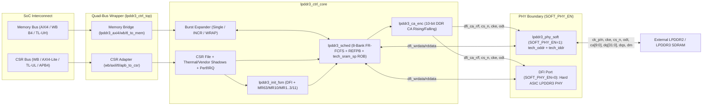

# LPDDR2 / LPDDR3 SDRAM Controller + DFI Boundary + Soft PHY (`41_lpddr3_ctrl`)

Clean-room, pure synthesizable IEEE 1800-2017 SystemVerilog **JEDEC JESD209-2 (LPDDR2) / JESD209-3B (LPDDR3) SDRAM Controller** featuring a dedicated **10-bit DDR `CA[9:0]` Command/Address Engine**, **8-Bank FR-FCFS Scheduler with Per-Bank Refresh (`REFPB`)**, **Mode Register Read/Write (`MRW`/`MRR`)**, **CA Bus Calibration (`MR41`/`MR42`/`MR48`)**, **Power Management (`PASR`, `SRE`/`SRX`, `PD`, `DPD`)**, selectable **ASIC Hard-PHY DFI Boundary (`SOFT_PHY_EN = 0`)** or **FPGA Soft PHY (`SOFT_PHY_EN = 1`)**, **Quad-Bus SoC Interfaces**, and bare-metal C software support.

---

## 1. Key Features

- **Runtime/CSR-Selectable JEDEC Standards (`CFG.LPDDR_STD`)**:
  - **`0` — LPDDR2** (JESD209-2): `BL4` (`CFG.BL_MODE=0`) or `BL8` (`CFG.BL_MODE=1`), no ODT, `MR63 -> MR10(0xFF ZQ Init) -> MR1 -> MR2 -> MR3` initialization.
  - **`1` — LPDDR3** (JESD209-3B): Fixed `BL8`, write ODT (`ODT` pin + `MR11` programming), CA Calibration/Training (`MR41`/`MR48`/`MR42`), `MR63 -> MR10(0xFF ZQ Init) -> MR1 -> MR2 -> MR3 -> MR11` initialization.
- **Dedicated 10-bit DDR `CA[9:0]` Encoder (`lpddr3_ca_enc.sv`)**:
  - Exact JESD209-2/3B rising-edge (`CA_r[9:0]`) and falling-edge (`CA_f[9:0]`) multiplexing for `ACT`, `RD`/`RDA`, `WR`/`WRA`, `PRE`/`PREA`, `REFpb`, `REFab`, `MRW`, `MRR`, `SRE`, `PD`, `DPD`, `NOP`, and `DES`, plus raw pattern injection for CA training.
- **8-Bank FR-FCFS Scheduler & Per-Bank Refresh (`lpddr3_sched.sv`)**:
  - Independent 8-bank (`BA[2:0]`) row/timing tracking (`tRCD`, `tRPpb`, `tRPab`, `tRAS`, `tRC`, `tRRD`, `tFAW`, `tWTR`, `tRTP`, `tWR`, `tRFCpb`, `tRFCab`, `tREFI`, `tMRW`, `tMRR`, `tXP`, `RL`, `WL`).
  - **Per-Bank Refresh (`REFPB`, `CTRL.REFPB_EN=1`)**: Rotates sequentially across banks `0..7` (`tRFCpb`), allowing the other 7 banks to continue serving `ACT`/`RD`/`WR` traffic concurrently; runtime selectable vs All-Bank Refresh (`REFAB`).
  - 8-entry FR-FCFS command reorder queue with same-word RAW/WAW/WAR hazard protection, programmable anti-starvation (`CFG.ANTI_STARVE`), and `tech_sram_sp`-backed in-order Reorder Response Buffer (ROB).
- **Mode Register Read/Write, Thermal Polling & ZQ Calibration**:
  - Software-triggered `MRW` (`MR1`, `MR2`, `MR3`, `MR10`, `MR11`, `MR16`, `MR17`, `MR41`/`42`/`48`, `MR63`) and `MRR` (`MR0`, `MR4` thermal, `MR5..MR8` vendor/density IDs).
  - Automatic shadow capture into `THERMAL_STATUS` (`MR4`, with `THERMAL_HIGH_IRQ` when `MR4[2:0] >= 5`) and `VENDOR_ID` (`{MR8, MR7, MR6, MR5}`).
  - `MR10` ZQ calibration opcodes: `0xFF` (ZQ Init), `0xAB` (ZQ Long), `0x56` (ZQ Short).
- **Power Management & CA Training**:
  - Hardware **PASR** (`MR16` bank mask / `MR17` segment mask), **Self-Refresh (`SRE`/`SRX`)** with `dfi_dram_clk_disable`, **Active/Precharge Power-Down (`PD`)** (auto-idle or forced), and **Deep Power-Down (`DPD`)** entry/exit with `DPD_REINIT_REQ` tracking.
  - Automated **CA Bus Calibration (`MR41 -> MR48 -> MR42`)** driving `CA_TRAIN_PAT` and reconstructing observed rising/falling CA edges into `CA_TRAIN_RES` + `CA_TRAIN_CTRL.PASS`.
- **DFI Boundary vs Soft FPGA PHY (`SOFT_PHY_EN = 0 / 1`)**:
  - `SOFT_PHY_EN = 0`: Clean ASIC DFI boundary (`dfi_ca_r_o[9:0]`, `dfi_ca_f_o[9:0]`, `dfi_cs_no`, `dfi_cke_o`, `dfi_odt_o`, `dfi_wrdata_o[63:0]`, `dfi_rddata_i[63:0]`, etc.).
  - `SOFT_PHY_EN = 1`: Instantiates `lpddr3_phy_soft.sv` using `tech_oddr` and `tech_iddr` to drive physical DDR `CA[9:0]`, `CK_p/n`, `CKE`, `CS_n`, `ODT`, and `DQ[31:0]`/`DQS[3:0]`/`DM[3:0]` pads.
- **Quad-Bus SoC Interfaces**:
  - CSR slave: Wishbone B4, AXI4-Lite, TileLink TL-UL, or AMBA APB4.
  - Memory slave: Wishbone B4 (classic & pipelined), Full AXI4 (single, `INCR`/`WRAP` bursts, decoupled `AW`/`W`), or TileLink TL-UL/TL-UH (AXI4 in `BUS_APB` mode per repo #37 convention).

---

## 2. Architecture Diagram

---

## 3. RTL Module Hierarchy

| # | File | Module(s) | Responsibility |
|---|---|---|---|
| 1 | [lpddr3_pkg.sv](file:///Users/tianrui6641/tians_ip_collection/ips/41_lpddr3_ctrl/rtl/lpddr3_pkg.sv) | `lpddr3_pkg` | Standards, command enum, MR addresses, CSR offsets, timing struct, Row-Bank-Col decoder |
| 2 | [lpddr3_ca_enc.sv](file:///Users/tianrui6641/tians_ip_collection/ips/41_lpddr3_ctrl/rtl/lpddr3_ca_enc.sv) | `lpddr3_ca_enc` | 10-bit DDR `CA[9:0]` rising+falling command/address encoder + raw training mux |
| 3 | [lpddr3_init_fsm.sv](file:///Users/tianrui6641/tians_ip_collection/ips/41_lpddr3_ctrl/rtl/lpddr3_init_fsm.sv) | `lpddr3_init_fsm` | DFI init handshake + JEDEC `MR63 -> MR10(0xFF) -> MR1/2/3/11` power-up FSM |
| 4 | [lpddr3_sched.sv](file:///Users/tianrui6641/tians_ip_collection/ips/41_lpddr3_ctrl/rtl/lpddr3_sched.sv) | `lpddr3_sched` | 8-bank FR-FCFS scheduler, `tech_sram_sp` ROB, `REFPB`/`REFAB`, `MRW`/`MRR`, CA training, `PASR`/`SRE`/`PD`/`DPD` |
| 5 | [lpddr3_phy_soft.sv](file:///Users/tianrui6641/tians_ip_collection/ips/41_lpddr3_ctrl/rtl/lpddr3_phy_soft.sv) | `lpddr3_phy_soft` | Soft FPGA PHY using `tech_oddr` (`CK`, `CA[9:0]`, `DQ`, `DQS`, `DM`) and `tech_iddr` (`DQ`) |
| 6 | [lpddr3_ctrl_core.sv](file:///Users/tianrui6641/tians_ip_collection/ips/41_lpddr3_ctrl/rtl/lpddr3_ctrl_core.sv) | `lpddr3_ctrl_core` | Protocol-agnostic controller core, CSR bank, burst expander, PHY/DFI mux |
| 7 | [lpddr3_axi4_to_mem.sv](file:///Users/tianrui6641/tians_ip_collection/ips/41_lpddr3_ctrl/rtl/lpddr3_axi4_to_mem.sv) | `lpddr3_axi4_to_mem` | Full AXI4 slave (`INCR`/`WRAP`, decoupled AW/W) to `mem_req_t`/`mem_rsp_t` |
| 8 | [lpddr3_wb_to_mem.sv](file:///Users/tianrui6641/tians_ip_collection/ips/41_lpddr3_ctrl/rtl/lpddr3_wb_to_mem.sv) | `lpddr3_wb_to_mem` | Wishbone B4 classic & pipelined slave to `mem_req_t`/`mem_rsp_t` |
| 9 | [lpddr3_tl_to_mem.sv](file:///Users/tianrui6641/tians_ip_collection/ips/41_lpddr3_ctrl/rtl/lpddr3_tl_to_mem.sv) | `lpddr3_tl_to_mem` | TileLink TL-UL / TL-UH slave to `mem_req_t`/`mem_rsp_t` |
| 10 | [lpddr3_ctrl_wb.sv](file:///Users/tianrui6641/tians_ip_collection/ips/41_lpddr3_ctrl/rtl/lpddr3_ctrl_wb.sv) | `lpddr3_ctrl_wb` | Wishbone CSR + Wishbone Memory wrapper |
| 11 | [lpddr3_ctrl_axi.sv](file:///Users/tianrui6641/tians_ip_collection/ips/41_lpddr3_ctrl/rtl/lpddr3_ctrl_axi.sv) | `lpddr3_ctrl_axi` | AXI4-Lite CSR + Full AXI4 Memory wrapper |
| 12 | [lpddr3_ctrl_tl.sv](file:///Users/tianrui6641/tians_ip_collection/ips/41_lpddr3_ctrl/rtl/lpddr3_ctrl_tl.sv) | `lpddr3_ctrl_tl` | TileLink TL-UL CSR + TL-UL/TL-UH Memory wrapper |
| 13 | [lpddr3_ctrl_apb.sv](file:///Users/tianrui6641/tians_ip_collection/ips/41_lpddr3_ctrl/rtl/lpddr3_ctrl_apb.sv) | `lpddr3_ctrl_apb` | AMBA APB4 CSR + Full AXI4 Memory wrapper |
| 14 | [lpddr3_ctrl_top.sv](file:///Users/tianrui6641/tians_ip_collection/ips/41_lpddr3_ctrl/rtl/lpddr3_ctrl_top.sv) | `lpddr3_ctrl_top` | Parameterized quad-bus top (`BUS_TYPE`, `SOFT_PHY_EN`, `CMD_Q_DEPTH`) |

---

## 4. 10-bit DDR `CA[9:0]` Command Truth Table (JESD209-2 / JESD209-3B)

All commands are qualified on `CK_t` rising edge (`CS_n`, `CKE`, `CA_r[9:0]`) and the following `CK_t` falling edge (`CA_f[9:0]`):

| Command | `CKE(n-1)->CKE(n)` | `CS_n` | Rising `CA_r[9:0]` (`CA9..CA0`) | Falling `CA_f[9:0]` (`CA9..CA0`) |
|---|---|---|---|---|
| **DES** | `H -> H` | `H` | `X` (`0`) | `X` (`0`) |
| **NOP** | `H -> H` | `L` | `{7'b0, 3'b111}` (`CA[2:0]=111`) | `X` (`0`) |
| **MRW** | `H -> H` | `L` | `{MA[5:0], 4'b0000}` | `{OP[7:0], MA[7:6]}` |
| **MRR** | `H -> H` | `L` | `{MA[5:0], 4'b1000}` | `{8'b0, MA[7:6]}` |
| **REFpb** | `H -> H` | `L` | `{6'b0, 4'b0100}` | `X` (`0`) |
| **REFab** | `H -> H` | `L` | `{6'b0, 4'b1100}` | `X` (`0`) |
| **ACT** | `H -> H` | `L` | `{BA[2:0], R[12:8], 2'b10}` | `{R[14:13], R[7:0]}` |
| **WR / WRA** | `H -> H` | `L` | `{BA[2:0], C[2:1], 2'b00, 3'b001}` | `{C11, C[10:3], AP}` |
| **RD / RDA** | `H -> H` | `L` | `{BA[2:0], C[2:1], 2'b00, 3'b101}` | `{C11, C[10:3], AP}` |
| **PRE / PREA** | `H -> H` | `L` | `{BA[2:0], 2'b00, AB, 4'b1011}` | `X` (`0`) |
| **SRE** | `H -> L` | `L` | `{7'b0, 3'b100}` | `X` (`0`) |
| **DPD** | `H -> L` | `L` | `{7'b0, 3'b011}` | `X` (`0`) |
| **PD** | `H -> L` | `H` | `X` | `X` |

### Address Mapping (`decode_lpddr_addr`)

For a 32-bit `DQ[31:0]` bus (`BL4` = 2 controller clocks = 16 B, `BL8` = 4 controller clocks = 32 B):
- `byte_addr[1:0]`: byte offset within 32-bit beat (`wstrb`)
- `byte_addr[2]`: DDR half-beat selector (`0` = even/`[31:0]`, `1` = odd/`[63:32]`)
- `byte_addr[11:3]`: `col[9:1]` (4 KB page per bank)
- `byte_addr[14:12]`: `ba[2:0]` (8 banks)
- `byte_addr[29:15]`: `row[14:0]` (32K rows, up to 1 GB)

---

## 5. Per-Bank Refresh (`REFPB`) vs All-Bank Refresh (`REFAB`)

- **`REFPB` (`CTRL.REFPB_EN = 1`, default)**:
  - `TIMING3.tREFI` programs `tREFIpb` (1/8th of `tREFIab`).
  - The controller and DRAM maintain a synchronized 3-bit round-robin counter `refpb_bank_q` (`0 -> 1 -> ... -> 7 -> 0`), reset to `0` on initialization or `REFab`.
  - Only `refpb_bank_q` is precharged (`PRE`) and blocked for `tRFCpb` (`b_rfc_cnt_q[refpb_bank_q]`); **all other 7 banks remain open and continue executing `ACT`, `RD`, `WR`, and `PRE` concurrently**, dramatically reducing tail latency under multi-bank traffic.
  - When `STATUS.REF_DEBT >= CFG.REF_URGENT_WM`, new requests to `refpb_bank_q` are held off until `REFpb` completes, while other banks remain unblocked.
- **`REFAB` (`CTRL.REFPB_EN = 0`)**:
  - `TIMING3.tREFI` programs `tREFIab`.
  - All 8 banks are precharged (`PREA`), followed by `REFab`, blocking the entire device for `tRFCab`.

---

## 6. Full CSR Register Map

| Offset | Name | Access | Bit Fields |
|---|---|---|---|
| `0x00` | `CTRL` | R/W | `[0]` INIT_START (W1P), `[1]` AUTO_REF_EN (def 1), `[2]` CLOSED_PAGE, `[3]` REFPB_EN (def 1), `[4]` ZQCS_AUTO_EN, `[5]` MANUAL_REF (W1P), `[6]` MANUAL_ZQCS (W1P), `[7]` MANUAL_ZQL (W1P), `[8]` IRQ_EN (def 1) |
| `0x04` | `CFG` | R/W | `[0]` LPDDR_STD (`0`=LPDDR2, `1`=LPDDR3, def 1), `[1]` BL_MODE (`0`=BL4, `1`=BL8, def 1), `[5:2]` ANTI_STARVE (def 8), `[13:6]` REF_URGENT_WM (def 4), `[14]` ODT_WR_EN (def 1), `[15]` SOFT_PHY_LOOPBACK |
| `0x08` | `STATUS` | RO | `[0]` INIT_DONE, `[1]` INIT_BUSY, `[2]` IN_SELF_REF, `[3]` IN_PD, `[4]` IN_DPD, `[5]` DPD_REINIT_REQ, `[6]` SCHED_IDLE, `[7]` MRR_VALID, `[11:8]` REF_DEBT, `[15:12]` CMD_Q_LEVEL, `[18:16]` REFPB_NEXT_BANK, `[19]` SOFT_PHY_EN, `[20]` DFI_INIT_COMPLETE, `[21]` IRQ_PENDING |
| `0x0C` | `TIMING0` | R/W | `[5:0]` tRCD (def 4), `[13:8]` tRPpb (def 4), `[21:16]` tRPab (def 5), `[29:24]` tRAS (def 10) |
| `0x10` | `TIMING1` | R/W | `[5:0]` tRC (def 14), `[11:8]` tRRD (def 2), `[19:12]` tFAW (def 10), `[23:20]` tWTR (def 2), `[27:24]` tRTP (def 2), `[31:28]` tWR (def 4) |
| `0x14` | `TIMING2` | R/W | `[4:0]` RL (def 6), `[9:5]` WL (def 3), `[13:10]` tCCD (def 2), `[19:14]` tMRW (def 4), `[25:20]` tMRR (def 2), `[31:26]` tXP (def 2) |
| `0x18` | `TIMING3` | R/W | `[9:0]` tRFCpb (def 12), `[19:10]` tRFCab (def 24), `[31:20]` tREFI (def 128) |
| `0x1C` | `TIMING4` | R/W | `[15:0]` tINIT_WAIT (def 16), `[23:16]` tZQINIT (def 16), `[31:24]` tZQCS_INT (def 8) |
| `0x20` | `TIMING5` | R/W | `[9:0]` tXSR (def 28), `[19:10]` tDPD_EXIT (def 16), `[27:20]` tZQ_WAIT (def 8) |
| `0x24` | `MR_INIT0` | R/W | `[7:0]` MR1 (def `0x83`), `[15:8]` MR2 (def `0x04`), `[23:16]` MR3 (def `0x02`), `[31:24]` MR11 (def `0x00`) |
| `0x28` | `MR_CMD` | R/W | `[7:0]` MA, `[15:8]` OP, `[16]` IS_READ (`0`=MRW, `1`=MRR), `[17]` TRIGGER (W1P), `[18]` BUSY (RO) |
| `0x2C` | `MR_RDATA` | RO/W1C | `[7:0]` RDATA, `[15:8]` LAST_MA, `[16]` VALID (RO), `[17]` CLR_VALID (W1P) |
| `0x30` | `THERMAL_STATUS` | RO | `[7:0]` MR4_RAW (`[2:0]` refresh rate code, `[7]` TUF), `[15:8]` MR0_RAW |
| `0x34` | `VENDOR_ID` | RO | `[7:0]` MR5, `[15:8]` MR6, `[23:16]` MR7, `[31:24]` MR8 |
| `0x38` | `PWR_CTRL` | R/W | `[0]` SELF_REF_REQ, `[1]` DPD_REQ, `[2]` FORCE_PD, `[3]` AUTO_PD_EN, `[15:4]` PD_IDLE_THRES (def 32), `[16]` PASR_AUTO_APPLY |
| `0x3C` | `PASR_CFG` | R/W | `[7:0]` MR16_BANK_MASK, `[15:8]` MR17_SEG_MASK, `[16]` PASR_APPLY (W1P) |
| `0x40` | `CA_TRAIN_CTRL` | R/W | `[0]` START (W1P), `[1]` DONE (RO), `[2]` PASS (RO), `[3]` BUSY (RO), `[9:4]` CA_LAT (def 6) |
| `0x44` | `CA_TRAIN_PAT` | R/W | `[9:0]` PAT_RISE (def `0x2A5`), `[25:16]` PAT_FALL (def `0x15A`) |
| `0x48` | `CA_TRAIN_RES` | RO | `[9:0]` OBS_RISE, `[25:16]` OBS_FALL |
| `0x4C` | `PHY_CTRL` | R/W | `[3:0]` PHY_RD_LAT (def 3), `[7:4]` PHY_WR_LAT (def 0), `[8]` CAL_START (W1P), `[9]` CAL_LOOPBACK |
| `0x50` | `PHY_STATUS` | RO | `[0]` CAL_DONE, `[1]` CAL_PASS, `[5:2]` CAL_BEST_TAP, `[13:6]` CAL_TAP_MASK |
| `0x54` | `PHY_CAL_PAT` | R/W | `[31:0]` CAL_PATTERN (def `0xA55A3CC3`) |
| `0x58` | `PERF_RD_OPS` | RO | 32-bit read count |
| `0x5C` | `PERF_WR_OPS` | RO | 32-bit write count |
| `0x60` | `PERF_ROW_HITS` | RO | 32-bit row-hit count |
| `0x64` | `PERF_ROW_MISS` | RO | 32-bit row-miss count |
| `0x68` | `PERF_REFPB_OPS` | RO | 32-bit `REFpb` count |
| `0x6C` | `PERF_REFAB_OPS` | RO | 32-bit `REFab` count |
| `0x70` | `IRQ_STATUS` | R/W1C | `[0]` INIT_DONE, `[1]` MRR_DONE, `[2]` CA_TRAIN_DONE, `[3]` THERMAL_HIGH |

---

## 7. Bare-Metal C Software Guide

Complete C header and bring-up driver examples are provided in `ips/41_lpddr3_ctrl/sw/`:
- [lpddr3_regs.h](file:///Users/tianrui6641/tians_ip_collection/ips/41_lpddr3_ctrl/sw/lpddr3_regs.h): MMIO register offsets, field masks, and JEDEC MR addresses/opcodes.
- [lpddr3_init_example.c](file:///Users/tianrui6641/tians_ip_collection/ips/41_lpddr3_ctrl/sw/lpddr3_init_example.c): Full bring-up flow (`lpddr3_bringup`, `lpddr3_enter_dpd_sleep`, `lpddr3_exit_dpd_and_reinit`) covering JEDEC power-up, `MR63` reset, `MR10` ZQ Init, `MR1/2/3/11`, `MR41/48/42` CA training, `MR5..MR8` vendor ID & `MR4` thermal polling, `REFPB` + `PASR`, and `DPD` sleep/wake.

---

## 8. ASIC DFI vs FPGA Soft-PHY & Synthesis Notes

- **ASIC Tape-Out (`SOFT_PHY_EN = 0`)**: Exposes synchronous DFI ports (`dfi_ca_r_o[9:0]`, `dfi_ca_f_o[9:0]`, `dfi_cs_no`, `dfi_cke_o`, `dfi_odt_o`, `dfi_wrdata_o[63:0]`, `dfi_wrdata_mask_o[7:0]`, `dfi_wrdata_en_o`, `dfi_rddata_en_o`, `dfi_rddata_i[63:0]`, `dfi_rddata_valid_i`, `dfi_init_start_o`, `dfi_init_complete_i`, `dfi_dram_clk_disable_o`) to connect directly to a foundry LPDDR2/LPDDR3 hard PHY macro.
- **FPGA / Simulation Soft PHY (`SOFT_PHY_EN = 1`)**: Instantiates `lpddr3_phy_soft.sv`, using `tech_oddr` (`CK_p/n`, `CA[9:0]`, `DQ`, `DQS`, `DM`) and `tech_iddr` (`DQ`, `DQS`) from `common/rtl/tech/` on a single `clk_i` domain.
- **SRAM Inference**: The ROB read-data buffer uses `tech_sram_sp` with clock-only synchronous writes (no async reset on memory arrays) for clean Yosys BRAM and ASIC SRAM compiler mapping.

---

## 9. Verification Summary

- [tb_lpddr3_dram_model.sv](file:///Users/tianrui6641/tians_ip_collection/ips/41_lpddr3_ctrl/tb/tb_lpddr3_dram_model.sv): Independent behavioral JEDEC JESD209-2/3B LPDDR2/LPDDR3 DRAM model decoding rising+falling 10-bit `CA[9:0]` and enforcing live JEDEC timings (`tRCD`, `tRPpb`, `tRPab`, `tRAS`, `tRC`, `tRRD`, `tFAW`, `tWTR`, `tRTP`, `tWR`, `tCCD`, `tRFCpb`, `tRFCab`, `tMRW`), bank state, `REFPB` round-robin counter & concurrent-op counters, `MRW`/`MRR`, `MR41`/`MR48`/`MR42` CA calibration DQ echo, `PASR`, `SRE`/`SRX`, `PD`, and `DPD`.
- [tb_lpddr3_ctrl.sv](file:///Users/tianrui6641/tians_ip_collection/ips/41_lpddr3_ctrl/tb/tb_lpddr3_ctrl.sv): Self-checking suite covering LPDDR3 & LPDDR2 (`BL4`/`BL8`), concurrent `REFPB` + `REFAB`, `MRW`/`MRR` (`MR0`/`MR4`/`MR5..8`/`MR10`), CA training, `PASR`/`SRE`/`PD`/`DPD`, `SOFT_PHY_EN=1` & `0`, all 4 bus wrappers (AXI4, Wishbone B4, TileLink, APB4+AXI4), and constrained-random multi-bank traffic (`+seed=N`) against a golden shadow RAM.
