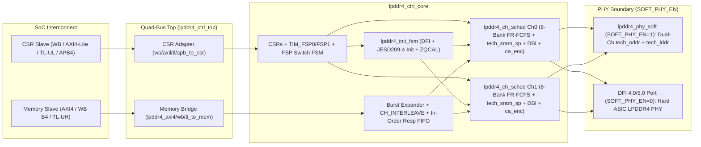

# Dual-Channel LPDDR4 / LPDDR4X SDRAM Controller (`42_lpddr4_ctrl`)

Clean-room, pure synthesizable IEEE 1800-2017 SystemVerilog **Dual-Channel LPDDR4 / LPDDR4X SDRAM Memory Controller** featuring an authentic **JEDEC JESD209-4 6-bit Multi-Cycle `CA[5:0]` Command Bus**, **Dual Independent 16-bit Sub-Channels** (`2 x 16-bit`), **Hardware DBI-WR / DBI-RD**, **Masked Write (`MWR`)**, **Glitch-Free `FSP0`/`FSP1` DVFS Switching**, **Concurrent Per-Bank Refresh (`REFPB`)**, **`MPC` DQ-FIFO/ZQCAL Training**, a **DFI 4.0/5.0 PHY Boundary**, optional **Soft FPGA PHY** (`tech_oddr`/`tech_iddr`), and **Quad-Bus SoC Interfaces** (AXI4, Wishbone B4, TileLink TL-UL/TL-UH, APB4+AXI4).

---

## 1. Key Features

- **Authentic JEDEC JESD209-4 6-Bit Multi-Cycle `CA[5:0]` Bus (`lpddr4_ca_enc.sv`)**:
  - **4-beat (4-cycle) Command Pairs**: `ACT-1 + ACT-2` (17-bit row + 3-bit bank), `RD-1 + CAS-2` (read), `WR-1 + CAS-2` (unmasked BL16 write), `MWR-1 + CAS-2` (masked write using `DMI[1:0]`), `MRW-1 + MRW-2` (Mode Register Write: `MR1, MR2, MR3, MR11, MR12, MR13, MR14, MR22`), `MRR-1 + CAS-2` (Mode Register Read).
  - **2-beat (2-cycle) Commands**: `PRE` (per-bank / all-bank `PREA`), `REF` (`REFPB` Per-Bank Refresh & `REFAB` All-Bank Refresh), `MPC` (`ZQCAL Start`, `ZQCAL Latch`, `WR-FIFO`, `RD-FIFO`, `RD-DQ-CAL`), `SRE` / `SRX` (Self-Refresh Entry/Exit).
- **Dual Independent 16-Bit Sub-Channels (`NUM_CH = 2`)**:
  - Channel 0 (`Ch0`) and Channel 1 (`Ch1`) run independent 8-bank FR-FCFS schedulers (`lpddr4_ch_sched.sv`) with independent `CA[5:0]`, `CS_n`, `CKE`, `CK_p/CK_n`, `DQ[15:0]`, `DMI[1:0]`, and `DQS[1:0]`.
  - Clock-only `tech_sram_sp` burst buffers (`u_wr_sram`, `u_rd_sram`, 64x32 each per channel) coalesce full 8-word (32-byte) BL16 lines into single `WR-1`/`RD-1` DRAM transactions while preserving byte-accurate `MWR-1` for partial writes.
  - Bijective, alias-free selectable address interleaving (`CFG.CH_INTERLEAVE`): Bit-6 (64B), Bit-7 (128B), Bit-5 (32B BL16 line), or Bit-28 (256MB high-bit split), with strict in-order host response merging (`ord_ch_q`).
- **LPDDR4X Power & Signal Integrity Features**:
  - **DBI-WR & DBI-RD (`DMI[1:0]`)**: Hardware byte-level Hamming-weight > 4 inversion on unmasked `WR-1` writes and automatic de-inversion on `RD-1` reads (`CTRL.DBI_WR_EN`, `CTRL.DBI_RD_EN`, `MR3[7:6]`), disabled automatically on `MWR-1` per JEDEC JESD209-4.
  - **Glitch-Free `FSP0` / `FSP1` DVFS (`fsp_active_o`)**: Dual shadow timing register banks (`TIM*_FSP0`, `TIM*_FSP1`) and dual Mode Register shadow banks (`MR_*_FSP0`, `MR_*_FSP1`) driven by a lockstep hardware FSP Switch FSM (`MR13.FSP-WR` preload -> `SRE` -> `fsp_active_o` + timing switch -> `SRX` -> `MR13.FSP-OP` flip -> `tFC`).
  - **Concurrent `REFPB` & `MPC` Training**: Per-bank refresh refreshes one bank at a time while the remaining 7 banks continue servicing traffic; CSR-triggered `MPC WR-FIFO / RD-FIFO / RD-DQ-CAL` loopback training and `MR12`/`MR14` VREF stepping.
- **DFI 4.0/5.0 Boundary & Soft FPGA PHY (`SOFT_PHY_EN = 0 / 1`)**:
  - `SOFT_PHY_EN = 0`: exposes per-channel DFI 4.0/5.0 ports for ASIC foundry hard LPDDR4/4X PHYs.
  - `SOFT_PHY_EN = 1`: instantiates `lpddr4_phy_soft.sv` using `common/rtl/tech/{tech_oddr,tech_iddr}.sv`, driving split pads (`*_i/*_o/*_oe_o`) for both sub-channels.
- **Quad-Bus SoC Interfaces**: Wishbone B4, AXI4, TileLink TL-UL/TL-UH, and APB4 CSR + AXI4 Memory (per repo #37 convention).

---

## 2. Architecture Diagram

---

## 3. JEDEC JESD209-4 6-Bit Multi-Cycle `CA[5:0]` Encoding

Every 2-beat sub-command asserts `CS_n = 0` on Beat 0 and `CS_n = 1` on Beat 1; 4-beat commands chain two 2-beat sub-commands (`CS_n = 0, 1, 0, 1`):

| Command | Cycles | Beat 0 (`CS_n=0`) `CA[5:0]` | Beat 1 (`CS_n=1`) `CA[5:0]` | Beat 2 (`CS_n=0`) `CA[5:0]` | Beat 3 (`CS_n=1`) `CA[5:0]` |
|---|---|---|---|---|---|
| `ACT-1 + ACT-2` | 4 | `{R[15:12], 2'b01}` | `{R[11:10], R16, BA[2:0]}` | `{R[9:6], 2'b11}` | `R[5:0]` |
| `RD-1 + CAS-2` | 4 | `{BL=0, 5'b00010}` | `{AP, 2'b00, BA[2:0]}` | `{C9, 5'b10010}` | `C[8:3]` |
| `WR-1 + CAS-2` | 4 | `{BL=0, 5'b00100}` | `{AP, 2'b00, BA[2:0]}` | `{C9, 5'b10010}` | `C[8:3]` |
| `MWR-1 + CAS-2` | 4 | `{1'b0, 5'b01100}` | `{AP, 2'b00, BA[2:0]}` | `{C9, 5'b10010}` | `C[8:3]` |
| `MRW-1 + MRW-2` | 4 | `{OP7, 5'b00110}` | `MA[5:0]` | `{OP6, 5'b10110}` | `OP[5:0]` |
| `MRR-1 + CAS-2` | 4 | `{1'b0, 5'b01110}` | `MA[5:0]` | `{1'b0, 5'b10010}` | `6'b000000` |
| `PRE` / `PREA` | 2 | `{AB, 5'b10000}` | `{3'b000, BA[2:0]}` | — | — |
| `REFPB` / `REFAB` | 2 | `{AB, 5'b01000}` | `{3'b000, BA[2:0]}` | — | — |
| `MPC` | 2 | `{OP6, 5'b00000}` | `OP[5:0]` | — | — |
| `SRE` | 2 | `{1'b0, 5'b11000}` | `6'b000000` | — | — |
| `SRX` | 2 | `{1'b0, 5'b10100}` | `6'b000000` | — | — |

MPC `OP[6:0]` values: `RD-FIFO = 7'b100_0001`, `RD-DQ-CAL = 7'b100_0011`, `WR-FIFO = 7'b100_0111`, `ZQCAL Start = 7'b100_1111`, `ZQCAL Latch = 7'b101_0001`.

---

## 4. Dual-Channel Address Interleaving (`CFG.CH_INTERLEAVE`)

All 4 modes implement a bijective 1-to-1 mapping across `byte_addr[31:2]` with zero address aliasing:

| `CFG[1:0]` | Mode | `ch` Select | `col[9:1]` | `ba[2:0]` | `row[16:0]` |
|---|---|---|---|---|---|
| `2'd0` | Bit-6 (64B fine-grain) | `addr[6]` | `{addr[11:7], addr[5:2]}` | `addr[14:12]` | `addr[31:15]` |
| `2'd1` | Bit-7 (128B fine-grain) | `addr[7]` | `{addr[11:8], addr[6:2]}` | `addr[14:12]` | `addr[31:15]` |
| `2'd2` | Bit-5 (32B BL16 line) | `addr[5]` | `{addr[11:6], addr[4:2]}` | `addr[14:12]` | `addr[31:15]` |
| `2'd3` | High-bit split (256MB/ch) | `addr[28]` | `addr[10:2]` | `addr[13:11]` | `{addr[31:29], addr[27:14]}` |

---

## 5. DBI-WR / DBI-RD & Glitch-Free FSP DVFS Flow

1. **DBI-WR / DBI-RD vs `MWR`**:
   - When a write covers a complete aligned 32-byte BL16 line (`wstrb == 4'hF` across all 8 words), `lpddr4_ch_sched` issues `WR-1 + CAS-2`. If `CTRL.DBI_WR_EN = 1`, each byte with Hamming weight > 4 is inverted on `DQ` and `DMI[b] = 1` is asserted.
   - When a write is partial (`wstrb != 4'hF` or `< 8` words), `lpddr4_ch_sched` issues `MWR-1 + CAS-2` with `DMI = ~byte_en` and DBI-WR disabled per JEDEC JESD209-4.
   - On `RD-1`, if `CTRL.DBI_RD_EN = 1`, `dbi_decode_word32` automatically re-inverts any byte captured with `DMI[b] == 1`.
2. **FSP0 <-> FSP1 Switch Sequence** (`CSR_FSP_CTRL.SWITCH_GO`):
   - Drain Ch0 & Ch1 schedulers -> `PREA` -> `MRW MR13` (`FSP-WR = target`, `FSP-OP = current`) -> Preload target FSP `MR1, MR2, MR3, MR11, MR12, MR14, MR22` -> `SRE` (`CKE = 0`) -> Switch `fsp_active_o`, active timing bank (`TIM*_FSP0/1`), and auto-sync `CTRL.DBI_*` from target `MR3[7:6]` -> `SRX` (`CKE = 1`, wait `tXSR`) -> `MRW MR13` (`FSP-OP = target`) -> wait `tFC` -> assert `FSP_DONE` / IRQ.

---

## 6. CSR Register Map

| Offset | Name | Access | Reset | Description |
|---|---|---|---|---|
| `0x00` | `CTRL` | RW/W1P | `0x0000_010C` | `[0]` `INIT_START` (W1P), `[1]` `SELF_REF_REQ`, `[2]` `AUTO_REF_EN`, `[3]` `ZQ_EN`, `[4]` `DBI_WR_EN`, `[5]` `DBI_RD_EN`, `[6]` `CLOSED_PAGE`, `[7]` `CNT_CLR` (W1P), `[8]` `IRQ_EN` |
| `0x04` | `CFG` | RW | `0x0000_048C` | `[1:0]` `CH_INTERLEAVE`, `[2]` `REFPB_EN`, `[3]` `LPDDR4X_EN`, `[7:4]` `ANTI_STARVE`, `[15:8]` `REF_URGENT_WM` |
| `0x08` | `STATUS` | RO/RW1C | — | `[0]` `INIT_DONE`, `[1]` `INIT_BUSY`, `[2]` `DFI_INIT_COMP`, `[3]` `SELF_REF_ACT`, `[4]` `SCHED_IDLE`, `[5]` `FSP_ACTIVE`, `[6]` `FSP_BUSY`, `[7]` `FSP_DONE_IRQ` (W1C), `[8]` `TRAIN_DONE_IRQ` (W1C), `[9]` `INIT_DONE_IRQ` (W1C), `[15:12]` `CH0_CMD_LVL`, `[19:16]` `CH1_CMD_LVL`, `[23:20]` `CH0_REF_DEBT`, `[27:24]` `CH1_REF_DEBT` |
| `0x10` | `TIM0_FSP0` | RW | `0x0E0A_0404` | FSP0 `[5:0] tRCD`, `[13:8] tRP`, `[21:16] tRAS`, `[29:24] tRC` |
| `0x14` | `TIM1_FSP0` | RW | `0x4404_1084` | FSP0 `[3:0] tRRD`, `[7:4] tCCD`, `[15:8] tFAW`, `[20:16] tWTR`, `[27:24] tRTP`, `[31:28] tWR` |
| `0x18` | `TIM2_FSP0` | RW | `0x0806_0406` | FSP0 `[4:0] RL`, `[12:8] WL`, `[21:16] tMRD`, `[29:24] tFC` |
| `0x1C` | `TIM3_FSP0` | RW | `0x0220_8010` | FSP0 `[9:0] tRFCpb`, `[19:10] tRFCab`, `[29:20] tXSR` |
| `0x20..0x2C` | `TIM0..3_FSP1` | RW | `0x140E_0606`.. | FSP1 timing bank (identical field layout to `TIM0..3_FSP0`) |
| `0x30` | `TIM_REF` | RW | `0x0608_0100` | `[15:0] tREFI`, `[23:16] tZQCAL`, `[31:24] tZQLAT` |
| `0x34` | `TIM_INIT` | RW | `0x0408_0008` | `[15:0] tINIT_WAIT`, `[23:16] ZQ_INT`, `[31:24] tCKESR` |
| `0x38` | `MR_A_FSP0` | RW | `0x2230_0004` | FSP0 `{MR11[7:0], MR3[7:0], MR2[7:0], MR1[7:0]}` |
| `0x3C` | `MR_B_FSP0` | RW | `0x0004_2020` | FSP0 `{MR13[7:0], MR22[7:0], MR14[7:0], MR12[7:0]}` |
| `0x40` | `MR_A_FSP1` | RW | `0x33F0_1B14` | FSP1 `{MR11[7:0], MR3[7:0], MR2[7:0], MR1[7:0]}` |
| `0x44` | `MR_B_FSP1` | RW | `0xC006_2828` | FSP1 `{MR13[7:0], MR22[7:0], MR14[7:0], MR12[7:0]}` |
| `0x48` | `MR_CMD` | RW/W1P | `0` | `[5:0] MR_ADDR`, `[15:8] MR_WDATA`, `[16] MR_READ`, `[18:17] CH_MASK`, `[24] GO` (W1P), `[25] BUSY` (RO), `[26] DONE` (RO) |
| `0x4C` | `MR_RDATA` | RO | `0` | `[7:0] CH0_RDATA`, `[15:8] CH1_RDATA` |
| `0x50` | `FSP_CTRL` | RW/W1P | `0x0000_0006` | `[0] TARGET_FSP`, `[1] PRELOAD_MRS`, `[2] AUTO_DBI_SYNC`, `[8] SWITCH_GO` (W1P), `[16] BUSY` (RO), `[17] DONE` (RO), `[18] CUR_FSP` (RO) |
| `0x54` | `MAINT_CMD` | RW/W1P | `0` | `[0] REFAB_REQ`, `[1] REFPB_REQ`, `[2] ZQCAL_REQ`, `[10:8] REFPB_BANK` |
| `0x58` | `TRAIN_CTRL` | RW/W1P | `0` | `[2:0] TRAIN_OP` (`0=WR-FIFO,1=RD-FIFO,2=RD-DQ-CAL,3=LOOPBACK,4=VREF-CA,5=VREF-DQ`), `[3] CH_SEL`, `[11:4] VREF_VAL`, `[16] GO` (W1P), `[24] BUSY`, `[25] DONE`, `[26] PASS` |
| `0x5C..0x68` | `TRAIN_PAT0..1`, `TRAIN_RDATA0..1` | RW/RO | `0xF0F1_F2F3`.. | Training TX pattern and captured RX data words |
| `0x6C..0x74` | `PHY_CTRL`, `PHY_STATUS`, `PHY_CAL_PAT` | RW/RO | `0x3` / `0xA55A_5AA5` | Soft PHY `PHY_RD_LAT[3:0]`, `PHY_WR_LAT[7:4]`, `CAL_START[8]`, `CAL_LOOPBACK[9]`, `CAL_CH_SEL[10]` |
| `0x78..0x98` | `PERF_*` | RO | `0` | Counters: `RD_OPS`, `WR_OPS`, `MWR_OPS`, `ROW_HITS`, `ROW_MISSES`, `REFPB_OPS`, `REFAB_OPS`, `DBI_WR_BYTES`, `DBI_RD_BYTES` |

---

## 7. Bare-Metal C Software Bring-Up

Header and driver examples are provided in [`sw/lpddr4_regs.h`](../sw/lpddr4_regs.h) and [`sw/lpddr4_init_example.c`](../sw/lpddr4_init_example.c).
The `lpddr4_bringup(ctrl_base, dram_base)` routine executes:
1. Channel interleave (`CH_ILV_BIT6`) + `REFPB_EN` + FSP0/FSP1 MR bank setup.
2. JEDEC init (`CTRL.INIT_START`) + poll `STATUS.INIT_DONE`.
3. Soft PHY loopback read-leveling calibration on Ch0 & Ch1.
4. `MR12`/`MR14` VREF stepping + `MPC WR-FIFO / RD-FIFO` loopback training (`TRAIN_OP_LOOPBACK`).
5. DBI-WR & DBI-RD enable (`MR3 = 0xF0`, `CTRL.DBI_WR_EN | DBI_RD_EN`).
6. Glitch-free `FSP0 -> FSP1` DVFS switch + `MRR` verification of `MR2`.

---

## 8. Integration Notes (ASIC DFI vs FPGA Soft PHY)

- **ASIC Tape-Out (`SOFT_PHY_EN = 0`)**: Connect `dfi_reset_no`, `dfi_init_start_o`, and per-channel `dfi_ch{0,1}_*` directly to a foundry hard LPDDR4/4X PHY macro. `u_wr_sram` and `u_rd_sram` use clock-only `tech_sram_sp` instances ready for compiled SRAM substitution via `` `ifdef TARGET_ASIC ``.
- **FPGA Prototyping (`SOFT_PHY_EN = 1`)**: Uses `tech_oddr` and `tech_iddr` (no tri-state inside core; split `*_i/*_o/*_oe_o` pads for `DQ`, `DMI`, `DQS`). Connect IOBUF primitives at the FPGA top-level pad ring.
- **APB4 Mode (`BUS_TYPE = BUS_APB`)**: Per repo convention (#37), CSRs use `apb_csr_i/apb_csr_o` and high-bandwidth memory traffic uses `axi_mem_i/axi_mem_o`.

---

## 9. Verification Summary

Testbench [`tb/tb_lpddr4_ctrl.sv`](../tb/tb_lpddr4_ctrl.sv) pairs with the independent dual-channel JEDEC model [`tb/tb_lpddr4_dram_model.sv`](../tb/tb_lpddr4_dram_model.sv) (with live `$fatal` JEDEC timing assertions) and verifies:
- JEDEC power-up init & Soft PHY loopback calibration on both sub-channels
- Dual-channel interleaving across `CH_ILV_BIT6`, `CH_ILV_BIT5`, and `CH_ILV_HIGH_BIT`
- Masked Write (`MWR`) partial byte strobes preserving neighbor words in the 32B BL16 line
- `MPC WR-FIFO / RD-FIFO / RD-DQ-CAL`, `MR12/MR14` VREF stepping, and `MRR` readback
- Bit-exact `DBI-WR` + `DBI-RD` recovery with verified `DMI` pad assertion on high-Hamming-weight data
- Glitch-free `FSP0 -> FSP1 -> FSP0` DVFS switch with retention & timing bank verification
- Concurrent `REFPB` refresh + constrained-random multi-bank stress (`+seed=1,7,42`)
- `SOFT_PHY_EN = 0` DFI Hard-PHY loopback and all 4 bus wrappers (AXI4, Wishbone B4, TileLink, APB4+AXI4)
