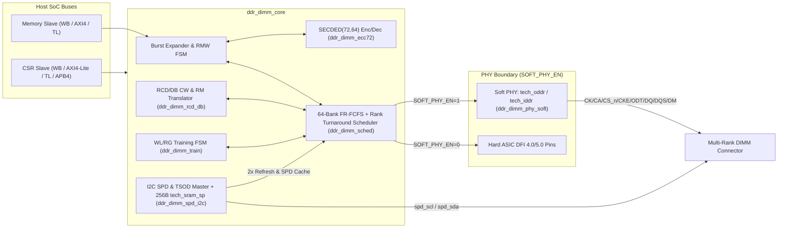

# Multi-Rank DDR3 / DDR4 DIMM Controller (`ips/43_ddr_dimm_ctrl`)

Clean-room, Yosys/FPGA/ASIC-friendly **Multi-Rank DDR3 / DDR4 DIMM Controller** supporting **UDIMM**, **SO-DIMM**, **RDIMM**, **LRDIMM**, and **CAMM2-style Dual-Sub-Channel (`DUAL_CH_SUB`)** modules, with integrated **I2C/SMBus SPD EEPROM & TSOD Thermal Auto-Discovery**, **Fly-By Write-Leveling & Read DQS Gate Training**, **64-bit Data + 8-bit Hamming SECDED(72,64) ECC**, and **Quad-Bus Host Interfaces** (Wishbone B4, AXI4, TileLink, APB4+AXI4). *(Intentionally omits DDR5, Optane/DDR-T, and NVDIMM.)*

---

## Key Features

- **JEDEC Standards**: Runtime-selectable **DDR3** (`DDR_STD=0`) and **DDR4** (`DDR_STD=1`, Bank Groups `BG[1:0]`, `ACT_n`, `A[16:14]` muxing, CA Even Parity & `ALERT_n` capture).
- **Module Topologies (`DIMM_TYPE[2:0]`)**:
  - `0 = UDIMM` (Unbuffered 64-bit + 8-bit ECC DIMM)
  - `1 = SO-DIMM` (Small-Outline 64-bit + 8-bit ECC DIMM)
  - `2 = RDIMM` (Registered DIMM with `+1 tCK` CA latency compensation, B-side CA output inversion, and `RC00..RCFF` Control Word programmer)
  - `3 = LRDIMM` (Load-Reduced DIMM with `BC00..BCFF` Data Buffer programmer via `MR7` + `BCOM[3:0]` and Rank Multiplication `RM = 1, 2, 4`)
  - `4 = DUAL_CH_SUB` (CAMM2-style dual independent 32-bit sub-channels sharing the module connector and I2C SPD/TSOD bus)
- **1–4 Physical Ranks (`MAX_RANKS = 4`)**:
  - Drives `CS_n[3:0]`, `CKE[3:0]`, `ODT[3:0]`, `CID[1:0]`, `BCOM[3:0]`.
  - **64-Bank FR-FCFS Scheduler** (4 ranks × 16 banks) with per-rank `tRRD_S/L`, `tFAW`, `tCCD_S/L`, `tWTR_S/L` and cross-rank turnaround enforcement (`tRTRS`, `tRTW_diff`, `tWTR_diff`).
  - **Programmable 4×4 Dynamic ODT Matrix** (`CSR_ODT_RD_MAP`, `CSR_ODT_WR_MAP`).
  - **Odd-Rank Address Mirroring (`RANK_MIRROR_EN`)**: Automatic JEDEC B-side swap (`A3<->A4, A5<->A6, A7<->A8, BA0<->BA1, BG0<->BG1`) on Ranks 1 and 3 during `MRS`.
- **64-bit Data + 8-bit Hamming SECDED(72,64) ECC (`ddr_dimm_ecc72.sv`)**:
  - Inline 1-bit error correction (`ECC_CE_CNT`/`ADDR`), 2-bit uncorrectable detection (`ECC_UE_CNT`/`ADDR` + IRQ + bus error), automatic partial-byte RMW, and 72-bit fault injection (`CSR_ECC_INJECT`).
- **Fly-By Write-Leveling & Read DQS Gate Training (`ddr_dimm_train.sv`)**:
  - 9 independent byte-lane delay taps (`WL_DELAY[0..8]` in half-cycle steps, `RL_DELAY[0..8]` deskew taps).
  - Hardware `MR1[7]` Write-Leveling sweep FSM capturing `DQ[0]` feedback per lane and `MR3[2]=1` MPR (`0xAA`) Read Gate sweep FSM.
- **Integrated I2C/SMBus SPD EEPROM & TSOD Master (`ddr_dimm_spd_i2c.sv`)**:
  - Reads JEDEC SPD EEPROM (`0x50..0x57`) into a 256-byte `tech_sram_sp` cache with automatic hardware extraction of summary bytes (`2, 3, 4, 12, 13, 131, 136`).
  - Polls JC42.4 TSOD thermal sensor (`0x18..0x1F`, reg `0x05`) and automatically asserts hardware double-rate **`2x` refresh** (`tREFI / 2`) when `TSOD_TEMP >= TSOD_THRESH`.
- **DFI 4.0/5.0 Boundary & Soft FPGA PHY (`SOFT_PHY_EN = 0 / 1`)**:
  - `SOFT_PHY_EN = 1`: Synthesizable soft PHY (`ddr_dimm_phy_soft.sv`) built on `tech_oddr` and `tech_iddr`.
  - `SOFT_PHY_EN = 0`: Clean DFI 4.0/5.0 boundary for foundry ASIC DDR3/4 DIMM PHY macros.

---

## Architecture Block Diagram

---

## Module Topology Comparison

| `DIMM_TYPE` | Module | Data Width | CA Latency | Control Words | Rank Multiplication | Sub-Channels |
| :--- | :--- | :--- | :--- | :--- | :--- | :--- |
| `0` (`DIMM_UDIMM`) | Unbuffered DIMM | 64b (+8b ECC) | Nominal (`+0 tCK`) | None | `RM = 1` | Single 64b |
| `1` (`DIMM_SODIMM`) | Small-Outline DIMM | 64b (+8b ECC) | Nominal (`+0 tCK`) | None | `RM = 1` | Single 64b |
| `2` (`DIMM_RDIMM`) | Registered DIMM | 64b (+8b ECC) | `+1 tCK` RCD pipe | `RC00..RCFF` (`MR7`), B-side inv | `RM = 1` | Single 64b |
| `3` (`DIMM_LRDIMM`) | Load-Reduced DIMM | 64b (+8b ECC) | `+1 tCK` RCD pipe | `RC00..RCFF` + `BC00..BCFF` (`BCOM[3:0]`) | `RM = 1, 2, 4` (`CID[1:0]`) | Single 64b |
| `4` (`DIMM_DUAL_CH_SUB`) | CAMM2-Style Sub-Ch | 2 × 32b (+8b ECC) | Nominal (`+0 tCK`) | None | `SubCh A = R0/2`, `SubCh B = R1/3` | Dual 32b |

---

## Parameters & Top-Level Ports (`ddr_dimm_ctrl_top`)

| Parameter | Default | Description |
| :--- | :--- | :--- |
| `BUS_TYPE` | `BUS_AXI4` | `0=BUS_WISHBONE`, `1=BUS_AXI4`, `2=BUS_TILELINK`, `3=BUS_APB` (CSR=APB4, Mem=AXI4 per #37) |
| `SOFT_PHY_EN` | `1'b1` | `1` = Internal Soft PHY (`dram_*` pads), `0` = External Hard DFI 4.0/5.0 (`dfi_*` pins) |
| `ECC_EN` | `1'b1` | `1` = 72-bit DQ (64b + 8b ECC, 9 lanes), `0` = 64-bit non-ECC (8 lanes) |
| `CMD_Q_DEPTH` | `8` | FR-FCFS command queue & in-order ROB depth |

### Signal Groups
- **Host CSR & Memory Slaves**: `wb_csr_{i,o}`, `axi_csr_{i,o}`, `tl_csr_{i,o}`, `apb_csr_{i,o}`, `wb_mem_{i,o}`, `axi_mem_{i,o}`, `tl_mem_{i,o}`.
- **Multi-Rank DIMM Pads (`SOFT_PHY_EN=1`)**: `dram_ck_p_o`, `dram_ck_n_o`, `dram_cke_o[3:0]`, `dram_cs_no[3:0]`, `dram_odt_o[3:0]`, `dram_cid_o[1:0]`, `dram_bcom_o[3:0]`, `dram_act_no`, `dram_ras_no`, `dram_cas_no`, `dram_we_no`, `dram_bg_o[1:0]`, `dram_ba_o[2:0]`, `dram_addr_o[17:0]`, `dram_reset_no`, `dram_par_o`, `dram_alert_ni`, `dram_dm_o[DRAM_DM_W-1:0]`, `dram_dq_{i,o,oe_o}`, `dram_dqs_{i,o,oe_o}`.
- **DFI 4.0/5.0 Boundary (`SOFT_PHY_EN=0`)**: `dfi_address_o[17:0]`, `dfi_bank_o[2:0]`, `dfi_bg_o[1:0]`, `dfi_cid_o[1:0]`, `dfi_bcom_o[3:0]`, `dfi_act_no`, `dfi_ras_no`, `dfi_cas_no`, `dfi_we_no`, `dfi_cs_no[3:0]`, `dfi_cke_o[3:0]`, `dfi_odt_o[3:0]`, `dfi_reset_no`, `dfi_parity_in_o`, `dfi_alert_ni`, `dfi_wrdata_o[2*DRAM_DQ_W-1:0]`, `dfi_wrdata_en_o`, `dfi_wrdata_mask_o[2*DRAM_DM_W-1:0]`, `dfi_rddata_en_o`, `dfi_rddata_i[2*DRAM_DQ_W-1:0]`, `dfi_rddata_valid_i`, `dfi_init_start_o`, `dfi_init_complete_i`, `dfi_dram_clk_disable_o`.
- **I2C SPD/TSOD Split Pads & Interrupt**: `spd_scl_{i,o,oe_o}`, `spd_sda_{i,o,oe_o}`, `irq_o`.

---

## SPD Byte Map & TSOD Thermal Throttling

| SPD Byte | Captured Summary Register | JEDEC Field |
| :--- | :--- | :--- |
| `2` | `CSR_SPD_SUMMARY0[7:0]` | DRAM Device Type (`0x0B`=DDR3, `0x0C`=DDR4) |
| `3` | `CSR_SPD_SUMMARY0[15:8]` | Module Type (`0x01`=RDIMM, `0x02`=UDIMM, `0x03`=SO-DIMM, `0x04`=LRDIMM) |
| `4` | `CSR_SPD_SUMMARY1[7:0]` | SDRAM Density & Banks |
| `12` | `CSR_SPD_SUMMARY0[23:16]` | Module Organization (`[5:3]`=Ranks-1, `[2:0]`=Device Width) |
| `13` | `CSR_SPD_SUMMARY0[31:24]` | Memory Bus Width (`[4:3]=01` indicates 8-bit ECC extension) |
| `131` | `CSR_SPD_SUMMARY1[15:8]` | DDR4 RCD / Module Height |
| `136` | `CSR_SPD_SUMMARY1[23:16]` | DDR4 Address Mapping (`[0]=1` indicates Odd-Rank Address Mirroring) |

All 256 bytes are cached in an internal `tech_sram_sp` (`8×256`, clock-only writes) accessible via `CSR_SPD_ADDR` / `CSR_SPD_DATA`. When `TSOD_POLL_EN=1` (or `TSOD_READ_GO=1`), the controller reads JC42.4 register `0x05` from `0x18 + TSOD_SLOT` and automatically switches to **`2x` refresh rate** (`tREFI / 2`) whenever signed 13-bit `TSOD_TEMP >= TSOD_THRESH` (`0.0625 °C/LSB`, default `+85.0 °C = 0x0550`).

---

## RCD/BCW & Fly-By Training Flow

1. **RCD/DB Initialization (`RDIMM` / `LRDIMM`)**:
   - After `tXPR`, `ddr_dimm_rcd_db` automatically issues `MR7` (`BA=7` / `{BG0,BA[1:0]}=7`) writes for `RC00` (B-side CA inversion control), `RC0A`, `RC0D`, `RC0E` (parity), `RC0F` (`+1 tCK` CA latency), and for `LRDIMM` also `BC00, BC01, BC0A, BC0C` along with `BCOM[3:0]` framing.
   - `ddr_dimm_sched` adds `+1` controller cycle to `RL` and `WL` when `RDIMM`/`LRDIMM` is active.
2. **Write-Leveling (`TRAIN_MODE = 1` or `3`)**:
   - `ddr_dimm_train` issues `PREA` → `MRS MR1[7]=1`, asserts `ODT` on `TRAIN_RANK`, sweeps `WL_DELAY` (`0..WL_MAX_TAP` in half-cycle steps) while pulsing `DQS` per lane, and locks the `0 -> 1` transition of `DQ[0]` on each of the 9 byte lanes.
3. **Read DQS Gate Training (`TRAIN_MODE = 2` or `3`)**:
   - `ddr_dimm_train` issues `PREA` → `MRS MR3[2]=1` (MPR Page 0 `0xAA` pattern), issues an MPR `RD`, sweeps capture cycle `0..7` across `phy_iddr_raw_i` for all 9 byte lanes, and locks `RL_DELAY[0..8]` to align all lanes synchronously in `ddr_dimm_phy_soft`.

---

## Full CSR Register Map

| Offset | Name | Access | Bitfields |
| :--- | :--- | :--- | :--- |
| `0x00` | `CSR_CTRL` | RW/W1P | `[0]` INIT_START (W1P), `[1]` SELF_REF_REQ, `[2]` AUTO_REF_EN, `[3]` ZQCS_EN, `[4]` ECC_EN_CSR, `[5]` CLOSED_PAGE, `[6]` PARITY_EN, `[7]` MR_WR_REQ (W1P), `[8]` REF_REQ (W1P), `[9]` ZQCS_REQ (W1P), `[10]` CNT_CLR (W1P), `[11]` IRQ_EN, `[12]` THERMAL_2X_EN |
| `0x04` | `CSR_CFG` | RW | `[0]` DDR_STD (0=DDR3,1=DDR4), `[3:1]` DIMM_TYPE, `[5:4]` NUM_RANKS_M1, `[6]` RANK_MIRROR_EN, `[7]` BL8_MODE, `[9:8]` LRDIMM_RM (0=1x,1=2x,2=4x), `[11:10]` RANK_MAP_MODE, `[14:12]` SUBCH_ILV_SEL, `[15]` RCD_B_INV_EN, `[19:16]` ANTI_STARVE, `[27:20]` REF_URGENT_WM |
| `0x08` | `CSR_STATUS` | RO/RW1C | `[0]` INIT_DONE, `[1]` INIT_BUSY, `[2]` DFI_INIT_COMP, `[3]` SELF_REF_ACT, `[4]` SCHED_IDLE, `[5]` ECC_UE_IRQ (W1C), `[6]` CA_PAR_ERR_IRQ (W1C), `[7]` ECC_CE_IRQ (W1C), `[8]` THERMAL_2X_ACT, `[9]` THERMAL_IRQ (W1C), `[10]` SPD_DONE, `[11]` TRAIN_DONE, `[15:12]` REF_DEBT, `[19:16]` CMD_Q_LEVEL, `[23:20]` RANK_ACTIVE_MASK |
| `0x0C` | `CSR_TIMING0` | RW | `[5:0]` tRCD, `[13:8]` tRP, `[21:16]` tRAS, `[29:24]` tRC |
| `0x10` | `CSR_TIMING1` | RW | `[3:0]` tRRD_S, `[7:4]` tRRD_L, `[11:8]` tCCD_S, `[15:12]` tCCD_L, `[23:16]` tFAW, `[27:24]` tWTR_S, `[31:28]` tWTR_L |
| `0x14` | `CSR_TIMING2` | RW | `[4:0]` RL, `[12:8]` WL, `[19:16]` tRTP, `[27:24]` tWR |
| `0x18` | `CSR_TIMING3` | RW | `[9:0]` tRFC, `[25:10]` tREFI, `[31:26]` tMRD_MOD |
| `0x1C` | `CSR_TIMING4` | RW | `[15:0]` tINIT_WAIT, `[23:16]` tZQ_WAIT, `[31:24]` tZQCS_INT |
| `0x20` | `CSR_TIMING_RANK` | RW | `[5:0]` tRTRS, `[11:6]` tWTR_DIFF, `[17:12]` tRTW_DIFF |
| `0x24..0x3C` | `CSR_MR0..MR6` | RW | `[17:0]` Mode Register 0..6 values |
| `0x40` | `CSR_MR_CMD` | RW | `[2:0]` MR_IDX, `[20:3]` MR_DATA, `[22:21]` MR_RANK, `[23]` MR_ALL_RANKS |
| `0x44` | `CSR_ODT_RD_MAP` | RW | `[3:0]` R0 ODT, `[7:4]` R1 ODT, `[11:8]` R2 ODT, `[15:12]` R3 ODT on Read |
| `0x48` | `CSR_ODT_WR_MAP` | RW | `[3:0]` R0 ODT, `[7:4]` R1 ODT, `[11:8]` R2 ODT, `[15:12]` R3 ODT on Write |
| `0x4C` | `CSR_RCD_DB_CMD` | RW/W1P | `[7:0]` CW_ADDR, `[15:8]` CW_DATA, `[16]` TARGET_DB, `[17]` IS_8BIT, `[19:18]` PBA_BUF_ID, `[20]` AUTO_INIT_SEQ, `[24]` GO (W1P), `[25]` BUSY (RO), `[26]` DONE (RO) |
| `0x50` | `CSR_RCD_STATUS` | RO | `[7:0]` DB_CW_CNT, `[15:8]` RCD_CW_CNT, `[16]` RCD_ACTIVE, `[17]` B_INV_ACTIVE |
| `0x54` | `CSR_RCD_LAST_CW` | RO | `[7:0]` RCD_LAST_ADDR, `[15:8]` RCD_LAST_DATA, `[23:16]` DB_LAST_ADDR, `[31:24]` DB_LAST_DATA |
| `0x58` | `CSR_TRAIN_CTRL` | RW/W1P | `[1:0]` TRAIN_MODE, `[3:2]` TRAIN_RANK, `[4]` TRAIN_GO (W1P), `[5]` PHY_CAL_LB, `[6]` PHY_CAL_GO (W1P), `[11:8]` WL_MAX_TAP, `[24]` BUSY, `[25]` DONE, `[26]` WL_PASS, `[27]` RG_PASS, `[28]` PHY_CAL_DONE, `[29]` PHY_CAL_PASS |
| `0x5C` | `CSR_TRAIN_LANE_MASK` | RO | `[8:0]` WL_LOCKED[8:0], `[24:16]` RG_LOCKED[8:0] |
| `0x60` | `CSR_WL_DELAY0` | RW | 8 × 4-bit `WL_DELAY[7:0]` (lanes 0..7) |
| `0x64` | `CSR_WL_DELAY1` | RW | `[3:0]` `WL_DELAY[8]` (ECC lane 8) |
| `0x68` | `CSR_RL_DELAY0` | RW | 8 × 4-bit `RL_DELAY[7:0]` (lanes 0..7) |
| `0x6C` | `CSR_RL_DELAY1` | RW | `[3:0]` `RL_DELAY[8]` (ECC lane 8) |
| `0x70` | `CSR_PHY_CTRL` | RW/RO | `[3:0]` PHY_RD_LAT, `[7:4]` PHY_WR_LAT, `[23:16]` CAL_TAP_MASK (RO) |
| `0x74` | `CSR_PHY_CAL_PAT` | RW | 32-bit Soft PHY calibration pattern |
| `0x78` | `CSR_SPD_CTRL` | RW/W1P | `[2:0]` SPD_SLOT, `[5:3]` TSOD_SLOT, `[6]` TSOD_POLL_EN, `[7]` SPD_READ_GO (W1P), `[8]` TSOD_READ_GO (W1P), `[9]` I2C_RAW_GO (W1P), `[10]` I2C_RAW_RNW, `[19:12]` SPD_READ_LEN, `[27:20]` I2C_CLK_DIV, `[28]` BUSY, `[29]` DONE, `[30]` NACK |
| `0x7C` | `CSR_SPD_ADDR` | RW | `[7:0]` SPD cache byte index, `[14:8]` Raw I2C 7b dev addr, `[23:16]` Raw reg addr, `[31:24]` Raw wdata |
| `0x80` | `CSR_SPD_DATA` | RO | `[7:0]` SPD cache byte at `CSR_SPD_ADDR[7:0]`, `[15:8]` Raw I2C rdata |
| `0x84` | `CSR_SPD_SUMMARY0` | RO | `{Byte13, Byte12, Byte3, Byte2}` |
| `0x88` | `CSR_SPD_SUMMARY1` | RO | `{8'd0, Byte136, Byte131, Byte4}` |
| `0x8C` | `CSR_TSOD_TEMP` | RO | `[12:0]` Signed 13b temp (`0.0625 °C/LSB`), `[15]` TSOD_VALID, `[31:16]` TSOD_RAW |
| `0x90` | `CSR_TSOD_CFG` | RW | `[12:0]` TSOD_THRESH, `[31:16]` TSOD_POLL_INT |
| `0x94` | `CSR_ECC_INJECT` | RW | `[0]` INJ_1B, `[1]` INJ_2B, `[8:2]` BIT_POS0, `[15:9]` BIT_POS1, `[16]` PERSIST |
| `0x98..0xA4` | `CSR_ECC_{CE,UE}_{CNT,ADDR}` | RO | Correctable/Uncorrectable ECC counters & last failing address |
| `0xA8..0xC4` | `CSR_PERF_*` | RO | `RD_OPS`, `WR_OPS`, `ROW_HITS`, `ROW_MISSES`, `REFRESHES`, `RANK_SW`, `SUBCH_A`, `SUBCH_B` |

---

## C Software Walkthrough

See [ddr_dimm_regs.h](file:///Users/tianrui6641/tians_ip_collection/ips/43_ddr_dimm_ctrl/sw/ddr_dimm_regs.h) and [ddr_dimm_spd_example.c](file:///Users/tianrui6641/tians_ip_collection/ips/43_ddr_dimm_ctrl/sw/ddr_dimm_spd_example.c):
1. Trigger `DDR_DIMM_SPD_READ_GO` to populate the 256-byte `tech_sram_sp` SPD cache from `0x50 + slot`.
2. Parse bytes `2, 3, 12, 13, 136` (or `63` for DDR3) to configure `DDR_DIMM_REG_CFG` (`DDR_STD`, `DIMM_TYPE`, `NUM_RANKS_M1`, `RANK_MIRROR`, `LRDIMM_RM`).
3. Load `ODT_RD_MAP` / `ODT_WR_MAP` and trigger `DDR_DIMM_CTRL_INIT_START`.
4. Run `DDR_DIMM_TRAIN_MODE_BOTH | DDR_DIMM_TRAIN_GO` to calibrate per-lane `WL_DELAY[0..8]` and `RL_DELAY[0..8]`.
5. Enable periodic `DDR_DIMM_SPD_TSOD_POLL_EN` for hardware `2x` thermal refresh protection.

---

## ASIC vs FPGA Notes

- **FPGA (`SOFT_PHY_EN = 1`)**: Uses `common/rtl/tech/tech_oddr.sv` and `common/rtl/tech/tech_iddr.sv` (Xilinx `ODDR`/`IDDR` inference under `TARGET_FPGA_XILINX`) and `common/rtl/tech/tech_sram_sp.sv` (`8×256` BRAM/SRAM inference with clock-only writes).
- **ASIC (`SOFT_PHY_EN = 0`)**: Bypasses the soft PHY and exposes the clean DFI 4.0/5.0 boundary (`dfi_*`) for connection to a foundry DDR3/4 DIMM PHY macro; `tech_sram_sp` maps to a compiled single-port SRAM macro under `TARGET_ASIC`.

---

## Verification Summary

- [tb_ddr_dimm_model.sv](file:///Users/tianrui6641/tians_ip_collection/ips/43_ddr_dimm_ctrl/tb/tb_ddr_dimm_model.sv): Independent multi-rank DDR3/DDR4 DIMM + RCD/DB + I2C SPD/TSOD behavioral model checking `tRCD/tRP/tRAS/tRC/tRRD/tCCD/tFAW/tWTR/tRTP/tWR/tRFC`, cross-rank `tRTRS`/`tWTR_diff`, 4×4 ODT matrix, odd-rank mirroring, fly-by skew, `RCW`/`BCW` capture, and `MR1[7]` / `MR3[2]` training.
- [tb_ddr_dimm_ctrl.sv](file:///Users/tianrui6641/tians_ip_collection/ips/43_ddr_dimm_ctrl/tb/tb_ddr_dimm_ctrl.sv): Self-checking suite exercising SPD/TSOD `2x` refresh, 4-rank DDR4/DDR3, RDIMM/LRDIMM (`RM=4`), CAMM2 `DUAL_CH_SUB`, fly-by WL/RG training, SECDED(72,64) 1b/2b/RMW, constrained-random stress (`+seed=1,7,42`), quad-bus wrappers (WB/AXI4/TL/APB4), and `SOFT_PHY_EN=1/0`.
