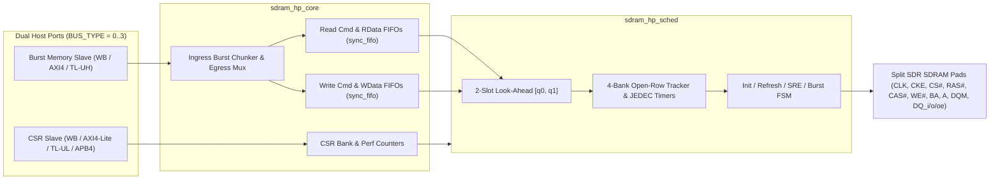

# High-Throughput 4-Bank Open-Page SDR SDRAM Controller (`44_sdram_hp`)

## Overview

`sdram_hp_top` is a pure synthesizable IEEE 1800-2017 SystemVerilog, Yosys/FPGA/ASIC-friendly **High-Throughput 4-Bank Open-Page Single Data Rate (SDR) SDRAM Controller**. It is specifically tuned for high-efficiency streaming on FPGA boards (DE10-Lite, ULX3S, Tang, MiSTer-class 16-bit and 32-bit SDRAMs) as well as compact MCU/MPU ASICs.

### Key Features

- **Parameterizable SDRAM Width (`SDRAM_DATA_W = 16` or `32`)**: Automatic 32-bit host <-> 16-bit/32-bit SDR burst packing and unpacking with exact `DQM` byte-lane masking (`sdram_dqm_o[SDRAM_DATA_W/8-1:0]`).
- **4-Bank Open-Page Interleaving + Look-Ahead Precharge/Activate**: Tracks open row per bank `BA[1:0]` (`bank_active_q[3:0]`, `bank_row_q[3:0]`) and uses a 2-slot `[q0, q1]` command buffer so `PRECHARGE` and `ACTIVE` for the next bank (`q1`) execute in the background during `q0`'s active data burst.
- **Selectable Page Policy & Burst Modes**:
  - Open-Page (`OPEN_PAGE_EN=1`) vs. Closed-Page Auto-Precharge (`OPEN_PAGE_EN=0`, `A10=1`).
  - Programmable Burst Length: `BL1`, `BL2`, `BL4`, `BL8`, and **Full-Page Burst** with `BURST_TERMINATE` (`CMD_BST`).
  - Programmable `CAS Latency = 2 or 3` + optional `RD_LAT_ADJ` (`0..3` cycles) for board/PLL skew tuning.
  - Selectable address mapping: Row-Bank-Col (`RBC`, interleaving across banks on row boundaries) or Bank-Row-Col (`BRC`).
- **Full JEDEC SDR Timing & Power Management**:
  - Programmable `tRP`, `tRCD`, `tRAS`, `tRC`, `tRRD`, `tWR`, `tRFC`, `tMRD`, `tWTR`, `tXSR`, `tREFI`, and `tINIT` (`200 us` / programmable power-up wait + `PREA` + `2x AREF` + `LMR`).
  - Periodic + urgent-watermark auto-refresh scheduler.
  - **Self-Refresh (`SRE`/`SRX`)** retention mode and **Clock-Suspend (`CKE=0`)** manual/auto power-down mode.
- **Separate Read/Write Command & Data FIFOs + Performance Counters**:
  - Built on `common/rtl/sync_fifo.sv` (`u_rd_cmd_fifo`, `u_wr_cmd_fifo`, `u_order_fifo`, `u_resp_order_fifo`, `u_wdata_fifo`, `u_rdata_fifo`).
  - Live 32-bit counters: `PERF_HITS`, `PERF_MISSES`, `PERF_REFS`, `PERF_WORDS`.
- **Quad-Bus Dual Host Interface (`BUS_TYPE = 0..3`)**:
  - Wishbone B4 (`BUS_WISHBONE=0`), AXI4 (`BUS_AXI4=1`), TileLink TL-UL/TL-UH (`BUS_TILELINK=2`), and APB4 CSR + AXI4 Memory (`BUS_APB=3`).

---

## Block Diagram



---

## 4-Bank Interleaving & Look-Ahead Timing Waveform

When `q0` bursts to `Bank 0` (`BL=4`), the command bus is otherwise idle on cycles `T1..T3`. The look-ahead engine uses those cycles to `PRECHARGE` (if needed) and `ACTIVE` `Bank 1` for `q1`, eliminating `tRP + tRCD` stalls between banks:

```text
Cycle      :  T0    T1    T2    T3    T4    T5    T6    T7    T8
sdram_clk  : _/‾\_/‾\_/‾\_/‾\_/‾\_/‾\_/‾\_/‾\_/‾\_/‾\_/‾\_/‾\_/‾\_
CMD        : RD_B0 ACT_B1 NOP   NOP  RD_B1 ACT_B2 NOP   NOP  RD_B2
BA[1:0]    :  0     1     -     -     1     2     -     -     2
DQ (CL=2)  :  -     -    B0.0  B0.1  B0.2  B0.3  B1.0  B1.1  B1.2
                         |<--- q0 (Bank 0) --->|<--- q1 (Bank 1) --->
```

---

## Parameters & Port Interface (`sdram_hp_top`)

### Parameters

| Parameter | Default | Description |
| :--- | :--- | :--- |
| `BUS_TYPE` | `BUS_AXI4` | `BUS_WISHBONE` (`0`), `BUS_AXI4` (`1`), `BUS_TILELINK` (`2`), `BUS_APB` (`3`) |
| `SDRAM_DATA_W` | `16` | External SDRAM DQ width: `16` or `32` |
| `CMD_Q_DEPTH` | `8` | Depth of read and write command `sync_fifo`s |
| `DATA_Q_DEPTH` | `32` | Depth of 32-bit write and read data `sync_fifo`s |
| `DEFAULT_T_INIT` | `20000` | Reset default for `TIMING2.T_INIT` (`200 us` @ `100 MHz`) |

### Split SDR SDRAM Pad Signals

| Port | Width | Dir | Description |
| :--- | :--- | :--- | :--- |
| `sdram_clk_o` | 1 | Out | Inverted clock (`~clk_i`) for mid-window SDR sampling |
| `sdram_cke_o` | 1 | Out | Clock Enable (`0` during Self-Refresh `SRE` and Clock-Suspend) |
| `sdram_cs_no` | 1 | Out | Chip Select (active low) |
| `sdram_ras_no` | 1 | Out | Row Address Strobe (active low) |
| `sdram_cas_no` | 1 | Out | Column Address Strobe (active low) |
| `sdram_we_no` | 1 | Out | Write Enable (active low) |
| `sdram_ba_o` | 2 | Out | Bank Address `BA[1:0]` (4 banks) |
| `sdram_addr_o` | 13 | Out | Multiplexed Row `A[12:0]` / Column `A[12:11,8:0]` + `A10` AP |
| `sdram_dqm_o` | `SDRAM_DATA_W/8` | Out | Active-high Byte Mask (`~wstrb` on writes, `0` on reads) |
| `sdram_dq_i` | `SDRAM_DATA_W` | In | Bidirectional pad input |
| `sdram_dq_o` | `SDRAM_DATA_W` | Out | Bidirectional pad output |
| `sdram_dq_oe_o` | 1 | Out | Output enable (`1` during SDRAM write data beats) |
| `irq_o` | 1 | Out | Level-high interrupt (`CTRL.IRQ_EN & |IRQ_STATUS`) |

---

## CSR Register Map

| Offset | Register | Reset | Access | Bit Fields |
| :--- | :--- | :--- | :--- | :--- |
| `0x00` | `CTRL` | `0x0000_0007` | RW | `[0]` `ENABLE`, `[1]` `AUTO_REF_EN`, `[2]` `OPEN_PAGE_EN`, `[3]` `INIT_START` (W1P), `[4]` `MANUAL_REF` (W1P), `[5]` `LMR_TRIG` (W1P), `[6]` `IRQ_EN`, `[7]` `PERF_CLR` (W1P) |
| `0x04` | `CFG` | `0x0000_4262` (16b) / `0x0000_4122` (32b) | RW | `[2:0]` `BURST_LEN` (`0`:BL1, `1`:BL2, `2`:BL4, `3`:BL8, `7`:Full-Page), `[5:4]` `CAS_LAT` (`2` or `3`), `[7:6]` `COL_BITS` (`0`:8b, `1`:9b, `2`:10b, `3`:11b), `[9:8]` `ROW_BITS` (`0`:11b, `1`:12b, `2`:13b), `[10]` `ADDR_MAP` (`0`:RBC, `1`:BRC), `[15:12]` `REF_URG_WM`, `[17:16]` `RD_LAT_ADJ`, `[18]` `WB_SINGLE_WR` (`MR[9]`) |
| `0x08` | `STATUS` | live | RO | `[0]` `INIT_DONE`, `[1]` `INIT_BUSY`, `[2]` `IN_SELF_REF`, `[3]` `IN_CLK_SUSP`, `[4]` `SCHED_IDLE`, `[5]` `DATA_W_32`, `[11:8]` `REF_PEND_CNT`, `[15:12]` `BANK_ACTIVE[3:0]`, `[16]` `IRQ_PEND` |
| `0x0C` | `TIMING0` | `0x1444_9633` | RW | `[3:0]` `T_RP`, `[7:4]` `T_RCD`, `[11:8]` `T_RAS`, `[16:12]` `T_RC`, `[20:17]` `T_RRD`, `[24:21]` `T_WR`, `[29:25]` `T_RFC` |
| `0x10` | `TIMING1` | `0x0030_CA12` | RW | `[3:0]` `T_MRD`, `[7:4]` `T_WTR`, `[11:8]` `T_XSR`, `[27:12]` `T_REFI` |
| `0x14` | `TIMING2` | `DEFAULT_T_INIT` | RW | `[15:0]` `T_INIT` (power-up NOP wait cycles before `PREA`) |
| `0x18` | `PWR_CTRL` | `0x0000_0400` | RW | `[0]` `SELF_REF_REQ` (1=SRE, 0=SRX), `[1]` `CLK_SUSP_REQ`, `[2]` `AUTO_PD_EN`, `[15:4]` `PD_THRES` |
| `0x1C` | `IRQ_STATUS` | `0x0000_0000` | RW1C | `[0]` `INIT_DONE_IRQ`, `[1]` `REF_OVF_IRQ` |
| `0x20` | `PERF_HITS` | `0x0000_0000` | RO | Count of open-page row hits |
| `0x24` | `PERF_MISSES` | `0x0000_0000` | RO | Count of row misses / bank activations |
| `0x28` | `PERF_REFS` | `0x0000_0000` | RO | Count of auto-refresh commands issued |
| `0x2C` | `PERF_WORDS` | `0x0000_0000` | RO | Count of 32-bit host words read + written |
| `0x30` | `IP_ID` | `0x5344_4850` | RO | ASCII `"SDHP"` identification signature |

---

## FPGA Board Wiring & Phase-Shifted Clock PLL Note

1. **Pad Ring Tri-State Instantiation**: Connect `sdram_dq_io[i] = sdram_dq_oe_o ? sdram_dq_o[i] : 1'bz;` and `assign sdram_dq_i = sdram_dq_io;` at the chip/FPGA top-level IO ring.
2. **Phase-Shifted SDRAM Clock (`PLL` / `ODDR`)**:
   - In RTL simulation and low-frequency boards (< 80 MHz), `sdram_clk_o` (`~clk_i`, 180° shift) centers the SDRAM clock edge cleanly between command/data transitions.
   - At **100–133 MHz** on FPGAs (Intel MAX10 DE10-Lite, Lattice ECP5 ULX3S, Gowin Tang, Cyclone V MiSTer), PCB trace delay + IOBUF `tCO` + SDRAM `tAC` (~5.4 ns) tighten the read-capture margin. Drive the physical SDRAM `CLK` pin from a **dedicated PLL output phase-shifted by -90° to -140°** (typically -2.5 ns to -3.5 ns relative to `clk_i`) via an `ALTDDIO_OUT` / `ODDRX1F` / `ODDR` primitive, and register `sdram_dq_i` in the IOB input flip-flop. If an extra IOB input pipeline stage is added, set `CFG.RD_LAT_ADJ = 1` so the controller's read capture window shifts by +1 cycle.

---

## Software Bring-Up (`sw/`)

- [`sdram_hp_regs.h`](sw/sdram_hp_regs.h): C register offsets and bitfield pack macros.
- [`sdram_hp_example.c`](sw/sdram_hp_example.c): Ready-to-use C initialization routines for:
  - 16-bit **W9825G6KH / IS42S16160** (32 MB, 13-bit row, 9-bit col) at 100 MHz (`CL=2, BL=4`) and 133 MHz (`CL=3, BL=8`).
  - 32-bit **IS42S32800** (32 MB, 12-bit row, 9-bit col) at 100 MHz and 133 MHz with auto clock-suspend.
  - 4-bank strided memory & DQM byte-strobe self-test (`sdram_hp_mem_test`).
  - Self-refresh retention sleep/wake helpers (`sdram_hp_enter_self_refresh`, `sdram_hp_exit_self_refresh`).

---

## Verification Summary (`tb/tb_sdram_hp.sv`)

- **`tb_sdram_hp_model.sv`**: Independent behavioral 4-bank JEDEC SDR SDRAM model enforcing power-up init sequence, `tRP`, `tRCD`, `tRAS`, `tRC`, `tRRD`, `tWR`, `tRFC`, `tMRD`, `DQM` masking, `BST`, `A10=1` Auto-Precharge, `SRE`/`SRX`, and `CKE` Clock-Suspend with `$fatal` on any violation.
- **`tb_sdram_hp.sv`**: Self-checking testbench exercising `SDRAM_DATA_W=16` & `32`, all 4 bus protocols (`AXI4`, `APB4+AXI4`, `Wishbone B4`, `TileLink`), open-page row hits & 4-bank interleaving, `BL1`/`BL2`/`BL4`/`BL8`/`Full-Page` + `CL=2/3`, `DQM` partial strobes, periodic auto-refresh under burst load, `SRE`/`SRX` retention, and constrained-random INCR/WRAP sweeps (`+seed=N`) against golden shadow RAM.
