# 45_isp_lite: Camera ISP-Lite Image Signal Processor Pipeline

A clean-room, pure synthesizable IEEE 1800-2017 SystemVerilog **6-Stage Camera ISP-Lite Pipeline** designed to plug directly between [`34_mipi_csi2_rx`](../../34_mipi_csi2_rx/doc/README.md) (`m_axis_*`) and downstream consumers such as [`16_gfx2d_dma`](../../16_gfx2d_dma/doc/README.md), [`17_mini_tpu`](../../17_mini_tpu/doc/README.md), or [`35_mipi_dsi_tx`](../../35_mipi_dsi_tx/doc/README.md) (`s_axis_*`) over 32-bit AXI4-Stream.

---

## 1. Key Features

- **Direct AXI4-Stream Camera-to-Display / NPU Integration**:
  - 32-bit `s_axis_*` input (`RAW8`, `RAW10`, `RAW12`) with `tuser[0] = SOF` and `tlast = EOL`.
  - 32-bit `m_axis_*` output (`OUT_RGB888`, `OUT_RGB565`, `OUT_YUV422`, `OUT_GRAY8`) with zero combinational `tvalid -> tready` loops and lossless backpressure propagation across all 6 stages.
- **Internal 12-Bit Streaming Pixel Pipeline (`MAX_WIDTH = 1920` default)**:
  1. **Stage 1 (`isp_blc`)**: Independent per-Bayer-channel (`R`, `Gr`, `Gb`, `B`) signed 13-bit pedestal subtraction, `[0, 4095]` clamping, and Q2.10 digital pre-gain (bypassable).
  2. **Stage 2 (`isp_linebuf` + `isp_dpc`)**: Dual `tech_sram_sdp` 3x3 sliding window with border replication (`mirror` or `clamp`), detecting and replacing hot/dead outlier pixels where `(center - max_nbr) > DPC_THRESH` or `(min_nbr - center) > DPC_THRESH` (bypassable).
  3. **Stage 3 (`isp_demosaic`)**: Dual `tech_sram_sdp` 3x3 edge-aware Bayer-to-RGB interpolation supporting all 4 Bayer CFA patterns (`RGGB`, `GRBG`, `GBRG`, `BGGR`) while preserving exact `IMG_W x IMG_H` frame dimensions.
  4. **Stage 4 (`isp_awb_ae`)**: Per-channel Q2.10 digital AWB gains (`GAIN_R`, `GAIN_G`, `GAIN_B`) plus double-buffered per-frame hardware 2A statistics (`STAT_SUM_R/G/B` 40-bit, `STAT_PIX_CNT`, and 16-bin AE Luma Histogram `HIST[0..15]`).
  5. **Stage 5 (`isp_ccm`)**: Two-stage pipelined signed Q3.10 3x3 Color Correction Matrix + signed 13-bit per-channel offsets with `[0, 4095]` saturation clamping (bypassable).
  6. **Stage 6 (`isp_gamma_out`)**: Three `256 x 8-bit` `tech_sram_sp` Gamma LUTs (CPU-loadable, bypassable), optional **2x2 box-average downscaler** (`SCALE_2X_EN` using one `tech_sram_sdp` line buffer) reducing `W x H -> (W/2) x (H/2)`, and 4-format 32-bit AXI4-Stream packer.
- **Built-in Bayer Test Pattern Generator (`TPG_EN`)**: 4 patterns (`Color Bars`, `Ramp`, `Checkerboard`, `Solid`) across all 4 Bayer phases.
- **Interrupts & Counters**: `FRAME_DONE` and `OVERFLOW` W1C IRQs, `DPC_STAT`, `PERF_FRAMES`, and `PERF_CYCLES`.
- **Quad-Bus SoC Wrappers**: Wishbone B4 (`BUS_WISHBONE`), AXI4 / AXI4-Lite (`BUS_AXI4`), TileLink TL-UL (`BUS_TILELINK`), and AMBA APB4 (`BUS_APB`).

---

## 2. Architecture Block Diagram

```mermaid
flowchart LR
    SA["s_axis_* (32b AXI4-Stream<br/>RAW8 / RAW10 / RAW12)"] --> IN["Stage 0: Input Unpacker<br/>& Bayer TPG (TPG_EN)"]
    IN -->|"12b Bayer"| BLC["Stage 1: isp_blc<br/>(Pedestal + Pre-Gain)"]
    BLC -->|"12b Bayer"| DPC["Stage 2: isp_dpc<br/>(isp_linebuf 2x tech_sram_sdp<br/>+ 3x3 Outlier Filter)"]
    DPC -->|"Clean Bayer"| DEM["Stage 3: isp_demosaic<br/>(isp_linebuf 2x tech_sram_sdp<br/>+ Edge-Aware RGB)"]
    DEM -->|"12b RGB"| AWB["Stage 4: isp_awb_ae<br/>(Q2.10 Gains + 40b Sums<br/>+ 16-bin AE HIST)"]
    AWB -->|"12b RGB"| CCM["Stage 5: isp_ccm<br/>(Signed Q3.10 3x3 Matrix<br/>+ Signed Offsets)"]
    CCM -->|"12b sRGB"| GAM["Stage 6: isp_gamma_out<br/>(3x tech_sram_sp Gamma LUT<br/>+ 2x2 Downscaler + Packer)"]
    GAM --> MA["m_axis_* (32b AXI4-Stream<br/>RGB888/RGB565/YUV422/GRAY8)"]
    CSR["Quad-Bus CSR Slave<br/>(WB / AXI4 / TL / APB4)"] <--> CORE["isp_lite_core<br/>(CSR, IRQs, Perf, 2A Stats)"]
    CORE --> IRQ["irq_o (FRAME_DONE / OVERFLOW)"]
```

---

## 3. RTL Hierarchy (`ips/45_isp_lite/filelist.f`)

| Compile Order | File | Module / Package | Role |
| :---: | :--- | :--- | :--- |
| 1 | `rtl/isp_pkg.sv` | `isp_pkg` | Enums, CSR offsets, clamp & Bayer phase helpers |
| 2 | `rtl/isp_linebuf.sv` | `isp_linebuf` | Dual `tech_sram_sdp` 3x3 sliding window with mirror/clamp borders |
| 3 | `rtl/isp_blc.sv` | `isp_blc` | Stage 1 per-channel pedestal & Q2.10 pre-gain |
| 4 | `rtl/isp_dpc.sv` | `isp_dpc` | Stage 2 3x3 hot/dead defect pixel replacement |
| 5 | `rtl/isp_demosaic.sv` | `isp_demosaic` | Stage 3 3x3 edge-aware Bayer-to-RGB demosaic |
| 6 | `rtl/isp_awb_ae.sv` | `isp_awb_ae` | Stage 4 Q2.10 AWB gains & double-buffered 2A stats |
| 7 | `rtl/isp_ccm.sv` | `isp_ccm` | Stage 5 2-stage pipelined signed Q3.10 3x3 CCM |
| 8 | `rtl/isp_gamma_out.sv` | `isp_gamma_out` | Stage 6 Gamma LUT SRAMs, 2x2 downscaler, AXI4-Stream packer |
| 9 | `rtl/isp_lite_core.sv` | `isp_lite_core` | Protocol-agnostic ISP core, input unpacker, TPG, CSR bank |
| 10 | `rtl/isp_lite_wb.sv` | `isp_lite_wb` | Wishbone B4 slave wrapper |
| 11 | `rtl/isp_lite_axi.sv` | `isp_lite_axi` | AXI4 / AXI4-Lite slave wrapper |
| 12 | `rtl/isp_lite_tl.sv` | `isp_lite_tl` | TileLink TL-UL / TL-UH slave wrapper |
| 13 | `rtl/isp_lite_apb.sv` | `isp_lite_apb` | AMBA APB4 completer wrapper |
| 14 | `rtl/isp_lite_top.sv` | `isp_lite_top` | Unified Quad-Bus top wrapper (`BUS_TYPE`, `MAX_WIDTH`) |

---

## 4. Parameters & Top-Level Ports (`isp_lite_top`)

| Parameter | Type | Default | Description |
| :--- | :--- | :---: | :--- |
| `BUS_TYPE` | `bus_pkg::bus_proto_e` | `BUS_AXI4` | `BUS_WISHBONE` (0), `BUS_AXI4` (1), `BUS_TILELINK` (2), `BUS_APB` (3) |
| `MAX_WIDTH` | `int unsigned` | `1920` | Maximum active line width (`IMG_W <= MAX_WIDTH`) |

| Port Group | Signal | Width | Dir | Description |
| :--- | :--- | :---: | :---: | :--- |
| **System** | `clk_i`, `rst_ni` | 1 | In | Pixel/CSR clock & active-low async reset |
| **CSR Bus** | `wb_i`/`wb_o`, `axi_i`/`axi_o`, `tl_i`/`tl_o`, `apb_i`/`apb_o` | struct | In/Out | Quad-bus CSR slave ports (tie unused inputs to `'0`) |
| **Stream In** | `s_axis_tvalid_i`, `s_axis_tready_o`, `s_axis_tdata_i`, `s_axis_tlast_i`, `s_axis_tuser_i` | 1/1/32/1/4 | In/Out | 32-bit Bayer input (`tuser[0]` = SOF, `tlast` = EOL) |
| **Stream Out** | `m_axis_tvalid_o`, `m_axis_tready_i`, `m_axis_tdata_o`, `m_axis_tlast_o`, `m_axis_tuser_o` | 1/1/32/1/4 | Out/In | 32-bit processed pixel output (`tuser[0]` = SOF, `tlast` = EOL) |
| **Interrupt** | `irq_o` | 1 | Out | Active-high level IRQ (`|(IRQ_STAT & IRQ_EN)`) |

---

## 5. Mathematical Specification

### 5.1 Input Alignment & Bayer Phase (`BAYER_PAT`)

- `RAW8`: 4 pixels/beat `{P3[7:0], P2[7:0], P1[7:0], P0[7:0]}`, aligned to 12-bit via `{P, 4'b0}`.
- `RAW10`: 2 pixels/beat `{6'b0, P1[9:0], 6'b0, P0[9:0]}`, aligned to 12-bit via `{P, 2'b0}`.
- `RAW12`: 2 pixels/beat `{4'b0, P1[11:0], 4'b0, P0[11:0]}`.
- Bayer channel at `(x, y)`: `ch = {(y[0] ^ BAYER_PAT[1]), (x[0] ^ BAYER_PAT[0])}` where `0=R, 1=Gr, 2=Gb, 3=B`.

### 5.2 Stage 1 — Black-Level Correction (`isp_blc`)

$$P_{\text{sub}} = \text{clamp}_{[0,4095]}(P_{\text{in}} - \text{PED}_{\text{ch}})$$
$$P_{\text{blc}} = \text{clamp}_{[0,4095]}\!\left(\frac{P_{\text{sub}} \cdot \text{PREGAIN}_{\text{ch}} + 512}{1024}\right)$$

### 5.3 Stage 2 — 3x3 Defect Pixel Correction (`isp_dpc`)

With 8-neighbor bounds $N_{\min}, N_{\max}$ around center $C = P_{11}$:
- Hot pixel if $(C > N_{\max}) \land (C - N_{\max} > \text{DPC\_THRESH})$.
- Dead pixel if $(C < N_{\min}) \land (N_{\min} - C > \text{DPC\_THRESH})$.
- Replacement: $P_{\text{corr}} = (P_{01} + P_{10} + P_{12} + P_{21} + 2) \gg 2$.

### 5.4 Stage 3 — 3x3 Edge-Aware Bayer Demosaic (`isp_demosaic`)

Border replication defaults to Bayer-phase-preserving mirror (`[-1] = [+1]`, `[W] = [W-2]`, selectable to edge clamp via `CTRL.BORDER_CLAMP=1`). For `R` (`ch=0`) and `B` (`ch=3`) centers:
- Missing `G` compares $d_h = |P_{10} - P_{12}|$ vs $d_v = |P_{01} - P_{21}|$ and interpolates along the smaller gradient (or 4-neighbor average when $d_h = d_v$).
- Missing `B`/`R` compares $d_+ = |P_{02} - P_{20}|$ vs $d_- = |P_{00} - P_{22}|$ along the smaller diagonal gradient.
- On `Gr`/`Gb` centers, `R` and `B` are interpolated from horizontal and vertical axial pairs.

### 5.5 Stage 4 — AWB & Live 2A Statistics (`isp_awb_ae`)

$$C_{\text{awb}} = \text{clamp}_{[0,4095]}\!\left(\frac{C_{\text{in}} \cdot \text{GAIN}_C + 512}{1024}\right), \quad C \in \{R, G, B\}$$
$$\text{Luma}_{12} = (R_{\text{awb}} + 2 G_{\text{awb}} + B_{\text{awb}}) \gg 2, \quad \text{bin} = \text{Luma}_{12}[11:8] \in [0..15]$$

`STAT_SUM_R/G/B` (40-bit), `STAT_PIX_CNT`, and `HIST[0..15]` are accumulated live and shadow-latched on `EOF` so CPU reads remain tear-free during back-to-back frames.

### 5.6 Stage 5 — 3x3 Color Correction Matrix (`isp_ccm`)

$$\begin{bmatrix} R' \\ G' \\ B' \end{bmatrix} = \text{clamp}_{[0,4095]}\!\left(\left\lfloor \frac{\mathbf{C}_{3\times 3} \cdot [R, G, B]^T + 1024 \cdot \mathbf{OFF} + 512}{1024} \right\rfloor\right)$$

### 5.7 Stage 6 — Gamma LUT, 2x2 Downscaler & Output Formats (`isp_gamma_out`)

- **Gamma LUT**: `C_8 = GAMMA_LUT[C_12[11:4]]` (or `C_12[11:4]` when `GAMMA_BYPASS=1`).
- **2x2 Box-Average Downscaler (`SCALE_2X_EN=1`)**: Averages `(2y,2x), (2y,2x+1), (2y+1,2x), (2y+1,2x+1)` with `+2 >> 2` rounding (requires even `IMG_W >= 2, IMG_H >= 2`).
- **BT.601 Full-Range Fixed-Point YUV**:
  $$Y = \text{clamp}_{[0,255]}\!\left(\frac{77 R + 150 G + 29 B + 128}{256}\right)$$
  $$U = \text{clamp}_{[0,255]}\!\left(\left\lfloor\frac{-43 R - 85 G + 128 B + 128}{256}\right\rfloor + 128\right)$$
  $$V = \text{clamp}_{[0,255]}\!\left(\left\lfloor\frac{128 R - 107 G - 21 B + 128}{256}\right\rfloor + 128\right)$$
- **32-bit `m_axis_tdata_o` Packing**:
  - `OUT_RGB888 (0)`: `{8'h00, R[7:0], G[7:0], B[7:0]}` (1 px/beat)
  - `OUT_RGB565 (1)`: `{P1[15:0], P0[15:0]}` (2 px/beat)
  - `OUT_YUV422 (2)`: `{Y1[7:0], V_avg[7:0], Y0[7:0], U_avg[7:0]}` (2 px/beat)
  - `OUT_GRAY8  (3)`: `{Y3[7:0], Y2[7:0], Y1[7:0], Y0[7:0]}` (4 px/beat)

---

## 6. CSR & Memory Map (`0x000..0x7FC`)

| Offset | Name | Access | Reset | Bit Fields |
| :---: | :--- | :---: | :---: | :--- |
| `0x000` | `CTRL` | RW | `0x0000_0000` | `[0]` `EN`, `[1]` `SW_RST` (W1P), `[2]` `TPG_EN`, `[4:3]` `TPG_MODE`, `[6:5]` `IN_BPP`, `[8:7]` `BAYER_PAT`, `[10:9]` `OUT_FMT`, `[11]` `SCALE_2X_EN`, `[12]` `BLC_BYPASS`, `[13]` `DPC_BYPASS`, `[14]` `AWB_BYPASS`, `[15]` `CCM_BYPASS`, `[16]` `GAMMA_BYPASS`, `[17]` `BORDER_CLAMP`, `[18]` `DROP_ON_FULL` |
| `0x004` | `STATUS` | RO | `0x0000_0000` | `[0]` `BUSY`, `[1]` `IN_READY`, `[2]` `OUT_VALID`, `[15:4]` `CUR_ROW`, `[27:16]` `MAX_WIDTH` |
| `0x008` | `IRQ_EN` | RW | `0x0000_0000` | `[0]` `FRAME_DONE_IE`, `[1]` `OVERFLOW_IE` |
| `0x00C` | `IRQ_STAT` | RW1C | `0x0000_0000` | `[0]` `FRAME_DONE`, `[1]` `OVERFLOW` |
| `0x010` | `IMG_SIZE` | RW | `0x01E0_0280` | `[11:0]` `IMG_W` (640), `[27:16]` `IMG_H` (480) |
| `0x014` | `BLC_PED_RG` | RW | `0x0000_0000` | `[12:0]` `PED_R` (s13), `[28:16]` `PED_GR` (s13) |
| `0x018` | `BLC_PED_GBB` | RW | `0x0000_0000` | `[12:0]` `PED_GB` (s13), `[28:16]` `PED_B` (s13) |
| `0x01C` | `BLC_GAIN_RG` | RW | `0x0400_0400` | `[11:0]` `PREGAIN_R` (Q2.10), `[27:16]` `PREGAIN_GR` (Q2.10) |
| `0x020` | `BLC_GAIN_GBB` | RW | `0x0400_0400` | `[11:0]` `PREGAIN_GB` (Q2.10), `[27:16]` `PREGAIN_B` (Q2.10) |
| `0x024` | `DPC_CFG` | RW | `0x0000_0100` | `[11:0]` `DPC_THRESH` |
| `0x028` | `DPC_STAT` | RO | `0x0000_0000` | `[31:0]` Replaced defect pixel count (latched on EOF) |
| `0x02C` | `AWB_GAIN_RG` | RW | `0x0400_0400` | `[11:0]` `GAIN_R` (Q2.10), `[27:16]` `GAIN_G` (Q2.10) |
| `0x030` | `AWB_GAIN_B` | RW | `0x0000_0400` | `[11:0]` `GAIN_B` (Q2.10) |
| `0x034` | `CCM_C00_C01` | RW | `0x0000_0400` | `[13:0]` `C00` (sQ3.10), `[29:16]` `C01` (sQ3.10) |
| `0x038` | `CCM_C02_OFF0` | RW | `0x0000_0000` | `[13:0]` `C02` (sQ3.10), `[28:16]` `OFF_R` (s13) |
| `0x03C` | `CCM_C10_C11` | RW | `0x0400_0000` | `[13:0]` `C10` (sQ3.10), `[29:16]` `C11` (sQ3.10) |
| `0x040` | `CCM_C12_OFF1` | RW | `0x0000_0000` | `[13:0]` `C12` (sQ3.10), `[28:16]` `OFF_G` (s13) |
| `0x044` | `CCM_C20_C21` | RW | `0x0000_0000` | `[13:0]` `C20` (sQ3.10), `[29:16]` `C21` (sQ3.10) |
| `0x048` | `CCM_C22_OFF2` | RW | `0x0000_0400` | `[13:0]` `C22` (sQ3.10), `[28:16]` `OFF_B` (s13) |
| `0x04C` | `PERF_FRAMES` | RO | `0x0000_0000` | `[31:0]` Completed frames |
| `0x050` | `PERF_CYCLES` | RO | `0x0000_0000` | `[31:0]` Active frame processing cycles |
| `0x054` | `STAT_SUM_R` | RO | `0x0000_0000` | `[31:0]` Latched R sum `[31:0]` |
| `0x058` | `STAT_SUM_G` | RO | `0x0000_0000` | `[31:0]` Latched G sum `[31:0]` |
| `0x05C` | `STAT_SUM_B` | RO | `0x0000_0000` | `[31:0]` Latched B sum `[31:0]` |
| `0x060` | `STAT_SUM_HI` | RO | `0x0000_0000` | `[7:0]` `SUM_R[39:32]`, `[15:8]` `SUM_G[39:32]`, `[23:16]` `SUM_B[39:32]` |
| `0x064` | `STAT_PIX_CNT` | RO | `0x0000_0000` | `[31:0]` Latched pixel count |
| `0x068` | `ID` | RO | `0x4953_5031` | ASCII `"ISP1"` |
| `0x080..0x0BC` | `HIST[0..15]` | RO | `0x0000_0000` | 16-bin latched AE luma histogram (`bin = luma12[11:8]`) |
| `0x400..0x7FC` | `GAMMA_LUT[0..255]` | RW | SRAM | `{8'h00, B[7:0], G[7:0], R[7:0]}` (accessible when `CTRL.EN == 0`) |

---

## 7. Bare-Metal C 2A Software Guide

Complete header and driver example provided in [`sw/isp_lite_regs.h`](../sw/isp_lite_regs.h) and [`sw/isp_camera_example.c`](../sw/isp_camera_example.c):
1. Ensure `CTRL.EN == 0` (via `ISP_CTRL_SW_RST`) before writing `GAMMA_LUT[0..255]`.
2. Program `IMG_SIZE`, `BLC_*`, `DPC_CFG`, initial `AWB_GAIN_*`, and `CCM_*`, then set `CTRL.EN = 1` before enabling `34_mipi_csi2_rx`.
3. On each `FRAME_DONE` interrupt, read the shadow-latched 40-bit `STAT_SUM_*`, `STAT_PIX_CNT`, and `HIST[0..15]` to execute Gray-World AWB (`GAIN_R`/`GAIN_B`) and Histogram AE (`BLC_GAIN_*` or sensor exposure) feedback updates.

---

## 8. Yosys / FPGA BRAM / ASIC Synthesis Notes

- **Inferable SRAMs**:
  - `isp_dpc` and `isp_demosaic` each instantiate two `tech_sram_sdp #(.DATA_W(12), .DEPTH(MAX_WIDTH))` line buffers (~11 KB total at `MAX_WIDTH=1920`, mapping to 4x 18Kb FPGA BRAMs or 4x 1R1W compiled ASIC SRAMs).
  - `isp_gamma_out` instantiates three `tech_sram_sp #(.DATA_W(8), .DEPTH(256))` Gamma LUTs and one `tech_sram_sdp #(.DATA_W(27), .DEPTH(MAX_WIDTH/2))` downscale line buffer.
  - All SRAMs use pure clock-only `always_ff @(posedge clk_i)` writes with zero async-reset loops.
- **DSP Multipliers**:
  - `isp_blc` (1 mul), `isp_awb_ae` (3 muls), `isp_ccm` (9 pipelined muls), and `isp_gamma_out` BT.601 YUV converter (6 constant-coefficient muls) infer DSP48 / multiplier blocks cleanly.

---

## 9. Verification (`ips/45_isp_lite/tb/tb_isp_lite.sv`)

Self-checking testbench (`tb_isp_lite`) with an independent first-principles SV golden reference model verifying:
- All 4 Bayer patterns (`RGGB`, `GRBG`, `GBRG`, `BGGR`) and all 3 input bit depths (`RAW8`, `RAW10`, `RAW12`, including non-multiple-of-4 widths).
- Signed BLC pedestals/pre-gain, hot/dead DPC detection & `DPC_STAT`, border-replicated demosaic (`mirror` & `clamp`), exact AWB stats & 16-bin histogram, signed Q3.10 3x3 CCM, custom Gamma LUT with 1-cycle SRAM CSR wait-state, 2x2 downscaler, and all 4 output formats (`RGB888`, `RGB565`, `YUV422`, `GRAY8`).
- Built-in Bayer TPG, `DROP_ON_FULL` `OVERFLOW` IRQ, back-to-back multi-frame streaming, random `s_axis`/`m_axis` stalls, and all 4 bus interfaces (`Wishbone B4`, `AXI4`, `TileLink`, `APB4`).
