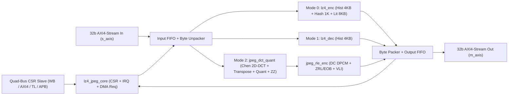

# `46_lz4_jpeg_codec` — Dual-Engine Hardware LZ4 & 8×8 Baseline JPEG Codec

Clean-room, synthesizable IEEE 1800-2017 SystemVerilog **Hardware LZ4 Block Compressor/Decompressor + Baseline 8×8 JPEG Block Codec Accelerator** with quad-bus CSR control (**Wishbone B4 / AXI4 / TileLink / AMBA APB4**), 32-bit **AXI4-Stream** input/output ports, CSR-accessible FIFOs, DMA handshake lines, and interrupt support.

## Features

- **Mode 0 (`MODE_LZ4_ENC`) — Hardware LZ4 Block Compressor (`lz4_enc`)**:
  - Emits standard LZ4 block streams (`token = {lit_len[3:0], match_len_m4[3:0]}`, `0xFF`-chained extended lengths, literal payload, 16-bit little-endian `offset`).
  - Enforces standard LZ4 block rules (`MIN_MATCH = 4`, `MFLIMIT = 12`, `LAST_LITS = 5`) for universal compatibility with standard software LZ4 decoders.
  - 4096-byte sliding history buffer (`tech_sram_sp`), 1024-entry direct-mapped 4-byte Knuth multiplicative hash table (`tech_sram_sp` + 1-cycle-clear valid bitmap), and 8192-byte literal staging SRAM (`tech_sram_sp`).
  - Supports overlapping matches (`offset = 1..HIST_SIZE`), real-time `BYTES_IN` / `BYTES_OUT` compression ratio counters.
- **Mode 1 (`MODE_LZ4_DEC`) — Hardware LZ4 Block Decompressor (`lz4_dec`)**:
  - Full standard LZ4 block decoder with `0xFF` extended literal/match lengths, 16-bit LE offsets, and byte-accurate overlapping copy (including RLE `offset = 1..3` and full-window `offset = 4096`).
  - Detects malformed offsets (`offset == 0`, `offset > written_bytes`, `offset > HIST_SIZE`) via `ERR_BAD_OFFSET` and truncated streams via `ERR_TRUNCATED`.
- **Mode 2 (`MODE_JPEG_8X8`) — Baseline 8×8 JPEG Block Engine (`jpeg_dct_quant`, `jpeg_rle_enc`)**:
  - Level-shifts unsigned 8-bit 8×8 blocks by `-128` (`[-128..+127]`).
  - Separable 2D Forward DCT using exact Chen Q13 integer butterfly constants, a 64×16 Q10.5 transpose SRAM (`tech_sram_sp`), and a 64×16 quantized coefficient SRAM (`tech_sram_sp`).
  - Programmable 64-entry reciprocal multiplier + shift quantization SRAM (`0x200..0x2FC`) plus built-in ITU-T T.81 Annex K Luminance Q50 and Chrominance Q50 LUTs.
  - Zig-zag scan ROM, resettable DC DPCM predictor, and `(RUN, SIZE, AMP)` symbol stream encoder with `ZRL = (15,0)` and `EOB = (0,0)` markers packed into 32-bit words for direct Huffman LUT indexing.
- **Dual Data Transport**:
  - **AXI4-Stream** (`s_axis_*` / `m_axis_*`, 32-bit w/ `tkeep` & `tlast`) for zero-copy chaining with `45_isp_lite`, `15_dma_gdma`, or CSI-2/DSI pipelines.
  - **CSR MMIO FIFOs** (`REG_DIN`, `REG_DIN_LAST`, `REG_DIN_BYTE`, `REG_DOUT`, `REG_DOUT_INFO`) + `REG_IN_LEN` auto-trim for MCU operation without DMA.
- **Quad-Bus Control Wrapper (`lz4_jpeg_top`)**:
  - `BUS_TYPE = 0..3`: `BUS_WISHBONE`, `BUS_AXI4`, `BUS_TILELINK`, `BUS_APB`.

---

## Architecture Block Diagram

---

## Parameters & Top-Level Ports

| Parameter | Default | Description |
|---|---|---|
| `BUS_TYPE` | `BUS_AXI4` (`1`) | Control bus: `0=BUS_WISHBONE`, `1=BUS_AXI4`, `2=BUS_TILELINK`, `3=BUS_APB` |
| `LZ4_HIST_SIZE` | `4096` | LZ4 sliding window size in bytes (power of 2, `<= 65535`) |
| `LZ4_HASH_SIZE` | `1024` | Direct-mapped 4-byte hash table entries (power of 2) |
| `LZ4_LIT_BUF` | `8192` | Maximum pending literal run per LZ4 sequence in bytes |
| `IN_FIFO_DEPTH` | `32` | Input 32-bit word FIFO depth |
| `OUT_FIFO_DEPTH` | `32` | Output 32-bit word FIFO depth |

| Port | Width | Dir | Description |
|---|---|---|---|
| `clk_i`, `rst_ni` | 1 | in | System clock and active-low async reset |
| `wb_i/o`, `axi_i/o`, `tl_i/o`, `apb_i/o` | struct | in/out | Selectable bus slave port (active selected by `BUS_TYPE`) |
| `s_axis_tvalid_i`, `s_axis_tready_o` | 1 | in/out | 32-bit AXI4-Stream input handshake |
| `s_axis_tdata_i`, `s_axis_tkeep_i`, `s_axis_tlast_i` | 32/4/1 | in | Little-endian byte-packed input data, valid byte mask, end-of-block |
| `m_axis_tvalid_o`, `m_axis_tready_i` | 1 | out/in | 32-bit AXI4-Stream output handshake |
| `m_axis_tdata_o`, `m_axis_tkeep_o`, `m_axis_tlast_o` | 32/4/1 | out | Output compressed bytes, decompressed bytes, or 32b JPEG symbols |
| `irq_o` | 1 | out | Active-high level interrupt (`|(IRQ_STAT & IRQ_EN)`) |
| `dma_rx_req_o`, `dma_tx_req_o` | 1 | out | DMA RX (input FIFO <= `IN_WM`) and TX (output FIFO >= `OUT_WM` or tail) level requests |

---

## Microarchitecture Details

### 1. LZ4 Block Format & Compressor (`lz4_enc`)
Each LZ4 sequence follows the standard block encoding:
1. `token[7:4] = min(lit_len, 15)`, `token[3:0] = min(match_len - 4, 15)` (or `0` on final sequence).
2. If `lit_len >= 15`: `(lit_len - 15)` emitted as `0xFF` bytes followed by remainder `< 255`.
3. `lit_len` raw literal bytes staged in `u_lit_sram`.
4. Unless final sequence: 16-bit little-endian `offset` (`1 .. HIST_SIZE`), followed by optional `0xFF`-chained `(match_len - 19)` bytes.

A 12-byte lookahead shift register (`la_q[0..11]`) guarantees `MFLIMIT = 12` (no match starts in the last 12 bytes) and `LAST_LITS = 5` (matches terminate at least 5 bytes before EOF). The 4-byte hash uses Knuth's golden-ratio multiplier `({b3,b2,b1,b0} * 32'h9E37_79B1) >> (32 - HASH_AW)`.

### 2. 8×8 JPEG DCT, Quantization & RLE Symbol Math
- **Level Shift**: `x = unsigned_pixel - 128` (`[-128..+127]`).
- **Separable 1D Chen DCT**: Constants `C_k = round(cos(k*pi/16) * 8192)` (`Q13`: `8035, 7568, 6811, 5793, 4551, 3135, 1598`).
  - Row pass shifts by `>>> 9` (with `+256` rounding) -> signed 16-bit **Q10.5** stored in `u_trans_sram` (`64x16`, max magnitude `11586 < 32767`).
  - Column pass shifts by `>>> 19` (with `+262144` rounding) -> rounded integer `F(v,u)` in `[-1024..+1023]`.
- **Reciprocal Quantizer**: Each entry stores `{shift[4:0], recip[15:0]}` approximating `2^shift / Q`:
  $$\text{quant}(F) = \text{sign}(F) \cdot \left\lfloor \frac{|F| \cdot \text{recip} + 2^{\text{shift}-1}}{2^{\text{shift}}} \right\rfloor$$
  All 64 entries of both built-in ITU-T T.81 Annex K Q50 tables achieve **0 integer mismatches** against exact `(abs(F) + Q/2) / Q` across `F in [-1024..+1024]`.
- **32-bit Output Symbol Word (`jpeg_rle_enc`)**:
  - `[11:0]`  `AMP`: JPEG VLI amplitude bits
  - `[15:12]` `SIZE`: VLI bit count (`0..11`)
  - `[19:16]` `RUN`: Preceding zero count (`0..15`)
  - `[20]`    `IS_DC`: `1` for DC DPCM symbol
  - `[21]`    `IS_EOB`: `1` for End-of-Block `(0,0)`
  - `[22]`    `IS_ZRL`: `1` for Zero-Run-Length `(15,0)`
  - `[23]`    `BLK_LAST`: `1` on final symbol of an 8×8 block
  - `[31:24]` `RS_BYTE`: `{RUN[3:0], SIZE[3:0]}` (direct Huffman DHT LUT index)

---

## CSR Register Map

| Offset | Name | Access | Reset | Bitfields |
|---|---|---|---|---|
| `0x000` | `REG_ID` | RO | `0x4C5A4A50` | IP identifier (`"LZJP"`) |
| `0x004` | `REG_CAPS` | RO | param | `[15:0]=HIST_SIZE`, `[27:16]=HASH_SIZE`, `[31:28]=VERSION(1)` |
| `0x008` | `REG_CTRL` | RW | `0x00000200` | `[1:0]=MODE (0:LZ4_ENC, 1:LZ4_DEC, 2:JPEG)`, `[3]=IN_SRC (1=CSR)`, `[4]=OUT_DST (1=CSR)`, `[5]=DMA_RX_EN`, `[6]=DMA_TX_EN`, `[8:7]=QTBL_SEL (0:LumaQ50, 1:ChromaQ50, 2:Custom)`, `[9]=JPEG_RST_DC_LAST` |
| `0x00C` | `REG_CMD` | WO | `0` | `[0]=START`, `[1]=ABORT_RST`, `[2]=RST_DC`, `[3]=CLR_STATS` |
| `0x010` | `REG_STATUS` | RO | `0x00000050` | `[0]=BUSY`, `[1]=DONE`, `[2]=ERR`, `[3]=IN_FULL`, `[4]=IN_EMPTY`, `[5]=OUT_FULL`, `[6]=OUT_EMPTY`, `[15:8]=IN_LVL`, `[23:16]=OUT_LVL`, `[27:24]=ENG_STATE` |
| `0x014` | `REG_ERR_STAT` | R/W1C | `0` | `[0]=BAD_OFFSET`, `[1]=TRUNCATED`, `[2]=LIT_OVF`, `[3]=IN_OVF`, `[4]=JPEG_ALIGN` |
| `0x018` | `REG_IRQ_EN` | RW | `0` | `[0]=DONE_EN`, `[1]=ERR_EN`, `[2]=IN_WM_EN`, `[3]=OUT_WM_EN` |
| `0x01C` | `REG_IRQ_STAT` | R/W1C/RO | `0` | `[0]=DONE (W1C)`, `[1]=ERR (W1C)`, `[2]=IN_WM (live)`, `[3]=OUT_WM (live)` |
| `0x020` | `REG_FIFO_CFG` | RW | `0x00000110` | `[7:0]=IN_WM`, `[15:8]=OUT_WM`, `[19:16]=DIN_LAST_KEEP` |
| `0x024` | `REG_IN_LEN` | RW | `0` | Exact input byte count (`0` = delimited by `tlast`/`DIN_LAST`) |
| `0x030` | `REG_DIN` | WO | `0` | Push 32b word into Input FIFO (`last=0`) |
| `0x034` | `REG_DIN_LAST` | WO | `0` | Push final 32b word into Input FIFO (`last=1`, keep=`DIN_LAST_KEEP` or `wstrb`) |
| `0x038` | `REG_DIN_BYTE` | WO | `0` | Push single byte `[7:0]` into Input FIFO, `[8]=last` |
| `0x040` | `REG_DOUT` | RO | `0` | Pop 32b word from Output FIFO |
| `0x044` | `REG_DOUT_INFO` | RO | `0` | Peek Output FIFO: `[7:0]=LVL`, `[11:8]=KEEP`, `[12]=LAST`, `[13]=EMPTY`, `[14]=FULL`, `[15]=DONE_FLUSHED` |
| `0x050` | `REG_BYTES_IN` | RO | `0` | Input byte counter for current/last job |
| `0x054` | `REG_BYTES_OUT` | RO | `0` | Output byte counter (`4 * symbols` in JPEG mode) |
| `0x058` | `REG_JPEG_STAT` | RO | `0` | `[15:0]=BLOCKS_DONE`, `[27:16]=LAST_DC` (signed 12-bit) |
| `0x05C` | `REG_PERF_CYCLES` | RO | `0` | Active engine cycles |
| `0x200..0x2FC` | `REG_QTBL(0..63)` | RW | X | Custom Q-table SRAM (1-cycle read wait state): `[15:0]=recip`, `[20:16]=shift` |

---

## Yosys / FPGA BRAM & ASIC SRAM Notes

- All bulk memories (`u_hist_sram` 4096×8, `u_hash_sram` 1024×32, `u_lit_sram` 8192×8, `u_hist_sram` in `lz4_dec` 4096×8, `u_trans_sram` 64×16, `u_coeff_sram` 64×16, `u_qtbl_sram` 64×24) instantiate `common/rtl/tech/tech_sram_sp.sv` with clock-only synchronous writes and zero async resets.
- `scripts/check_yosys_compat.py` passes with 0 errors.
- Define `TARGET_ASIC` to map `tech_sram_sp` instances to compiled single-port SRAM macros.

---

## Verification & Software Examples

- **Testbench**: `ips/46_lz4_jpeg_codec/tb/tb_lz4_jpeg_codec.sv` (`tb_lz4_jpeg_codec`)
  - Independent pure-SV LZ4 decoder checking bit-exact decode & real compression ratio on `lz4_enc`.
  - Independent pure-SV LZ4 encoder + directed edge cases (`offset=1` RLE, `offset=4096`, `0xFF` extended lengths, `0x00` empty block, `offset=0`/`OOB`/`truncated` errors) on `lz4_dec`.
  - HW-to-HW loopback (`lz4_enc -> lz4_dec`) under random AXI4-Stream backpressure.
  - Independent fixed-point & floating-point real 2D-DCT/IDCT golden model verifying bit-exact `(RUN, SIZE, AMP)` symbols (including `ZRL=(15,0)`, `EOB=(0,0)`, DC DPCM, Annex K & Custom Q-tables) and reconstructed PSNR (`> 30 dB` at Q50, `> 48 dB` at Q=1).
  - Quad-bus CSR smoke (`WB`, `AXI4`, `TL`, `APB`), CSR-FIFO mode, `dma_rx_req_o`/`dma_tx_req_o`, and `IRQ` checks.
- **Software Driver**:
  - `ips/46_lz4_jpeg_codec/sw/codec_regs.h`
  - `ips/46_lz4_jpeg_codec/sw/codec_lz4_jpeg_example.c`
