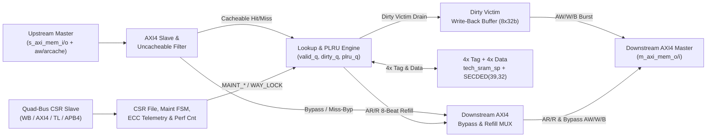

# 47_l2_cache — 4-Way Set-Associative Write-Back AXI4 L2 Cache Controller

## Overview

`47_l2_cache` is a clean-room, synthesizable IEEE 1800-2017 SystemVerilog **4-Way Set-Associative Write-Back / Write-Allocate L2 Cache Controller** with **SECDED(39,32) ECC**, **3-bit tree Pseudo-LRU (PLRU)** replacement, a **Dirty Victim Write-Back Buffer**, **hardware cache maintenance CSRs**, **way locking**, and **uncacheable bypass**.

It sits inline on a 32-bit AXI4 memory path (`s_axi_mem_i/o` -> `m_axi_mem_o/i`) while exposing a separate **Quad-Bus CSR Control Port** (`BUS_TYPE = BUS_WISHBONE | BUS_AXI4 | BUS_TILELINK | BUS_APB`).

## Features

- **Configurable Geometry**: Default `WAYS = 4`, `NUM_SETS = 64`, `LINE_BYTES = 32` (`8 KB` cache, 8 words/line); scales cleanly to `64 KB` (`NUM_SETS = 512`) or `512 KB` (`NUM_SETS = 4096`).
- **Write-Back / Write-Allocate**: Dirty-bit tracking per set/way, partial `wstrb` byte-merge on write hits and write-allocate misses, and a dedicated **8-word Dirty Victim Write-Back Buffer** that drains evicted dirty lines over `m_axi_mem` `AW/W/B` **concurrently** with `AR/R` line refills.
- **3-Bit Tree PLRU + Way Locking (`WAY_LOCK[3:0]`)**: Prefers invalid unlocked ways first, then tree PLRU across unlocked ways; supports pinning real-time ISR code or NPU weights in locked ways (with single-beat passthrough fallback if all 4 ways are locked).
- **SECDED(39,32) Inline ECC (`ECC_EN = 1`)**: Protects both Tag SRAMs and Data SRAMs using `{ecc[6:0], data[31:0]}` codewords in `tech_sram_sp`:
  - Single-bit error detection, inline correction, hardware scrub writeback, `ECC_CE_CNT`/`ECC_CE_ADDR`, and `IRQ_ECC_CE`.
  - Double-bit error detection, `ECC_UE_CNT`/`ECC_UE_ADDR`, `SLVERR` response, and `IRQ_ECC_UE`.
  - DFT fault injection (`ECC_INJ_LO` / `ECC_INJ_HI`) supporting one-shot or persistent injection into Data or Tag SRAM writes.
- **Uncacheable Bypass**: Honors global `CTRL.CACHE_EN` (`0` at reset), AXI4 `s_axi_awcache_i[1]` / `s_axi_arcache_i[1]` (`Modifiable`), and programmable `UNCACHE_BASE` / `UNCACHE_MASK` region matching, forwarding bursts directly to `m_axi_mem` with `SLVERR` propagation.
- **Hardware Cache Maintenance CSRs**: `INV_ALL`, `CLEAN_ALL`, `CLEAN_INV_ALL`, and line-granular `CLEAN_ADDR`, `INV_ADDR`, `CLEAN_INV_ADDR` (guaranteed drained to backing memory `BVALID` before `STATUS.MAINT_BUSY` clears).
- **Performance Counters**: `PERF_RD_HIT`, `PERF_RD_MISS`, `PERF_WR_HIT`, `PERF_WR_MISS`, `PERF_EVICTS`, `PERF_BYPASS`.
- **Quad-Bus CSR Wrappers**: `l2_cache_wb`, `l2_cache_axi`, `l2_cache_tl`, `l2_cache_apb`, unified under `l2_cache_top` (`BUS_TYPE = 0..3`).

## Architecture Block Diagram



## Address Breakdown & SRAM / ECC Layout

For a 32-bit physical byte address (default `WAYS = 4`, `NUM_SETS = 64`, `LINE_BYTES = 32`):

| Bits | Width | Field | Description |
| :--- | :--- | :--- | :--- |
| `[31:11]` | `21` | `TAG` | Physical tag (`TAG_W = 32 - SET_W - OFFSET_W`) |
| `[10:5]` | `6` | `SET` | Set index (`0..NUM_SETS-1`) |
| `[4:2]` | `3` | `WORD` | 32-bit word offset within 32B line (`0..7`) |
| `[1:0]` | `2` | `BYTE` | Byte lane offset within 32-bit word |

### SRAM & Metadata Organization

- **Tag SRAM (4 banks of `tech_sram_sp`)**: Depth = `NUM_SETS`, Width = `39` bits (`ECC_EN = 1`) or `32` bits (`ECC_EN = 0`). Stores `{ecc[6:0], {(32-TAG_W){1'b0}}, tag[TAG_W-1:0]}`.
- **Data SRAM (4 banks of `tech_sram_sp`)**: Depth = `NUM_SETS * (LINE_BYTES / 4)`, Width = `39` or `32` bits. Addressed by `{set_idx, word_idx}`.
- **Metadata Flip-Flops**: `valid_q[NUM_SETS][WAYS]`, `dirty_q[NUM_SETS][WAYS]`, and `plru_q[NUM_SETS][2:0]` are packed flip-flops so `rst_ni` and `MAINT_INV_ALL` clear cleanly without async reset loops on SRAM arrays.

### 3-Bit Tree PLRU Mapping

- `plru[0]`: Root (`0` -> left pair `{way 0, way 1}` is LRU side; `1` -> right pair `{way 2, way 3}` is LRU side).
- `plru[1]`: Left leaf (`0` -> `way 0` is LRU; `1` -> `way 1` is LRU).
- `plru[2]`: Right leaf (`0` -> `way 2` is LRU; `1` -> `way 3` is LRU).

### SECDED(39,32) Codeword Mapping

Stored as `{ecc[6:0], data[31:0]}`:
- `ecc[5:0]`: Hamming parity bits at 1-indexed bit positions `1, 2, 4, 8, 16, 32`.
- `ecc[6]`: Overall even-parity bit over `{ecc[5:0], data[31:0]}`.
- `data[31:0]`: Mapped to remaining 1-indexed Hamming positions `3, 5..7, 9..15, 17..31, 33..38`.

## Parameters & Top-Level Ports (`l2_cache_top`)

| Parameter | Type | Default | Description |
| :--- | :--- | :--- | :--- |
| `BUS_TYPE` | `bus_pkg::bus_proto_e` | `BUS_AXI4` | CSR port protocol (`0=WB, 1=AXI4, 2=TL, 3=APB`) |
| `WAYS` | `int unsigned` | `4` | Set associativity (4-way PLRU) |
| `NUM_SETS` | `int unsigned` | `64` | Number of cache sets (power of 2) |
| `LINE_BYTES` | `int unsigned` | `32` | Cache line size in bytes (power of 2, >= 4) |
| `ECC_EN` | `bit` | `1'b1` | `1`: SECDED(39,32) on Tag & Data SRAMs; `0`: raw 32-bit |

| Port | Dir | Type | Description |
| :--- | :--- | :--- | :--- |
| `clk_i`, `rst_ni` | in | `logic` | System clock and active-low async reset |
| `s_wb_i/o`, `s_axi_i/o`, `s_tl_i/o`, `s_apb_i/o` | in/out | `bus_pkg` | Quad-bus CSR control slave ports (selected by `BUS_TYPE`) |
| `s_axi_mem_i/o` | in/out | `axi4_m2s/s2m_t` | Upstream AXI4 memory slave port |
| `s_axi_awcache_i`, `s_axi_arcache_i` | in | `logic [3:0]` | AXI4 cache attributes (`bit[1]=Modifiable`, default `4'b0010`) |
| `m_axi_mem_o/i` | out/in | `axi4_m2s/s2m_t` | Downstream AXI4 memory master port |
| `m_axi_awcache_o`, `m_axi_arcache_o` | out | `logic [3:0]` | Downstream AXI4 cache attributes |
| `irq_o` | out | `logic` | Active-high interrupt (`ECC_CE`, `ECC_UE`, `MAINT_DONE`, `AXI_ERR`) |

## CSR Register Map

All registers are 32-bit aligned; out-of-range or unaligned CSR accesses return `err = 1`.

| Offset | Name | Access | Reset | Bit Fields |
| :--- | :--- | :--- | :--- | :--- |
| `0x00` | `CTRL` | RW | `0x0000_000A` (ECC=1) | `[0]` `CACHE_EN` (`0` at reset), `[1]` `ECC_CHK_EN`, `[2]` `IRQ_EN`, `[3]` `UNCACHE_WIN_EN` |
| `0x04` | `STATUS` | RO | — | `[0]` `CACHE_EN`, `[1]` `MAINT_BUSY`, `[2]` `WB_BUSY`, `[3]` `IDLE`, `[4]` `ECC_PRESENT`, `[15:8]` `WAYS`, `[23:16]` `LINE_BYTES`, `[31:24]` `LOG2_SETS` |
| `0x08` | `CACHE_INFO` | RO | — | `[15:0]` `NUM_SETS`, `[23:16]` `WAYS`, `[31:24]` `LINE_BYTES` |
| `0x0C` | `WAY_LOCK` | RW | `0x0000_0000` | `[3:0]` Way lock mask (`1` = pin way against eviction/allocation) |
| `0x10` | `MAINT_CMD` | RW | `0x0000_0000` | `[2:0]` `OP` (`1=INV_ALL, 2=CLEAN_ALL, 3=CLEAN_INV_ALL, 4=CLEAN_ADDR, 5=INV_ADDR, 6=CLEAN_INV_ADDR`), `[31]` `GO` (self-clears) |
| `0x14` | `MAINT_ADDR` | RW | `0x0000_0000` | `[31:0]` Physical byte address for `*_ADDR` maintenance |
| `0x18` | `UNCACHE_BASE` | RW | `0x0000_0000` | `[31:0]` Base address of uncacheable window |
| `0x1C` | `UNCACHE_MASK` | RW | `0x0000_0000` | `[31:0]` Mask (`!= 0` enables `(addr & mask) == (base & mask)` bypass) |
| `0x20` | `IRQ_STATUS` | RW1C | `0x0000_0000` | `[0]` `ECC_CE`, `[1]` `ECC_UE`, `[2]` `MAINT_DONE`, `[3]` `AXI_ERR` |
| `0x24` | `IRQ_EN` | RW | `0x0000_0000` | `[3:0]` Per-source interrupt enable mask |
| `0x28` | `ECC_CE_CNT` | RW (clr) | `0x0000_0000` | `[31:0]` Single-bit corrected error count (any write clears) |
| `0x2C` | `ECC_CE_ADDR` | RO | `0x0000_0000` | `[31:0]` Address of most recent 1-bit CE |
| `0x30` | `ECC_UE_CNT` | RW (clr) | `0x0000_0000` | `[31:0]` Double-bit uncorrectable error count (any write clears) |
| `0x34` | `ECC_UE_ADDR` | RO | `0x0000_0000` | `[31:0]` Address of most recent 2-bit UE |
| `0x38` | `ECC_INJ_LO` | RW | `0x0000_0000` | `[31:0]` DFT XOR injection mask for `data[31:0]` |
| `0x3C` | `ECC_INJ_HI` | RW | `0x0000_0000` | `[6:0]` `ecc[6:0]` mask, `[7]` `TARGET` (`0=Data, 1=Tag`), `[8]` `ONESHOT`, `[9]` `ARM` |
| `0x40` | `PERF_CTRL` | RW | `0x0000_0001` | `[0]` `COUNTERS_EN`, `[1]` `CLR_ALL` (WO pulse) |
| `0x44` | `PERF_RD_HIT` | RO | `0x0000_0000` | Read hit beats |
| `0x48` | `PERF_RD_MISS` | RO | `0x0000_0000` | Read miss beats |
| `0x4C` | `PERF_WR_HIT` | RO | `0x0000_0000` | Write hit beats |
| `0x50` | `PERF_WR_MISS` | RO | `0x0000_0000` | Write miss beats |
| `0x54` | `PERF_EVICTS` | RO | `0x0000_0000` | Valid cache line evictions |
| `0x58` | `PERF_BYPASS` | RO | `0x0000_0000` | Uncacheable bypass transactions |
| `0x5C` | `ID_VER` | RO | `0x4C32_0100` | IP identifier (`"L2"` v1.0) |

## Concurrent Dirty Victim Write-Back & Refill Timing

```
Cycle:        0      1..8     9..16         17..24
Lookup:    [MISS]
Data SRAM:        [Drain W0..7]->[WB Buf]
m_axi AW/W:                       [AW + W0..W7]----[B]
m_axi AR/R:                       [AR]--[R0..R7]->[Tag+Valid]
```

While the 8-word dirty victim drains over `m_axi_mem` `AW/W/B`, the missed line is concurrently refilled over `m_axi_mem` `AR/R`. A line-address hazard check stalls `AR` only if the very next miss targets the exact line still draining in the write-back buffer.

## Software Programming & DMA Coherency Recipes

Bare-metal C helpers are provided in [l2_cache_regs.h](../sw/l2_cache_regs.h) and [l2_cache_maint_example.c](../sw/l2_cache_maint_example.c):

1. **Boot Bring-Up**: Call `l2_enable(L2_BASE, MMIO_BASE, MMIO_MASK)` to set the uncacheable MMIO window, run `MAINT_OP_INV_ALL`, enable ECC IRQ reporting, and set `CTRL.CACHE_EN = 1`.
2. **Non-Coherent DMA TX (CPU -> Peripheral/NPU)**: Call `l2_clean_range(L2_BASE, buf_paddr, len)` before starting DMA so all dirty lines are flushed to DRAM (`STATUS.MAINT_BUSY == 0` guarantees `BVALID` completion).
3. **Non-Coherent DMA RX (Peripheral/NPU -> DRAM)**: Call `l2_invalidate_range(L2_BASE, buf_paddr, len)` after DMA completes so the CPU reloads fresh DRAM data instead of stale cache lines.
4. **RTOS Way Locking**: Call `l2_pin_region_in_way(L2_BASE, way_idx, isr_paddr, isr_len)` to load critical ISR code or NPU weights into a dedicated way and lock it via `WAY_LOCK`.

## FPGA & ASIC Synthesis Notes

- All Tag and Data memories use `common/rtl/tech/tech_sram_sp.sv` with clock-only synchronous writes and **no async reset on memory arrays**, allowing Yosys (`memory_bram`), FPGA Vivado/Quartus, and ASIC OpenRAM/SRAM compilers (`TARGET_ASIC`) to infer block RAM / hard SRAM macros cleanly.
- Verified static Yosys/ASIC compatibility via `python3 scripts/check_yosys_compat.py` (0 errors).

## Verification Scope (`tb_l2_cache`)

[tb_l2_cache.sv](../tb/tb_l2_cache.sv) implements a self-checking, constrained-random testbench against an independent golden shadow memory covering:
- Reset bypass (`CACHE_EN = 0`) and cache enable (`CACHE_EN = 1`)
- Cold misses -> hits and performance counters
- Partial `wstrb` write-allocate & decoupled `AW`/`W` handshakes
- 5-way set thrashing (PLRU eviction & dirty writeback verification in `tb_sim_ram`)
- Hardware maintenance (`CLEAN_ADDR`, `INV_ADDR`, `CLEAN_INV_ALL`, `CLEAN_ALL`, `INV_ALL`)
- Way locking (`WAY_LOCK = 4'b0001` and `4'hF` all-locked fallback)
- Uncacheable bypass (`UNCACHE_BASE/MASK` & `AxCACHE[1] == 0`)
- SECDED(39,32) 1-bit CE + scrub & 2-bit UE + `SLVERR` + `irq_o` on both Data & Tag SRAMs
- AXI4 INCR & WRAP bursts with downstream backpressure & `SLVERR` injection
- All 4 CSR bus modes (`BUS_AXI4`, `BUS_WISHBONE`, `BUS_TILELINK`, `BUS_APB`) and `ECC_EN = 0`
- Constrained-random stress (`+seed=N`) with final full-cache clean & DRAM-vs-shadow comparison
