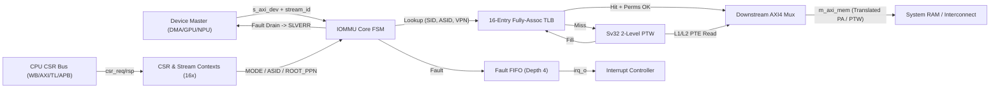

# 48_iommu — Hardware IOMMU / SMMU-Lite (`Sv32` PTW + 16-Entry TLB + Per-Stream Isolation)

## Overview

`48_iommu` is a clean-room, pure-synthesizable IEEE 1800-2017 SystemVerilog **Hardware Input/Output Memory Management Unit (IOMMU / SMMU-Lite)** designed to sit inline on AXI4 bus-master paths (DMA engines, 2D GPU, NPU/Mini-TPU, PCIe, USB). It provides per-stream address space isolation, RISC-V `Sv32`-compatible 2-level hardware page-table walking (supporting both **4KB pages** and **4MB superpages**), a **16-entry fully-associative TLB** with targeted invalidation, a **depth-4 fault recording FIFO** with interrupt generation, and a **quad-bus CSR control interface** (`BUS_WISHBONE`, `BUS_AXI4`, `BUS_TILELINK`, `BUS_APB`).

## Features

- **Inline AXI4 Data Path (`s_axi_dev_i/o` -> `m_axi_mem_o/i`)**:
  - Translates single-beat and multi-beat AXI4 read/write bursts (`awlen`/`arlen = 0..255`), preserving burst length, size, burst type, strobes, QoS, protection, and transaction IDs (`awid`/`arid` -> `bid`/`rid`).
  - **Pre-Memory Fault Blocking**: Faulting writes are drained locally without ever issuing downstream `AW`/`W` transactions to system RAM; both faulting reads and writes return `AXI_RESP_SLVERR` cleanly across all burst beats.
- **Per-Stream Device Context Table (`NUM_STREAMS = 16`)**:
  - Indexed by external `aw_stream_id_i` / `ar_stream_id_i` or dynamically via `s_axi_dev_i.awid` / `arid` (`CTRL.SID_FROM_AXI_ID`).
  - Independent `MODE` (`BYPASS`, `BLOCK`, `SV32_TRANSLATE`), `ASID[7:0]`, and 4KB-aligned `ROOT_PPN[21:0]` per stream.
- **RISC-V `Sv32` 2-Level Hardware Page-Table Walker (`iommu_ptw`)**:
  - Walks L1 pointer -> L2 leaf PTE for **4KB pages** and L1 leaf PTE (`R|W|X != 0`) for **4MB superpages**.
  - Enforces `V` (Valid), `R` (Read), `W` (Write), `A` (Accessed), `D` (Dirty on write), 4MB superpage alignment (`PPN[9:0] == 0`), invalid `W=1 && R=0` encodings, and non-leaf L2 rejection.
  - Muxes PTW AXI4 read fetches cleanly onto the single downstream `m_axi_mem_o/i` port with zero interlocks.
- **16-Entry Fully-Associative TLB (`iommu_tlb`)**:
  - Parallel CAM match on `(stream_id, asid, vpn[19:0], is_superpage)` with round-robin replacement.
  - Targeted shootdowns: `TLB_INV_ALL`, `TLB_INV_STREAM`, `TLB_INV_IOVA`.
  - Hardware performance counters: `PERF_TLB_HIT`, `PERF_TLB_MISS`, `PERF_PTW_CYC`, `PERF_FAULTS`.
- **Fault Recording Queue (`FAULT_FIFO`, Depth 4) & Interrupt (`irq_o`)**:
  - Captures `(FAULT_IOVA, FAULT_STREAM_ID, FAULT_ASID, FAULT_WRITE, FAULT_CAUSE)` with overflow tracking and W1C IRQ status.
- **Quad-Bus CSR Control Port (`BUS_TYPE = 0..3`)**:
  - Wishbone B4 (`iommu_wb`), AXI4/AXI4-Lite (`iommu_axi`), TileLink TL-UL (`iommu_tl`), AMBA APB4 (`iommu_apb`), unified under `iommu_top`.

---

## Architecture & Data-Path Flow



---

## Sv32 Address & PTE Formats

### IOVA Translation Mapping

```text
31                  22 21                  12 11                   0
+---------------------+----------------------+----------------------+
|     VPN[1] (10b)    |     VPN[0] (10b)     |  Page Offset (12b)   |  4KB Page
+---------------------+----------------------+----------------------+
           |                     |
           v                     v
   L1 PTE = RAM[{ROOT_PPN[19:0], VPN[1], 2'b00}]
     |-- If (R|W|X != 0): 4MB Superpage -> PA = {L1_PTE.PPN[19:10], IOVA[21:0]}
     '-- If (R==0 & W==0 & X==0):
           L2 PTE = RAM[{L1_PTE.PPN[19:0], VPN[0], 2'b00}]
             '-> 4KB Page -> PA = {L2_PTE.PPN[19:0], IOVA[11:0]}
```

### Sv32 32-Bit Page-Table Entry (PTE) Bitfields

```text
31                20 19                10 9   8 7 6 5 4 3 2 1 0
+-------------------+--------------------+-----+-+-+-+-+-+-+-+-+
|    PPN[1] (12b)   |    PPN[0] (10b)    | RSW |D|A|G|U|X|W|R|V|
+-------------------+--------------------+-----+-+-+-+-+-+-+-+-+
```

| Bit(s) | Field | Description |
| :--- | :--- | :--- |
| `0` | `V` | Valid (`0` = fault `PTE_INVALID`) |
| `1` | `R` | Read permission (`0` on read leaf -> `PERM_RD`; `R=0,W=1` -> `PTE_INVALID`) |
| `2` | `W` | Write permission (`0` on write leaf -> `PERM_WR`) |
| `3` | `X` | Execute permission (participates in leaf detection `R \| W \| X != 0`) |
| `4..5` | `U, G` | User / Global (preserved, unused by hardware) |
| `6` | `A` | Accessed (when `CTRL.AD_CHECK_EN=1`, leaf `A==0` faults as `PTE_INVALID`) |
| `7` | `D` | Dirty (when `CTRL.AD_CHECK_EN=1`, write to leaf with `D==0` faults as `PERM_WR`) |
| `9:8` | `RSW` | Reserved for software |
| `31:10` | `PPN[21:0]` | Physical Page Number (4KB-aligned; for 4MB superpages, `PPN[9:0]` must be `0`) |

---

## Multi-Stream Isolation

Each bus master (or AXI ID) carries a 4-bit `stream_id` (`0..15`) selecting an isolated entry in the Device Context Table:
- **Stream 0 (`BYPASS`)**: `PA == IOVA` with 0 PTW/TLB overhead.
- **Stream 1 (`BLOCK`)**: Every read/write immediately returns `AXI_RESP_SLVERR`, records `FAULT_STREAM_BLOCKED`, and never touches downstream RAM.
- **Stream 2 (`SV32_TRANSLATE`)**: Translates IOVAs using that stream's dedicated `ROOT_PPN` and `ASID`. Two streams accessing the exact same IOVA (e.g., `0x1000_2000`) map independently to isolated physical pages without aliasing or leaking TLB entries.

---

## Parameters & Top-Level Ports (`iommu_top`)

| Parameter | Default | Description |
| :--- | :--- | :--- |
| `BUS_TYPE` | `BUS_AXI4` | CSR bus protocol: `0=BUS_WISHBONE`, `1=BUS_AXI4`, `2=BUS_TILELINK`, `3=BUS_APB` |
| `NUM_STREAMS` | `16` | Number of per-stream device context entries |
| `TLB_ENTRIES` | `16` | Fully-associative TLB depth |
| `FAULT_FIFO_DEPTH` | `4` | Hardware fault recording FIFO depth |
| `USE_AXI_ID_AS_STREAM` | `1'b0` | Reset value of `CTRL.SID_FROM_AXI_ID` |

| Port | Direction | Width / Type | Description |
| :--- | :--- | :--- | :--- |
| `clk_i`, `rst_ni` | Input | `logic` | System clock and active-low async reset |
| `wb_i`, `wb_o` | In / Out | `wb_m2s_t` / `wb_s2m_t` | Wishbone B4 CSR slave (active when `BUS_TYPE==0`) |
| `axi_i`, `axi_o` | In / Out | `axi4_m2s_t` / `axi4_s2m_t` | AXI4 CSR slave (active when `BUS_TYPE==1`) |
| `tl_i`, `tl_o` | In / Out | `tl_m2s_t` / `tl_s2m_t` | TileLink TL-UL CSR slave (active when `BUS_TYPE==2`) |
| `apb_i`, `apb_o` | In / Out | `apb_m2s_t` / `apb_s2m_t` | AMBA APB4 CSR slave (active when `BUS_TYPE==3`) |
| `s_axi_dev_i`, `s_axi_dev_o` | In / Out | `axi4_m2s_t` / `axi4_s2m_t` | Upstream AXI4 device master port (IOVA) |
| `aw_stream_id_i`, `ar_stream_id_i` | Input | `logic [3:0]` | Per-channel Stream ID when `CTRL.SID_FROM_AXI_ID==0` |
| `m_axi_mem_o`, `m_axi_mem_i` | Out / In | `axi4_m2s_t` / `axi4_s2m_t` | Downstream AXI4 memory master port (PA + muxed PTW reads) |
| `irq_o` | Output | `logic` | Level-sensitive fault interrupt |

---

## CSR Register Map

| Offset | Name | Access | Reset | Bitfields |
| :--- | :--- | :--- | :--- | :--- |
| `0x000` | `CTRL` | RW | `0x0000_0002` | `[0]` `EN` (0=global bypass, 1=active), `[1]` `AD_CHECK_EN`, `[2]` `SID_FROM_AXI_ID`, `[3]` `SW_RST` (W1P, clears TLB/FIFO/counters/IRQs) |
| `0x004` | `STATUS` | RO | `0x0010_1000` | `[0]` `BUSY`, `[1]` `FAULT_VALID`, `[2]` `FAULT_FULL`, `[3]` `FAULT_OVF`, `[7:4]` `FAULT_COUNT`, `[15:8]` `NUM_STREAMS`, `[23:16]` `TLB_ENTRIES` |
| `0x008` | `IRQ_EN` | RW | `0x0000_0000` | `[0]` `FAULT_IRQ_EN`, `[1]` `FAULT_OVF_IRQ_EN` |
| `0x00C` | `IRQ_STAT` | RW1C | `0x0000_0000` | `[0]` `FAULT_IRQ`, `[1]` `FAULT_OVF_IRQ` (also clears `STATUS.FAULT_OVF`) |
| `0x010` | `TLB_INV_ALL` | WO | `0x0000_0000` | Any write invalidates all 16 TLB entries |
| `0x014` | `TLB_INV_STREAM` | WO | `0x0000_0000` | `[3:0]` `STREAM_ID`: invalidates all TLB entries for one stream |
| `0x018` | `TLB_INV_IOVA` | WO | `0x0000_0000` | `[31:12]` `IOVA[31:12]` (`VPN`), `[3:0]` `STREAM_ID`: invalidates matching entry (or covering 4MB superpage) |
| `0x01C` | `CAP_ID` | RO | `0x494F_4D31` | ASCII `"IOM1"` capability ID |
| `0x020` | `FAULT_IOVA` | RO | `0x0000_0000` | `[31:0]` Head fault IOVA (`0` if FIFO empty) |
| `0x024` | `FAULT_INFO` | RO | `0x0000_0000` | `[31]` `VALID`, `[23:16]` `ASID`, `[10:8]` `CAUSE` (`1=PTE_INVALID`, `2=PERM_RD`, `3=PERM_WR`, `4=STREAM_BLOCKED`, `5=PTW_BUS_ERR`), `[4]` `WRITE`, `[3:0]` `STREAM_ID` |
| `0x028` | `FAULT_POP` | WO | `0x0000_0000` | Any write pops the head entry from `FAULT_FIFO` |
| `0x030` | `PERF_TLB_HIT` | RW | `0x0000_0000` | Count of TLB hits |
| `0x034` | `PERF_TLB_MISS` | RW | `0x0000_0000` | Count of TLB misses triggering PTW |
| `0x038` | `PERF_PTW_CYC` | RW | `0x0000_0000` | Total cycles spent walking page tables |
| `0x03C` | `PERF_FAULTS` | RW | `0x0000_0000` | Total translation / permission / block faults |
| `0x100 + s*8` | `STREAM_CFG(s)` | RW | `0x0000_0000` | `[1:0]` `MODE` (`0=BYPASS`, `1=BLOCK`, `2=SV32`), `[15:8]` `ASID` (`s = 0..15`) |
| `0x104 + s*8` | `STREAM_ROOT(s)` | RW | `0x0000_0000` | `[21:0]` `ROOT_PPN` (4KB-aligned L1 table PPN, `s = 0..15`) |

---

## Software Driver Walkthrough (`sw/`)

- [iommu_regs.h](file:///Users/tianrui6641/tians_ip_collection/ips/48_iommu/sw/iommu_regs.h): Complete CSR offsets, Sv32 PTE bit/macro builders (`SV32_MAKE_PTE`, `SV32_VPN1`, `SV32_VPN0`), and MMIO accessors.
- [iommu_pagetable_example.c](file:///Users/tianrui6641/tians_ip_collection/ips/48_iommu/sw/iommu_pagetable_example.c):
  1. `iommu_sv32_map_4kb()` / `iommu_sv32_map_4mb()`: Constructs L1/L2 page tables in RAM with `V`, `R`, `W`, `A`, `D` flags.
  2. `iommu_soc_init()`: Configures isolated contexts for DMA (`SV32` 4KB), GPU (`BYPASS`), Mini-TPU (`SV32` 4MB read-only superpage), and untrusted PCIe (`BLOCK`), then enables interrupts and `CTRL.EN`.
  3. `iommu_remap_4kb()`: Updates an L2 PTE in RAM and performs targeted `TLB_INV_IOVA` shootdown.
  4. `iommu_fault_isr()`: Drains `FAULT_FIFO` via `FAULT_INFO` / `FAULT_IOVA` / `FAULT_POP` and clears `IRQ_STAT`.

---

## FPGA / ASIC Synthesis Notes

- Pure synthesizable IEEE 1800-2017 SystemVerilog with zero `#` delays, `initial` blocks, `real` types, or tri-states; passes `scripts/check_yosys_compat.py` cleanly.
- Single clock domain (`clk_i`) with async-assert active-low reset (`rst_ni`).
- The 16-entry TLB (`iommu_tlb`) uses flip-flop CAM storage for single-cycle parallel lookup; the depth-4 `FAULT_FIFO` reuses `common/rtl/sync_fifo.sv`.
- Zero combinational paths between `s_axi_dev` address/control inputs and `m_axi_mem` outputs (`ST_LOOKUP` registers the incoming transaction before lookup/translation).

---

## Verification Summary (`tb_iommu`)

[tb_iommu.sv](file:///Users/tianrui6641/tians_ip_collection/ips/48_iommu/tb/tb_iommu.sv) verifies:
- Quad-bus CSR configuration and end-to-end Sv32 translation across all 4 `BUS_TYPE` values (`BUS_WISHBONE`, `BUS_AXI4`, `BUS_TILELINK`, `BUS_APB`).
- Global & per-stream `BYPASS` mode and `BLOCK` mode (confirming `SLVERR`, `irq_o`, and target RAM untouched).
- Real Sv32 2-level 4KB page walks in `tb_sim_ram` (TLB miss -> PTW -> TLB fill -> subsequent TLB hits verified via `PERF_TLB_HIT`).
- 4MB superpage walks and superpage TLB hits across different 4KB sub-pages.
- Multi-stream isolation (Stream 0 and Stream 1 mapping identical IOVA `0x1000_2000` to disjoint PAs).
- Permission/flag fault coverage: write to `R=1,W=0`, read from `V=0`, read-then-write to `D=0`, invalid `W=1,R=0` non-leaf, misaligned 4MB superpage, and PTW AXI bus error (`FAULT_PTW_BUS_ERR`).
- `TLB_INV_IOVA`, `TLB_INV_STREAM`, `TLB_INV_ALL` after RAM PTE remapping.
- `SID_FROM_AXI_ID` mode and depth-4 `FAULT_FIFO` queuing.
- Constrained-random multi-stream IOVA traffic (`+seed=`) with downstream backpressure against a full-RAM golden scoreboard.
