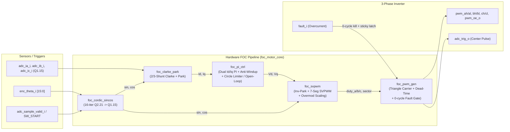

# `49_foc_motor` — Hardware FOC (Field-Oriented Control) Motor Control Accelerator

## 1. Overview

`49_foc_motor` is a clean-room, Yosys-, FPGA-, and ASIC-friendly **Hardware Field-Oriented Control (FOC)** accelerator for 3-phase PMSM and BLDC motors. It executes the complete synchronous current-control pipeline in deterministic fixed-point hardware (~24 clock cycles typical, ~73 cycles worst-case when both circle voltage limiting and over-modulation scaling engage), freeing the host CPU from high-rate (20–100 kHz) interrupt-driven math.

### Key Features
- **Full Fixed-Point Q1.15 Hardware Pipeline**:
  - **Stage 1 (`foc_cordic_sincos`)**: 16-iteration rotational CORDIC with full `[0, 2*pi)` quadrant mapping and pre-scaled `K = 0.607253` (`Q2.21`), delivering Q1.15 `sin(theta)` and `cos(theta)` with `<= 1 LSB` error.
  - **Stage 2 (`foc_clarke_park`)**: Selectable **2-shunt** (`Ic = -(Ia + Ib)`) or **3-shunt** (`Ia, Ib, Ic` common-mode-rejecting) amplitude-invariant Clarke transform, followed by saturating Park rotation `(Id, Iq)`.
  - **Stage 3 (`foc_pi_ctrl`)**: Dual independent `Id` & `Iq` PI controllers with programmable Q4.12 gains (`Kp_d, Ki_d, Kp_q, Ki_q`), 32-bit Q5.27 saturating integrators with **conditional-clamping anti-windup**, programmable `V_MAX` clamp, **Open-Loop Voltage Override** (`Vd_ovr, Vq_ovr`), and an exact iterative restoring-`sqrt`/div **Circle Voltage Limiter** (`sqrt(Vd^2 + Vq^2) <= V_MAX`).
  - **Stage 4 (`foc_svpwm` & `foc_pwm_gen`)**: Inverse Park `(Valpha, Vbeta)`, 6-sector **7-segment center-aligned SVPWM** with exact proportional over-modulation scaling (`T1 + T2 > PWM_PERIOD`), shadow-buffered up/down triangle carrier, programmable 12-bit dead-time insertion (`pwm_ah/al`, `pwm_bh/bl`, `pwm_ch/cl`), 0-cycle combinational + sticky latched hardware emergency fault (`fault_i`), and programmable center-aligned `adc_trig_o` pulse.
- **Autonomous or Software-Triggered**: Triggered either autonomously by hardware `adc_sample_valid_i` (zero-CPU-overhead inner current loop) or via CSR `SW_START`.
- **Quad-Bus CSR Slave**: Parameterized `foc_motor_top` (`BUS_TYPE = 0..3`: Wishbone B4, AXI4/AXI4-Lite, TileLink TL-UL/TL-UH, AMBA APB4).

---

## 2. FOC Control Loop Architecture



---

## 3. Fixed-Point Arithmetic & Mathematical Equations

### 3.1 Number Formats
- **Q1.15 (`q15_t`)**: `logic signed [15:0]`, range `[-32768, +32767]` representing `[-1.0, +0.9999695]`. All multiplications use rounded right-shift `>>> 15` and clamp via `sat_q15()`.
- **Electrical Angle (`theta_e`)**: Unsigned 16-bit `[0..65535]` mapping `[0, 2*pi)` (`16'h4000 = pi/2`, `16'h8000 = pi`, `16'hC000 = 3*pi/2`).
- **PI Gains (`Kp, Ki`)**: Unsigned 16-bit **Q4.12** (`1.0 = 16'h1000 = 4096`, range `[0, 15.99976]`).
- **PI Integrator (`acc_d, acc_q`)**: Signed 32-bit **Q5.27** (`acc >>> 12` gives Q1.15).

### 3.2 Stage Equations
1. **CORDIC `sin/cos`**: Top 2 bits `theta_e[15:14]` select quadrant; bottom 14 bits map `[0, pi/2)` into 24-bit `z`. Vector `(K_16, 0)` with `K_16 = 0.6072529` (`1273502` in Q2.21) undergoes 16 shift-add micro-rotations, followed by quadrant swap/negation.
2. **Clarke Transform**:
   - **2-Shunt (`THREE_SHUNT=0`)**:
     `Ialpha = Ia`, `Ibeta = (Ia + 2*Ib) * (1/sqrt(3))`, with `1/sqrt(3) = 18919` (`16'h49E7` in Q1.15).
   - **3-Shunt (`THREE_SHUNT=1`)**:
     `Ialpha = (2*Ia - Ib - Ic) / 3`, `Ibeta = (Ib - Ic) * (1/sqrt(3))`.
3. **Park Transform**:
   `Id = Ialpha*cos(theta) + Ibeta*sin(theta)`, `Iq = -Ialpha*sin(theta) + Ibeta*cos(theta)`.
4. **Dual PI + Anti-Windup + Circle Limiter**:
   - `e = ref - meas`
   - `u_unsat = (Kp * e + acc_q) >>> 12`
   - Conditional clamping: `acc` freezes whenever `u_unsat >= +V_MAX` with `e > 0`, or `u_unsat <= -V_MAX` with `e < 0`; otherwise `acc` integrates `Ki * e` clamped to `[-V_MAX << 12, +V_MAX << 12]`.
   - Circle Limiter (`CIRCLE_LIM_EN=1`): when `Vd^2 + Vq^2 > V_MAX^2`, computes `mag = ceil(sqrt(Vd^2 + Vq^2))` and `scale = (V_MAX << 15) / mag` iteratively and scales `(Vd, Vq)` radially onto the `V_MAX` circle.
5. **Inverse Park**:
   `Valpha = Vd*cos(theta) - Vq*sin(theta)`, `Vbeta = Vd*sin(theta) + Vq*cos(theta)`.

---

## 4. 7-Segment SVPWM 6-Sector Switching Table

Reference projections:
- `Vref1 = Vbeta`
- `Vref2 = (sqrt(3)*Valpha - Vbeta) / 2`
- `Vref3 = (-sqrt(3)*Valpha - Vbeta) / 2`
- `N = (Vref3 > 0 ? 4 : 0) + (Vref2 > 0 ? 2 : 0) + (Vref1 > 0 ? 1 : 0)`

With `T0 = PWM_PERIOD - T1 - T2`, `T_lo = T0 / 2`, `T_mid1 = T_lo + T1`, `T_mid2 = T_lo + T2`, `T_hi = T_lo + T1 + T2`:

| `N` | Sector | Angle Range | `T1` (scaled) | `T2` (scaled) | `duty_a_o` | `duty_b_o` | `duty_c_o` |
|-----|--------|-------------|---------------|---------------|------------|------------|------------|
| `3` | `1` | `[0, 60)` | `Vref2` | `Vref1` | `T_hi` | `T_mid2` | `T_lo` |
| `1` | `2` | `[60, 120)` | `-Vref3` | `-Vref2` | `T_mid1` | `T_hi` | `T_lo` |
| `5` | `3` | `[120, 180)` | `Vref1` | `Vref3` | `T_lo` | `T_hi` | `T_mid2` |
| `4` | `4` | `[180, 240)` | `-Vref2` | `-Vref1` | `T_lo` | `T_mid1` | `T_hi` |
| `6` | `5` | `[240, 300)` | `Vref3` | `Vref2` | `T_mid2` | `T_lo` | `T_hi` |
| `2` | `6` | `[300, 360)` | `-Vref1` | `-Vref3` | `T_hi` | `T_lo` | `T_mid1` |

When `T1 + T2 > PWM_PERIOD`, `foc_svpwm` performs exact proportional over-modulation scaling (`T1' = floor(T1 * PWM_PERIOD / (T1 + T2))`, `T2' = PWM_PERIOD - T1'`, `T0 = 0`) and asserts `SATURATED`.

---

## 5. Dead-Time, ADC Trigger & Fault-Protection Timing

```text
cnt_q       :  0  ...  duty-1  duty ... PWM_PERIOD ... duty  duty-1 ... 0
ideal_x     :  1111111111111111100000000000000000000000011111111111111111
pwm_xh_o    :  11111111111111111000000000000000000000000000<--DT-->111111
pwm_xl_o    :  00000000000000000000<--DT-->111111111111100000000000000000
adc_trig_o  :  _____________________________^____________________________  (Mode 00: peak)
fault_i     :  _______________________________________/‾‾‾‾‾‾‾\__________
pwm_oe_o    :  ‾‾‾‾‾‾‾‾‾‾‾‾‾‾‾‾‾‾‾‾‾‾‾‾‾‾‾‾‾‾‾‾‾‾‾‾‾‾‾\__________________  (0-cycle kill, sticky until W1C)
pwm_xh/xl_o :  .......................................\__________________  (Forced 0 immediately)
```

---

## 6. Parameters & Ports (`foc_motor_top`)

| Parameter | Default | Description |
|-----------|---------|-------------|
| `BUS_TYPE` | `bus_pkg::BUS_AXI4` | Bus protocol selector: `0=BUS_WISHBONE`, `1=BUS_AXI4`, `2=BUS_TILELINK`, `3=BUS_APB` |

| Port | Width / Type | Dir | Description |
|------|--------------|-----|-------------|
| `clk_i`, `rst_ni` | `logic` | in | System clock and active-low async reset |
| `wb_i/o`, `axi_i/o`, `tl_i/o`, `apb_i/o` | `bus_pkg::*` | in/out | Quad-bus CSR slave ports (tie unused inputs to `'0`) |
| `adc_sample_valid_i` | `logic` | in | Single-cycle hardware trigger pulse for autonomous FOC loop |
| `adc_ia_i`, `adc_ib_i`, `adc_ic_i` | `q15_t` (`16b` signed) | in | Phase A/B/C Q1.15 current samples (`adc_ic_i` used when `THREE_SHUNT=1`) |
| `enc_theta_i` | `logic [15:0]` | in | Unsigned 16-bit electrical rotor angle `[0, 2*pi)` |
| `pwm_ah_o/al_o`, `bh_o/bl_o`, `ch_o/cl_o` | `logic` | out | Complementary center-aligned PWM outputs with dead-time |
| `pwm_oe_o` | `logic` | out | Global PWM output enable (`0` when disabled or faulted) |
| `fault_i` | `logic` | in | Active-high emergency break / overcurrent fault input |
| `adc_trig_o` | `logic` | out | Single-cycle center-aligned ADC sampling trigger pulse |
| `irq_o` | `logic` | out | Level-high interrupt output (`|(IRQ_STAT & IRQ_EN)`) |

---

## 7. CSR Register Map

| Offset | Name | Access | Reset | Bitfields |
|--------|------|--------|-------|-----------|
| `0x00` | `CTRL` | RW/WO | `0x0000_0020` | `[0]` FOC_EN, `[1]` PWM_EN, `[2]` HW_TRIG_EN, `[3]` THREE_SHUNT, `[4]` OPEN_LOOP, `[5]` CIRCLE_LIM_EN (rst=1), `[7:6]` ADC_TRIG_MODE (`00`=peak, `01`=valley, `10`=both, `11`=off), `[8]` CLR_INTEGRATOR (WO), `[9]` SW_START (WO), `[10]` SW_USE_EXT_ADC |
| `0x04` | `STATUS` | RO | `0x0000_0010` | `[0]` BUSY, `[1]` FAULT_ACTIVE, `[2]` FAULT_PIN, `[3]` SATURATED, `[6:4]` SECTOR (`1..6`), `[7]` PWM_ACTIVE, `[31:16]` CYCLE_CNT |
| `0x08` | `IRQ_EN` | RW | `0x0000_0000` | `[0]` CYCLE_DONE_EN, `[1]` FAULT_EN, `[2]` SATURATED_EN |
| `0x0C` | `IRQ_STAT` | RW1C | `0x0000_0000` | `[0]` CYCLE_DONE, `[1]` FAULT (W1C clears latch only if `fault_i == 0`), `[2]` SATURATED |
| `0x10` | `ID_IQ_REF` | RW | `0x0000_0000` | `[15:0]` ID_REF (Q1.15), `[31:16]` IQ_REF (Q1.15) |
| `0x14` | `KP_KI_D` | RW | `0x0100_1000` | `[15:0]` KP_D (Q4.12), `[31:16]` KI_D (Q4.12) |
| `0x18` | `KP_KI_Q` | RW | `0x0100_1000` | `[15:0]` KP_Q (Q4.12), `[31:16]` KI_Q (Q4.12) |
| `0x1C` | `V_LIMIT` | RW | `0x0000_7FFF` | `[15:0]` V_MAX (unsigned Q1.15 `[0..32767]`) |
| `0x20` | `VD_VQ_OVR` | RW | `0x0000_0000` | `[15:0]` VD_OVR (Q1.15), `[31:16]` VQ_OVR (Q1.15) |
| `0x24` | `PWM_CFG` | RW | `0x000A_03E8` | `[15:0]` PWM_PERIOD (half-period cycles), `[27:16]` DEAD_TIME (cycles) |
| `0x28` | `CSR_I_AB` | RW | `0x0000_0000` | `[15:0]` CSR_IA (Q1.15), `[31:16]` CSR_IB (Q1.15) |
| `0x2C` | `CSR_IC_THETA` | RW | `0x0000_0000` | `[15:0]` CSR_IC (Q1.15), `[31:16]` CSR_THETA (`[0..65535]`) |
| `0x30` | `OBS_SINCOS` | RO | `0x0000_7FFF` | `[15:0]` COS_THETA (Q1.15), `[31:16]` SIN_THETA (Q1.15) |
| `0x34` | `OBS_IALPHA_BETA` | RO | `0x0000_0000` | `[15:0]` I_ALPHA (Q1.15), `[31:16]` I_BETA (Q1.15) |
| `0x38` | `OBS_ID_IQ` | RO | `0x0000_0000` | `[15:0]` ID_MEAS (Q1.15), `[31:16]` IQ_MEAS (Q1.15) |
| `0x3C` | `OBS_VD_VQ` | RO | `0x0000_0000` | `[15:0]` VD_CMD (Q1.15), `[31:16]` VQ_CMD (Q1.15) |
| `0x40` | `OBS_VALPHA_BETA` | RO | `0x0000_0000` | `[15:0]` V_ALPHA (Q1.15), `[31:16]` V_BETA (Q1.15) |
| `0x44` | `OBS_DUTY_AB` | RO | `0x0000_01F4` | `[15:0]` DUTY_A, `[31:16]` DUTY_B |
| `0x48` | `OBS_DUTY_C` | RO | `0x0001_01F4` | `[15:0]` DUTY_C, `[18:16]` SECTOR (`1..6`) |
| `0x4C` | `OBS_ACC_D` | RO | `0x0000_0000` | `[31:0]` ID_INTEGRATOR (Q5.27) |
| `0x50` | `OBS_ACC_Q` | RO | `0x0000_0000` | `[31:0]` IQ_INTEGRATOR (Q5.27) |
| `0x54` | `ID_VERSION` | RO | `0x464F_4301` | Constant IP ID `"FOC\x01"` |

---

## 8. Software Bring-Up & Synthesis Notes

- **Firmware Header & Example**: See [foc_regs.h](../sw/foc_regs.h) and [foc_motor_loop_example.c](../sw/foc_motor_loop_example.c) for `foc_init_pmsm()`, `foc_align_rotor_open_loop()`, `foc_close_current_loop()`, `foc_speed_loop_tick()`, and `foc_isr_handler()`.
- **FPGA / Yosys DSP Inference**: All multiplications are 16x16 or 18x18 signed/unsigned with registered stage outputs (`foc_clarke_park`, `foc_pi_ctrl`, `foc_svpwm`), mapping cleanly to Xilinx DSP48E1/E2 or Lattice ECP5 `MULT18X18D` slices. Divisions in the circle limiter and over-modulation scaler use compact 15–16 cycle shift-subtract state machines to avoid large combinational divider trees in Yosys/OpenLane.
- **ASIC Tape-Out**: Single clock domain (`clk_i`), async-assert reset (`rst_ni`), no latches, no internal tri-states (`pwm_oe_o` controls external gate-driver/pad OE), and 0-cycle combinational `fault_i` output gating.

---

## 9. Verification Summary

`ips/49_foc_motor/tb/tb_foc_motor.sv` (`tb_foc_motor`) verifies:
1. **Quad-Bus CSR Parity**: Identical behavior across Wishbone B4, AXI4, TileLink, and APB4 wrappers + APB byte-strobe & invalid-address error checks.
2. **CORDIC Full-Quadrant Sweep**: 72 boundary + random angles verified against `real $cos/$sin` (`<= 2 LSB` Q1.15 error).
3. **All 6 SVPWM Sectors**: 2-shunt & 3-shunt Clarke/Park, Inverse Park, zero-sequence centering, and SVPWM phase voltage reconstruction (`< 1%` error vs `real` math).
4. **Anti-Windup, Circle Limiter & Over-Modulation**: Non-zero integrator freeze during saturation, exact circle bound clamping, and over-modulation duty clamping.
5. **Dead-Time, ADC Trigger, HW Trigger & Fault Protection**: Continuous shoot-through monitor across all 4 DUTs, exact `>= DEAD_TIME` cycle gap verification, center-aligned `adc_trig_o`, `adc_sample_valid_i` autonomous loop, and 0-cycle + sticky `fault_i` latch/W1C recovery.
6. **Closed-Loop PMSM RL Plant**: 160-step discrete-time dq RL motor simulation driven by reconstructed SVPWM duties, verifying `Id -> 0` and `Iq -> +0.5 -> -0.4` step tracking (`< 0.015` steady-state error).
7. **Constrained-Random Sweep**: 40 randomized vectors with `+seed` support.
