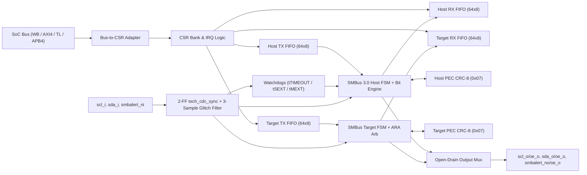

# `50_smbus_pmbus` — SMBus 3.0 / PMBus 1.3 Host & Target Controller

Clean-room, synthesizable IEEE 1800-2017 SystemVerilog **SMBus 3.0 / PMBus 1.3 Host & Target Controller** featuring Hardware PEC CRC-8, `SMBALERT#` ARA (`7'h0C`) arbitration, ARP (`7'h61`) protocol support, strict hardware timeout watchdogs, 64-byte TX/RX FIFOs, and selectable Wishbone B4 / AXI4 / TileLink / APB4 slave CSR wrappers.

---

## Key Features

- **Pure Synthesizable Open-Drain Architecture**: Split pad signals (`scl_i/o/oe_o`, `sda_i/o/oe_o`, `smbalert_ni/o/oe_o`) with zero `inout` tristate primitives inside digital RTL (100% Yosys / OpenLane / FPGA / ASIC clean).
- **2-FF Synchronizers & Digital Glitch Filter**: `tech_cdc_sync` (2-stage `async_reg` synchronizer) + 3-sample consensus glitch filter on `scl_i`, `sda_i`, and `smbalert_ni`.
- **Full SMBus 3.0 Host Protocol Engine** (100 kHz / 400 kHz / 1 MHz via programmable `CLK_DIV`, clock-stretching, multi-master arbitration loss detection):
  - **Quick Command** (`S Addr+R/W A P`)
  - **Send Byte / Receive Byte** (with optional PEC)
  - **Write Byte / Read Byte** (`CMD + 1B`, Repeated-START + optional PEC)
  - **Write Word / Read Word** (`CMD + 2B` little-endian for PMBus voltage/telemetry)
  - **Process Call** (`CMD + Write 2B + Sr + Read 2B`, optional PEC)
  - **Block Write / Block Read / Block Write-Block Read Process Call** (`CMD + ByteCount + 1..64B` via internal 64-byte TX/RX FIFOs, optional PEC)
- **Hardware PEC CRC-8 (`smbus_pec_crc8`)**: Polynomial $x^8 + x^2 + x + 1$ (`8'h07`, MSB-first, init `8'h00`), automatically spanning all packet bytes from initial `START` (preserving state across `Repeated-START`), auto-appending PEC on TX and checking PEC on RX (`ERR_PEC` + IRQ).
- **`SMBALERT#` & Alert Response Address (`ARA = 7'h0C`)**: Falling-edge & live-level monitor on `smbalert_ni`, optional `AUTO_ARA_EN`, or manual one-shot `SMBUS_OP_ARA` capturing the winning slave's 7-bit address (with PEC verification) into `ARA_ADDR`.
- **SMBus ARP (`7'h61`) Support**: Host `Prepare to ARP` (`0x01`), `Reset Device` (`0x02`), `Get UDID` (`0x03`, 16-byte block read), and `Assign Address` (`0x04`, 17-byte block write) via the standard Send Byte / Block Read / Block Write engine (`smbus_arp_discover()`).
- **SMBus Target (Slave) Mode**: Programmable `OWN_ADDR` + Host Notify (`7'h08`) + **ARA (`7'h0C`) bitwise SDA arbitration** (`TARGET_ALERT_EN=1`, automatically clearing alert on winning ACK), hardware PEC checking/generation, optional read clock-stretching (`TGT_STRETCH_EN`), and dedicated 64-byte Target TX/RX FIFOs.
- **Strict Hardware Watchdogs & Bus Recovery**:
  - `tTIMEOUT` (continuous SCL-low timeout -> abort + release bus + `ERR_TIMEOUT`)
  - `tLOW:SEXT` (cumulative target clock-stretch per packet -> `ERR_SEXT`)
  - `tLOW:MEXT` (cumulative host SCL-low per byte -> `ERR_MEXT`)
  - `SMBUS_OP_BUS_RECOVER` (9 open-drain SCL pulses + `STOP` to unwedge stuck slaves)
- **Quad-Bus CSR Wrappers**: `BUS_WISHBONE (0)`, `BUS_AXI4 (1)`, `BUS_TILELINK (2)`, `BUS_APB (3)`.

---

## Block Diagram



---

## Parameters & Ports (`smbus_pmbus_top`)

| Parameter / Port | Direction / Type | Description |
|---|---|---|
| `BUS_TYPE` | `bus_pkg::bus_proto_e` | `BUS_WISHBONE` (0), `BUS_AXI4` (1, default), `BUS_TILELINK` (2), `BUS_APB` (3) |
| `clk_i`, `rst_ni` | input `logic` | System clock and active-low asynchronous reset |
| `wb_i/o`, `axi_i/o`, `tl_i/o`, `apb_i/o` | bus structs | Selectable CSR slave ports (tie unused inputs to `'0`) |
| `scl_i`, `scl_o`, `scl_oe_o` | in / out / out | Split open-drain SCL pad (`scl_o=0`, `scl_oe_o=1` pulls SCL low) |
| `sda_i`, `sda_o`, `sda_oe_o` | in / out / out | Split open-drain SDA pad (`sda_o=0`, `sda_oe_o=1` pulls SDA low) |
| `smbalert_ni`, `smbalert_no`, `smbalert_oe_o` | in / out / out | Split open-drain `SMBALERT#` pad (`smbalert_no=0`, `smbalert_oe_o=1` pulls low) |
| `irq_o` | output `logic` | Level-high combined interrupt (`|(IRQ_STAT & IRQ_EN)`) |

---

## SMBus 3.0 Protocol & Hardware PEC CRC-8 Reference

### PEC CRC-8 Calculation
- Polynomial: $C(x) = x^8 + x^2 + x + 1$ (`8'h07`), MSB-first, initialized to `8'h00` on initial `START`.
- **Repeated-START Rule**: `Repeated-START (Sr)` does **not** reset the CRC-8 accumulator; the Repeated-START Read address byte (`{addr7, 1'b1}`) is included in the PEC calculation.
- **Verification Property**: Feeding the received PEC byte into the CRC-8 engine yields `8'h00` if and only if the packet is error-free.

### Host Operations (`CMD.OP[3:0]`)

| Code | Enum | Wire Sequence |
|---|---|---|
| `0` | `SMBUS_OP_NOP` | No operation |
| `1` | `SMBUS_OP_QUICK_CMD` | `S \| Addr+RW \| A \| P` (no PEC) |
| `2` | `SMBUS_OP_SEND_BYTE` | `S \| Addr+W \| A \| TX[0] \| A \| [PEC \| A] \| P` |
| `3` | `SMBUS_OP_RECV_BYTE` | `S \| Addr+R \| A \| RX[0] \| [A \| PEC] \| N \| P` |
| `4` | `SMBUS_OP_WRITE_BYTE` | `S \| Addr+W \| A \| CMD \| A \| TX[0] \| A \| [PEC \| A] \| P` |
| `5` | `SMBUS_OP_READ_BYTE` | `S \| Addr+W \| A \| CMD \| A \| Sr \| Addr+R \| A \| RX[0] \| [A \| PEC] \| N \| P` |
| `6` | `SMBUS_OP_WRITE_WORD` | `S \| Addr+W \| A \| CMD \| A \| TX[0] \| A \| TX[1] \| A \| [PEC \| A] \| P` |
| `7` | `SMBUS_OP_READ_WORD` | `S \| Addr+W \| A \| CMD \| A \| Sr \| Addr+R \| A \| RX[0] \| A \| RX[1] \| [A \| PEC] \| N \| P` |
| `8` | `SMBUS_OP_PROCESS_CALL` | `S \| Addr+W \| A \| CMD \| A \| TX[0..1] \| Sr \| Addr+R \| A \| RX[0..1] \| [A \| PEC] \| N \| P` |
| `9` | `SMBUS_OP_BLOCK_WRITE` | `S \| Addr+W \| A \| CMD \| A \| LEN \| A \| TX[0..LEN-1] \| A \| [PEC \| A] \| P` |
| `10` | `SMBUS_OP_BLOCK_READ` | `S \| Addr+W \| A \| CMD \| A \| Sr \| Addr+R \| A \| CNT \| A \| RX[0..CNT-1] \| [A \| PEC] \| N \| P` |
| `11` | `SMBUS_OP_BLOCK_PROC_CALL` | `S \| Addr+W \| A \| CMD \| A \| WLEN \| A \| TX[...] \| Sr \| Addr+R \| A \| RCNT \| A \| RX[...] \| [A \| PEC] \| N \| P` |
| `12` | `SMBUS_OP_ARA` | `S \| 7'h0C+R \| A \| SlvAddrByte \| [A \| PEC] \| N \| P` -> `ARA_ADDR` |
| `13` | `SMBUS_OP_BUS_RECOVER` | 9 open-drain SCL clocks + `STOP` |

### `SMBALERT#` ARA & ARP Flows
- **ARA (`7'h0C`)**: When multiple slaves pull `SMBALERT#` low simultaneously, an `SMBUS_OP_ARA` read broadcasts `8'h19`. Alerting slaves transmit `{OWN_ADDR, 1'b0}` with bitwise wired-AND SDA arbitration; the lowest 7-bit address wins, releases `SMBALERT#`, and is captured in `ARA_ADDR[6:0]`. Losing slaves keep `SMBALERT#` low for subsequent ARA cycles.
- **ARP (`7'h61`)**: Implemented cleanly using `SMBUS_OP_SEND_BYTE` (`0x01` Prepare / `0x02` Reset), `SMBUS_OP_BLOCK_READ` (`0x03` Get UDID, 16 bytes), and `SMBUS_OP_BLOCK_WRITE` (`0x04` Assign Address, 16-byte UDID + 1-byte new address).

---

## CSR Register Map

| Offset | Name | Access | Reset | Bitfields |
|---|---|---|---|---|
| `0x00` | `CTRL` | R/W | `0x0000_0000` | `[0]` `HOST_EN`, `[1]` `TARGET_EN`, `[2]` `PEC_EN`, `[3]` `TGT_PEC_EN`, `[4]` `AUTO_ARA_EN`, `[5]` `HOST_NOTIFY_EN`, `[6]` `TARGET_ALERT_EN` (HW-cleared on ARA win), `[7]` `TGT_STRETCH_EN`, `[8]` `FIFO_CLR` (SC), `[9]` `TGT_FIFO_CLR` (SC), `[10]` `SW_RST` (SC), `[11]` `FILT_DIS` |
| `0x04` | `CLK_DIV` | R/W | `0x0000_00FA` | `[15:0]` `QUARTER_DIV` (cycles per quarter-SCL; min 2, >=6 w/ filter), `[31:16]` `TBUF_DIV` (bus-free wait; 0 -> `2 * QUARTER_DIV`) |
| `0x08` | `CMD` | R/W | `0x0000_0000` | Writing when idle launches Host transfer: `[3:0]` `OP`, `[4]` `RW_BIT` (Quick Cmd), `[5]` `NO_PEC`, `[14:8]` `SLAVE_ADDR`, `[23:16]` `CMD_CODE`, `[31:24]` `TX_LEN` (`1..64`) |
| `0x0C` | `STATUS` | RO | `0x0000_C000` | `[0]` `HOST_BUSY`, `[1]` `HOST_DONE`, `[2]` `BUS_BUSY`, `[3]` `ALERT_ACTIVE`, `[4]` `ERR_NACK`, `[5]` `ERR_PEC`, `[6]` `ERR_ARB_LOST`, `[7]` `ERR_TIMEOUT`, `[8]` `ERR_SEXT`, `[9]` `ERR_MEXT`, `[10]` `ERR_PROTO`, `[11]` `TGT_BUSY`, `[12]` `TGT_ERR_PEC`, `[13]` `TGT_RD_STRETCH`, `[14]` `SCL_LEVEL`, `[15]` `SDA_LEVEL`, `[23:16]` `RX_BYTE_CNT`, `[31:24]` `LAST_PEC` |
| `0x10` | `TX_FIFO` | WO | `0x0000_0000` | `[7:0]` Push byte to 64-byte Host TX FIFO |
| `0x14` | `RX_FIFO` | RO | `0x0000_0100` | `[7:0]` Pop byte from 64-byte Host RX FIFO, `[8]` `EMPTY` |
| `0x18` | `FIFO_STAT` | RO | `0x0000_0000` | `[6:0]` `TX_LVL`, `[7]` `TX_FULL`, `[14:8]` `RX_LVL`, `[15]` `RX_FULL`, `[22:16]` `TGT_TX_LVL`, `[23]` `TGT_TX_FULL`, `[30:24]` `TGT_RX_LVL`, `[31]` `TGT_RX_FULL` |
| `0x1C` | `IRQ_EN` | R/W | `0x0000_0000` | `[0]` `HOST_DONE`, `[1]` `HOST_ERR`, `[2]` `ALERT`, `[3]` `ARA_DONE`, `[4]` `TGT_WR_DONE`, `[5]` `TGT_RD_REQ`, `[6]` `TGT_ERR`, `[7]` `TGT_ARA_WON`, `[8]` `HOST_NOTIFY` |
| `0x20` | `IRQ_STAT` | R/W1C | `0x0000_0000` | Same `[8:0]` bit layout as `IRQ_EN`; write `1` to clear |
| `0x24` | `ARA_ADDR` | R/W1C | `0x0000_0000` | `[6:0]` `ADDR`, `[7]` `PEC_OK`, `[15:8]` `RAW_BYTE`, `[31]` `VALID` (W1C) |
| `0x28` | `T_TIMEOUT_CFG` | R/W | `0x002D_C6C0` | `[23:0]` Continuous SCL-low watchdog limit in `clk_i` cycles (0=disabled, default 3,000,000 = 30 ms @ 100 MHz) |
| `0x2C` | `T_SEXT_CFG` | R/W | `0x0026_25A0` | `[23:0]` Cumulative target stretch limit per packet (0=disabled, default 2,500,000 = 25 ms @ 100 MHz) |
| `0x30` | `T_MEXT_CFG` | R/W | `0x000F_4240` | `[23:0]` Cumulative host low limit per byte (0=disabled, default 1,000,000 = 10 ms @ 100 MHz) |
| `0x34` | `TGT_CFG` | R/W | `0x0100_082A` | `[6:0]` `OWN_ADDR` (RW), `[14:8]` `NOTIFY_ADDR` (RW, `7'h08`), `[23:16]` `TGT_RX_CNT` (RO), `[24]` `TGT_LAST_PEC_OK` (RO), `[25]` `TGT_LAST_NOTIFY` (RO), `[26]` `TGT_ARA_LOST` (RO) |
| `0x38` | `TGT_TX_FIFO` | WO | `0x0000_0000` | `[7:0]` Push byte to 64-byte Target TX FIFO |
| `0x3C` | `TGT_RX_FIFO` | RO | `0x0000_0100` | `[7:0]` Pop byte from 64-byte Target RX FIFO, `[8]` `EMPTY` |
| `0x40` | `CAP_ID` | RO | `0x534D_4233` | ASCII `"SMB3"` |

---

## Software Bring-Up & PMBus Telemetry

See [smbus_pmbus_regs.h](../sw/smbus_pmbus_regs.h) and [smbus_pmbus_example.c](../sw/smbus_pmbus_example.c):

1. Verify `CAP_ID == 0x534D4233`.
2. Set `CLK_DIV` (`QUARTER_DIV = f_clk / (4 * f_SCL)`, e.g. `250` for 100 kHz or `62` for 400 kHz at 100 MHz) and timeout thresholds (`T_TIMEOUT_CFG`, `T_SEXT_CFG`, `T_MEXT_CFG`).
3. Enable `HOST_EN | PEC_EN` in `CTRL`.
4. Use `pmbus_read_telemetry()` to convert PMBus **Linear16** (`READ_VOUT` + `VOUT_MODE` exponent) to mV and **Linear11** (`READ_IOUT`, `READ_TEMPERATURE_1`) to mA / milli-degrees C via fixed-point integer math.
5. Call `smbus_handle_alert_ara()` on `IRQ_ALERT` and `smbus_arp_discover()` to dynamically enumerate ARP-capable devices.

---

## Yosys / FPGA / ASIC Integration Notes

Connect the split open-drain pad signals at the chip I/O ring (with external board pull-up resistors):

```systemverilog
// FPGA IOBUF / ASIC open-drain pad example:
assign pad_scl      = scl_oe_o      ? scl_o      : 1'bz;
assign pad_sda      = sda_oe_o      ? sda_o      : 1'bz;
assign pad_smbalert = smbalert_oe_o ? smbalert_no : 1'bz;

assign scl_i        = pad_scl;
assign sda_i        = pad_sda;
assign smbalert_ni  = pad_smbalert;
```

- All memories (`sync_fifo`) separate the synchronous write array from pointer reset, allowing clean SRAM/distributed-RAM inference in Yosys and ASIC synthesis.
- Minimum recommended `QUARTER_DIV` is `6` when the 3-sample glitch filter is enabled (`FILT_DIS=0`).

---

## Verification Summary

Verified via self-checking testbench [tb_smbus_pmbus.sv](../tb/tb_smbus_pmbus.sv) against an independent behavioral PMBus 1.3 VRM slave model and Host-to-Target DUT loopback:

- Quick Command, Send/Receive Byte, Write/Read Byte & Word (PEC=0 and PEC=1), deliberate PEC corruption (`ERR_PEC`), and NACK detection (`ERR_NACK`).
- Block Write, Block Read (`MFR_ID`), Process Call, and Block Write-Block Read Process Call with PEC.
- `SMBALERT#` + ARA (`7'h0C`) multi-slave arbitration (manual & `AUTO_ARA_EN`).
- Dual-DUT Host-to-Target loopback (Target R/W, Host Notify `7'h08`, Target PEC, Target ARA win/loss).
- Hardware watchdogs (`tTIMEOUT`, `tLOW:SEXT`) and 9-pulse `BUS_RECOVER`.
- Quad-bus CSR smoke (`BUS_WISHBONE`, `BUS_AXI4`, `BUS_TILELINK`, `BUS_APB`) and randomized SMBus transactions (`+seed`).
